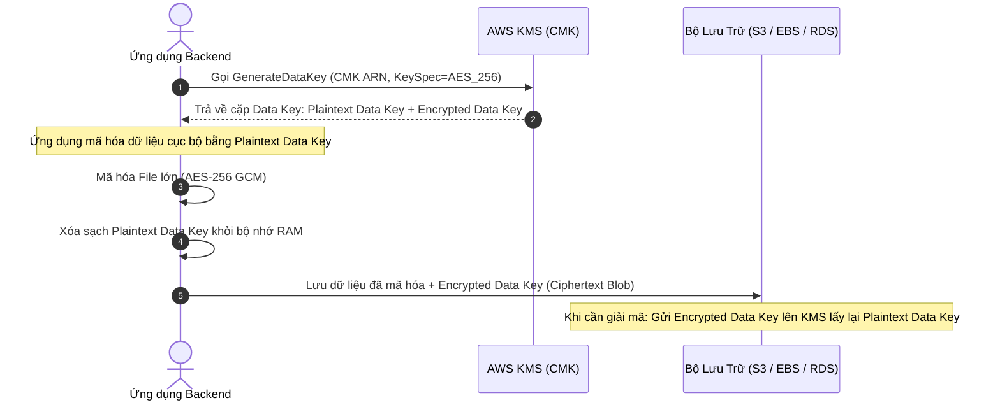
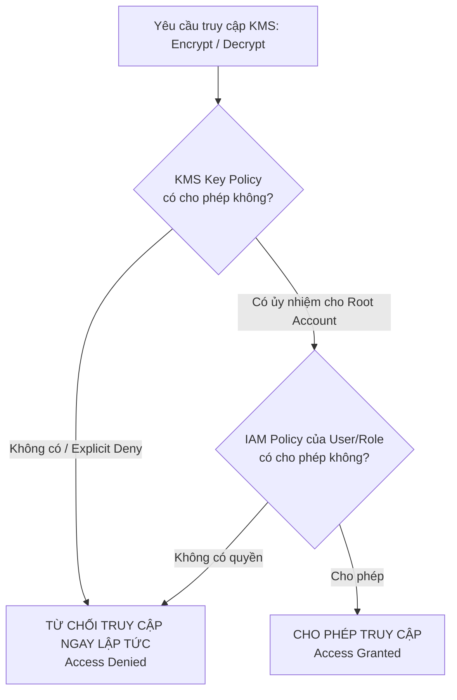
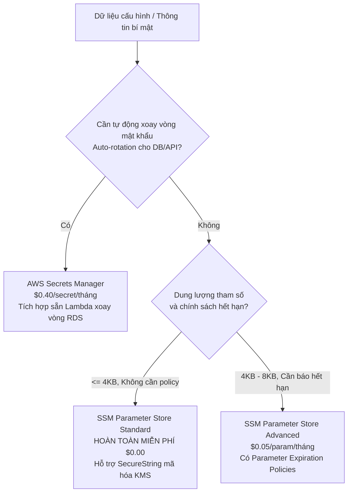
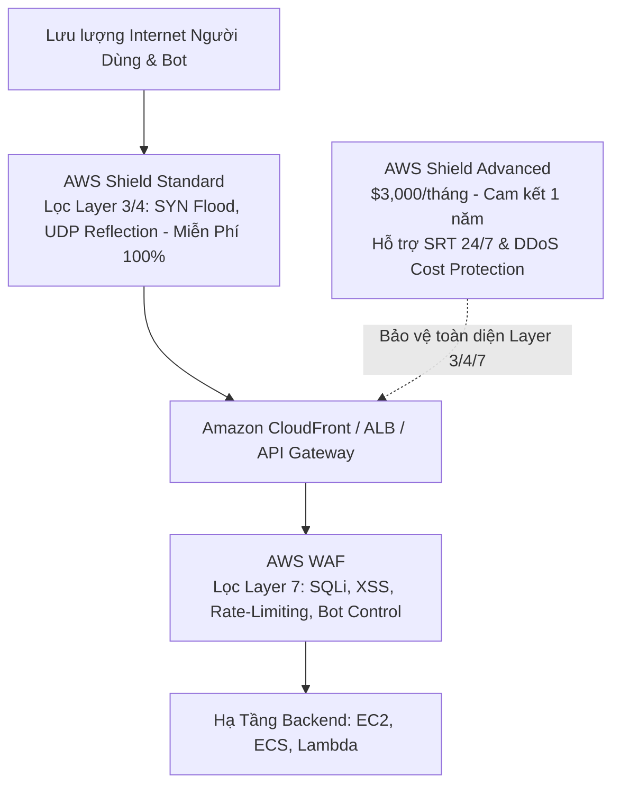
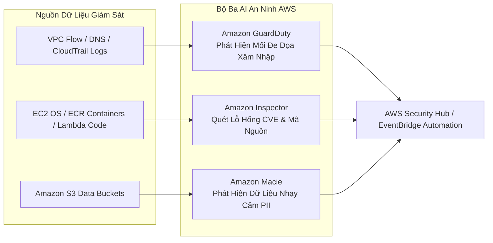
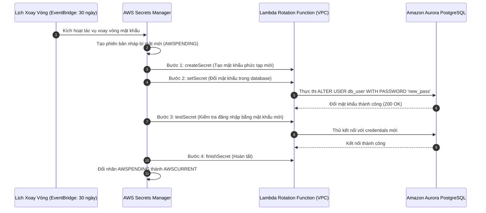

# Tài Liệu Học Tập Chuyên Sâu: AWS KMS, Secrets Manager, CloudHSM, WAF & Dịch Vụ An Ninh Đám Mây (Security & Encryption)

> **Tài liệu chuẩn hóa kiến trúc đám mây**: Hướng dẫn toàn diện theo tiêu chuẩn Senior AWS Solutions Architect & Cloud DevOps Engineer (cập nhật mới nhất 2026).  
> **Ngôn ngữ**: Tiếng Việt (Bảo lưu toàn bộ thuật ngữ chuyên ngành tiếng Anh chuẩn AWS).  
> **Các dịch vụ liên quan**: AWS KMS, AWS Secrets Manager, AWS Systems Manager Parameter Store, AWS CloudHSM, AWS WAF, AWS Shield, Amazon GuardDuty, Amazon Inspector, Amazon Macie.

---

## 6.1. Tổng Quan Dịch Vụ (Service Overview)

### Dịch vụ gì?
Bảo vệ dữ liệu và an toàn thông tin là trụ cột hàng đầu (Security Pillar) trong mô hình Well-Architected của AWS. Hệ sinh thái mã hóa và an ninh của AWS cung cấp một kiến trúc phòng thủ chiều sâu (Defense-in-Depth) toàn diện:
1. **AWS Key Management Service (AWS KMS)**: Dịch vụ quản lý khóa mật mã tập trung, tích hợp gốc với hơn 100 dịch vụ AWS, cho phép tạo, xoay vòng và kiểm soát các khóa mã hóa (**KMS Keys**) để bảo vệ dữ liệu lưu trữ (Encryption at Rest) và hỗ trợ thuật toán kháng lượng tử (Post-Quantum Hybrid Cryptography).
2. **AWS Secrets Manager**: Dịch vụ chuyên dụng quản lý, mã hóa và **tự động luân chuyển (Auto-rotate)** các thông tin bí mật nhạy cảm (mật khẩu cơ sở dữ liệu RDS/Aurora, API keys, OAuth tokens) thông qua các hàm AWS Lambda mà không làm gián đoạn ứng dụng.
3. **AWS Systems Manager Parameter Store**: Kho lưu trữ tham số cấu hình tập trung phân tầng (Hierarchical Key-Value Store), hỗ trợ PlainText và mã hóa **`SecureString`** qua KMS với chi phí tối ưu (tầng Standard hoàn toàn miễn phí).
4. **AWS CloudHSM**: Thiết bị mô-đun bảo mật phần cứng chuyên dụng (**Hardware Security Module**), đạt chuẩn kiểm định an ninh **FIPS 140-2/3 Level 3**, đơn khách hàng (**Single-tenant**) trao quyền kiểm soát độc quyền vật liệu khóa cho doanh nghiệp.
5. **AWS WAF & AWS Shield**: Bộ đôi phòng ngự chu vi mạng: **AWS WAF** lọc lưu lượng web Layer 7 (chống SQLi, XSS, Brute-force bot) và **AWS Shield** bảo vệ chống tấn công từ chối dịch vụ phân tán (**DDoS Protection** Layer 3/4/7).
6. **Bộ Ba Trí Tuệ Nhân Tạo An Ninh**: **Amazon GuardDuty** (phát hiện mối đe dọa thông minh qua log), **Amazon Inspector** (quét lỗ hổng phần mềm CVE và mã nguồn tự động), và **Amazon Macie** (quét và bảo vệ dữ liệu định danh cá nhân nhạy cảm PII trên S3 bằng ML).

---

## 6.2. Các Khái Niệm, Kiến Trúc & Vận Hành Cốt Lõi (Core Concepts, Security & Day-2 Operations)

### 1. Phân loại Khóa mã hóa trong AWS KMS (4 Chiều Độc Lập)

```mermaid
flowchart TD
    KMS[AWS KMS Keys] --> Dim1[1. Quyền Quản Trị & Sở Hữu]
    KMS --> Dim2[2. Thuật Toán Mật Mã]
    KMS --> Dim3[3. Phạm Vi Địa Lý]
    KMS --> Dim4[4. Nguồn Gốc Vật Liệu Khóa]

    Dim1 --> O1[AWS Owned Keys\nMiễn phí, Ẩn trong console, SSE-S3]
    Dim1 --> O2[AWS Managed Keys\naws/service, Miễn phí, Xoay vòng 1 năm]
    Dim1 --> O3[Customer Managed Keys - CMK\n$1/tháng, Toàn quyền Key Policy & Xoay vòng 90-2560 ngày]

    Dim2 --> C1[Symmetric Keys\nAES-256 GCM, Envelope Encryption]
    Dim2 --> C2[Asymmetric Keys\nRSA & ECC, Cặp Public/Private, Ký số]
    Dim2 --> C3[HMAC Keys\nXác thực toàn vẹn thông điệp 256-512 bit]

    Dim3 --> G1[Single-Region Keys\nHoạt động trong 1 Region duy nhất]
    Dim3 --> G2[Multi-Region Keys\nCùng Key ID & Key Material đa vùng]

    Dim4 --> M1[AWS KMS HSM\nMặc định, FIPS 140-2 Level 3 Multi-tenant]
    Dim4 --> M2[Imported BYOK\nTự nạp khóa, Kill-switch tức thì 1 giây]
    Dim4 --> M3[CloudHSM Store\nCụm HSM riêng FIPS 140-2 Level 3]
    Dim4 --> M4[External Key Store - XKS\nKhóa đặt tại On-Premises HSM vật lý]
```



#### A. 4 Chiều Phân Loại Chi Tiết
1. **Theo quyền quản trị**:
   - **AWS Owned Keys**: Thuộc hạ tầng nội bộ của AWS, hoàn toàn ẩn trong KMS Console, không ghi log riêng vào CloudTrail, miễn phí hoàn toàn (ví dụ: mã hóa mặc định SSE-S3).
   - **AWS Managed Keys**: Do AWS tự tạo trong tài khoản người dùng (`aws/s3`, `aws/ebs`, `aws/rds`). Hiển thị trên console, ghi log CloudTrail, nhưng người dùng **không thể sửa Key Policy, không thể chia sẻ xuyên tài khoản, không thể xóa thủ công**, và chu kỳ xoay vòng khóa cố định mỗi **1 năm (365 ngày)**.
   - **Customer Managed Keys (CMK)**: Khóa do người dùng tự tạo, toàn quyền kiểm soát qua **KMS Key Policy**, hỗ trợ phân quyền ủy nhiệm tạm thời (**KMS Grants**), chia sẻ xuyên tài khoản (**Cross-Account**), tùy biến tự động xoay vòng linh hoạt (**90 đến 2560 ngày**), bắt buộc thời gian ân hạn xóa an toàn (**Schedule Key Deletion từ 7 đến 30 ngày**). Chi phí: **$1.00/key/tháng**.
2. **Theo thuật toán mật mã**:
   - **Symmetric Keys (AES-256 GCM)**: Dùng chung một khóa cho Encrypt và Decrypt. Vật liệu khóa không bao giờ rời khỏi KMS HSM.
   - **Asymmetric Keys (RSA & ECC)**: Cặp Public Key (tải về máy gửi cho client/đối tác bên ngoài không có tài khoản AWS) và Private Key (giữ an toàn trong KMS để giải mã hoặc ký số `kms:Sign`).
   - **HMAC Keys**: Mã xác thực thông điệp băm đối xứng bảo đảm tính toàn vẹn dữ liệu.
3. **Theo phạm vi địa lý**:
   - **Single-Region Keys**: Chỉ tồn tại và giải mã trong một Region.
   - **Multi-Region Keys**: Gồm Primary Key và các Replica Keys sở hữu **cùng Key ID và cùng vật liệu khóa**, cho phép giải mã dữ liệu cục bộ tại Region đích mà không cần gọi API xuyên lục địa, giảm độ trễ từ 100ms xuống <5ms.
4. **Theo nguồn gốc vật liệu khóa**:
   - **KMS HSM (Mặc định)**: AWS sinh vật liệu khóa ngẫu nhiên.
   - **Imported Key Material (BYOK)**: Tự nạp khóa từ Data Center; hỗ trợ **Kill-Switch khẩn cấp** bằng lệnh `kms:DeleteKeyMaterial` xóa khóa sạch trong 1 giây để đóng băng dữ liệu tức thì.
   - **Custom Key Store (CloudHSM / XKS)**: Lưu khóa trong phần cứng CloudHSM chuyên dụng hoặc HSM on-premises ngoài đám mây để đáp ứng luật chủ quyền dữ liệu.

---

### 2. Nguyên Lý Mã Hóa Phong Bì (Envelope Encryption)

Khi dữ liệu có dung lượng lớn hơn 4 KB (giới hạn payload tối đa của lệnh `kms:Encrypt`), AWS KMS áp dụng cơ chế **Envelope Encryption**:



#### B. Phân Biệt Các Lệnh API Cốt Lõi Trong Envelope Encryption

| Lệnh API của AWS KMS | Dữ liệu trả về cho ứng dụng | Kịch bản sử dụng chuẩn mực |
| :--- | :--- | :--- |
| **`kms:GenerateDataKey`** | **Plaintext Data Key** + **Encrypted Data Key (Ciphertext)** | Dùng khi ứng dụng **cần mã hóa dữ liệu ngay lập tức trong bộ nhớ RAM**. Sau khi mã hóa xong file lớn, ứng dụng xóa ngay Plaintext Key khỏi RAM và chỉ lưu Encrypted Key đính kèm file. |
| **`kms:GenerateDataKeyWithoutPlaintext`** | **CHỈ TRẢ VỀ Encrypted Data Key (Ciphertext)** | Dùng cho kiến trúc bất đồng bộ hoặc bảo mật nghiêm ngặt: Tạo sẵn khóa mã hóa để gửi cho một hệ thống khác lưu trữ, hệ thống đó chỉ giải mã lấy khóa rõ khi thực sự cần xử lý. |
| **`kms:Decrypt`** | **Plaintext Data Key** | Nhận vào Encrypted Data Key blob và trả lại khóa rõ để ứng dụng giải mã file. Giới hạn payload tối đa của lệnh Decrypt là **4 KB**. |

---

#### C. Nguyên Lý Quyền Lực Tối Thượng Của KMS Key Policy (Key Policy Primacy)



⚠️ **ĐIỂM NÓNG TRONG MỌI ĐỀ THI SAA/SAP & THỰC TẾ DOANH NGHIỆP**:
- **Key Policy là cơ chế kiểm soát bắt buộc cấp 1**: Khác với S3 Bucket Policy (tùy chọn), mọi khóa KMS **bắt buộc phải có một Key Policy**.
- **Nếu Key Policy không mở cửa, IAM Policy hoàn toàn vô giá trị**: Một kỹ sư sở hữu quyền `AdministratorAccess` (full `*.*` trong IAM) nhưng nếu không được khai báo trong KMS Key Policy thì **hoàn toàn không thể đọc hay giải mã dữ liệu của khóa đó**.
- **Cú pháp ủy quyền chuẩn cho tài khoản**:
  ```json
  {
    "Sid": "Enable IAM User Permissions",
    "Effect": "Allow",
    "Principal": {
      "AWS": "arn:aws:iam::111122223333:root"
    },
    "Action": "kms:*",
    "Resource": "*"
  }
  ```
  *Ý nghĩa*: Mệnh đề trên không cấp quyền trực tiếp cho mọi user, mà nó cấp quyền cho **mặt phẳng điều khiển IAM của tài khoản `111122223333`** được phép dùng IAM Policy để phân quyền tiếp cho người dùng. Nếu thiếu khối này, bạn sẽ bị mất quyền kiểm soát khóa!

---

### 3. Phân Tầng Bí Mật: AWS Secrets Manager vs SSM Parameter Store



---

### 4. Phòng Ngự Chu Vi: AWS WAF vs AWS Shield Standard & Advanced



---

### 5. Bộ Ba Trí Tuệ Nhân Tạo An Ninh AWS



---

### 🏛️ I. Các Kịch Bản Kiến Trúc Chuẩn (Best Practice Scenarios)

#### 1. Bộ Ba Dịch Vụ An Ninh Tình Báo Tự Động: GuardDuty vs Inspector vs Macie
- **Tình huống thi**: Đề thi thường yêu cầu xây dựng cơ chế phát hiện mối đe dọa, lỗ hổng phần mềm hoặc rò rỉ dữ liệu cá nhân nhạy cảm tự động trên diện rộng.
- **Quy tắc phân công chuẩn xác**:
  - **Amazon GuardDuty**: Dịch vụ phát hiện mối đe dọa thông minh (Threat Detection) dựa trên Machine Learning. Liên tục phân tích CloudTrail Events, VPC Flow Logs, DNS Query Logs, và EKS Audit Logs để phát hiện hành vi bất thường như: máy chủ EC2 đào tiền ảo (crypto-mining), tài khoản IAM bị rò rỉ credential, hoặc S3 bucket bị truy cập từ IP của mạng Tor.
  - **Amazon Inspector**: Dịch vụ quét lỗ hổng bảo mật tự động (Vulnerability Assessment). Tự động quét các lỗ hổng mã nguồn (CVE), cấu hình sai và lỗ hổng mạng trên các máy chủ EC2, Container Images lưu trữ trong Amazon ECR, và mã nguồn hàm AWS Lambda.
  - **Amazon Macie**: Dịch vụ bảo vệ quyền riêng tư dữ liệu dựa trên AI. Tự động quét và phát hiện các thông tin định danh cá nhân nhạy cảm (PII - Personally Identifiable Information) như: số thẻ tín dụng, số hộ chiếu, số an sinh xã hội, hoặc hồ sơ bệnh án được lưu trữ trong Amazon S3.

#### 2. Ngăn Chặn Tấn Công Lớp Ứng Dụng (Layer 7) Bằng AWS WAF
- **Tình huống thi**: Ứng dụng web công khai bị tấn công bằng kỹ thuật SQL Injection (SQLi), Cross-Site Scripting (XSS), hoặc bị tấn công từ chối dịch vụ dạng HTTP Flood (hàng triệu HTTP GET request gửi tới làm cạn kiệt tài nguyên máy chủ).
- **Giải pháp chuẩn**:
  - Triển khai **AWS WAF (Web Application Firewall)** gắn trước Application Load Balancer hoặc CloudFront.
  - Bật các bộ luật quản lý sẵn **AWS Managed Rules** (chống SQLi, XSS, Common Rule Set).
  - Cấu hình **Rate-Based Rule**: Ví dụ, tự động chặn tạm thời bất kỳ địa chỉ IP nào gửi vượt quá 2,000 yêu cầu trong vòng 5 phút.

#### 3. Pipeline ETL Mã Hóa Đầu-Cuối Với AWS Glue & AWS KMS
- **Tình huống thi**: Doanh nghiệp tài chính cần trích xuất và biến đổi dữ liệu nhạy cảm (ETL) từ S3 data lake mà không muốn tự quản trị cụm máy chủ Spark/Hadoop, đồng thời phải đảm bảo toàn bộ dữ liệu được mã hóa cả khi lưu trữ và truyền tải.
- **Giải pháp chuẩn**:
  - Sử dụng **AWS Glue ETL Jobs (Serverless Spark)**.
  - Cấu hình **Glue Security Configuration** tích hợp với **AWS KMS Customer Managed Key (CMK)**: Tự động mã hóa dữ liệu ghi vào S3 target, mã hóa metadata catalog, và mã hóa shuffle storage tạm thời trên các node Glue.

#### 4. Kiểm Soát Khóa Tuyệt Đối Với KMS Custom Key Store Backed by AWS CloudHSM — (TD-Set1 Q64, TD-Set6 Q47)
- **Tình huống thi**: Doanh nghiệp tài chính/y tế có yêu cầu pháp lý nghiêm ngặt: Toàn bộ dữ liệu đám mây phải được mã hóa ở trạng thái nghỉ, tích hợp dễ dàng với các dịch vụ AWS, nhưng doanh nghiệp phải **toàn quyền kiểm soát vật liệu khóa (exclusive control)**, lưu trữ khóa trên thiết bị phần cứng chuyên dụng đơn khách hàng (**Single-tenant FIPS 140-2 Level 3 Dedicated HSM**), có khả năng **xóa sạch vật liệu khóa ngay lập tức (immediate key material removal)** và kiểm toán việc dùng khóa độc lập hoàn toàn với AWS CloudTrail (`TD-Set1 Q64`, `TD-Set6 Q47`).
- **Giải pháp tối ưu chuẩn AWS**:
  - Tạo một **AWS KMS Custom Key Store** được hỗ trợ bởi cụm **AWS CloudHSM (CloudHSM-backed KMS key)**.
  - KMS quản lý vòng đời logic và giao diện API cho các dịch vụ AWS (EBS, S3, RDS), nhưng vật liệu khóa mật mã thực tế được sinh ra, lưu trữ an toàn và thực thi mật mã độc quyền bên trong phần cứng CloudHSM của khách hàng.
  - Để vô hiệu hóa/xóa khóa ngay lập tức: Khách hàng chỉ cần ngắt kết nối Custom Key Store hoặc xóa trực tiếp key trên cluster CloudHSM. Nhật ký hoạt động được ghi nhận độc lập qua log daemon của CloudHSM.

#### 5. Bảo Mật Biến Môi Trường Lambda Bằng KMS Encryption Helpers — (TD-Set1 Q58)
- **Tình huống thi**: Hàm AWS Lambda lưu các biến môi trường nhạy cảm như database credentials, API tokens. Mặc dù Lambda mặc định mã hóa biến môi trường bằng KMS, nhưng các lập trình viên hoặc người dùng có quyền truy cập console Lambda vẫn nhìn thấy các giá trị mật khẩu này dưới dạng **văn bản rõ (Plaintext)**. Cần giải pháp bảo mật tối đa ngăn chặn đồng nghiệp nhìn thấy credentials (`TD-Set1 Q58`).
- **Giải pháp chuẩn AWS**:
  - Tạo một **Customer Managed KMS Key (CMK)** riêng biệt.
  - Kích hoạt tính năng **Encryption Helpers** trong AWS Lambda Console: Sử dụng khóa KMS CMK để mã hóa biến môi trường phía client trước khi lưu trữ.
  - Trong mã nguồn hàm Lambda, sử dụng AWS SDK gọi lệnh `kms:Decrypt` trong thời gian chạy (runtime) để giải mã lấy giá trị sử dụng.
  - Phân quyền IAM: Chỉ cấp quyền `kms:Decrypt` cho Execution Role của Lambda, không cấp cho nhóm lập trình viên, khiến giá trị trên console luôn bị che giấu dưới dạng Ciphertext nhị phân an toàn.

#### 6. Tối Ưu Chi Phí Lưu Trữ Bí Mật: Parameter Store SecureString vs Secrets Manager — (TD-Set3 Q33)
- **Tình huống thi**: Hệ thống ứng dụng nhiều tầng chạy trên EC2 và Aurora MySQL cần lưu trữ an toàn có mã hóa các biến môi trường cấu hình, database hostnames, license keys và mật khẩu. Doanh nghiệp yêu cầu giải pháp có **chi phí triển khai tối ưu nhất (Lowest implementation cost)** và không yêu cầu tính năng tự động xoay vòng mật khẩu (`TD-Set3 Q33`).
- **Giải pháp chuẩn AWS**:
  - Lưu trữ các biến cấu hình bằng tham số kiểu **`SecureString` trong AWS Systems Manager Parameter Store**, sử dụng **AWS KMS** để mã hóa at-rest.
  - Cập nhật ứng dụng gọi Parameter Store API để lấy cấu hình khi khởi động.
  - *Phân tích chi phí*: SSM Parameter Store Standard Parameters là **HOÀN TOÀN MIỄN PHÍ ($0.00/tháng)** cho việc lưu trữ tham số (chỉ chịu phí truy vấn KMS rất nhỏ). Trong khi đó, AWS Secrets Manager tính phí **$0.40/secret/tháng** (lưu 100 bí mật tốn $40/tháng), chỉ nên dùng Secrets Manager khi thực sự cần tính năng tự động xoay vòng (Auto-rotation).

#### 7. Tự Động Quét Phát Hiện Dữ Liệu Cá Nhân PII Trên S3 Bằng Amazon Macie — (TD-Set1 Q44, TD-Set5 Q44, TD-Set6 Q44)
- **Tình huống thi**: Đơn vị điều tra dân số hoặc sàn thương mại điện tử tải hàng triệu hồ sơ dữ liệu lên các Amazon S3 buckets. Cần cơ chế tự động liên tục kiểm tra và cảnh báo nếu có dữ liệu định danh cá nhân nhạy cảm (PII: Số CCCD/SSN, số hộ chiếu, số thẻ tín dụng, hồ sơ bệnh án) bị rò rỉ hoặc lưu trữ không an toàn (`TD-Set1 Q44`, `TD-Set5 Q44`, `TD-Set6 Q44`).
- **Giải pháp chuẩn AWS**:
  - Kích hoạt **Amazon Macie**.
  - Thiết lập các tác vụ **Macie Sensitive Data Discovery Jobs** định kỳ quét các đối tượng lưu trữ trong S3 buckets chỉ định.
  - Macie sử dụng thuật toán Machine Learning và đối sánh mẫu (Pattern Matching) tự động phân loại mức độ nhạy cảm của dữ liệu, gắn nhãn rủi ro và đẩy các cảnh báo an ninh (**Findings**) sang **Amazon EventBridge** để tự động kích hoạt Lambda xử lý (cách ly file, siết chặt quyền S3 Bucket Policy).

#### 8. Khôi Phục Snapshot EBS Chưa Mã Hóa Thành Volume Đã Mã Hóa — (TD-Set6 Q04)
- **Tình huống thi**: Trong tài khoản AWS có nhiều bản snapshot của các ổ đĩa Amazon EBS chưa được mã hóa. Kiến trúc sư an ninh cần đảm bảo rằng tất cả các ổ đĩa EBS mới được tạo hoặc khôi phục từ các snapshot này đều **bắt buộc phải được mã hóa tự động** (`TD-Set6 Q04`).
- **Giải pháp chuẩn AWS**:
  - Kích hoạt tính năng **EBS Encryption by Default** ở cấp độ Region trong tài khoản AWS.
  - Khi tính năng này được bật, bất kỳ volume mới nào được tạo hoặc khôi phục từ snapshot (kể cả unencrypted snapshot) sẽ tự động được mã hóa bằng khóa KMS mặc định hoặc CMK chỉ định.
  - Hoặc sao chép snapshot bằng lệnh `aws ec2 copy-snapshot --encrypted --kms-key-id <key-id>` và khôi phục volume từ snapshot bản sao đã mã hóa.

---

### 🪤 II. Các Bẫy Thi Tinh Vi & Phân Tích Phương Án Sai (Exam Traps & Distractors)

#### 🪤 Bẫy 1: Khóa Bất Biến Chống Xóa Bản Sao Lưu Bằng AWS Backup Vault Lock — (CM-PT1 Q58)
- **Tình huống đề thi**: *"Doanh nghiệp thuộc ngành tài chính bắt buộc phải tuân thủ quy định bảo lưu dữ liệu khắt khe (WORM - Write Once, Read Many). Yêu cầu đảm bảo không một ai, KỂ CẢ TÀI KHOẢN ROOT, có thể xóa hoặc sửa đổi các bản sao lưu trong thời gian bảo lưu quy định."*
- **Phân biệt hai chế độ Vault Lock**:
  - **Governance Mode (Chế độ Quản trị)**: Vẫn cho phép người dùng có các quyền IAM đặc quyền (`backup:DeleteRecoveryPoint`) hoặc tài khoản Root gỡ bỏ khóa và xóa bản sao lưu trước hạn.
  - **Compliance Mode (Chế độ Tuân thủ)**: Một khi đã kích hoạt và hết thời gian ân hạn (Grace Period), **KHÔNG MỘT AI, KỂ CẢ TÀI KHOẢN ROOT CỦA TỔ CHỨC HOẶC AWS SUPPORT**, có thể xóa hoặc thay đổi bản sao lưu trước khi hết thời hạn lưu trữ quy định!
- **Bẫy thi**: Đề bài yêu cầu "không ai xóa được kể cả root" -> Bắt buộc chọn **AWS Backup Vault Lock ở chế độ Compliance Mode** (chọn Governance Mode là sai).

#### 🪤 Bẫy 2: Giới Hạn Dịch Vụ Có Thể Gắn AWS WAF (Attachment Points) — (U-PT2 Q36)
- **Bẫy thi cực kỳ phổ biến**: Đề bài yêu cầu bảo vệ một dịch vụ bằng AWS WAF và đưa ra các lựa chọn gắn WAF vào Network Load Balancer (NLB) hoặc gắn trực tiếp vào EC2 instance.
- **Nguyên lý bất biến**:
  - AWS WAF là tường lửa **tầng Layer 7 (HTTP/HTTPS)**.
  - WAF **KHÔNG THỂ** gắn vào Network Load Balancer (NLB - Layer 4) và **KHÔNG THỂ** gắn vào máy chủ EC2 trực tiếp.
  - **Danh sách duy nhất các dịch vụ hỗ trợ gắn AWS WAF**:
    1. Application Load Balancer (ALB)
    2. Amazon CloudFront
    3. Amazon API Gateway (REST API)
    4. AWS AppSync
    5. Amazon Cognito User Pools
    6. AWS App Runner

#### 🪤 Bẫy 3: Yêu Cầu KMS Multi-Region Key Khi Dùng S3 Cross-Region Replication (CRR) — (U-PT2 Q46)
- **Tình huống đề thi**: *"Dữ liệu trong S3 bucket tại Region A được mã hóa bằng SSE-KMS. Doanh nghiệp cấu hình S3 Cross-Region Replication để tự động sao chép sang S3 bucket tại Region B. Quá trình sao chép bị lỗi không thể giải mã dữ liệu tại Region B."*
- **Nguyên nhân & Khắc phục**:
  - Khóa KMS thông thường là **tài nguyên cục bộ trong 1 Region (Regional Resource)**. Khóa tạo ở Region A hoàn toàn không tồn tại và không thể dùng để giải mã ở Region B.
  - **Giải pháp ĐÚNG**: Sử dụng **AWS KMS Multi-Region Key (`mrk-xxxxxxxx`)**. Khóa này chia sẻ cùng một Key ID và Key Material trên nhiều Region, cho phép mã hóa ở Region A và giải mã liền mạch tại Region B.

#### 🪤 Bẫy 4: Tự Kiểm Soát Khóa Mã Hóa (Retain Control Over Key Material) — (CM-PT2 Q23, TD-Set1 Q06)
- **Tình huống đề thi**: *"Khách hàng yêu cầu toàn bộ dữ liệu lưu trữ trên Amazon S3 Glacier phải được mã hóa khi lưu trữ. Tuy nhiên, doanh nghiệp bắt buộc phải TỰ MÌNH KIỂM SOÁT toàn bộ chuỗi bit khóa mã hóa (Key Material), tuyệt đối không để AWS tự sinh ra hay nắm giữ key material trong HSM của AWS."*
- **Phân tích giải pháp**:
  - **Giải pháp 1**: Tạo một **AWS KMS Key với Imported Key Material (BYOK - Bring Your Own Key)**. Khách hàng sử dụng thiết bị HSM tại chỗ (On-Premises HSM) để sinh key material, sau đó import vào KMS key rỗng. Khách hàng toàn quyền xóa hoặc thay thế key material bất cứ lúc nào.
  - **Giải pháp 2**: Sử dụng **Client-Side Encryption with Customer-Provided Keys (CSE-C)** (`TD-Set1 Q06`): Khách hàng tự mã hóa file cục bộ trước khi upload lên S3. Cả Plaintext Data và Master Key không bao giờ chạm tới hạ tầng đám mây AWS.
  - **Giải pháp 3**: Sử dụng **Server-Side Encryption with Customer-Provided Keys (SSE-C)**: Khách hàng truyền key trong HTTPS header, AWS chỉ mã hóa trong bộ nhớ đệm RAM rồi xóa ngay lập tức.

#### 🪤 Bẫy 5: Quyền Kiểm Soát Lịch Xoay Vòng Khóa Bắt Buộc Dùng Customer Managed Key (CMK) — (CM-PT6 Q14)
- **Tình huống đề thi**: *"Chính sách bảo mật của doanh nghiệp quy định đội ngũ an ninh phải chủ động kiểm soát và thiết lập lịch xoay vòng khóa mã hóa (Key Rotation Schedule) theo yêu cầu riêng hoặc định kỳ 90 ngày một lần. Chọn loại khóa KMS nào?"*
- **Bẫy bất biến**:
  - **AWS Managed Keys** (ví dụ `aws/s3`, `aws/ebs`): AWS tự động xoay vòng mỗi năm 1 lần (365 ngày), người dùng **HOÀN TOÀN KHÔNG CÓ QUYỀN** thay đổi hoặc kiểm soát lịch xoay vòng này.
  - **Customer Managed Keys (CMK)**: Người dùng có toàn quyền bật/tắt xoay vòng tự động, kích hoạt xoay vòng theo nhu cầu (On-demand Rotation), hoặc tự quản lý các phiên bản khóa. Bắt buộc chọn **Customer Managed Key (CMK)**!

#### 🪤 Bẫy 6: Cấp Quyền Giải Mã S3 KMS Xuyên Tài Khoản Cho Lambda — (CM-PT6 Q55)
- **Tình huống đề thi**: *"Hàm AWS Lambda tại Tài khoản A cần đọc và giải mã các file nhạy cảm trong S3 bucket được mã hóa bằng AWS KMS tại Tài khoản B. Cần cấu hình phân quyền giải mã như thế nào?"*
- **Nguyên tắc phân quyền KMS Cross-Account**:
  - Cần đồng thời cả 2 cấu hình:
    1. **IAM Policy gán vào Lambda Execution Role tại Tài khoản A**: Cho phép hành động `kms:Decrypt` trên ARN của khóa KMS ở Tài khoản B.
    2. **KMS Key Policy tại Tài khoản B**: Phải có statement cho phép Principal là Tài khoản A (hoặc IAM Role của Lambda) quyền gọi `kms:Decrypt`.
  - Nếu chỉ cấp quyền trên IAM Role mà không mở trên Key Policy $\rightarrow$ Thao tác decrypt chắc chắn bị `AccessDenied`.

#### 🪤 Bẫy 7: Region Bắt Buộc Của Chứng Chỉ ACM Cho CloudFront — (CM-PT3 Q35)
- **Bẫy đề thi**: *"Ứng dụng sử dụng Amazon CloudFront để phân phối nội dung toàn cầu và cần gắn chứng chỉ SSL/TLS công khai cấp bởi AWS Certificate Manager (ACM) cho tên miền riêng `app.example.com`."*
- **Quy tắc bất biến của AWS**:
  - Chứng chỉ SSL/TLS dùng cho **Amazon CloudFront Distribution** BẮT BUỘC PHẢI ĐƯỢC REQUEST TẠI REGION **`us-east-1` (N. Virginia)**!
  - Nếu tạo chứng chỉ ở bất kỳ Region nào khác (ví dụ `ap-southeast-1` Singapore hay `eu-west-1` Ireland), CloudFront Distribution sẽ hoàn toàn không nhìn thấy chứng chỉ đó trong danh sách dropdown!

#### 🪤 Bẫy 8: AWS KMS vs AWS CloudHSM: Môi Trường Phần Cứng Chuyên Dụng — (TD-Set6 Q47, TD-Set1 Q64)
- **Tình huống đề thi**: *"Doanh nghiệp xử lý thẻ tín dụng phân vân giữa KMS và CloudHSM. Khi nào bắt buộc phải dùng CloudHSM?"*
- **Điểm mấu chốt**:
  - **AWS KMS**: Dịch vụ đa người dùng (**Multi-tenant**), AWS quản lý phần cứng ngầm. Thích hợp cho hầu hết các workload thông thường, chi phí thấp ($1/key/tháng).
  - **AWS CloudHSM**: Thiết bị phần cứng đơn khách hàng (**Single-tenant dedicated hardware appliance**), khách hàng sở hữu độc quyền thông tin đăng nhập HSM (`crypto-user`), tuân thủ chuẩn **FIPS 140-2 Level 3**, hỗ trợ giao thức tiêu chuẩn công nghiệp (PKCS#11, JCE, CNG). Chi phí cao (tính theo giờ phần cứng).

#### 🪤 Bẫy 9: Cơ Chế Chờ Xóa Khóa KMS Để Tránh Mất Mát Dữ Liệu Ngoài Ý Muốn — (TD-Set8 Q05)
- **Tình huống đề thi**: *"Kỹ sư vô tình gọi API xóa khóa KMS. Dữ liệu mã hóa có bị mất vĩnh viễn ngay lập tức không?"*
- **Quy tắc KMS bất biến**:
  - AWS KMS **KHÔNG BAO GIỜ hỗ trợ xóa khóa ngay lập tức** qua API thông thường.
  - Lệnh xóa khóa bắt buộc phải lên lịch chờ (**ScheduleKeyDeletion**) với khoảng thời gian chờ an toàn (**Waiting Period**) từ **7 đến 30 ngày** (mặc định 30 ngày).
  - Trong thời gian chờ này, khóa ở trạng thái `PendingDeletion` (không thể encrypt/decrypt nhưng có thể gọi `CancelKeyDeletion` để khôi phục an toàn).

---

### 📊 III. Ma Trận Quyết Định An Ninh & Mã Hóa Nhanh (Exam Decision Matrix)

| Tình huống / Yêu cầu trong đề thi | Dịch vụ / Giải pháp chuẩn | Giải pháp bị loại & Lý do | Nguồn thực chứng |
|:---|:---|:---|:---|
| **Chống xóa bản sao lưu tuyệt đối (kể cả Root)** | **AWS Backup Vault Lock (Compliance Mode)** | Governance Mode (Root vẫn có thể xóa) | Chuẩn AWS |
| **Phát hiện máy chủ bị hack đào crypto / IP độc** | **Amazon GuardDuty** | Amazon Inspector (chỉ quét CVE, không monitor traffic) | `TD-Set2 Q07`, `TD-Set5 Q14` |
| **Quét lỗ hổng CVE trên EC2, ECR, Lambda** | **Amazon Inspector** | GuardDuty (không quét lỗ hổng phần mềm) | `TD-Set1 Q12`, `TD-Set4 Q38` |
| **Tự động tìm kiếm số thẻ tín dụng/PII trong S3** | **Amazon Macie** | AWS IAM Access Analyzer (chỉ phân tích quyền) | `TD-Set1 Q44`, `TD-Set5 Q44`, `TD-Set6 Q44` |
| **Chống tấn công SQL Injection, XSS, HTTP Flood** | **AWS WAF** (gắn trên ALB/CloudFront) | AWS Shield Standard (chỉ bảo vệ Layer 3/4) | `TD-Set1 Q16` |
| **Phần cứng FIPS 140-2 Level 3 độc quyền kiểm soát khóa** | **AWS CloudHSM** (hoặc KMS Custom Key Store) | AWS KMS Standard (môi trường Multi-tenant) | `TD-Set1 Q64`, `TD-Set6 Q47` |
| **Lưu trữ bí mật/mật khẩu rẻ nhất (không cần auto-rotate)** | **SSM Parameter Store (SecureString)** | AWS Secrets Manager ($0.40/secret/tháng đắt đỏ) | `TD-Set3 Q33` |
| **Tự động xoay vòng mật khẩu DB không gián đoạn** | **AWS Secrets Manager** (kết hợp Lambda) | SSM Parameter Store (không tích hợp xoay vòng tự động) | `TD-Set2 Q10` |
| **Giấu biến môi trường Lambda khỏi Console Plaintext** | **KMS Encryption Helpers (Customer Managed Key)** | Mã hóa mặc định Lambda (vẫn xem được Plaintext console) | `TD-Set1 Q58` |
| **Mã hóa S3 CRR xuyên nhiều AWS Regions** | **AWS KMS Multi-Region Key** | Single-Region KMS Key (không giải mã được ở Region khác) | Chuẩn AWS |
| **Khôi phục snapshot chưa mã hóa thành volume mã hóa** | Bật **EBS Encryption by Default** ở cấp Region | Khôi phục trực tiếp (volume sinh ra vẫn unencrypted) | `TD-Set6 Q04` |
| **Ngăn chặn xóa nhầm khóa mã hóa KMS** | **ScheduleKeyDeletion (Chờ 7-30 ngày)** | Lệnh xóa tức thì (KMS không cho phép xóa ngay) | `TD-Set8 Q05` |
| **Master Key & Plaintext không bao giờ chạm tới AWS** | **Client-Side Encryption with Customer Key (CSE-C)** | SSE-KMS / SSE-S3 (dữ liệu rõ vẫn gửi lên AWS) | `TD-Set1 Q06` |
| **Cấp chứng chỉ SSL/TLS cho CloudFront Distribution** | **ACM tại Region `us-east-1` (bắt buộc)** | ACM tại các Region khác (CloudFront không nhận) | `TD-Set1 Q19` |

---

---

---

## 6.3. Kiến Trúc Thực Tế và Luồng Vận Hành (Production Architecture & Workflow)

### Quy trình tự động xoay vòng mật khẩu RDS bằng Secrets Manager & Lambda



---

## 6.4. Bảng Tích Hợp với Các Dịch Vụ AWS Khác (Integration Table)

| Related AWS Service | Purpose (Mục đích tích hợp) | Integration Method (Phương thức tích hợp) | Practical Example (Ví dụ thực tiễn) |
| :--- | :--- | :--- | :--- |
| **Amazon S3** | Mã hóa dữ liệu lưu trữ đối tượng và giảm chi phí KMS | SSE-KMS kết hợp S3 Bucket Keys | Bật Bucket Keys giúp giảm 99% số cuộc gọi KMS API khi Athena quét hàng triệu file Parquet. |
| **Amazon RDS / Aurora** | Quản lý thông tin xác thực tự động và mã hóa bảng lưu trữ | Secrets Manager Native Integration & KMS CMK | Tự động xoay vòng mật khẩu Master DB mà không gián đoạn kết nối của cụm ECS Fargate. |
| **Amazon CloudFront** | Đưa lá chắn WAF ra biên mạng (Edge) để chặn đứng tấn công sớm | Gắn WebACL phạm vi Global (`us-east-1`) vào CloudFront | Chặn các cuộc tấn công SQLi và Brute-force bot ngay tại Edge Locations trước khi chạm tới VPC. |
| **Amazon EventBridge** | Phản ứng tự động hóa sự cố an ninh theo thời gian thực | Event Rule khớp sự kiện GuardDuty / Inspector | Khi GuardDuty phát hiện máy ảo EC2 bị nhiễm trojan đào coin, kích hoạt Lambda cách ly Security Group ngay tức khắc. |
| **AWS CloudTrail** | Kiểm toán toàn bộ các thao tác mã hóa, giải mã và sử dụng khóa | Quản lý sự kiện truy vết API KMS (`kms:*`) | Kiểm toán viên rà soát toàn bộ lịch sử ai đã giải mã dữ liệu thẻ tín dụng lúc nửa đêm qua CloudTrail Lake. |
| **AWS Systems Manager** | Cung cấp biến môi trường bảo mật cho container và máy chủ | SSM GetParameters / SecureString qua KMS | Container trên ECS nạp chuỗi cấu hình microservice từ Parameter Store mà không lưu trong Dockerfile. |

---

## 6.5. Bảng So Sánh Trong Hệ Sinh Thái AWS (Ecosystem Comparison)

### So sánh các giải pháp bảo vệ dữ liệu và quản lý mật mã

| Tiêu chuẩn so sánh | AWS KMS (CMK) | AWS CloudHSM | AWS Secrets Manager | SSM Parameter Store | HashiCorp Vault on AWS |
| :--- | :--- | :--- | :--- | :--- | :--- |
| **Bản chất dịch vụ** | Dịch vụ quản lý khóa mật mã đa người dùng (Multi-tenant) quản lý bởi AWS. | Thiết bị phần cứng bảo mật chuyên dụng đơn khách hàng (Single-tenant). | Dịch vụ lưu trữ và tự động xoay vòng thông tin bí mật chuyên dụng. | Kho lưu trữ tham số cấu hình ứng dụng phân tầng. | Phần mềm quản trị bí mật bên thứ 3 tự vận hành trên máy ảo EC2/EKS. |
| **Tiêu chuẩn kiểm định** | FIPS 140-2/3 Level 3 Cryptographic Modules. | **FIPS 140-2 Level 3** toàn bộ phần cứng chuyên dụng. | Được mã hóa bảo vệ bằng AWS KMS. | Hỗ trợ PlainText hoặc mã hóa bằng AWS KMS. | Tùy biến theo cấu hình backend lưu trữ. |
| **Tự động xoay vòng** | Tự động xoay vòng khóa KMS (90 - 2560 ngày). | Khách hàng tự lập trình và quản trị vòng đời khóa. | **Tích hợp sẵn gốc (Native)** với Lambda cho RDS/Redshift. | Không hỗ trợ sẵn (Phải tự viết Lambda kích hoạt ngoài). | Hỗ trợ xoay vòng qua Vault Dynamic Secrets engine. |
| **Quyền kiểm soát vật liệu khóa** | AWS quản lý bên trong HSM; người dùng không trích xuất được Plaintext Key. | **Khách hàng nắm quyền kiểm soát độc quyền**, AWS không thể can thiệp. | AWS quản lý dữ liệu bí mật đã được mã hóa. | AWS quản lý trong hệ thống phân tán. | Khách hàng nắm giữ chìa khóa Unseal Keys. |
| **Giao thức hỗ trợ** | AWS REST API / AWS SDK / SigV4. | PKCS#11, Java Cryptography Extension (JCE), Microsoft CNG. | AWS REST API / AWS SDK. | AWS REST API / AWS SDK. | Vault HTTP API, HashiCorp CLI, Agent Injector. |
| **Chi phí tham chiếu** | **$1.00 / key / tháng** + $0.03/10k requests. | **~$1.60/giờ/HSM** (~$1,200/tháng/cụm Multi-AZ 2 nodes). | **$0.40 / secret / tháng** + $0.05/10k requests. | Standard: **$0.00 (Miễn phí)**.<br>Advanced: $0.05/param/tháng. | Cước EC2/EBS hạ tầng tự chạy + phí bản quyền Vault Enterprise. |

---

## 6.6. Mô Hình Tính Phí & Chiến Lược Tối Ưu Chi Phí (FinOps & Cost Optimization)

### 6.6.1. Bảng Cấu Trúc Định Giá Chi Tiết

| Thành phần Dịch Vụ | Đơn giá AWS niêm yết | Cơ chế đo lường | Ghi chú tối ưu hóa chi phí FinOps |
| :--- | :--- | :--- | :--- |
| **AWS KMS (AWS Managed)** | **$0.00** | Miễn phí không giới hạn số lượng | Dùng cho tài nguyên nội bộ một tài khoản không cần tùy biến Key Policy. |
| **AWS KMS (Customer Managed Key)** | **$1.00 / key / tháng** | Tính theo số lượng CMK tạo lập | Xóa hoặc hợp nhất các khóa CMK không sử dụng bằng `ScheduleKeyDeletion`. |
| **KMS API Requests** | **$0.03 / 10,000 requests** | 20,000 requests đầu tiên mỗi tháng miễn phí | Áp dụng Envelope Encryption và Data Key Caching để giảm 99% cuộc gọi API. |
| **AWS Secrets Manager** | **$0.40 / secret / tháng** | $0.05 / 10,000 API requests | Chuyển các tham số tĩnh không cần xoay vòng sang SSM Parameter Store Standard ($0.00). |
| **SSM Parameter Store (Standard)** | **$0.00** | Miễn phí tối đa 10,000 tham số / Region | Lựa chọn số 1 cho cấu hình microservices và token tĩnh (`SecureString`). |
| **AWS WAF** | **$5.00/WebACL + $1.00/rule/tháng** | $0.60 / 1 triệu requests kiểm tra | Hợp nhất WebACL tại CloudFront Edge thay vì gắn phân tán vào nhiều ALB. |
| **Amazon Macie** | $0.10/bucket + **$1.00 / GB quét** | Tính phí theo dung lượng file thực tế quét | Dùng File Inclusion/Exclusion tránh quét cạn kiệt các file video, binary nén. |

---

### 6.6.2. 5 Kịch Bản Tối Ưu Hóa Chi Phí Thực Tế (FinOps Scenarios)

#### Kịch bản 1: Kích hoạt S3 Bucket Keys cho kho lưu trữ Big Data Lake (SSE-KMS)
- **Bối cảnh**: Kho dữ liệu Big Data trên Amazon S3 chứa 80 triệu tệp tin Parquet mã hóa bằng Customer Managed Key (`SSE-KMS`). Các tác vụ Amazon Athena và AWS EMR định kỳ phân tích dữ liệu, phát sinh **150 triệu lượt truy xuất đối tượng mỗi tháng**.
- **Tính toán chi phí khi chưa bật Bucket Keys**:
  - Mỗi thao tác đọc/ghi file S3 gửi một API call riêng tới KMS:
  $$\text{Cost}_{\text{KMS\_Default}} = \left( \frac{150{,}000{,}000}{10{,}000} \right) \times \$0.03 = \$450/\text{tháng}$$
- **Giải pháp tối ưu**:
  - Kích hoạt tính năng **S3 Bucket Keys** trên thuộc tính mã hóa của S3 Bucket:
  - S3 sinh ra một khóa tạm thời cấp bucket trong hạ tầng lưu trữ S3, các thao tác đọc/ghi tái sử dụng khóa này cục bộ, cắt giảm 99% số cuộc gọi API lên KMS:
  $$\text{Cost}_{\text{KMS\_Optimized}} = \left( \frac{1{,}500{,}000}{10{,}000} \right) \times \$0.03 = \$4.50/\text{tháng}$$
- **Hiệu quả kinh tế**:
  $$\text{Tiết kiệm} = \$450 - \$4.50 = \$445.50/\text{tháng} \quad (\$5{,}346/\text{năm}) \implies \text{Tiết kiệm } 99\% \text{ chi phí KMS}$$

#### Kịch bản 2: Áp dụng Envelope Encryption với Data Key Caching trong Microservices
- **Bối cảnh**: Ứng dụng thanh toán xử lý 90 triệu giao dịch/tháng. Đội ngũ phát triển gọi trực tiếp lệnh `kms:Encrypt` cho từng bản ghi thông tin thẻ khách hàng.
- **Tính toán chi phí ban đầu**:
  $$\text{Cost}_{\text{Direct\_KMS}} = \left( \frac{90{,}000{,}000}{10{,}000} \right) \times \$0.03 = \$270/\text{tháng}$$
  *Nguy cơ nghiêm trọng*: Thêm 30ms độ trễ mạng HTTPS trên mỗi giao dịch và nguy cơ chạm hạn mức KMS API Request Quota (lỗi HTTP 429 Throttling).
- **Giải pháp tối ưu**:
  - Tích hợp **AWS Encryption SDK** với **Cryptographic Materials Cache (Data Key Caching)** có thời gian sống TTL = 300 giây (hoặc 1,000 bản ghi/key).
  - Số cuộc gọi KMS API thực tế giảm xuống chỉ còn 30,000 cuộc gọi/tháng:
  $$\text{Cost}_{\text{Cached\_KMS}} = \left( \frac{30{,}000}{10{,}000} \right) \times \$0.03 = \$0.09/\text{tháng}$$
- **Hiệu quả kinh tế**:
  $$\text{Tiết kiệm} = \$270 - \$0.09 \approx \$269.91/\text{tháng} \quad (\$3{,}238/\text{năm}) \implies \text{Tiết kiệm } 99.96\% \text{ chi phí API}$$

#### Kịch bản 3: Phân tầng bí mật giữa Secrets Manager và SSM Parameter Store
- **Bối cảnh**: Hệ thống microservices quản lý 600 tham số và thông tin đăng nhập. Kỹ sư lưu trữ toàn bộ 600 mục này trong AWS Secrets Manager.
- **Tính toán chi phí ban đầu**:
  $$\text{Cost}_{\text{Initial}} = 600 \times \$0.40 = \$240/\text{tháng} \quad (\$2{,}880/\text{năm})$$
- **Giải pháp tối ưu**:
  - Phân loại: Chỉ giữ lại 30 thông tin đăng nhập cơ sở dữ liệu (RDS/Aurora) trên Secrets Manager để tận dụng tính năng **Auto-rotation**.
  - Chuyển 570 tham số cấu hình và API tokens tĩnh còn lại sang **SSM Parameter Store Standard** dưới định dạng `SecureString` (mã hóa KMS miễn phí phí lưu trữ):
  $$\text{Cost}_{\text{New}} = (30 \times \$0.40) + (570 \times \$0.00) = \$12/\text{tháng}$$
- **Hiệu quả kinh tế**:
  $$\text{Tiết kiệm} = \$240 - \$12 = \$228/\text{tháng} \quad (\$2{,}736/\text{năm}) \implies \text{Giảm } 95\% \text{ chi phí lưu trữ bí mật}$$

#### Kịch bản 4: Hợp nhất WebACL của AWS WAF tại CloudFront Edge
- **Bối cảnh**: Doanh nghiệp vận hành 10 Application Load Balancers (ALB) cho các ứng dụng web khác nhau. Nhóm an ninh triển khai 10 WebACL riêng biệt trên 10 ALB, mỗi WebACL gắn 8 Managed Rules giống nhau.
- **Tính toán chi phí cố định**:
  $$\text{Cost}_{\text{ALB\_WAF}} = 10 \times [\$5.00 + (8 \times \$1.00)] = 10 \times \$13.00 = \$130/\text{tháng}$$
- **Giải pháp tối ưu**:
  - Đặt **Amazon CloudFront** phía trước 10 ALB và tạo duy nhất **1 WebACL** tại Region Global (`us-east-1`):
  $$\text{Cost}_{\text{CloudFront\_WAF}} = \$5.00 + (8 \times \$1.00) = \$13/\text{tháng}$$
  - Ngoài ra, các yêu cầu tải ảnh tĩnh trúng cache (Cache Hit) tại CloudFront Edge không bị tính phí chuyển tiếp về ALB, giúp tiết kiệm thêm cước xử lý LCU của ALB.
- **Hiệu quả kinh tế**:
  $$\text{Tiết kiệm} = \$130 - \$13 = \$117/\text{tháng} \quad (\$1{,}404/\text{năm}) \implies \text{Giảm } 90\% \text{ chi phí WebACL}$$

#### Kịch bản 5: Ngăn ngừa bẫy quét dữ liệu ngoài tầm kiểm soát của Amazon Macie
- **Bối cảnh**: Doanh nghiệp muốn quét dữ liệu nhạy cảm PII trên S3. Kỹ sư tạo một Discovery Job quét toàn bộ S3 bucket lưu trữ camera an ninh và file nén backup dung lượng **20 TB (20,000 GB)**.
- **Rủi ro chi phí nếu không có bộ lọc**:
  - Đơn giá quét nội dung của Amazon Macie là $1.00/GB:
  $$\text{Cost}_{\text{Unfiltered}} = 20{,}000 \times \$1.00 = \$20{,}000 \quad (\text{Hai mươi ngàn USD cho 1 tác vụ!})$$
- **Giải pháp tối ưu**:
  - Áp dụng **File Extension Exclusions** (loại bỏ `.mp4`, `.zip`, `.tar`, `.iso`, `.png`, `.jpg`).
  - Áp dụng **File Extension Inclusions** (chỉ quét `.csv`, `.json`, `.parquet`, `.txt`, `.pdf`).
  - Sử dụng chế độ **Automated Sensitive Data Discovery** lấy mẫu thông minh ngẫu nhiên, dung lượng quét thực tế chỉ là 50 GB:
  $$\text{Cost}_{\text{Filtered}} = 50 \times \$1.00 = \$50/\text{tháng}$$
- **Hiệu quả kinh tế**:
  $$\text{Ngăn chặn thảm họa tài chính} = \$20{,}000 - \$50 = \$19{,}950 \implies \text{Tránh lãng phí } 99.75\%$$

---

## 6.7. Khắc Phục Sự Cố Thực Tế (Troubleshooting Guide)

| Tình huống sự cố (Problem) | Nguyên nhân cốt lõi (Root Cause) | Các bước điều tra & Chỉ số giám sát (Metrics & Logs) | Giải pháp khắc phục (Remediation) | Biện pháp phòng ngừa (Prevention) |
| :--- | :--- | :--- | :--- | :--- |
| **Lỗi `AccessDeniedException` khi gọi `kms:Decrypt` từ IAM Role** | IAM Policy có quyền nhưng **KMS Key Policy** chưa cho phép IAM Role đó làm Principal. | - Tra cứu CloudTrail log tìm sự kiện `eventName: Decrypt` với mã lỗi `AccessDenied`.<br>- Kiểm tra ARN của IAM Role trong Key Policy. | Cập nhật **KMS Key Policy** để thêm IAM Role vào mệnh đề `Principal`, hoặc cấp quyền qua **KMS Grant**. | Ghi nhớ nguyên tắc: Đối với KMS, Key Policy là chốt chặn quyết định quyền tối cao (Root của Account cũng không bypass được nếu bị thiếu trong Key Policy). |
| **Mất kết nối database sau khi Secrets Manager xoay vòng mật khẩu** | Ứng dụng lưu mật khẩu tĩnh trong RAM và không có cơ chế tự refresh khi gặp lỗi xác thực `401/403`. | - Kiểm tra application logs: `FATAL: password authentication failed for user`.<br>- Kiểm tra CloudTrail sự kiện `GetSecretValue` từ ứng dụng. | Cập nhật ứng dụng tích hợp thư viện **AWS Secrets Manager Caching Library** (tự động xóa cache và kéo secret mới khi kết nối thất bại). | Không bao giờ lưu trữ mật khẩu trong biến toàn cục tĩnh mà không có logic retry-refresh. |
| **Khách hàng hợp lệ bị chặn truy cập bởi AWS WAF (`HTTP 403 Forbidden`)** | Luật **Rate-based Rule** đặt ngưỡng quá khắt khe hoặc địa chỉ IP nằm nhầm trong danh sách IP Reputation List. | - Xem tab **Sampled Requests** trên WAF Console.<br>- Kiểm tra CloudWatch metric `BlockedRequests` theo RuleName. | Tăng ngưỡng request (ví dụ từ 100 lên 500 req/5 phút) hoặc thêm IP đối tác vào Whitelist Rule có độ ưu tiên cao hơn. | Chạy luật WAF mới ở chế độ **Count** (chỉ đếm giám sát, không block) từ 3 - 7 ngày trước khi bật chế độ Block. |
| **Không thể xóa KMS Key ngay lập tức trên AWS Console/CLI** | Cơ chế an toàn bắt buộc của KMS cấm xóa tức thì để phòng chống mất dữ liệu vĩnh viễn không thể phục hồi. | - Kiểm tra trạng thái khóa qua lệnh `aws iam/kms describe-key`.<br>- Thông báo `PendingDeletion`. | Đặt lịch xóa an toàn (**ScheduleKeyDeletion**) với thời gian chờ từ 7 đến 30 ngày. Nếu cần ngắt quyền gấp, hãy dùng lệnh `kms:DisableKey`. | Nếu bắt buộc cần Kill-Switch tức thì trong 1 giây, hãy thiết kế giải pháp bằng **Imported Key Material (BYOK)**. |
| **Lỗi `KMS ThrottlingException` khi hệ thống tăng tải đột biến** | Vượt quá hạn mức yêu cầu API mật mã của KMS Region (ví dụ 10,000 req/giây). | - Giám sát CloudWatch metric `ThrottledRequests` của namespace `AWS/KMS`. | Áp dụng kỹ thuật **Envelope Encryption** với Data Key Caching trên client, hoặc gửi yêu cầu nâng hạn mức Service Quotas. | Kích hoạt S3 Bucket Keys trên toàn bộ các S3 Buckets sử dụng SSE-KMS. |

---

---

## 6.8. Tóm Tắt và Danh Mục Kiểm Tra Kiến Thức (Summary & Learning Checklist)

### 7 Nguyên Tắc Vàng Bảo Mật & Mã Hóa AWS (Golden Rules)
1. **KMS Key Policy là tối thượng**: IAM Policy chỉ có hiệu lực khi được KMS Key Policy cho phép; mất khóa KMS là mất dữ liệu vĩnh viễn.
2. **Kích hoạt S3 Bucket Keys**: Luôn bật S3 Bucket Keys cho các bucket sử dụng SSE-KMS để cắt giảm 99% chi phí API.
3. **Envelope Encryption cho dữ liệu lớn**: Luôn sử dụng Data Key Caching trong AWS Encryption SDK để bảo vệ ứng dụng khỏi nghẽn quota và giảm độ trễ.
4. **Phân tầng thông minh giữa Secrets Manager và Parameter Store**: Dùng Secrets Manager cho bí mật cần auto-rotate; dùng SSM Parameter Store `SecureString` cho tham số tĩnh để tiết kiệm 95% chi phí.
5. **Đưa WAF ra biên mạng (Edge)**: Gắn WebACL tại CloudFront Distribution để chặn đứng tấn công Layer 7 sớm nhất và tiết kiệm chi phí inspection.
6. **Không quét mở Amazon Macie**: Luôn thiết lập file exclusion/inclusion để tránh bẫy quét dữ liệu nhị phân hàng chục ngàn USD.
7. **Cơ chế Kill-Switch với BYOK**: Sử dụng Imported Key Material khi kiến trúc yêu cầu khả năng đóng băng dữ liệu tức thì trong vòng 1 giây.

---

### Danh Mục Kiểm Tra Năng Lực (Learning Checklist)
- [ ] Tôi phân biệt rõ ràng 4 chiều phân loại của khóa KMS (Quản trị, Thuật toán, Địa lý, Nguồn gốc).
- [ ] Tôi hiểu rõ nguyên lý hoạt động của Envelope Encryption và vai trò của Data Encryption Key (DEK).
- [ ] Tôi biết cách cấu hình S3 Bucket Keys để giảm 99% chi phí KMS API cho Data Lake.
- [ ] Tôi nắm vững quy trình 4 bước tự động xoay vòng mật khẩu của AWS Secrets Manager với Lambda.
- [ ] Tôi phân biệt được trường hợp sử dụng tối ưu giữa Secrets Manager và SSM Parameter Store.
- [ ] Tôi hiểu rõ các tầng phòng ngự của AWS WAF, AWS Shield Standard và Shield Advanced.
- [ ] Tôi phân biệt được phạm vi và nguồn dữ liệu của bộ ba AI an ninh: GuardDuty, Inspector, và Macie.

---

### Liên kết và Tài liệu Liên quan
- 📖 [Ghi Chú Bài Học Chương 26: AWS Security & Encryption](../Lesson_Notes/26_AWS_Security_Encryption_KMS.md)
- 📖 [Bảng Thuật Ngữ Kỹ Thuật (GLOSSARY.md)](../GLOSSARY.md)
- ⏭️ Tiếp tục chuyển sang chuyên đề: [AWS Lambda & Kiến Trúc Serverless](./Lambda_Serverless_Architecture.md).
