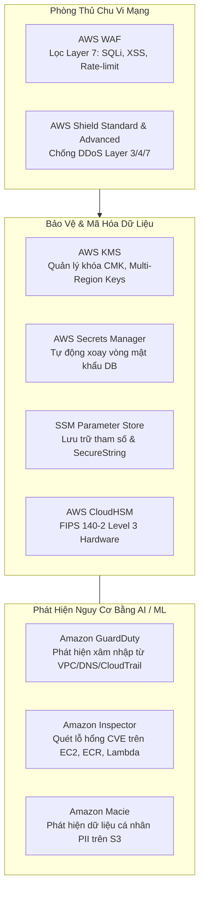
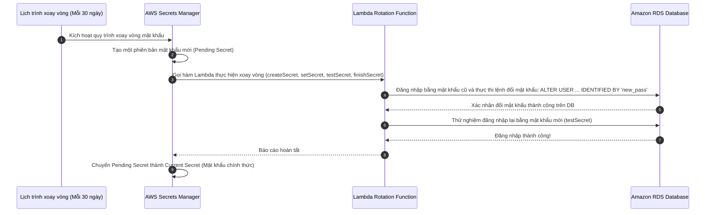

# Tài Liệu Học Tập Chuyên Sâu: AWS KMS, Secrets Manager, CloudHSM, WAF & Dịch Vụ An Ninh Đám Mây (Security & Encryption)

> **Tài liệu chuẩn hóa kiến trúc đám mây**: Hướng dẫn toàn diện theo tiêu chuẩn Senior AWS Solutions Architect & Cloud DevOps Engineer.  
> **Ngôn ngữ**: Tiếng Việt (Bảo lưu toàn bộ thuật ngữ chuyên ngành tiếng Anh chuẩn AWS).  
> **Các bài giảng liên quan**: Chương 26 (AWS Security & Encryption: KMS, SSM, Secrets Manager, CloudHSM, WAF, Shield, GuardDuty, Macie, Inspector: Bài 292 đến Bài 312).

---

## 6.1. Tổng Quan Dịch Vụ (Service Overview)

### Dịch vụ gì?
An toàn thông tin và bảo mật dữ liệu là ưu tiên số một trên đám mây AWS. Hệ sinh thái an ninh của AWS bao gồm các tầng phòng thủ chuyên sâu:
1. **AWS Key Management Service (AWS KMS)**: Dịch vụ quản lý khóa mã hóa tập trung, tích hợp sẵn với hơn 100 dịch vụ AWS, cho phép tạo và kiểm soát các khóa mật mã (**KMS Keys**) để mã hóa dữ liệu lưu trữ (Encryption at Rest).
2. **AWS Secrets Manager**: Dịch vụ chuyên biệt quản lý, lưu trữ an toàn và **tự động luân chuyển (Auto-rotate)** các thông tin bí mật nhạy cảm (mật khẩu cơ sở dữ liệu RDS, API keys, OAuth tokens) thông qua các hàm AWS Lambda.
3. **AWS Systems Manager Parameter Store**: Kho lưu trữ cấu hình và tham số tập trung dạng phân cấp, hỗ trợ cả dữ liệu rõ (PlainText) và dữ liệu mã hóa (**SecureString** qua KMS) với chi phí cực rẻ/miễn phí.
4. **AWS CloudHSM**: Thiết bị mô-đun phần cứng bảo mật chuyên dụng (**Hardware Security Module**) đơn khách hàng (Single-tenant), đạt tiêu chuẩn FIPS 140-2 Level 3, trao toàn quyền kiểm soát phần cứng mật mã cho khách hàng.
5. **AWS WAF & AWS Shield**: Bộ đôi phòng thủ chu vi mạng: **AWS WAF** lọc lưu lượng web Layer 7 (chống SQLi, XSS, bot) và **AWS Shield** bảo vệ chống tấn công từ chối dịch vụ phân tán (**DDoS Protection**).
6. **Bộ Ba Trí Tuệ Nhân Tạo An Ninh**: **Amazon GuardDuty** (phát hiện mối đe dọa thông minh), **Amazon Inspector** (quét lỗ hổng phần mềm CVE tự động), và **Amazon Macie** (quét và bảo vệ dữ liệu thông tin định danh cá nhân nhạy cảm PII trên S3).

---

## 6.2. Các Khái Niệm và Thành Phần Cốt Lõi (Core Concepts and Components)



### 1. Phân loại Khóa mã hóa trong AWS KMS
- **Customer Managed Keys (CMK - Khóa do khách hàng quản lý)**:
  - Do bạn tự tạo, cấu hình và quản trị toàn bộ vòng đời.
  - Cho phép bật tính năng **Tự động xoay vòng khóa (Automatic Key Rotation)**: AWS tự động tạo khóa mật mã mới mỗi **1 năm (hoặc 90-360 ngày theo nhu cầu)** mà vẫn giữ nguyên Key ID và giải mã được toàn bộ dữ liệu cũ.
  - Kiểm soát quyền truy cập chi tiết thông qua **KMS Key Policy**.
- **AWS Managed Keys (Khóa do AWS quản lý)**:
  - Do AWS tự tạo khi bạn sử dụng một dịch vụ lần đầu (ví dụ: `aws/s3`, `aws/ebs`, `aws/rds`).
  - Hoàn toàn miễn phí duy trì; tự động xoay vòng mỗi 1 năm; bạn không thể tự ý xóa hoặc thay đổi Key Policy.
- **KMS Multi-Region Keys (Khóa đa vùng)**:
  - Khóa chính (Primary Key) được tạo ở 1 Region và nhân bản (Replicate) sang các Region khác với **cùng Key ID và cùng vật liệu khóa (Key material)**.
  - Cho phép mã hóa dữ liệu tại Region A và giải mã cục bộ tại Region B **mà không cần gọi API xuyên Region** (cực kỳ hữu ích cho S3 Cross-Region Replication và Aurora Global Database).

### 2. So Sánh: AWS Secrets Manager vs SSM Parameter Store

| Tiêu chuẩn so sánh | AWS Secrets Manager | SSM Parameter Store |
| :--- | :--- | :--- |
| **Mục đích thiết kế chính** | Quản lý các bí mật nhạy cảm cao cần **tự động xoay vòng (Rotation)**. | Quản lý cấu hình ứng dụng, cờ tính năng (Feature flags) và mật khẩu tĩnh. |
| **Tính năng tự động xoay vòng**| **Tích hợp sẵn gốc**: Tự động gọi hàm Lambda đổi mật khẩu RDS/Aurora định kỳ. | **Không hỗ trợ sẵn**: Phải tự viết toàn bộ script và cơ chế lên lịch bên ngoài. |
| **Chi phí dịch vụ** | **0.40 USD/secret/tháng** + 0.05 USD mỗi 10,000 lượt gọi API. | Tầng Standard: **HOÀN TOÀN MIỄN PHÍ** (Tối đa 10,000 tham số, kích thước 4KB). |
| **Tích hợp Cross-Account** | Hỗ trợ chia sẻ bí mật xuyên tài khoản AWS dễ dàng. | Phức tạp hơn, chủ yếu dùng trong nội bộ tài khoản. |

### 3. Phòng Thủ Chu Vi: AWS WAF vs AWS Shield Standard & Advanced
- **AWS WAF**:
  - Gắn vào: **Amazon CloudFront**, **Application Load Balancer**, **Amazon API Gateway**, **AWS AppSync**.
  - Kiểm tra sâu gói tin HTTP/HTTPS: Chặn các cuộc tấn công SQL Injection, Cross-Site Scripting (XSS), giới hạn tần suất gọi (**Rate-based Rules** ví dụ: chặn IP nếu gửi quá 100 request/phút).
- **AWS Shield Standard**:
  - **Hoàn toàn miễn phí**, tự động kích hoạt cho 100% khách hàng AWS.
  - Bảo vệ chống lại các đợt tấn công từ chối dịch vụ phổ biến ở Tầng 3 và Tầng 4 (SYN Floods, UDP Reflection, DNS Floods).
- **AWS Shield Advanced**:
  - Dịch vụ bảo vệ cao cấp trả phí (**3,000 USD/tháng** kèm cam kết 1 năm).
  - Cung cấp đội ngũ chuyên gia phản ứng nhanh an ninh mạng **24/7 AWS Shield Response Team (SRT)** trực tiếp can thiệp ứng cứu.
  - **Bảo vệ tài chính (DDoS Cost Protection)**: AWS sẽ hoàn trả lại toàn bộ chi phí phát sinh ngoài ý muốn (tiền co giãn máy chủ EC2, ALB, CloudFront) do cuộc tấn công DDoS gây ra!

### 4. Bộ Ba AI An Ninh: GuardDuty vs Inspector vs Macie

| Dịch vụ AI An ninh | Nguồn dữ liệu phân tích | Mục tiêu phát hiện | Kịch bản sử dụng thực tế |
| :--- | :--- | :--- | :--- |
| **Amazon GuardDuty** | CloudTrail Logs, VPC Flow Logs, DNS Logs, EKS Audit Logs. | **Phát hiện hành vi xâm nhập thông minh (Intelligent Threat Detection)**. | Phát hiện máy ảo EC2 bị biến thành công cụ đào tiền ảo (Crypto-mining) hoặc tài khoản bị rò rỉ Access Key. |
| **Amazon Inspector** | Quét hệ điều hành EC2, container images trên ECR, mã nguồn Lambda. | **Quét lỗ hổng bảo mật phần mềm đã biết (CVE Vulnerability Assessment)**. | Phát hiện phiên bản thư viện Log4j có lỗ hổng bảo mật nghiêm trọng trong Docker image vừa đẩy lên ECR. |
| **Amazon Macie** | Quét dữ liệu lưu trữ bên trong các **Amazon S3 Buckets**. | **Phát hiện và bảo vệ thông tin định danh cá nhân nhạy cảm (PII & Sensitive Data)**. | Cảnh báo khi có nhân viên vô tình tải file Excel chứa số thẻ tín dụng hoặc số CMND/Hộ chiếu lên S3 bucket công khai. |

---

## 6.3. Kiến Trúc và Luồng Vận Hành (Architecture and Workflow)

### Sơ đồ quy trình tự động xoay vòng mật khẩu RDS bằng AWS Secrets Manager



---

## 6.4. Bảng Tích Hợp với Các Dịch Vụ AWS Khác (Integration Table)

| Related AWS Service | Purpose (Mục đích tích hợp) | Integration Method (Phương thức tích hợp) | Practical Example (Ví dụ thực tiễn) |
| :--- | :--- | :--- | :--- |
| **Amazon EventBridge** | Tự động phản ứng khi GuardDuty phát hiện nguy cơ bảo mật | Event Pattern khớp với `aws.guardduty` | Khi GuardDuty phát hiện máy ảo EC2 giao tiếp với máy chủ mã độc C&C, EventBridge kích hoạt Lambda để cách ly máy ảo ngay lập tức. |
| **AWS Systems Manager** | Lưu trữ cấu hình tham số bảo mật cho pipeline CI/CD | SSM Parameter GetParameter | Pipeline build kéo chuỗi kết nối database dạng SecureString từ Parameter Store mà không cần nhúng vào code. |
| **AWS Firewall Manager** | Quản lý tập trung các luật WAF và Shield trên toàn bộ tổ chức | AWS Organizations Integration | Tự động áp đặt một bộ luật WAF chung cho toàn bộ các Application Load Balancers thuộc 100 tài khoản con trong tổ chức. |

---

## 6.5. Mô Hình Tính Phí Dịch Vụ & Chiến Lược Tối Ưu Chi Phí Theo Từng Use Case (Security & Encryption Cost Breakdown & Optimization)

Bảo mật là ưu tiên số một trong thiết kế đám mây (Security Pillar). Tuy nhiên, các dịch vụ an ninh và mã hóa của AWS có những cơ chế tính phí rất tinh vi: từ cước duy trì khóa cố định theo tháng, phí API request trên từng thao tác mã hóa, cho đến cước kiểm tra gói tin WAF và cước quét dữ liệu của Macie. Nắm vững mô hình định giá giúp doanh nghiệp bảo vệ hệ thống tuyệt đối mà không lãng phí ngân sách.

### 6.5.1. Bảng Cấu Trúc Định Giá Chi Tiết (Pricing Dimensions Matrix)

| Dịch Vụ Bảo Mật | Có tính phí hay Miễn phí? | Cơ chế tính phí chi tiết (Pricing Dimensions) | Mức phí tham chiếu điển hình (US East/Singapore) | Lưu ý rủi ro chi phí (Cost Pitfalls) |
| :--- | :--- | :--- | :--- | :--- |
| **AWS KMS (Key Management Service)** | AWS Managed Keys miễn phí | 1. **AWS Managed Keys**: Khóa mặc định do AWS quản lý (`aws/s3`, `aws/ebs`): **MIỄN PHÍ CỐ ĐỊNH**.<br>2. **Customer Managed Keys (CMK)**: Khóa do người dùng tự tạo: **$1.00 / tháng / key**.<br>3. **API Requests**: Cước gọi mã hóa/giải mã: **$0.03 / 10,000 requests** (20,000 requests đầu/tháng miễn phí). | - Managed Key: **$0.00**.<br>- CMK: **$1.00 / key / tháng**.<br>- Multi-Region Primary/Replica: **$1.00 / key / tháng**.<br>- API Calls: **$0.03 / 10,000 requests**. | Gọi API `kms:Decrypt` trực tiếp từ ứng dụng cho từng bản ghi database hoặc từng HTTP request thay vì sử dụng Envelope Encryption với Data Key Caching. |
| **AWS Secrets Manager** | Tính phí theo Secret & API | 1. **Cước lưu trữ Secret**: Tính theo số lượng secret được tạo.<br>2. **Cước API Calls**: Tính theo số lượt gọi `GetSecretValue`.<br>3. **Cước xoay vòng**: Phí thực thi Lambda xoay vòng mật khẩu. | - Lưu trữ: **$0.40 / secret / tháng**.<br>- API Calls: **$0.05 / 10,000 requests**.<br>- Lambda Rotation: Cước compute tiêu chuẩn. | Dùng Secrets Manager để lưu toàn bộ các tham số cấu hình tĩnh thông thường thay vì chuyển sang SSM Parameter Store Standard (hoàn toàn miễn phí). |
| **AWS Systems Manager Parameter Store** | Miễn phí tầng Standard | 1. **Standard Parameters**: Tối đa 10,000 tham số, kích thước 4KB, hỗ trợ String & SecureString: **MIỄN PHÍ 100%**.<br>2. **Advanced Parameters**: Kích thước 8KB, policies: **$0.05 / param / tháng**.<br>3. **Higher Throughput**: $0.05 / 10,000 interactions. | - Standard: **$0.00**.<br>- Advanced: **$0.05 / parameter / tháng**.<br>- Standard API: **$0.00**.<br>- Higher Throughput: **$0.05 / 10,000 calls**. | Vô tình bật tùy chọn "Enable higher throughput" khi không thực sự cần thiết, làm chuyển các lượt gọi API miễn phí sang tính tiền. |
| **AWS WAF (Web Application Firewall)** | Tính phí theo Rule & Traffic | 1. **WebACL**: Cước duy trì WebACL.<br>2. **Rule**: Cước cho từng rule được gắn vào WebACL.<br>3. **Requests Inspected**: Cước kiểm tra gói tin HTTP/S. | - WebACL: **$5.00 / tháng**.<br>- Rule: **$1.00 / rule / tháng**.<br>- Request: **$0.60 / 1 triệu requests**.<br>- Bot Control: $10/tháng + $1/1M requests. | Tạo nhiều WebACL trùng lặp cho từng Load Balancer riêng lẻ thay vì tập trung hóa lá chắn tại Amazon CloudFront Edge. |
| **AWS Shield** | Standard miễn phí | 1. **Shield Standard**: Tự động bảo vệ Layer 3/4: **MIỄN PHÍ 100%**.<br>2. **Shield Advanced**: Bảo vệ toàn diện, cam kết 1 năm: **$3,000 / tháng** + cước DTO bảo vệ. | - Standard: **$0.00**.<br>- Advanced: **$3,000 / tháng** (Kèm DDoS Cost Protection). | Đăng ký Shield Advanced cho các dự án nhỏ hoặc startup khi chỉ cần WAF kết hợp Shield Standard là đủ an toàn. |
| **Amazon Macie** | Rủi ro chi phí quét dữ liệu | 1. **Bucket Inventory**: $0.10 / bucket / tháng.<br>2. **Data Inspection**: Cước quét nội dung file S3 tìm PII. | - 1 GB đầu/tháng: Miễn phí.<br>- Tiếp theo: **$1.00 / GB dữ liệu quét**! | Chạy Macie Job quét toàn bộ S3 Data Lake hàng chục TB chứa file ảnh/video/log khiến hóa đơn tăng vọt hàng ngàn USD! |

---

### 6.5.2. 5 Kịch Bản Tối Ưu Hóa Chi Phí Kiến Trúc Thực Tế (Architectural Cost Optimization Use Cases)

#### Use Case 1: Tận dụng Envelope Encryption & Data Key Caching trong AWS SDK (Triệt tiêu 99.9% KMS API Calls)
- **Bối cảnh**: Hệ thống ngân hàng/thương mại điện tử cần mã hóa thông tin nhạy cảm của khách hàng (PII, số điện thoại, CCCD). Đội ngũ lập trình viên ban đầu gọi trực tiếp lệnh `kms:Encrypt` khi lưu bản ghi và `kms:Decrypt` khi đọc bản ghi từ DynamoDB/RDS.
- **Rủi ro chi phí**: Hệ thống xử lý 80 triệu lượt đọc/ghi mỗi tháng:
  - Chi phí gọi KMS API: 80,000,000 / 10,000 * $0.03 = **$240/tháng** chỉ riêng tiền API KMS.
  - Nguy cơ nghiêm trọng hơn: Mỗi lần gọi API tới KMS endpoint qua HTTPS tốn từ **15ms - 40ms**, làm chậm đáng kể độ trễ phản hồi của toàn bộ hệ thống Web API và dễ chạm hạn mức KMS API Request Quota (bị lỗi HTTP 429 Throttling).
- **Giải pháp tối ưu**:
  - Áp dụng kỹ thuật **Envelope Encryption** chuẩn thông qua thư viện **AWS Encryption SDK** kết hợp tính năng **Cryptographic Materials Cache (Data Key Caching)**:
    - Ứng dụng gọi KMS để sinh ra một Data Key (DEK). Khóa dữ liệu này được lưu trong bộ nhớ RAM của ứng dụng trong khoảng thời gian nhất định (ví dụ: TTL = 10 phút, hoặc tối đa 1,000 bản ghi).
    - Toàn bộ các thao tác mã hóa và giải mã tiếp theo diễn ra hoàn toàn cục bộ trên CPU máy chủ bằng thuật toán AES-GCM với độ trễ chỉ vài microsecond!
- **Hiệu quả kinh tế**:
  - Số lượng cuộc gọi KMS API giảm từ 80 triệu xuống còn chưa đầy 20,000 cuộc gọi/tháng.
  - Chi phí KMS API giảm từ $240 xuống còn **$0.06/tháng (Tiết kiệm 99.98% chi phí)**.
  - Độ trễ xử lý (P99 latency) giảm tới 95%, loại bỏ hoàn toàn nguy cơ bị nghẽn API quota.

#### Use Case 2: Kích hoạt Amazon S3 Bucket Keys cho Server-Side Encryption (SSE-KMS)
- **Bối cảnh**: Một kho dữ liệu lớn (Big Data Lake) trên Amazon S3 chứa 60 triệu tệp tin phân tích (Parquet, CSV) được mã hóa bằng Customer Managed Key (`SSE-KMS`). Các tác vụ Amazon Athena và AWS Glue định kỳ quét dữ liệu hàng ngày, phát sinh hơn **100 triệu lượt tải file mỗi tháng**.
- **Rủi ro chi phí**: Mỗi khi đọc hoặc ghi một file, Amazon S3 mặc định thực hiện một cuộc gọi API riêng lẻ tới AWS KMS:
  - Chi phí KMS API: 100,000,000 / 10,000 * $0.03 = **$300/tháng** (với các hệ thống Data Lake lớn 500M request, chi phí lên tới **$1,500/tháng**).
- **Giải pháp tối ưu**:
  - Bật tính năng **S3 Bucket Keys** trên thuộc tính mã hóa mặc định của S3 Bucket:
    ```bash
    aws s3api put-bucket-encryption \
        --bucket my-datalake-analytics-bucket \
        --server-side-encryption-configuration '{
            "Rules": [{
                "ApplyServerSideEncryptionByDefault": {
                    "SSEAlgorithm": "aws:kms",
                    "KMSMasterKeyId": "arn:aws:kms:ap-southeast-1:123456789012:key/xxxx"
                },
                "BucketKeyEnabled": true
            }]
        }'
    ```
  - Khi Bucket Key được bật, S3 tự động tạo một khóa tạm thời cấp bucket trong hạ tầng S3. Các thao tác đọc/ghi file trong cùng bucket sẽ tái sử dụng khóa này mà không cần gọi lại KMS.
- **Hiệu quả kinh tế**:
  - Giảm số lượng cuộc gọi KMS API tới **99%** (từ 100 triệu xuống còn ~1 triệu calls).
  - Chi phí KMS của Data Lake giảm từ $300 xuống còn **$3.00/tháng (Tiết kiệm ngay 99% chi phí KMS)**.

#### Use Case 3: Secrets Manager vs SSM Parameter Store - Phân tầng bí mật thông minh
- **Bối cảnh**: Doanh nghiệp quản lý 100 microservices với tổng cộng **800 cấu hình tham số** (bao gồm URL kết nối, cờ tính năng, API tokens đối tác, chuỗi kết nối database). Tất cả đều được lưu trong AWS Secrets Manager.
- **Chi phí ban đầu**:
  - 800 secrets * $0.40/secret/tháng = **$320/tháng ($3,840/năm)** chỉ riêng tiền phí lưu trữ thông tin cấu hình.
- **Giải pháp tối ưu**:
  - Đánh giá và phân loại toàn bộ 800 tham số:
    1. **AWS Secrets Manager**: Chỉ giữ lại các thông tin xác thực cơ sở dữ liệu (RDS PostgreSQL, MySQL, Aurora) - khoảng 40 secrets - để tận dụng tính năng **Tự động xoay vòng mật khẩu (Automatic Rotation via Lambda)** tích hợp sẵn.
    2. **AWS Systems Manager Parameter Store (Standard Tier)**: Chuyển toàn bộ 760 tham số còn lại sang SSM Parameter Store. Với các API Token hay Private Key không cần tính năng auto-rotate, lưu dưới dạng kiểu dữ liệu **`SecureString`** (vẫn được mã hóa bằng KMS an toàn tuyệt đối). Tầng Standard Parameter Store **hoàn toàn MIỄN PHÍ ($0.00)**.
- **Hiệu quả kinh tế**:
  - Chi phí Secrets Manager giảm từ $320/tháng xuống còn **$16/tháng** (40 secrets * $0.40).
  - 760 tham số trên SSM Parameter Store tốn $0.00.
  - **Tiết kiệm $304/tháng ($3,648/năm, giảm 95% chi phí lưu trữ bí mật)** mà vẫn giữ nguyên cấp độ bảo mật cao nhất.

#### Use Case 4: Tối ưu chi phí AWS WAF bằng cách hợp nhất tại CloudFront Edge
- **Bối cảnh**: Doanh nghiệp có 8 Application Load Balancers (ALB) phục vụ các hệ thống web khác nhau. Đội ngũ an ninh tạo 8 WebACL riêng biệt gắn vào 8 ALB, mỗi WebACL cấu hình 12 Managed Rules giống nhau (AWS Core Rule Set, SQLi Rule Set, Known Bad Inputs).
- **Rủi ro chi phí**:
  - Phí duy trì WebACL: 8 WebACL * $5.00 = **$40/tháng**.
  - Phí duy trì Rules: 8 WebACL * 12 rules * $1.00 = **$96/tháng**.
  - Tổng phí cố định: **$136/tháng** chưa kể cước kiểm tra request. Ngoài ra, các request tải ảnh, CSS, JS tĩnh đều đi qua ALB và bị tính cước WAF inspection.
- **Giải pháp tối ưu**:
  - Triển khai **Amazon CloudFront** phía trước toàn bộ các ALB.
  - Tạo **1 WebACL duy nhất** ở Region `us-east-1` (Global) và gắn vào CloudFront Distribution thay vì gắn vào từng ALB.
  - Cấu hình CloudFront Cache: Các tệp tĩnh (Static Assets) được lưu cache tại các Edge Location. Những request trúng cache (Cache Hit) không cần gọi về ALB, đồng thời WAF chặn đứng các đợt tấn công ngay tại biên (Edge) trước khi chạm tới mạng VPC.
- **Hiệu quả kinh tế**:
  - Phí WebACL cố định giảm từ $136 xuống còn **$17/tháng** (1 WebACL $5 + 12 rules $12).
  - **Tiết kiệm 87.5% chi phí duy trì WAF**, đồng thời giảm cước kiểm tra WAF và giảm tải hạ tầng máy chủ backend.

#### Use Case 5: Thiết lập bộ lọc dữ liệu thông minh cho Amazon Macie (Tránh bẫy quét Data Lake $20,000)
- **Bối cảnh**: Một công ty viễn thông kích hoạt dịch vụ Amazon Macie để rà soát dữ liệu nhạy cảm (PII - Sensitive Data Discovery). Kỹ sư vô tình tạo một Discovery Job với phạm vi toàn bộ tài khoản có chứa một S3 Bucket lưu trữ video camera giám sát và file backup nén có dung lượng **15 TB (15,000 GB)**.
- **Rủi ro chi phí tiềm ẩn**:
  - Đơn giá quét dữ liệu của Amazon Macie là **$1.00 cho mỗi 1 GB dữ liệu được đọc/quét**.
  - Nếu quét toàn bộ 15 TB: 15,000 GB * $1.00 = **$15,000 (Mười lăm ngàn USD)** cho một tác vụ quét duy nhất phát sinh ngoài ý muốn!
- **Giải pháp tối ưu**:
  - **Không bao giờ tạo tác vụ quét mở (Open-ended scan) trên toàn bộ bucket mà không áp dụng bộ lọc**.
  - Cấu hình phạm vi quét cụ thể trong tác vụ Macie:
    - Sử dụng **File Extension Exclusions**: Bỏ qua toàn bộ các đuôi tệp tin nhị phân không chứa văn bản thô như `.mp4`, `.avi`, `.jpg`, `.png`, `.zip`, `.tar.gz`, `.iso`.
    - Sử dụng **File Extension Inclusions**: Chỉ quét các loại tệp có khả năng chứa thông tin khách hàng: `.csv`, `.json`, `.parquet`, `.txt`, `.docx`, `.pdf`.
    - Thiết lập giới hạn dung lượng quét tối đa (Sampling Depth) hoặc sử dụng tính năng **Automated Sensitive Data Discovery** (Macie tự động lấy mẫu thông minh ngẫu nhiên với chi phí chỉ vài USD/tháng thay vì quét cạn kiệt 100% dung lượng byte).
- **Hiệu quả kinh tế**:
  - Giảm dung lượng quét thực tế từ 15,000 GB xuống chỉ còn 30 GB tài liệu văn bản cần kiểm tra.
  - Chi phí thực tế chỉ tốn **$29.00 thay vì $15,000 (Ngăn ngừa thảm họa ngân sách 99.8%)**.

---

## 6.6. Khắc Phục Sự Cố Thực Tế (Troubleshooting Guide)

| Vấn đề (Problem) | Nguyên nhân khả dĩ (Possible Causes) | Các bước điều tra (Investigation Steps) | Giải pháp (Solution) | Biện pháp phòng ngừa (Prevention) |
| :--- | :--- | :--- | :--- | :--- |
| **Lỗi `AccessDenied` khi mã hóa hoặc giải mã dữ liệu bằng KMS** | IAM Policy có quyền nhưng **KMS Key Policy** chưa cho phép IAM User/Role đó sử dụng khóa. | Xem lỗi chi tiết trong CloudTrail sự kiện `kms:Decrypt`. | Cập nhật **KMS Key Policy** thêm ARN của IAM Principal vào danh sách người dùng khóa. | Nhớ nguyên tắc: Với KMS, Key Policy luôn là chốt chặn quyết định quyền tối cao. |
| **Ứng dụng bị sập kết nối database sau khi Secrets Manager xoay vòng mật khẩu** | Ứng dụng lưu mật khẩu tĩnh trong bộ nhớ và không tự động kéo lại mật khẩu mới khi gặp lỗi xác thực. | Xem log của ứng dụng xem có lỗi `Authentication Failed` không. | Sử dụng thư viện **AWS Secrets Manager Caching Library** (tự động làm mới secret khi gặp lỗi xác thực). | Không bao giờ lưu cứng mật khẩu trong biến tĩnh lâu dài. |
| **Khách hàng hợp pháp bị chặn truy cập bởi AWS WAF (`HTTP 403 Forbidden`)** | Luật **Rate-based Rule** bị đặt ngưỡng quá thấp hoặc địa chỉ IP bị nhầm lẫn trong danh sách chặn. | Kiểm tra WAF Sampled Requests trên AWS Console. | Nâng ngưỡng giới hạn request của Rate-based Rule hoặc thêm IP vào Whitelist Exception. | Chạy luật WAF ở chế độ **Count** (chỉ đếm, không chặn) trong vài ngày để quan sát trước khi bật chế độ Block. |
| **Không thể xóa được một KMS Key ngay lập tức** | Cơ chế an toàn bắt buộc của AWS KMS không cho phép xóa khóa tức thì để phòng ngừa thảm họa mất dữ liệu vĩnh viễn. | Xem tùy chọn "Schedule key deletion" trên console. | Đặt lịch xóa khóa (thời gian chờ tối thiểu từ **7 ngày đến 30 ngày**); trong thời gian này có thể hủy lệnh xóa nếu cần. | Hãy vô hiệu hóa khóa (Disable key) trước thay vì xóa khóa. |

---

## 6.7. Bộ Câu Hỏi Ôn Tập và Kiểm Tra Kiến Thức (Knowledge Review)

### A. 10 Câu hỏi Cốt lõi (Core Concepts)
1. Trong dịch vụ AWS KMS, sự khác nhau giữa **Customer Managed Keys (CMK)** và **AWS Managed Keys** là gì?
2. Nếu bạn vô tình làm mất hoặc xóa vĩnh viễn một khóa KMS Key được sử dụng để mã hóa một ổ đĩa EBS, dữ liệu trên ổ đĩa đó có thể khôi phục lại được không?
3. Tính năng nào của AWS KMS cho phép bạn mã hóa dữ liệu tại Region Singapore và giải mã cục bộ tại Region Tokyo với cùng một Key ID mà không cần gọi API xuyên Region?
4. Dịch vụ nào của AWS cung cấp khả năng lưu trữ thông tin bí mật và tự động xoay vòng (Auto-rotate) mật khẩu cơ sở dữ liệu Amazon RDS theo chu kỳ định trước?
5. Sự khác biệt cốt lõi về mặt chi phí và tính năng giữa **AWS Systems Manager Parameter Store** tầng Standard và **AWS Secrets Manager** là gì?
6. Thiết bị phần cứng bảo mật chuyên dụng nào của AWS đạt tiêu chuẩn FIPS 140-2 Level 3 và dành riêng cho một khách hàng duy nhất (Single-tenant)?
7. Gói bảo vệ chống tấn công từ chối dịch vụ **AWS Shield Standard** có tính thêm chi phí duy trì hàng tháng không?
8. Dịch vụ an ninh nào của AWS ứng dụng học máy (Machine Learning) để liên tục phân tích VPC Flow Logs, DNS Logs và CloudTrail Logs nhằm phát hiện các hành vi xâm nhập trái phép?
9. Dịch vụ nào của AWS tự động quét tìm các lỗ hổng phần mềm đã biết (CVEs) bên trong hệ điều hành máy ảo EC2 và các ảnh container trên Amazon ECR?
10. Mục đích chính của dịch vụ **Amazon Macie** là gì?

---

### Đáp án Bộ Câu Hỏi Ôn Tập (Answer Key)

<details>
<summary>👉 Nhấp vào đây để xem toàn bộ đáp án chi tiết</summary>

1. **Customer Managed Keys (CMK)** do khách hàng tự tạo, kiểm soát toàn bộ chính sách Key Policy, hỗ trợ xoay vòng khóa tự động hoặc thủ công; trong khi **AWS Managed Keys** do AWS tự tạo miễn phí cho từng dịch vụ cụ thể (`aws/s3`, `aws/ebs`), khách hàng không thể chỉnh sửa policy và không thể xóa.
2. **HOÀN TOÀN KHÔNG THỂ**. Dữ liệu sẽ bị mất vĩnh viễn và không có bất kỳ ai (kể cả kỹ sư của AWS) có thể giải mã lại được. Đó là lý do AWS bắt buộc thời gian chờ xóa khóa tối thiểu là 7 ngày.
3. **KMS Multi-Region Keys**.
4. **AWS Secrets Manager** (kết hợp với các hàm AWS Lambda rotation).
5. **SSM Parameter Store Standard** hoàn toàn **MIỄN PHÍ** nhưng không có tính năng tự động xoay vòng mật khẩu; trong khi **AWS Secrets Manager** có phí duy trì hàng tháng (0.40$/secret) nhưng tích hợp sẵn tính năng tự động xoay vòng mật khẩu cơ sở dữ liệu.
6. **AWS CloudHSM**.
7. **HOÀN TOÀN MIỄN PHÍ** (được tích hợp sẵn và tự động kích hoạt cho toàn bộ khách hàng AWS).
8. **Amazon GuardDuty**.
9. **Amazon Inspector**.
10. Sử dụng công nghệ học máy để tự động phát hiện, phân loại và cảnh báo việc để lộ các **thông tin định danh cá nhân nhạy cảm (PII)** như số thẻ tín dụng, số an sinh xã hội, số hộ chiếu lưu trữ trong các **Amazon S3 Buckets**.
</details>

---

## 6.8. Tóm Tắt và Danh Mục Kiểm Tra Kiến Thức (Summary & Learning Checklist)

### 5 Khái niệm quan trọng nhất phải nhớ:
1. **KMS Key Policy là tối thượng**: IAM Policy chỉ có hiệu lực khi được KMS Key Policy cho phép; xóa khóa là mất dữ liệu vĩnh viễn.
2. **Secrets Manager (Xoay vòng tự động) vs Parameter Store (Cấu hình miễn phí)**.
3. **AWS WAF (Layer 7)**: Bảo vệ chống SQLi/XSS; AWS Shield (Layer 3/4 DDoS): Standard miễn phí, Advanced có bảo vệ tài chính.
4. **Bộ ba AI An ninh**: GuardDuty (Phát hiện xâm nhập) - Inspector (Quét lỗ hổng phần mềm CVE) - Macie (Bảo vệ dữ liệu cá nhân PII trên S3).
5. **KMS Multi-Region Keys**: Mã hóa đa vùng với cùng một Key ID, giải mã cục bộ không tốn độ trễ mạng.

### Liên kết và Chủ đề tiếp theo:
- 📖 [Ghi Chú Bài Học Chương 26: AWS Security & Encryption](file:///n:/AWS_XBrain_Note/Lesson_Notes/26_AWS_Security_Encryption_KMS.md)
- 📖 [Bảng Thuật Ngữ Kỹ Thuật (GLOSSARY.md)](file:///n:/AWS_XBrain_Note/GLOSSARY.md)
- ⏭️ Tiếp tục chuyển sang chuyên đề: **Khắc Phục Thảm Họa & Di Chuyển Lên Đám Mây: Disaster Recovery, AWS DRS, DMS & Backup**.
