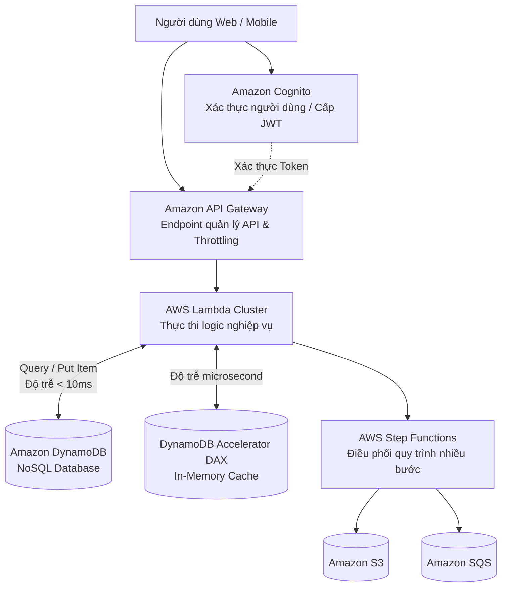

# Tài Liệu Học Tập Chuyên Sâu: AWS Lambda, Amazon API Gateway, DynamoDB & Kiến Trúc Phi Máy Chủ (Serverless Architecture)

> **Tài liệu chuẩn hóa kiến trúc đám mây**: Hướng dẫn toàn diện theo tiêu chuẩn Senior AWS Solutions Architect & Cloud DevOps Engineer.  
> **Ngôn ngữ**: Tiếng Việt (Bảo lưu toàn bộ thuật ngữ chuyên ngành tiếng Anh chuẩn AWS).  
> **Các bài giảng liên quan**: Chương 19 (Serverless Overviews) & Chương 20 (Serverless Solution Architectures).

---

## 6.1. Tổng Quan Dịch Vụ (Service Overview)

### Dịch vụ gì?
Mô hình điện toán phi máy chủ (**Serverless**) trên AWS cho phép lập trình viên xây dựng và vận hành các ứng dụng hoàn chỉnh mà không cần phải quan tâm, cung cấp hay quản lý bất kỳ máy chủ nào. Bộ tứ trụ cột Serverless cốt lõi bao gồm:
1. **AWS Lambda**: Dịch vụ tính toán phi máy chủ (Function-as-a-Service - FaaS), thực thi mã nguồn để phản hồi lại các sự kiện (Events), tự động co giãn từ 0 đến hàng chục ngàn lượt thực thi đồng thời và chỉ tính phí chính xác theo từng millisecond thực thi mã.
2. **Amazon API Gateway**: Cổng kết nối API được quản lý toàn diện cho phép tạo, xuất bản, duy trì, giám sát và bảo mật các REST API, HTTP API và WebSocket API ở bất kỳ quy mô nào.
3. **Amazon DynamoDB**: Cơ sở dữ liệu NoSQL dạng Key-Value và Document hoàn toàn phi máy chủ, cung cấp độ trễ phản hồi dưới 10 millisecond (**Single-digit millisecond latency**) ở bất kỳ quy mô lưu trữ và truy vấn nào.
4. **AWS Step Functions**: Dịch vụ điều phối luồng công việc (Visual Workflow Orchestration) sử dụng máy trạng thái (State Machines) để kết nối các hàm Lambda, dịch vụ AWS và hệ thống bên ngoài thành các quy trình nghiệp vụ phức tạp.
5. **Amazon Cognito**: Dịch vụ quản lý danh tính người dùng ứng dụng di động/web, hỗ trợ đăng nhập, đăng ký và cấp quyền truy cập tài nguyên AWS.

---

## 6.2. Các Khái Niệm và Thành Phần Cốt Lõi (Core Concepts and Components)

### 1. Giới hạn kỹ thuật sống còn của AWS Lambda (Lambda Limits)
- **Thời gian thực thi tối đa (Execution Timeout)**: **Tối đa 15 phút (900 giây)** cho một lượt gọi hàm. Không dùng Lambda cho các tác vụ tính toán dài nhiều giờ.
- **Dung lượng bộ nhớ RAM (Memory Allocation)**: Từ **128 MB đến 10,240 MB (10 GB)** (tăng giảm theo bước nhảy 1 MB). Khi bạn tăng dung lượng RAM, AWS sẽ **tự động tăng tỷ lệ sức mạnh CPU và băng thông mạng** tương ứng.
- **Ổ đĩa tạm thời (`/tmp` Ephemeral Storage)**: Cung cấp sẵn từ **512 MB lên tới 10,240 MB (10 GB)**.
- **Kích thước gói triển khai (Deployment Package Size)**:
  - Tệp nén `.zip`: Tối đa **50 MB**.
  - Tệp giải nén (Uncompressed): Tối đa **250 MB**.
  - Docker Container Image cho Lambda: Tối đa **10 GB**.
- **Kích thước tải dữ liệu (Payload Size)**:
  - Gọi đồng bộ (Synchronous Invocation): Tối đa **6 MB**.
  - Gọi bất đồng bộ (Asynchronous Invocation): Tối đa **256 KB**.

### 2. Xử lý Cold Start & Quản trị Concurrency trong Lambda
- **Cold Start (Khởi động lạnh)**: Khi có request mới mà chưa có môi trường thực thi nào sẵn sàng, Lambda phải tải code, khởi động container runtime, và chạy đoạn mã khởi tạo (Initialization). Điều này gây ra độ trễ ban đầu (đặc biệt với ngôn ngữ Java, C#).
- **Các chế độ Concurrency**:
  - *Reserved Concurrency*: Cố định một hạn ngạch số lượng thực thi đồng thời cho một hàm cụ thể, đảm bảo hàm đó luôn có sẵn tài nguyên và không bị các hàm khác tranh chấp, đồng thời đóng vai trò làm trần giới hạn không để hàm gọi quá nhiều làm sập database backend.
  - *Provisioned Concurrency*: Khởi tạo và làm nóng sẵn (Pre-warmed) môi trường thực thi, **triệt tiêu hoàn toàn độ trễ Cold Start**, sẵn sàng phản hồi trong vài millisecond.
  - *Lambda SnapStart (cho Java)*: Chụp ảnh nhanh trạng thái bộ nhớ của hàm sau khi khởi tạo (MicroVM Snapshot) và lưu vào bộ nhớ cache; khi có request mới, Lambda phục hồi tức thời từ snapshot, giảm độ trễ khởi động tới **90%**.

### 3. Amazon API Gateway: REST APIs vs HTTP APIs

| Tiêu chuẩn so sánh | HTTP APIs (Thế hệ mới) | REST APIs (Thế hệ chuẩn) |
| :--- | :--- | :--- |
| **Chi phí** | **Rẻ hơn tới 71%** so với REST API. | Chi phí tiêu chuẩn. |
| **Độ trễ** | Rất thấp, tối ưu hóa cho kiến trúc serverless nhẹ. | Độ trễ trung bình. |
| **Giao thức** | HTTP/2, HTTP/1.1 | HTTP/1.1 |
| **Tính năng hỗ trợ** | Hỗ trợ OIDC, OAuth 2.0, CORS tích hợp sẵn. | Hỗ trợ toàn diện: **API Caching**, **Request Validation**, **WAF Integration**, **Usage Plans & API Keys**, Client Certificates. |
| **Khuyến nghị lựa chọn** | Dành cho các ứng dụng chỉ cần proxy gọi Lambda/HTTP backend đơn giản và muốn tối ưu chi phí tối đa. | Dành cho các cổng API doanh nghiệp cần đầy đủ tính năng bảo vệ, rate limiting và monetize API. |

### 4. Amazon DynamoDB: Kiến Trúc NoSQL Hiệu Năng Cao
- **Cấu trúc Primary Key (Khóa chính)**:
  - *Single Primary Key (Partition Key / Hash Key)*: Dữ liệu được băm (hash) để xác định phân vùng vật lý lưu trữ bản ghi.
  - *Composite Primary Key (Partition Key + Sort Key / Range Key)*: Cho phép lưu trữ nhiều bản ghi có cùng Partition Key và được sắp xếp thứ tự bởi Sort Key (ví dụ: `UserID` (Partition Key) + `TransactionDate` (Sort Key)).
- **Chế độ tính toán dung lượng (Capacity Modes)**:
  - *On-Demand Mode*: Tự động thích ứng với lưu lượng không đoán trước; không cần quy hoạch dung lượng; tính tiền theo từng triệu lượt đọc/ghi thực tế.
  - *Provisioned Mode*: Đặt trước số lượng **Read Capacity Units (RCU)** và **Write Capacity Units (WCU)**; kết hợp Auto Scaling để tiết kiệm chi phí cho tải ổn định.
- **Tính nhất quán dữ liệu**:
  - *Eventually Consistent Read (Mặc định)*: Tiêu tốn 0.5 RCU cho mỗi 4KB; dữ liệu trả về có thể trễ vài trăm millisecond so với bản ghi mới nhất.
  - *Strongly Consistent Read*: Tiêu tốn 1 RCU cho mỗi 4KB; đảm bảo trả về dữ liệu mới nhất tuyệt đối.
- **DynamoDB Accelerator (DAX)**: Cụm bộ nhớ đệm in-memory chuyên biệt đặt ngay trước DynamoDB, giúp giảm độ trễ từ mili-giây xuống **micro-giây**, không cần viết lại logic ứng dụng.
- **DynamoDB Streams**: Ghi lại toàn bộ chuỗi sự kiện thay đổi dữ liệu (Insert, Update, Delete) theo thời gian thực (Change Data Capture - CDC), tự động kích hoạt hàm Lambda để đồng bộ sang OpenSearch hoặc gửi thông báo.

### 5. Amazon Cognito: User Pools vs Identity Pools
- **Cognito User Pools (Authentication - Xác thực)**:
  - Đóng vai trò là danh bạ người dùng (User Directory).
  - Cung cấp tính năng đăng ký tài khoản, đăng nhập, quên mật khẩu, bật MFA, xác thực qua mạng xã hội (Google, Facebook, Apple) hoặc SAML/OIDC.
  - Trả về mã thông báo chuẩn **JSON Web Tokens (JWT: ID Token, Access Token, Refresh Token)**.
- **Cognito Identity Pools (Authorization - Phân quyền)**:
  - Đổi token của người dùng (từ User Pool hoặc Google/Facebook) lấy các **thông tin xác thực AWS tạm thời (Temporary AWS Credentials qua STS)**.
  - Cho phép người dùng ứng dụng di động tải trực tiếp tệp tin lên S3 Bucket riêng của họ hoặc truy cập vào bảng DynamoDB theo quyền hạn của một IAM Role được gán.

---

## 6.3. Bảng Tích Hợp với Các Dịch Vụ AWS Khác (Integration Table)

| Related AWS Service | Purpose (Mục đích tích hợp) | Integration Method (Phương thức tích hợp) | Practical Example (Ví dụ thực tiễn) |
| :--- | :--- | :--- | :--- |
| **Amazon S3** | Lưu trữ website tĩnh và kích hoạt xử lý dữ liệu tự động | S3 Event Notifications trỏ tới Lambda | Người dùng tải video lên S3, S3 tự kích hoạt Lambda để chia nhỏ và tạo các độ phân giải khác nhau. |
| **Amazon RDS / Aurora** | Cho phép Lambda truy cập cơ sở dữ liệu quan hệ an toàn trong mạng riêng | **Lambda in VPC** & **Amazon RDS Proxy** | Lambda được cấu hình gắn vào Private Subnet của VPC để truy vấn dữ liệu từ cụm Aurora Serverless qua RDS Proxy. |
| **AWS Step Functions** | Điều phối chuỗi xử lý nghiệp vụ nhiều bước phức tạp | Serverless State Machine Integration | Chuỗi quy trình xử lý đơn hàng: Trừ tiền thẻ tín dụng ➔ Nếu thành công thì trừ hàng trong kho ➔ Nếu thất bại thì gọi bước hoàn tiền. |
| **Amazon EventBridge** | Định tuyến các sự kiện từ hạ tầng và ứng dụng tới Lambda | Event Rule Target | Tự động kích hoạt hàm Lambda dọn dẹp các EBS Snapshot cũ vào lúc 0h00 hàng đêm theo lịch cron. |

---

## 6.4. Mô Hình Tính Phí Dịch Vụ & Chiến Lược Tối Ưu Chi Phí Theo Từng Use Case (Serverless Cost Breakdown & Optimization)

Kiến trúc Serverless được biết đến với khẩu hiệu "Chỉ trả tiền cho những gì bạn thực sự sử dụng" (Pay-as-you-go). Tuy nhiên, nếu không nắm vững sự khác biệt giữa các dòng API Gateway, cơ chế định cỡ RAM Lambda và chế độ tính cước DynamoDB, chi phí Serverless có thể đắt hơn gấp 5 lần so với máy ảo truyền thống.

---

### 6.4.1. Bảng Phân Tích Cơ Chế Tính Phí Các Dịch Vụ Serverless

| Dịch Vụ Serverless | Cơ chế tính phí chi tiết (Pricing Dimensions) | Mức phí tham chiếu điển hình | Rủi ro phát sinh chi phí (Cost Pitfalls) |
| :--- | :--- | :--- | :--- |
| **AWS Lambda** | • **Số lượng request**: **$0.20 / 1 triệu requests** (1 triệu reqs đầu/tháng miễn phí). • **Thời gian thực thi (GB-seconds)**:   - Kiến trúc x86: **$0.0000166667 / GB-s**.   - Kiến trúc **Arm64 (Graviton2)**: **$0.0000133334 / GB-s** (Rẻ hơn 20%!). • Tính cước làm tròn tới **1 mili-giây (1 ms)**. | Rất rẻ ở quy mô vừa. Tự động về $0 khi không có traffic. | Cấu hình cấp phát RAM quá thấp khiến hàm chạy lê thê dẫn tới tổng chi phí GB-s cao hơn! |
| **Lambda Provisioned Concurrency** | • Giữ ấm sẵn môi trường thực thi để xóa Cold Start. • Tính phí theo dung lượng RAM và thời gian duy trì: **$0.0000041667 / GB-s** duy trì + phí chạy giảm nhẹ. | Cần thiết cho API thanh toán thời gian thực. | Bật Provisioned Concurrency 24/7 với số lượng lớn trong khi traffic ban đêm rất thấp. |
| **Amazon API Gateway (REST API)** | • **$3.50 / 1 triệu requests** (cho 333 triệu requests đầu tiên). • Hỗ trợ đầy đủ: API Keys, Usage Plans, Request Validation, WAF integration, Caching. | Phù hợp cho API doanh nghiệp phức tạp cần quản trị khách hàng B2B. | Sử dụng REST API cho các tác vụ CRUD đơn giản (đắt gấp 3.5 lần HTTP API!). |
| **Amazon API Gateway (HTTP API)** | • **$1.00 / 1 triệu requests** (**Rẻ hơn tới 71% so với REST API!**). • Độ trễ xử lý thấp hơn (Low latency), hỗ trợ OIDC/OAuth2 native JWT authorizer. | Lựa chọn mặc định tốt nhất cho Microservices và Serverless backend. | Cần tính năng API Key / Usage Plan hoặc Request Transformation (HTTP API không hỗ trợ). |
| **Amazon DynamoDB (On-Demand Mode)** | • **Phí ghi (WRU)**: **$1.25 / 1 triệu Write Request Units**. • **Phí đọc (RRU)**: **$0.25 / 1 triệu Read Request Units**. • **Lưu trữ**: 25 GB đầu miễn phí, sau đó **$0.25 / GB / tháng**. | Tự động thích ứng tức thì với tải đột biến, không cần cấu hình dung lượng trước. | Dùng On-Demand cho các hệ thống có tải đọc/ghi ổn định liên tục 24/7 (đắt hơn Provisioned 5-7 lần). |
| **Amazon DynamoDB (Provisioned Mode)** | • **$0.00065 / WCU / giờ** (~$0.47 / WCU / tháng). • **$0.00013 / RCU / giờ** (~$0.09 / RCU / tháng). • **Miễn phí vĩnh viễn 25 WCU và 25 RCU** mỗi tháng. | Cực kỳ tiết kiệm khi kết hợp với **DynamoDB Auto Scaling**. | Cấp phát cứng dung lượng cao mà không bật Auto Scaling khi traffic giảm. |
| **AWS Step Functions (Standard vs Express)** | • **Standard Workflows**: **$0.025 / 1,000 State Transitions** ($25 / 1 triệu bước!). • **Express Workflows**: **$1.00 / 1 triệu lượt thực thi** + thời gian chạy GB-s. | Standard dùng cho nghiệp vụ kiểm toán dài ngày; Express dùng cho streaming/IoT tốc độ cao. | Dùng Standard Workflow cho luồng xử lý hàng chục triệu tin nhắn IoT/Streaming (gây nổ hóa đơn hàng ngàn USD!). |

---

### 6.4.2. Chiến Lược Tối Ưu Hóa Chi Phí Theo 5 Kịch Bản Thực Tế (Use Cases Optimization)

#### Use Case 1: Chuyển đổi từ API Gateway REST API sang HTTP API (Cắt giảm 71% chi phí API)
* **Vấn đề & So sánh chi phí**:
  - Hệ thống backend ứng dụng di động tiếp nhận **100 triệu lượt gọi API** mỗi tháng.
  - Ban đầu kỹ sư tạo API Gateway bằng loại **REST API** mặc định.
  - Chi phí API Gateway hàng tháng:
    $$\text{Chi phí REST API} = 100 \text{ triệu} \times 3.50\$/\text{triệu} = \mathbf{350.00\$/\text{tháng}}$$
* **Giải pháp Tối ưu kiến trúc**:
  - Đánh giá lại tính năng: Ứng dụng chỉ sử dụng xác thực JWT Token qua Cognito User Pool và định tuyến request về Lambda (không dùng API Keys, không dùng XML transform).
  - Chuyển đổi sang **API Gateway HTTP API**:
    $$\text{Chi phí HTTP API} = 100 \text{ triệu} \times 1.00\$/\text{triệu} = \mathbf{100.00\$/\text{tháng}}$$
* **Kết quả tiết kiệm**: Tiết kiệm ngay **$250/tháng ($3,000/năm - Giảm 71.4%)**, đồng thời độ trễ API giảm đi khoảng 15-20ms.

#### Use Case 2: Tối ưu dung lượng RAM và Thời gian chạy Lambda (AWS Lambda Power Tuning)
* **Vấn đề & Nghịch lý Serverless**:
  - Kỹ sư nghĩ rằng cấu hình Lambda ở mức RAM thấp nhất (**128 MB**) sẽ tiết kiệm tiền nhất.
  - Một tác vụ xử lý ảnh với RAM 128 MB (chỉ nhận được một phần nhỏ năng lực CPU) mất **10,000 ms (10 giây)** để hoàn thành:
    $$\text{Chi phí 128 MB} = 10 \text{s} \times (128/1024) \text{ GB} \times 0.0000166667\$ = \mathbf{0.00002083\$/\text{lần chạy}}$$
* **Giải pháp Tối ưu với AWS Lambda Power Tuning**:
  - Chạy công cụ mã nguồn mở **AWS Lambda Power Tuning** để thử nghiệm hàm qua các mức RAM từ 128MB đến 2048MB.
  - Khi tăng RAM lên **1,024 MB (1 GB)**, AWS cấp phát tương đương **1 vCPU đầy đủ**, hàm hoàn thành chỉ trong **500 ms (0.5 giây)** (nhanh gấp 20 lần!):
    $$\text{Chi phí 1024 MB} = 0.5 \text{s} \times (1024/1024) \text{ GB} \times 0.0000166667\$ = \mathbf{0.00000833\$/\text{lần chạy}}$$
* **Kết quả tiết kiệm**: Chi phí cho mỗi lần chạy **giảm tới 60%**, trong khi trải nghiệm người dùng tăng tốc gấp 20 lần!

#### Use Case 3: Chuyển đổi kiến trúc Lambda sang chip AWS Graviton (Arm64)
* **Vấn đề**: Toàn bộ hệ thống 50 hàm Lambda chạy trên kiến trúc mặc định `x86_64` (Intel/AMD) tiêu tốn 10,000,000 GB-seconds mỗi tháng:
  $$\text{Chi phí x86} = 10,000,000 \times 0.0000166667\$ = \mathbf{166.67\$/\text{tháng}}$$
* **Giải pháp Tối ưu**:
  - Với các hàm viết bằng Node.js, Python, Java, Go: Chỉ cần vào phần cấu hình Architecture và chuyển cờ từ `x86_64` sang **`arm64` (AWS Graviton2)**.
  - Mức giá giảm còn **$0.0000133334 / GB-s**:
    $$\text{Chi phí Graviton2} = 10,000,000 \times 0.0000133334\$ = \mathbf{133.33\$/\text{tháng}}$$
* **Kết quả tiết kiệm**: Tiết kiệm ngay **20% chi phí tính toán** chỉ bằng 1 cú nhấp chuột mà không cần sửa đổi bất kỳ dòng mã nguồn nào.

#### Use Case 4: Lựa chọn chế độ DynamoDB On-Demand vs Provisioned Capacity Mode
* **Vấn đề & Bài toán thực tế**:
  - Bảng DynamoDB của một ứng dụng IoT tiếp nhận lưu lượng ghi ổn định liên tục **500 WCU** (500 writes/giây) suốt 24/7 (khoảng 1.3 tỷ lượt ghi/tháng).
  - *Nếu chạy ở chế độ On-Demand Mode*:
    $$\text{Chi phí On-Demand} = 1,300 \text{ triệu} \times 1.25\$/\text{triệu} = \mathbf{1,625\$/\text{tháng}}$$
  - *Nếu chuyển sang chế độ Provisioned Mode có bật Auto Scaling*:
    - Cấp phát 500 WCU (trừ đi 25 WCU miễn phí):
    $$\text{Chi phí Provisioned} = (500 - 25) \text{ WCU} \times 0.00065\$ \times 720 = \mathbf{222.30\$/\text{tháng}}$$
* **Kết quả tiết kiệm**: Tiết kiệm hơn **$1,400/tháng (Giảm hơn 86% chi phí!)** cho các luồng dữ liệu có tải ổn định và dự đoán được.

#### Use Case 5: Tối ưu quy trình Step Functions cho Khối lượng Sự kiện Lớn (Express Workflows)
* **Vấn đề & Cách tính tiền cũ**:
  - Hệ thống xử lý đơn hàng xử lý **5 triệu đơn hàng/tháng**, mỗi đơn hàng trải qua 6 bước (State Transitions).
  - Sử dụng **Step Functions Standard Workflows**:
    $$\text{Số bước chuyển trạng thái} = 5 \text{ triệu} \times 6 = 30 \text{ triệu transitions}$$
    $$\text{Chi phí Standard Workflows} = 30,000 \times 0.025\$ = \mathbf{750.00\$/\text{tháng}}$$
* **Giải pháp Tối ưu kiến trúc**:
  - Vì toàn bộ quy trình xử lý đơn hàng hoàn tất trong vòng dưới 5 phút, chuyển đổi sang **Step Functions Express Workflows**:
    $$\text{Phí thực thi Express} = 5 \text{ triệu} \times 1.00\$/\text{triệu} = 5.00\$$$
    $$\text{Phí thời gian chạy (ước tính 2 giây/đơn ở mức 256MB)} \approx 15.00\$$$
    $$\text{Tổng chi phí Express Workflows} \approx \mathbf{20.00\$/\text{tháng}}$$
* **Kết quả tiết kiệm**: Tiết kiệm **$730/tháng (Giảm hơn 97% chi phí điều phối quy trình!)**.

---

## 6.5. Khắc Phục Sự Cố Thực Tế (Troubleshooting Guide)

| Vấn đề (Problem) | Nguyên nhân khả dĩ (Possible Causes) | Các bước điều tra (Investigation Steps) | Giải pháp (Solution) | Biện pháp phòng ngừa (Prevention) |
| :--- | :--- | :--- | :--- | :--- |
| **Hàm Lambda bị lỗi `Task timed out after 3.00 seconds`** | Thời gian thực thi mặc định của Lambda là 3 giây; logic code hoặc gọi dịch vụ ngoài mất nhiều thời gian hơn. | Xem CloudWatch Logs của Lambda tại dòng `REPORT RequestId: ... Duration: 3000.00 ms`. | Tăng thông số **Timeout** trong cấu hình của Lambda lên giá trị phù hợp (ví dụ 30 giây hoặc 1 phút). | Luôn cấu hình timeout thực tế và xử lý cơ chế retry. |
| **Lambda trong VPC không thể kết nối ra ngoài Internet (gọi API bên ngoài)** | Subnet của Lambda không có đường dẫn tới **NAT Gateway** (hoặc Lambda đang được đặt nhầm vào Public Subnet). | Kiểm tra Route Table của Subnet mà Lambda đang được gắn ENI. | Đặt Lambda vào **Private Subnet** và cấu hình Route Table trỏ `0.0.0.0/0` tới **NAT Gateway** đặt tại Public Subnet. | Nắm vững nguyên tắc: Lambda trong VPC không bao giờ nhận Public IP trực tiếp. |
| **DynamoDB báo lỗi `ProvisionedThroughputExceededException`** | Tốc độ đọc hoặc ghi vượt quá số lượng RCU hoặc WCU đã cấp phát trong chế độ Provisioned. | Xem metric `ThrottledRequests` trên CloudWatch của bảng DynamoDB. | 1. Bật **Auto Scaling** cho RCU/WCU. 2. Chuyển sang chế độ **On-Demand Capacity Mode**. 3. Áp dụng Exponential Backoff trong mã nguồn. | Thiết kế Partition Key có độ phân tán đồng đều để tránh tạo ra "Hot Partition". |
| **Người dùng gặp lỗi `HTTP 429 Too Many Requests` từ API Gateway** | Lưu lượng gọi API vượt quá giới hạn Throttling (Rate và Burst limits) của tài khoản hoặc Usage Plan. | Xem CloudWatch metric `4XXError` và cấu hình Throttling trên Stage. | Tăng giới hạn Throttling Limits trong API Gateway hoặc yêu cầu tăng Service Quota. | Sử dụng **API Gateway Caching** để phục vụ các request trùng lặp từ bộ nhớ đệm. |

---

## 6.6. Bộ Câu Hỏi Ôn Tập và Kiểm Tra Kiến Thức (Knowledge Review)

### A. 10 Câu hỏi Cốt lõi (Core Concepts)
1. Thời gian chạy tối đa (Maximum Execution Timeout) được phép của một hàm AWS Lambda là bao nhiêu phút?
2. Dung lượng bộ nhớ RAM tối thiểu và tối đa có thể cấp phát cho một hàm AWS Lambda là bao nhiêu?
3. Khi bạn tăng dung lượng bộ nhớ RAM cho một hàm AWS Lambda, yếu tố tài nguyên phần cứng nào khác sẽ tự động được AWS tăng theo tỷ lệ tương ứng?
4. Tính năng nào của AWS Lambda giúp loại bỏ hoàn toàn độ trễ khởi động lạnh (Cold Start) bằng cách khởi tạo và làm nóng sẵn các môi trường thực thi?
5. Sự khác biệt cốt lõi nhất giữa **Amazon Cognito User Pools** và **Amazon Cognito Identity Pools** là gì?
6. Để một hàm AWS Lambda đặt bên trong một VPC có thể truy cập được các dịch vụ trên Internet công cộng, nó bắt buộc phải được đặt ở loại Subnet nào và cần thành phần mạng nào?
7. Hai chế độ tính toán dung lượng (Capacity Modes) của cơ sở dữ liệu Amazon DynamoDB là gì?
8. Bộ nhớ đệm in-memory chuyên biệt nào của DynamoDB giúp giảm độ trễ phản hồi từ mili-giây xuống micro-giây mà không cần thay đổi logic ứng dụng?
9. Thuật ngữ **WORM** trong bảo mật dữ liệu lưu trữ có nghĩa là gì?
10. Sự khác biệt giữa **Standard Workflows** và **Express Workflows** trong dịch vụ AWS Step Functions là gì?

---

### Đáp án Bộ Câu Hỏi Ôn Tập (Answer Key)

👉 Nhấp vào đây để xem toàn bộ đáp án chi tiết

1. Tối đa **15 phút (900 giây)**.
2. Tối thiểu là **128 MB** và tối đa là **10,240 MB (10 GB)**.
3. **Năng lực tính toán CPU** (và băng thông mạng).
4. Tính năng **Provisioned Concurrency**.
5. **Cognito User Pools** phục vụ cho việc **Xác thực (Authentication)**, quản lý tài khoản người dùng và cấp mã thông báo JWT; trong khi **Cognito Identity Pools** phục vụ cho việc **Phân quyền (Authorization)**, đổi token người dùng lấy thông tin xác thực AWS tạm thời (STS credentials) để truy cập trực tiếp tài nguyên AWS.
6. Lambda phải được đặt trong **Private Subnet** và lưu lượng đi ra ngoài Internet phải được định tuyến qua một **NAT Gateway** (nằm ở Public Subnet) kết nối với Internet Gateway.
7. Chế độ **On-Demand Capacity Mode** (tự động co giãn theo request thực tế) và **Provisioned Capacity Mode** (cấp phát trước số lượng RCU và WCU cố định kèm Auto Scaling).
8. **Amazon DynamoDB Accelerator (DAX)**.
9. Viết tắt của **Write Once, Read Many** (Ghi một lần, Đọc nhiều lần - dữ liệu sau khi ghi sẽ không thể bị sửa đổi hoặc xóa bỏ trong suốt thời gian quy định).
10. **Standard Workflows** có thể chạy tối đa **1 năm**, có cơ chế thực thi "đúng chính xác một lần" (Exactly-once), lưu lịch sử thực thi đầy đủ; trong khi **Express Workflows** chỉ chạy tối đa **5 phút**, thông lượng cực lớn (hơn 100,000 executions/s), cơ chế thực thi "tối thiểu một lần" (At-least-once), chi phí rẻ hơn nhiều cho xử lý dữ liệu IoT/Streaming.

---

## 6.7. Tóm Tắt và Danh Mục Kiểm Tra Kiến Thức (Summary & Learning Checklist)

### 5 Khái niệm quan trọng nhất phải nhớ:
1. **Lambda Timeout 15 phút & Tỷ lệ RAM/CPU**: Tăng RAM đồng nghĩa tăng CPU; tác vụ dài hơn 15 phút phải chuyển sang ECS Fargate hoặc Batch.
2. **Triệt tiêu Cold Start**: Sử dụng Provisioned Concurrency hoặc Lambda SnapStart cho Java.
3. **Lambda trong VPC**: Cần Private Subnet + NAT Gateway để vừa gọi được RDS nội bộ vừa gọi được Internet ngoài.
4. **DynamoDB Single-Digit Millisecond**: Partition Key tốt là chìa khóa tránh Hot Partition; dùng DAX cho microsecond cache.
5. **Cognito Architecture**: User Pool (Đăng nhập, Identity) ➔ Identity Pool (Lấy AWS IAM Temporary Credentials).

### Liên kết và Chủ đề tiếp theo:
- 📖 [Ghi Chú Bài Học Chương 19-20: Serverless Lambda, APIGW & DynamoDB](file:///n:/AWS_XBrain_Note/Lesson_Notes/19_20_Serverless_Lambda_APIGW_DynamoDB.md)
- 📖 [Bảng Thuật Ngữ Kỹ Thuật (GLOSSARY.md)](file:///n:/AWS_XBrain_Note/GLOSSARY.md)
- ⏭️ Tiếp tục chuyển sang chuyên đề: **Hạ Tầng Mạng Riêng Ảo: Amazon VPC & Mạng Đám Mây Nâng Cao**.
