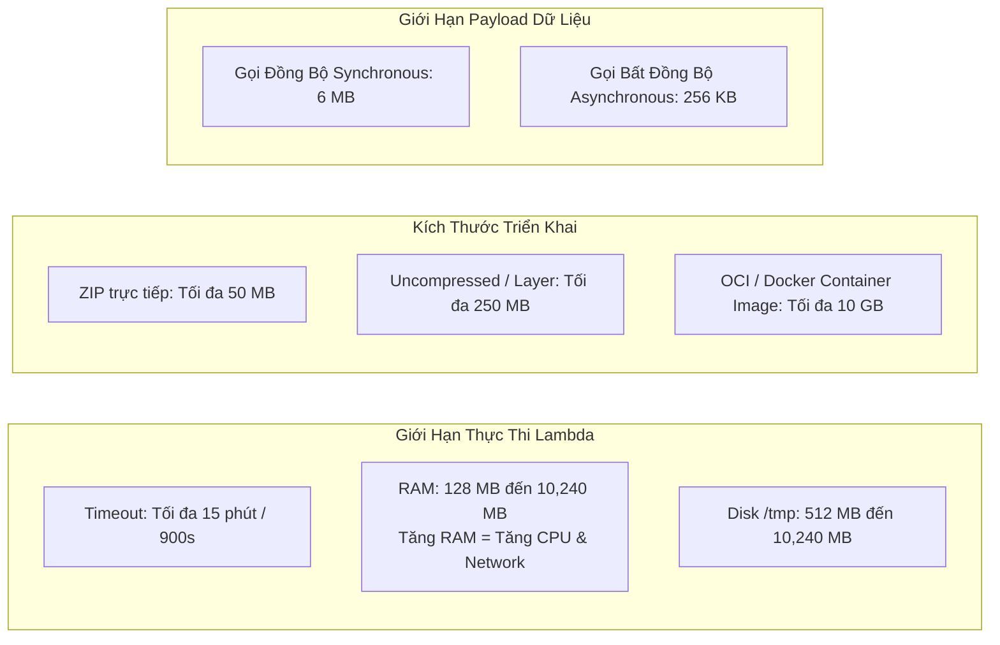
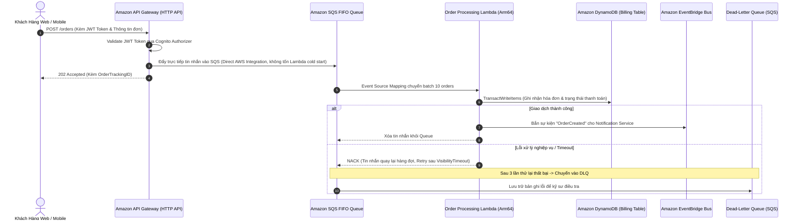

# Tài Liệu Học Tập Chuyên Sâu: AWS Lambda, Amazon API Gateway, DynamoDB & Kiến Trúc Phi Máy Chủ (Serverless Architecture)

> **Tài liệu chuẩn hóa kiến trúc đám mây**: Hướng dẫn toàn diện theo tiêu chuẩn Senior AWS Solutions Architect & Cloud DevOps Engineer (cập nhật mới nhất 2026).  
> **Ngôn ngữ**: Tiếng Việt (Bảo lưu toàn bộ thuật ngữ chuyên ngành tiếng Anh chuẩn AWS).  
> **Các dịch vụ liên quan**: AWS Lambda, Amazon API Gateway, Amazon DynamoDB, AWS Step Functions, Amazon Cognito, Amazon EventBridge.

---

## 6.1. Tổng Quan Dịch Vụ (Service Overview)

### Dịch vụ gì?
Mô hình điện toán phi máy chủ (**Serverless**) trên AWS cho phép lập trình viên và kiến trúc sư đám mây xây dựng và vận hành các ứng dụng hoàn chỉnh mà không cần cấu hình, bảo trì hay quản lý bất kỳ cụm máy ảo nào. Bộ tứ trụ cột Serverless cốt lõi bao gồm:
1. **AWS Lambda**: Dịch vụ tính toán phi máy chủ (Function-as-a-Service - FaaS), thực thi mã nguồn để phản hồi lại các sự kiện (Events), tự động co giãn từ 0 đến hàng chục ngàn lượt thực thi đồng thời và chỉ tính phí chính xác theo từng millisecond thực thi mã (GB-seconds).
2. **Amazon API Gateway**: Cổng kết nối API được quản lý toàn diện cho phép tạo, xuất bản, bảo mật, đo lường và giám sát các REST API, HTTP API và WebSocket API ở bất kỳ quy mô nào.
3. **Amazon DynamoDB**: Cơ sở dữ liệu NoSQL dạng Key-Value và Document hoàn toàn phi máy chủ, cung cấp độ trễ phản hồi dưới 10 millisecond (**Single-digit millisecond latency**) ở bất kỳ quy mô lưu trữ và thông lượng nào.
4. **AWS Step Functions**: Dịch vụ điều phối quy trình phân tán (Visual Workflow Orchestration) sử dụng máy trạng thái (State Machines) để kết nối các microservices, xử lý luồng rẽ nhánh và rollback giao dịch (Saga Pattern).
5. **Amazon Cognito**: Dịch vụ quản lý danh tính người dùng ứng dụng di động/web, hỗ trợ đăng nhập, đăng ký và cấp quyền truy cập tài nguyên AWS an toàn.

---

## 6.2. Các Khái Niệm, Kiến Trúc & Vận Hành Cốt Lõi (Core Concepts, Security & Day-2 Operations)

### 1. Giới Hạn Kỹ Thuật Sống Còn của AWS Lambda (Lambda Limits & Runtime)

- **Thời gian thực thi tối đa (Execution Timeout)**: **Tối đa 15 phút (900 giây)** cho một lần gọi. Không dùng Lambda cho các tác vụ phân tích batch kéo dài hàng giờ (chuyển sang AWS Fargate hoặc AWS Batch).
- **Cấp phát bộ nhớ RAM**: Từ **128 MB đến 10 GB**. Khi tăng RAM, AWS tự động tăng tuyến tính sức mạnh vCPU (tại 1,769 MB RAM, Lambda được cấp chính xác 1 vCPU đầy đủ).
- **Ổ đĩa tạm thời (`/tmp`)**: Khởi tạo từ 512 MB lên tới 10 GB, có thể dùng để giải nén model AI hoặc cache dữ liệu lớn trong cùng một môi trường thực thi.
- **Payload Limits**: 6 MB cho gọi đồng bộ (qua API Gateway / SDK invoke) và 256 KB cho gọi bất đồng bộ (qua SNS / S3 / EventBridge).

---

### 2. Quản Trị Concurrency, Cold Start & SnapStart

- **Cold Start (Khởi động lạnh)**: Khi có request mới mà chưa có môi trường thực thi nào sẵn sàng, Lambda phải tải code, khởi động container runtime, và chạy đoạn mã khởi tạo bên ngoài handler (`init code`). Gây độ trễ từ vài trăm ms đến vài giây (đặc biệt với Java/.NET).
- **Reserved Concurrency**: Cố định số lượng thực thi đồng thời dành riêng cho một hàm (ví dụ: cấp 200 execution slots). Vừa đảm bảo hàm luôn có slot chạy, vừa đóng vai trò làm trần giới hạn bảo vệ database phía sau khỏi bị sập do quá tải kết nối.
- **Provisioned Concurrency**: Khởi tạo và "làm ấm" sẵn môi trường thực thi 24/7, **triệt tiêu hoàn toàn độ trễ Cold Start**, phản hồi ngay lập tức dưới 10ms.
- **Lambda SnapStart (cho Java 11/17/21)**: Chụp snapshot toàn bộ trạng thái bộ nhớ MicroVM sau khi hoàn tất init và cache lại; khi có request, Lambda khôi phục tức thời từ snapshot, giảm độ trễ khởi động tới **90%** mà không mất thêm chi phí duy trì.
- **Response Streaming**: Cho phép hàm Lambda truyền luồng phản hồi dữ liệu về client theo từng phần (Chunked Transfer) mà không cần đợi toàn bộ payload hoàn tất, giúp giảm Time-to-First-Byte (TTFB) và vượt giới hạn payload 6 MB (lên tới 20 MB).

---

### 3. Mô Hình Kích Hoạt Lambda: Sync vs Async vs Event Source Mapping

```mermaid
flowchart TD
    subgraph SyncModel[1. Synchronous Invocation]
        APIGW[API Gateway / ALB] -->|Chờ kết quả trả về ngay| L1[AWS Lambda]
        L1 -->|Return Payload / Error| APIGW
    end

    subgraph AsyncModel[2. Asynchronous Invocation]
        S3[S3 / SNS / EventBridge] -->|HTTP 202 Accepted| Queue[(Internal Lambda Queue)]
        Queue --> L2[AWS Lambda]
        L2 -.->|Retry 2 lần thất bại| DLQ[(Dead-Letter Queue SQS / SNS / Destination)]
    end

    subgraph ESMModel[3. Event Source Mapping Polling]
        Streams[(DynamoDB Streams / Kinesis / SQS)] -->|Lambda Service tự động Poll| ESM[Event Source Mapping]
        ESM -->|Batching Records| L3[AWS Lambda]
    end
```

---

### 4. Amazon API Gateway: HTTP APIs vs REST APIs

| Tiêu chuẩn so sánh | HTTP APIs (Thế hệ mới) | REST APIs (Thế hệ chuẩn) |
| :--- | :--- | :--- |
| **Đơn giá cuộc gọi** | **$1.00 / 1 triệu requests** (**Rẻ hơn 71%**) | **$3.50 / 1 triệu requests** |
| **Độ trễ xử lý** | Siêu thấp (< 10ms xử lý gateway) | Trung bình (20 - 40ms) |
| **Cơ chế xác thực** | Native OIDC / OAuth2 JWT Authorizer, Lambda Authorizer | Lambda Authorizer, Cognito User Pools, IAM (SigV4), API Keys |
| **Tính năng doanh nghiệp** | Hỗ trợ CORS, OIDC native, tự động deploy | **API Caching**, **Request/Response Validation**, **WAF Integration**, **Usage Plans & Throttling theo khách hàng**, Mock Endpoints |
| **Khuyến nghị kiến trúc** | Serverless microservices hiện đại, proxy Lambda đơn giản, tối ưu chi phí | Hệ thống API thương mại cho đối tác B2B, cần Rate Limit theo API Key hoặc bảo vệ bởi AWS WAF |

---

### 5. Amazon DynamoDB: Kiến Trúc NoSQL & Tối Ưu Phân Vùng

- **Khóa chính (Primary Key)**:
  - *Partition Key (PK)*: Băm giá trị qua thuật toán hash để phân bổ bản ghi vào phân vùng vật lý (Physical Partition). PK phải có độ biến thiên cao (High Cardinality) để tránh tạo ra **Hot Partition**.
  - *Sort Key (SK)*: Sắp xếp các bản ghi có cùng Partition Key theo thứ tự vật lý, cho phép truy vấn dải (`begins_with`, `between`).
- **Secondary Indexes**:
  - *Local Secondary Index (LSI)*: Cùng PK với bảng chính nhưng khác SK. Phải tạo ngay khi tạo bảng (không thể thêm sau), chia sẻ hạn mức RCU/WCU của bảng chính.
  - *Global Secondary Index (GSI)*: PK và SK hoàn toàn mới. Có thể tạo hoặc xóa bất kỳ lúc nào, sở hữu hạn mức RCU/WCU độc lập.
- **DynamoDB Streams & CDC**: Ghi nhận toàn bộ biến động dữ liệu theo thứ tự thời gian, tự động kích hoạt Lambda xử lý hậu kỳ (Real-time analytics, cache invalidation).
- **Amazon DynamoDB Accelerator (DAX)**: Cụm bộ nhớ đệm in-memory hoàn toàn tương thích API của DynamoDB, giảm độ trễ đọc từ mili-giây xuống **micro-giây**.

---

## 6.3. Kiến Trúc Thực Tế và Luồng Vận Hành (Production Architecture & Workflow)

### Kiến trúc Webhook & Xử Lý Đơn Hàng Phi Máy Chủ Bất Đồng Bộ

---

## 6.4. Bảng Tích Hợp với Các Dịch Vụ AWS Khác (Integration Table)

| Related AWS Service | Purpose (Mục đích tích hợp) | Integration Method (Phương thức tích hợp) | Practical Example (Ví dụ thực tiễn) |
| :--- | :--- | :--- | :--- |
| **Amazon S3** | Xử lý sự kiện lưu trữ phi máy chủ | S3 Event Notifications | Tự động kích hoạt Lambda sinh thumbnail và trích xuất metadata khi người dùng tải ảnh lên S3. |
| **Amazon RDS / Aurora** | Quản lý kết nối cơ sở dữ liệu bền bỉ | **Amazon RDS Proxy** | Hàng ngàn container Lambda đồng thời chia sẻ một connection pool nhỏ qua RDS Proxy, tránh làm sập PostgreSQL/MySQL. |
| **Amazon SQS / SNS** | Phân tách (Decouple) các thành phần kiến trúc | Event Source Mapping & Push Triggers | Lambda tiêu thụ hàng đợi tin nhắn bất đồng bộ, tự động scale out theo số lượng thông điệp trong queue. |
| **AWS Step Functions** | Điều phối quy trình nghiệp vụ nhiều bước | Task State `arn:aws:states:::lambda:invoke` | Quy trình duyệt hoàn tiền: Kiểm tra số dư ➔ Trừ ví ➔ Gửi SMS ➔ Báo cáo kế toán (có tự động retry và catch error). |
| **Amazon CloudWatch** | Giám sát hiệu năng và truy vết lỗi | CloudWatch Logs Insights & X-Ray Tracing | Bật AWS X-Ray Active Tracing để đo đạc chính xác thời gian khởi tạo container (Cold Start) và thời gian thực thi hàm. |
| **AWS Secrets Manager** | Bảo mật chuỗi kết nối và API keys | Lambda Extensions / SDK Caching | Lambda nạp API Key bên thứ 3 và cache trong bộ nhớ RAM, tự động lấy secret mới khi được xoay vòng. |

---

## 6.5. Bảng So Sánh Trong Hệ Sinh Thái AWS (Ecosystem Comparison)

### So sánh các nền tảng tính toán cho Microservices trên AWS

| Tiêu chí | AWS Lambda | AWS Fargate (ECS/EKS) | AWS App Runner | Amazon EC2 |
| :--- | :--- | :--- | :--- | :--- |
| **Mô hình tính toán** | Function-as-a-Service (FaaS) hướng sự kiện. | Container-as-a-Service (CaaS) phi máy chủ. | Platform-as-a-Service (PaaS) triển khai web/API tự động. | Infrastructure-as-a-Service (IaaS) máy ảo chuyên dụng. |
| **Giới hạn thời gian chạy** | **Tối đa 15 phút (900 giây)**. | **Không giới hạn** (chạy tiến trình liên tục 24/7). | **Không giới hạn** (phù hợp HTTP request dài). | **Không giới hạn**. |
| **Khả năng co giãn về 0 (Scale to Zero)** |  **Có (Mặc định)**: $0 khi không có lưu lượng. | ❌ Không tự về 0 (phải duy trì tối thiểu 1 task). |  Có thể tạm dừng instance khi không có request. | ❌ Không tự về 0 (phải duy trì instance bật). |
| **Độ trễ khởi động** | Vài mili-giây (Warm) đến vài giây (Cold Start). | Khoảng 30 giây đến 2 phút để kéo image và chạy task. | Vài giây đến 1 phút khi scale up. | Vài phút khi ASG khởi tạo máy ảo mới. |
| **Cơ chế tính phí** | Làm tròn tới **1 ms** theo dung lượng RAM và thời gian chạy. | Tính theo từng giây dựa trên vCPU và GB RAM cấp phát. | Tính theo vCPU/RAM active + phí duy trì memory khi idle. | Tính theo từng giây chạy của máy ảo (cố định). |
| **Trường hợp sử dụng tối ưu** | Tác vụ xử lý sự kiện ngắn, webhook, API tải đột biến thất thường. | Microservices chạy liên tục, background worker dài ngày, websockets. | Ứng dụng web/REST API container hóa đơn giản cần CI/CD tự động. | Ứng dụng legacy, kiến trúc monlithic, yêu cầu tùy biến sâu kernel OS. |

---

## 6.6. Mô Hình Tính Phí & Chiến Lược Tối Ưu Chi Phí (FinOps & Cost Optimization)

### 6.6.1. Bảng Cấu Trúc Định Giá Chi Tiết

| Thành phần Dịch Vụ | Đơn giá AWS niêm yết | Cơ chế đo lường | Ghi chú tối ưu hóa chi phí FinOps |
| :--- | :--- | :--- | :--- |
| **AWS Lambda (x86_64)** | **$0.0000166667 / GB-s** | Tính theo mili-giây (1 ms) thực thi | 1 triệu request và 3.2 triệu GB-s miễn phí mỗi tháng (Free Tier vĩnh viễn). |
| **AWS Lambda (Arm64 Graviton)** | **$0.0000133334 / GB-s** | Rẻ hơn **20%** so với x86 | Chuyển đổi kiến trúc sang Arm64 cho Python, Node.js, Go để tiết kiệm ngay 20%. |
| **Amazon API Gateway (HTTP API)** | **$1.00 / 1 triệu requests** | Tính trên mỗi request nhận được | Rẻ hơn 71% so với REST API ($3.50/triệu requests). |
| **Amazon DynamoDB (On-Demand)** | **$1.25 / 1M WRU** & **$0.25 / 1M RRU** | Tính trên lượt đọc/ghi thực tế | Phù hợp cho tải khó đoán hoặc mới ra mắt; chuyển sang Provisioned khi tải ổn định. |
| **Amazon DynamoDB (Provisioned)** | **$0.00065 / WCU / giờ** (~$0.47/tháng) **$0.00013 / RCU / giờ** (~$0.09/tháng) | Miễn phí 25 WCU và 25 RCU cố định | Bật Auto Scaling để giảm 80% chi phí so với On-Demand trên tải đều đặn. |
| **AWS Step Functions (Express)** | **$1.00 / 1 triệu executions** | $1/triệu + cước GB-s | Rẻ hơn 97% so với Standard Workflows ($25/triệu transitions) cho tác vụ < 5 phút. |

---

### 6.6.2. 5 Kịch Bản Tối Ưu Hóa Chi Phí Thực Tế (FinOps Scenarios)

#### Kịch bản 1: Chuyển đổi API Gateway từ REST API sang HTTP API
- **Bối cảnh**: Hệ thống backend di động tiếp nhận **120 triệu lượt gọi API** mỗi tháng. Kỹ sư khởi tạo cổng API bằng REST API mặc định.
- **Tính toán chi phí REST API**:
  $$\text{Cost}_{\text{REST}} = \left( \frac{120{,}000{,}000}{1{,}000{,}000} \right) \times \$3.50 = \$420/\text{tháng}$$
- **Giải pháp tối ưu**:
  - Đánh giá kiến trúc: Ứng dụng chỉ dùng xác thực JWT qua Cognito và chuyển tiếp request về Lambda (không cần API Keys hay Request XML Transformation).
  - Chuyển sang **HTTP API** với đơn giá $1.00/1 triệu calls:
  $$\text{Cost}_{\text{HTTP}} = \left( \frac{120{,}000{,}000}{1{,}000{,}000} \right) \times \$1.00 = \$120/\text{tháng}$$
- **Hiệu quả kinh tế**:
  $$\text{Tiết kiệm} = \$420 - \$120 = \$300/\text{tháng} \quad (\$3{,}600/\text{năm}) \implies \text{Cắt giảm } 71.4\% \text{ chi phí API}$$

#### Kịch bản 2: Tối ưu dung lượng RAM bằng AWS Lambda Power Tuning (Nghịch lý Serverless)
- **Bối cảnh**: Kỹ sư nghĩ rằng cấu hình mức RAM nhỏ nhất (**128 MB**) sẽ tiết kiệm chi phí nhất. Một tác vụ xử lý đồ họa với 128 MB RAM (nhận tỷ lệ CPU rất nhỏ) mất **8.0 giây (8,000 ms)** để hoàn thành. Hệ thống chạy 5 triệu lần mỗi tháng.
- **Tính toán chi phí 128 MB**:
  $$\text{Cost}_{128\text{MB}} = 5{,}000{,}000 \times 8.0 \text{ s} \times \left( \frac{128}{1024} \text{ GB} \right) \times \$0.0000166667 = \$83.33/\text{tháng}$$
- **Giải pháp tối ưu**:
  - Dùng công cụ **AWS Lambda Power Tuning** nâng RAM lên **1,024 MB (1 GB)**. Tại mức này, hàm được cấp 1 vCPU trọn vẹn, thời gian xử lý giảm mạnh xuống chỉ còn **0.4 giây (400 ms)**:
  $$\text{Cost}_{1024\text{MB}} = 5{,}000{,}000 \times 0.4 \text{ s} \times \left( \frac{1024}{1024} \text{ GB} \right) \times \$0.0000166667 = \$33.33/\text{tháng}$$
- **Hiệu quả kinh tế**:
  $$\text{Tiết kiệm} = \$83.33 - \$33.33 = \$50.00/\text{tháng} \quad (\$600/\text{năm}) \implies \text{Tiết kiệm } 60\% \text{ chi phí, tăng tốc } 20\text{ lần}$$

#### Kịch bản 3: Chuyển đổi Runtime Lambda sang chip ARM64 (AWS Graviton)
- **Bối cảnh**: Hệ thống microservices gồm 40 hàm Lambda viết bằng Node.js và Python chạy trên kiến trúc `x86_64`, tiêu tốn trung bình 15,000,000 GB-seconds mỗi tháng.
- **Tính toán chi phí x86**:
  $$\text{Cost}_{\text{x86}} = 15{,}000{,}000 \times \$0.0000166667 = \$250.00/\text{tháng}$$
- **Giải pháp tối ưu**:
  - Chuyển đổi cờ cấu hình kiến trúc sang **`arm64` (AWS Graviton)** trên Console hoặc Terraform mà không cần đổi mã nguồn:
  $$\text{Cost}_{\text{Arm64}} = 15{,}000{,}000 \times \$0.0000133334 = \$200.00/\text{tháng}$$
- **Hiệu quả kinh tế**:
  $$\text{Tiết kiệm} = \$250.00 - \$200.00 = \$50.00/\text{tháng} \quad (\$600/\text{năm}) \implies \text{Tiết kiệm ngay } 20\% \text{ chi phí tính toán}$$

#### Kịch bản 4: DynamoDB On-Demand vs Provisioned Capacity Mode kèm Auto Scaling
- **Bối cảnh**: Một ứng dụng thương mại điện tử có lưu lượng ghi ổn định liên tục **400 WCU** (400 writes/giây) suốt 24/7 (tương đương khoảng 1.036 tỷ lượt ghi mỗi tháng).
- **Tính toán chi phí On-Demand Mode**:
  $$\text{Cost}_{\text{OnDemand}} = \left( \frac{1{,}036{,}800{,}000}{1{,}000{,}000} \right) \times \$1.25 = \$1{,}296/\text{tháng}$$
- **Giải pháp tối ưu**:
  - Chuyển sang **Provisioned Capacity Mode** với Auto Scaling (cấp phát 400 WCU, trừ đi 25 WCU miễn phí):
  $$\text{Cost}_{\text{Provisioned}} = (400 - 25) \text{ WCU} \times \$0.00065/\text{giờ} \times 730 \text{ giờ} = \$177.94/\text{tháng}$$
- **Hiệu quả kinh tế**:
  $$\text{Tiết kiệm} = \$1{,}296 - \$177.94 = \$1{,}118.06/\text{tháng} \quad (\$13{,}416/\text{năm}) \implies \text{Tiết kiệm } 86.3\% \text{ chi phí DB}$$

#### Kịch bản 5: Chuyển đổi Step Functions từ Standard sang Express Workflows
- **Bối cảnh**: Hệ thống phân tích thanh toán xử lý **8 triệu giao dịch/tháng**. Mỗi giao dịch trải qua 5 bước chuyển trạng thái (State Transitions). Tất cả giao dịch hoàn thành trong vòng dưới 3 giây.
- **Tính toán chi phí Standard Workflows**:
  $$\text{Số transitions} = 8{,}000{,}000 \times 5 = 40{,}000{,}000 \text{ transitions}$$
  $$\text{Cost}_{\text{Standard}} = \left( \frac{40{,}000{,}000}{1{,}000} \right) \times \$0.025 = \$1{,}000/\text{tháng}$$
- **Giải pháp tối ưu**:
  - Chuyển sang **Express Workflows** (thiết kế chuyên biệt cho tác vụ xử lý sự kiện ngắn dưới 5 phút):
  $$\text{Phí thực thi} = 8 \text{ triệu} \times \$1.00/\text{triệu} = \$8.00$$
  $$\text{Phí thời gian chạy (3s @ 256MB RAM)} \approx \$20.00$$
  $$\text{Total Cost}_{\text{Express}} = \$8.00 + \$20.00 = \$28.00/\text{tháng}$$
- **Hiệu quả kinh tế**:
  $$\text{Tiết kiệm} = \$1{,}000 - \$28 = \$972/\text{tháng} \quad (\$11{,}664/\text{năm}) \implies \text{Tiết kiệm } 97.2\% \text{ chi phí điều phối}$$

---

## 6.7. Khắc Phục Sự Cố Thực Tế (Troubleshooting Guide)

| Tình huống sự cố (Problem) | Nguyên nhân cốt lõi (Root Cause) | Các bước điều tra & Chỉ số giám sát (Metrics & Logs) | Giải pháp khắc phục (Remediation) | Biện pháp phòng ngừa (Prevention) |
| :--- | :--- | :--- | :--- | :--- |
| **Lỗi `Task timed out after 3.00 seconds` trên Lambda** | Thời gian timeout mặc định là 3 giây; mã nguồn gọi API ngoài hoặc truy vấn database bị chậm vượt quá thời gian này. | - Xem CloudWatch Logs: `REPORT RequestId: ... Duration: 3000.00 ms Status: timeout`. - Giám sát CloudWatch metric `Duration` và `Errors`. | Tăng thông số **Timeout** trong cấu hình của Lambda lên giá trị thực tế (ví dụ: 15s - 30s). | Thiết lập kết nối timeout trên HTTP Client trong code để fail-fast; cấu hình CloudWatch Alarm cho metric `Errors`. |
| **Lambda trong VPC không thể gọi API ra ngoài Internet** | Subnet gắn Lambda không có route ra Internet hoặc bị đặt nhầm vào Public Subnet không có NAT Gateway. | - Kiểm tra Route Table của Subnet gắn Lambda ENI. - Tra cứu lỗi kết nối mạng `ETIMEDOUT` hoặc `Connection refused`. | Đặt Lambda vào **Private Subnet** và cấu hình Route Table trỏ `0.0.0.0/0` tới **NAT Gateway** ở Public Subnet. | Nhớ nguyên tắc: Lambda trong VPC không bao giờ nhận Public IP; bắt buộc phải đi qua NAT Gateway để ra ngoài. |
| **DynamoDB báo lỗi `ProvisionedThroughputExceededException`** | Tốc độ đọc/ghi vượt quá hạn mức RCU/WCU đã cấp phát, hoặc do thiết kế Partition Key kém gây **Hot Partition**. | - Xem CloudWatch metric `ThrottledRequests` và `ReadThrottleEvents`. - Kiểm tra phân bổ dữ liệu trên CloudWatch Contributor Insights. | 1. Bật **Auto Scaling** cho bảng DynamoDB. 2. Chuyển sang chế độ **On-Demand Capacity**. 3. Áp dụng Exponential Backoff trong SDK. | Thiết kế Partition Key có độ phân tán cao (High Cardinality) hoặc kết hợp kỹ thuật Salted Key. |
| **Khách hàng gặp lỗi `HTTP 429 Too Many Requests` từ API Gateway** | Lưu lượng gọi API vượt quá giới hạn Rate Limits hoặc Burst Limits của tài khoản hoặc Usage Plan. | - Giám sát CloudWatch metric `4XXError` và `IntegrationLatency` trên API Gateway Console. | Nâng giới hạn Throttling Limits trong API Gateway Stage/Usage Plan hoặc gửi yêu cầu tăng Service Quotas. | Kích hoạt tính năng **API Gateway Caching** để trả về dữ liệu đệm cho các request trùng lặp. |
| **Tăng vọt số lượng Cold Starts gây trễ hệ thống thanh toán** | Tải tăng đột biến không dự đoán trước khiến Lambda phải liên tục khởi tạo container MicroVM mới. | - Tra cứu log tìm chuỗi `Init Duration: ... ms`. - Giám sát metric `ConcurrentExecutions`. | 1. Bật **Provisioned Concurrency** cho các endpoints thanh toán quan trọng. 2. Kích hoạt **Lambda SnapStart** nếu dùng runtime Java. | Tối ưu mã nguồn khởi tạo (Init code): Lazy-load các thư viện không cần thiết và giữ kết nối DB ngoài handler. |

---

## 6.8. Bộ Câu Hỏi Ôn Tập và Kiểm Tra Kiến Thức (Knowledge Review)

### A. Nhóm Câu Hỏi Cốt Lõi (Core Concepts)

#### Câu 1: Thời gian thực thi tối đa (Maximum Execution Timeout) cho phép của một hàm AWS Lambda là bao nhiêu? Nếu tác vụ kéo dài hơn thì giải pháp là gì?

👉 Nhấp để xem đáp án chi tiết

- **Đáp án**: Tối đa là **15 phút (900 giây)**.
- **Giải thích**: AWS Lambda được thiết kế cho các tác vụ xử lý sự kiện ngắn hạn. Nếu một tác vụ tính toán hoặc xử lý dữ liệu đòi hỏi thời gian chạy dài hơn 15 phút, bạn không thể sử dụng Lambda trực tiếp mà phải chuyển sang các giải pháp container hóa phi máy chủ như **AWS Fargate (Amazon ECS/EKS)** hoặc dịch vụ tính toán theo lô **AWS Batch**.

#### Câu 2: Khi bạn tăng dung lượng bộ nhớ RAM cho hàm AWS Lambda từ 128 MB lên 1,024 MB, yếu tố tài nguyên phần cứng nào khác được tự động tăng tương ứng?

👉 Nhấp để xem đáp án chi tiết

- **Đáp án**: **Năng lực tính toán vCPU** và **Băng thông mạng (Network Throughput)**.
- **Giải thích**: Trong AWS Lambda, bạn chỉ có thể trực tiếp cấu hình dung lượng bộ nhớ RAM (từ 128 MB đến 10,240 MB). AWS sẽ tự động phân bổ tỷ lệ sức mạnh CPU tương ứng với dung lượng RAM. Tại mốc **1,769 MB RAM**, hàm Lambda nhận được đúng 1 vCPU trọn vẹn.

#### Câu 3: Hãy phân biệt sự khác nhau giữa Amazon Cognito User Pools và Amazon Cognito Identity Pools.

👉 Nhấp để xem đáp án chi tiết

- **Cognito User Pools (Authentication - Xác thực)**: Là một thư mục người dùng (User Directory) quản lý việc đăng ký, đăng nhập, khôi phục mật khẩu, MFA và liên kết mạng xã hội (Google, Facebook, Apple). Kết quả trả về cho client là các **mã thông báo chuẩn JSON Web Tokens (JWT: ID Token, Access Token, Refresh Token)**.
- **Cognito Identity Pools (Authorization - Phân quyền)**: Nhận token từ User Pool hoặc nhà cung cấp định danh bên ngoài để đổi lấy các **thông tin xác thực AWS tạm thời (Temporary AWS Credentials qua STS)**. Điều này cho phép client trực tiếp gọi các API của AWS (như tải file lên S3, đọc ghi DynamoDB) dựa trên quyền hạn của IAM Role được gán.

---

### B. Nhóm Câu Hỏi Tình Huống & Xử Lý Sự Cố (Scenarios & Troubleshooting)

#### Câu 4: Một kỹ sư cấu hình hàm Lambda kết nối vào VPC để truy vấn dữ liệu từ Amazon Aurora PostgreSQL. Sau khi kết nối vào VPC, hàm không thể gọi được các API thanh toán bên ngoài Internet. Nguyên nhân và cách xử lý là gì?
- (A) Lambda phải được gắn vào Public Subnet có gắn Internet Gateway và bật Auto-assign Public IP.
- (B) Lambda phải được đặt trong Private Subnet và Route Table của Subnet đó phải trỏ đường truyền `0.0.0.0/0` tới NAT Gateway đặt tại Public Subnet.
- (C) Mở toàn bộ cổng Inbound trên Security Group của Lambda.
- (D) Tạo VPC Peering kết nối VPC với Internet.

👉 Nhấp để xem đáp án chi tiết

- **Đáp án đúng**: **(B)**
- **Giải thích chuyên sâu**:
  - Khi gắn Lambda vào VPC, AWS sẽ gắn các Elastic Network Interfaces (ENI) vào các subnet được chỉ định. Lambda ENI **không bao giờ sở hữu địa chỉ Public IP**, do đó dù có đặt Lambda vào Public Subnet thì lưu lượng cũng không thể đi thẳng ra Internet Gateway.
  - Kiến trúc chuẩn: Đặt Lambda vào **Private Subnet**, lưu lượng Internet của Lambda được định tuyến qua **NAT Gateway** (nằm ở Public Subnet) để đi ra ngoài mạng Internet.

#### Câu 5: Hệ thống thương mại điện tử gặp sự cố vào dịp khuyến mãi lớn: Hàng ngàn container Lambda đồng thời khởi chạy và đồng loạt mở kết nối tới cơ sở dữ liệu Amazon RDS PostgreSQL, làm cạn kiệt connection pool của cơ sở dữ liệu và gây sập hệ thống. Giải pháp kiến trúc nào giải quyết triệt để vấn đề này?
- (A) Tăng dung lượng máy chủ RDS lên instance lớn hơn.
- (B) Giảm thời gian timeout của Lambda xuống 1 giây.
- (C) Triển khai dịch vụ Amazon RDS Proxy đứng giữa Lambda và cơ sở dữ liệu RDS.
- (D) Chuyển toàn bộ database sang SQLite nhúng trong code Lambda.

👉 Nhấp để xem đáp án chi tiết

- **Đáp án đúng**: **(C)**
- **Giải thích chuyên sâu**:
  - Bản chất của Lambda là co giãn tự động theo từng request (mỗi container là một tiến trình độc lập). Khi có 1,000 requests đồng thời, 1,000 container Lambda sẽ cố gắng mở 1,000 kết nối TCP tới cơ sở dữ liệu quan hệ, gây tràn bộ nhớ và sập DB (**Connection Exhaustion**).
  - **Amazon RDS Proxy** duy trì một nhóm kết nối dùng chung (Connection Pooling) bền vững với RDS, cho phép hàng ngàn hàm Lambda chia sẻ lại một số lượng nhỏ các kết nối cơ sở dữ liệu, đồng thời giảm thời gian chuyển đổi dự phòng (failover) của Aurora xuống tới 66%.

---

### C. Nhóm Câu Hỏi Phỏng Vấn Chuyên Sâu (Solutions Architect & DevOps)

#### Câu 6: "Hãy phân tích ưu và nhược điểm của việc sử dụng Amazon API Gateway HTTP API so với REST API, và khi nào bắt buộc phải giữ lại REST API?"

👉 Nhấp để xem đáp án chi tiết

- **Ưu điểm của HTTP API**:
  - Chi phí cực rẻ: $1.00/1M requests (tiết kiệm 71% so với $3.50 của REST API).
  - Độ trễ thấp hơn đáng kể vì kiến trúc gọn nhẹ, tối ưu hóa cho serverless proxy.
  - Hỗ trợ native JWT Authorizer (tích hợp trực tiếp với Cognito/OIDC mà không cần viết custom Lambda Authorizer tốn tiền và trễ).
- **Khi nào BẮT BUỘC phải dùng REST API**:
  1. **Tích hợp AWS WAF**: Cần lọc và chặn các cuộc tấn công Layer 7 ngay tại API Gateway.
  2. **API Caching**: Cần lưu cache phản hồi của backend ngay tại gateway để giảm tải server.
  3. **Quản trị API thương mại**: Cần sử dụng tính năng **Usage Plans**, **API Keys**, và phân bổ hạn ngạch (Throttling) theo từng nhóm khách hàng B2B.
  4. **Request/Response Transformation**: Cần chuyển đổi dữ liệu từ XML sang JSON hoặc chỉnh sửa payload trước khi gửi về backend.

#### Câu 7: "Làm thế nào để xử lý các tin nhắn lỗi khi Lambda tiêu thụ dữ liệu từ SQS Queue mà không làm tắc nghẽn toàn bộ hàng đợi?"

👉 Nhấp để xem đáp án chi tiết

- **Giải pháp**: Sử dụng **Dead-Letter Queue (DLQ)** kết hợp với **ReportBatchItemFailures**:
  1. **Cấu hình DLQ trên SQS**: Thiết lập thuộc tính `maxReceiveCount` (ví dụ: 3 lần). Nếu một tin nhắn được tiêu thụ thất bại quá 3 lần, SQS sẽ tự động tách tin nhắn đó ra khỏi hàng đợi chính và chuyển vào DLQ để không làm nghẽn các tin nhắn phía sau (Head-of-Line Blocking).
  2. **Sử dụng `ReportBatchItemFailures` trong Lambda**: Khi Lambda nhận một batch gồm 10 tin nhắn từ SQS, nếu chỉ có tin nhắn số 4 bị lỗi, thay vì làm cả batch bị fail và SQS phải retry lại cả 10 tin nhắn, hàm Lambda chỉ trả về ID của đúng tin nhắn số 4 (`itemIdentifier`). SQS sẽ chỉ retry đúng tin nhắn bị lỗi đó, giúp tối ưu hóa hiệu năng và chi phí xử lý.

---

## 6.9. Tóm Tắt và Danh Mục Kiểm Tra Kiến Thức (Summary & Learning Checklist)

### 7 Nguyên Tắc Vàng Kiến Trúc Serverless AWS (Golden Rules)
1. **Tuân thủ giới hạn 15 phút**: Lambda chỉ dành cho tác vụ ngắn dưới 900 giây; tác vụ dài hơn bắt buộc chuyển sang ECS Fargate.
2. **Nghịch lý RAM và CPU**: Tăng RAM giúp tăng CPU tương ứng; nhiều trường hợp tăng RAM giúp hàm chạy nhanh gấp nhiều lần và tổng chi phí lại rẻ hơn.
3. **Ưu tiên Arm64 Graviton**: Luôn chuyển đổi kiến trúc Lambda sang `arm64` để tiết kiệm ngay 20% chi phí tính toán.
4. **Mặc định dùng HTTP APIs**: Chỉ chọn REST API khi thực sự cần WAF, Caching hoặc API Keys/Usage Plans.
5. **Bảo vệ Database với RDS Proxy**: Không bao giờ kết nối trực tiếp hàng ngàn hàm Lambda vào cơ sở dữ liệu quan hệ mà không có connection pool.
6. **Thiết kế Partition Key phân tán**: Tránh Hot Partition trong DynamoDB bằng cách chọn Partition Key có độ biến thiên cao.
7. **Triệt tiêu Cold Start cho luồng tài chính**: Sử dụng **Provisioned Concurrency** cho các endpoints nhạy cảm với độ trễ và **SnapStart** cho runtime Java.

---

### Danh Mục Kiểm Tra Năng Lực (Learning Checklist)
- [ ] Tôi nắm vững các giới hạn kỹ thuật của Lambda (Timeout 15m, RAM 128MB-10GB, Payload 6MB/256KB).
- [ ] Tôi hiểu rõ sự khác biệt giữa Reserved Concurrency và Provisioned Concurrency.
- [ ] Tôi biết cách cấu hình Lambda trong VPC với Private Subnet và NAT Gateway để kết nối cả DB nội bộ và Internet.
- [ ] Tôi phân biệt được trường hợp sử dụng tối ưu giữa API Gateway HTTP API và REST API.
- [ ] Tôi giải thích được nguyên lý hoạt động của DynamoDB Partition Key, Sort Key, LSI và GSI.
- [ ] Tôi biết cách tính toán chuyển đổi giữa DynamoDB On-Demand Mode và Provisioned Mode kèm Auto Scaling.
- [ ] Tôi hiểu rõ vai trò của RDS Proxy trong việc chống cạn kiệt kết nối database cho kiến trúc Serverless.

---

### Liên kết và Tài liệu Liên quan
- 📖 [Ghi Chú Bài Học Chương 19-20: Serverless Lambda, APIGW & DynamoDB](../Lesson_Notes/19_20_Serverless_Lambda_APIGW_DynamoDB.md)
- 📖 [Bảng Thuật Ngữ Kỹ Thuật (GLOSSARY.md)](../GLOSSARY.md)
- ⏭️ Tiếp tục chuyển sang chuyên đề: [Amazon ECS, EKS & Dịch Vụ Container](./ECS_Fargate_Containers.md).
