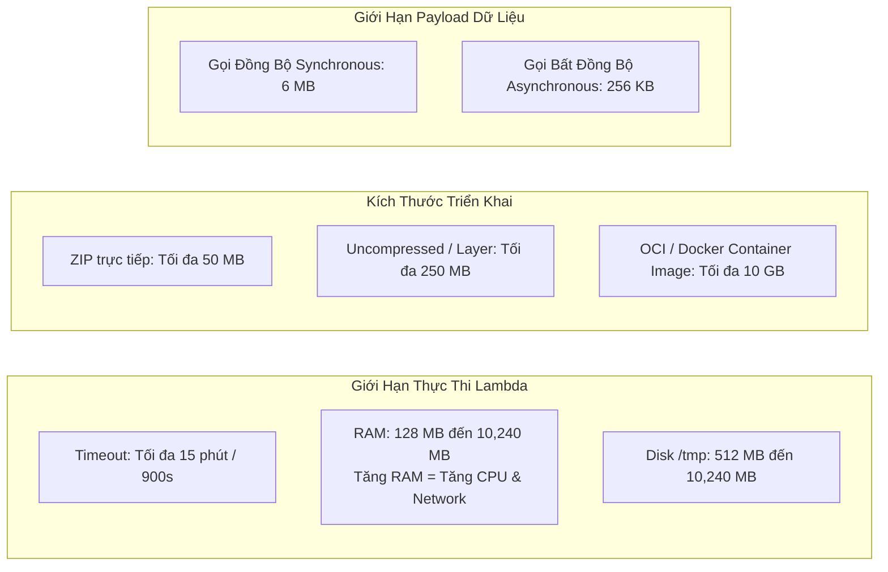
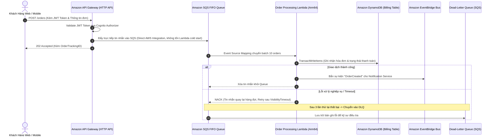

# Tài Liệu Học Tập Chuyên Sâu: AWS Lambda, Amazon API Gateway, DynamoDB & Kiến Trúc Phi Máy Chủ (Serverless Architecture)

> **Tài liệu chuẩn hóa kiến trúc đám mây**: Hướng dẫn toàn diện theo tiêu chuẩn Senior AWS Solutions Architect & Cloud DevOps Engineer (cập nhật mới nhất 2026).  
> **Ngôn ngữ**: Tiếng Việt (Bảo lưu toàn bộ thuật ngữ chuyên ngành tiếng Anh chuẩn AWS).  
> **Các dịch vụ liên quan**: AWS Lambda, Amazon API Gateway, Amazon DynamoDB, AWS Step Functions, Amazon Cognito, Amazon EventBridge.

---

## 6.1. Tổng Quan Dịch Vụ (Service Overview)

### Dịch vụ gì?
Mô hình điện toán phi máy chủ (**Serverless**) trên AWS cho phép lập trình viên và kiến trúc sư đám mây xây dựng và vận hành các ứng dụng hoàn chỉnh mà không cần cấu hình, bảo trì hay quản lý bất kỳ cụm máy ảo nào. Bộ tứ trụ cột Serverless cốt lõi bao gồm:
1. **AWS Lambda**: Dịch vụ tính toán phi máy chủ (Function-as-a-Service - FaaS), thực thi mã nguồn để phản hồi lại các sự kiện (Events), tự động co giãn từ 0 đến hàng chục ngàn lượt thực thi đồng thời và chỉ tính phí chính xác theo từng millisecond thực thi mã (GB-seconds).
2. **Amazon API Gateway**: Cổng kết nối API được quản lý toàn diện cho phép tạo, xuất bản, bảo mật, đo lường và giám sát các REST API, HTTP API và WebSocket API ở bất kỳ quy mô nào.
3. **Amazon DynamoDB**: Cơ sở dữ liệu NoSQL dạng Key-Value và Document hoàn toàn phi máy chủ, cung cấp độ trễ phản hồi dưới 10 millisecond (**Single-digit millisecond latency**) ở bất kỳ quy mô lưu trữ và thông lượng nào.
4. **AWS Step Functions**: Dịch vụ điều phối quy trình phân tán (Visual Workflow Orchestration) sử dụng máy trạng thái (State Machines) để kết nối các microservices, xử lý luồng rẽ nhánh và rollback giao dịch (Saga Pattern).
5. **Amazon Cognito**: Dịch vụ quản lý danh tính người dùng ứng dụng di động/web, hỗ trợ đăng nhập, đăng ký và cấp quyền truy cập tài nguyên AWS an toàn.

---

## 6.2. Các Khái Niệm, Kiến Trúc & Vận Hành Cốt Lõi (Core Concepts, Security & Day-2 Operations)

### 1. Giới Hạn Kỹ Thuật Sống Còn của AWS Lambda (Lambda Limits & Runtime)

- **Thời gian thực thi tối đa (Execution Timeout)**: **Tối đa 15 phút (900 giây)** cho một lần gọi. Không dùng Lambda cho các tác vụ phân tích batch kéo dài hàng giờ (chuyển sang AWS Fargate hoặc AWS Batch).
- **Cấp phát bộ nhớ RAM**: Từ **128 MB đến 10 GB**. Khi tăng RAM, AWS tự động tăng tuyến tính sức mạnh vCPU (tại 1,769 MB RAM, Lambda được cấp chính xác 1 vCPU đầy đủ).
- **Ổ đĩa tạm thời (`/tmp`)**: Khởi tạo từ 512 MB lên tới 10 GB, có thể dùng để giải nén model AI hoặc cache dữ liệu lớn trong cùng một môi trường thực thi.
- **Payload Limits**: 6 MB cho gọi đồng bộ (qua API Gateway / SDK invoke) và 256 KB cho gọi bất đồng bộ (qua SNS / S3 / EventBridge).

---

### 2. Quản Trị Concurrency, Cold Start & SnapStart

- **Cold Start (Khởi động lạnh)**: Khi có request mới mà chưa có môi trường thực thi nào sẵn sàng, Lambda phải tải code, khởi động container runtime, và chạy đoạn mã khởi tạo bên ngoài handler (`init code`). Gây độ trễ từ vài trăm ms đến vài giây (đặc biệt với Java/.NET).
- **Reserved Concurrency**: Cố định số lượng thực thi đồng thời dành riêng cho một hàm (ví dụ: cấp 200 execution slots). Vừa đảm bảo hàm luôn có slot chạy, vừa đóng vai trò làm trần giới hạn bảo vệ database phía sau khỏi bị sập do quá tải kết nối.
- **Provisioned Concurrency**: Khởi tạo và "làm ấm" sẵn môi trường thực thi 24/7, **triệt tiêu hoàn toàn độ trễ Cold Start**, phản hồi ngay lập tức dưới 10ms.
- **Lambda SnapStart (cho Java 11/17/21)**: Chụp snapshot toàn bộ trạng thái bộ nhớ MicroVM sau khi hoàn tất init và cache lại; khi có request, Lambda khôi phục tức thời từ snapshot, giảm độ trễ khởi động tới **90%** mà không mất thêm chi phí duy trì.
- **Response Streaming**: Cho phép hàm Lambda truyền luồng phản hồi dữ liệu về client theo từng phần (Chunked Transfer) mà không cần đợi toàn bộ payload hoàn tất, giúp giảm Time-to-First-Byte (TTFB) và vượt giới hạn payload 6 MB (lên tới 20 MB).

---

### 3. Mô Hình Kích Hoạt Lambda: Sync vs Async vs Event Source Mapping

```mermaid
flowchart TD
    subgraph SyncModel[1. Synchronous Invocation]
        APIGW[API Gateway / ALB] -->|Chờ kết quả trả về ngay| L1[AWS Lambda]
        L1 -->|Return Payload / Error| APIGW
    end

    subgraph AsyncModel[2. Asynchronous Invocation]
        S3[S3 / SNS / EventBridge] -->|HTTP 202 Accepted| Queue[(Internal Lambda Queue)]
        Queue --> L2[AWS Lambda]
        L2 -.->|Retry 2 lần thất bại| DLQ[(Dead-Letter Queue SQS / SNS / Destination)]
    end

    subgraph ESMModel[3. Event Source Mapping Polling]
        Streams[(DynamoDB Streams / Kinesis / SQS)] -->|Lambda Service tự động Poll| ESM[Event Source Mapping]
        ESM -->|Batching Records| L3[AWS Lambda]
    end
```

---

### 4. Amazon API Gateway: HTTP APIs vs REST APIs

| Tiêu chuẩn so sánh | HTTP APIs (Thế hệ mới) | REST APIs (Thế hệ chuẩn) |
| :--- | :--- | :--- |
| **Đơn giá cuộc gọi** | **$1.00 / 1 triệu requests** (**Rẻ hơn 71%**) | **$3.50 / 1 triệu requests** |
| **Độ trễ xử lý** | Siêu thấp (< 10ms xử lý gateway) | Trung bình (20 - 40ms) |
| **Cơ chế xác thực** | Native OIDC / OAuth2 JWT Authorizer, Lambda Authorizer | Lambda Authorizer, Cognito User Pools, IAM (SigV4), API Keys |
| **Tính năng doanh nghiệp** | Hỗ trợ CORS, OIDC native, tự động deploy | **API Caching**, **Request/Response Validation**, **WAF Integration**, **Usage Plans & Throttling theo khách hàng**, Mock Endpoints |
| **Khuyến nghị kiến trúc** | Serverless microservices hiện đại, proxy Lambda đơn giản, tối ưu chi phí | Hệ thống API thương mại cho đối tác B2B, cần Rate Limit theo API Key hoặc bảo vệ bởi AWS WAF |

---

### 5. Amazon DynamoDB: Kiến Trúc NoSQL & Tối Ưu Phân Vùng

- **Khóa chính (Primary Key)**:
  - *Partition Key (PK)*: Băm giá trị qua thuật toán hash để phân bổ bản ghi vào phân vùng vật lý (Physical Partition). PK phải có độ biến thiên cao (High Cardinality) để tránh tạo ra **Hot Partition**.
  - *Sort Key (SK)*: Sắp xếp các bản ghi có cùng Partition Key theo thứ tự vật lý, cho phép truy vấn dải (`begins_with`, `between`).
- **Secondary Indexes**:
  - *Local Secondary Index (LSI)*: Cùng PK với bảng chính nhưng khác SK. Phải tạo ngay khi tạo bảng (không thể thêm sau), chia sẻ hạn mức RCU/WCU của bảng chính.
  - *Global Secondary Index (GSI)*: PK và SK hoàn toàn mới. Có thể tạo hoặc xóa bất kỳ lúc nào, sở hữu hạn mức RCU/WCU độc lập.
- **DynamoDB Streams & CDC**: Ghi nhận toàn bộ biến động dữ liệu theo thứ tự thời gian, tự động kích hoạt Lambda xử lý hậu kỳ (Real-time analytics, cache invalidation).
- **Amazon DynamoDB Accelerator (DAX)**: Cụm bộ nhớ đệm in-memory hoàn toàn tương thích API của DynamoDB, giảm độ trễ đọc từ mili-giây xuống **micro-giây**.

---

### 🏛️ I. Các Kịch Bản Kiến Trúc Chuẩn (Best Practice Scenarios)

#### 1. Pipeline Ingestion Serverless Hoàn Toàn: SQS Standard + Lambda + DynamoDB Auto-Scaling
- **Tình huống thi**: Hệ thống IoT nhận telemetry dữ liệu cảm biến xe hơi với lưu lượng thay đổi thất thường. Yêu cầu kiến trúc 100% serverless, không cần cấu hình dung lượng thủ công (no manual capacity provisioning).
- **Giải pháp tối ưu chuẩn AWS**:
  - Dữ liệu cảm biến đẩy vào **Amazon SQS Standard Queue**.
  - **AWS Lambda** tự động poll tin nhắn theo lô (batches) thông qua cơ chế Event Source Mapping (ESM).
  - Lambda ghi dữ liệu vào bảng **Amazon DynamoDB** được cấu hình chế độ **On-Demand Capacity** hoặc **Provisioned Mode kèm Auto-Scaling**.
  - **Lợi ích**: Toàn bộ hệ thống tự động co giãn từ 0 đến hàng ngàn request/s mà không cần can thiệp vận hành.

#### 2. Điều Phối Quy Trình Serverless Phức Tạp Bằng AWS Step Functions (Orchestration vs Choreography)
- **Tình huống thi**: Quy trình xử lý ảnh/video hoặc pipeline Data Lake ETL cần chạy tuần tự nhiều bước, kiểm tra điều kiện, xử lý lỗi (retry/catch), và có các tác vụ batch kéo dài.
- **Giải pháp chuẩn**:
  - Không viết một hàm Lambda "khổng lồ" chứa toàn bộ logic (Anti-pattern).
  - Sử dụng **AWS Step Functions (Standard Workflow)** làm bộ điều phối trạng thái (State Machine):
    - Bước 1: Lambda validate input.
    - Bước 2: Trigger **AWS Glue ETL Job** hoặc **AWS Batch** để xử lý nặng.
    - Bước 3: Đợi tác vụ hoàn tất (sử dụng service integration `.sync`).
    - Bước 4: Gửi thông báo SNS khi thành công hoặc đẩy vào DLQ khi thất bại.

#### 3. Quản Trị Concurrency Bảo Vệ Database Phía Sau (RDS / Aurora)
- **Tình huống thi**: Ứng dụng Serverless gọi vào cơ sở dữ liệu quan hệ (Amazon RDS/Aurora). Khi traffic tăng đột biến, hàng ngàn Lambda instance khởi tạo đồng thời làm cạn kiệt connection pool của Database.
- **Giải pháp chuẩn**:
  - Cấu hình **Reserved Concurrency** trên hàm Lambda (ví dụ: giới hạn tối đa 50 concurrent executions) để tạo trần chặn quá tải database.
  - Kết hợp sử dụng **Amazon RDS Proxy**: Quản lý connection pool tập trung, chia sẻ kết nối giữa các hàm Lambda, giảm thiểu 90% chi phí mở kết nối mới.

---

### 🪤 II. Các Bẫy Thi Tinh Vi & Phân Tích Phương Án Sai (Exam Traps & Distractors)

#### 🪤 Bẫy 1: Giới Hạn Thời Gian 15 Phút Của Lambda (Execution Timeout) — (U-PT2 Q02)
- **Tình huống đề thi**: *"Doanh nghiệp có một script phân tích dữ liệu cần chạy định kỳ mỗi đêm, thời gian thực thi mất từ 25 đến 30 phút. Giải pháp Serverless nào tối ưu và tốn ít công quản trị nhất?"*
- **Các phương án bẫy**:
  - ❌ *Dùng AWS Lambda*: Giới hạn cứng bất biến của Lambda là **tối đa 15 phút (900 giây)**. Bất kỳ tác vụ nào vượt quá 15 phút đều bị Lambda hủy bỏ bắt buộc (Force Kill). Không thể cấu hình timeout lớn hơn 15m.
  - ❌ *Chia nhỏ hàm Lambda thành nhiều hàm lồng nhau*: Gây phức tạp mã nguồn và khó bảo trì không cần thiết.
- **Giải pháp ĐÚNG**: Sử dụng **Amazon ECS Task chạy trên AWS Fargate**, được lập lịch kích hoạt bởi **Amazon EventBridge Scheduler**.
  - AWS Fargate là serverless container (không cần quản lý máy chủ EC2).
  - Không có giới hạn thời gian chạy (có thể chạy bao lâu tùy ý).

#### 🪤 Bẫy 2: Tái Sử Dụng Mã Nguồn & Thư Viện Giữa Nhiều Lambda (Lambda Layers) — (CM-PT1 Q17)
- **Tình huống đề thi**: *"Đội ngũ phát triển xây dựng nhiều microservices bằng AWS Lambda. Có một bộ thư viện tiện ích (common utilities/logging) cần được dùng chung giữa tất cả các hàm và phải cập nhật phiên bản dễ dàng với chi phí vận hành thấp nhất."*
- **Các phương án bẫy**:
  - ❌ *Đóng gói thư viện vào từng file ZIP của mỗi hàm*: Mỗi lần sửa 1 dòng code tiện ích phải build và redeploy toàn bộ hàng chục hàm Lambda.
  - ❌ *Lưu file code trên S3 và cho Lambda tải về khi chạy*: Tăng đáng kể độ trễ Cold Start và chi phí request S3.
  - ❌ *Chuyển toàn bộ sang Container Image*: Tăng kích thước package và overhead quy trình CI/CD.
- **Giải pháp ĐÚNG**: Đóng gói thư viện vào **AWS Lambda Layers**.
  - Một Layer có thể được chia sẻ giữa nhiều Lambda functions trong cùng tài khoản hoặc xuyên tài khoản.
  - Hỗ trợ đánh số phiên bản (Versioning) rõ ràng. Mỗi hàm Lambda có thể gắn tối đa 5 Layers.

#### 🪤 Bẫy 3: Trùng Lặp Định Danh Ngẫu Nhiên (UUID) Trong Lambda SnapStart — (CM-PT1 Q27)
- **Tình huống đề thi**: *"Ứng dụng Java sử dụng AWS Lambda SnapStart để tối ưu Cold Start. Sau khi triển khai, hệ thống phát hiện các mã giao dịch ngẫu nhiên (UUID) tạo ra từ các execution environments khác nhau bị trùng lặp nhau hoàn toàn."*
- **Nguyên nhân cốt lõi**:
  - SnapStart khởi động container, thực thi toàn bộ giai đoạn `Init`, sau đó chụp snapshot bộ nhớ RAM và lưu trữ.
  - Nếu mã nguồn sinh UUID hoặc thiết lập random seed ngay trong giai đoạn `Init` tĩnh trước snapshot, trạng thái bộ nhớ đó sẽ được giữ nguyên cho mọi instance khôi phục sau này -> **toàn bộ các instance mới đều mang cùng 1 giá trị ID**!
- **Giải pháp ĐÚNG**: Sử dụng **CRaC (Coordinated Restore at Checkpoint) API**:
  - Gọi `org.crac.Core.getGlobalContext().register(resource)` để đăng ký **pre-snapshot hook** hoặc **post-restore hook**.
  - Đảm bảo các giá trị ngẫu nhiên, UUID, hoặc kết nối mạng được tạo mới lại tại thời điểm runtime sau khi restore.

#### 🪤 Bẫy 4: Phân Biệt Tuyệt Đối Cognito User Pools vs Cognito Identity Pools — (U-PT6 Q39, U-PT2 Q14)
- **Bẫy thi kinh điển**: Đề thi thường yêu cầu người dùng ứng dụng di động tải file trực tiếp lên S3 hoặc đăng nhập vào Web. Thí sinh rất dễ nhầm lẫn giữa User Pool và Identity Pool.

| Tiêu chuẩn so sánh | Amazon Cognito User Pool | Amazon Cognito Identity Pool (Federated Identities) |
|:---|:---|:---|
| **Mục đích chính** | **Xác thực danh tính (Authentication)** | **Cấp quyền truy cập tài nguyên AWS (Authorization)** |
| **Đầu ra (Output)** | Trả về các **JWT Tokens** (ID Token, Access Token, Refresh Token) | Trả về **AWS Temporary Credentials** (Access Key, Secret Key, Session Token) |
| **Cấp quyền AWS** | ❌ **KHÔNG** cấp quyền truy cập tài nguyên AWS trực tiếp | ✅ **Gán IAM Role** cho user để gọi thẳng API AWS (S3, DynamoDB) |
| **Tích hợp ALB** | ✅ **ALB hỗ trợ native** xác thực người dùng qua User Pool listener rules | ❌ Không gắn trực tiếp vào ALB listener rules |
| **Đăng nhập xã hội** | Hỗ trợ Sign-in with Apple, Google, Facebook, SAML, OIDC | Nhận token từ User Pool hoặc Google/Facebook để đổi lấy IAM Role |

- **Quy tắc thi cử**:
  - Người dùng đăng nhập web qua ALB -> **Cognito User Pool**.
  - App di động cần upload trực tiếp lên S3 bucket riêng của user -> **Cognito User Pool (đăng nhập) + Cognito Identity Pool (lấy quyền IAM Role ghi vào S3)**.

#### 🪤 Bẫy 5: Nghẽn Lưu Lượng Khi SNS Gửi Tin Tới Lambda (SNS-to-Lambda Delivery Bottlenecks) — (U-PT1 Q34)
- **Tình huống đề thi**: *"Amazon SNS fan-out tin nhắn tới hàng ngàn subscribers, trong đó có một hàm AWS Lambda. Đội ngũ phát hiện một lượng lớn tin nhắn bị chậm trễ hoặc thất bại khi invoke Lambda."*
- **Nguyên nhân & Khắc phục**:
  - Khi SNS invoke Lambda (theo mô hình Asynchronous), số lượng concurrency của Lambda tăng vọt. Nếu tài khoản đạt ngưỡng giới hạn **Account Concurrency Limit** (mặc định 1,000 unreserved concurrency/Region), các yêu cầu invoke tiếp theo sẽ bị throttle.
  - **Giải pháp**: Yêu cầu AWS Support tăng **Account Concurrency Quota** hoặc cấu hình SQS làm buffer đệm giữa SNS và Lambda.

---

### 📊 III. Ma Trận Quyết Định Công Nghệ Serverless Nhanh (Exam Decision Matrix)

| Tình huống / Yêu cầu trong đề thi | Giải pháp chuẩn AWS | Giải pháp bị loại & Lý do |
|:---|:---|:---|
| **Tác vụ tính toán chạy > 15 phút (20-60 phút)** | **ECS on AWS Fargate** (+ EventBridge) | Loại Lambda (hard limit timeout 15 phút) |
| **Chia sẻ mã tiện ích/lib giữa nhiều Lambda** | **AWS Lambda Layers** | Loại S3 download (tăng Cold Start & chi phí) |
| **Giảm Cold Start cho ứng dụng Java 90%** | **AWS Lambda SnapStart** | Provisioned Concurrency tốn chi phí 24/7 |
| **Xác thực người dùng Web trên ALB không viết code** | **ALB + Cognito User Pool** | Loại tự dựng IdP server trên EC2 |
| **Cấp quyền cho Mobile App ghi trực tiếp vào S3** | **Cognito Identity Pool** (+ User Pool) | User Pool đơn thuần không sinh AWS IAM credentials |
| **Bảo vệ RDS không bị sập kết nối bởi Lambda** | **Amazon RDS Proxy** (+ Reserved Concurrency) | Loại tăng RAM Lambda (không giải quyết connection pool) |
| **Điều phối luồng nghiệp vụ phân tán, có retry** | **AWS Step Functions** | Loại viết code logic lồng nhau trong 1 hàm Lambda |
| **Xử lý luồng dữ liệu thời gian thực hàng ngàn record** | **Kinesis Data Streams + Lambda** | SQS không hỗ trợ replay dữ liệu theo shard |

---

---

---

## 6.3. Kiến Trúc Thực Tế và Luồng Vận Hành (Production Architecture & Workflow)

### Kiến trúc Webhook & Xử Lý Đơn Hàng Phi Máy Chủ Bất Đồng Bộ

---

## 6.4. Bảng Tích Hợp với Các Dịch Vụ AWS Khác (Integration Table)

| Related AWS Service | Purpose (Mục đích tích hợp) | Integration Method (Phương thức tích hợp) | Practical Example (Ví dụ thực tiễn) |
| :--- | :--- | :--- | :--- |
| **Amazon S3** | Xử lý sự kiện lưu trữ phi máy chủ | S3 Event Notifications | Tự động kích hoạt Lambda sinh thumbnail và trích xuất metadata khi người dùng tải ảnh lên S3. |
| **Amazon RDS / Aurora** | Quản lý kết nối cơ sở dữ liệu bền bỉ | **Amazon RDS Proxy** | Hàng ngàn container Lambda đồng thời chia sẻ một connection pool nhỏ qua RDS Proxy, tránh làm sập PostgreSQL/MySQL. |
| **Amazon SQS / SNS** | Phân tách (Decouple) các thành phần kiến trúc | Event Source Mapping & Push Triggers | Lambda tiêu thụ hàng đợi tin nhắn bất đồng bộ, tự động scale out theo số lượng thông điệp trong queue. |
| **AWS Step Functions** | Điều phối quy trình nghiệp vụ nhiều bước | Task State `arn:aws:states:::lambda:invoke` | Quy trình duyệt hoàn tiền: Kiểm tra số dư ➔ Trừ ví ➔ Gửi SMS ➔ Báo cáo kế toán (có tự động retry và catch error). |
| **Amazon CloudWatch** | Giám sát hiệu năng và truy vết lỗi | CloudWatch Logs Insights & X-Ray Tracing | Bật AWS X-Ray Active Tracing để đo đạc chính xác thời gian khởi tạo container (Cold Start) và thời gian thực thi hàm. |
| **AWS Secrets Manager** | Bảo mật chuỗi kết nối và API keys | Lambda Extensions / SDK Caching | Lambda nạp API Key bên thứ 3 và cache trong bộ nhớ RAM, tự động lấy secret mới khi được xoay vòng. |

---

## 6.5. Bảng So Sánh Trong Hệ Sinh Thái AWS (Ecosystem Comparison)

### So sánh các nền tảng tính toán cho Microservices trên AWS

| Tiêu chí | AWS Lambda | AWS Fargate (ECS/EKS) | AWS App Runner | Amazon EC2 |
| :--- | :--- | :--- | :--- | :--- |
| **Mô hình tính toán** | Function-as-a-Service (FaaS) hướng sự kiện. | Container-as-a-Service (CaaS) phi máy chủ. | Platform-as-a-Service (PaaS) triển khai web/API tự động. | Infrastructure-as-a-Service (IaaS) máy ảo chuyên dụng. |
| **Giới hạn thời gian chạy** | **Tối đa 15 phút (900 giây)**. | **Không giới hạn** (chạy tiến trình liên tục 24/7). | **Không giới hạn** (phù hợp HTTP request dài). | **Không giới hạn**. |
| **Khả năng co giãn về 0 (Scale to Zero)** |  **Có (Mặc định)**: $0 khi không có lưu lượng. | ❌ Không tự về 0 (phải duy trì tối thiểu 1 task). |  Có thể tạm dừng instance khi không có request. | ❌ Không tự về 0 (phải duy trì instance bật). |
| **Độ trễ khởi động** | Vài mili-giây (Warm) đến vài giây (Cold Start). | Khoảng 30 giây đến 2 phút để kéo image và chạy task. | Vài giây đến 1 phút khi scale up. | Vài phút khi ASG khởi tạo máy ảo mới. |
| **Cơ chế tính phí** | Làm tròn tới **1 ms** theo dung lượng RAM và thời gian chạy. | Tính theo từng giây dựa trên vCPU và GB RAM cấp phát. | Tính theo vCPU/RAM active + phí duy trì memory khi idle. | Tính theo từng giây chạy của máy ảo (cố định). |
| **Trường hợp sử dụng tối ưu** | Tác vụ xử lý sự kiện ngắn, webhook, API tải đột biến thất thường. | Microservices chạy liên tục, background worker dài ngày, websockets. | Ứng dụng web/REST API container hóa đơn giản cần CI/CD tự động. | Ứng dụng legacy, kiến trúc monlithic, yêu cầu tùy biến sâu kernel OS. |

---

## 6.6. Mô Hình Tính Phí & Chiến Lược Tối Ưu Chi Phí (FinOps & Cost Optimization)

### 6.6.1. Bảng Cấu Trúc Định Giá Chi Tiết

| Thành phần Dịch Vụ | Đơn giá AWS niêm yết | Cơ chế đo lường | Ghi chú tối ưu hóa chi phí FinOps |
| :--- | :--- | :--- | :--- |
| **AWS Lambda (x86_64)** | **$0.0000166667 / GB-s** | Tính theo mili-giây (1 ms) thực thi | 1 triệu request và 3.2 triệu GB-s miễn phí mỗi tháng (Free Tier vĩnh viễn). |
| **AWS Lambda (Arm64 Graviton)** | **$0.0000133334 / GB-s** | Rẻ hơn **20%** so với x86 | Chuyển đổi kiến trúc sang Arm64 cho Python, Node.js, Go để tiết kiệm ngay 20%. |
| **Amazon API Gateway (HTTP API)** | **$1.00 / 1 triệu requests** | Tính trên mỗi request nhận được | Rẻ hơn 71% so với REST API ($3.50/triệu requests). |
| **Amazon DynamoDB (On-Demand)** | **$1.25 / 1M WRU** & **$0.25 / 1M RRU** | Tính trên lượt đọc/ghi thực tế | Phù hợp cho tải khó đoán hoặc mới ra mắt; chuyển sang Provisioned khi tải ổn định. |
| **Amazon DynamoDB (Provisioned)** | **$0.00065 / WCU / giờ** (~$0.47/tháng) **$0.00013 / RCU / giờ** (~$0.09/tháng) | Miễn phí 25 WCU và 25 RCU cố định | Bật Auto Scaling để giảm 80% chi phí so với On-Demand trên tải đều đặn. |
| **AWS Step Functions (Express)** | **$1.00 / 1 triệu executions** | $1/triệu + cước GB-s | Rẻ hơn 97% so với Standard Workflows ($25/triệu transitions) cho tác vụ < 5 phút. |

---

### 6.6.2. 5 Kịch Bản Tối Ưu Hóa Chi Phí Thực Tế (FinOps Scenarios)

#### Kịch bản 1: Chuyển đổi API Gateway từ REST API sang HTTP API
- **Bối cảnh**: Hệ thống backend di động tiếp nhận **120 triệu lượt gọi API** mỗi tháng. Kỹ sư khởi tạo cổng API bằng REST API mặc định.
- **Tính toán chi phí REST API**:
  $$\text{Cost}_{\text{REST}} = \left( \frac{120{,}000{,}000}{1{,}000{,}000} \right) \times \$3.50 = \$420/\text{tháng}$$
- **Giải pháp tối ưu**:
  - Đánh giá kiến trúc: Ứng dụng chỉ dùng xác thực JWT qua Cognito và chuyển tiếp request về Lambda (không cần API Keys hay Request XML Transformation).
  - Chuyển sang **HTTP API** với đơn giá $1.00/1 triệu calls:
  $$\text{Cost}_{\text{HTTP}} = \left( \frac{120{,}000{,}000}{1{,}000{,}000} \right) \times \$1.00 = \$120/\text{tháng}$$
- **Hiệu quả kinh tế**:
  $$\text{Tiết kiệm} = \$420 - \$120 = \$300/\text{tháng} \quad (\$3{,}600/\text{năm}) \implies \text{Cắt giảm } 71.4\% \text{ chi phí API}$$

#### Kịch bản 2: Tối ưu dung lượng RAM bằng AWS Lambda Power Tuning (Nghịch lý Serverless)
- **Bối cảnh**: Kỹ sư nghĩ rằng cấu hình mức RAM nhỏ nhất (**128 MB**) sẽ tiết kiệm chi phí nhất. Một tác vụ xử lý đồ họa với 128 MB RAM (nhận tỷ lệ CPU rất nhỏ) mất **8.0 giây (8,000 ms)** để hoàn thành. Hệ thống chạy 5 triệu lần mỗi tháng.
- **Tính toán chi phí 128 MB**:
  $$\text{Cost}_{128\text{MB}} = 5{,}000{,}000 \times 8.0 \text{ s} \times \left( \frac{128}{1024} \text{ GB} \right) \times \$0.0000166667 = \$83.33/\text{tháng}$$
- **Giải pháp tối ưu**:
  - Dùng công cụ **AWS Lambda Power Tuning** nâng RAM lên **1,024 MB (1 GB)**. Tại mức này, hàm được cấp 1 vCPU trọn vẹn, thời gian xử lý giảm mạnh xuống chỉ còn **0.4 giây (400 ms)**:
  $$\text{Cost}_{1024\text{MB}} = 5{,}000{,}000 \times 0.4 \text{ s} \times \left( \frac{1024}{1024} \text{ GB} \right) \times \$0.0000166667 = \$33.33/\text{tháng}$$
- **Hiệu quả kinh tế**:
  $$\text{Tiết kiệm} = \$83.33 - \$33.33 = \$50.00/\text{tháng} \quad (\$600/\text{năm}) \implies \text{Tiết kiệm } 60\% \text{ chi phí, tăng tốc } 20\text{ lần}$$

#### Kịch bản 3: Chuyển đổi Runtime Lambda sang chip ARM64 (AWS Graviton)
- **Bối cảnh**: Hệ thống microservices gồm 40 hàm Lambda viết bằng Node.js và Python chạy trên kiến trúc `x86_64`, tiêu tốn trung bình 15,000,000 GB-seconds mỗi tháng.
- **Tính toán chi phí x86**:
  $$\text{Cost}_{\text{x86}} = 15{,}000{,}000 \times \$0.0000166667 = \$250.00/\text{tháng}$$
- **Giải pháp tối ưu**:
  - Chuyển đổi cờ cấu hình kiến trúc sang **`arm64` (AWS Graviton)** trên Console hoặc Terraform mà không cần đổi mã nguồn:
  $$\text{Cost}_{\text{Arm64}} = 15{,}000{,}000 \times \$0.0000133334 = \$200.00/\text{tháng}$$
- **Hiệu quả kinh tế**:
  $$\text{Tiết kiệm} = \$250.00 - \$200.00 = \$50.00/\text{tháng} \quad (\$600/\text{năm}) \implies \text{Tiết kiệm ngay } 20\% \text{ chi phí tính toán}$$

#### Kịch bản 4: DynamoDB On-Demand vs Provisioned Capacity Mode kèm Auto Scaling
- **Bối cảnh**: Một ứng dụng thương mại điện tử có lưu lượng ghi ổn định liên tục **400 WCU** (400 writes/giây) suốt 24/7 (tương đương khoảng 1.036 tỷ lượt ghi mỗi tháng).
- **Tính toán chi phí On-Demand Mode**:
  $$\text{Cost}_{\text{OnDemand}} = \left( \frac{1{,}036{,}800{,}000}{1{,}000{,}000} \right) \times \$1.25 = \$1{,}296/\text{tháng}$$
- **Giải pháp tối ưu**:
  - Chuyển sang **Provisioned Capacity Mode** với Auto Scaling (cấp phát 400 WCU, trừ đi 25 WCU miễn phí):
  $$\text{Cost}_{\text{Provisioned}} = (400 - 25) \text{ WCU} \times \$0.00065/\text{giờ} \times 730 \text{ giờ} = \$177.94/\text{tháng}$$
- **Hiệu quả kinh tế**:
  $$\text{Tiết kiệm} = \$1{,}296 - \$177.94 = \$1{,}118.06/\text{tháng} \quad (\$13{,}416/\text{năm}) \implies \text{Tiết kiệm } 86.3\% \text{ chi phí DB}$$

#### Kịch bản 5: Chuyển đổi Step Functions từ Standard sang Express Workflows
- **Bối cảnh**: Hệ thống phân tích thanh toán xử lý **8 triệu giao dịch/tháng**. Mỗi giao dịch trải qua 5 bước chuyển trạng thái (State Transitions). Tất cả giao dịch hoàn thành trong vòng dưới 3 giây.
- **Tính toán chi phí Standard Workflows**:
  $$\text{Số transitions} = 8{,}000{,}000 \times 5 = 40{,}000{,}000 \text{ transitions}$$
  $$\text{Cost}_{\text{Standard}} = \left( \frac{40{,}000{,}000}{1{,}000} \right) \times \$0.025 = \$1{,}000/\text{tháng}$$
- **Giải pháp tối ưu**:
  - Chuyển sang **Express Workflows** (thiết kế chuyên biệt cho tác vụ xử lý sự kiện ngắn dưới 5 phút):
  $$\text{Phí thực thi} = 8 \text{ triệu} \times \$1.00/\text{triệu} = \$8.00$$
  $$\text{Phí thời gian chạy (3s @ 256MB RAM)} \approx \$20.00$$
  $$\text{Total Cost}_{\text{Express}} = \$8.00 + \$20.00 = \$28.00/\text{tháng}$$
- **Hiệu quả kinh tế**:
  $$\text{Tiết kiệm} = \$1{,}000 - \$28 = \$972/\text{tháng} \quad (\$11{,}664/\text{năm}) \implies \text{Tiết kiệm } 97.2\% \text{ chi phí điều phối}$$

---

## 6.7. Khắc Phục Sự Cố Thực Tế (Troubleshooting Guide)

| Tình huống sự cố (Problem) | Nguyên nhân cốt lõi (Root Cause) | Các bước điều tra & Chỉ số giám sát (Metrics & Logs) | Giải pháp khắc phục (Remediation) | Biện pháp phòng ngừa (Prevention) |
| :--- | :--- | :--- | :--- | :--- |
| **Lỗi `Task timed out after 3.00 seconds` trên Lambda** | Thời gian timeout mặc định là 3 giây; mã nguồn gọi API ngoài hoặc truy vấn database bị chậm vượt quá thời gian này. | - Xem CloudWatch Logs: `REPORT RequestId: ... Duration: 3000.00 ms Status: timeout`. - Giám sát CloudWatch metric `Duration` và `Errors`. | Tăng thông số **Timeout** trong cấu hình của Lambda lên giá trị thực tế (ví dụ: 15s - 30s). | Thiết lập kết nối timeout trên HTTP Client trong code để fail-fast; cấu hình CloudWatch Alarm cho metric `Errors`. |
| **Lambda trong VPC không thể gọi API ra ngoài Internet** | Subnet gắn Lambda không có route ra Internet hoặc bị đặt nhầm vào Public Subnet không có NAT Gateway. | - Kiểm tra Route Table của Subnet gắn Lambda ENI. - Tra cứu lỗi kết nối mạng `ETIMEDOUT` hoặc `Connection refused`. | Đặt Lambda vào **Private Subnet** và cấu hình Route Table trỏ `0.0.0.0/0` tới **NAT Gateway** ở Public Subnet. | Nhớ nguyên tắc: Lambda trong VPC không bao giờ nhận Public IP; bắt buộc phải đi qua NAT Gateway để ra ngoài. |
| **DynamoDB báo lỗi `ProvisionedThroughputExceededException`** | Tốc độ đọc/ghi vượt quá hạn mức RCU/WCU đã cấp phát, hoặc do thiết kế Partition Key kém gây **Hot Partition**. | - Xem CloudWatch metric `ThrottledRequests` và `ReadThrottleEvents`. - Kiểm tra phân bổ dữ liệu trên CloudWatch Contributor Insights. | 1. Bật **Auto Scaling** cho bảng DynamoDB. 2. Chuyển sang chế độ **On-Demand Capacity**. 3. Áp dụng Exponential Backoff trong SDK. | Thiết kế Partition Key có độ phân tán cao (High Cardinality) hoặc kết hợp kỹ thuật Salted Key. |
| **Khách hàng gặp lỗi `HTTP 429 Too Many Requests` từ API Gateway** | Lưu lượng gọi API vượt quá giới hạn Rate Limits hoặc Burst Limits của tài khoản hoặc Usage Plan. | - Giám sát CloudWatch metric `4XXError` và `IntegrationLatency` trên API Gateway Console. | Nâng giới hạn Throttling Limits trong API Gateway Stage/Usage Plan hoặc gửi yêu cầu tăng Service Quotas. | Kích hoạt tính năng **API Gateway Caching** để trả về dữ liệu đệm cho các request trùng lặp. |
| **Tăng vọt số lượng Cold Starts gây trễ hệ thống thanh toán** | Tải tăng đột biến không dự đoán trước khiến Lambda phải liên tục khởi tạo container MicroVM mới. | - Tra cứu log tìm chuỗi `Init Duration: ... ms`. - Giám sát metric `ConcurrentExecutions`. | 1. Bật **Provisioned Concurrency** cho các endpoints thanh toán quan trọng. 2. Kích hoạt **Lambda SnapStart** nếu dùng runtime Java. | Tối ưu mã nguồn khởi tạo (Init code): Lazy-load các thư viện không cần thiết và giữ kết nối DB ngoài handler. |

---

---

## 6.8. Tóm Tắt và Danh Mục Kiểm Tra Kiến Thức (Summary & Learning Checklist)

### 7 Nguyên Tắc Vàng Kiến Trúc Serverless AWS (Golden Rules)
1. **Tuân thủ giới hạn 15 phút**: Lambda chỉ dành cho tác vụ ngắn dưới 900 giây; tác vụ dài hơn bắt buộc chuyển sang ECS Fargate.
2. **Nghịch lý RAM và CPU**: Tăng RAM giúp tăng CPU tương ứng; nhiều trường hợp tăng RAM giúp hàm chạy nhanh gấp nhiều lần và tổng chi phí lại rẻ hơn.
3. **Ưu tiên Arm64 Graviton**: Luôn chuyển đổi kiến trúc Lambda sang `arm64` để tiết kiệm ngay 20% chi phí tính toán.
4. **Mặc định dùng HTTP APIs**: Chỉ chọn REST API khi thực sự cần WAF, Caching hoặc API Keys/Usage Plans.
5. **Bảo vệ Database với RDS Proxy**: Không bao giờ kết nối trực tiếp hàng ngàn hàm Lambda vào cơ sở dữ liệu quan hệ mà không có connection pool.
6. **Thiết kế Partition Key phân tán**: Tránh Hot Partition trong DynamoDB bằng cách chọn Partition Key có độ biến thiên cao.
7. **Triệt tiêu Cold Start cho luồng tài chính**: Sử dụng **Provisioned Concurrency** cho các endpoints nhạy cảm với độ trễ và **SnapStart** cho runtime Java.

---

### Danh Mục Kiểm Tra Năng Lực (Learning Checklist)
- [ ] Tôi nắm vững các giới hạn kỹ thuật của Lambda (Timeout 15m, RAM 128MB-10GB, Payload 6MB/256KB).
- [ ] Tôi hiểu rõ sự khác biệt giữa Reserved Concurrency và Provisioned Concurrency.
- [ ] Tôi biết cách cấu hình Lambda trong VPC với Private Subnet và NAT Gateway để kết nối cả DB nội bộ và Internet.
- [ ] Tôi phân biệt được trường hợp sử dụng tối ưu giữa API Gateway HTTP API và REST API.
- [ ] Tôi giải thích được nguyên lý hoạt động của DynamoDB Partition Key, Sort Key, LSI và GSI.
- [ ] Tôi biết cách tính toán chuyển đổi giữa DynamoDB On-Demand Mode và Provisioned Mode kèm Auto Scaling.
- [ ] Tôi hiểu rõ vai trò của RDS Proxy trong việc chống cạn kiệt kết nối database cho kiến trúc Serverless.

---

### Liên kết và Tài liệu Liên quan
- 📖 [Ghi Chú Bài Học Chương 19-20: Serverless Lambda, APIGW & DynamoDB](../Lesson_Notes/19_20_Serverless_Lambda_APIGW_DynamoDB.md)
- 📖 [Bảng Thuật Ngữ Kỹ Thuật (GLOSSARY.md)](../GLOSSARY.md)
- ⏭️ Tiếp tục chuyển sang chuyên đề: [Amazon ECS, EKS & Dịch Vụ Container](./ECS_Fargate_Containers.md).
