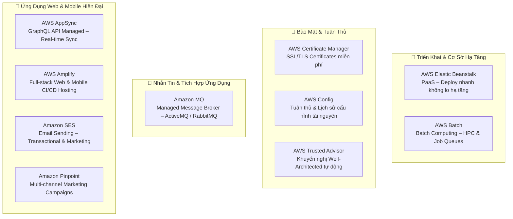
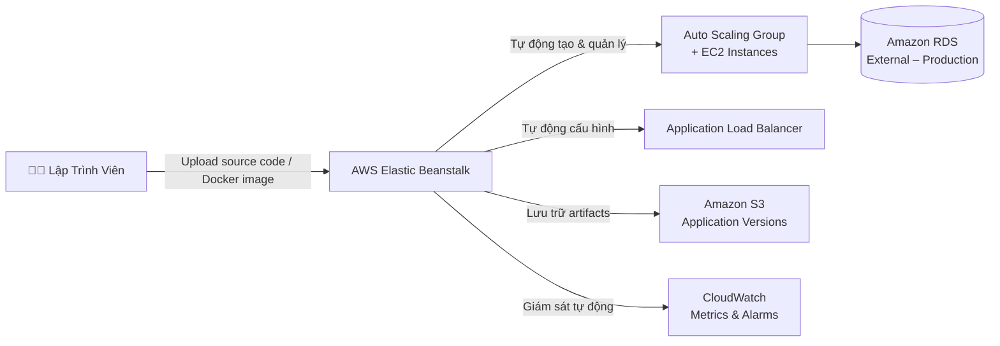
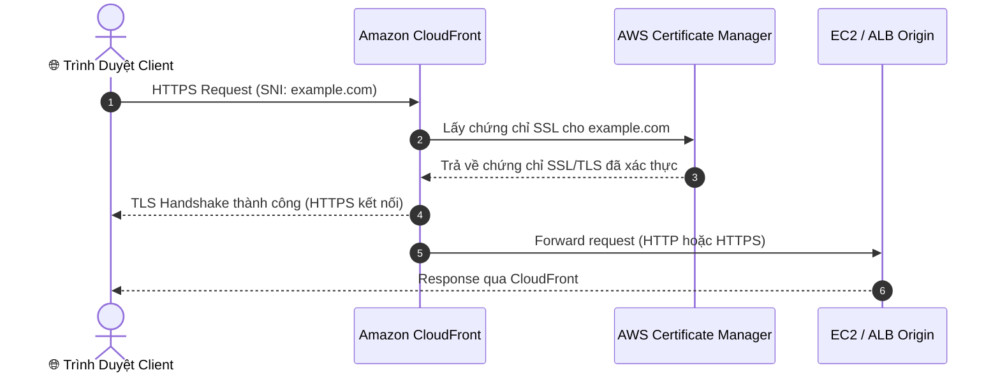
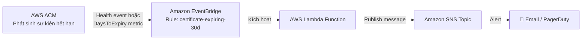
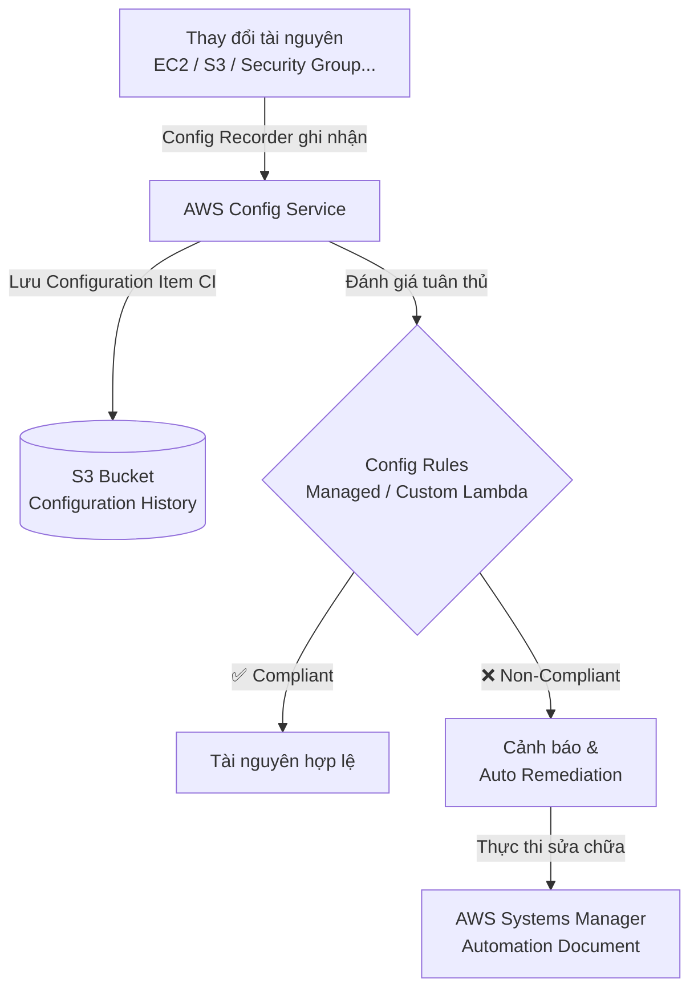
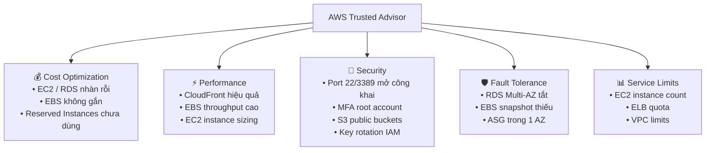
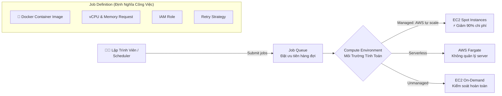
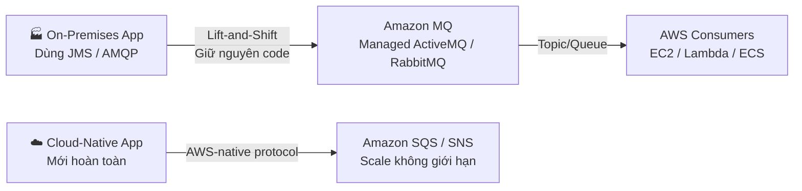
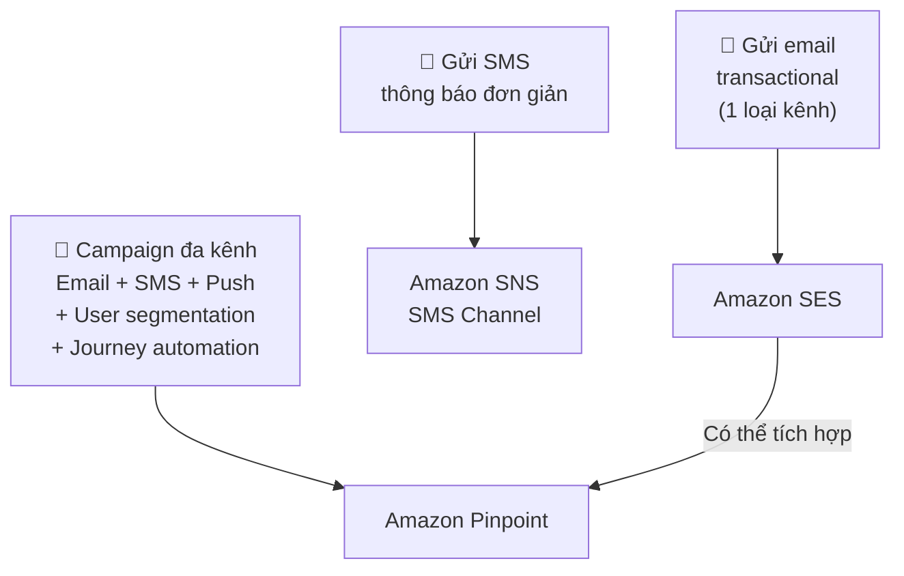

# Tài Liệu Học Tập Chuyên Sâu: Dịch Vụ Triển Khai, Nhắn Tin & Ứng Dụng Hiện Đại AWS

> **Tài liệu chuẩn hóa kiến trúc đám mây**: Hướng dẫn toàn diện theo tiêu chuẩn Senior AWS Solutions Architect (SAA-C03) cập nhật 2026.  
> **Ngôn ngữ**: Tiếng Việt chuyên ngành (Bảo lưu 100% thuật ngữ chuyên ngành tiếng Anh chuẩn AWS).  
> **Các dịch vụ bao phủ**: AWS Elastic Beanstalk, AWS Certificate Manager (ACM), AWS Config, AWS Trusted Advisor, AWS Batch, Amazon MQ, AWS AppSync, AWS Amplify, Amazon SES, Amazon Pinpoint.

---

## 1. Tổng Quan Nhóm Dịch Vụ (Service Overview)

Nhóm này bao gồm các dịch vụ **quản lý triển khai**, **bảo mật chứng chỉ**, **tuân thủ cấu hình**, **xử lý batch**, **nhắn tin legacy** và **ứng dụng web/mobile hiện đại** — những dịch vụ thường xuất hiện trong đề thi SAA-C03 với tần suất cao nhưng thường bị bỏ qua khi ôn tập.



---

## 2. AWS Elastic Beanstalk — Triển Khai Ứng Dụng Dạng PaaS

### 2.1 Bản Chất & Mô Hình Vận Hành

**AWS Elastic Beanstalk** là dịch vụ **Platform-as-a-Service (PaaS)** cho phép lập trình viên upload code và AWS tự động lo toàn bộ hạ tầng bên dưới (EC2, Auto Scaling Group, ELB, Security Groups, S3). Bạn **vẫn toàn quyền kiểm soát** các tài nguyên bên dưới và có thể tùy chỉnh trực tiếp nếu cần.

> [!IMPORTANT]
> **Elastic Beanstalk hoàn toàn MIỄN PHÍ** — bạn chỉ trả tiền cho các tài nguyên AWS bên dưới (EC2, RDS, ELB...) mà ứng dụng sử dụng.



**Ngôn ngữ & Nền tảng hỗ trợ**: Go, Java, .NET, Node.js, PHP, Python, Ruby, Docker (Single/Multi-container), và các nền tảng tùy chỉnh.

---

### 2.2 Các Chiến Lược Triển Khai (Deployment Policies) — Trọng Tâm Thi

Đây là chủ đề **xuất hiện nhiều nhất** trong đề thi khi hỏi về Elastic Beanstalk:

| Chiến Lược | Cơ Chế Hoạt Động | Downtime? | Giảm Capacity? | Rollback | Chi Phí Bổ Sung | Tốc Độ |
| :--- | :--- | :---: | :---: | :---: | :---: | :---: |
| **All at Once** | Cập nhật toàn bộ instances cùng lúc | ✅ Có | Toàn bộ | Manual re-deploy | Không | ⚡ Nhanh nhất |
| **Rolling** | Cập nhật theo từng batch, giữ phần còn lại | ❌ Không | Có (1 batch) | Manual re-deploy | Không | Trung bình |
| **Rolling with Additional Batch** | Tạo thêm 1 batch mới TRƯỚC khi hạ batch cũ | ❌ Không | ❌ Không (Full capacity) | Manual re-deploy | Nhẹ (tạm thời 1 batch) | Trung bình |
| **Immutable** | Tạo toàn bộ fleet mới trong ASG mới → test → swap | ❌ Không | ❌ Không | ⚡ Nhanh (terminate fleet mới) | ✅ Lớn (gấp đôi instances) | Chậm nhất |
| **Traffic Splitting** | Chia % traffic sang fleet mới (Canary deployment) | ❌ Không | ❌ Không | Chuyển lại % traffic | ✅ Có | Chậm |
| **Blue/Green** | Tạo môi trường Beanstalk riêng biệt → swap CNAME | ❌ Không | ❌ Không | Swap CNAME ngược lại | ✅ Lớn (2 env) | Chậm |

> [!TIP]
> **Mẹo ghi nhớ nhanh cho đề thi:**
> - **"Zero downtime + Full capacity + Không phát sinh chi phí"** → Chọn **Rolling with Additional Batch**
> - **"Zero downtime + Rollback nhanh nhất + An toàn tuyệt đối"** → Chọn **Immutable**
> - **"Test tính năng mới với 10% user thực"** → Chọn **Traffic Splitting**
> - **"Môi trường Test hoàn toàn tách biệt Production"** → Chọn **Blue/Green**

---

### 2.3 Tùy Chỉnh Môi Trường với `.ebextensions`

Thư mục `.ebextensions/` ở gốc source bundle chứa các file `.config` (định dạng YAML/JSON) để:
- Cài đặt packages hệ thống (yum, apt)
- Chạy lệnh shell tùy chỉnh khi deploy
- Cấu hình Security Groups, IAM Roles, biến môi trường

```yaml
# .ebextensions/install-nginx-module.config
packages:
  yum:
    nginx-mod-http-geoip: []
commands:
  01_create_dir:
    command: "mkdir -p /var/app/logs"
```

---

### 2.4 Quản Lý Database trong Elastic Beanstalk

> [!WARNING]
> **Bẫy thi quan trọng**: Đừng bao giờ gắn database RDS **bên trong** vòng đời Beanstalk Environment cho production. Nếu bạn terminate Beanstalk Environment, database sẽ **bị xóa theo**!

**Pattern đúng cho Production**:
- Tạo Amazon RDS **bên ngoài** (External) Beanstalk Environment
- Truyền connection string vào ứng dụng qua **Environment Variables** của Beanstalk
- Kết nối bảo mật qua Security Group rules

---

### 2.5 Bẫy Thi & So Sánh Dịch Vụ

| Từ khóa đề thi | Chọn | Lý do |
| :--- | :--- | :--- |
| "Deploy nhanh không quản lý server, vẫn truy cập được EC2" | **Elastic Beanstalk** | PaaS + giữ toàn quyền tài nguyên |
| "Infrastructure as Code, kiểm soát toàn bộ stack" | **AWS CloudFormation** | IaC định nghĩa mọi tài nguyên |
| "Chạy container Kubernetes, cần chuẩn hóa workload" | **Amazon EKS** | Kubernetes managed |
| "Deploy container không cần quản lý server" | **AWS Fargate** | Serverless containers |

---

## 3. AWS Certificate Manager (ACM) — Quản Lý SSL/TLS

### 3.1 Bản Chất & Giá Trị Cốt Lõi

**AWS Certificate Manager (ACM)** cung cấp, quản lý và triển khai chứng chỉ **SSL/TLS công khai miễn phí** cho các dịch vụ AWS như Application Load Balancer, CloudFront, API Gateway, và Elastic Beanstalk.



### 3.2 Các Điểm Chính Cho Đề Thi

| Đặc điểm | Chi tiết |
| :--- | :--- |
| **Chi phí chứng chỉ Public** | **MIỄN PHÍ** — không giới hạn số lượng |
| **Tự động gia hạn** | Chỉ cho chứng chỉ **được phát hành bởi ACM** và gắn vào tài nguyên AWS |
| **Chứng chỉ Import** | Có thể import chứng chỉ bên ngoài vào ACM — **KHÔNG tự động gia hạn** |
| **Private CA** | **AWS Private CA** (phí riêng) dành cho hệ thống nội bộ, IoT, microservices |
| **Tích hợp với** | ALB, NLB, CloudFront, API Gateway, Elastic Beanstalk |
| **KHÔNG tích hợp trực tiếp** | EC2 (phải dùng import và tự cấu hình webserver) |

### 3.3 Giám Sát Hết Hạn Chứng Chỉ — Bẫy Thi

> [!CAUTION]
> **Bẫy quan trọng**: ACM **KHÔNG có tính năng gửi email/SNS cảnh báo hết hạn chứng chỉ tích hợp sẵn** theo cấu hình đơn giản.

**Pattern chuẩn để cảnh báo hết hạn chứng chỉ**:



Hai cách phát hiện hết hạn:
1. **EventBridge Rule** bắt sự kiện `AWS Health → ACM certificate expiration` (sự kiện 45, 30, 15, 7, 3, 1 ngày trước khi hết hạn)
2. **CloudWatch Metric** `DaysToExpiry` của ACM → tạo Alarm → EventBridge → Lambda → SNS

---

## 4. AWS Config — Tuân Thủ & Lịch Sử Cấu Hình Tài Nguyên

### 4.1 Bản Chất & Mô Hình Hoạt Động

**AWS Config** là dịch vụ **giám sát liên tục cấu hình** (configuration) tài nguyên AWS, ghi lại mọi thay đổi và đánh giá sự tuân thủ so với bộ quy tắc (Config Rules) đã định nghĩa.



### 4.2 Config Rules — Managed vs Custom

| Loại | Mô tả | Ví dụ |
| :--- | :--- | :--- |
| **Managed Rules** | AWS cung cấp sẵn 200+ quy tắc phổ biến | `s3-bucket-public-read-prohibited`, `encrypted-volumes`, `mfa-enabled-for-iam-console-access` |
| **Custom Rules** | Tự viết bằng AWS Lambda để kiểm tra logic nghiệp vụ đặc thù | Kiểm tra EC2 phải có tag `Environment` |

### 4.3 Auto Remediation (Tự Động Sửa Chữa)

Khi AWS Config phát hiện tài nguyên vi phạm (Non-Compliant), có thể tự động kích hoạt **AWS Systems Manager Automation Document** để sửa chữa. Ví dụ:
- S3 bucket bị public → Config Rule phát hiện → SSM Automation tự động bật Block Public Access

### 4.4 Multi-Account Config Aggregator

Dùng **Config Aggregator** để tập trung kết quả tuân thủ từ nhiều AWS Accounts và nhiều Regions vào một bảng điều khiển duy nhất.

### 4.5 Phân Biệt Config vs CloudTrail vs Trusted Advisor

| Câu hỏi | Dịch vụ | Lý do |
| :--- | :--- | :--- |
| "**Ai** xóa S3 bucket lúc 3 giờ sáng?" | **CloudTrail** | Ghi lại API calls + danh tính người dùng |
| "S3 bucket đã từng bị public bao giờ chưa?" | **AWS Config** | Lịch sử cấu hình tài nguyên theo thời gian |
| "Có Security Group nào đang mở port 22 ra internet không?" | **AWS Config** | Đánh giá tuân thủ liên tục |
| "EC2 nào đang chạy mà không dùng đến?" | **Trusted Advisor** | Khuyến nghị tối ưu Well-Architected |

---

## 5. AWS Trusted Advisor — Cố Vấn Tối Ưu Hóa Tự Động

### 5.1 Bản Chất & 5 Trụ Cột

**AWS Trusted Advisor** là công cụ kiểm tra tự động môi trường AWS của bạn theo 5 trụ cột của **AWS Well-Architected Framework**, đưa ra khuyến nghị thực tế tức thì.



### 5.2 Phân Quyền Truy Cập

| Gói Support | Checks có sẵn | API Access |
| :--- | :--- | :--- |
| **Basic / Developer** | Chỉ **7 core checks** (Security + Service Limits cơ bản) | ❌ Không |
| **Business / Enterprise** | **Toàn bộ 500+ checks** | ✅ Có (Trusted Advisor API) |

> [!NOTE]
> **Business/Enterprise Support** mở khóa tích hợp với **AWS Organizations Organizational View** — xem trạng thái toàn bộ accounts trong Organization từ một bảng điều khiển.

---

## 6. AWS Batch — Xử Lý Tính Toán Hàng Loạt (Batch Computing)

### 6.1 Bản Chất & Kiến Trúc

**AWS Batch** quản lý và thực thi **hàng nghìn/triệu batch jobs** một cách hiệu quả bằng cách tự động cấp phát và điều phối tài nguyên compute (EC2 On-Demand, EC2 Spot, Fargate) dựa trên số lượng và yêu cầu của jobs trong queue.



### 6.2 Các Thành Phần Cốt Lõi

| Thành phần | Vai trò |
| :--- | :--- |
| **Job** | Đơn vị công việc — script, ứng dụng, Docker container |
| **Job Definition** | Template định nghĩa tài nguyên cần thiết (CPU, RAM, Docker image, IAM Role) |
| **Job Queue** | Hàng đợi tổ chức job theo thứ tự ưu tiên trước khi chạy |
| **Compute Environment** | Tập hợp tài nguyên tính toán (EC2 Spot/On-Demand hoặc Fargate) |

### 6.3 Bẫy Thi: AWS Batch vs AWS Lambda

| Tiêu chí | AWS Batch | AWS Lambda |
| :--- | :--- | :--- |
| **Giới hạn thời gian** | ❌ Không giới hạn (chạy hàng giờ, hàng ngày) | ✅ Tối đa 15 phút |
| **Giới hạn bộ nhớ** | ❌ Không giới hạn (phụ thuộc instance type) | ✅ Tối đa 10 GB |
| **Trigger** | Job Queue, EventBridge Schedule | Event-driven (S3, API GW, SQS...) |
| **Use case** | HPC, ML training, video encoding, genome sequencing | API handler, event processor nhỏ |

> [!TIP]
> Từ khóa nhận biết AWS Batch trong đề thi: **"batch jobs", "HPC", "genome sequencing", "image processing hàng loạt", "financial simulation hàng nghìn kịch bản"**, hoặc **"xử lý quá 15 phút"**.

---

## 7. Amazon MQ — Message Broker Managed cho Legacy Apps

### 7.1 Bản Chất & Vị Trí Trong Kiến Trúc

**Amazon MQ** là dịch vụ managed **message broker** cho **Apache ActiveMQ** và **RabbitMQ** — phục vụ nhu cầu di chuyển (lift-and-shift) ứng dụng On-Premises lên AWS mà không cần viết lại code.

> [!IMPORTANT]
> **Quy tắc lựa chọn vàng cho đề thi:**
> - Ứng dụng đang dùng **JMS, AMQP, MQTT, STOMP, OpenWire** trên-premises → **Amazon MQ** (giữ nguyên protocol)
> - Ứng dụng mới xây dựng hoàn toàn trên cloud, cần scale lên hàng triệu message → **Amazon SQS / SNS** (AWS-native, scale vô hạn)



### 7.2 High Availability với Multi-AZ

Amazon MQ hỗ trợ cấu hình **Active/Standby** trải rộng 2 Availability Zones với shared storage (**Amazon EFS** cho ActiveMQ, Cluster Mirror cho RabbitMQ). Failover tự động < 60 giây.

---

## 8. AWS AppSync — GraphQL API Managed

### 8.1 Bản Chất

**AWS AppSync** là dịch vụ managed **GraphQL API** cho phép ứng dụng:
- Truy vấn dữ liệu từ **nhiều nguồn** (DynamoDB, Aurora, Lambda, HTTP APIs) trong một request duy nhất
- **Real-time synchronization** qua WebSocket cho nhiều client cùng lúc
- **Offline data access** — đồng bộ tự động khi client kết nối lại

### 8.2 Phân Biệt AppSync vs API Gateway

| Tiêu chí | AWS AppSync | Amazon API Gateway |
| :--- | :--- | :--- |
| **API Type** | **GraphQL** | REST, HTTP, WebSocket |
| **Real-time sync** | ✅ Tích hợp sẵn (Subscriptions) | WebSocket API (phải tự build) |
| **Offline support** | ✅ Client-side caching tự động | ❌ Phải tự implement |
| **Multiple data sources** | ✅ Một query → nhiều backend | ❌ Mỗi route gắn 1 backend |
| **Use case** | Mobile app, collaborative tools, dashboard | REST API, Microservices gateway |

---

## 9. AWS Amplify — Full-Stack Web & Mobile Hosting

### 9.1 Bản Chất

**AWS Amplify** là framework và hosting service tối ưu cho **React, Next.js, Vue, Angular, iOS, Android** — cung cấp:
- **Amplify Hosting**: CI/CD tự động từ GitHub/GitLab, CDN toàn cầu, preview branch tự động
- **Amplify Studio**: Visual UI builder cho ứng dụng React
- **Amplify CLI**: Tích hợp dễ dàng Cognito (Auth), AppSync (GraphQL), S3, Lambda từ terminal

### 9.2 Phân Biệt Amplify vs Elastic Beanstalk

| Tiêu chí | AWS Amplify | AWS Elastic Beanstalk |
| :--- | :--- | :--- |
| **Đối tượng** | Frontend devs, full-stack devs (React/Mobile) | Backend devs (Server apps, APIs) |
| **Mô hình** | JAMstack / Static + Serverless backend | Truyền thống (Server process) |
| **CI/CD** | ✅ Git push → build & deploy tự động | ❌ Phải cấu hình tay hoặc dùng CodePipeline |
| **Điểm mạnh** | SPA hosting, offline mobile apps | Web server, API server phức tạp |

---

## 10. Amazon SES — Email Sending cho Ứng Dụng

### 10.1 Bản Chất

**Amazon Simple Email Service (SES)** là dịch vụ gửi email quy mô lớn, chi phí thấp cho cả email **giao dịch** (transactional) lẫn email **marketing**.

| Loại email | Ví dụ | Dịch vụ phù hợp |
| :--- | :--- | :--- |
| Transactional | Order confirm, password reset, shipping notification | **Amazon SES** |
| Marketing bulk | Newsletter, promotional campaigns với segmentation | **Amazon SES** (đơn giản) hoặc **Amazon Pinpoint** (nâng cao) |
| Multi-channel (Push, SMS, Email) | Omni-channel campaign | **Amazon Pinpoint** |

### 10.2 Tính Năng Bảo Mật Email

- **Domain Verification**: Xác minh ownership của domain gửi
- **DKIM (DomainKeys Identified Mail)**: Ký số email để chống giả mạo
- **SPF (Sender Policy Framework)**: Xác thực mail server được phép gửi
- **Bounce & Complaint Tracking**: Theo dõi tỷ lệ email bị từ chối/báo spam tự động

---

## 11. Amazon Pinpoint — Multi-Channel Marketing Campaigns

### 11.1 Bản Chất

**Amazon Pinpoint** là dịch vụ **multi-channel marketing engagement** cho phép:
- Gửi email, SMS, push notifications, voice calls
- **User segmentation** động dựa trên hành vi trong ứng dụng
- **Journey orchestration** — luồng tự động hóa marketing đa bước
- **Stream event data** ra Kinesis Data Streams / Firehose để phân tích

### 11.2 Phân Biệt SES vs Pinpoint vs SNS



---

## 12. Bảng Tóm Tắt Nhận Dạng Dịch Vụ Nhanh — Keyword Mapping

| Từ Khóa / Tình Huống Đề Thi | Dịch Vụ | Điểm Quyết Định |
| :--- | :--- | :--- |
| "Deploy web app nhanh, không quản lý server, vẫn truy cập EC2" | **Elastic Beanstalk** | PaaS + toàn quyền tài nguyên |
| "Zero downtime + Full capacity + Không tăng chi phí khi deploy" | **Rolling with Additional Batch** | Tạo thêm batch trước khi hạ cũ |
| "Rollback nhanh nhất sau deploy lỗi" | **Immutable Deployment** | Fleet mới riêng biệt, terminate ngay nếu lỗi |
| "SSL/TLS miễn phí cho ALB / CloudFront" | **AWS Certificate Manager** | Public cert = miễn phí + tự gia hạn |
| "Cảnh báo chứng chỉ SSL sắp hết hạn 30 ngày" | **EventBridge → Lambda → SNS** | ACM không có built-in SNS alert |
| "Kiểm tra S3 bucket có đang public không, liên tục" | **AWS Config** | Đánh giá tuân thủ liên tục |
| "Ai đã mở port 22 trong Security Group?" | **AWS CloudTrail** | API call history + identity |
| "Kiểm tra chi phí, hiệu suất, bảo mật tổng thể" | **AWS Trusted Advisor** | Well-Architected recommendations |
| "Chạy 10,000 batch jobs song song, HPC, cần Spot" | **AWS Batch** | Batch + Spot = cost-optimized |
| "Migrate ActiveMQ / RabbitMQ lên AWS, giữ JMS code" | **Amazon MQ** | Legacy protocol support |
| "GraphQL API, real-time sync mobile app" | **AWS AppSync** | GraphQL + WebSocket Subscriptions |
| "Deploy React SPA, CI/CD từ GitHub" | **AWS Amplify** | Git-based hosting + serverless backend |
| "Gửi triệu email/ngày, DKIM, bounce tracking" | **Amazon SES** | Bulk email, low cost |
| "Campaign marketing đa kênh: Email + SMS + Push" | **Amazon Pinpoint** | Multi-channel + segmentation + journey |

---

## 13. Bẫy Thi Thường Gặp (Exam Traps) — Tổng Hợp

### ❌ Các Lỗi Sai Phổ Biến:

1. **Bẫy Elastic Beanstalk + RDS**: Chọn option "tạo RDS bên trong Beanstalk" cho môi trường production → **SAI**. Production RDS phải đặt bên ngoài vòng đời Beanstalk.

2. **Bẫy ACM Import**: Nghĩ rằng import chứng chỉ vào ACM sẽ được tự động gia hạn → **SAI**. Chỉ chứng chỉ ACM-issued mới được tự gia hạn.

3. **Bẫy AWS Config vs CloudTrail**: Nhầm Config cho câu hỏi "Ai đã thực hiện thay đổi?" → **SAI**. Config xem trạng thái cấu hình; CloudTrail xem API calls & identity.

4. **Bẫy Amazon MQ vs SQS**: Chọn Amazon MQ cho ứng dụng cloud-native mới hoàn toàn → **SAI (thường)**. Chỉ dùng MQ khi migrate legacy app dùng JMS/AMQP/MQTT.

5. **Bẫy AWS Batch vs Lambda**: Chọn Lambda cho workload chạy 2 giờ → **SAI**. Lambda tối đa 15 phút; dùng AWS Batch cho long-running jobs.

6. **Bẫy Trusted Advisor**: Nghĩ rằng Basic Support có đầy đủ checks → **SAI**. Basic/Developer chỉ có 7 core checks; cần Business/Enterprise để có toàn bộ 500+ checks.

