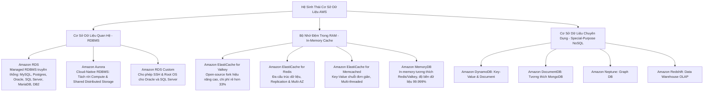
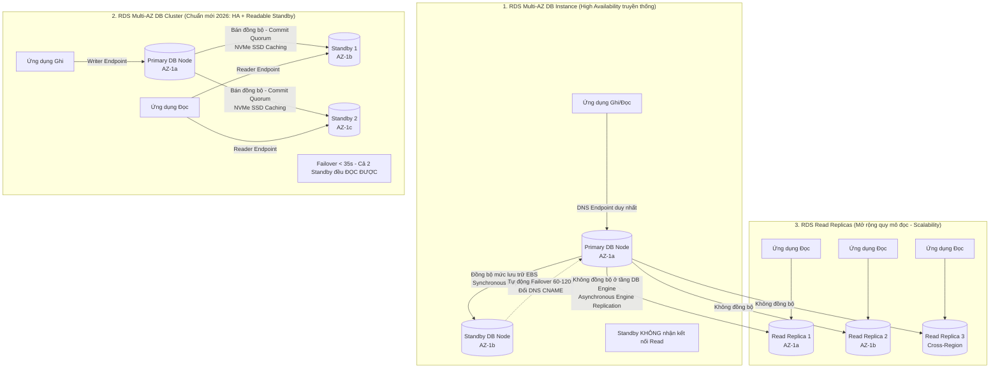
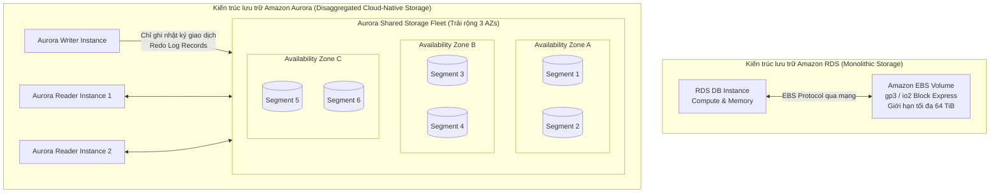
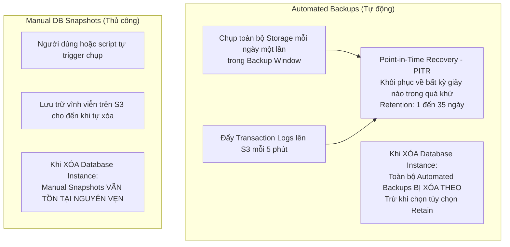
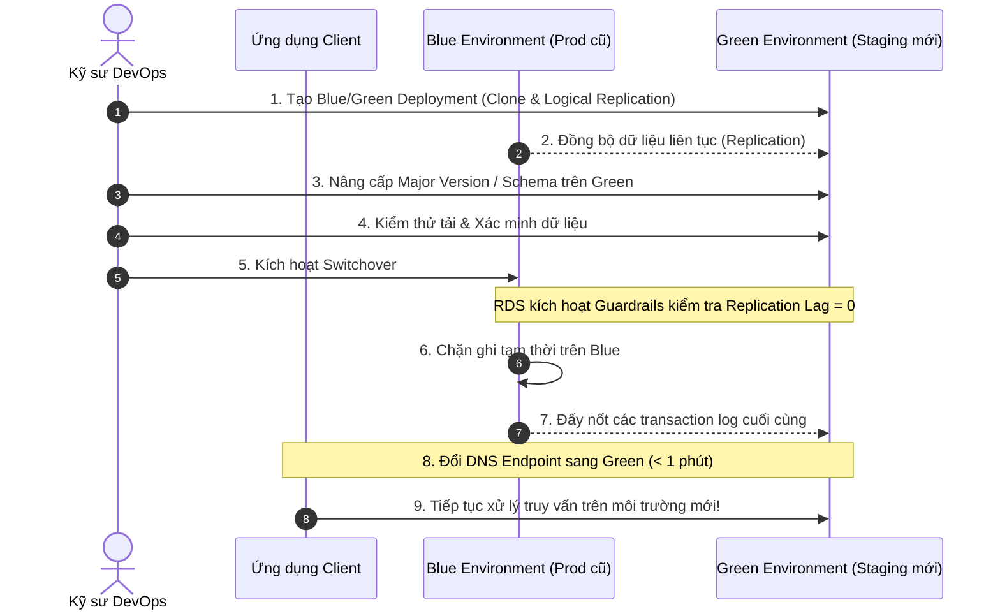
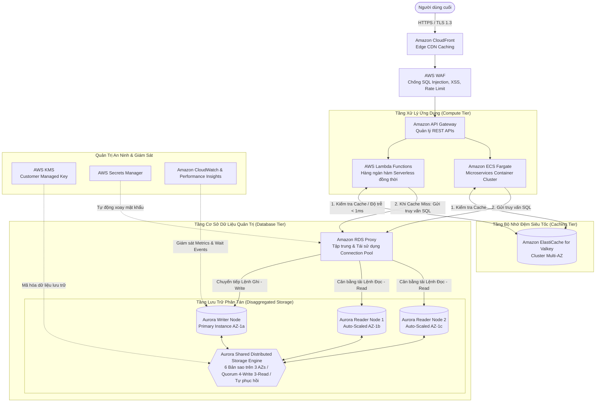
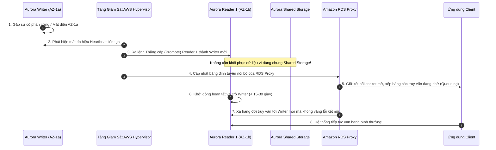

# Tài Liệu Học Tập Chuyên Sâu: Amazon RDS, Amazon Aurora & Dịch Vụ Cơ Sở Dữ Liệu Đám Mây (Databases in AWS)

> **Tài liệu chuẩn hóa kiến trúc đám mây**: Hướng dẫn toàn diện theo tiêu chuẩn Principal AWS Solutions Architect & Senior Cloud DevOps Engineer (Cập nhật phiên bản kiến trúc mới nhất 2026).  
> **Ngôn ngữ**: Tiếng Việt chuyên ngành (Bảo lưu toàn bộ thuật ngữ chuyên ngành tiếng Anh chuẩn AWS).  
> **Mục tiêu**: Phục vụ thi chứng chỉ cấp độ Professional/Specialty (**SAA-C03, SAP-C02, DOP-C02**) và vận hành hệ thống cấp độ doanh nghiệp (**Production-grade**).  
> **Các bài giảng liên quan**: Chương 09 (RDS, Aurora & ElastiCache) & Chương 21 (Databases in AWS).

---

## 6.1. Tổng Quan Dịch Vụ (Service Overview)

### 1. Định nghĩa chuẩn xác và Phân nhóm dịch vụ
Hệ sinh thái cơ sở dữ liệu quan hệ và bộ nhớ đệm đám mây trên AWS được phân nhóm chuyên biệt dựa trên bản chất kiến trúc:

1. **Amazon Relational Database Service (Amazon RDS)**: Dịch vụ cơ sở dữ liệu quan hệ được quản lý hoàn toàn (**Managed Relational Database Service**), tự động hóa việc cấp phát hạ tầng, vá lỗi hệ điều hành, sao lưu, và phục hồi thảm họa. Hỗ trợ 6 database engine thương mại và nguồn mở: **PostgreSQL, MySQL, MariaDB, Oracle, Microsoft SQL Server, và IBM DB2**.
2. **Amazon Aurora**: Hệ thống cơ sở dữ liệu quan hệ **Cloud-Native** thế hệ mới độc quyền của AWS, tương thích hoàn toàn mã nguồn với **MySQL** và **PostgreSQL**. Aurora được thiết kế lại triệt để tầng lưu trữ để đạt thông lượng xử lý gấp **5 lần MySQL chuẩn** và **3 lần PostgreSQL chuẩn** trên cùng cấu hình phần cứng.
3. **Amazon RDS Custom**: Giải pháp lai dành riêng cho **Oracle** và **Microsoft SQL Server**, cho phép doanh nghiệp truy cập vào hệ điều hành bên dưới (Root/Administrator access qua SSH hoặc AWS Systems Manager Session Manager) để cài đặt các phần mềm phụ trợ, patch kernel đặc thù mà RDS tiêu chuẩn không cho phép.
4. **Amazon ElastiCache (Valkey, Redis, Memcached)**: Dịch vụ bộ nhớ đệm trong RAM (**In-Memory Data Store & Cache**) được quản lý hoàn toàn, giúp giảm tải truy vấn đọc cho database quan hệ và đạt độ trễ phản hồi mức microsecond. Từ năm 2024–2026, AWS ưu tiên bổ sung **ElastiCache for Valkey** (dự án nguồn mở kế thừa Redis) với chi phí thấp hơn 33%.
5. **Amazon MemoryDB**: Cơ sở dữ liệu in-memory siêu tốc tương thích hoàn toàn với Redis/Valkey nhưng sử dụng nhật ký giao dịch phân tán (**Distributed Transactional Log**), cho phép sử dụng như một **Primary Database** với độ bền dữ liệu (Durability) đạt 99.999999999% (11 số 9).

---

### 2. Bài toán cốt lõi: Managed Database (RDS/Aurora) vs Tự cài đặt trên EC2

| Tiêu chí so sánh | Tự cài đặt Database trên EC2 (Self-Managed) | Amazon RDS / Amazon Aurora (Fully Managed) |
| :--- | :--- | :--- |
| **Trách nhiệm bảo trì phần cứng & OS** | Khách hàng tự cài đặt OS, cấu hình RAID, vá lỗi hệ điều hành định kỳ (**OS Patching**). | **AWS quản lý 100%**: Tự động vá lỗi OS và DB engine trong khung giờ bảo trì (**Maintenance Window**). |
| **Cơ chế sao lưu & PITR** | Tự viết script cronjob dump database, tự sao chép sang S3, khó khôi phục về từng giây chính xác. | **Tự động hóa hoàn toàn**: Transaction logs được ghi liên tục lên S3 mỗi 5 phút, hỗ trợ **Point-in-Time Recovery (PITR)** đến từng giây. |
| **Dự phòng thảm họa (High Availability)** | Phải tự cấu hình Replication phức tạp, tự viết script giám sát heartbeat và tự xử lý failover. | **Tích hợp sẵn**: Multi-AZ tự động phát hiện lỗi và chuyển đổi dự phòng (**Automated Failover**) trong 35–120 giây mà không cần can thiệp thủ công. |
| **Khả năng mở rộng quy mô (Scaling)** | Yêu cầu dừng máy để nâng cấp RAM/CPU, mở rộng đĩa đòi hỏi cấu hình LVM phức tạp. | **Click-to-scale**: Đổi cỡ instance linh hoạt, Aurora Serverless v2 tự co giãn tức thì, Storage Auto Scaling tự động tăng đĩa. |
| **Giám sát & Tối ưu hiệu năng** | Tự cài đặt công cụ bên thứ ba (Zabbix, Prometheus, Datadog). | Tích hợp sẵn **CloudWatch Metrics**, **Enhanced Monitoring** (chi tiết tới từng tiến trình hệ điều hành), và **Performance Insights** (phân tích top truy vấn gây nghẽn). |

---

### 3. Khi nào KHÔNG nên dùng RDS/Aurora (Anti-patterns & Giải pháp thay thế)

* ❌ **Lưu trữ dữ liệu phi cấu trúc lớn (BLOBs, File tài liệu, Media, Video)**: Không lưu trữ trực tiếp các file ảnh, video, PDF dung lượng lớn trong database quan hệ vì sẽ làm phình to dung lượng ổ đĩa đắt đỏ và nghẽn băng thông I/O.  
  👉 *Giải pháp thay thế*: Lưu trữ file trên **Amazon S3**, chỉ lưu đường dẫn URL hoặc metadata trong RDS/Aurora.
* ❌ **Truy vấn phân tích dữ liệu lớn phức tạp (OLAP / Big Data Analytics)**: RDS/Aurora được thiết kế tối ưu cho xử lý giao dịch trực tuyến (**OLTP - Online Transaction Processing**). Nếu chạy các câu lệnh tổng hợp `JOIN`, `GROUP BY` trên hàng trăm triệu/hàng tỷ bản ghi lịch sử, hệ thống sẽ bị treo CPU.  
  👉 *Giải pháp thay thế*: Trích xuất dữ liệu (ETL) sang kho dữ liệu **Amazon Redshift** hoặc sử dụng **AWS Glue + Amazon Athena** trên S3 Data Lake.
* ❌ **Ứng dụng yêu cầu thông lượng ghi cực cao với mô hình Key-Value đơn giản**: Các bài toán như lưu giỏ hàng thương mại điện tử, bảng xếp hạng game, dữ liệu viễn trắc IoT với hàng triệu lượt ghi/giây.  
  👉 *Giải pháp thay thế*: Sử dụng **Amazon DynamoDB** (NoSQL phân tán) để có độ trễ sub-10ms và chi phí tối ưu hơn.
* ❌ **Yêu cầu can thiệp sâu vào nhân hệ điều hành (Root Access, Custom OS Kernel, 3rd-party non-supported extensions)**: RDS không cung cấp quyền truy cập SSH hoặc Root vào máy chủ bên dưới.  
  👉 *Giải pháp thay thế*: Sử dụng **Amazon RDS Custom** (cho Oracle/SQL Server) hoặc tự cài đặt database trên **Amazon EC2**.
* ❌ **Truy vấn tìm kiếm toàn văn bản chuyên sâu (Full-text Search / Log Analytics)**: Các câu lệnh `LIKE '%query%'` trên RDS sẽ gây quét toàn bộ bảng (Table Scan) và phá vỡ hiệu năng index.  
  👉 *Giải pháp thay thế*: Đồng bộ dữ liệu sang **Amazon OpenSearch Service** để lập chỉ mục và tìm kiếm toàn văn.

---

## 6.2. Các Khái Niệm, Kiến Trúc & Vận Hành Cốt Lõi (Core Concepts, Security & Day-2 Operations)

### 1. Sơ đồ các mô hình triển khai cốt lõi

---

### 2. Bảng phân biệt then chốt các kiến trúc RDS & Aurora (Trọng tâm thi cử & Thực tế)

| Tiêu chí | RDS Single-AZ | RDS Multi-AZ DB Instance | RDS Multi-AZ DB Cluster | Amazon Aurora Cluster |
| :--- | :--- | :--- | :--- | :--- |
| **Mục tiêu chính** | Dev/Test, Tiết kiệm chi phí tối đa | Tính khả dụng cao (**HA**) & Chống chịu lỗi AZ | **HA cao cấp + Mở rộng đọc** + Ghi cực nhanh | **Cloud-native HA + Scalability siêu việt** |
| **Số lượng Node** | 1 Primary Node | 1 Primary + 1 Standby | 1 Primary + 2 Readable Standbys | 1 Primary + Tối đa 15 Aurora Replicas |
| **Phạm vi triển khai** | 1 AZ duy nhất | **2 AZs khác nhau** | **3 AZs khác nhau** | **3 AZs khác nhau** |
| **Cơ chế sao chép (Replication)** | Không có | **Đồng bộ (Synchronous)** ở tầng block lưu trữ EBS | **Bán đồng bộ (Semi-sync)**, cần 1 Standby ACK commit | **Đồng bộ ở tầng lưu trữ phân tán (6 bản sao)** |
| **Truy cập nút phụ (Standby Read)** | Không có nút phụ | ❌ **KHÔNG** (Standby bị khóa hoàn toàn, không mở port) |  **CÓ** (Cả 2 Standby đều tiếp nhận traffic đọc qua Reader Endpoint) |  **CÓ** (Toàn bộ 15 Replicas phục vụ đọc tải cao) |
| **Thời gian Failover** | Thủ công (Restore snapshot: hàng giờ) | **60 – 120 giây** (Đổi DNS CNAME) | **Dưới 35 giây** (Đổi DNS CNAME) | **Dưới 30 giây** (Thậm chí tức thì nếu dùng RDS Proxy) |
| **Chi phí hạ tầng** | 1x Compute + 1x Storage | **2x Compute + 2x Storage** | **3x Compute + 3x Storage** (NVMe SSD cao cấp) | 1x Compute Master + Nx Compute Replicas + 1x Shared Storage |

---

### 3. Kiến trúc chuyên sâu bên dưới (Storage, Compute, Quorums & Limits)

#### A. Kiến trúc tầng lưu trữ: Amazon RDS EBS vs Amazon Aurora Distributed Storage

* **Cơ chế lưu trữ của Amazon RDS**:
  - Dữ liệu nằm trên các ổ đĩa **Amazon EBS** gắn qua mạng mạng ảo hóa Nitro:
    - **General Purpose SSD (`gp3`)**: Hiệu năng cơ bản **3,000 IOPS** và **125 MB/s throughput** miễn phí, có thể nâng độc lập lên 64,000 IOPS và 1,000 MB/s mà không cần mua thêm dung lượng đĩa.
    - **Provisioned IOPS SSD (`io2 Block Express`)**: Độ trễ sub-millisecond, độ bền dữ liệu 99.999%, hỗ trợ tới **256,000 IOPS** và **4,000 MB/s throughput**.
  - **Giới hạn dung lượng**: Tối đa **64 TiB** cho một instance RDS. Khi muốn mở rộng dung lượng, RDS hỗ trợ **Storage Auto Scaling** (tự động tăng dung lượng đĩa lên tới ngưỡng trần chỉ định khi dung lượng trống dưới 10% kéo dài trên 5 phút).
* **Cơ chế lưu trữ phân tán đột phá của Amazon Aurora**:
  - Tách rời hoàn toàn tầng Compute và Storage (**Disaggregated Architecture**).
  - Tầng lưu trữ được chia nhỏ thành các đoạn **10 GiB Protection Groups** và nhân bản thành **6 bản sao (6 copies) trải rộng trên 3 Availability Zones** (2 bản sao mỗi AZ).
  - **Cơ chế Quorum (Bầu chọn đa số)**:
    - **Ghi dữ liệu (Write Quorum = 4/6)**: Khi Writer Node gửi Redo Log, chỉ cần **4 trên 6 nút lưu trữ** xác nhận đã ghi log thành công là transaction được coi là commit. Do đó, hệ sinh thái Aurora có thể chịu đựng việc **sập hoàn toàn 1 AZ** (mất 2 bản sao) mà quá trình ghi **VẪN TIẾP TỤC BÌNH THƯỜNG**.
    - **Đọc dữ liệu (Read Quorum = 3/6)**: Quá trình đọc chỉ cần 3 bản sao để tái tạo khối dữ liệu. Do đó, Aurora có thể chịu được việc **sập 1 AZ và mất thêm 1 node ở AZ khác** (mất 3 bản sao) mà người dùng **VẪN ĐỌC DỮ LIỆU BÌNH THƯỜNG**.
  - **Cơ chế tự phục hồi (Self-Healing)**: Tầng lưu trữ liên tục quét các khối dữ liệu bị lỗi hoặc mất mát ngầm và tự động sửa chữa bằng cách sao chép từ các node lành lặn mà không gây suy giảm hiệu năng của Compute instance.
  - **Dung lượng lưu trữ co giãn tự động**: Tự động mở rộng từ 10 GiB lên tới **256 TiB** (áp dụng đồng bộ cho cả Aurora MySQL và Aurora PostgreSQL). Hệ thống tự động phân bổ thêm các phân đoạn 10 GiB khi dữ liệu tăng trưởng, người dùng chỉ trả tiền cho dung lượng thực tế đang dùng mà không cần cấu hình cấp phát trước dung lượng (No provisioning required).

---

#### B. Các tính năng cao cấp & Cập nhật kiến trúc Aurora (Cập nhật 2026)

1. **Amazon Aurora Serverless v2**:
   - Tự động co giãn tài nguyên xử lý tính toán (đo bằng **Aurora Capacity Units - ACUs**, với $1 \text{ ACU} \approx 2 \text{ GiB RAM} + \text{vCPU tương ứng}$) chỉ trong **vài mili-giây** dựa trên tải thực tế của ứng dụng mà không gây đứt kết nối.
   - **Tính năng Scale về 0 ACU (Scale-to-Zero)**: Cho phép cấu hình mức sàn `Min ACU = 0`. Khi không có kết nối nào phát sinh (ví dụ ban đêm trên môi trường Dev/Test), Aurora Serverless v2 sẽ tự động tạm dừng tính toán (compute ngưng tính phí, chỉ tính phí lưu trữ storage). Khi có kết nối mới tới, thời gian đánh thức (**Cold Resume Latency**) thực tế mất khoảng **15 đến 25 giây** (ứng dụng client nên cấu hình Connection Timeout phù hợp hoặc kết hợp **RDS Proxy** để đệm hàng đợi kết nối, tránh phát sinh lỗi `Connection Timed Out`).
2. **Amazon Aurora Global Database**:
   - Dành cho các hệ thống đa quốc gia hoặc yêu cầu khắc phục thảm họa xuyên lục địa (**Disaster Recovery**).
   - Bao gồm 1 Primary Region (xử lý ghi và đọc) và tối đa **5 Secondary Regions** (chỉ xử lý đọc).
   - Cơ chế sao chép dữ liệu vật lý ở tầng lưu trữ chuyên dụng (**Storage-based Replication**) với độ trễ xuyên lục địa **dưới 1 giây**.
   - Mục tiêu phục hồi thảm họa cực chuẩn: **RPO < 1 giây** và **RTO < 1 phút** (khi thảm họa xảy ra, có thể thăng cấp Secondary Region thành Master độc lập chỉ bằng một nút bấm mà không mất dữ liệu).
   - Hỗ trợ **Cross-Region Write Forwarding**: Cho phép ứng dụng tại Secondary Region gửi lệnh ghi trực tiếp tới nút Reader cục bộ, Aurora sẽ tự động chuyển tiếp lệnh ghi về Primary Region an toàn.
3. **Amazon Aurora Multi-Master `[Deprecated]`**:
   - `[LƯU Ý THI CỬ - DEPRECATED]`: Tính năng cho phép nhiều Writer Nodes cùng ghi vào một cụm trên nhiều AZ hiện đã **bị AWS ngừng khuyến nghị và không hỗ trợ cho các phiên bản engine mới** do độ trễ xử lý xung đột ghi (Write Conflicts) cao và kiến trúc phức tạp. Trong các thiết kế mới và đề thi cập nhật, giải pháp thay thế chuẩn mực là **Amazon Aurora Global Database** hoặc **RDS Multi-AZ DB Cluster**.
4. **Amazon Aurora Limitless Database**:
   - Đột phá kiến trúc hỗ trợ mở rộng quy mô ghi ngang (**Horizontal Write Scaling**) tự động bằng cơ chế phân mảnh dữ liệu (**Automated Sharding**) trên PostgreSQL.
   - Cho phép xử lý hàng triệu lệnh ghi mỗi giây và dung lượng dữ liệu cấp độ Petabyte mà ứng dụng vẫn nhìn nhận như một database duy nhất.
5. **Aurora Optimized Reads & Aurora Optimized Writes**:
   - **Optimized Reads**: Sử dụng ổ cứng thể rắn **NVMe SSD** gắn cục bộ trên máy chủ instance để làm bộ nhớ đệm phụ cho các bảng dữ liệu vượt quá kích thước RAM, giúp tăng tốc truy vấn phân tích lên gấp **8 lần**.
   - **Optimized Writes**: Loại bỏ cơ chế ghi đệm kép (Double-write buffer) truyền thống của MySQL bằng cách ghi trực tiếp các trang dữ liệu vào tầng lưu trữ phân tán của Aurora một cách nguyên tử (**Atomically**), giúp tăng thông lượng ghi lên gấp **2 lần** mà không phát sinh thêm chi phí.
6. **Aurora Fast Database Cloning**:
   - Cho phép tạo bản sao độc lập của database hàng chục Terabyte chỉ trong **vài phút** mà không tốn thêm dung lượng lưu trữ ban đầu.
   - Sử dụng cơ chế **Copy-on-Write (CoW)**: Bản clone dùng chung con trỏ tới các khối dữ liệu cũ; dung lượng lưu trữ mới chỉ bị tính phí khi có thao tác sửa đổi dữ liệu trên bản clone hoặc bản gốc.

---

### 4. Cơ chế Sao lưu, Phục hồi & Vận hành không gián đoạn (Backup, Recovery & Zero-Downtime)

#### A. Phân biệt Automated Backups và Manual Snapshots

* **Point-in-Time Recovery (PITR)**:
  - Cho phép phục hồi cơ sở dữ liệu về một DB instance mới tại **bất kỳ giây nào** nằm trong thời gian lưu giữ (**Retention Period**, từ **1 đến 35 ngày**, mặc định là 7 ngày).
  - Quá trình thực hiện bằng cách lấy bản Daily Snapshot gần nhất kết hợp phát lại (replay) các bản **Transaction Logs** được đẩy liên tục lên S3 mỗi 5 phút.

#### B. Nâng cấp phiên bản không gián đoạn với RDS Blue/Green Deployments

* **Bài toán truyền thống**: Nâng cấp phiên bản lớn (**Major Engine Version Upgrade**, ví dụ MySQL 5.7 lên 8.0 hoặc PostgreSQL 13 lên 16) hoặc sửa đổi cấu hình Schema lớn thường gây gián đoạn hệ thống (Downtime) từ 15 phút đến hàng giờ.
* **Cơ chế RDS Blue/Green Deployments**:
  1. **Khởi tạo môi trường Green**: AWS tự động clone môi trường Production hiện tại (gọi là **Blue**) sang một môi trường độc lập hoàn toàn (gọi là **Green**) và thiết lập kênh sao chép dữ liệu logic (**Logical Replication**) liên tục từ Blue sang Green.
  2. **Thực hiện thay đổi trên Green**: Bạn tiến hành nâng cấp Major Version, đổi tham số, hoặc chạy các câu lệnh `ALTER TABLE` nặng nề trên môi trường Green mà không hề ảnh hưởng tới người dùng trên Blue.
  3. **Chuyển giao không gián đoạn (Switchover)**: Khi hoàn tất kiểm thử, bạn bấm **Switchover**. RDS sẽ kích hoạt các chốt kiểm tra bảo vệ an toàn (**Guardrails**): chặn lệnh ghi trên Blue, đợi Green đồng bộ 100% dữ liệu (Replication Lag = 0), đảo chiều định tuyến DNS sang Green trong thời gian **dưới 1 phút** và hoàn toàn **không mất dữ liệu (Zero Data Loss)**.

---

### 5. Bảo mật & Quản trị cấu hình chuyên sâu (Security & Day-2 Operations)

#### A. Quy tắc mã hóa dữ liệu lưu trữ (Encryption at Rest với AWS KMS)
* Mã hóa dữ liệu lưu trữ sử dụng thuật toán tiêu chuẩn công nghiệp **AES-256** thông qua khóa do khách hàng quản lý (**Customer Managed Key - CMK**) trong **AWS KMS**.
* Bao gồm mã hóa: Dữ liệu bảng chính, nhật ký giao dịch (WAL/Redo Logs), bộ nhớ đệm swap, các bản Automated Backups, Read Replicas và Snapshots.
* ⚠️ **QUY TẮC BẤT BIẾN TRONG THI CỬ VÀ VẬN HÀNH**:  
  **KHÔNG THỂ BẬT MÃ HÓA TRỰC TIẾP TRÊN MỘT DATABASE INSTANCE ĐANG CHẠY MÀ CHƯA ĐƯỢC MÃ HÓA**.  
  Quy trình mã hóa bắt buộc chuẩn mực gồm 5 bước:
  1. Chụp ảnh thủ công (**Create Manual Snapshot**) từ DB instance chưa mã hóa.
  2. Thực hiện sao chép bản snapshot đó (**Copy Snapshot**), trong quá trình copy tích chọn bật **KMS Encryption** và chỉ định KMS CMK.
  3. Khôi phục một Database Instance hoàn toàn mới từ bản Snapshot đã mã hóa (**Restore from Encrypted Snapshot**).
  4. Cấu hình lại ứng dụng trỏ Endpoint sang Database mới.
  5. Xóa bỏ Database instance cũ chưa mã hóa để đảm bảo tuân thủ an toàn.

* ⚠️ **QUY TẮC CHIA SẺ SNAPSHOT XUYÊN TÀI KHOẢN (CROSS-ACCOUNT SNAPSHOT SHARING)**:
  - ❌ **KHÔNG THỂ chia sẻ** Snapshot được mã hóa bằng khóa mặc định **AWS Managed Key (`aws/rds`)**.
  -  **BẮT BUỘC**: Phải sao chép snapshot bằng **Customer Managed Key (CMK)**, sau đó vào KMS Console thêm quyền sử dụng khóa cho Account ID của tài khoản đích trong **KMS Key Policy**, rồi mới thực hiện chia sẻ snapshot. Tài khoản đích khi nhận được snapshot phải tiến hành copy snapshot về tài khoản của mình bằng khóa KMS của chính họ trước khi có thể restore.

#### B. Bảo mật truyền tải (Encryption in Transit)
* Toàn bộ dữ liệu kết nối từ ứng dụng đến RDS/Aurora phải được mã hóa qua giao thức **SSL/TLS**.
* Khách hàng tải chứng chỉ bảo mật **AWS Root CA Certificate** nạp vào client để xác thực máy chủ.
* Thiết lập tham số bắt buộc kết nối bảo mật: Trong **DB Parameter Group**, đặt thuộc tính `rds.force_ssl = 1` (đối với PostgreSQL/MySQL) để từ chối mọi kết nối dùng PlainText không an toàn.

#### C. Quản lý danh tính và Thông tin bí mật (IAM & Secrets Manager)
* **IAM Database Authentication**:
  - Không cần lưu trữ mật khẩu cơ sở dữ liệu hardcoded trong mã nguồn hoặc file cấu hình.
  - Ứng dụng xác thực vào RDS MySQL/PostgreSQL thông qua một **Authentication Token tạm thời** được ký bằng thuật toán AWS Signature Version 4 (SigV4) với thời gian sống tối đa **15 phút**.
* **AWS Secrets Manager**:
  - Lưu trữ an toàn thông tin đăng nhập Master DB.
  - Hỗ trợ tính năng **Auto-rotation (Tự động xoay vòng mật khẩu)** theo chu kỳ (ví dụ mỗi 30 hoặc 60 ngày) thông qua một hàm AWS Lambda chuyên dụng mà không làm gián đoạn ứng dụng.

#### D. Quản trị tham số hệ thống: DB Parameter Groups
* Mọi cấu hình engine (bộ nhớ đệm, timezone, timeout, connection limits) được quản lý tập trung thông qua **DB Parameter Groups** (cho từng instance) và **DB Cluster Parameter Groups** (cho cụm Aurora).
* Phân loại tham số:
  - **Dynamic Parameters (Tham số động)**: Thay đổi có hiệu lực ngay lập tức sau khi nhấn Apply mà **không cần khởi động lại database**.
  - **Static Parameters (Tham số tĩnh)**: Đòi hỏi phải **khởi động lại DB instance (Reboot)** thì tham số mới bắt đầu được nạp vào bộ nhớ.

---

### 🏛️ I. Các Kịch Bản Kiến Trúc Chuẩn (Best Practice Scenarios)

#### 1. Mở Rộng Quy Mô Đọc Dữ Liệu Bằng In-Region Read Replicas & Aurora Reader Endpoint
- **Tình huống thi**: Ứng dụng thương mại điện tử hoặc phân tích dữ liệu bị chậm do các câu truy vấn báo cáo nặng (Heavy Reporting/Analytics Queries) chiếm dụng 100% tài nguyên CPU của Primary Database.
- **Giải pháp tối ưu chuẩn AWS**:
  - Với **Amazon RDS**: Tạo một hoặc nhiều **Read Replicas** (sử dụng sao chép bất đồng bộ - Asynchronous Replication) trong cùng Region. Cấu hình ứng dụng trỏ toàn bộ kết nối đọc (SELECT queries) vào endpoint của Read Replica.
  - Với **Amazon Aurora**: Tạo các **Aurora Replicas** (chia sẻ chung tầng lưu trữ phân tán Cluster Volume) và cấu hình ứng dụng kết nối tới **Aurora Reader Endpoint**. Reader Endpoint sẽ tự động phân phối tải cân bằng (Load Balancing) qua toàn bộ các replicas sẵn có.

#### 2. Tự Động Xoay Vòng Mật Khẩu Database Bằng AWS Secrets Manager (Least Operational Overhead)
- **Tình huống thi**: Chính sách bảo mật yêu cầu tự động thay đổi (rotate) thông tin đăng nhập database định kỳ 30 ngày một lần. Giải pháp phải tích hợp tự động với RDS và yêu cầu ít công sức bảo trì nhất.
- **Giải pháp chuẩn**:
  - Lưu thông tin đăng nhập vào **AWS Secrets Manager**.
  - Kích hoạt tính năng **Automatic Rotation** với chu kỳ 30 ngày.
  - Secrets Manager cung cấp sẵn mẫu hàm Lambda được kiểm thử chính thức để tự động cập nhật mật khẩu trên cả Secrets Manager và RDS database. Ứng dụng chỉ cần gọi SDK Secrets Manager lấy mật khẩu mới nhất mà không cần khởi động lại.

#### 3. Bộ Nhớ Đệm In-Memory Siêu Tốc: ElastiCache vs DynamoDB DAX
- **Tình huống thi**: Cơ sở dữ liệu quan hệ (RDS) hoặc NoSQL (DynamoDB) bị quá tải khi xử lý 90% truy vấn đọc lặp lại đối với các dữ liệu phổ biến.
- **Quy tắc phân định chuẩn**:
  - Dữ liệu nằm trên **Amazon RDS / Aurora / MongoDB** -> Chọn **Amazon ElastiCache** (Valkey hoặc Redis) để cache kết quả truy vấn, giảm độ trễ xuống microsecond.
  - Dữ liệu nằm trên **Amazon DynamoDB** -> Chọn **Amazon DynamoDB Accelerator (DAX)**: Cache native tương thích 100% với API DynamoDB, tăng tốc độ đọc lên tới 10 lần mà không cần viết lại mã nguồn ứng dụng (Zero Code Refactoring).

#### 4. Mở Rộng Ổ Đĩa Tự Động Không Gián Đoạn Bằng RDS Storage Auto Scaling
- **Tình huống thi**: Cơ sở dữ liệu sản xuất thường xuyên tăng trưởng dữ liệu không dự đoán trước, gây nguy cơ hết dung lượng ổ đĩa (Storage Full) làm sập hệ thống.
- **Giải pháp chuẩn**:
  - Kích hoạt tính năng **Amazon RDS Storage Auto Scaling**.
  - Khi dung lượng trống giảm xuống dưới 10% và tình trạng kéo dài trên 5 phút, RDS sẽ tự động tăng kích thước ổ đĩa lên mức cần thiết (lên tới 64 TB) mà **hoàn toàn không gây gián đoạn hoạt động (Zero Downtime)**.

---

### 🪤 II. Các Bẫy Thi Tinh Vi & Phân Tích Phương Án Sai (Exam Traps & Distractors)

#### 🪤 Bẫy 1: Khắc Phục Thảm Họa Đa Vùng Với RPO Dưới 1 Giây (Sub-Second RPO) — (CM-PT1 Q24, U-PT2 Q05, U-PT6 Q51)
- **Tình huống đề thi**: *"Hệ thống ngân hàng yêu cầu cơ sở dữ liệu quan hệ phải có khả năng phục hồi sau thảm họa toàn vùng (Multi-Region DR) với RPO < 1 giây và RTO < 1 phút, hỗ trợ đọc cục bộ độ trễ thấp tại các chi nhánh quốc tế."*
- **Các phương án bẫy**:
  - ❌ *RDS Multi-AZ*: Multi-AZ chỉ bảo vệ trong **phạm vi 1 Region** (chống sập 1 Availability Zone), hoàn toàn không có khả năng chống thảm họa sập toàn bộ Region.
  - ❌ *RDS Cross-Region Read Replica*: Sử dụng cơ chế sao chép binlog bất đồng bộ qua mạng WAN, độ trễ nhân bản (Replication Lag) thường từ vài giây tới vài phút -> không đảm bảo cam kết RPO < 1 giây.
  - ❌ *DynamoDB Global Tables*: Là cơ sở dữ liệu NoSQL, không đáp ứng yêu cầu cơ sở dữ liệu quan hệ (Relational ACID).
- **Giải pháp ĐÚNG**: **Amazon Aurora Global Database**.
  - Sử dụng tầng lưu trữ phân tán phần cứng chuyên dụng nhân bản dữ liệu qua mạng trục riêng của AWS với độ trễ **dưới 1 giây (sub-second lag)**.
  - Hỗ trợ chuyển vùng khẩn cấp (Managed Failover) hoàn tất trong chưa đầy 1 phút với RTO < 1m.

#### 🪤 Bẫy 2: Nâng Cấp Phiên Bản Động Cơ (Engine Version Upgrade) Trên RDS Multi-AZ Gây Downtime — (U-PT2 Q65)
- **Tình huống đề thi**: *"Một kiến trúc sư cho rằng việc triển khai RDS Multi-AZ sẽ giúp hệ thống không bao giờ bị gián đoạn (zero downtime) khi nâng cấp Major Version cho database engine. Nhận định này đúng hay sai?"*
- **Bẫy thi cực kỳ phổ biến**:
  - **SAI HOÀN TOÀN**! Khi thực hiện nâng cấp Engine Version (ví dụ: nâng cấp MySQL 5.7 lên 8.0, PostgreSQL 13 lên 15) trên mô hình Standard RDS Multi-AZ (1 Primary + 1 Standby), AWS sẽ **tiến hành nâng cấp đồng thời cả Primary và Standby cùng một lúc**, dẫn tới ứng dụng bị **DOWNTIME** trong suốt thời gian biên dịch và chuyển đổi dữ liệu.
- **Giải pháp chuẩn để đạt Zero Downtime**:
  - Sử dụng tính năng **Amazon RDS Blue/Green Deployments**.
  - Tạo một môi trường Green độc lập đồng bộ dữ liệu với Blue -> Nâng cấp phiên bản trên Green -> Kiểm thử toàn diện -> Cắt chuyển luồng giao dịch (Switchover) trong dưới 1 phút không mất mát dữ liệu.

#### 🪤 Bẫy 3: Tính Sẵn Sàng Cao Cho Microsoft SQL Server Trên AWS — (CM-PT1 Q64)
- **Tình huống đề thi**: *"Doanh nghiệp chuyển đổi cơ sở dữ liệu Microsoft SQL Server lên AWS. Yêu cầu thiết lập kiến trúc có tính sẵn sàng cao (High Availability), tự động failover khi có sự cố phần cứng hoặc AZ bị sập với ít công sức vận hành nhất."*
- **Các phương án bẫy**:
  - ❌ *Tự cài SQL Server lên 2 EC2 instances và cấu hình replication thủ công*: Tốn chi phí quản trị hệ điều hành, vá lỗi và không có cơ chế failover tự động của AWS.
  - ❌ *Tạo SQL Server Single-AZ kết hợp lịch chụp snapshot hàng giờ*: RPO bị mất tới 1 giờ và failover thủ công mất nhiều thời gian.
- **Giải pháp ĐÚNG**: Kích hoạt **Amazon RDS for SQL Server Multi-AZ** (sử dụng công nghệ Always On Availability Groups hoặc Database Mirroring tùy phiên bản). AWS tự động xử lý toàn bộ việc đồng bộ dữ liệu và chuyển đổi dự phòng trong suốt.

#### 🪤 Bẫy 4: Tối Ưu Chi Phí Sao Chép Dữ Liệu Đa Vùng Khả Dụng (Cross-AZ Data Transfer) — (U-PT6 Q52)
- **Tình huống đề thi**: *"Doanh nghiệp tự triển khai cụm cơ sở dữ liệu phân tán trên các máy chủ EC2 trải dài trên nhiều Availability Zones. Hóa đơn hàng tháng ghi nhận chi phí Data Transfer liên vùng rất cao. Làm sao để cắt giảm chi phí này?"*
- **Nguyên nhân & Khắc phục**:
  - Nếu các máy chủ database kết nối và đồng bộ với nhau thông qua **Public IP** hoặc **Elastic IP (EIP)**, AWS sẽ định tuyến lưu lượng ra Internet gateway và tính cước theo biểu phí truyền dữ liệu Internet (cả chiều gửi và nhận).
  - **Giải pháp ĐÚNG**: Luôn cấu hình cụm cơ sở dữ liệu giao tiếp và đồng bộ thông qua **Private IP Address** trong VPC. Chi phí truyền dữ liệu Cross-AZ qua Private IP rẻ hơn rất nhiều ($0.01/GB).

#### 🪤 Bẫy 5: Quy Trình Mã Hóa Database RDS Đang Chạy Chưa Được Mã Hóa — (U-PT2 Q16)
- **Bẫy bất biến**: Không thể bật mã hóa trực tiếp (in-place) trên một RDS Database đang tồn tại.
- **Quy tắc sao chép mã hóa**:
  1. Instance Primary chưa mã hóa -> **KHÔNG THỂ** tạo Standby Multi-AZ được mã hóa hay Read Replica được mã hóa.
  2. Muốn mã hóa: Bắt buộc chụp Snapshot của DB -> Copy Snapshot đó kèm theo lựa chọn kích hoạt AWS KMS Key -> Restore ra một cụm RDS mới từ Encrypted Snapshot -> Cắt chuyển ứng dụng sang cụm mới.

---

### 📊 III. Ma Trận Quyết Định Cơ Sở Dữ Liệu Nhanh (Exam Decision Matrix)

| Tình huống / Yêu cầu trong đề thi | Giải pháp chuẩn AWS | Giải pháp bị loại & Lý do |
|:---|:---|:---|
| **Multi-Region DR, RPO < 1s, RTO < 1m (Relational)** | **Amazon Aurora Global Database** | RDS Cross-Region Replica (lag > 1s) |
| **Phân tích báo cáo nặng làm chậm DB chính** | **RDS / Aurora Read Replicas** | Multi-AZ Standby (chỉ để dự phòng, không đọc được) |
| **Tự động xoay mật khẩu database định kỳ 30 ngày** | **AWS Secrets Manager** (Automatic Rotation) | Systems Manager Parameter Store (không có built-in rotation) |
| **Tăng tốc độ đọc DynamoDB lên 10x, zero-code** | **Amazon DynamoDB Accelerator (DAX)** | ElastiCache Redis (phải sửa mã nguồn ứng dụng) |
| **Nâng cấp Major Engine Version không gián đoạn** | **RDS Blue/Green Deployments** | Nâng cấp trực tiếp trên Multi-AZ (bị downtime) |
| **High Availability tự động failover cho SQL Server** | **Amazon RDS for SQL Server Multi-AZ** | Tự dựng cluster trên EC2 (quá nhiều overhead) |
| **Tối ưu chi phí truyền dữ liệu sao chép giữa các AZ** | **Sử dụng Private IP Address** | Dùng Public IP / EIP (bị tính cước Internet) |
| **Mở rộng dung lượng ổ đĩa tự động không downtime** | **RDS Storage Auto Scaling** | Tăng thủ công (nguy cơ sập khi cạn disk đột ngột) |

---

---

---

## 6.3. Kiến Trúc Thực Tế và Luồng Vận Hành (Production Architecture & Workflow)

### 1. Sơ đồ luồng ứng dụng Microservices kết hợp RDS Proxy, Aurora và ElastiCache

---

### 2. Luồng xử lý dữ liệu và Cơ chế tự động chịu lỗi (Failover Workflow)

#### A. Luồng đọc ghi bình thường (Normal Request Flow)
1. **Kiểm tra Cache (Cache-Aside)**: Ứng dụng truy vấn khóa dữ liệu trong **Amazon ElastiCache for Valkey**. Nếu dữ liệu tồn tại (**Cache Hit**), trả về kết quả tức thì với độ trễ dưới 1 mili-giây.
2. **Xử lý Cache Miss**: Nếu dữ liệu chưa có trong cache, ứng dụng gửi truy vấn SQL tới **Amazon RDS Proxy**.
3. **Quản lý kết nối qua RDS Proxy**: Thay vì mỗi instance Lambda mở một kết nối socket riêng biệt làm cạn RAM của database, RDS Proxy gom hàng ngàn yêu cầu vào một nhóm kết nối cố định (**Connection Multiplexing**) chuyển tiếp tới Aurora Writer hoặc Reader Endpoints.
4. **Ghi và Đọc**: Các lệnh ghi dữ liệu được chuyển tới nút **Aurora Writer**. Writer gửi bản ghi Redo Log xuống 6 nút lưu trữ phân tán. Sau khi 4 nút xác nhận ghi thành công, transaction hoàn tất và phản hồi về ứng dụng. Các nút **Aurora Reader** đọc dữ liệu trực tiếp từ các block lưu trữ dùng chung này với độ trễ sao chép (**Replication Lag**) thường dưới 10 mili-giây.

#### B. Cơ chế tự động chịu lỗi (Automated Failover Workflow Step-by-Step)

* **Tại sao RDS Proxy giúp giảm thời gian Failover tới 66%?**:  
  Nếu không có RDS Proxy, khi Writer bị sập, ứng dụng client sẽ bị đứt gãy kết nối TCP socket và phải dựa vào việc phân giải DNS (DNS Resolution). Tuy nhiên, do bộ nhớ đệm DNS (**DNS Caching**) tại hệ điều hành client hoặc JVM thường bị giữ lại quá lâu (vượt quá TTL), ứng dụng sẽ liên tục cố kết nối vào IP cũ đã chết, gây lỗi kéo dài hàng phút. Khi có **RDS Proxy**, kết nối từ client tới Proxy được duy trì ổn định; Proxy tự động phát hiện failover và âm thầm chuyển hướng luồng dữ liệu sang Standby mới được thăng cấp mà ứng dụng không hề hay biết.

---

## 6.4. Bảng Tích Hợp với Các Dịch Vụ AWS Khác (Integration Table)

| Related AWS Service | Purpose (Mục đích tích hợp) | Integration Method (Phương thức kỹ thuật chính xác) | Practical Example (Ví dụ thực tiễn) |
| :--- | :--- | :--- | :--- |
| **AWS Secrets Manager** | Lưu trữ bảo mật thông tin đăng nhập và tự động hóa việc luân chuyển mật khẩu database định kỳ | Tích hợp gốc (**Native Integration**) thông qua hàm xoay vòng AWS Lambda tiêu chuẩn | Cứ 30 ngày một lần, Secrets Manager tự động kích hoạt Lambda để đổi mật khẩu quản trị viên RDS mà không gây downtime cho ứng dụng. |
| **AWS KMS** | Mã hóa toàn bộ dữ liệu lưu trữ (bảng, log, snapshots, replicas) theo tiêu chuẩn FIPS 140-2 | Sử dụng khóa do khách hàng quản lý (**KMS Customer Managed Key - CMK**) | Sử dụng CMK riêng của từng phòng ban với chính sách Key Policy chi tiết để mã hóa toàn bộ dữ liệu giao dịch tài chính trên cụm Aurora PostgreSQL. |
| **Amazon CloudWatch & Enhanced Monitoring** | Giám sát trạng thái hoạt động, cảnh báo ngưỡng tài nguyên và theo dõi tiến trình hệ điều hành | **Hypervisor Metrics** kết hợp **Enhanced Monitoring Agent** chạy trong Guest OS (tần suất 1s–60s) | Thiết lập CloudWatch Alarm kích hoạt cảnh báo khi `CPUUtilization > 80%` và xem danh sách các tiến trình chiếm dụng RAM trong bảng Enhanced Monitoring. |
| **AWS Database Migration Service (DMS)** | Di chuyển cơ sở dữ liệu đồng bộ liên tục từ On-Premises lên RDS/Aurora với thời gian gián đoạn tối thiểu | Sử dụng **DMS Replication Instance** kết hợp công cụ chuyển đổi lược đồ **AWS SCT** | Di chuyển 15 TB dữ liệu từ Oracle Database tại trung tâm dữ liệu cục bộ lên Amazon Aurora PostgreSQL thông qua cơ chế CDC (**Change Data Capture**). |
| **Amazon S3** | Xuất/nhập trực tiếp dữ liệu lớn, sao lưu định dạng mở Parquet và lưu trữ log kiểm toán lâu dài | Tích hợp quyền thông qua **IAM Role gắn vào RDS DB Instance** | Định kỳ xuất tự động snapshot của RDS sang S3 dưới định dạng **Apache Parquet** để chạy phân tích giá rẻ bằng Amazon Athena. |
| **AWS Backup** | Quản lý chính sách sao lưu tập trung, nhất quán trên toàn bộ các tài nguyên đám mây của doanh nghiệp | Quản trị tập trung dựa trên tag tài nguyên (**Tag-based Backup Plan**) | Thiết lập một Backup Policy duy nhất tự động chụp snapshot hàng ngày cho toàn bộ các database RDS trên 5 tài khoản AWS khác nhau và khóa chống xóa bằng **AWS Backup Vault Lock**. |
| **AWS Lambda** | Xử lý các sự kiện thay đổi dữ liệu hoặc kích hoạt hàm xử lý trực tiếp từ bên trong database engine | Gọi hàm Lambda từ Stored Procedure thông qua **Native Lambda Invocation** trong Aurora MySQL/PostgreSQL | Khi có một đơn hàng mới được chèn vào bảng `Orders` trong Aurora, một Stored Procedure tự động gọi hàm Lambda gửi thông báo đẩy tới điện thoại khách hàng. |

---

## 6.5. Bảng So Sánh Toàn Bộ Các Dịch Vụ Database Trên AWS (Ecosystem Comparison)

| Dịch vụ AWS | Loại hình Database | Mô hình dữ liệu | Cơ chế mở rộng (Scaling Model) | Độ trễ truy vấn | Kịch bản sử dụng chuẩn mực |
| :--- | :--- | :--- | :--- | :--- | :--- |
| **Amazon RDS** | Quan hệ (RDBMS) | Bảng, Cột, Khóa ngoại (SQL) | Mở rộng dọc (Vertical Scaling) + Tối đa 15 Read Replicas | Mili-giây (Miliseconds) | Ứng dụng truyền thống (ERP, CRM, E-commerce) cần tính tương thích cao với các engine quen thuộc. |
| **Amazon Aurora** | Quan hệ Cloud-Native | Bảng, Cột, Quan hệ chặt chẽ (SQL) | Tách rời Compute/Storage; Serverless v2; Tối đa 15 Replicas; Limitless Sharding | Mili-giây (Nhanh gấp 3–5 lần RDS thông thường) | Hệ thống lõi ngân hàng số, giao dịch thanh toán quy mô lớn, đòi hỏi SLA 99.99% và tự động phục hồi. |
| **Amazon DynamoDB** | NoSQL Key-Value & Document | Khóa chính (Partition Key, Sort Key), Thuộc tính JSON | Mở rộng ngang tự động không giới hạn (Auto Partitioning) | Sub-10 mili-giây (Microsecond nếu bật DAX) | Giỏ hàng mua sắm, bảng xếp hạng game, hồ sơ người dùng di động, dữ liệu thiết bị IoT quy mô cực lớn. |
| **Amazon ElastiCache (Valkey / Redis)** | In-Memory Data Store | Key-Value, List, Set, Sorted Set, Hashes | Phân cụm (Clustering) + Sharding ngang + Multi-AZ | Microsecond (Siêu tốc dưới 1ms) | Tầng đệm giảm tải database, lưu trữ phiên đăng nhập (Session Store), bảng xếp hạng thời gian thực (Leaderboards). |
| **Amazon MemoryDB** | Primary In-Memory Database | Cấu trúc dữ liệu tương thích Redis/Valkey | Sharding ngang + Transaction Log phân tán độ bền cao | Microsecond cho đọc, Low-millisecond cho ghi | Ứng dụng yêu cầu tốc độ phản hồi microsecond của bộ nhớ đệm nhưng bắt buộc dữ liệu không bao giờ bị mất khi khởi động lại. |
| **Amazon DocumentDB** | NoSQL Document | Tài liệu JSON / BSON (Tương thích MongoDB) | Tách rời Compute và Storage tương tự kiến trúc Aurora | Mili-giây | Ứng dụng quản lý danh mục sản phẩm phức tạp, nền tảng thương mại điện tử, hệ quản trị nội dung (CMS). |
| **Amazon Neptune** | Cơ sở dữ liệu đồ thị (Graph) | Nút (Nodes), Cạnh liên kết (Edges), Thuộc tính (Properties) | Mở rộng dọc Compute + Tầng lưu trữ phân tán 6 bản sao | Mili-giây | Mạng lưới xã hội, đồ thị phát hiện gian lận tài chính (Fraud Detection), công cụ gợi ý sản phẩm (Recommendation Engines). |
| **Amazon Redshift** | Kho dữ liệu phân tích (OLAP Data Warehouse) | Dữ liệu dạng cột (Columnar Storage), Phân tán song song (MPP) | Cụm máy chủ tính toán phân tán (Compute Nodes) + Managed Storage | Giây đến Phút (Tối ưu cho truy vấn phức tạp) | Báo cáo kinh doanh thông minh (BI), phân tích xu hướng thị trường hàng năm, tổng hợp dữ liệu toàn doanh nghiệp cấp độ Petabyte. |
| **Amazon Timestream** | Chuỗi thời gian (Time-series) | Bản ghi gắn nhãn mốc thời gian (Timestamped events) | Serverless hoàn toàn, tự động phân tầng lưu trữ Memory/Magnetic | Mili-giây đến Giây | Giám sát chỉ số máy chủ viễn trắc (DevOps Telemetry), cảm biến thiết bị công nghiệp thông minh (Smart Factory IoT). |

---

## 6.6. Mô Hình Tính Phí Dịch Vụ & Chiến Lược Tối Ưu Chi Phí (FinOps & Cost Optimization)

Cơ sở dữ liệu đám mây thường chiếm từ 20% đến 40% tổng hóa đơn AWS hàng tháng. Việc hiểu sâu bản chất tính phí và áp dụng các chiến lược FinOps 2026 sẽ giúp doanh nghiệp tiết kiệm hàng chục ngàn USD mỗi năm.

---

### 6.6.1. Bảng Phân Tích Cơ Chế Tính Phí Chi Tiết Của Amazon RDS & Aurora

| Thành phần Dịch vụ | Cơ chế tính phí chi tiết (Pricing Dimensions) | Mức phí tham chiếu điển hình (US-East-1) | Bẫy chi phí nghiêm trọng (Cost Pitfalls) |
| :--- | :--- | :--- | :--- |
| **RDS Instance Hours (Compute)** | • Tính theo từng giây hoạt động (tối thiểu 10 phút). • Dòng chip **AWS Graviton (`db.m7g`, `db.r7g`) rẻ hơn ~20%** và hiệu năng cao hơn so với dòng x86 (`db.m6i`, `db.r6i`). • **Multi-AZ Deployment**: **Nhân đôi (x2)** giá instance hour! | `db.t4g.medium`: ~$0.068/giờ. `db.r7g.xlarge`: ~$0.476/giờ. Bật Multi-AZ Instance: ~$0.952/giờ! | Bật tùy chọn Multi-AZ cho các môi trường thử nghiệm (Dev, QA, Staging) gây lãng phí 100% tiền máy chủ dự phòng. |
| **RDS Storage (Dung lượng ổ đĩa)** | • **General Purpose SSD (`gp3`)**: **$0.115 / GiB / tháng** (bao gồm sẵn 3,000 IOPS và 125 MB/s miễn phí). • **Provisioned IOPS SSD (`io2 Block Express`)**: $0.125 / GiB + $0.065 / IOPS / tháng. | 1,000 GiB `gp3`: $115/tháng. 1,000 GiB `io2` + 20,000 IOPS: **$1,425/tháng**! | Vẫn dùng ổ đĩa thế hệ cũ `gp2` (bị gắn chặt IOPS vào dung lượng đĩa) hoặc cấp phát thừa Provisioned IOPS trên `io2` khi không cần thiết. |
| **RDS Backup Storage** | • **Miễn phí** dung lượng sao lưu bằng 100% tổng dung lượng database instance đang cấp phát. • Dung lượng snapshot vượt hạn mức: **$0.095 / GiB / tháng**. | Miễn phí nếu chu kỳ lưu trữ (Retention Period) được đặt hợp lý. | Thiết lập retention period tối đa (35 ngày) cho các database có tần suất sửa đổi dữ liệu khổng lồ (churn rate cao), làm phình to dung lượng transaction logs trên S3. |
| **Amazon Aurora Standard** | • **Compute Instance**: Tính theo giờ. • **Dung lượng lưu trữ**: **$0.10 / GiB / tháng** (tự co giãn, chỉ tính dung lượng thực dùng). • **Phí I/O Requests**: **$0.20 / 1 triệu requests I/O**. | Thích hợp cho ứng dụng có tỷ lệ đọc/ghi thấp hoặc trung bình. | **BẪY CHI PHÍ I/O NGUY HIỂM**: Các ứng dụng xử lý dữ liệu lớn (như sàn TMĐT, ví điện tử) phát sinh hàng tỷ lệnh I/O mỗi tháng, khiến hóa đơn I/O vượt xa tiền máy chủ! |
| **Amazon Aurora I/O-Optimized** | • Tăng giá Compute Instance thêm **~30%**. • Giá lưu trữ: **$0.225 / GiB / tháng**. • **HOÀN TOÀN MIỄN PHÍ TRUY VẤN I/O ($0.00 / I/O Request)**! | Tối ưu tuyệt đối khi chi phí I/O chiếm vượt quá **25%** tổng hóa đơn của cụm Aurora Standard. | Triển khai Aurora I/O-Optimized cho các database ít truy cập (làm đội chi phí compute và storage một cách lãng phí). |
| **Amazon Aurora Serverless v2** | • Tính theo **Aurora Capacity Unit (ACU)** tiêu thụ mỗi giờ: **~$0.12 / ACU / giờ**. • Co giãn từ **0 ACU** đến 128 ACU. | Rất tiết kiệm cho hệ thống có lưu lượng biến thiên bất thường hoặc không hoạt động ban đêm. | Cấu hình mức sàn `Min ACU` quá cao trên môi trường Dev/Test thay vì đặt về `Min ACU = 0`. |
| **Amazon RDS Proxy** | • Tính phí cố định: **$0.015 / vCPU-hour** của máy chủ RDS bên dưới. • Máy chủ 4 vCPU = $0.06/giờ (~$43.20/tháng). | Chi phí rất nhỏ so với lợi ích chống nghẽn connection pool cho Lambda. | Bật RDS Proxy cho ứng dụng monolithic truyền thống vốn đã có sẵn connection pool nội bộ hoàn chỉnh. |
| **ElastiCache for Valkey vs Redis** | • **Valkey Engine**: Rẻ hơn **33%** so với Redis trên cùng cấu hình node. • **ElastiCache Serverless**: **$0.125 / GB-hour dữ liệu lưu trữ** + **$0.0034 / 1 triệu ECPUs** (ElastiCache Processing Units). | Giúp giảm tải 80% truy vấn đọc xuống database quan hệ. | Không đặt thời gian sống (TTL) cho cache key khiến dữ liệu rác chiếm trọn bộ nhớ RAM của node cache. |

---

### 6.6.2. Chiến Lược Tối Ưu Hóa Chi Phí Theo 5 Kịch Bản Thực Tế (Use Cases Optimization)

#### Kịch bản 1: Đổi Cấu Hình Giữa Aurora Standard và Aurora I/O-Optimized Cho Hệ Thống Giao Dịch
* **Bối cảnh thực tế**:
  Một công ty tài chính công nghệ (Fintech) vận hành hệ thống thanh toán chạy trên **Aurora PostgreSQL** với 1 instance Primary `db.r7g.2xlarge` (8 vCPU, 64 GiB RAM, đơn giá $1.04/giờ) và lưu trữ 2,000 GiB dữ liệu. Do tần suất giao dịch quét chỉ mục liên tục, hệ thống phát sinh **6 tỷ lượt I/O requests** mỗi tháng.
* **Định lượng chi phí trên Aurora Standard**:
  $$\text{Phí Compute} = 1.04\$ \times 720 \text{ giờ} = 748.80\$$$
  $$\text{Phí Storage} = 2,000 \text{ GiB} \times 0.10\$ = 200.00\$$$
  $$\text{Phí I/O Requests} = \frac{6,000,000,000}{1,000,000} \times 0.20\$ = \mathbf{1,200.00\$/\text{tháng}}$$
  $$\text{Tổng chi phí Aurora Standard} = 748.80\$ + 200.00\$ + 1,200.00\$ = \mathbf{2,148.80\$/\text{tháng}}$$
* **Định lượng chi phí khi chuyển sang Aurora I/O-Optimized**:
  - Đơn giá Compute tăng ~30%: $1.04\$ \times 1.30 = 1.352\$/\text{giờ}$.
  - Đơn giá Storage tăng lên $0.225\$/\text{GiB}$.
  - Phí I/O: **$0.00 (Hoàn toàn miễn phí)**.
  $$\text{Phí Compute} = 1.352\$ \times 720 \text{ giờ} = 973.44\$$$
  $$\text{Phí Storage} = 2,000 \text{ GiB} \times 0.225\$ = 450.00\$$$
  $$\text{Phí I/O Requests} = \mathbf{0.00\$}$$
  $$\text{Tổng chi phí Aurora I/O-Optimized} = 973.44\$ + 450.00\$ + 0.00\$ = \mathbf{1,423.44\$/\text{tháng}}$$
* **Kết quả tiết kiệm**:
  $$\text{Số tiền tiết kiệm} = 2,148.80\$ - 1,423.44\$ = \mathbf{725.36\$/\text{tháng}} \quad (\approx \mathbf{8,704\$/\text{năm}})$$
  **Tỷ lệ tiết kiệm đạt ~33.7%**, đồng thời loại bỏ hoàn toàn rủi ro biến động ngân sách khi số lượng giao dịch tăng vọt.

---

#### Kịch bản 2: Phân Tách Single-AZ Kèm Tự Động Tắt Bật Cho Môi Trường Dev/Test/Staging
* **Bối cảnh thực tế**:
  Đội ngũ phát triển sử dụng chung template Infrastructure as Code (Terraform) vô tình cấu hình `multi_az = true` cho cả 3 môi trường phát triển (Dev, QA, UAT) sử dụng máy chủ `db.m7g.xlarge` ($0.238/giờ; khi bật Multi-AZ thành $0.476/giờ) chạy liên tục 24/7 (720 giờ/tháng).
* **Chi phí ban đầu**:
  $$\text{Chi phí 1 instance Multi-AZ} = 0.476\$ \times 720 = 342.72\$/\text{tháng}$$
  $$\text{Tổng chi phí 3 môi trường} = 3 \times 342.72\$ = \mathbf{1,028.16\$/\text{tháng}}$$
* **Chiến lược tối ưu hóa**:
  1. Chuyển cấu hình sang **Single-AZ (`multi_az = false`)** cho Dev/QA/UAT (giữ lại Automated Backups 7 ngày để phòng sự cố phần cứng).
  2. Áp dụng giải pháp **AWS Systems Manager Quick Setup hoặc EventBridge + Lambda** tự động dừng (Stop) instance vào lúc 19h tối và bật (Start) lại vào 7h sáng từ thứ Hai đến thứ Sáu (chỉ chạy 12 giờ/ngày $\times$ 22 ngày công $= 264\text{ giờ/tháng}$).
* **Chi phí sau tối ưu**:
  $$\text{Chi phí máy chủ Single-AZ chạy 264 giờ} = 0.238\$ \times 264 = 62.83\$/\text{tháng/môi trường}$$
  $$\text{Tổng chi phí 3 môi trường sau tối ưu} = 3 \times 62.83\$ = \mathbf{188.49\$/\text{tháng}}$$
* **Kết quả tiết kiệm**:
  $$\text{Số tiền tiết kiệm} = 1,028.16\$ - 188.49\$ = \mathbf{839.67\$/\text{tháng}} \quad (\approx \mathbf{10,076\$/\text{năm}})$$
  **Tỷ lệ tiết kiệm đạt ~81.7%** chi phí database cho các môi trường phi sản xuất!

---

#### Kịch bản 3: Tích Hợp ElastiCache for Valkey Để Hạ Cỡ Cấu Hình RDS (Caching Tiering)
* **Bối cảnh thực tế**:
  Một trang web tin tức và thương mại điện tử có tỷ lệ đọc/ghi là 95:5 (95% là truy vấn `SELECT`). Do lượng bạn đọc quá đông, máy chủ RDS MySQL bị nghẽn CPU và doanh nghiệp phải nâng cấp lên cấu hình lớn **`db.r6i.4xlarge` (16 vCPU, 128 GiB RAM = $2.016/giờ)**.
  $$\text{Chi phí RDS ban đầu} = 2.016\$ \times 720 = \mathbf{1,451.52\$/\text{tháng}}$$
* **Chiến lược tối ưu hóa**:
  1. Triển khai một cụm **Amazon ElastiCache for Valkey** (`cache.m7g.large` = 2 vCPU, 6.38 GiB RAM = $0.096/giờ $\times$ 720 $\approx \mathbf{69.12\$/\text{tháng}}$ - rẻ hơn 33% so với Redis).
  2. Áp dụng mô hình **Cache-Aside Pattern**: 90% truy vấn đọc được giải quyết trực tiếp tại Valkey Cache với độ trễ microsecond.
  3. Tải CPU trên RDS MySQL giảm từ 90% xuống dưới 20%. Doanh nghiệp tự tin hạ cỡ instance RDS từ `db.r6i.4xlarge` xuống **`db.m7g.xlarge` (4 vCPU, 16 GiB RAM = $0.238/giờ)**:
     $$\text{Chi phí RDS sau hạ cấp} = 0.238\$ \times 720 = 171.36\$/\text{tháng}$$
     $$\text{Tổng chi phí kiến trúc mới} = 171.36\$ \text{ (RDS)} + 69.12\$ \text{ (Valkey)} = \mathbf{240.48\$/\text{tháng}}$$
* **Kết quả tiết kiệm**:
  $$\text{Số tiền tiết kiệm} = 1,451.52\$ - 240.48\$ = \mathbf{1,211.04\$/\text{tháng}} \quad (\approx \mathbf{14,532\$/\text{năm}})$$
  **Tỷ lệ tiết kiệm đạt ~83.4%**, đồng thời tốc độ tải trang phản hồi nhanh hơn gấp 5 lần.

---

#### Kịch bản 4: Sử Dụng Aurora Serverless v2 Với Tính Năng Scale-To-Zero Cho Ứng Dụng Nội Bộ
* **Bối cảnh thực tế**:
  Hệ thống phần mềm kế toán và phê duyệt nghỉ phép nội bộ doanh nghiệp chỉ phục vụ nhân viên từ 8h sáng đến 18h tối (10 tiếng/ngày, 22 ngày/tháng). Ban đêm và 2 ngày cuối tuần hoàn toàn không có ai truy cập. Doanh nghiệp trước đó duy trì một instance cố định `db.r7g.xlarge` ($0.476/giờ) chạy 24/7.
  $$\text{Chi phí máy chủ cố định} = 0.476\$ \times 720 = \mathbf{342.72\$/\text{tháng}}$$
* **Chiến lược tối ưu hóa**:
  - Chuyển sang sử dụng **Amazon Aurora Serverless v2** với cấu hình:
    - `Max ACU = 8` (xử lý thoải mái các đợt kết toán cuối tháng).
    - `Min ACU = 0` (Kích hoạt tính năng **Scale-to-Zero** tự động tạm dừng khi không có kết nối).
  - Định mức tiêu thụ thực tế:
    - Giờ làm việc cao điểm (220 giờ/tháng): Tiêu thụ trung bình 2 ACU ($2 \times 0.12\$ = 0.24\$/\text{giờ}$).
    - Ngoài giờ làm việc & cuối tuần (500 giờ/tháng): Co về **0 ACU ($0.00\$/\text{giờ}$)**.
* **Chi phí sau tối ưu**:
  $$\text{Chi phí Compute Serverless} = 220 \text{ giờ} \times 0.24\$ + 500 \text{ giờ} \times 0.00\$ = \mathbf{52.80\$/\text{tháng}}$$
* **Kết quả tiết kiệm**:
  $$\text{Số tiền tiết kiệm} = 342.72\$ - 52.80\$ = \mathbf{289.92\$/\text{tháng}} \quad (\approx \mathbf{3,479\$/\text{năm}})$$
  **Tỷ lệ tiết kiệm đạt ~84.6%** một cách hoàn toàn tự động!

---

#### Kịch bản 5: Chuyển Đổi gp2 Sang gp3, Vi Xử Lý AWS Graviton và Mua Cam Kết Reserved Instances
* **Bối cảnh thực tế**:
  Một cơ sở dữ liệu sản xuất PostgreSQL đang chạy trên máy chủ Intel x86 thế hệ cũ **`db.m5.2xlarge` (8 vCPU, 32 GiB RAM = $0.768/giờ = $552.96/tháng)** với ổ cứng **3,000 GiB `gp2`** ($0.10/GiB = $300/tháng, bị ép nâng dung lượng để có 9,000 IOPS).
  $$\text{Tổng chi phí ban đầu} = 552.96\$ + 300.00\$ = \mathbf{852.96\$/\text{tháng}}$$
* **Chiến lược tối ưu hóa toàn diện 3 bước**:
  1. **Chuyển đổi lưu trữ từ `gp2` sang `gp3`**:
     - `gp3` có đơn giá $0.115/GiB nhưng tách rời hoàn toàn IOPS. Với 3,000 GiB, doanh nghiệp giữ nguyên 9,000 IOPS (3,000 IOPS miễn phí + 6,000 IOPS mua thêm với giá $0.005/IOPS):
     $$\text{Chi phí gp3} = (3,000 \times 0.115\$) + (6,000 \times 0.005\$) = 345.00\$ + 30.00\$ = \mathbf{375.00\$/\text{tháng}}$$
     *(Mặc dù dung lượng lớn giá hơi tăng nhẹ, nhưng hiệu năng throughput tăng từ 250 MB/s lên 500 MB/s ổn định)*.
  2. **Chuyển đổi máy chủ sang chip ARM AWS Graviton3 `db.m7g.2xlarge`**:
     - Đơn giá On-Demand giảm xuống $0.476/giờ (tiết kiệm ngay ~38% so với `db.m5.2xlarge` mà hiệu năng lại cao hơn 25%).
  3. **Mua cam kết RDS Reserved Instance (RI) 3 năm (Partial Upfront)**:
     - Nhận mức chiết khấu bổ sung ~60% trên đơn giá compute, đưa chi phí instance thực tế về chỉ còn khoảng **$0.19 / giờ ($136.80/tháng)**.
* **Tổng chi phí sau tối ưu**:
  $$\text{Tổng chi phí mới} = 136.80\$ \text{ (Compute RI)} + 375.00\$ \text{ (gp3 Storage)} = \mathbf{511.80\$/\text{tháng}}$$
* **Kết quả tiết kiệm**:
  $$\text{Số tiền tiết kiệm} = 852.96\$ - 511.80\$ = \mathbf{341.16\$/\text{tháng}} \quad (\approx \mathbf{4,094\$/\text{năm}})$$
  **Tỷ lệ tiết kiệm đạt ~40.0% tổng chi phí** trong khi thông lượng đọc ghi và độ ổn định của hệ thống tăng gấp 2 lần.

---

## 6.7. Khắc Phục Sự Cố Thực Tế (Troubleshooting Guide)

| Vấn đề (Problem) | Nguyên nhân khả dĩ (Possible Causes) | Các bước điều tra (Investigation Steps - Metrics/Logs) | Giải pháp xử lý (Solution) | Biện pháp phòng ngừa (Prevention) |
| :--- | :--- | :--- | :--- | :--- |
| **Ứng dụng không thể kết nối tới Database (`Connection Timeout`)** | • Security Group của RDS chặn traffic cổng 3306/5432. • DB Subnet Group cấu hình nhầm route table không có đường mạng nội bộ. • Cấu hình nhầm tham số `Publicly Accessible`. | 1. Kiểm tra Inbound Rules của Security Group gắn trên RDS. 2. Kiểm tra Route Table của VPC Subnet chứa RDS instance. 3. Dùng công cụ **VPC Reachability Analyzer** kiểm tra luồng gói tin từ EC2/Lambda tới RDS ENI. | Thêm Inbound Rule trên Security Group của RDS cho phép nhận traffic từ **Security Group ID của App Server** (không dùng dải IP cố định). | Luôn tuân thủ nguyên tắc Security Group lồng nhau (Security Group Referencing); không bao giờ mở database ra dải IP công cộng `0.0.0.0/0`. |
| **Cạn kiệt kết nối vào Database (`Too many connections error`)** | • Các tiến trình Lambda Serverless nhân bản hàng ngàn instances mở kết nối trực tiếp. • Ứng dụng bị rò rỉ kết nối (Connection Leak) không đóng sau khi truy vấn. | 1. Xem CloudWatch Metric **`DatabaseConnections`**. 2. Kiểm tra log lỗi `max_connections` trong RDS Database Logs. 3. Truy vấn `SHOW PROCESSLIST;` (MySQL) hoặc `pg_stat_activity` (Postgres) xem số kết nối trạng thái Idle. | 1. Tạm thời khởi động lại DB hoặc tăng tham số `max_connections` trong DB Parameter Group. 2. Triển khai ngay **Amazon RDS Proxy** đứng giữa để quản lý Connection Pooling. | Cấu hình giới hạn Connection Pool trên mã nguồn ứng dụng (ví dụ HikariCP) và bắt buộc sử dụng RDS Proxy cho toàn bộ kiến trúc Serverless. |
| **Độ trễ sao chép trên Read Replica tăng vọt (`High Replication Lag`)** | • Máy chủ chính (Master) phải xử lý các lệnh ghi lô hàng loạt (Bulk write / Data migration). • Cấu hình phần cứng (Compute/Storage) của Read Replica yếu hơn Master. • Nghẽn băng thông mạng hoặc IOPS trên Replica. | 1. Xem CloudWatch Metric **`ReplicaLag`** (tính bằng giây). 2. So sánh CloudWatch Metric `CPUUtilization` và `WriteIOPS` giữa Master và Replica. 3. Xem nhật ký Slow Query Logs trên Replica. | 1. Nâng cỡ instance của Read Replica lên ngang bằng hoặc mạnh hơn Master. 2. Nâng cấp ổ đĩa Replica lên `gp3` với IOPS cao hơn. 3. Chia nhỏ các tác vụ bulk update thành nhiều lô nhỏ (Batching). | Thiết lập CloudWatch Alarm khi `ReplicaLag > 30s` để tự động ngắt tải đọc khỏi Replica bị chậm hoặc kích hoạt Auto Scaling thêm Replica mới. |
| **Cạn kiệt dung lượng ổ đĩa lưu trữ (`Storage Full / Disk Full`)** | • Bảng dữ liệu hoặc file Transaction Logs (WAL/binlog) tăng đột biến do transaction bị treo. • File Temp Tables phình to do các câu lệnh truy vấn phân tích không tối ưu index. | 1. Giám sát CloudWatch Metric **`FreeStorageSpace`**. 2. Kiểm tra kích thước thư mục `pg_wal` (Postgres) hoặc `relay-log` (MySQL). 3. Truy vấn tìm các long-running transactions đang chặn dọn dẹp log. | 1. Thực hiện tăng dung lượng ổ đĩa thủ công ngay lập tức trên RDS Console. 2. Kill các transaction bị treo để hệ thống dọn dẹp log giải phóng đĩa. | Bật tính năng **Storage Auto Scaling** trên RDS (cho phép tự tăng dung lượng lên tới trần cấu hình) và đặt cảnh báo khi `FreeStorageSpace < 20%`. |
| **Nghẽn cổ chai CPU và I/O (`High CPU Utilization & Disk Bottleneck`)** | • Thiếu Index khiến các câu truy vấn thực hiện Full Table Scan. • Ổ đĩa bị cạn kiệt IOPS dẫn đến hàng đợi đĩa tăng cao. | 1. Xem metric `CPUUtilization`, `DiskQueueDepth`, `ReadLatency`, `WriteLatency`. 2. Bật **Performance Insights** để phân tích **AAS (Average Active Sessions)** và tìm Top SQL Wait Events (ví dụ `wait/io/table/sql/handler`). | 1. Tối ưu hóa câu truy vấn SQL và tạo thêm Index cần thiết. 2. Bổ sung tầng bộ nhớ đệm **ElastiCache for Valkey** phía trước để hứng truy vấn. 3. Nâng cấp IOPS cho ổ đĩa `gp3` hoặc chuyển sang `io2 Block Express`. | Thường xuyên review báo cáo hàng tuần từ **AWS DevOps Guru for RDS** và Performance Insights để phát hiện sớm các câu truy vấn thoái hóa hiệu năng. |
| **Downtime kéo dài khi Failover do Client bị Cache DNS quá lâu** | Ứng dụng Client hoặc máy ảo Java (JVM) lưu cache địa chỉ IP của DNS Endpoint vĩnh viễn (TTL = infinity hoặc quá dài), khiến ứng dụng tiếp tục gửi request vào IP của Primary cũ đã chết. | 1. Kiểm tra thời gian ứng dụng khôi phục kết nối sau khi RDS đã báo Failover hoàn tất. 2. Kiểm tra thông số cấu hình mạng và DNS resolver trên ứng dụng client. | Cấu hình tham số mạng JVM `networkaddress.cache.ttl = 1` hoặc `5` (giây) thay vì mặc định lưu vĩnh viễn. | Triển khai **Amazon RDS Proxy**; RDS Proxy xử lý failover ở tầng kết nối nội bộ mà không dựa vào việc client phải phân giải lại DNS. |

---

---

## 6.8. Tóm Tắt và Danh Mục Kiểm Tra Kiến Thức (Summary & Learning Checklist)

### 7 Nguyên Tắc Kiến Trúc "Sống Còn" (Golden Architectural Rules)
1. **Phân biệt rạch ròi HA vs Scalability**:  
   - **Multi-AZ Deployment** = Dự phòng thảm họa (**High Availability & DR**), đồng bộ, tự động failover, trên bản Multi-AZ DB Instance truyền thống thì node Standby KHÔNG ĐƯỢC PHÉP ĐỌC.  
   - **Read Replicas** = Mở rộng năng lực đọc (**Scalability & Performance**), không đồng bộ, cung cấp Endpoint riêng để đọc.  
   - **Multi-AZ DB Cluster** = Chuẩn mới kết hợp cả hai: 1 Primary + 2 Standby trên 3 AZ, cả 2 Standby đều ĐỌC ĐƯỢC và failover dưới 35 giây.
2. **Bản chất kiến trúc lưu trữ Amazon Aurora**:  
   Tách rời Compute và Storage; lưu trữ phân tán **6 bản sao trên 3 Availability Zones**; cơ chế Quorum **4/6 cho Ghi** và **3/6 cho Đọc**; tự động mở rộng dung lượng lên tới **256 TiB** mà không cần cấp phát trước.
3. **Quy tắc FinOps I/O-Optimized**:  
   Nếu chi phí truy vấn I/O trên cụm Aurora Standard vượt quá **25%** tổng hóa đơn, hãy chuyển đổi ngay sang **Aurora I/O-Optimized** để đưa chi phí I/O về **$0.00**.
4. **Cứu cánh Serverless với RDS Proxy**:  
   Bất kỳ kiến trúc nào kết hợp **AWS Lambda với RDS/Aurora** đều bắt buộc phải triển khai **Amazon RDS Proxy** để ngăn chặn thảm họa cạn kiệt kết nối (**Connection Storm**).
5. **Quy trình mã hóa KMS cho Database đang chạy**:  
   Không thể bật mã hóa trực tiếp! Bắt buộc phải tuân theo chuỗi 5 bước: *Snapshot thủ công $\rightarrow$ Copy Snapshot kèm bật KMS CMK $\rightarrow$ Restore DB mới từ Snapshot mã hóa $\rightarrow$ Đổi Endpoint ứng dụng $\rightarrow$ Xóa DB cũ*.
6. **Nâng cấp phiên bản an toàn với Blue/Green Deployments**:  
   Tuyệt đối tránh nâng cấp Major Version trực tiếp trên môi trường Production; luôn sử dụng **RDS Blue/Green Deployments** để đảm bảo thời gian chuyển giao dưới 1 phút và không mất dữ liệu.
7. **Lựa chọn bộ nhớ đệm thông minh 2026**:  
   Ưu tiên triển khai **Amazon ElastiCache for Valkey** thay vì Redis để nhận cùng một chuẩn hiệu năng microsecond nhưng chi phí bản quyền và hạ tầng rẻ hơn **33%**.

---

### Liên Kết Nội Bộ và Tài Liệu Tham Khảo (Internal Links)
- 📖 [Ghi Chú Bài Học Chương 09: RDS, Aurora & ElastiCache](../Lesson_Notes/09_RDS_Aurora_ElastiCache.md)
- 📖 [Ghi Chú Bài Học Chương 21: Phân Loại Cơ Sở Dữ Liệu Đám Mây Trên AWS](../Lesson_Notes/21_Databases_in_AWS.md)
- 📖 [Tài Liệu Chuyên Sâu: AWS KMS, Secrets Manager & Bảo Mật Dữ Liệu](./KMS_Security_Encryption.md)
- 📖 [Tài Liệu Chuyên Sâu: Amazon EC2 & Kiến Trúc Tính Toán](./EC2_Elastic_Compute_Cloud.md)
- 📖 [Tài Liệu Chuyên Sâu: VPC Networking & Hạ Tầng Mạng](./VPC_Networking.md)
- 📖 [Bảng Thuật Ngữ Kỹ Thuật Đám Mây Toàn Diện](../GLOSSARY.md)
- ⏭️ **Chuyên đề tiếp theo**: [Hệ Thống Phân Giải Tên Miền Đám Mây: Amazon Route 53](./Route53_DNS.md)
