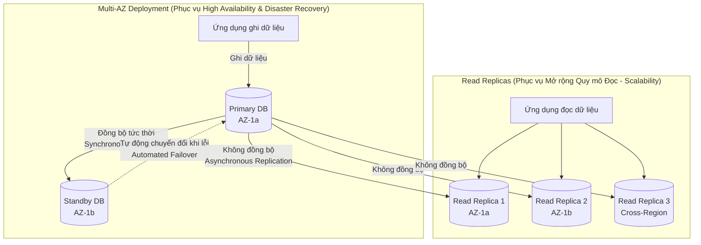
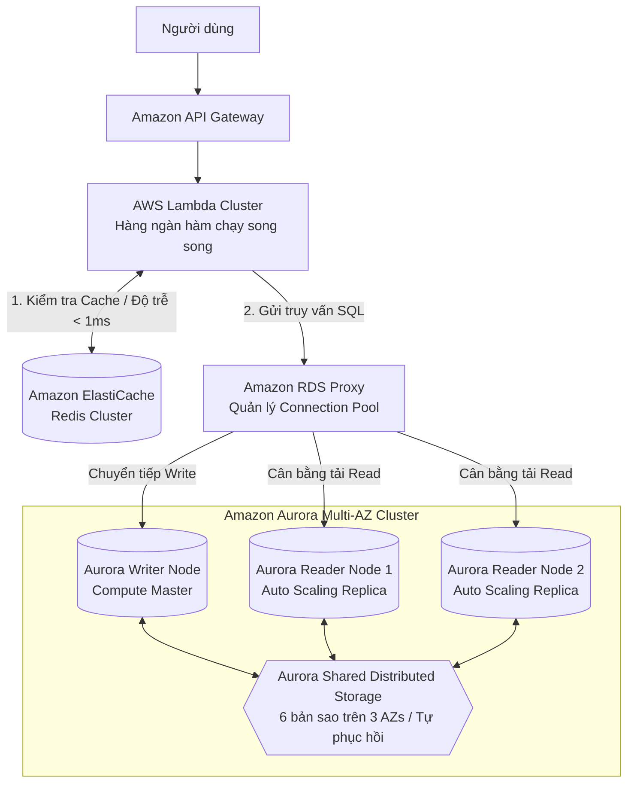

# Tài Liệu Học Tập Chuyên Sâu: Amazon RDS, Amazon Aurora & Dịch Vụ Cơ Sở Dữ Liệu Đám Mây (Databases in AWS)

> **Tài liệu chuẩn hóa kiến trúc đám mây**: Hướng dẫn toàn diện theo tiêu chuẩn Senior AWS Solutions Architect & Cloud DevOps Engineer.  
> **Ngôn ngữ**: Tiếng Việt (Bảo lưu toàn bộ thuật ngữ chuyên ngành tiếng Anh chuẩn AWS).  
> **Các bài giảng liên quan**: Chương 09 (RDS + Aurora) & Chương 21 (Databases in AWS).

---

## 6.1. Tổng Quan Dịch Vụ (Service Overview)

### Dịch vụ gì?
Cơ sở dữ liệu đám mây trên AWS được phân chia thành hai nhóm lớn:
1. **Amazon Relational Database Service (Amazon RDS)**: Dịch vụ cơ sở dữ liệu quan hệ được quản lý hoàn toàn (Managed Relational Database Service), hỗ trợ 6 công cụ cơ sở dữ liệu phổ biến: PostgreSQL, MySQL, MariaDB, Oracle, Microsoft SQL Server, và IBM DB2.
2. **Amazon Aurora**: Cơ sở dữ liệu đám mây thế hệ mới độc quyền của AWS, tương thích hoàn toàn với MySQL và PostgreSQL, được thiết kế lại toàn bộ tầng lưu trữ để đạt hiệu năng gấp **5 lần MySQL chuẩn** và **3 lần PostgreSQL chuẩn** trên cùng cấu hình phần cứng.
3. **Amazon ElastiCache**: Dịch vụ bộ nhớ đệm trong RAM (In-Memory Data Store & Cache) được quản lý hoàn toàn, hỗ trợ Redis và Memcached, giúp giảm tải truy vấn cho cơ sở dữ liệu quan hệ và đem lại độ trễ microsecond.

### Tại sao sử dụng Managed Database thay vì tự cài trên EC2?
- **Tự động hóa hoàn toàn các tác vụ vận hành nặng nhọc (Automated Administrative Tasks)**:
  - Tự động vá lỗi hệ điều hành và engine database (Automated OS & DB Patching).
  - Tự động sao lưu dữ liệu liên tục với khả năng phục hồi về bất kỳ giây nào trong quá khứ (Point-in-Time Recovery - PITR).
  - Tự động chuyển đổi dự phòng khi máy chủ chính gặp thảm họa (Multi-AZ Automated Failover).
  - Dễ dàng tạo bản sao đọc (Read Replicas) chỉ bằng vài cú click chuột để mở rộng quy mô đọc.
  - Tự động đồng bộ hóa số liệu giám sát và chỉ số hiệu năng (CloudWatch, Enhanced Monitoring, Performance Insights).
- **Khi nào nên tự chạy Database trên EC2 thay vì RDS?**:
  - Khi bạn cần toàn quyền kiểm soát hệ điều hành (Root/SSH access) và quyền can thiệp vào các file cấu hình hệ thống sâu bên dưới mà RDS không cho phép (dù hiện nay đã có **RDS Custom** cho Oracle và SQL Server để giải quyết một phần bài toán này).
  - Khi cần sử dụng các tính năng hoặc plugin đặc thù chưa được RDS hỗ trợ.

---

## 6.2. Các Khái Niệm và Thành Phần Cốt Lõi (Core Concepts and Components)

### 1. Phân biệt then chốt: RDS Read Replicas vs Multi-AZ (Cực kỳ quan trọng trong thi cử)

| Tiêu chí | RDS Read Replicas | RDS Multi-AZ Deployment |
| :--- | :--- | :--- |
| **Mục tiêu chính** | **Mở rộng quy mô đọc (Scalability & Performance)** | **Tính khả dụng cao & Khắc phục thảm họa (High Availability & DR)** |
| **Cơ chế sao chép** | **Không đồng bộ (Asynchronous)**: Có độ trễ sao chép (Replication Lag); dữ liệu đọc có thể hơi cũ (Eventual Consistency). | **Đồng bộ (Synchronous)**: Dữ liệu ghi thành công trên cả 2 node thì transaction mới hoàn tất (Strict Consistency). |
| **Số lượng bản sao** | Tối đa **15 Read Replicas** cho mỗi Primary DB. | **Duy nhất 1 Standby Replica** (hoặc 2 với Multi-AZ DB Cluster). |
| **Vị trí triển khai** | Có thể cùng AZ, khác AZ, hoặc **Xuyên Region (Cross-Region)**. | Luôn luôn nằm ở **2 Availability Zones khác nhau** trong cùng 1 Region. |
| **Quyền truy cập đọc** | **Được phép đọc**: Cung cấp DNS Endpoint riêng để ứng dụng kết nối đọc báo cáo, analytics. | **KHÔNG được phép truy cập**: Standby DB chỉ chạy ngầm, không mở endpoint cho người dùng. |
| **Cơ chế Failover** | Có thể được promote thủ công thành database độc lập nếu cần. | **Hoàn toàn tự động (Automated Failover)**: Tự đổi DNS CNAME sang Standby trong vòng 60-120 giây. |

### 2. Kiến trúc đột phá của Amazon Aurora
- **Kiến trúc tách rời Compute và Storage**:
  - Không giống như RDS truyền thống (Compute và EBS Volume bị trói chặt với nhau), Aurora tách riêng biệt tầng xử lý tính toán (Compute Nodes) và tầng lưu trữ dữ liệu (Shared Storage Volume).
- **Tầng lưu trữ phân tán 6 bản sao (6-way Replication across 3 AZs)**:
  - Dữ liệu được tự động chia nhỏ thành các đoạn 10GB và nhân bản thành **6 bản sao trải rộng trên 3 Availability Zones** (2 bản sao mỗi AZ).
  - *Khả năng chịu lỗi siêu việt*: 
    - Có thể mất 1 AZ hoàn toàn (2 bản sao) mà việc ghi dữ liệu vẫn diễn ra bình thường (Quorum Write 4/6).
    - Có thể mất 1 AZ và thêm 1 bản sao nữa (3 bản sao) mà việc đọc dữ liệu vẫn hoạt động bình thường (Quorum Read 3/6).
    - Tính năng tự phục hồi (Self-healing): Ổ đĩa tự động phát hiện block lỗi và tự sửa chữa ngầm mà không cần can thiệp.
  - Tự động co giãn dung lượng lưu trữ: Từ 10GB lên tới **128 TB** mà không cần cấp phát trước.
- **Aurora Endpoints**:
  - **Writer Endpoint**: Trỏ đến Master DB duy nhất xử lý các thao tác ghi (`INSERT`, `UPDATE`, `DELETE`).
  - **Reader Endpoint**: Cung cấp tính năng cân bằng tải ở tầng DNS, tự động phân phối các truy vấn đọc (`SELECT`) đều ra tất cả các Aurora Replicas (tối đa 15 replicas với độ trễ sao chép < 10ms).
- **Các biến thể cao cấp của Aurora**:
  - **Aurora Serverless v2**: Tự động co giãn tài nguyên tính toán (đo bằng Aurora Capacity Units - ACUs) chỉ trong một phần giây để đáp ứng các đợt tăng tải đột ngột mà không cần gián đoạn kết nối.
  - **Aurora Global Database**: Trải rộng cơ sở dữ liệu trên nhiều AWS Region với độ trễ sao chép dữ liệu xuyên lục địa dưới 1 giây. Khi Region chính gặp thảm họa, có thể chuyển giao quyền Master cho Region phụ trong vòng chưa đầy 1 phút (RPO < 1s, RTO < 1min).
  - **Aurora Multi-Master**: Cho phép nhiều node xử lý ghi đồng thời trên nhiều AZ (phù hợp cho các hệ thống yêu cầu continuous write availability).

### 3. Amazon RDS Proxy
- **Vấn đề**: Các ứng dụng Serverless (như AWS Lambda) có thể nhân bản lên hàng ngàn instances đồng thời trong vài giây. Mỗi instance mở một kết nối database độc lập, nhanh chóng làm cạn kiệt bộ nhớ RAM và làm sập connection pool của cơ sở dữ liệu quan hệ.
- **Giải pháp**: **RDS Proxy** đứng ở giữa đóng vai trò như một bộ tập trung kết nối (Connection Pooler):
  - Chia sẻ và tái sử dụng hàng ngàn kết nối từ Lambda vào một số lượng kết nối cố định tới Database.
  - **Giảm thời gian Failover lên tới 66%**: Khi RDS chính bị lỗi, RDS Proxy tự động chuyển hướng kết nối sang Standby DB mà không làm đứt kết nối của ứng dụng, ứng dụng không phải tự xử lý logic thử lại (retry).
  - Tăng cường bảo mật: Bắt buộc xác thực qua IAM Database Authentication và quản lý mật khẩu tập trung trong **AWS Secrets Manager**.

### 4. Amazon ElastiCache (Bộ Nhớ Đệm Siêu Tốc)
- **Redis vs Memcached**:
  - **Redis**: Hỗ trợ cấu trúc dữ liệu phức tạp (Sets, Hashes, Sorted Sets), hỗ trợ tính năng bền vững dữ liệu (Persistence), sao lưu snapshot, Multi-AZ với tính năng tự động failover (Auto-failover), hỗ trợ Pub/Sub.
  - **Memcached**: Thuần túy là bộ nhớ đệm Key-Value dạng chuỗi đa luồng (Multi-threaded), không hỗ trợ nhân bản, không hỗ trợ snapshot, phù hợp cho bài toán cache đơn giản phân mảnh nhiều node (Sharding).
- **Chiến lược bộ nhớ đệm (Caching Patterns)**:
  - *Lazy Loading / Cache-Aside*: Ứng dụng tìm kiếm trong Cache trước; nếu không có (Cache Miss), đọc từ Database rồi ghi ngược lại vào Cache. Dữ liệu chỉ được nạp khi có người hỏi.
  - *Write-Through*: Khi ứng dụng ghi dữ liệu, ghi đồng thời vào Cache và Database. Đảm bảo dữ liệu trong Cache luôn tươi mới nhưng tốn chi phí ghi.

---

## 6.3. Kiến Trúc và Luồng Vận Hành (Architecture and Workflow)

### Sơ đồ kiến trúc ứng dụng Microservices kết hợp RDS Proxy, Aurora và ElastiCache

---

## 6.4. Bảng Tích Hợp với Các Dịch Vụ AWS Khác (Integration Table)

| Related AWS Service | Purpose (Mục đích tích hợp) | Integration Method (Phương thức tích hợp) | Practical Example (Ví dụ thực tiễn) |
| :--- | :--- | :--- | :--- |
| **AWS Secrets Manager** | Tự động hóa lưu trữ và luân chuyển mật khẩu cơ sở dữ liệu định kỳ | Tích hợp gốc (Native Integration) | Cứ 30 ngày một lần, Secrets Manager tự động kích hoạt Lambda để đổi mật khẩu RDS root mà không gây downtime. |
| **AWS KMS** | Mã hóa dữ liệu lưu trữ (Encryption at Rest) cho database và snapshots | KMS Customer Managed Key (CMK) | Sử dụng khóa KMS riêng của doanh nghiệp để mã hóa toàn bộ dữ liệu bảng và file log giao dịch của PostgreSQL. |
| **Amazon CloudWatch** | Theo dõi hiệu năng chuyên sâu (Enhanced Monitoring) | CloudWatch Agent trong Hypervisor | Giám sát chi tiết mức độ sử dụng CPU của từng tiến trình (OS process list) chạy trong máy chủ RDS. |
| **AWS Database Migration Service (DMS)** | Di chuyển cơ sở dữ liệu từ On-Premises lên RDS/Aurora | DMS Replication Instance | Di chuyển 10TB dữ liệu từ Oracle Database tại chỗ lên Amazon Aurora PostgreSQL mà không làm gián đoạn hệ thống. |

---

## 6.5. Bảng So Sánh Toàn Bộ Các Dịch Vụ Database Trên AWS (Database Landscape)

| AWS Database Service | Loại hình Database | Mô hình dữ liệu | Kịch bản sử dụng chuẩn mực |
| :--- | :--- | :--- | :--- |
| **Amazon RDS** | Quan hệ (Relational - RDBMS) | SQL Tables, Foreign Keys | Ứng dụng thương mại điện tử truyền thống, hệ thống ERP, CRM phức tạp. |
| **Amazon Aurora** | Quan hệ Cloud-native | SQL tương thích MySQL/Postgres | Hệ thống giao dịch tài chính quy mô lớn, ngân hàng số cần độ sẵn sàng 99.99%. |
| **Amazon DynamoDB** | NoSQL Key-Value & Document | JSON, BSON, Key-Value | Ứng dụng di động, bảng xếp hạng game, giỏ hàng thương mại điện tử, IoT. |
| **Amazon ElastiCache** | In-Memory Data Store | Key-Value, Sets, Hashes | Bộ nhớ đệm giảm tải database, lưu trữ phiên đăng nhập (Session Store), Leaderboard. |
| **Amazon DocumentDB** | NoSQL Document | JSON (Tương thích MongoDB) | Quản lý danh mục sản phẩm (Product Catalog), hệ thống quản lý nội dung (CMS). |
| **Amazon Neptune** | Cơ sở dữ liệu đồ thị (Graph) | Nodes, Edges, Properties | Mạng xã hội, đồ thị phát hiện gian lận tài chính (Fraud Detection), Recommendation. |
| **Amazon Keyspaces** | NoSQL Columnar | Wide-column (Tương thích Apache Cassandra) | Dữ liệu thiết bị viễn thông, theo dõi vị trí GPS của đội xe theo thời gian thực. |
| **Amazon Timestream** | Cơ sở dữ liệu chuỗi thời gian (Time-series) | Datapoints gắn nhãn thời gian | Dữ liệu cảm biến IoT công nghiệp, theo dõi số liệu viễn trắc (Telemetry logs). |

---

## 6.6. Mô Hình Tính Phí Dịch Vụ & Chiến Lược Tối Ưu Chi Phí Theo Từng Use Case (RDS & Aurora Cost Breakdown & Optimization)

Cơ sở dữ liệu đám mây thường là thành phần đắt đỏ thứ hai trong hóa đơn AWS (chỉ sau EC2). Các quyết định kiến trúc như bật Multi-AZ sai môi trường, chọn nhầm cấu hình lưu trữ Aurora Standard/I-O Optimized hoặc không dùng bộ nhớ đệm (Cache) có thể khiến chi phí đội lên gấp nhiều lần.

---

### 6.6.1. Bảng Phân Tích Cơ Chế Tính Phí Chi Tiết Của Amazon RDS & Aurora

| Thành phần Dịch vụ (Component) | Cơ chế tính phí chi tiết (Pricing Dimensions) | Mức phí tham chiếu điển hình | Rủi ro phát sinh chi phí (Cost Pitfalls) |
| :--- | :--- | :--- | :--- |
| **RDS Database Instance Hours** | • Tính theo từng giây máy chủ chạy (tối thiểu 10 phút). • Dòng chip **AWS Graviton (`db.m6g`, `db.r6g`, `db.t4g`) rẻ hơn ~20%** so với x86. • **Multi-AZ Deployment**: **Nhân đôi (x2)** giá instance hour và dung lượng lưu trữ! | `db.t4g.medium`: ~$0.068/giờ. `db.r6g.xlarge`: ~$0.48/giờ. Bật Multi-AZ = $0.96/giờ! | Bật Multi-AZ cho môi trường Dev/Test/Staging gây lãng phí 100% chi phí máy chủ dự phòng. |
| **RDS Storage (Dung lượng ổ đĩa)** | • **General Purpose SSD (`gp3`)**: ~$0.115 / GB / tháng. • **Provisioned IOPS SSD (`io1`)**: $0.125 / GB + $0.10 / IOPS / tháng. | Dung lượng lưu trữ cấp phát cố định (không tự giảm khi xóa dữ liệu). | Cấp phát 1 TB `io1` với 20,000 IOPS tốn tới **$2,125/tháng** riêng tiền ổ đĩa! |
| **RDS Backup Storage** | • **Miễn phí** dung lượng sao lưu bằng 100% tổng dung lượng database cấp phát. • Dung lượng backup vượt quá: **$0.095 / GB / tháng**. | Miễn phí trong giới hạn retention period thông thường. | Đặt retention period tối đa (35 ngày) cho database có tần suất thay đổi dữ liệu khổng lồ. |
| **Amazon Aurora Standard** | • **Compute Instance**: Tính theo giờ hoạt động. • **Dung lượng lưu trữ**: **$0.10 / GB / tháng** (chỉ tính dữ liệu thực tế sử dụng, tự co giãn từ 10GB tới 128TB). • **Phí I/O Requests**: **$0.20 / 1 triệu requests I/O**. | Thích hợp cho ứng dụng có tải I/O từ thấp đến trung bình. | **Bẫy chi phí nghiêm trọng**: Với ứng dụng đọc/ghi liên tục (ví dụ 5 tỷ I/O/tháng), tiền I/O tốn tới **$1,000/tháng**! |
| **Amazon Aurora I/O-Optimized** | • Tăng giá Compute Instance thêm ~30%. • Giá lưu trữ: **$0.225 / GB / tháng**. • **HOÀN TOÀN MIỄN PHÍ MỌI TRUY VẤN I/O ($0.00 / I/O Request)**! | Tối ưu tuyệt đối khi chi phí I/O vượt quá **25%** tổng hóa đơn Aurora. | Dùng cho database ít truy cập (làm tăng chi phí compute và storage vô ích). |
| **Amazon Aurora Serverless v2** | • Tính phí theo **Aurora Capacity Unit (ACU)** tiêu thụ mỗi giờ. • **~$0.12 / ACU / giờ** (1 ACU = xấp xỉ 2 GB RAM + CPU tương ứng). • Tự động co giãn tức thì từ 0.5 ACU đến 128 ACU. | Cực kỳ tiết kiệm cho hệ thống có lưu lượng biến thiên mạnh hoặc không hoạt động ban đêm. | Cấu hình mức sàn `Min ACU` quá cao trên môi trường thử nghiệm. |
| **Amazon RDS Proxy** | • Tính phí cố định: **$0.015 / vCPU-hour** của máy chủ RDS bên dưới. • Ví dụ RDS chạy 4 vCPU = $0.06/giờ (~$43.20/tháng). | Rẻ, giúp tái sử dụng connection pool cho hàng nghìn Lambda functions. | Bật RDS Proxy cho các máy chủ monolithic truyền thống đã có sẵn connection pool nội bộ. |
| **Amazon ElastiCache (Redis/Memcached)** | • Tính phí theo giờ máy chủ cache (ví dụ `cache.t4g.medium` ~$0.034/giờ ≈ $25/tháng). | Giảm tải tới 80% truy vấn đọc cho database, giúp hạ cỡ tải RDS instance. | Không thiết lập TTL cho cache key khiến RAM của ElastiCache bị tràn bộ nhớ. |

---

### 6.6.2. Chiến Lược Tối Ưu Hóa Chi Phí Theo 5 Kịch Bản Thực Tế (Use Cases Optimization)

#### Use Case 1: Lựa chọn giữa Aurora Standard và Aurora I/O-Optimized
* **Vấn đề & Bài toán thực tế**:
  - Doanh nghiệp vận hành nền tảng Fintech với lưu lượng ghi transaction cực lớn, phát sinh **4 tỷ lượt I/O requests** mỗi tháng trên cụm Aurora PostgreSQL (1 instance `db.r6g.2xlarge` = $0.96/giờ, 1 TB dữ liệu).
  - *Nếu chạy Aurora Standard*:
    $$\text{Phí Compute} = 0.96\$ \times 720 = 691.20\$$$
    $$\text{Phí Storage} = 1,000 \text{ GB} \times 0.10\$ = 100.00\$$$
    $$\text{Phí I/O Requests} = 4,000 \text{ triệu} \times 0.20\$ = \mathbf{800.00\$/\text{tháng}}$$
    $$\text{Tổng chi phí Aurora Standard} = 691.20\$ + 100\$ + 800\$ = \mathbf{1,591.20\$/\text{tháng}}$$
  - *Nếu chuyển sang Aurora I/O-Optimized*:
    $$\text{Phí Compute (+30%)} = 1.25\$ \times 720 = 900.00\$$$
    $$\text{Phí Storage} = 1,000 \text{ GB} \times 0.225\$ = 225.00\$$$
    $$\text{Phí I/O Requests} = \mathbf{0.00\$ (Hoàn toàn Miễn phí)}$$
    $$\text{Tổng chi phí Aurora I/O-Optimized} = 900\$ + 225\$ + 0\$ = \mathbf{1,125.00\$/\text{tháng}}$$
* **Kết quả tiết kiệm**: Tiết kiệm ngay **$466.20/tháng (~30% tổng chi phí)**, đồng thời loại bỏ hoàn toàn sự bất định và rủi ro nổ hóa đơn I/O khi người dùng tăng đột biến.

#### Use Case 2: Phân tách cấu hình Multi-AZ giữa Môi trường Dev/Test và Production
* **Vấn đề & Cách tính tiền cũ**:
  - Kỹ sư dùng chung template Infrastructure as Code (Terraform) bật thuộc tính `multi_az = true` cho tất cả các môi trường (Dev, Staging, Production) trên dòng máy `db.m6g.xlarge` ($0.26/giờ).
  - Chi phí 1 instance Multi-AZ: $0.52/giờ ≈ $374.40/tháng.
  - 3 môi trường Dev, QA, Staging tốn: $3 \times 374.40\$ = \mathbf{1,123.20\$/\text{tháng}}$.
* **Giải pháp Tối ưu kiến trúc**:
  - **Môi trường Production**: Bắt buộc giữ `multi_az = true` để đảm bảo SLA 99.95%, dự phòng tự động chuyển đổi khi thảm họa xảy ra.
  - **Môi trường Non-Production (Dev/QA/Staging)**: Đặt `multi_az = false` (Single-AZ deployment). Vẫn bật tính năng **Automated Backups** (giữ 1-7 ngày) để nếu có sự cố phần cứng thì khôi phục lại máy ảo trong 15-20 phút.
* **Kết quả tiết kiệm**: Giảm ngay 50% chi phí máy chủ cho 3 môi trường thử nghiệm, tiết kiệm **$561.60/tháng ($6,739/năm)**.

#### Use Case 3: Thêm tầng Cache ElastiCache để Hạ Cỡ Tải RDS Instance (Caching Tiering)
* **Vấn đề & Cách tính tiền cũ**:
  - Ứng dụng thương mại điện tử có tỷ lệ đọc/ghi là 9:1 (90% là truy vấn xem danh mục sản phẩm).
  - Do số lượng truy vấn `SELECT` quá lớn, doanh nghiệp buộc phải nâng cấp database lên máy chủ cực mạnh **`db.r5.4xlarge` (16 vCPU, 128 GB RAM = $2.00/giờ)**:
    $$\text{Chi phí Database} = 2.00\$ \times 720 = \mathbf{1,440\$/\text{tháng}}$$
* **Giải pháp Tối ưu kiến trúc**:
  - Đặt một cụm **Amazon ElastiCache Redis** (`cache.t4g.medium` = 2 vCPU, 3.1 GB RAM = $0.034/giờ ≈ **$24.50/tháng**) đứng trước database theo mô hình **Cache-Aside Pattern**.
  - 85% các truy vấn xem danh mục được phục vụ trực tiếp từ bộ nhớ RAM của Redis với độ trễ sub-millisecond.
  - Tải CPU trên RDS giảm từ 85% xuống còn 15%. Doanh nghiệp hạ cấp instance RDS từ `db.r5.4xlarge` xuống **`db.r5.xlarge` (4 vCPU = $0.50/giờ)**:
    $$\text{Chi phí RDS sau hạ cấp} = 0.50\$ \times 720 = 360.00\$$$
    $$\text{Tổng chi phí sau tối ưu} = 360\$ + 24.50\$ = \mathbf{384.50\$/\text{tháng}}$$
* **Kết quả tiết kiệm**: Tiết kiệm hơn **$1,055/tháng (Giảm 73% chi phí)** trong khi tốc độ phản hồi trang web nhanh hơn gấp 10 lần.

#### Use Case 4: Ứng dụng tải biến thiên mạnh với Aurora Serverless v2
* **Vấn đề & Cách tính tiền cũ**:
  - Hệ thống chấm công và quản lý nhân sự nội bộ công ty chỉ hoạt động từ 8h sáng đến 18h tối (10 tiếng/ngày), ban đêm và 2 ngày cuối tuần gần như không có bất kỳ ai truy cập.
  - Nếu duy trì máy chủ cố định `db.r6g.xlarge` chạy 24/7: $0.52\$ \times 720 = \mathbf{374.40\$/\text{tháng}}$.
* **Giải pháp Tối ưu kiến trúc**:
  - Chuyển sang sử dụng **Amazon Aurora Serverless v2**:
    - Ban ngày (giờ làm việc cao điểm): Tự động scale lên 4 ACU ($0.48/giờ) xử lý mượt mà.
    - Ban đêm và cuối tuần: Tự động scale co về mức sàn tối thiểu **0.5 ACU ($0.06/giờ)**.
  - Chi phí ước tính hàng tháng:
    $$\text{Giờ làm việc (220 giờ)} = 220 \times (4 \times 0.12\$) = 105.60\$$$
    $$\text{Giờ thấp điểm (500 giờ)} = 500 \times (0.5 \times 0.12\$) = 30.00\$$$
    $$\text{Tổng chi phí Serverless} = 105.60\$ + 30.00\$ = \mathbf{135.60\$/\text{tháng}}$$
* **Kết quả tiết kiệm**: Tiết kiệm **$238.80/tháng (Giảm gần 64% chi phí)** mà không cần người can thiệp vận hành.

#### Use Case 5: Tối ưu chi phí dài hạn với RDS Reserved Instances và Chuyển sang Graviton
* **Vấn đề**: Hệ thống sản xuất chạy ổn định trong 3 năm bằng máy ảo On-Demand dòng Intel x86 `db.m5.2xlarge` ($0.77/giờ = $554.40/tháng).
* **Giải pháp Tối ưu**:
  1. Chuyển đổi engine sang vi xử lý **AWS Graviton `db.m6g.2xlarge`** ($0.62/giờ): Tiết kiệm ngay 20% chi phí On-Demand.
  2. Mua gói cam kết **RDS Reserved Instance (RI) kỳ hạn 1 năm hoặc 3 năm** (All Upfront hoặc Partial Upfront): Chiết khấu thêm tới 40% - 60%.
  3. Giá sau khi kết hợp Graviton + 3-Year Reserved Instance chỉ còn khoảng **$0.25 / giờ** ($180/tháng).
* **Kết quả tiết kiệm**: Giảm từ $554.40/tháng xuống $180/tháng (**Tiết kiệm $374.40/tháng ~67.5% chi phí**).

---

## 6.7. Khắc Phục Sự Cố Thực Tế (Troubleshooting Guide)

| Vấn đề (Problem) | Nguyên nhân khả dĩ (Possible Causes) | Các bước điều tra (Investigation Steps) | Giải pháp (Solution) | Biện pháp phòng ngừa (Prevention) |
| :--- | :--- | :--- | :--- | :--- |
| **Ứng dụng không thể kết nối tới RDS database (Connection Timeout)** | Security Group của RDS chưa cho phép Inbound traffic từ Security Group của máy chủ ứng dụng. | 1. Kiểm tra Inbound rule của RDS Security Group. 2. Kiểm tra RDS Subnet Group xem có nằm cùng VPC không. | Thêm rule trên RDS SG cho phép cổng tương ứng (ví dụ 3306 cho MySQL, 5432 cho Postgres) từ App SG. | Không bao giờ mở cổng database tới `0.0.0.0/0`. |
| **Cạn kiệt kết nối vào database (`Too many connections error`)** | Ứng dụng mở quá nhiều kết nối hoặc không giải phóng kết nối sau khi xử lý xong (Connection Leak). | Xem metric `DatabaseConnections` trên CloudWatch. | Triển khai **Amazon RDS Proxy** đứng trước database để tái sử dụng kết nối (Connection Pooling). | Cấu hình giới hạn Connection Pool trên mã nguồn ứng dụng. |
| **Read Replica bị tụt hậu dữ liệu quá xa so với Master (`High Replication Lag`)** | Tải ghi trên Master quá lớn hoặc cấu hình phần cứng của Read Replica yếu hơn Master. | Xem metric `ReplicaLag` trên CloudWatch. | Nâng kích thước instance của Read Replica lên ngang bằng hoặc mạnh hơn Master, hoặc chia tải đọc ra nhiều Replicas. | Thiết lập cảnh báo CloudWatch Alarm khi `ReplicaLag > 30s`. |
| **Cạn kiệt không gian ổ đĩa trên RDS (`Storage Full`)** | Lượng dữ liệu thực tế hoặc file transaction log tăng đột biến. | Xem metric `FreeStorageSpace` trên CloudWatch. | Bật tính năng **Storage Auto Scaling** trên RDS (cho phép tự tăng dung lượng lên tới trần cấu hình). | Thiết lập cảnh báo khi dung lượng trống dưới 20%. |

---

## 6.8. Bộ Câu Hỏi Ôn Tập và Kiểm Tra Kiến Thức (Knowledge Review)

### A. 10 Câu hỏi Cốt lõi (Core Concepts)
1. Amazon RDS hỗ trợ cơ chế phục hồi theo thời gian (Point-in-Time Recovery - PITR) trong khoảng thời gian lưu giữ (Retention Period) tối đa là bao nhiêu ngày?
2. Trong mô hình triển khai **RDS Multi-AZ**, máy chủ Standby Database có thể tiếp nhận các truy vấn đọc (`SELECT`) từ người dùng để giảm tải cho máy chủ chính không?
3. Kiến trúc lưu trữ của **Amazon Aurora** nhân bản dữ liệu thành bao nhiêu bản sao và trải rộng trên bao nhiêu Availability Zones?
4. Đâu là điểm khác biệt cốt lõi nhất giữa **Read Replicas** và **Multi-AZ Deployment** trong Amazon RDS?
5. Dịch vụ nào đóng vai trò như một bộ tập trung kết nối trung gian giúp ứng dụng serverless AWS Lambda không làm cạn kiệt connection pool của RDS?
6. Cơ sở dữ liệu nào của AWS được thiết kế tối ưu chuyên biệt cho việc lưu trữ và truy vấn các mối quan hệ phức tạp như mạng lưới bạn bè trên mạng xã hội hoặc đồ thị phát hiện gian lận?
7. Hai công cụ bộ nhớ đệm nào được hỗ trợ bởi dịch vụ **Amazon ElastiCache**?
8. Tính năng nào của Amazon Aurora cho phép một cụm cơ sở dữ liệu có thể mở rộng trải dài trên nhiều AWS Region với độ trễ sao chép dữ liệu xuyên lục địa dưới 1 giây?
9. Cơ chế sao lưu tự động (Automated Backups) và chụp ảnh thủ công (Manual Snapshots) của RDS khác nhau như thế nào khi bạn quyết định xóa bỏ (Delete) instance database?
10. Dịch vụ cơ sở dữ liệu NoSQL nào của AWS được thiết kế tương thích hoàn toàn với các ứng dụng đang sử dụng mã nguồn MongoDB?

---

### Đáp án Bộ Câu Hỏi Ôn Tập (Answer Key)

👉 Nhấp vào đây để xem toàn bộ đáp án chi tiết

1. Tối đa **35 ngày** (mặc định là 7 ngày).
2. **KHÔNG THỂ**. Máy chủ Standby trong cấu hình RDS Multi-AZ thông thường chỉ đóng vai trò dự phòng nóng (Failover target), không mở bất kỳ endpoint nào cho người dùng đọc dữ liệu. Muốn mở rộng quy mô đọc, bạn bắt buộc phải tạo **Read Replicas**.
3. **6 bản sao (6 copies) trải rộng trên 3 Availability Zones** (2 bản sao mỗi AZ).
4. **Multi-AZ** phục vụ cho **Tính khả dụng cao và khắc phục thảm họa (HA & DR)** thông qua cơ chế sao chép đồng bộ (Synchronous) và tự động failover; trong khi **Read Replicas** phục vụ cho việc **Mở rộng năng lực đọc (Performance & Scalability)** thông qua cơ chế sao chép không đồng bộ (Asynchronous).
5. **Amazon RDS Proxy**.
6. **Amazon Neptune** (Graph Database).
7. **Redis** và **Memcached**.
8. **Amazon Aurora Global Database**.
9. Khi xóa database instance: Toàn bộ các bản sao lưu tự động (**Automated Backups**) sẽ **BỊ XÓA THEO**; trong khi các bản chụp thủ công (**Manual Snapshots**) sẽ **ĐƯỢC GIỮ LẠI VĨNH VIỄN** trong tài khoản cho đến khi bạn chủ động xóa chúng.
10. **Amazon DocumentDB**.

---

## 6.9. Tóm Tắt và Danh Mục Kiểm Tra Kiến Thức (Summary & Learning Checklist)

### 5 Khái niệm quan trọng nhất phải nhớ:
1. **Multi-AZ = Disaster Recovery**: Đồng bộ, tự động failover, không dùng để đọc; **Read Replicas = Performance**: Bất đồng bộ, dùng để mở rộng quy mô đọc.
2. **Aurora Architecture**: Tách rời Compute và Storage; 6 bản sao trên 3 AZ; tự động co giãn lưu trữ lên tới 128TB.
3. **RDS Proxy**: Cứu tinh của kiến trúc Serverless Lambda khi kết nối vào cơ sở dữ liệu quan hệ.
4. **ElastiCache**: Redis (đa tính năng, có persistence, cluster) vs Memcached (thuần in-memory đa luồng).
5. **Chọn đúng Database cho đúng bài toán**: SQL cho quan hệ phức tạp, DynamoDB cho NoSQL tốc độ cao, Neptune cho đồ thị, Timestream cho chuỗi thời gian.

### Liên kết và Chủ đề tiếp theo:
- 📖 [Ghi Chú Bài Học Chương 09: RDS, Aurora & ElastiCache](file:///n:/AWS_XBrain_Note/Lesson_Notes/09_RDS_Aurora_ElastiCache.md)
- 📖 [Ghi Chú Bài Học Chương 21: Phân Loại Các Cơ Sở Dữ Liệu Trên AWS](file:///n:/AWS_XBrain_Note/Lesson_Notes/21_Databases_in_AWS.md)
- 📖 [Bảng Thuật Ngữ Kỹ Thuật (GLOSSARY.md)](file:///n:/AWS_XBrain_Note/GLOSSARY.md)
- ⏭️ Tiếp tục chuyển sang chuyên đề: **Hệ Thống Phân Giải Tên Miền Đám Mây: Amazon Route 53**.
