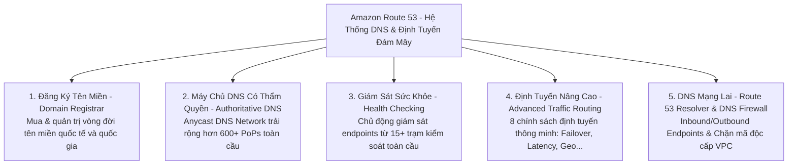
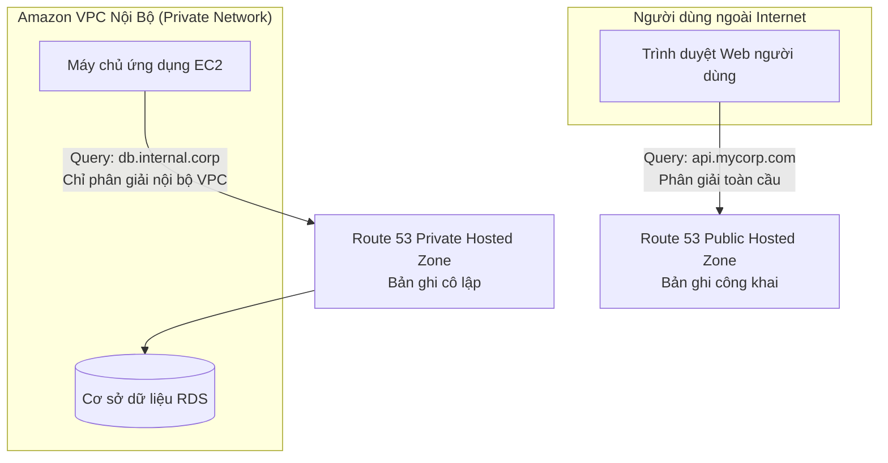
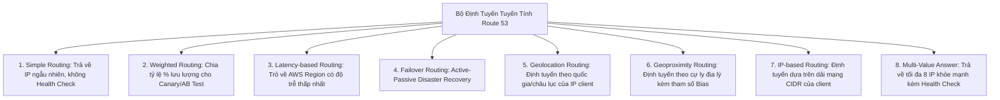
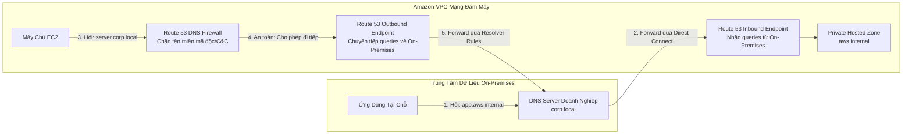
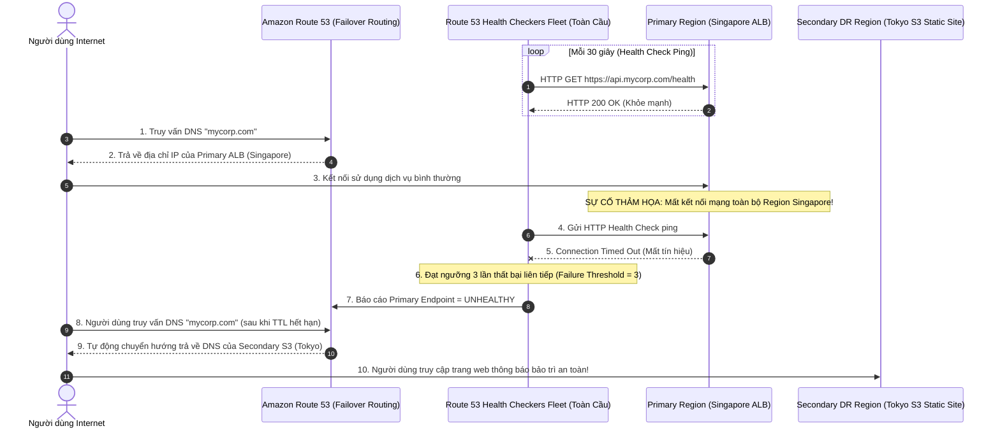

# Tài Liệu Học Tập Chuyên Sâu: Amazon Route 53 (Dịch Vụ Phân Giải Tên Miền & Định Tuyến Toàn Cầu)

> **Tài liệu chuẩn hóa kiến trúc đám mây**: Hướng dẫn toàn diện theo tiêu chuẩn Principal AWS Solutions Architect & Senior Cloud DevOps Engineer (Cập nhật phiên bản kiến trúc mới nhất 2026).  
> **Ngôn ngữ**: Tiếng Việt chuyên ngành (Bảo lưu toàn bộ thuật ngữ chuyên ngành tiếng Anh chuẩn AWS).  
> **Mục tiêu**: Phục vụ thi chứng chỉ cấp độ Professional/Specialty (**SAA-C03, SAP-C02, DOP-C02**) và vận hành hệ thống cấp độ doanh nghiệp (**Production-grade**).  
> **Các bài giảng liên quan**: Chương 10 (Route 53: Bài 101 đến Bài 120).

---

## 6.1. Tổng Quan Dịch Vụ (Service Overview)

### 1. Định nghĩa chuẩn xác và Phân nhóm dịch vụ
**Amazon Route 53** là dịch vụ phân giải tên miền (**Domain Name System - DNS**) và định tuyến lưu lượng toàn cầu có khả năng mở rộng cao và độ khả dụng đạt cam kết **100% SLA**. Tên gọi "Route 53" xuất phát từ cổng mạng mặc định **Port 53 (TCP/UDP)** của giao thức DNS truyền thống kết hợp với biểu tượng tuyến đường cao tốc lịch sử Route 66.



---

### 2. Bốn chức năng cốt lõi của Route 53

1. **Đăng ký tên miền (Domain Registrar)**: Đăng ký, gia hạn, khóa chống chuyển nhượng và quản lý quyền sở hữu tên miền cấp cao nhất (gTLDs và ccTLDs) trực tiếp trên AWS Management Console.
2. **Phân giải DNS có thẩm quyền (Authoritative DNS Service)**: Lưu trữ và trả lời các truy vấn DNS cho tên miền của bạn thông qua mạng lưới máy chủ phân tán toàn cầu sử dụng công nghệ định tuyến **Anycast DNS Network**.
3. **Kiểm tra sức khỏe tài nguyên (Health Checking)**: Liên tục giám sát trạng thái hoạt động (HTTP, HTTPS, TCP) của các máy chủ và ứng dụng web từ khắp nơi trên thế giới; tự động tích hợp với CloudWatch Metrics.
4. **Định tuyến lưu lượng thông minh (Traffic Management)**: Cung cấp 8 chính sách định tuyến chuyên sâu hỗ trợ kiểm thử A/B Testing, tối ưu hóa độ trễ theo địa lý và tự động chuyển đổi dự phòng khi xảy ra thảm họa (**Automated Disaster Recovery Failover**).

---

### 3. Khi nào KHÔNG nên dùng Route 53

* ❌ **Thay thế giải pháp tường lửa ứng dụng web Layer 7 (WAF)**: Route 53 chỉ định tuyến ở tầng phân giải tên miền (DNS Level). Nó không thể phân tích nội dung HTTP payload để chặn tấn công SQLi, XSS.  
  👉 *Giải pháp thay thế*: Sử dụng **AWS WAF** kết hợp **Amazon CloudFront** hoặc **Application Load Balancer**.
* ❌ **Cân bằng tải phân phối gói tin thời gian thực ở mức độ vi mô**: DNS có cơ chế lưu bộ nhớ đệm (Caching/TTL) tại các máy chủ trung gian của nhà mạng (ISP). Không thể dùng DNS để cân bằng tải chia đều từng request đơn lẻ.  
  👉 *Giải pháp thay thế*: Sử dụng **Elastic Load Balancing (ALB/NLB)**.

---

## 6.2. Các Khái Niệm, Kiến Trúc & Vận Hành Cốt Lõi (Core Concepts, Security & Day-2 Operations)

### 1. Phân loại Hosted Zones: Public vs Private Hosted Zones



* **Public Hosted Zone**: Lưu trữ các bản ghi DNS có thể phân giải công khai từ bất kỳ đâu trên Internet.
* **Private Hosted Zone**: Lưu trữ các bản ghi DNS chỉ có thể phân giải được từ **bên trong các VPC nội bộ** được chỉ định.  
  ⚠️ **Điều kiện tiên quyết bắt buộc của VPC**: Để sử dụng Private Hosted Zone, VPC liên kết bắt buộc phải bật 2 thuộc tính mạng:
  - `enableDnsHostnames = true`
  - `enableDnsSupport = true`

---

### 2. Các loại bản ghi DNS cơ bản & Phân biệt CNAME vs Alias Record

* **A Record**: Ánh xạ tên miền sang một địa chỉ **IPv4** (ví dụ: `198.51.100.25`).
* **AAAA Record**: Ánh xạ tên miền sang một địa chỉ **IPv6** (ví dụ: `2001:0db8:85a3::8a2e:0370:7334`).
* **CNAME Record**: Ánh xạ tên miền phụ sang một tên miền khác (ví dụ: `www.example.com` $\rightarrow$ `example.com`).  
  ⚠️ **Giới hạn RFC DNS**: CNAME **KHÔNG THỂ áp dụng cho tên miền gốc (Zone Apex / Naked Domain, ví dụ: `example.com`)**.
* **Alias Record (Đặc quyền tối thượng của Amazon Route 53)**:

| Tiêu chuẩn so sánh | CNAME Record | Route 53 Alias Record |
| :--- | :--- | :--- |
| **Bản chất kỹ thuật** | Chuẩn DNS quốc tế thông thường (RFC 1034). | **Tính năng mở rộng độc quyền của Amazon Route 53**. |
| **Áp dụng cho Zone Apex (`example.com`)** | ❌ **BỊ CẤM HOÀN TOÀN** bởi chuẩn DNS quốc tế. |  **HOÀN TOÀN ĐƯỢC PHÉP** (Áp dụng hoàn hảo cho root domain). |
| **Đích trỏ tới** | Bất kỳ tên miền hợp lệ nào trên Internet. | **Chỉ trỏ tới tài nguyên nội bộ của AWS** (ALB, CloudFront, S3 Website, API Gateway, VPC Endpoints). |
| **Chi phí truy vấn DNS** | Bị tính phí cước truy vấn thông thường ($0.40/1M). | **HOÀN TOÀN MIỄN PHÍ TRUY VẤN ($0.00)** khi trỏ tới tài nguyên AWS! |
| **Hiệu năng phân giải** | Client phải truy vấn 2 chặng (2 DNS roundtrips). | Route 53 tự động trả về trực tiếp địa chỉ IP A/AAAA của tài nguyên (1 chặng). |
| **Nhận biết IP động** | Tĩnh, client tự phân giải lại. | Tự động nhận biết và theo dõi sự thay đổi IP ngầm của ALB/CloudFront. |

---

### 3. Tám Chính Sách Định Tuyến Của Route 53 (The 8 Routing Policies)



1. **Simple Routing Policy (Định tuyến đơn giản)**: Cung cấp một bản ghi trỏ về 1 hoặc nhiều địa chỉ IP (Route 53 trả về danh sách ngẫu nhiên). Không hỗ trợ gắn kèm Route 53 Health Check.
2. **Weighted Routing Policy (Định tuyến theo trọng số)**: Phân bổ lưu lượng theo tỷ lệ phần trăm (ví dụ: 90% vào bản ghi A, 10% vào bản ghi B). Lý tưởng cho thử nghiệm **A/B Testing** và phát hành phần mềm Canary.
3. **Latency-based Routing Policy (Định tuyến theo độ trễ)**: Route 53 liên tục đo đạc độ trễ mạng toàn cầu và tự động chuyển hướng người dùng đến **AWS Region nào có thời gian phản hồi nhanh nhất**.
4. **Failover Routing Policy (Định tuyến chuyển đổi dự phòng Active-Passive)**:
   - Gắn liền với **Route 53 Health Check**.
   - Bình thường 100% traffic trỏ về **Primary Record**. Nếu Primary bị hỏng, Route 53 tự động chuyển hướng toàn bộ traffic sang **Secondary Record** (ví dụ: trang web bảo trì tĩnh trên Amazon S3).
5. **Geolocation Routing Policy (Định tuyến theo vị trí địa lý)**:
   - Định tuyến dựa trên vị trí địa lý của người dùng (theo châu lục, quốc gia, hoặc bang của Mỹ). Thích hợp cho việc bản địa hóa ngôn ngữ website hoặc kiểm soát phân phối nội dung theo bản quyền.
6. **Geoproximity Routing Policy (Định tuyến theo cự ly địa lý kèm Bias)**:
   - Định tuyến dựa trên khoảng cách vật lý giữa người dùng và trung tâm dữ liệu AWS. Cho phép cấu hình thông số **Bias** (từ -99 đến +99) để chủ động mở rộng hoặc thu hẹp vùng phủ sóng địa lý của một Region cụ thể.
7. **IP-based Routing Policy (Định tuyến dựa trên dải địa chỉ IP)**:
   - Định tuyến dựa trên danh sách dải địa chỉ mạng CIDR của người dùng (ví dụ: chuyển các dải IP của nhà mạng Viettel/VNPT hoặc mạng văn phòng nội bộ về cụm máy chủ chuyên dụng).
8. **Multi-Value Answer Routing Policy (Định tuyến đa giá trị)**:
   - Trả về tối đa **8 bản ghi IP khỏe mạnh (Healthy Records)** cho mỗi truy vấn DNS, có hỗ trợ gắn kèm Health Check. Đóng vai trò như một bộ cân bằng tải sơ cấp phía máy khách.

---

### 4. Kiến trúc DNS Mạng Lai: Route 53 Resolver & Route 53 DNS Firewall



* **Route 53 Inbound Endpoint**: Cho phép các máy chủ tại trung tâm dữ liệu On-Premises có thể phân giải được các tên miền nội bộ (**Private Hosted Zones**) nằm trong AWS VPC thông qua đường truyền riêng AWS Direct Connect hoặc Site-to-Site VPN.
* **Route 53 Outbound Endpoint & Resolver Rules**: Cho phép các máy ảo EC2 trong VPC phân giải được các tên miền nội bộ của doanh nghiệp (`corp.local`) bằng cách thiết lập các quy tắc chuyển tiếp có điều kiện (**Conditional Forwarding Rules**) trỏ về địa chỉ IP của DNS Server tại chỗ.
* **Route 53 DNS Firewall**: Tường lửa DNS hoạt động ở cấp độ VPC, cho phép bạn thiết lập danh sách trắng (Allowlist) và danh sách đen (Denylist) để giám sát và chặn đứng các yêu cầu phân giải DNS tới các tên miền lừa đảo, phát tán mã độc hoặc máy chủ điều khiển botnet (Command and Control - C&C servers).
* **DNSSEC (Domain Name System Security Extensions)**: Route 53 hỗ trợ kích hoạt DNSSEC cho cả Public và Private Hosted Zones, bảo vệ tính toàn vẹn của gói tin phản hồi DNS và chống lại các cuộc tấn công giả mạo đầu độc bộ nhớ đệm DNS (**DNS Cache Poisoning / Spoofing**).

---

### 🏛️ I. Các Kịch Bản Kiến Trúc Chuẩn (Best Practice Scenarios)

#### 1. Giới Hạn Phân Phối Bản Quyền Truyền Thông Bằng Geolocation Routing
- **Tình huống thi**: Một giải bóng đá lớn cấp quyền phát sóng trực tiếp các trận đấu độc quyền tại Hoa Kỳ. Nền tảng phát sóng phải đảm bảo chỉ người dùng tại Mỹ mới có thể xem luồng video, người dùng từ các quốc gia khác phải bị từ chối truy cập.
- **Giải pháp tối ưu chuẩn AWS**:
  - Sử dụng chính sách **Amazon Route 53 Geolocation Routing Policy**: Ánh xạ truy vấn DNS từ người dùng tại Hoa Kỳ tới tài nguyên phục vụ video, cấu hình Default record trả về trang thông báo từ chối cho các quốc gia khác.
  - Kết hợp sử dụng tính năng **CloudFront Georestriction (Geo-blocking)** với danh sách cho phép (Allowlist) chỉ gồm Hoa Kỳ để bảo vệ lớp nội dung tại CDN Edge.

#### 2. Định Tuyến Độ Trễ Thấp Nhất Toàn Cầu Với Latency-Based Routing
- **Tình huống thi**: Ứng dụng triển khai trên nhiều AWS Regions (Mỹ, Châu Âu, Châu Á). Cần định tuyến người dùng toàn cầu tới Region mang lại trải nghiệm độ trễ mạng thấp nhất cho họ một cách tự động.
- **Giải pháp chuẩn**:
  - Cấu hình chính sách **Latency-Based Routing** trên Amazon Route 53.
  - AWS liên tục đo đạc độ trễ mạng giữa các dải mạng Internet của người dùng trên toàn thế giới tới các data centers của AWS và tự động trả về IP của Region có độ trễ ngắn nhất.
  - Gắn kèm **Route 53 Health Checks** cho từng Region: Nếu Region gần nhất gặp sự cố, Route 53 sẽ tự động chuyển tiếp người dùng sang Region khả dụng kế tiếp.

#### 3. Sử Dụng Alias Record Cho Tên Miền Gốc (Zone Apex / Naked Domain)
- **Tình huống thi**: Doanh nghiệp sở hữu tên miền gốc `example.com` (không có tiền tố `www`) và muốn trỏ tên miền này tới Application Load Balancer hoặc CloudFront Distribution.
- **Quy tắc DNS cốt lõi**:
  - Tiêu chuẩn DNS RFC **nghiêm cấm tạo CNAME record** tại cấp độ Apex (`example.com`).
  - **Giải pháp chuẩn của AWS**: Tạo một **Route 53 Alias Record** kiểu A trỏ tới tên miền của ALB hoặc CloudFront.
  - **Lợi ích**:
    - Hỗ trợ đầy đủ cho Zone Apex.
    - Truy vấn DNS Alias tới tài nguyên AWS hoàn toàn **MIỄN PHÍ cước phí ($0.00)**.
    - Route 53 tự động nhận biết khi IP của ALB thay đổi mà không cần cập nhật thủ công.

---

### 🪤 II. Các Bẫy Thi Tinh Vi & Phân Tích Phương Án Sai (Exam Traps & Distractors)

#### 🪤 Bẫy 1: Triển Khai Blue-Green Tức Thì: Route 53 Weighted Bị Nghẽn Bởi DNS Cache — (U-PT2 Q43, CM-PT1 Q40)
- **Tình huống đề thi**: *"Doanh nghiệp muốn triển khai phiên bản mới của ứng dụng di động theo mô hình Blue-Green. Yêu cầu chuyển đổi lưu lượng giữa hai môi trường phải diễn ra tức thì trong vài giây và có thể rollback ngay lập tức nếu phát hiện lỗi nghiêm trọng."*
- **Các phương án bẫy**:
  - ❌ *Dùng Route 53 Weighted Routing*: Lý thuyết cho phép chia tỉ lệ (ví dụ: 90% Blue, 10% Green). Tuy nhiên, **Route 53 dựa trên giao thức DNS**, các nhà mạng viễn thông ISP và thiết bị di động của người dùng **thường lưu cache bản ghi DNS rất lâu** (bỏ qua giá trị TTL thấp). Khi cần rollback khẩn cấp, người dùng vẫn tiếp tục gửi yêu cầu vào phiên bản Green bị lỗi trong nhiều giờ!
- **Giải pháp ĐÚNG**: Sử dụng **AWS Global Accelerator với Traffic Dial**.
  - Cung cấp **2 địa chỉ IP tĩnh Anycast**.
  - Việc điều phối phần trăm lưu lượng (0% đến 100%) diễn ra trực tiếp tại các máy chủ Edge trên mạng trục riêng của AWS, **hoàn toàn bỏ qua bộ đệm DNS của client (Bypasses Client DNS Caching)** -> Thay đổi có hiệu lực ngay lập tức trong vài giây.

#### 🪤 Bẫy 2: Phân Biệt Chiều Định Tuyến Của Route 53 Resolver Endpoints — (CM-PT1 Q41)
- **Bẫy tráo chiều kinh điển trong đề thi**:
  - Muốn máy chủ On-Premises phân giải được các tên miền nội bộ AWS `*.internal`:
    - 👉 **Cấu hình Route 53 Resolver INBOUND Endpoint** (Lưu lượng truy vấn từ On-Premises đi **VÀO** AWS).
  - Muốn máy chủ EC2 trong VPC phân giải được các tên miền Active Directory nội bộ On-Premises `*.corp.local`:
    - 👉 **Cấu hình Route 53 Resolver OUTBOUND Endpoint** kết hợp với **Forwarding Rule** trỏ về địa chỉ IP của DNS Server On-Premises (Lưu lượng truy vấn từ AWS đi **RA NGOÀI** On-Premises).

#### 🪤 Bẫy 3: Phân Biệt Giữa Geolocation Routing và Geoproximity Routing
- **Geolocation Routing**:
  - Định tuyến dựa trên **vị trí địa lý của người dùng** (Quốc gia, Châu lục, hoặc Bang của Mỹ).
  - Thường dùng để hạn chế phân phối nội dung bản quyền hoặc hiển thị ngôn ngữ bản địa phù hợp.
- **Geoproximity Routing**:
  - Định tuyến dựa trên **khoảng cách địa lý giữa người dùng và tài nguyên AWS**.
  - Điểm đặc biệt: Cho phép sử dụng tham số **Bias** (giá trị từ `-99` đến `+99`) để chủ động mở rộng hoặc thu hẹp vùng địa lý mà một Region phục vụ (ví dụ: ép người dùng ở Châu Á chuyển hướng sang Region Châu Âu dù họ ở gần Châu Á hơn).
  - Yêu cầu bắt buộc phải sử dụng **Route 53 Traffic Flow**.

#### 🪤 Bẫy 4: Yêu Cầu Kích Hoạt DNS Trên VPC Để Dùng Private Hosted Zone — (U-PT2 Q60)
- **Tình huống đề thi**: *"Sau khi tạo Route 53 Private Hosted Zone và liên kết với VPC, các ứng dụng chạy trên EC2 vẫn không thể phân giải được tên miền."*
- **Nguyên nhân**: VPC bị thiếu một trong hai thiết lập mạng cơ sở:
  - `enableDnsHostnames` phải được đặt thành `true`.
  - `enableDnsSupport` phải được đặt thành `true`.
- Nếu thiếu cờ `enableDnsSupport`, máy chủ nội bộ `10.x.x.2` (AmazonProvidedDNS) sẽ không được kích hoạt, dẫn tới Route 53 Resolver không thể phản hồi truy vấn cho Private Hosted Zone.

---

### 📊 III. Ma Trận Quyết Định Chính Sách Định Tuyến DNS Nhanh (Exam Decision Matrix)

| Tình huống / Yêu cầu trong đề thi | Chính sách Route 53 chuẩn | Giải pháp bị loại & Lý do |
|:---|:---|:---|
| **Giới hạn nội dung theo quốc gia/châu lục** | **Geolocation Routing** | Latency-based (không chặn theo quốc gia được) |
| **Trải nghiệm mạng nhanh nhất cho user toàn cầu** | **Latency-Based Routing** | Weighted Routing (không đo đạc độ trễ mạng) |
| **Failover chủ động - dự phòng (Active-Passive)** | **Failover Routing** (+ Health Check) | Multi-Value (trả về nhiều IP cùng lúc) |
| **Phân bổ traffic thử nghiệm (Canary/A-B Testing)** | **Weighted Routing** | Geolocation Routing |
| **Chuyển đổi lưu lượng tức thì, bypass DNS cache** | **AWS Global Accelerator** | Route 53 Weighted (bị nghẽn bởi DNS cache) |
| **Điều chỉnh vùng phục vụ bằng tham số Bias** | **Geoproximity Routing** (Traffic Flow) | Geolocation Routing (không có tính năng Bias) |
| **Tên miền gốc `example.com` trỏ vào ALB/CloudFront** | **Alias Record (A/AAAA)** | CNAME Record (vi phạm tiêu chuẩn RFC DNS Apex) |
| **On-Premises phân giải tên miền private AWS** | **Route 53 Resolver Inbound Endpoint** | Outbound Endpoint (sai chiều đi của query) |
| **EC2 trong VPC phân giải tên miền On-Premises** | **Route 53 Resolver Outbound Endpoint** | Inbound Endpoint (sai chiều đi của query) |

---

---

---

## 6.3. Kiến Trúc Thực Tế và Luồng Vận Hành (Production Architecture & Workflow)

### Sơ đồ luồng định tuyến tự động chịu lỗi thảm họa đa vùng (Multi-Region Active-Passive Failover)



---

## 6.4. Bảng Tích Hợp với Các Dịch Vụ AWS Khác (Integration Table)

| Related AWS Service | Purpose (Mục đích tích hợp) | Integration Method (Phương thức kỹ thuật chính xác) | Practical Example (Ví dụ thực tiễn) |
| :--- | :--- | :--- | :--- |
| **AWS CloudFront** | Phân phối nội dung CDN toàn cầu với tên miền riêng biệt | **Route 53 Alias Record** (loại A / AAAA) | Trỏ trực tiếp tên miền `cdn.mycorp.com` vào CloudFront Distribution mà không tốn phí truy vấn DNS. |
| **AWS Certificate Manager (ACM)** | Xác thực quyền sở hữu tên miền tự động khi cấp chứng chỉ SSL/TLS | Tự động tạo bản ghi **CNAME** trong Route 53 Hosted Zone | ACM tự động thêm bản ghi CNAME vào Route 53 để phát hành chứng chỉ HTTPS trong vòng 2 phút mà không cần xác thực qua email. |
| **Amazon S3** | Lưu trữ trang web tĩnh với tên miền gốc (Zone Apex) | **S3 Static Website Hosting** kết hợp **Alias Record** | Tạo bucket trùng tên `mycorp.com` và dùng Route 53 Alias trỏ trực tiếp vào S3 website hosting endpoint. |
| **AWS RAM (Resource Access Manager)** | Chia sẻ tập trung cấu hình DNS Resolver và Private Hosted Zones | Quản trị tập trung xuyên tài khoản qua **AWS Organizations** | Chia sẻ các Resolver Rules từ tài khoản Network Hub sang 50 tài khoản thành viên khác để dùng chung Hybrid DNS. |
| **Amazon CloudWatch** | Thu thập chỉ số sức khỏe của endpoint và kích hoạt cảnh báo | Tích hợp **CloudWatch Alarms** làm nguồn kích hoạt Health Check | Tạo Calculated Health Check trên Route 53 dựa trên CloudWatch Alarm theo dõi tỷ lệ lỗi 5xx của ALB. |

---

## 6.5. Bảng So Sánh Toàn Bộ Các Giải Pháp DNS & Phân Giải Tên Miền (Ecosystem Comparison)

| Tiêu chuẩn so sánh | Amazon Route 53 Public | Amazon Route 53 Private | Route 53 Resolver | Amazon CloudFront DNS | CoreDNS trên Amazon EKS |
| :--- | :--- | :--- | :--- | :--- | :--- |
| **Phạm vi phân giải** | **Toàn cầu (Internet)** | **Nội bộ VPC (Private)** | **Mạng Lai (Hybrid Cloud)** | Toàn cầu tại các điểm Edge | **Nội bộ EKS Cluster** |
| **Đối tượng truy cập** | Người dùng ngoài Internet | Máy ảo EC2, RDS trong VPC | Máy chủ On-Premises & VPC | Người dùng ngoài Internet | Các Kubernetes Pods nội bộ |
| **Cam kết độ sẵn sàng** | **100% SLA** | 99.99% SLA | 99.99% SLA | 99.99% SLA | Phụ thuộc cấu hình Pods |
| **Khả năng Health Check** |  Hỗ trợ đầy đủ | ❌ Gián tiếp qua CloudWatch | ❌ Không hỗ trợ | ❌ Không hỗ trợ |  Kubernetes Liveness probes |
| **Hỗ trợ Alias Record** |  Có (Tài nguyên AWS) |  Có (Tài nguyên nội bộ) | ❌ Không | ❌ Không | ❌ Không |
| **Kịch bản sử dụng chuẩn** | Phân giải tên miền công khai, Failover DR, Geo routing | Tên miền nội bộ microservices, database endpoint | Kết nối DNS giữa Data Center vật lý và AWS VPC | Tối ưu hóa CDN routing tại điểm biên gần nhất | Phân giải Service Discovery cho Kubernetes Pods (`.svc.cluster.local`) |

---

## 6.6. Mô Hình Tính Phí & Chiến Lược Tối Ưu Chi Phí (FinOps & Cost Optimization)

### 6.6.1. Bảng Phân Tích Cơ Chế Tính Phí Chi Tiết Của Amazon Route 53

| Thành phần tính phí | Cơ chế tính phí chi tiết (Pricing Dimensions) | Mức phí tham chiếu điển hình (US-East-1) | Bẫy chi phí nghiêm trọng (Cost Pitfalls) |
| :--- | :--- | :--- | :--- |
| **Hosted Zones** | • 25 Hosted Zones đầu tiên: **$0.50 / zone / tháng**.<br>• Từ zone thứ 26 trở đi: **$0.10 / zone / tháng**. | Áp dụng cho cả Public và Private Hosted Zones. | Tạo Private Hosted Zone riêng lẻ cho từng VPC thay vì liên kết nhiều VPC vào chung 1 Zone. |
| **Bản ghi Alias Record** | • **HOÀN TOÀN MIỄN PHÍ TRUY VẤN ($0.00 / query)** khi trỏ tới tài nguyên AWS (ALB, CloudFront, S3 Website, API Gateway, VPC Endpoints). | **$0.00 / 1 triệu queries**. | Dùng bản ghi CNAME thông thường khi trỏ tới ALB làm phát sinh phí truy vấn DNS tiêu chuẩn. |
| **Truy vấn DNS Tiêu chuẩn** | • Áp dụng cho các bản ghi A, CNAME, TXT, MX thông thường.<br>• **1 Tỷ queries đầu tiên**: **$0.40 / 1 triệu queries**.<br>• Trên 1 Tỷ queries: **$0.20 / 1 triệu queries**. | Rất rẻ ở quy mô nhỏ, nhưng hệ thống hàng trăm triệu queries/tháng sẽ tốn đáng kể. | Cấu hình giá trị TTL quá thấp (ví dụ: 5s–10s) khiến client liên tục gửi query về Route 53. |
| **Truy vấn Định tuyến Nâng cao** | • **Latency-based Routing**: **$0.60 / 1 triệu queries**.<br>• **Geo DNS & Geoproximity**: **$0.70 / 1 triệu queries**.<br>• **IP-based Routing**: **$0.80 / 1 triệu queries** (đắt gấp đôi Standard). | Phí cao hơn do Route 53 phải xử lý giải thuật đo đạc vị trí IP của client. | Sử dụng Geolocation routing cho các bản ghi dịch vụ nội bộ không cần phân vùng ngôn ngữ. |
| **Route 53 Health Checks** | • AWS Endpoints (EC2, Elastic IP): **$0.50 / check / tháng**.<br>• Non-AWS Endpoints: **$0.75 / check / tháng**.<br>• Fast Interval (10s): Phụ thu thêm **$1.00 / tháng**.<br>• HTTPS Matching String: Phụ thu thêm **$1.00 / tháng**. | Tính theo số lượng checker toàn cầu. | Tạo hàng chục Health Check riêng lẻ cho từng máy chủ EC2 con phía sau Load Balancer. |
| **Route 53 Resolver Endpoints** | • **$0.11 / giờ / ENI** (~$80 / tháng cho mỗi Endpoint gồm 2 ENIs trên 2 AZs để HA).<br>• Phí truy vấn qua Resolver: **$0.40 / 1 triệu queries**. | Cần tính toán số lượng Endpoint triển khai giữa các VPC. | Tạo Resolver Endpoints riêng rẽ ở từng VPC thay vì tập trung hóa tại một Hub VPC duy nhất. |

---

### 6.6.2. Chiến Lược Tối Ưu Hóa Chi Phí Theo 5 Kịch Bản Thực Tế (Use Cases Optimization)

#### Kịch bản 1: Tiết Kiệm Chi Phí Truy Vấn Bằng Cách Chuyển CNAME Sang Alias Record
* **Bối cảnh thực tế**:
  Một trang web thương mại điện tử phục vụ **600 triệu lượt truy vấn DNS mỗi tháng**. Tên miền phụ `shop.mycompany.com` được cấu hình bằng bản ghi **CNAME** trỏ tới Application Load Balancer.
  $$\text{Chi phí DNS CNAME ban đầu} = \frac{600,000,000}{1,000,000} \times 0.40\$ = \mathbf{240.00\$/\text{tháng}}$$
* **Chiến lược tối ưu hóa**:
  - Chuyển đổi bản ghi từ **CNAME** sang **Route 53 Alias Record** (loại A Record với cờ `Alias = Yes`) trỏ trực tiếp tới ALB.
  - AWS quy định: **Mọi truy vấn DNS tới Route 53 Alias Record trỏ vào tài nguyên AWS đều được MIỄN PHÍ 100% ($0.00)**.
* **Kết quả tiết kiệm**:
  $$\text{Số tiền tiết kiệm} = \mathbf{240.00\$/\text{tháng}} \quad (\approx \mathbf{2,880\$/\text{năm}})$$
  **Tiết kiệm 100% chi phí truy vấn DNS**, đồng thời giảm độ trễ phân giải vì không cần truy vấn hai chặng.

---

#### Kịch bản 2: Tối Ưu Hóa Giá Trị Time To Live (TTL Optimization)
* **Bối cảnh thực tế**:
  Đội ngũ lập trình viên đặt giá trị TTL của các bản ghi DNS là **10 giây** để tiện deploy nhanh. Do đó, các máy chủ DNS của nhà mạng ISP không thể lưu cache, phát sinh tới **1.2 tỷ lượt truy vấn mỗi tháng**.
  $$\text{Chi phí truy vấn ban đầu} = \left(1,000 \times 0.40\$\right) + \left(200 \times 0.20\$\right) = 400\$ + 40\$ = \mathbf{440.00\$/\text{tháng}}$$
* **Chiến lược tối ưu hóa**:
  - Điều chỉnh chính sách TTL theo tính chất bản ghi:
    - Các bản ghi dịch vụ sản xuất ổn định: Tăng TTL lên **300 giây (5 phút)**.
    - Các bản ghi tĩnh ít thay đổi (MX, TXT verification, S3 website): Tăng TTL lên **86,400 giây (24 giờ)**.
  - Số lượng truy vấn lặp lại giảm tới 80%, chỉ còn khoảng 240 triệu queries/tháng:
  $$\text{Chi phí truy vấn sau tối ưu} = \frac{240,000,000}{1,000,000} \times 0.40\$ = \mathbf{96.00\$/\text{tháng}}$$
* **Kết quả tiết kiệm**:
  $$\text{Số tiền tiết kiệm} = 440.00\$ - 96.00\$ = \mathbf{344.00\$/\text{tháng}} \quad (\approx \mathbf{4,128\$/\text{năm}})$$
  **Tỷ lệ tiết kiệm đạt ~78.2% chi phí truy vấn**.

---

#### Kịch bản 3: Hợp Nhất Private Hosted Zone Cho Nhiều VPC (VPC Association)
* **Bối cảnh thực tế**:
  Doanh nghiệp có 40 VPCs độc lập. Nhóm kỹ sư tạo 40 Private Hosted Zones riêng rẽ cho từng VPC với cùng tên miền nội bộ `corp.internal`.
  $$\text{Chi phí Hosted Zones ban đầu} = 40 \text{ zones} \times 0.50\$ = \mathbf{20.00\$/\text{tháng}}$$
* **Chiến lược tối ưu hóa**:
  - Chỉ duy trì **1 Private Hosted Zone duy nhất** mang tên `corp.internal`.
  - Thực hiện liên kết (Associate) tất cả 40 VPCs vào chung Private Hosted Zone này bằng AWS CLI:
    ```bash
    aws route53 associate-zone-with-vpc --zone-id Z123456789 --vpc VPCRegion=ap-southeast-1,VPCId=vpc-xxxxxx
    ```
  - AWS chỉ tính phí **$0.50/tháng cho 1 Hosted Zone duy nhất**, không tính thêm phụ phí liên kết cho các VPC bổ sung.
* **Kết quả tiết kiệm**:
  $$\text{Số tiền tiết kiệm} = 20.00\$ - 0.50\$ = \mathbf{19.50\$/\text{tháng}} \quad (\approx \mathbf{234\$/\text{năm}})$$
  **Tỷ lệ tiết kiệm đạt ~97.5%**, đồng thời tập trung hóa việc quản trị bản ghi nội bộ tại một đầu mối duy nhất.

---

#### Kịch bản 4: Tinh Gọn Kiến Trúc Route 53 Resolver Mạng Lai (Centralized Hub-and-Spoke with RAM)
* **Bối cảnh thực tế**:
  Một doanh nghiệp có 8 VPCs cần phân giải tên miền với trung tâm dữ liệu On-Premises. Kỹ sư tạo riêng cho mỗi VPC một cặp Inbound và Outbound Endpoints (mỗi endpoint cần 2 ENIs trên 2 AZs để đảm bảo HA = 4 ENIs/VPC $\times$ 8 VPCs = 32 ENIs).
  $$\text{Chi phí ENI ban đầu} = 32 \text{ ENIs} \times 0.11\$ \times 720 \text{ giờ} = \mathbf{2,534.40\$/\text{tháng}}$$
* **Chiến lược tối ưu hóa**:
  - Xây dựng mô hình tập trung: Chỉ triển khai duy nhất 1 cặp Inbound và Outbound Endpoint đặt tại **Hub Network VPC (Shared Services)** gồm **4 ENIs tổng cộng**.
  - Chia sẻ các Resolver Rules cho 7 Spoke VPCs còn lại thông qua **AWS Resource Access Manager (AWS RAM)**.
  $$\text{Chi phí ENI tập trung mới} = 4 \text{ ENIs} \times 0.11\$ \times 720 \text{ giờ} = \mathbf{316.80\$/\text{tháng}}$$
* **Kết quả tiết kiệm**:
  $$\text{Số tiền tiết kiệm} = 2,534.40\$ - 316.80\$ = \mathbf{2,217.60\$/\text{tháng}} \quad (\approx \mathbf{26,611\$/\text{năm}})$$
  **Tỷ lệ tiết kiệm đạt ~87.5%**, loại bỏ hoàn toàn các endpoint dư thừa mà khả năng phân giải tên miền vẫn liên tục và ổn định.

---

#### Kịch bản 5: Tối Ưu Chi Phí Health Checks Kết Hợp CloudWatch Metrics
* **Bối cảnh thực tế**:
  Kỹ sư tạo 30 Health Checks riêng lẻ cho từng máy ảo EC2 trong một Auto Scaling Group, bật tính năng kiểm tra nhanh (Fast Interval 10s = phụ thu $1.00) và kiểm tra chuỗi HTTPS (phụ thu $1.00):
  $$\text{Chi phí ban đầu} = 30 \times (0.50\$ + 1.00\$ + 1.00\$) = \mathbf{75.00\$/\text{tháng}}$$
* **Chiến lược tối ưu hóa**:
  - Xóa bỏ toàn bộ 30 Health Checks riêng lẻ của các máy ảo con. Hãy để **Application Load Balancer** tự kiểm tra sức khỏe của các EC2 con trong Target Group (hoàn toàn miễn phí).
  - Route 53 chỉ cần tạo duy nhất **1 Health Check** giám sát trực tiếp Endpoint của ALB với chu kỳ tiêu chuẩn (**Standard Interval: 30 giây** = $0.50/tháng).
* **Kết quả tiết kiệm**:
  $$\text{Số tiền tiết kiệm} = 75.00\$ - 0.50\$ = \mathbf{74.50\$/\text{tháng}} \quad (\approx \mathbf{894\$/\text{năm}})$$
  **Tiết kiệm hơn 99.3% chi phí giám sát sức khỏe DNS**.

---

## 6.7. Khắc Phục Sự Cố Thực Tế (Troubleshooting Guide)

| Vấn đề (Problem) | Nguyên nhân khả dĩ (Possible Causes) | Các bước điều tra (Investigation Steps - Metrics/Logs) | Giải pháp xử lý (Solution) | Biện pháp phòng ngừa (Prevention) |
| :--- | :--- | :--- | :--- | :--- |
| **Thay đổi bản ghi DNS nhưng người dùng vẫn bị trỏ về địa chỉ IP cũ** | Giá trị **TTL (Time To Live)** của bản ghi quá cao (ví dụ: 86,400s = 24 giờ), máy tính client và ISP DNS vẫn đang lưu cache cũ. | Chạy lệnh `dig +nocmd +noall +answer mydomain.com` trên terminal để xem thời gian TTL còn lại. | Kiên nhẫn chờ cache hết hạn. Khi chuẩn bị di chuyển hệ thống, chủ động hạ TTL xuống 60 giây trước 1 ngày. | Luôn duy trì TTL ngắn (60s – 300s) cho các dịch vụ thay đổi thường xuyên. |
| **Lỗi không thể tạo bản ghi CNAME cho tên miền gốc (`example.com`)** | Vi phạm tiêu chuẩn thiết kế DNS quốc tế RFC 1034 (Zone Apex bắt buộc phải là bản ghi địa chỉ, không được dùng CNAME). | Xem thông báo lỗi hiển thị trên Route 53 Console. | Chuyển sang sử dụng **Route 53 Alias Record** (chọn loại A Record, bật tùy chọn `Alias = Yes`). | Luôn ưu tiên dùng Alias Record khi làm việc với các tài nguyên AWS. |
| **Route 53 Health Check báo lỗi `Unhealthy` dù website vẫn truy cập bình thường** | Tường lửa Security Group hoặc Web Server chặn các dải địa chỉ IP của Route 53 Health Checkers toàn cầu. | 1. Xem tab Health Checkers trên console.<br>2. Xem CloudWatch Metric **`HealthCheckStatus`**.<br>3. Kiểm tra Nginx access log xem có request từ Route 53 IP không. | Thêm Inbound Rule cho phép các dải IP công khai của Route 53 Health Checkers truy cập cổng 80/443. | Tải file IP ranges chính thức của AWS và cấu hình tự động cập nhật Security Group. |
| **Máy ảo EC2 không phân giải được tên miền trong Private Hosted Zone** | VPC liên kết chưa bật 2 thuộc tính mạng bắt buộc: `enableDnsHostnames` và `enableDnsSupport`. | Kiểm tra cài đặt VPC DNS Attributes trong VPC Console. | Chuyển cả hai giá trị `enableDnsHostnames` và `enableDnsSupport` sang trạng thái **`true`**. | Luôn định nghĩa sẵn 2 thuộc tính này trong template Infrastructure as Code (Terraform). |
| **Truy vấn DNS giữa On-Premises và AWS VPC bị thất bại (DNS Resolution Timeout)** | Route 53 Resolver Inbound/Outbound Endpoint bị chặn cổng UDP/TCP 53 bởi Security Group của Endpoint ENI. | 1. Xem nhật ký **Route 53 Resolver Query Logs**.<br>2. Kiểm tra Inbound/Outbound Rules của Security Group gắn trên Resolver ENIs. | Mở cổng **UDP 53 và TCP 53** trên Security Group của Resolver Endpoint cho phép dải mạng nội bộ On-Premises. | Kiểm tra kỹ bảng định tuyến Route Table trên Direct Connect / VPN. |
| **Kịch bản Failover không kích hoạt khi máy chủ chính gặp sự cố** | Bản ghi Primary chưa được gắn kèm Health Check, hoặc cấu hình sai giá trị Failure Threshold. | Kiểm tra thuộc tính bản ghi xem đã tích chọn `Associate with Health Check` chưa. | Gắn đúng Route 53 Health Check vào bản ghi Primary trong bộ chính sách Failover. | Luôn kiểm thử kịch bản Failover bằng cách chủ động ngắt endpoint health check trên môi trường Staging. |

---

---

## 6.8. Tóm Tắt và Danh Mục Kiểm Tra Kiến Thức (Summary & Learning Checklist)

### 7 Nguyên Tắc Kiến Trúc "Sống Còn" Của Amazon Route 53 (Golden Rules)
1. **Luôn ưu tiên sử dụng Alias Record thay cho CNAME**:  
   Alias Record hỗ trợ tên miền gốc (Zone Apex `example.com`), tự động thích ứng với IP động của tài nguyên AWS và hoàn toàn **miễn phí cước truy vấn DNS**.
2. **Quy tắc phân biệt Latency vs Geolocation**:  
   - Cần tốc độ mạng phản hồi nhanh nhất $\rightarrow$ Chọn **Latency-based Routing**.  
   - Cần tuân thủ pháp lý lãnh thổ (GDPR), bản quyền nội dung hoặc bản địa hóa ngôn ngữ $\rightarrow$ Chọn **Geolocation Routing**.
3. **Điều kiện tiên quyết của Private Hosted Zone**:  
   Bắt buộc phải bật đồng thời cả 2 cờ `enableDnsHostnames = true` và `enableDnsSupport = true` trên Amazon VPC thì máy ảo mới phân giải được tên miền nội bộ.
4. **Cấu hình Active-Passive Failover chuẩn mực**:  
   Bản ghi **Primary** bắt buộc phải gắn kèm Route 53 Health Check; luôn thiết lập trang dự phòng **Secondary** (ví dụ: website tĩnh trên S3) để ứng cứu khi cụm chính sập.
5. **Tập trung hóa Hybrid DNS bằng Route 53 Resolver**:  
   Chỉ tạo duy nhất một cặp Inbound/Outbound Endpoints tại Hub Network VPC và chia sẻ Rules cho các Spoke VPCs qua **AWS RAM** để tiết kiệm 90% chi phí ENI.
6. **Bảo mật mạng VPC với DNS Firewall & DNSSEC**:  
   Kích hoạt **DNSSEC** để chống đầu độc cache DNS và triển khai **Route 53 Resolver DNS Firewall** để ngăn chặn máy chủ bị mã độc kết nối ra C&C server.
7. **Tối ưu hóa giá trị TTL**:  
   Đặt TTL dài (86,400s) cho các bản ghi tĩnh để giảm chi phí truy vấn; hạ TTL xuống 60 giây trước 1 ngày khi chuẩn bị diễn ra đợt chuyển đổi hạ tầng lớn.

---

### Liên Kết Nội Bộ và Tài Liệu Tham Khảo (Internal Links)
- 📖 [Ghi Chú Bài Học Chương 10: Route 53](../Lesson_Notes/10_Route_53.md)
- 📖 [Tài Liệu Chuyên Sâu: Elastic Load Balancing & Auto Scaling Groups](./ELB_and_ASG_High_Availability.md)
- 📖 [Tài Liệu Chuyên Sâu: Amazon S3 & CloudFront Storage](./S3_and_CloudFront_Storage.md)
- 📖 [Tài Liệu Chuyên Sâu: VPC Networking & Hạ Tầng Mạng](./VPC_Networking.md)
- 📖 [Tài Liệu Chuyên Sâu: AWS KMS, Secrets Manager & Bảo Mật Dữ Liệu](./KMS_Security_Encryption.md)
- 📖 [Bảng Thuật Ngữ Kỹ Thuật Đám Mây Toàn Diện](../GLOSSARY.md)
- ⏭️ **Chuyên đề tiếp theo**: [Mạng Riêng Ảo & Hạ Tầng Mạng Đám Mây: Amazon VPC](./VPC_Networking.md)
