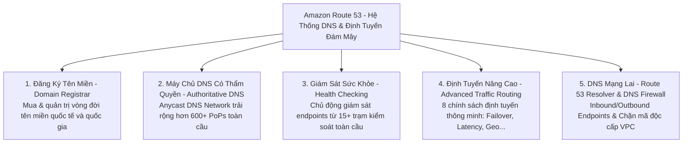
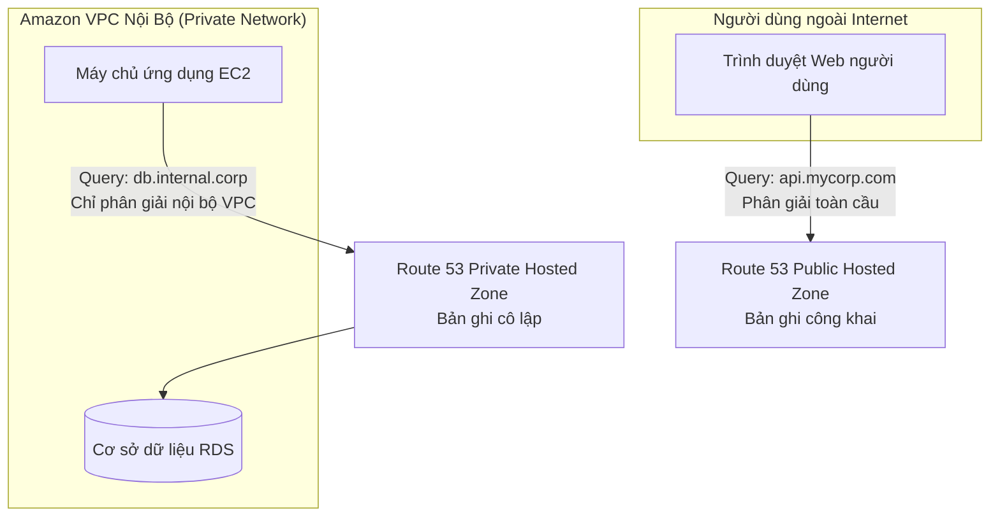
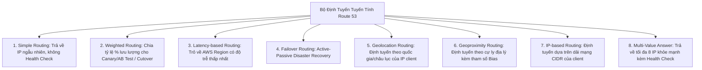
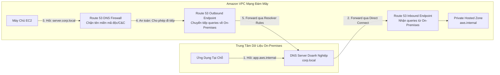
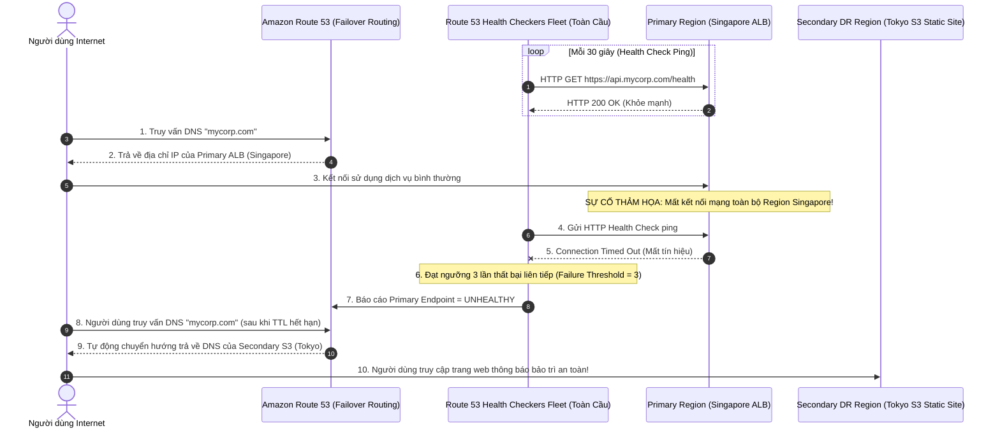

# Tài Liệu Học Tập Chuyên Sâu: Amazon Route 53 (Dịch Vụ Phân Giải Tên Miền & Định Tuyến Toàn Cầu)

> **Tài liệu chuẩn hóa kiến trúc đám mây**: Hướng dẫn toàn diện theo tiêu chuẩn Principal AWS Solutions Architect & Senior Cloud DevOps Engineer (Cập nhật phiên bản kiến trúc mới nhất 2026).  
> **Ngôn ngữ**: Tiếng Việt chuyên ngành (Bảo lưu toàn bộ thuật ngữ chuyên ngành tiếng Anh chuẩn AWS).  
> **Mục tiêu**: Phục vụ thi chứng chỉ cấp độ Professional/Specialty (**SAA-C03, SAP-C02, DOP-C02**) và vận hành hệ thống cấp độ doanh nghiệp (**Production-grade**).  
> **Các bài giảng liên quan**: Chương 10 (Route 53: Bài 101 đến Bài 120).

---

## 1. Tổng Quan Dịch Vụ (Service Overview)

### 1. Định nghĩa chuẩn xác và Phân nhóm dịch vụ
**Amazon Route 53** là dịch vụ phân giải tên miền (**Domain Name System - DNS**) và định tuyến lưu lượng toàn cầu có khả năng mở rộng cao và độ khả dụng đạt cam kết **100% SLA**. Tên gọi "Route 53" xuất phát từ cổng mạng mặc định **Port 53 (TCP/UDP)** của giao thức DNS truyền thống kết hợp với biểu tượng tuyến đường cao tốc lịch sử Route 66.



---

### 2. Bốn chức năng cốt lõi của Route 53

1. **Đăng ký tên miền (Domain Registrar)**: Đăng ký, gia hạn, khóa chống chuyển nhượng và quản lý quyền sở hữu tên miền cấp cao nhất (gTLDs và ccTLDs) trực tiếp trên AWS Management Console.
2. **Phân giải DNS có thẩm quyền (Authoritative DNS Service)**: Lưu trữ và trả lời các truy vấn DNS cho tên miền của bạn thông qua mạng lưới máy chủ phân tán toàn cầu sử dụng công nghệ định tuyến **Anycast DNS Network**.
3. **Kiểm tra sức khỏe tài nguyên (Health Checking)**: Liên tục giám sát trạng thái hoạt động (HTTP, HTTPS, TCP) của các máy chủ và ứng dụng web từ khắp nơi trên thế giới; tự động tích hợp với CloudWatch Metrics.
4. **Định tuyến lưu lượng thông minh (Traffic Management)**: Cung cấp 8 chính sách định tuyến chuyên sâu hỗ trợ kiểm thử A/B Testing, tối ưu hóa độ trễ theo địa lý và tự động chuyển đổi dự phòng khi xảy ra thảm họa (**Automated Disaster Recovery Failover**).

---

### 3. Khi nào KHÔNG nên dùng Route 53

* ❌ **Thay thế giải pháp tường lửa ứng dụng web Layer 7 (WAF)**: Route 53 chỉ định tuyến ở tầng phân giải tên miền (DNS Level). Nó không thể phân tích nội dung HTTP payload để chặn tấn công SQLi, XSS.  
  👉 *Giải pháp thay thế*: Sử dụng **AWS WAF** kết hợp **Amazon CloudFront** hoặc **Application Load Balancer**.
* ❌ **Cân bằng tải phân phối gói tin thời gian thực ở mức độ vi mô**: DNS có cơ chế lưu bộ nhớ đệm (Caching/TTL) tại các máy chủ trung gian của nhà mạng (ISP). Không thể dùng DNS để cân bằng tải chia đều từng request đơn lẻ.  
  👉 *Giải pháp thay thế*: Sử dụng **Elastic Load Balancing (ALB/NLB)**.

---

## 2. Các Khái Niệm, Kiến Trúc & Vận Hành Cốt Lõi (Core Concepts, Security & Day-2 Operations)

### 1. Phân loại Hosted Zones: Public vs Private Hosted Zones



* **Public Hosted Zone**: Lưu trữ các bản ghi DNS có thể phân giải công khai từ bất kỳ đâu trên Internet.
* **Private Hosted Zone**: Lưu trữ các bản ghi DNS chỉ có thể phân giải được từ **bên trong các VPC nội bộ** được chỉ định.  
  ⚠️ **Điều kiện tiên quyết bắt buộc của VPC**: Để sử dụng Private Hosted Zone, VPC liên kết bắt buộc phải bật 2 thuộc tính mạng:
  - `enableDnsHostnames = true`
  - `enableDnsSupport = true`

---

### 2. Các loại bản ghi DNS cơ bản & Phân biệt CNAME vs Alias Record

* **A Record**: Ánh xạ tên miền sang một địa chỉ **IPv4** (ví dụ: `198.51.100.25`).
* **AAAA Record**: Ánh xạ tên miền sang một địa chỉ **IPv6** (ví dụ: `2001:0db8:85a3::8a2e:0370:7334`).
* **CNAME Record**: Ánh xạ tên miền phụ sang một tên miền khác (ví dụ: `www.example.com` $\rightarrow$ `example.com`).  
  ⚠️ **Giới hạn RFC DNS**: CNAME **KHÔNG THỂ áp dụng cho tên miền gốc (Zone Apex / Naked Domain, ví dụ: `example.com`)**.
* **Alias Record (Đặc quyền tối thượng của Amazon Route 53)**:

| Tiêu chuẩn so sánh | CNAME Record | Route 53 Alias Record |
| :--- | :--- | :--- |
| **Bản chất kỹ thuật** | Chuẩn DNS quốc tế thông thường (RFC 1034). | **Tính năng mở rộng độc quyền của Amazon Route 53**. |
| **Áp dụng cho Zone Apex (`example.com`)** | ❌ **BỊ CẤM HOÀN TOÀN** bởi chuẩn DNS quốc tế. |  **HOÀN TOÀN ĐƯỢC PHÉP** (Áp dụng hoàn hảo cho root domain). |
| **Đích trỏ tới** | Bất kỳ tên miền hợp lệ nào trên Internet. | **Chỉ trỏ tới tài nguyên nội bộ của AWS** (ALB, CloudFront, S3 Website, API Gateway, VPC Endpoints). |
| **Chi phí truy vấn DNS** | Bị tính phí cước truy vấn thông thường (\$0.40/1M). | **HOÀN TOÀN MIỄN PHÍ TRUY VẤN (\$0.00)** khi trỏ tới tài nguyên AWS! |
| **Hiệu năng phân giải** | Client phải truy vấn 2 chặng (2 DNS roundtrips). | Route 53 tự động trả về trực tiếp địa chỉ IP A/AAAA của tài nguyên (1 chặng). |
| **Nhận biết IP động** | Tĩnh, client tự phân giải lại. | Tự động nhận biết và theo dõi sự thay đổi IP ngầm của ALB/CloudFront. |

---

### 3. Tám Chính Sách Định Tuyến Của Route 53 (The 8 Routing Policies)



1. **Simple Routing Policy (Định tuyến đơn giản)**: Cung cấp một bản ghi trỏ về 1 hoặc nhiều địa chỉ IP (Route 53 trả về danh sách ngẫu nhiên theo round-robin). **Không hỗ trợ gắn kèm Route 53 Health Check**. Nếu 1 server chết, client vẫn nhận IP chết đó.
2. **Weighted Routing Policy (Định tuyến theo trọng số)** — (`TD-Set5 Q25`, `TD-Set5 Q32`): Phân bổ lưu lượng theo tỷ lệ phần trăm (ví dụ: 50% On-Premises, 50% AWS trong quá trình Zero-Downtime Migration; hoặc 90% Blue, 10% Green). Trọng số từ `0` đến `255`. Nếu đặt trọng số bằng `0`, bản ghi đó dừng nhận lưu lượng.
3. **Latency-based Routing Policy (Định tuyến theo độ trễ)** — (`TD-Set6 Q18`): Route 53 liên tục đo đạc độ trễ mạng toàn cầu giữa người dùng và các AWS Regions, tự động chuyển hướng người dùng đến **AWS Region nào có thời gian phản hồi (Round Trip Time) nhanh nhất**. Kết hợp Route 53 Health Checks để failover sang Region khác nếu Region gần nhất gặp sự cố.
4. **Failover Routing Policy (Định tuyến chuyển đổi dự phòng Active-Passive)** — (`TD-Set2 Q26`):
   - Bắt buộc gắn liền với **Route 53 Health Check**.
   - Bình thường 100% traffic trỏ về **Primary Record**. Nếu Primary bị hỏng (Unhealthy), Route 53 tự động chuyển hướng toàn bộ traffic sang **Secondary Record** (ví dụ: trang web bảo trì tĩnh trên Amazon S3 hoặc server backup).
5. **Geolocation Routing Policy (Định tuyến theo vị trí địa lý)**:
   - Định tuyến dựa trên vị trí địa lý nơi bắt nguồn truy vấn DNS của người dùng (theo Châu lục, Quốc gia, hoặc Bang của Hoa Kỳ). Thích hợp cho việc bản địa hóa ngôn ngữ website, tuân thủ quy định pháp lý dữ liệu (GDPR), hoặc kiểm soát phân phối nội dung theo bản quyền. Có thể cấu hình **Default record** để xử lý các truy vấn không khớp vị trí cụ thể nào.
6. **Geoproximity Routing Policy (Định tuyến theo cự ly địa lý kèm Bias)** — (`TD-Set2 Q59`):
   - Định tuyến dựa trên cự ly địa lý giữa người dùng và vị trí tài nguyên AWS (hoặc tọa độ vĩ độ/kinh độ của On-Premises data center).
   - **Cơ chế Routing Bias**: Cho phép mở rộng hoặc thu hẹp vùng phủ sóng địa lý bằng giá trị Bias từ **`-99` đến `+99`**:
     - **Bias dương (+1 đến +99)**: Mở rộng vùng địa lý mà tài nguyên phục vụ (kéo thêm lưu lượng từ các vùng lân cận về tài nguyên này).
     - **Bias âm (-1 đến -99)**: Thu hẹp vùng địa lý phục vụ (đẩy bớt lưu lượng sang các tài nguyên ở vùng khác).
   - *Yêu cầu bắt buộc*: Phải sử dụng **Route 53 Traffic Flow** và biểu diễn dạng sơ đồ trực quan.
7. **IP-based Routing Policy (Định tuyến dựa trên dải địa chỉ IP)**:
   - Định tuyến dựa trên danh sách dải địa chỉ mạng CIDR của client (ví dụ: định tuyến lưu lượng từ các ISP cụ thể hoặc từ mạng VPN nội bộ của văn phòng công ty tới các cụm máy chủ chuyên dụng tối ưu chi phí).
8. **Multi-Value Answer Routing Policy (Định tuyến đa giá trị)** — (`TD-Set8 Q15`):
   - Cho phép Route 53 trả về tối đa **8 bản ghi IP khỏe mạnh (Healthy Records)** được chọn ngẫu nhiên từ nhóm tài nguyên cho mỗi truy vấn DNS.
   - **Hỗ trợ Route 53 Health Check**: Route 53 tự động loại bỏ các IP Unhealthy, chỉ trả về IP của các server đang hoạt động tốt.
   - Đóng vai trò như một cơ chế **DNS-level Load Balancing & Fault Tolerance** đơn giản, phân tán lưu lượng mà **không cần dựng Elastic Load Balancer xuyên Region**.

---

### 4. Kiến trúc DNS Mạng Lai: Route 53 Resolver, DNS Firewall & DNSSEC



* **Route 53 Inbound Endpoint**: Cho phép các máy chủ tại trung tâm dữ liệu On-Premises có thể phân giải được các tên miền nội bộ (**Private Hosted Zones**) nằm trong AWS VPC thông qua đường truyền riêng AWS Direct Connect hoặc Site-to-Site VPN.
* **Route 53 Outbound Endpoint & Resolver Rules**: Cho phép các máy ảo EC2 trong VPC phân giải được các tên miền nội bộ của doanh nghiệp (`corp.local`) bằng cách thiết lập các quy tắc chuyển tiếp có điều kiện (**Conditional Forwarding Rules**) trỏ về địa chỉ IP của DNS Server tại chỗ.
* **Chia Sẻ Tập Trung Qua AWS RAM (Resource Access Manager)** — (`TD-Set1 Q03`, `TD-Set6 Q54`): Thay vì tạo Inbound/Outbound Endpoints tốn kém tại từng VPC riêng lẻ, doanh nghiệp thiết lập một cặp Inbound/Outbound Endpoints tại Hub Network VPC, sau đó chia sẻ Resolver Rules xuyên suốt các Spoke VPCs và tài khoản AWS khác thông qua **AWS RAM**.
* **Route 53 DNS Firewall**: Tường lửa DNS hoạt động ở cấp độ VPC, cho phép bạn thiết lập danh sách trắng (Allowlist) và danh sách đen (Denylist) để giám sát và chặn đứng các yêu cầu phân giải DNS tới các tên miền lừa đảo, phát tán mã độc hoặc máy chủ điều khiển botnet (Command and Control - C&C servers).
* **DNSSEC (Domain Name System Security Extensions)** — (`TD-Set5 Q05`):
  - Kích hoạt ký số bằng mật mã bất đối xứng trên Hosted Zone (kết hợp với **AWS KMS Asymmetric Customer Managed Key** - KSK Key-Signing Key).
  - Xác minh tính toàn vẹn và tính xác thực nguồn gốc của các bản ghi DNS từ Route 53 gửi về resolver của client, ngăn chặn triệt để tấn công **DNS Cache Poisoning** và **Man-in-the-Middle Spoofing**.

---

### 🏛️ I. Các Kịch Bản Kiến Trúc Chuẩn (Best Practice Scenarios)

#### 1. Giới Hạn Phân Phối Bản Quyền Truyền Thông Bằng Geolocation Routing
- **Tình huống thi**: Một giải bóng đá lớn cấp quyền phát sóng trực tiếp các trận đấu độc quyền tại Hoa Kỳ. Nền tảng phát sóng phải đảm bảo chỉ người dùng tại Mỹ mới có thể xem luồng video, người dùng từ các quốc gia khác phải bị từ chối truy cập.
- **Giải pháp tối ưu chuẩn AWS**:
  - Sử dụng chính sách **Amazon Route 53 Geolocation Routing Policy**: Ánh xạ truy vấn DNS từ người dùng tại Hoa Kỳ tới tài nguyên phục vụ video, cấu hình Default record trả về trang thông báo từ chối cho các quốc gia khác.
  - Kết hợp sử dụng tính năng **CloudFront Georestriction (Geo-blocking)** với danh sách cho phép (Allowlist) chỉ gồm Hoa Kỳ để bảo vệ lớp nội dung tại CDN Edge.

#### 2. Định Tuyến Độ Trễ Thấp Nhất Toàn Cầu Với Latency-Based Routing
- **Tình huống thi**: Ứng dụng triển khai trên nhiều AWS Regions (Mỹ, Châu Âu, Châu Á). Cần định tuyến người dùng toàn cầu tới Region mang lại trải nghiệm độ trễ mạng thấp nhất cho họ một cách tự động.
- **Giải pháp chuẩn**:
  - Cấu hình chính sách **Latency-Based Routing** trên Amazon Route 53.
  - AWS liên tục đo đạc độ trễ mạng giữa các dải mạng Internet của người dùng trên toàn thế giới tới các data centers của AWS và tự động trả về IP của Region có độ trễ ngắn nhất.
  - Gắn kèm **Route 53 Health Checks** cho từng Region: Nếu Region gần nhất gặp sự cố, Route 53 sẽ tự động chuyển tiếp người dùng sang Region khả dụng kế tiếp.

#### 3. Sử Dụng Alias Record Cho Tên Miền Gốc (Zone Apex / Naked Domain) — (TD-Set5 Q31)
- **Tình huống thi**: Doanh nghiệp sở hữu tên miền gốc `example.com` (không có tiền tố `www`) và muốn trỏ tên miền này tới Application Load Balancer hoặc CloudFront Distribution.
- **Quy tắc DNS cốt lõi**:
  - Tiêu chuẩn DNS RFC **nghiêm cấm tạo CNAME record** tại cấp độ Apex (`example.com`).
  - **Giải pháp chuẩn của AWS**: Tạo một **Route 53 Alias Record** kiểu A trỏ tới tên miền của ALB hoặc CloudFront (`TD-Set5 Q31`).
  - **Lợi ích**:
    - Hỗ trợ đầy đủ cho Zone Apex.
    - Truy vấn DNS Alias tới tài nguyên AWS hoàn toàn **MIỄN PHÍ cước phí (\$0.00)**.
    - Route 53 tự động nhận biết khi IP của ALB thay đổi mà không cần cập nhật thủ công.

#### 4. Cân Bằng Tải DNS Đa Vùng Khả Dụng / Đa Region Không Cần ALB Bằng Multi-Value Answer — (TD-Set8 Q15)
- **Tình huống thi**: Một startup muốn tăng tính sẵn sàng và khả năng chịu lỗi bằng cách phân phối lưu lượng vào các cụm EC2 Auto Scaling Groups đặt tại hai regions khác nhau (`us-east-1` và `us-west-2`). Hệ thống yêu cầu tự động cô lập và chuyển hướng lưu lượng ra khỏi các máy chủ bị lỗi (Unhealthy instances) bất kể máy chủ đó nằm ở region nào, với chi phí và độ phức tạp quản trị tối thiểu.
- **Giải pháp tối ưu chuẩn AWS**:
  - Cấu hình **Route 53 với Multi-Value Answer Routing Policy** kết hợp với **Route 53 Health Checks** (`TD-Set8 Q15`).
  - Route 53 trả về tối đa **8 địa chỉ IP khỏe mạnh** ngẫu nhiên cho mỗi DNS query của người dùng.
  - Khi một máy ảo bị hỏng, Health Check phát hiện và Route 53 tự động gỡ IP đó ra khỏi danh sách trả về, đảm bảo người dùng chỉ kết nối tới các instance đang hoạt động tốt.
  - *Vì sao không dùng ALB xuyên region*: Application Load Balancer chỉ là dịch vụ Regional, Target Group của ALB **không hỗ trợ gán trực tiếp Instance ID của máy ảo ở Region khác** (`TD-Set8 Q15`).

#### 5. Mở Rộng / Thu Hẹp Vùng Phục Vụ Địa Lý Bằng Geoproximity Routing Với Routing Bias — (TD-Set2 Q59)
- **Tình huống thi**: Ứng dụng chat/tin nhắn vận hành trên 2 regions: `ap-northeast-1` (Tokyo) và `ap-southeast-2` (Sydney). Đội ngũ kiến trúc sư cần thiết lập định tuyến sao cho phần lớn lưu lượng từ Philippines và Bắc Ấn Độ được chuyển về Tokyo thay vì Sydney (`TD-Set2 Q59`).
- **Giải pháp chuẩn AWS**:
  - Sử dụng **Route 53 Geoproximity Routing Policy** thông qua **Route 53 Traffic Flow**.
  - Thiết lập giá trị **Routing Bias**: Đặt giá trị Bias dương hoặc âm phù hợp (ví dụ: Tokyo bias `-40` hoặc điều chỉnh tỷ lệ bias tương đối so với Sydney) để dịch chuyển ranh giới phục vụ địa lý (Geographic Region Boundary), kéo luồng người dùng từ Philippines và Bắc Ấn Độ về tài nguyên Tokyo.
  - *Điểm mấu chốt*: Geolocation routing thuần túy chỉ ánh xạ cố định theo ranh giới quốc gia, **không có khả năng mở rộng/thu hẹp linh hoạt vùng phủ sóng bằng Bias** như Geoproximity.

#### 6. Di Chuyển Hệ Thống Lên Đám Mây Không Downtime (Zero-Downtime Migration) Bằng Weighted Routing — (TD-Set5 Q32)
- **Tình huống thi**: Doanh nghiệp di chuyển ứng dụng web từ trung tâm dữ liệu On-Premises lên AWS Cloud. Giám đốc yêu cầu quá trình chuyển đổi không được gây gián đoạn dịch vụ (Zero-Downtime Cutover) và phải cho phép kiểm thử tải thực tế trước khi chuyển toàn bộ (`TD-Set5 Q32`).
- **Giải pháp chuẩn AWS**:
  - Triển khai ứng dụng hoàn chỉnh trên môi trường AWS.
  - Cấu hình **Route 53 Weighted Routing Policy** với hai bản ghi:
    - Bản ghi A: Trỏ về On-Premises Web Server với Weight ban đầu là `50`.
    - Bản ghi B: Trỏ về AWS ALB / EC2 với Weight ban đầu là `50`.
  - Phân chia 50% lưu lượng sang AWS để theo dõi hiệu năng. Sau khi hệ thống ổn định, tăng dần trọng số của AWS lên `100` và giảm On-Premises về `0`.

#### 7. Điều Kiện Tiên Quyết Định Tuyến S3 Static Website Bằng Route 53 Alias Record — (TD-Set2 Q22)
- **Tình huống thi**: Doanh nghiệp đã đăng ký tên miền qua Route 53 (ví dụ `example.com`) và muốn tích hợp với website tĩnh lưu trên Amazon S3 (`TD-Set2 Q22`).
- **3 Điều kiện tiên quyết bắt buộc**:
  1. **Tên S3 Bucket bắt buộc phải trùng khớp 100% với tên miền** (ví dụ: tên bucket phải là `example.com` cho apex domain, hoặc `portal.example.com` cho subdomain).
  2. S3 Bucket phải được bật tính năng **Static Website Hosting** (chỉ định Index document `index.html`).
  3. Tạo bản ghi **Route 53 Alias Record (loại A)** trỏ trực tiếp vào S3 Website Endpoint tương ứng của Region.

---

### 🪤 II. Các Bẫy Thi Tinh Vi & Phân Tích Phương Án Sai (Exam Traps & Distractors)

#### 🪤 Bẫy 1: Triển Khai Blue-Green Tức Thì: Route 53 Weighted Bị Nghẽn Bởi DNS Cache — (U-PT2 Q43, CM-PT1 Q40)
- **Tình huống đề thi**: *"Doanh nghiệp muốn triển khai phiên bản mới của ứng dụng di động theo mô hình Blue-Green. Yêu cầu chuyển đổi lưu lượng giữa hai môi trường phải diễn ra tức thì trong vài giây và có thể rollback ngay lập tức nếu phát hiện lỗi nghiêm trọng."*
- **Các phương án bẫy**:
  - ❌ *Dùng Route 53 Weighted Routing*: Lý thuyết cho phép chia tỉ lệ (ví dụ: 90% Blue, 10% Green). Tuy nhiên, **Route 53 dựa trên giao thức DNS**, các nhà mạng viễn thông ISP và thiết bị di động của người dùng **thường lưu cache bản ghi DNS rất lâu** (bỏ qua giá trị TTL thấp). Khi cần rollback khẩn cấp, người dùng vẫn tiếp tục gửi yêu cầu vào phiên bản Green bị lỗi trong nhiều giờ!
- **Giải pháp ĐÚNG**: Sử dụng **AWS Global Accelerator với Traffic Dial**.
  - Cung cấp **2 địa chỉ IP tĩnh Anycast**.
  - Việc điều phối phần trăm lưu lượng (0% đến 100%) diễn ra trực tiếp tại các máy chủ Edge trên mạng trục riêng của AWS, **hoàn toàn bỏ qua bộ đệm DNS của client (Bypasses Client DNS Caching)** -> Thay đổi có hiệu lực ngay lập tức trong vài giây.

#### 🪤 Bẫy 2: Phân Biệt Chiều Định Tuyến Của Route 53 Resolver Endpoints & Yêu Cầu Hai Chiều (Bidirectional) — (CM-PT1 Q41, TD-Set6 Q54, U-PT1 Q20)
- **Bẫy tráo chiều kinh điển trong đề thi**:
  - Muốn máy chủ On-Premises phân giải được các tên miền nội bộ AWS `*.internal`:
    - 👉 **Cấu hình Route 53 Resolver INBOUND Endpoint** (Lưu lượng truy vấn từ On-Premises đi **VÀO** AWS qua Private IP ENI).
  - Muốn máy chủ EC2 trong VPC phân giải được các tên miền Active Directory nội bộ On-Premises `*.corp.local`:
    - 👉 **Cấu hình Route 53 Resolver OUTBOUND Endpoint** kết hợp với **Conditional Forwarding Rule** trỏ về địa chỉ IP của DNS Server On-Premises (Lưu lượng truy vấn từ AWS đi **RA NGOÀI** On-Premises).
- **Cạm bẫy bài toán Phân giải Hai Chiều (Bidirectional Hybrid DNS — CM-PT1 Q41)**:
  - *Tình huống đề thi*: *"Doanh nghiệp mở rộng trung tâm dữ liệu on-premises lên AWS VPC qua Direct Connect. Ứng dụng on-premises cần gọi các microservices trong AWS Private Hosted Zone, và các ứng dụng trên AWS EC2 cần gọi cơ sở dữ liệu on-premises có tên miền nội bộ công ty. Giải pháp nào đáp ứng đầy đủ với ít overhead nhất?"*
  - ❌ *Phương án bẫy*: Chỉ chọn Inbound Endpoint HOẶC chỉ chọn Outbound Endpoint; hoặc tự cài BIND DNS server trên EC2.
  - ✅ *Đáp án ĐÚNG*: Phải triển khai **CẢ HAI: Route 53 Resolver Inbound Endpoint VÀ Outbound Endpoint kèm Forwarding Rules** để thiết lập luồng phân giải DNS 2 chiều hoàn chỉnh, kết hợp chia sẻ Rules qua **AWS RAM** cho các tài khoản khác.

#### 🪤 Bẫy 3: Phân Biệt Giữa Geolocation Routing và Geoproximity Routing — (TD-Set2 Q59)
- **Geolocation Routing**:
  - Định tuyến dựa trên **vị trí địa lý của người dùng** (Quốc gia, Châu lục, hoặc Bang của Mỹ).
  - Thường dùng để hạn chế phân phối nội dung bản quyền hoặc hiển thị ngôn ngữ bản địa phù hợp.
- **Geoproximity Routing**:
  - Định tuyến dựa trên **khoảng cách địa lý giữa người dùng và tài nguyên AWS**.
  - Điểm đặc biệt: Cho phép sử dụng tham số **Bias** (giá trị từ `-99` đến `+99`) để chủ động mở rộng hoặc thu hẹp vùng địa lý mà một Region phục vụ (ví dụ: ép người dùng ở Châu Á chuyển hướng sang Region Châu Âu dù họ ở gần Châu Á hơn).
  - Yêu cầu bắt buộc phải sử dụng **Route 53 Traffic Flow**.

#### 🪤 Bẫy 4: Yêu Cầu Kích Hoạt DNS Trên VPC Để Dùng Private Hosted Zone & Nhận DNS Hostname — (U-PT2 Q60, TD-Set4 Q64)
- **Tình huống đề thi**: *"Sau khi tạo VPC mới hoặc tạo Route 53 Private Hosted Zone, máy ảo EC2 không nhận được Public DNS Hostname hoặc không thể phân giải được tên miền nội bộ."*
- **Nguyên nhân cốt lõi (`TD-Set4 Q64`)**:
  - Mặc định trên Default VPC cả 2 thuộc tính đều bật, nhưng **khi tạo VPC tùy biến mới (Custom VPC)**, thuộc tính `enableDnsHostnames` mặc định là **`false`**!
  - Để máy ảo có Public DNS hostname và phân giải được Private Hosted Zone, bắt buộc:
    - `enableDnsHostnames = true` (gán DNS hostname cho máy có Public IP).
    - `enableDnsSupport = true` (kích hoạt DNS Resolver tại IP `10.x.x.2` / `AmazonProvidedDNS`).

#### 🪤 Bẫy 5: Tăng Tốc Giao Thức TCP/UDP Toàn Cầu: Global Accelerator vs CloudFront — (CM-PT1 Q40, CM-PT6 Q48, TD-Set6 Q15)
- **Tình huống đề thi**: *"Ứng dụng truyền thông VoIP, máy chủ game trực tuyến hoặc IoT giao tiếp qua giao thức TCP/UDP trên nhiều cổng mạng khác nhau. Khách hàng phân tán trên toàn thế giới và yêu cầu độ trễ thấp nhất, không phụ thuộc vào bộ nhớ đệm IP/DNS trên thiết bị người dùng cuối."*
- **Các phương án bẫy**:
  - ❌ *Dùng Amazon CloudFront*: CloudFront là mạng phân phối nội dung (CDN) hoạt động ở **Layer 7** chuyên cho các giao thức web (HTTP/HTTPS), hoàn toàn **KHÔNG hỗ trợ giao thức UDP** hay các ứng dụng TCP thô non-HTTP.
  - ❌ *Dùng Route 53 Latency-Based Routing*: Route 53 chỉ phân giải tên miền ở bước đầu; lưu lượng gói tin thực tế sau đó vẫn phải di chuyển qua mạng Internet công cộng đầy rủi ro và nghẽn mạng.
- **Giải pháp ĐÚNG**: Sử dụng **AWS Global Accelerator**.
  - Cung cấp **2 địa chỉ Static Anycast IP** cố định (dễ cấu hình whitelist tường lửa).
  - Hỗ trợ đầy đủ cả giao thức **TCP và UDP** trên mọi dải cổng mạng.
  - Đưa lưu lượng gói tin của client vào điểm biên Edge Location gần nhất của AWS, sau đó dẫn truyền toàn bộ qua mạng trục cáp quang riêng tốc độ cao của AWS (AWS Global Network Backbone), giúp giảm tới 60% độ trễ và triệt tiêu hiện tượng jitter/packet loss.

#### 🪤 Bẫy 6: Định Tuyến Đa Vùng Độ Trễ Thấp Nhất Bằng Route 53 Latency Routing — (CM-PT1 Q11, CM-PT5 Q06, TD-Set6 Q18)
- **Tình huống đề thi**: *"Doanh nghiệp triển khai ứng dụng web trên hai cụm máy chủ EC2 đặt phía sau Application Load Balancers (ALBs) tại 2 AWS Regions khác nhau. Cần giải pháp định tuyến người dùng tới Region có độ trễ mạng thấp nhất và tự động chuyển hướng khi một Region gặp sự cố."*
- **Giải pháp ĐÚNG**: Sử dụng **Route 53 Public Hosted Zone** với các bản ghi **Alias Record sử dụng Latency-Based Routing Policy** trỏ vào DNS của từng ALB kèm theo Route 53 Health Checks.
  - Route 53 liên tục đo đạc độ trễ mạng từ các mạng người dùng tới từng Region và trả về địa chỉ của ALB gần nhất về mặt thời gian phản hồi mạng.

#### 🪤 Bẫy 7: Simple Routing vs Multi-Value Answer: Khác Biệt Về Health Check — (TD-Set8 Q15)
- **Tình huống đề thi**: *"Muốn cấu hình DNS trả về nhiều địa chỉ IP để cân bằng tải và tự động loại bỏ các server chết."*
- **Các phương án bẫy**:
  - ❌ *Dùng Simple Routing Policy với nhiều IP*: Simple Routing cho phép nhập nhiều IP vào một bản ghi A, Route 53 sẽ trả về tất cả các IP theo thứ tự ngẫu nhiên. **TUY NHIÊN, Simple Routing KHÔNG hỗ trợ Health Check**! Nếu 1 IP bị sập, Route 53 vẫn trả về IP chết đó cho client.
- **Giải pháp ĐÚNG**: Sử dụng **Multi-Value Answer Routing Policy**.
  - Mỗi bản ghi liên kết với một IP và một **Route 53 Health Check**.
  - Route 53 kiểm tra sức khỏe và chỉ trả về tối đa **8 IP khỏe mạnh (Healthy)**.

#### 🪤 Bẫy 8: ALB Không Thể Đính Kèm Target Bằng Instance ID Xuyên Region — (TD-Set8 Q15)
- **Tình huống đề thi**: *"Cấu hình một ALB ở `us-east-1` để cân bằng tải giữa các EC2 instances ở `us-east-1` và `us-west-2` bằng cách thêm Instance IDs vào Target Group."*
- **Lý do sai**:
  - ALB là **Regional Service**. Target Group loại `instance` **chỉ chấp nhận các máy ảo nằm trong cùng VPC / cùng Region** với ALB.
  - Target Group loại `ip` có thể trỏ tới IP private khác VPC (qua Peering/Transit Gateway), nhưng không thể chuyển tải mượt mà giữa các region mà không có hạ tầng mạng liên kết phức tạp.
- **Giải pháp ĐÚNG**: Sử dụng **Route 53 Multi-Value Answer Routing** hoặc **AWS Global Accelerator** phía trước 2 ALBs riêng biệt ở 2 Regions.

#### 🪤 Bẫy 9: Di Chuyển Nhanh Toàn Bộ Bản Ghi Sang Route 53 Bằng Cách Import DNS Zone File (BIND RFC 1035 Format) — (CM-PT5 Q18)
- **Tình huống đề thi**: Doanh nghiệp đang quản lý hàng trăm đến hàng ngàn bản ghi DNS phức tạp trên nhà cung cấp DNS bên ngoài hoặc máy chủ DNS On-Premises (BIND). Đội ngũ cần di chuyển toàn bộ hệ thống tên miền này sang Amazon Route 53 với thời gian cấu hình tối thiểu và không tạo thủ công từng bản ghi.
- **Giải pháp ĐÚNG**:
  - Xuất file cấu hình vùng từ hệ thống cũ theo định dạng chuẩn **BIND (RFC 1035 Zone File format)**.
  - Tại Route 53 Console: Tạo mới Public Hosted Zone cho tên miền đó.
  - Chọn tính năng **Import Zone File**, dán nội dung hoặc tải file zone lên; Route 53 sẽ tự động phân tích cú pháp và khởi tạo hàng loạt tất cả các bản ghi `A`, `CNAME`, `MX`, `TXT`, `SRV` trong tích tắc!

#### 🪤 Bẫy 10: Định Tuyến Latency-Based Routing Kết Hợp Cả Trung Tâm Dữ Liệu On-Premises — (CM-PT1 Q11)
- **Tình huống đề thi**: Doanh nghiệp triển khai ứng dụng web lai (Hybrid Architecture) chạy đồng thời trên các máy chủ AWS EC2 tại Region `us-east-1` và cụm máy chủ vật lý tại trung tâm dữ liệu On-Premises ở Châu Âu. Cần giải pháp tự động định tuyến người dùng toàn cầu tới nơi có độ trễ mạng thấp nhất giữa AWS và On-Premises.
- **Phương án bẫy**: Nghĩ rằng Route 53 Latency Routing chỉ áp dụng được cho tài nguyên nội bộ của AWS.
- **Giải pháp ĐÚNG**: Cấu hình **Latency-Based Routing Policy kết hợp IP On-Premises**.
  - Tạo bản ghi `A` với chính sách Latency trỏ về IP công cộng của On-Premises Datacenter.
  - Trong cấu hình bản ghi, Route 53 yêu cầu bạn chọn một **AWS Region gần nhất về mặt địa lý với Datacenter On-Premises đó** (ví dụ: `eu-central-1` đại diện cho Frankfurt).
  - Route 53 sẽ sử dụng cơ sở dữ liệu độ trễ mạng toàn cầu đo từ client tới Region đại diện đó để quyết định khi nào gửi user về On-Premises và khi nào gửi user về AWS!

#### 🪤 Bẫy 11: Phân Biệt Chi Tiết Alias Record vs CNAME Record Trong Bài Toán Zone Apex và Bên Thứ Ba — (U-PT3 Q44, U-PT3 Q45)
- **Tình huống 1 (Trỏ Zone Apex `domain.com` sang Subdomain trong cùng Hosted Zone)** (`U-PT3 Q44`): Cần cấu hình tên miền gốc `example.com` tự động trỏ về `www.example.com` mà không tốn phí truy vấn $\rightarrow$ Bắt buộc dùng **Alias Record (Loại A, Alias Target trỏ vào `www.example.com`)**. Tiêu chuẩn DNS RFC nghiêm cấm tạo bản ghi CNAME tại Zone Apex.
- **Tình huống 2 (Trỏ Subdomain sang tên miền nhà cung cấp bên thứ ba)** (`U-PT3 Q45`): Cần cấu hình subdomain `shop.example.com` trỏ sang sàn thương mại điện tử bên thứ 3 (ví dụ: `custom-store.shopify.com` hoặc `my-saas-app.com`) $\rightarrow$ Bắt buộc dùng **CNAME Record**. Không thể dùng Alias Record vì Alias Record của Route 53 **CHỈ trỏ được vào tài nguyên AWS hoặc bản ghi khác trong cùng Hosted Zone**, KHÔNG THỂ trỏ vào tên miền bên ngoài AWS!

#### 🪤 Bẫy 12: Danh Sách Kiểm Tra Bắt Buộc Khi Cấu Hình Active-Passive Failover: Mở Tường Lửa Cho Health Checkers — (TD-Set2 Q64, CM-PT3 Q16, U-PT2 Q52, U-PT4 Q48)
- **Tình huống đề thi** (`TD-Set2 Q64`): Thiết lập Route 53 Failover Routing giữa cụm máy chủ Primary (EC2/ALB) và Secondary (S3 Static Website). Ngay sau khi bật Health Check, Route 53 lập tức đánh dấu Primary là `Unhealthy` và chuyển toàn bộ lưu lượng sang Secondary, dù máy chủ Primary vẫn hoạt động hoàn hảo khi truy cập nội bộ!
- **Nguyên nhân cốt lõi**: Các máy chủ kiểm tra sức khỏe của Route 53 (**Route 53 Health Checkers**) là các máy chủ công khai phân tán trên khắp thế giới. Nếu tường lửa Security Group, NACL, hoặc tường lửa On-Premises chặn IP của các Health Checkers này, Route 53 sẽ nhận định máy chủ đã chết.
- **Giải pháp ĐÚNG**: Bắt buộc phải **mở Inbound Rule trên Security Group và NACL cho phép dải địa chỉ IP công khai của Route 53 Health Checkers** (Route 53 IP Ranges) truy cập cổng kiểm tra (cổng 80/443).

#### 🪤 Bẫy 13: Định Tuyến Đa Vùng Active-Active Kết Hợp Weighted Routing + Health Checks vs Multi-Value Answer — (TD-Set3 Q53, CM-PT3 Q54)
- **Active-Active có kiểm soát tỉ lệ tải giữa các Regions** (`TD-Set3 Q53`): Khi doanh nghiệp muốn chia đều lưu lượng (50/50 hoặc 80/20) giữa cụm máy chủ ở 2 Regions khác nhau, và nếu một Region bị sập thì 100% lưu lượng tự động dồn về Region còn lại $\rightarrow$ Cấu hình **Weighted Routing Policy kết hợp Route 53 Health Checks** cho từng Region.
- **DNS Load Balancing trả về nhiều IP khỏe mạnh ngẫu nhiên** (`CM-PT3 Q54`): Cung cấp khả năng cân bằng tải ở tầng DNS trả về danh sách tối đa 8 IP khỏe mạnh; client sẽ tự chọn 1 trong 8 IP để kết nối $\rightarrow$ Dùng **Multi-Value Answer Routing Policy**.

#### 🪤 Bẫy 14: Toàn Bộ Các Kịch Bản Thực Chiến Của AWS Global Accelerator — (TD-Set6 Q15, CM-PT2 Q15, CM-PT3 Q50, U-PT1 Q58, U-PT2 Q43, U-PT3 Q49, U-PT4 Q63)
- **Bảo toàn địa chỉ IP nguồn của Client (Client IP Preservation)** (`TD-Set6 Q15`): Global Accelerator bảo toàn địa chỉ IP gốc của người dùng cuối trong gói tin khi chuyển tiếp tới Application Load Balancer hoặc EC2, giúp ứng dụng backend ghi nhận chính xác danh tính khách hàng mà không cần giải mã header phức tạp.
- **Hai địa chỉ Anycast IP tĩnh thay thế hàng trăm IP/Domain động** (`U-PT3 Q49`): Khi khách hàng doanh nghiệp có chính sách tường lửa khắt khe chỉ cho phép whitelist địa chỉ IP tĩnh cố định (trong khi ALB dùng IP động thay đổi liên tục) $\rightarrow$ Đặt **AWS Global Accelerator** phía trước ALB.
- **Tăng tốc cả máy chủ AWS lẫn máy chủ On-Premises UDP/TCP** (`U-PT4 Q63`): Global Accelerator có thể trỏ Target tới Network Load Balancer (NLB), và NLB có thể chuyển tiếp lưu lượng qua Direct Connect/VPN về IP private của máy chủ vật lý On-Premises, mang lại khả năng tăng tốc Anycast toàn cầu cho cả hạ tầng lai!

---

### 📊 III. Ma Trận Quyết Định Chính Sách Định Tuyến DNS Nhanh (Exam Decision Matrix)

| Tình huống / Yêu cầu trong đề thi | Chính sách Route 53 chuẩn | Giải pháp bị loại & Lý do | Nguồn thực chứng |
|:---|:---|:---|:---|
| **Giới hạn nội dung theo quốc gia/châu lục / GDPR** | **Geolocation Routing** | Latency-based (không chặn theo vị trí địa lý được) | Chuẩn AWS |
| **Trải nghiệm mạng nhanh nhất cho user toàn cầu** | **Latency-Based Routing** (+ Health Check) | Weighted Routing (không đo đạc độ trễ mạng) | `CM-PT1 Q11`, `TD-Set6 Q18` |
| **Failover chủ động - dự phòng (Active-Passive)** | **Failover Routing** (+ Health Check) | Multi-Value (trả về nhiều IP cùng lúc) | `TD-Set2 Q26`, `TD-Set2 Q64` |
| **Phân bổ traffic thử nghiệm / Active-Active DR** | **Weighted Routing** (+ Health Checks) | Geolocation Routing | `TD-Set3 Q53`, `TD-Set5 Q32` |
| **Cân bằng tải DNS đa vùng, tự động loại bỏ server lỗi** | **Multi-Value Answer Routing** (+ Health Checks) | Simple Routing (không hỗ trợ Health Check) | `CM-PT3 Q54`, `TD-Set8 Q15` |
| **Chuyển đổi lưu lượng tức thì, bypass DNS cache** | **AWS Global Accelerator (Traffic Dial)** | Route 53 Weighted (bị nghẽn bởi ISP DNS cache) | `TD-Set6 Q15`, `U-PT2 Q43` |
| **Điều chỉnh mở rộng/thu hẹp vùng phục vụ bằng Bias** | **Geoproximity Routing** (Traffic Flow) | Geolocation Routing (không có tính năng Bias) | `TD-Set2 Q59` |
| **Tên miền gốc `example.com` trỏ vào ALB/CloudFront** | **Alias Record (A/AAAA)** | CNAME Record (vi phạm tiêu chuẩn RFC DNS Apex) | `TD-Set5 Q31`, `U-PT3 Q44` |
| **Subdomain trỏ sang SaaS đối tác bên ngoài AWS** | **CNAME Record** | Alias Record (Alias chỉ trỏ được tài nguyên AWS) | `U-PT3 Q45` |
| **Tên miền Route 53 trỏ vào S3 Static Website** | **Alias Record (A)** (Tên bucket = Tên miền) | CNAME (Apex không hỗ trợ; bucket sai tên sẽ 404) | `TD-Set2 Q22` |
| **On-Premises phân giải tên miền private AWS** | **Route 53 Resolver Inbound Endpoint** | Outbound Endpoint (sai chiều đi của query) | `CM-PT1 Q41` |
| **EC2 trong VPC phân giải tên miền On-Premises** | **Route 53 Resolver Outbound Endpoint** (+ Rule) | Inbound Endpoint (sai chiều đi của query) | `CM-PT1 Q41`, `U-PT1 Q20` |
| **Chia sẻ DNS Resolver Rules cho nhiều VPC/Account** | **AWS Resource Access Manager (RAM)** | Dựng resolver endpoints riêng lẻ ở từng VPC (lãng phí) | `CM-PT1 Q41` |
| **Tăng tốc ứng dụng UDP/VoIP/Game với 2 Anycast IP tĩnh** | **AWS Global Accelerator (2 Static Anycast IPs)** | CloudFront (chỉ hỗ trợ Layer 7 HTTP/HTTPS) | `TD-Set6 Q15`, `U-PT3 Q49` |
| **Chống giả mạo DNS & đầu độc bộ nhớ đệm (Cache Poisoning)** | **Route 53 DNSSEC** (KMS Asymmetric Key) | SSL/TLS thông thường (chỉ mã hóa dữ liệu truyền) | `TD-Set5 Q05` |
| **Máy ảo EC2 trong VPC mới không có DNS hostname** | Bật `enableDnsHostnames = true` trên VPC | Đổi AMI máy ảo (vấn đề nằm ở thiết lập VPC) | `U-PT6 Q18`, `TD-Set4 Q64` |
| **Di chuyển hàng ngàn bản ghi DNS từ On-Premises lên AWS** | **Import DNS Zone File (định dạng BIND)** | Tạo thủ công từng bản ghi trên giao diện (chậm, dễ sai) | `CM-PT5 Q18` |

---

## 3. Kiến Trúc Thực Tế và Luồng Vận Hành (Production Architecture & Workflow)

### Sơ đồ luồng định tuyến tự động chịu lỗi thảm họa đa vùng (Multi-Region Active-Passive Failover)



---

## 4. Bảng Tích Hợp với Các Dịch Vụ AWS Khác (Integration Table)

| Related AWS Service | Purpose (Mục đích tích hợp) | Integration Method (Phương thức kỹ thuật chính xác) | Practical Example (Ví dụ thực tiễn) |
| :--- | :--- | :--- | :--- |
| **AWS CloudFront** | Phân phối nội dung CDN toàn cầu với tên miền riêng biệt | **Route 53 Alias Record** (loại A / AAAA) | Trỏ trực tiếp tên miền `cdn.mycorp.com` vào CloudFront Distribution mà không tốn phí truy vấn DNS. |
| **AWS Certificate Manager (ACM)** | Xác thực quyền sở hữu tên miền tự động khi cấp chứng chỉ SSL/TLS | Tự động tạo bản ghi **CNAME** trong Route 53 Hosted Zone | ACM tự động thêm bản ghi CNAME vào Route 53 để phát hành chứng chỉ HTTPS trong vòng 2 phút mà không cần xác thực qua email. |
| **Amazon S3** | Lưu trữ trang web tĩnh với tên miền gốc (Zone Apex) | **S3 Static Website Hosting** kết hợp **Alias Record** | Tạo bucket trùng tên `mycorp.com` và dùng Route 53 Alias trỏ trực tiếp vào S3 website hosting endpoint. |
| **AWS RAM (Resource Access Manager)** | Chia sẻ tập trung cấu hình DNS Resolver và Private Hosted Zones | Quản trị tập trung xuyên tài khoản qua **AWS Organizations** | Chia sẻ các Resolver Rules từ tài khoản Network Hub sang 50 tài khoản thành viên khác để dùng chung Hybrid DNS. |
| **Amazon CloudWatch** | Thu thập chỉ số sức khỏe của endpoint và kích hoạt cảnh báo | Tích hợp **CloudWatch Alarms** làm nguồn kích hoạt Health Check | Tạo Calculated Health Check trên Route 53 dựa trên CloudWatch Alarm theo dõi tỷ lệ lỗi 5xx của ALB. |

---

## 5. Bảng So Sánh Toàn Bộ Các Giải Pháp DNS & Phân Giải Tên Miền (Ecosystem Comparison)

| Tiêu chuẩn so sánh | Amazon Route 53 Public | Amazon Route 53 Private | Route 53 Resolver | Amazon CloudFront DNS | CoreDNS trên Amazon EKS |
| :--- | :--- | :--- | :--- | :--- | :--- |
| **Phạm vi phân giải** | **Toàn cầu (Internet)** | **Nội bộ VPC (Private)** | **Mạng Lai (Hybrid Cloud)** | Toàn cầu tại các điểm Edge | **Nội bộ EKS Cluster** |
| **Đối tượng truy cập** | Người dùng ngoài Internet | Máy ảo EC2, RDS trong VPC | Máy chủ On-Premises & VPC | Người dùng ngoài Internet | Các Kubernetes Pods nội bộ |
| **Cam kết độ sẵn sàng** | **100% SLA** | 99.99% SLA | 99.99% SLA | 99.99% SLA | Phụ thuộc cấu hình Pods |
| **Khả năng Health Check** |  Hỗ trợ đầy đủ | ❌ Gián tiếp qua CloudWatch | ❌ Không hỗ trợ | ❌ Không hỗ trợ |  Kubernetes Liveness probes |
| **Hỗ trợ Alias Record** |  Có (Tài nguyên AWS) |  Có (Tài nguyên nội bộ) | ❌ Không | ❌ Không | ❌ Không |
| **Kịch bản sử dụng chuẩn** | Phân giải tên miền công khai, Failover DR, Geo routing | Tên miền nội bộ microservices, database endpoint | Kết nối DNS giữa Data Center vật lý và AWS VPC | Tối ưu hóa CDN routing tại điểm biên gần nhất | Phân giải Service Discovery cho Kubernetes Pods (`.svc.cluster.local`) |

---

## 6. Mô Hình Tính Phí & Chiến Lược Tối Ưu Chi Phí (FinOps & Cost Optimization)

### 6.1. Bảng Phân Tích Cơ Chế Tính Phí Chi Tiết Của Amazon Route 53

| Thành phần tính phí | Cơ chế tính phí chi tiết (Pricing Dimensions) | Mức phí tham chiếu điển hình (US-East-1) | Bẫy chi phí nghiêm trọng (Cost Pitfalls) |
| :--- | :--- | :--- | :--- |
| **Hosted Zones** | • 25 Hosted Zones đầu tiên: **\$0.50 / zone / tháng**.<br>• Từ zone thứ 26 trở đi: **\$0.10 / zone / tháng**. | Áp dụng cho cả Public và Private Hosted Zones. | Tạo Private Hosted Zone riêng lẻ cho từng VPC thay vì liên kết nhiều VPC vào chung 1 Zone. |
| **Bản ghi Alias Record** | • **HOÀN TOÀN MIỄN PHÍ TRUY VẤN (\$0.00 / query)** khi trỏ tới tài nguyên AWS (ALB, CloudFront, S3 Website, API Gateway, VPC Endpoints). | **\$0.00 / 1 triệu queries**. | Dùng bản ghi CNAME thông thường khi trỏ tới ALB làm phát sinh phí truy vấn DNS tiêu chuẩn. |
| **Truy vấn DNS Tiêu chuẩn** | • Áp dụng cho các bản ghi A, CNAME, TXT, MX thông thường.<br>• **1 Tỷ queries đầu tiên**: **\$0.40 / 1 triệu queries**.<br>• Trên 1 Tỷ queries: **\$0.20 / 1 triệu queries**. | Rất rẻ ở quy mô nhỏ, nhưng hệ thống hàng trăm triệu queries/tháng sẽ tốn đáng kể. | Cấu hình giá trị TTL quá thấp (ví dụ: 5s–10s) khiến client liên tục gửi query về Route 53. |
| **Truy vấn Định tuyến Nâng cao** | • **Latency-based Routing**: **\$0.60 / 1 triệu queries**.<br>• **Geo DNS & Geoproximity**: **\$0.70 / 1 triệu queries**.<br>• **IP-based Routing**: **\$0.80 / 1 triệu queries** (đắt gấp đôi Standard). | Phí cao hơn do Route 53 phải xử lý giải thuật đo đạc vị trí IP của client. | Sử dụng Geolocation routing cho các bản ghi dịch vụ nội bộ không cần phân vùng ngôn ngữ. |
| **Route 53 Health Checks** | • AWS Endpoints (EC2, Elastic IP): **\$0.50 / check / tháng**.<br>• Non-AWS Endpoints: **\$0.75 / check / tháng**.<br>• Fast Interval (10s): Phụ thu thêm **\$1.00 / tháng**.<br>• HTTPS Matching String: Phụ thu thêm **\$1.00 / tháng**. | Tính theo số lượng checker toàn cầu. | Tạo hàng chục Health Check riêng lẻ cho từng máy chủ EC2 con phía sau Load Balancer. |
| **Route 53 Resolver Endpoints** | • **\$0.11 / giờ / ENI** (~\\$80 / tháng cho mỗi Endpoint gồm 2 ENIs trên 2 AZs để HA).<br>• Phí truy vấn qua Resolver: **\$0.40 / 1 triệu queries**. | Cần tính toán số lượng Endpoint triển khai giữa các VPC. | Tạo Resolver Endpoints riêng rẽ ở từng VPC thay vì tập trung hóa tại một Hub VPC duy nhất. |

---

### 6.2. Chiến Lược Tối Ưu Hóa Chi Phí Theo 5 Kịch Bản Thực Tế (Use Cases Optimization)

#### Kịch bản 1: Tiết Kiệm Chi Phí Truy Vấn Bằng Cách Chuyển CNAME Sang Alias Record
* **Bối cảnh thực tế**:
  Một trang web thương mại điện tử phục vụ **600 triệu lượt truy vấn DNS mỗi tháng**. Tên miền phụ `shop.mycompany.com` được cấu hình bằng bản ghi **CNAME** trỏ tới Application Load Balancer.
  $$\text{Chi phí DNS CNAME ban đầu} = \frac{600,000,000}{1,000,000} \times 0.40\$ = \mathbf{240.00\$/\text{tháng}}$$
* **Chiến lược tối ưu hóa**:
  - Chuyển đổi bản ghi từ **CNAME** sang **Route 53 Alias Record** (loại A Record với cờ `Alias = Yes`) trỏ trực tiếp tới ALB.
  - AWS quy định: **Mọi truy vấn DNS tới Route 53 Alias Record trỏ vào tài nguyên AWS đều được MIỄN PHÍ 100% (\$0.00)**.
* **Kết quả tiết kiệm**:
  $$\text{Số tiền tiết kiệm} = \mathbf{240.00\$/\text{tháng}} \quad (\approx \mathbf{2,880\$/\text{năm}})$$
  **Tiết kiệm 100% chi phí truy vấn DNS**, đồng thời giảm độ trễ phân giải vì không cần truy vấn hai chặng.

---

#### Kịch bản 2: Tối Ưu Hóa Giá Trị Time To Live (TTL Optimization)
* **Bối cảnh thực tế**:
  Đội ngũ lập trình viên đặt giá trị TTL của các bản ghi DNS là **10 giây** để tiện deploy nhanh. Do đó, các máy chủ DNS của nhà mạng ISP không thể lưu cache, phát sinh tới **1.2 tỷ lượt truy vấn mỗi tháng**.
  $$\text{Chi phí truy vấn ban đầu} = \left(1,000 \times 0.40\$\right) + \left(200 \times 0.20\$\right) = 400\$ + 40\$ = \mathbf{440.00\$/\text{tháng}}$$
* **Chiến lược tối ưu hóa**:
  - Điều chỉnh chính sách TTL theo tính chất bản ghi:
    - Các bản ghi dịch vụ sản xuất ổn định: Tăng TTL lên **300 giây (5 phút)**.
    - Các bản ghi tĩnh ít thay đổi (MX, TXT verification, S3 website): Tăng TTL lên **86,400 giây (24 giờ)**.
  - Số lượng truy vấn lặp lại giảm tới 80%, chỉ còn khoảng 240 triệu queries/tháng:
  $$\text{Chi phí truy vấn sau tối ưu} = \frac{240,000,000}{1,000,000} \times 0.40\$ = \mathbf{96.00\$/\text{tháng}}$$
* **Kết quả tiết kiệm**:
  $$\text{Số tiền tiết kiệm} = 440.00\$ - 96.00\$ = \mathbf{344.00\$/\text{tháng}} \quad (\approx \mathbf{4,128\$/\text{năm}})$$
  **Tỷ lệ tiết kiệm đạt ~78.2% chi phí truy vấn**.

---

#### Kịch bản 3: Hợp Nhất Private Hosted Zone Cho Nhiều VPC (VPC Association)
* **Bối cảnh thực tế**:
  Doanh nghiệp có 40 VPCs độc lập. Nhóm kỹ sư tạo 40 Private Hosted Zones riêng rẽ cho từng VPC với cùng tên miền nội bộ `corp.internal`.
  $$\text{Chi phí Hosted Zones ban đầu} = 40 \text{ zones} \times 0.50\$ = \mathbf{20.00\$/\text{tháng}}$$
* **Chiến lược tối ưu hóa**:
  - Chỉ duy trì **1 Private Hosted Zone duy nhất** mang tên `corp.internal`.
  - Thực hiện liên kết (Associate) tất cả 40 VPCs vào chung Private Hosted Zone này bằng AWS CLI:
    ```bash
    aws route53 associate-zone-with-vpc --zone-id Z123456789 --vpc VPCRegion=ap-southeast-1,VPCId=vpc-xxxxxx
    ```
  - AWS chỉ tính phí **\$0.50/tháng cho 1 Hosted Zone duy nhất**, không tính thêm phụ phí liên kết cho các VPC bổ sung.
* **Kết quả tiết kiệm**:
  $$\text{Số tiền tiết kiệm} = 20.00\$ - 0.50\$ = \mathbf{19.50\$/\text{tháng}} \quad (\approx \mathbf{234\$/\text{năm}})$$
  **Tỷ lệ tiết kiệm đạt ~97.5%**, đồng thời tập trung hóa việc quản trị bản ghi nội bộ tại một đầu mối duy nhất.

---

#### Kịch bản 4: Tinh Gọn Kiến Trúc Route 53 Resolver Mạng Lai (Centralized Hub-and-Spoke with RAM)
* **Bối cảnh thực tế**:
  Một doanh nghiệp có 8 VPCs cần phân giải tên miền với trung tâm dữ liệu On-Premises. Kỹ sư tạo riêng cho mỗi VPC một cặp Inbound và Outbound Endpoints (mỗi endpoint cần 2 ENIs trên 2 AZs để đảm bảo HA = 4 ENIs/VPC $\times$ 8 VPCs = 32 ENIs).
  $$\text{Chi phí ENI ban đầu} = 32 \text{ ENIs} \times 0.11\$ \times 720 \text{ giờ} = \mathbf{2,534.40\$/\text{tháng}}$$
* **Chiến lược tối ưu hóa**:
  - Xây dựng mô hình tập trung: Chỉ triển khai duy nhất 1 cặp Inbound và Outbound Endpoint đặt tại **Hub Network VPC (Shared Services)** gồm **4 ENIs tổng cộng**.
  - Chia sẻ các Resolver Rules cho 7 Spoke VPCs còn lại thông qua **AWS Resource Access Manager (AWS RAM)**.
  $$\text{Chi phí ENI tập trung mới} = 4 \text{ ENIs} \times 0.11\$ \times 720 \text{ giờ} = \mathbf{316.80\$/\text{tháng}}$$
* **Kết quả tiết kiệm**:
  $$\text{Số tiền tiết kiệm} = 2,534.40\$ - 316.80\$ = \mathbf{2,217.60\$/\text{tháng}} \quad (\approx \mathbf{26,611\$/\text{năm}})$$
  **Tỷ lệ tiết kiệm đạt ~87.5%**, loại bỏ hoàn toàn các endpoint dư thừa mà khả năng phân giải tên miền vẫn liên tục và ổn định.

---

#### Kịch bản 5: Tối Ưu Chi Phí Health Checks Kết Hợp CloudWatch Metrics
* **Bối cảnh thực tế**:
  Kỹ sư tạo 30 Health Checks riêng lẻ cho từng máy ảo EC2 trong một Auto Scaling Group, bật tính năng kiểm tra nhanh (Fast Interval 10s = phụ thu \$1.00) và kiểm tra chuỗi HTTPS (phụ thu \$1.00):
  $$\text{Chi phí ban đầu} = 30 \times (0.50\$ + 1.00\$ + 1.00\$) = \mathbf{75.00\$/\text{tháng}}$$
* **Chiến lược tối ưu hóa**:
  - Xóa bỏ toàn bộ 30 Health Checks riêng lẻ của các máy ảo con. Hãy để **Application Load Balancer** tự kiểm tra sức khỏe của các EC2 con trong Target Group (hoàn toàn miễn phí).
  - Route 53 chỉ cần tạo duy nhất **1 Health Check** giám sát trực tiếp Endpoint của ALB với chu kỳ tiêu chuẩn (**Standard Interval: 30 giây** = \$0.50/tháng).
* **Kết quả tiết kiệm**:
  $$\text{Số tiền tiết kiệm} = 75.00\$ - 0.50\$ = \mathbf{74.50\$/\text{tháng}} \quad (\approx \mathbf{894\$/\text{năm}})$$
  **Tiết kiệm hơn 99.3% chi phí giám sát sức khỏe DNS**.

---

## 7. Khắc Phục Sự Cố Thực Tế (Troubleshooting Guide)

| Vấn đề (Problem) | Nguyên nhân khả dĩ (Possible Causes) | Các bước điều tra (Investigation Steps - Metrics/Logs) | Giải pháp xử lý (Solution) | Biện pháp phòng ngừa (Prevention) |
| :--- | :--- | :--- | :--- | :--- |
| **Thay đổi bản ghi DNS nhưng người dùng vẫn bị trỏ về địa chỉ IP cũ** | Giá trị **TTL (Time To Live)** của bản ghi quá cao (ví dụ: 86,400s = 24 giờ), máy tính client và ISP DNS vẫn đang lưu cache cũ. | Chạy lệnh `dig +nocmd +noall +answer mydomain.com` trên terminal để xem thời gian TTL còn lại. | Kiên nhẫn chờ cache hết hạn. Khi chuẩn bị di chuyển hệ thống, chủ động hạ TTL xuống 60 giây trước 1 ngày. | Luôn duy trì TTL ngắn (60s – 300s) cho các dịch vụ thay đổi thường xuyên. |
| **Lỗi không thể tạo bản ghi CNAME cho tên miền gốc (`example.com`)** | Vi phạm tiêu chuẩn thiết kế DNS quốc tế RFC 1034 (Zone Apex bắt buộc phải là bản ghi địa chỉ, không được dùng CNAME). | Xem thông báo lỗi hiển thị trên Route 53 Console. | Chuyển sang sử dụng **Route 53 Alias Record** (chọn loại A Record, bật tùy chọn `Alias = Yes`). | Luôn ưu tiên dùng Alias Record khi làm việc với các tài nguyên AWS. |
| **Route 53 Health Check báo lỗi `Unhealthy` dù website vẫn truy cập bình thường** | Tường lửa Security Group hoặc Web Server chặn các dải địa chỉ IP của Route 53 Health Checkers toàn cầu. | 1. Xem tab Health Checkers trên console.<br>2. Xem CloudWatch Metric **`HealthCheckStatus`**.<br>3. Kiểm tra Nginx access log xem có request từ Route 53 IP không. | Thêm Inbound Rule cho phép các dải IP công khai của Route 53 Health Checkers truy cập cổng 80/443. | Tải file IP ranges chính thức của AWS và cấu hình tự động cập nhật Security Group. |
| **Máy ảo EC2 không phân giải được tên miền trong Private Hosted Zone** | VPC liên kết chưa bật 2 thuộc tính mạng bắt buộc: `enableDnsHostnames` và `enableDnsSupport`. | Kiểm tra cài đặt VPC DNS Attributes trong VPC Console. | Chuyển cả hai giá trị `enableDnsHostnames` và `enableDnsSupport` sang trạng thái **`true`**. | Luôn định nghĩa sẵn 2 thuộc tính này trong template Infrastructure as Code (Terraform). |
| **Truy vấn DNS giữa On-Premises và AWS VPC bị thất bại (DNS Resolution Timeout)** | Route 53 Resolver Inbound/Outbound Endpoint bị chặn cổng UDP/TCP 53 bởi Security Group của Endpoint ENI. | 1. Xem nhật ký **Route 53 Resolver Query Logs**.<br>2. Kiểm tra Inbound/Outbound Rules của Security Group gắn trên Resolver ENIs. | Mở cổng **UDP 53 và TCP 53** trên Security Group của Resolver Endpoint cho phép dải mạng nội bộ On-Premises. | Kiểm tra kỹ bảng định tuyến Route Table trên Direct Connect / VPN. |
| **Kịch bản Failover không kích hoạt khi máy chủ chính gặp sự cố** | Bản ghi Primary chưa được gắn kèm Health Check, hoặc cấu hình sai giá trị Failure Threshold. | Kiểm tra thuộc tính bản ghi xem đã tích chọn `Associate with Health Check` chưa. | Gắn đúng Route 53 Health Check vào bản ghi Primary trong bộ chính sách Failover. | Luôn kiểm thử kịch bản Failover bằng cách chủ động ngắt endpoint health check trên môi trường Staging. |

---

## 8. Tóm Tắt và Danh Mục Kiểm Tra Kiến Thức (Summary & Learning Checklist)

### 7 Nguyên Tắc Kiến Trúc "Sống Còn" Của Amazon Route 53 (Golden Rules)
1. **Luôn ưu tiên sử dụng Alias Record thay cho CNAME**:  
   Alias Record hỗ trợ tên miền gốc (Zone Apex `example.com`), tự động thích ứng với IP động của tài nguyên AWS và hoàn toàn **miễn phí cước truy vấn DNS**.
2. **Quy tắc phân biệt Latency vs Geolocation**:  
   - Cần tốc độ mạng phản hồi nhanh nhất $\rightarrow$ Chọn **Latency-based Routing**.  
   - Cần tuân thủ pháp lý lãnh thổ (GDPR), bản quyền nội dung hoặc bản địa hóa ngôn ngữ $\rightarrow$ Chọn **Geolocation Routing**.
3. **Điều kiện tiên quyết của Private Hosted Zone**:  
   Bắt buộc phải bật đồng thời cả 2 cờ `enableDnsHostnames = true` và `enableDnsSupport = true` trên Amazon VPC thì máy ảo mới phân giải được tên miền nội bộ.
4. **Cấu hình Active-Passive Failover chuẩn mực**:  
   Bản ghi **Primary** bắt buộc phải gắn kèm Route 53 Health Check; luôn thiết lập trang dự phòng **Secondary** (ví dụ: website tĩnh trên S3) để ứng cứu khi cụm chính sập. Mở Security Group/NACL cho dải IP của Route 53 Health Checkers.
5. **Tập trung hóa Hybrid DNS bằng Route 53 Resolver**:  
   Chỉ tạo duy nhất một cặp Inbound/Outbound Endpoints tại Hub Network VPC và chia sẻ Rules cho các Spoke VPCs qua **AWS RAM** để tiết kiệm 90% chi phí ENI.
6. **Bảo mật mạng VPC với DNS Firewall & DNSSEC**:  
   Kích hoạt **DNSSEC** để chống đầu độc cache DNS và triển khai **Route 53 Resolver DNS Firewall** để ngăn chặn máy chủ bị mã độc kết nối ra C&C server.
7. **Tối ưu hóa giá trị TTL**:  
   Đặt TTL dài (86,400s) cho các bản ghi tĩnh để giảm chi phí truy vấn; hạ TTL xuống 60 giây trước 1 ngày khi chuẩn bị diễn ra đợt chuyển đổi hạ tầng lớn.

---

### ✅ Danh Mục Kiểm Tra Kiến Thức Thực Chiến (Learning Checklist)
- [ ] Phân biệt bản chất kỹ thuật giữa Alias Record (Zone Apex, tài nguyên AWS, miễn phí, cập nhật IP động) vs CNAME Record (Subdomain, bên ngoài AWS, mất phí truy vấn).
- [ ] Nắm vững 8 Routing Policies của Route 53: Simple, Weighted, Latency, Failover, Geolocation, Geoproximity (Traffic Flow + Bias), Multi-Value Answer, IP-based.
- [ ] Nắm rõ điều kiện của Private Hosted Zone (`enableDnsSupport = true` và `enableDnsHostnames = true`) và cách liên kết nhiều VPC vào chung 1 Hosted Zone.
- [ ] Thiết lập kiến trúc Hybrid DNS hai chiều với Route 53 Resolver Inbound Endpoint (On-Premises truy vấn AWS) và Outbound Endpoint + Forwarding Rules (AWS truy vấn On-Premises).
- [ ] Hiểu rõ kịch bản mở tường lửa cho Route 53 Health Checkers để tránh tình trạng failover nhầm lẫn sang Secondary.
- [ ] Phân biệt AWS Global Accelerator (2 Anycast IP tĩnh, L4/L3, TCP/UDP, bỏ qua DNS cache, bảo toàn IP client) vs CloudFront (L7, CDN caching, HTTP/HTTPS).
- [ ] Sử dụng tính năng Import DNS Zone File (định dạng BIND RFC 1035) để di chuyển hàng loạt bản ghi từ hệ thống ngoài lên Route 53.
- [ ] Thiết kế Active-Active DR với Weighted Routing + Health Checks vs Active-Passive DR với Failover Routing.

---

### Liên Kết Nội Bộ và Tài Liệu Tham Khảo (Internal Links)
- 📖 [Ghi Chú Bài Học Chương 10: Route 53](../Lesson_Notes/10_Route_53.md)
- 📖 [Tài Liệu Chuyên Sâu: Elastic Load Balancing & Auto Scaling Groups](./ELB_and_ASG_High_Availability.md)
- 📖 [Tài Liệu Chuyên Sâu: Amazon S3 & CloudFront Storage](./S3_and_CloudFront_Storage.md)
- 📖 [Tài Liệu Chuyên Sâu: VPC Networking & Hạ Tầng Mạng](./VPC_Networking.md)
- 📖 [Tài Liệu Chuyên Sâu: AWS KMS, Secrets Manager & Bảo Mật Dữ Liệu](./KMS_Security_Encryption.md)
- 📖 [Bảng Thuật Ngữ Kỹ Thuật Đám Mây Toàn Diện](../GLOSSARY.md)
- ⏭️ **Chuyên đề tiếp theo**: [Mạng Riêng Ảo & Hạ Tầng Mạng Đám Mây: Amazon VPC](./VPC_Networking.md)
