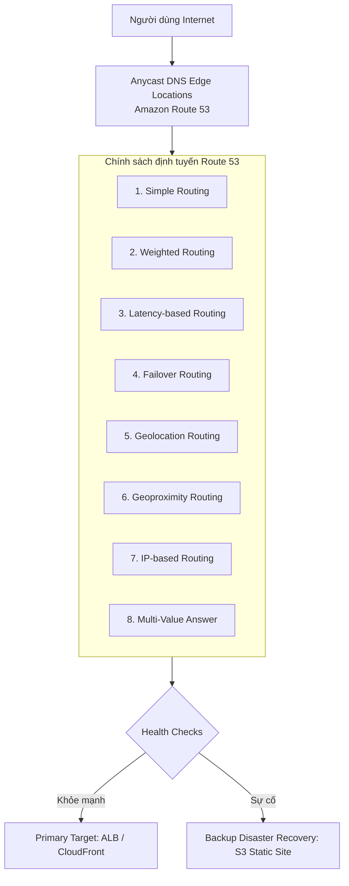
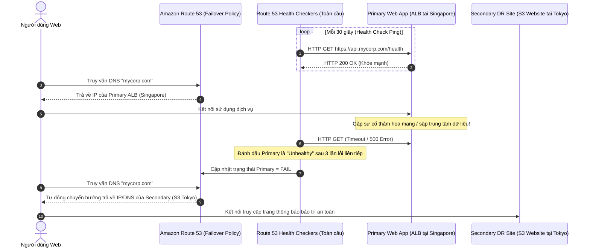
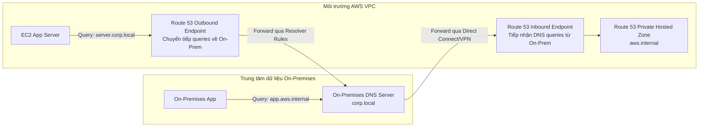

# Tài Liệu Học Tập Chuyên Sâu: Amazon Route 53 (Dịch Vụ Phân Giải Tên Miền & Định Tuyến Toàn Cầu)

> **Tài liệu chuẩn hóa kiến trúc đám mây**: Hướng dẫn toàn diện theo tiêu chuẩn Senior AWS Solutions Architect & Cloud DevOps Engineer.  
> **Ngôn ngữ**: Tiếng Việt (Bảo lưu toàn bộ thuật ngữ chuyên ngành tiếng Anh chuẩn AWS).  
> **Các bài giảng liên quan**: Chương 10 (Route 53: Bài 101 đến Bài 120).

---

## 6.1. Tổng Quan Dịch Vụ (Service Overview)

### Dịch vụ gì?
**Amazon Route 53** là dịch vụ phân giải tên miền (Domain Name System - DNS) có tính khả dụng và khả năng mở rộng quy mô cực cao của AWS. Tên gọi "Route 53" xuất phát từ cổng mạng mặc định **Port 53** của giao thức DNS truyền thống.

### Các chức năng cốt lõi:
1. **Đăng ký tên miền (Domain Registrar)**: Mua và quản lý quyền sở hữu tên miền trực tiếp trên AWS.
2. **Máy chủ DNS có thẩm quyền (Authoritative DNS Service)**: Lưu trữ và phân giải các bản ghi DNS cho tên miền của bạn thông qua mạng lưới toàn cầu các điểm biên (**Edge Locations / Anycast DNS Network**).
3. **Kiểm tra sức khỏe tài nguyên (Health Checking)**: Liên tục giám sát tính sẵn sàng của các máy chủ và ứng dụng web từ khắp nơi trên thế giới.
4. **Định tuyến lưu lượng thông minh (Advanced Traffic Routing)**: Cung cấp 8 chính sách định tuyến linh hoạt (Failover, Latency, Geolocation, Weighted, IP-based...).

---

## 6.2. Các Khái Niệm và Thành Phần Cốt Lõi (Core Concepts and Components)

### 1. Hosted Zones (Vùng Lưu Trữ Bản Ghi DNS)
- **Public Hosted Zone**: Lưu trữ các bản ghi DNS có thể truy cập công khai từ bất kỳ đâu trên Internet (ví dụ: `api.mycompany.com`).
- **Private Hosted Zone**: Lưu trữ các bản ghi DNS chỉ có thể phân giải được từ **bên trong các VPC nội bộ** được chỉ định (ví dụ: `db.internal.corp`). Giúp máy chủ nội bộ giao tiếp với nhau bằng tên miền thân thiện mà không để lộ cấu trúc mạng ra ngoài Internet.

### 2. Các Loại Bản Ghi DNS Cơ Bản (DNS Record Types)
- **A Record**: Ánh xạ tên miền sang một địa chỉ **IPv4** (ví dụ: `198.51.100.25`).
- **AAAA Record**: Ánh xạ tên miền sang một địa chỉ **IPv6** (ví dụ: `2001:0db8:85a3::8a2e:0370:7334`).
- **CNAME Record**: Ánh xạ tên miền sang một tên miền khác (ví dụ: `www.example.com` -> `example.com`). **QUY TẮC BẮT BUỘC**: CNAME **KHÔNG THỂ** áp dụng cho tên miền gốc (Naked Domain / Zone Apex, ví dụ `example.com`).
- **NS Record**: Name Server records - Danh sách các máy chủ DNS có thẩm quyền quản lý tên miền.
- **MX Record**: Mail Exchange - Trỏ đến máy chủ tiếp nhận thư điện tử.
- **TXT Record**: Chuỗi văn bản chứa thông tin xác thực tên miền (SPF, DKIM, Google Search Console).

### 3. Phân biệt then chốt: CNAME vs Alias Record (Đặc quyền của AWS)

| Tiêu chuẩn so sánh | CNAME Record | Route 53 Alias Record |
| :--- | :--- | :--- |
| **Bản chất** | Chuẩn DNS quốc tế thông thường. | **Tính năng mở rộng độc quyền của riêng Route 53**. |
| **Áp dụng cho Zone Apex (`example.com`)** | **KHÔNG THỂ** (Bị cấm bởi chuẩn DNS RFC). | **HOÀN TOÀN ĐƯỢC PHÉP** (Áp dụng hoàn hảo cho cả root domain và subdomain). |
| **Đích trỏ tới** | Tên miền bất kỳ trên Internet. | **Chỉ trỏ tới tài nguyên nội bộ của AWS** (ALB, CloudFront, S3 Website, API Gateway, VPC Endpoint). |
| **Chi phí truy vấn DNS** | Bị tính phí truy vấn thông thường. | **HOÀN TOÀN MIỄN PHÍ** khi trỏ tới tài nguyên AWS! |
| **Nhận biết thay đổi IP ngầm** | Trả về chuỗi CNAME, client phải query lần 2. | Tự động trả về trực tiếp địa chỉ A/AAAA của tài nguyên, tự theo dõi IP động của ALB. |

### 4. Tám Chính Sách Định Tuyến của Route 53 (The 8 Routing Policies)

1. **Simple Routing Policy (Định tuyến đơn giản)**:
   - Một tên miền trỏ về một hoặc nhiều địa chỉ IP (Route 53 trả về danh sách ngẫu nhiên). Không hỗ trợ gắn kèm Health Check.
2. **Weighted Routing Policy (Định tuyến theo trọng số)**:
   - Phân chia tỷ lệ phần trăm lưu lượng truy cập tới các máy chủ đích khác nhau (ví dụ: 80% traffic vào cụm v1, 20% traffic vào cụm v2). Rất phổ biến cho kiểm thử **A/B Testing** hoặc chiến lược triển khai Canary.
3. **Latency-based Routing Policy (Định tuyến theo độ trễ)**:
   - Tự động chuyển hướng người dùng đến **AWS Region nào đem lại độ trễ mạng thấp nhất** đối với vị trí của người dùng đó.
4. **Failover Routing Policy (Định tuyến chuyển đổi dự phòng)**:
   - Dành cho kịch bản khắc phục thảm họa **Active - Passive**. Gắn liền với Route 53 Health Check: Bình thường 100% traffic trỏ về cụm Primary; nếu Primary bị hỏng, Route 53 tự động chuyển toàn bộ traffic sang cụm Secondary (ví dụ: trang web tĩnh trên S3).
5. **Geolocation Routing Policy (Định tuyến theo vị trí địa lý)**:
   - Định tuyến dựa trên **vị trí địa lý thực tế của người dùng** (theo châu lục, quốc gia, hoặc bang của Mỹ). Thích hợp cho việc bản địa hóa ngôn ngữ website hoặc phân vùng tuân thủ bản quyền nội dung.
6. **Geoproximity Routing Policy (Định tuyến theo cự ly địa lý kèm Bias)**:
   - Định tuyến dựa trên khoảng cách địa lý giữa người dùng và tài nguyên AWS. Cung cấp thông số **Bias** (từ -99 đến +99) cho phép mở rộng hoặc thu hẹp vùng phủ sóng địa lý của một Region. Yêu cầu sử dụng giao diện **Route 53 Traffic Flow**.
7. **IP-based Routing Policy (Định tuyến theo địa chỉ IP)**:
   - Định tuyến dựa trên dải địa chỉ IP (CIDR blocks) của client gửi request (ví dụ: chuyển các dải IP của nhà mạng di động tới cụm máy chủ tối ưu riêng).
8. **Multi-Value Answer Routing Policy (Định tuyến đa giá trị)**:
   - Trả về tối đa **8 bản ghi IP khỏe mạnh (Healthy Records)** cho mỗi lượt truy vấn DNS, kết hợp với Health Check. Hoạt động như một cơ chế cân bằng tải sơ cấp ở phía client.

---

## 6.3. Kiến Trúc và Luồng Vận Hành (Architecture and Workflow)

### Sơ đồ luồng định tuyến thảm họa Failover kết hợp Route 53 Health Check

---

## 6.4. Bảng Tích Hợp với Các Dịch Vụ AWS Khác (Integration Table)

| Related AWS Service | Purpose (Mục đích tích hợp) | Integration Method (Phương thức tích hợp) | Practical Example (Ví dụ thực tiễn) |
| :--- | :--- | :--- | :--- |
| **AWS CloudFront** | Phân phối nội dung CDN toàn cầu với tên miền tùy chỉnh | Route 53 Alias Record (A / AAAA) | Trỏ trực tiếp tên miền `cdn.mycorp.com` vào CloudFront Distribution mà không tốn phí truy vấn DNS. |
| **AWS Certificate Manager (ACM)** | Xác thực quyền sở hữu tên miền tự động qua DNS | Tự động tạo bản ghi **CNAME** trong Route 53 | Khi xin cấp chứng chỉ SSL, ACM cho phép bấm 1 nút để tự động nạp bản ghi CNAME vào Route 53 để cấp chứng chỉ trong 2 phút. |
| **Amazon S3** | Lưu trữ website tĩnh với tên miền riêng (Apex Domain) | S3 Website Hosting & Alias Record | Tạo S3 bucket trùng tên với domain `example.com` và dùng Route 53 Alias trỏ trực tiếp vào S3 endpoint. |
| **Route 53 Resolver** | Cầu nối phân giải tên miền lai (Hybrid Cloud DNS) | Inbound & Outbound Endpoints | Máy chủ On-Premises có thể phân giải tên miền nội bộ AWS `.aws.internal` và ngược lại. |

---

## 6.5. Hybrid DNS với Route 53 Resolver (Cực kỳ quan trọng cho Kiến trúc Doanh nghiệp)

- **Inbound Endpoints**: Cho phép hệ thống mạng On-Premises gửi truy vấn DNS vào các Private Hosted Zones bên trong AWS VPC.
- **Outbound Endpoints & Resolver Rules**: Cho phép các máy ảo trong VPC phân giải được tên miền của hệ thống On-Premises bằng cách thiết lập các quy tắc chuyển tiếp (Conditional Forwarding Rules) trỏ về địa chỉ IP của DNS Server tại chỗ.

---

## 6.6. Mô Hình Tính Phí Dịch Vụ & Chiến Lược Tối Ưu Chi Phí Theo Từng Use Case (Route 53 Cost Breakdown & Optimization)

Amazon Route 53 là dịch vụ cốt lõi có chi phí khởi điểm rất thấp, nhưng đối với các hệ thống có quy mô hàng triệu người dùng hoặc doanh nghiệp triển khai Hybrid DNS quy mô lớn, chi phí truy vấn và Endpoint có thể tăng vọt nếu không được tối ưu đúng cách.

---

### 6.6.1. Bảng Phân Tích Cơ Chế Tính Phí Chi Tiết Của Amazon Route 53

| Thành phần Dịch vụ (Component) | Cơ chế tính phí chi tiết (Pricing Dimensions) | Mức phí tham chiếu điển hình | Rủi ro phát sinh chi phí (Cost Pitfalls) |
| :--- | :--- | :--- | :--- |
| **Hosted Zones (Vùng lưu trữ DNS)** | • **25 Hosted Zones đầu tiên**: **$0.50 / hosted zone / tháng**. • **Từ Hosted Zone thứ 26 trở đi**: **$0.10 / hosted zone / tháng**. • Phí tính theo tháng (hoặc một phần của tháng khi khởi tạo). | Cả **Public Hosted Zone** và **Private Hosted Zone** đều tính phí $0.50/tháng. | Tạo hàng chục Private Hosted Zone trùng lặp cho mỗi VPC riêng lẻ thay vì chia sẻ chung 1 Zone. |
| **Bản ghi Alias Record trỏ tới Tài nguyên AWS** | • **HOÀN TOÀN MIỄN PHÍ TRUY VẤN ($0.00 / query)** cho các bản ghi Alias trỏ tới: CloudFront, ALB, NLB, S3 Website, API Gateway, VPC Endpoints. | **$0.00 / 1 triệu lượt truy vấn**. | Dùng bản ghi CNAME thông thường thay vì Alias Record khi trỏ vào tài nguyên AWS. |
| **Truy vấn DNS Tiêu chuẩn (Standard DNS Queries)** | • Áp dụng cho các bản ghi A, CNAME, TXT, MX thông thường. • **1 Tỷ lượt truy vấn đầu tiên / tháng**: **$0.40 / 1 triệu queries**. • **Trên 1 Tỷ lượt truy vấn / tháng**: **$0.20 / 1 triệu queries**. | Rất rẻ ở quy mô nhỏ, nhưng hệ thống hàng trăm triệu request/ngày sẽ tốn hàng trăm USD/tháng. | Cấu hình TTL quá thấp (ví dụ 5s - 10s) khiến client liên tục gửi query lên Route 53. |
| **Truy vấn Định tuyến Nâng cao (Routing Queries)** | • **Latency-based Routing**: **$0.60 / 1 triệu queries**. • **Geo DNS & Geoproximity Routing**: **$0.70 / 1 triệu queries**. • **IP-based Routing**: **$0.80 / 1 triệu queries** (đắt gấp đôi Standard query). | Cao hơn truy vấn tiêu chuẩn do Route 53 phải xử lý giải thuật đo đạc vị trí IP của client. | Sử dụng Geolocation routing cho các tài nguyên nội bộ không cần phân vùng ngôn ngữ. |
| **Route 53 Health Checks** | • **AWS Endpoints** (EC2, Elastic IP): **$0.50 / health check / tháng**. • **Non-AWS Endpoints** (Máy chủ bên ngoài, On-Premises): **$0.75 / health check / tháng**. • **Fast Interval (10 giây)**: Phụ thu thêm **$1.00 / tháng**. • **HTTPS Matching String**: Phụ thu thêm **$1.00 / tháng**. | Tính theo số lượng checker trên toàn cầu (khoảng 15-20 endpoints kiểm tra mỗi target). | Tạo hàng trăm Health Checks cho từng instance con thay vì kiểm tra qua Target Group của Load Balancer. |
| **Route 53 Resolver (Hybrid DNS)** | • **Phí Inbound / Outbound Endpoint ENI**: **$0.11 / giờ / ENI** (~$80 / tháng cho mỗi Endpoint chạy 2 AZs để HA). • **Phí truy vấn qua Resolver**: **$0.40 / 1 triệu queries**. | Cần tính toán số lượng Endpoint triển khai giữa các VPC. | Tạo Resolver Endpoints riêng rẽ ở từng VPC thay vì gom về một Hub VPC dùng chung qua RAM. |
| **Traffic Flow (Visual Traffic Policies)** | • **$50.00 / tháng / active policy record**. | Khá đắt, chỉ nên dùng khi quản lý ma trận định tuyến đa tầng cực kỳ phức tạp. | Bật thử nghiệm chính sách Traffic Flow rồi quên không xóa bản ghi chính sách. |

---

### 6.6.2. Chiến Lược Tối Ưu Hóa Chi Phí Theo 5 Kịch Bản Thực Tế (Use Cases Optimization)

#### Use Case 1: Tối ưu hàng trăm triệu lượt truy vấn Web (CNAME vs Alias Record)
* **Vấn đề & Cách tính tiền cũ**:
  - Doanh nghiệp vận hành ứng dụng thương mại điện tử phục vụ 500 triệu lượt truy vấn DNS mỗi tháng.
  - Tên miền phụ `app.mycompany.com` được cấu hình bằng bản ghi **CNAME** trỏ tới Application Load Balancer.
  - Chi phí truy vấn DNS tiêu chuẩn:
    $$\text{Chi phí DNS} = 500 \text{ triệu} \times 0.40\$/\text{triệu} = \mathbf{200\$/\text{tháng}}$$
* **Giải pháp Tối ưu kiến trúc**:
  - Chuyển đổi bản ghi từ **CNAME** sang **Route 53 Alias Record (A Record với cờ Alias = Yes)** trỏ trực tiếp tới ALB hoặc CloudFront Distribution.
  - AWS quy định: **Mọi truy vấn DNS tới Route 53 Alias Record trỏ vào tài nguyên AWS đều được MIỄN PHÍ 100% ($0)**.
* **Kết quả tiết kiệm**: Tiết kiệm ngay **$200/tháng ($2,400/năm)**, đồng thời giảm độ trễ DNS vì Alias Record không cần bước phân giải 2 chặng như CNAME.

#### Use Case 2: Tối ưu bộ nhớ đệm DNS và giá trị TTL (Time To Live Optimization)
* **Vấn đề & Cách tính tiền cũ**:
  - Đội ngũ phát triển đặt giá trị TTL của các bản ghi DNS rất thấp (ví dụ: `TTL = 10 giây`) để thuận tiện cập nhật nhanh khi triển khai mã nguồn mới.
  - Hệ quả: Các máy chủ DNS trung gian của nhà mạng (ISP) và trình duyệt người dùng không lưu cache được, liên tục gửi truy vấn về Route 53. Số lượng truy vấn tăng gấp 10 lần (1 tỷ truy vấn/tháng = $400/tháng).
* **Giải pháp Tối ưu kiến trúc**:
  - Phân loại chiến lược TTL theo tính chất của bản ghi:
    1. **Bản ghi tĩnh hoặc ít thay đổi** (Apex domain, MX record, TXT verification, S3 static asset): Đặt **TTL = 86400 giây (24 giờ)**.
    2. **Bản ghi dịch vụ ổn định** (Production ALB, API Gateway): Đặt **TTL = 300 giây (5 phút)**.
    3. **Chỉ hạ TTL xuống 60 giây trước 1 ngày** khi chuẩn bị diễn ra đợt bảo trì hoặc di chuyển hệ thống lớn (Maintenance/Migration), sau khi hoàn tất thì nâng TTL trở lại.
* **Kết quả tiết kiệm**: Giảm hơn 75% lượng truy vấn lặp lại không cần thiết về Route 53, tiết kiệm hàng trăm USD mỗi tháng.

#### Use Case 3: Chia sẻ Private Hosted Zone cho nhiều VPC trong Doanh nghiệp
* **Vấn đề & Cách tính tiền cũ**:
  - Doanh nghiệp có 50 VPCs (Dev, Staging, Prod, Data, Security trên nhiều tài khoản).
  - Kỹ sư tạo 50 Private Hosted Zones riêng rẽ cho từng VPC với cùng tên miền nội bộ `corp.internal`.
  - Chi phí Hosted Zones hàng tháng:
    $$\text{Chi phí} = 50 \text{ zones} \times 0.50\$ = \mathbf{25\$/\text{tháng}}$$
* **Giải pháp Tối ưu kiến trúc**:
  - Chỉ tạo **1 Private Hosted Zone duy nhất** mang tên `corp.internal` tại tài khoản Shared Services.
  - Liên kết (Associate) tất cả 50 VPCs từ các tài khoản khác nhau vào chung một Private Hosted Zone duy nhất này (sử dụng lệnh `aws route53 create-vpc-association-authorization`).
  - AWS **chỉ tính tiền $0.50/tháng cho 1 Hosted Zone**, không tính thêm phí liên kết cho các VPC bổ sung.
* **Kết quả tiết kiệm**: Giảm chi phí duy trì Hosted Zone xuống còn **$0.50/tháng (giảm 98%)**, đồng thời tập trung hóa việc quản trị bản ghi nội bộ tại một đầu mối duy nhất.

#### Use Case 4: Kiến trúc Route 53 Resolver cho Mạng Lai (Centralized Hybrid DNS with RAM)
* **Vấn đề & So sánh chi phí**:
  - Một tổ chức có 10 VPCs cần phân giải tên miền với Data Center On-Premises qua kết nối Direct Connect.
  - *Nếu tạo Resolver Inbound/Outbound Endpoints tại từng VPC*:
    - Mỗi endpoint cần 2 IP trên 2 AZs để dự phòng = 2 ENIs.
    - 10 VPCs $\times$ 2 loại endpoints (Inbound + Outbound) $\times$ 2 ENIs = 40 ENIs.
    - Chi phí ENI hàng tháng:
      $$\text{Chi phí ENI} = 40 \text{ ENIs} \times 0.11\$ \times 720 = \mathbf{3,168\$/\text{tháng}!}$$
  - *Giải pháp Tối ưu kiến trúc Tập trung (Centralized Hub-and-Spoke)*:
    - Chỉ tạo duy nhất 1 cặp Inbound và Outbound Endpoint đặt tại **Hub Network VPC (Shared VPC)**: 4 ENIs tổng cộng.
    - Chia sẻ Resolver Rules cho 9 VPCs còn lại thông qua **AWS Resource Access Manager (AWS RAM)**.
    - Chi phí ENI tập trung:
      $$\text{Chi phí tập trung} = 4 \text{ ENIs} \times 0.11\$ \times 720 = \mathbf{316.80\$/\text{tháng}}$$
* **Kết quả tiết kiệm**: Tiết kiệm ngay **$2,851.20/tháng (Giảm 90% chi phí)** mà vẫn đảm bảo tính dự phòng cao và phân giải tên miền xuyên suốt toàn bộ doanh nghiệp.

#### Use Case 5: Tối ưu chi phí Giám sát Sức khỏe (Route 53 Health Checks Optimization)
* **Vấn đề & Cách tính tiền cũ**:
  - Kỹ sư tạo 40 Health Checks riêng lẻ cho từng máy ảo EC2 trong một Auto Scaling Group, bật tính năng kiểm tra nhanh (Fast Interval 10s = +$1.00) và HTTPS matching string (+$1.00):
  - Chi phí: $40 \times (0.50\$ + 1.00\$ + 1.00\$) = \mathbf{100\$/\text{tháng}}$.
* **Giải pháp Tối ưu kiến trúc**:
  - Không tạo Health Check cho từng máy ảo EC2 riêng lẻ phía sau Load Balancer. Hãy để **Application Load Balancer (ALB)** tự làm nhiệm vụ kiểm tra sức khỏe của các EC2 con bên trong Target Group (hoàn toàn miễn phí).
  - Route 53 chỉ cần duy nhất **1 Health Check** giám sát trực tiếp Endpoint của ALB hoặc tạo **Calculated Health Check** kết hợp với **CloudWatch Metric Health Check**.
  - Sử dụng khoảng thời gian tiêu chuẩn (**Standard Interval: 30 giây**) thay vì Fast Interval (10 giây) trừ khi ứng dụng thuộc nhóm tài chính siêu khẩn cấp.
* **Kết quả tiết kiệm**: Giảm chi phí Health Checks từ $100/tháng xuống dưới **$1.00/tháng (Tiết kiệm > 99%)**.

---

## 6.7. Khắc Phục Sự Cố Thực Tế (Troubleshooting Guide)

| Vấn đề (Problem) | Nguyên nhân khả dĩ (Possible Causes) | Các bước điều tra (Investigation Steps) | Giải pháp (Solution) | Biện pháp phòng ngừa (Prevention) |
| :--- | :--- | :--- | :--- | :--- |
| **Thay đổi bản ghi DNS nhưng người dùng vẫn bị trỏ về IP cũ** | Giá trị **TTL (Time To Live)** của bản ghi quá cao (ví dụ 86400s = 24 giờ), máy tính client vẫn đang lưu cache cũ. | Chạy lệnh `dig mydomain.com` hoặc `nslookup` để xem thời gian TTL còn lại. | Chờ cache hết hạn. Khi chuẩn bị chuyển đổi hệ thống, chủ động hạ TTL xuống 60 giây trước 1 ngày. | Luôn duy trì TTL ngắn (60s - 300s) cho các dịch vụ thay đổi thường xuyên. |
| **Không thể tạo bản ghi CNAME cho tên miền gốc (`example.com`)** | Vi phạm tiêu chuẩn thiết kế DNS quốc tế (Zone Apex không được phép dùng CNAME). | Xem thông báo lỗi trên Route 53 Console. | Chuyển sang sử dụng **Route 53 Alias Record** (chọn loại A Record, bật cờ Alias = Yes). | Luôn ưu tiên dùng Alias Record khi làm việc trên AWS. |
| **Health Check báo lỗi Unhealthy dù website vẫn đang chạy bình thường** | Tường lửa Security Group hoặc Web Server chặn dải địa chỉ IP của Route 53 Health Checkers. | Kiểm tra IP gọi vào web log và cấu hình tường lửa. | Mở cho phép các dải IP công khai của Route 53 Health Checkers truy cập cổng 80/443. | Xem tài liệu AWS IP Address Ranges để whitelist dải IP Route 53. |
| **Máy ảo EC2 không phân giải được tên miền trong Private Hosted Zone** | VPC chưa bật 2 thuộc tính bắt buộc: `enableDnsHostnames` và `enableDnsSupport`. | Kiểm tra cài đặt VPC DNS Attributes trên console. | Chuyển cả hai giá trị `enableDnsHostnames` và `enableDnsSupport` sang **`true`**. | Đảm bảo IaC luôn khai báo sẵn 2 thuộc tính này khi tạo VPC mới. |

---

## 6.8. Bộ Câu Hỏi Ôn Tập và Kiểm Tra Kiến Thức (Knowledge Review)

### A. 10 Câu hỏi Cốt lõi (Core Concepts)
1. Cổng mạng (Network Port) mặc định mà giao thức phân giải tên miền DNS sử dụng là cổng số mấy?
2. Sự khác biệt cơ bản nhất giữa **CNAME Record** và **Route 53 Alias Record** là gì?
3. Bạn có thể sử dụng bản ghi CNAME cho tên miền gốc (Zone Apex / Naked Domain như `mycorp.com`) được không?
4. Chính sách định tuyến nào cho phép bạn gửi 70% lượng người dùng vào cụm máy chủ Production và 30% vào cụm máy chủ thử nghiệm phiên bản mới?
5. Chính sách định tuyến nào tự động đo đạc và điều hướng người dùng tới AWS Region nào mang lại độ trễ mạng thấp nhất cho họ?
6. Khi cấu hình định tuyến chuyển đổi dự phòng (**Failover Routing**), hai vai trò của bản ghi là gì và bản ghi nào bắt buộc phải gắn kèm Health Check?
7. Dịch vụ nào của Route 53 cho phép kết nối phân giải tên miền 2 chiều an toàn giữa hệ thống On-Premises và AWS VPC qua đường truyền riêng Direct Connect?
8. Số lượng bản ghi địa chỉ IP tối đa mà chính sách **Multi-Value Answer Routing** có thể trả về cho một truy vấn của client là bao nhiêu?
9. Thuật ngữ **TTL (Time To Live)** trong bản ghi DNS có ý nghĩa gì đối với máy tính của người dùng cuối?
10. Tại sao việc sử dụng Route 53 Alias Record để trỏ về Application Load Balancer lại được miễn phí cước truy vấn DNS?

---

### Đáp án Bộ Câu Hỏi Ôn Tập (Answer Key)

👉 Nhấp vào đây để xem toàn bộ đáp án chi tiết

1. Cổng **Port 53** (giao thức UDP/TCP).
2. **CNAME** chỉ trỏ được từ tên miền sang tên miền khác và không dùng được cho Zone Apex; trong khi **Alias Record** là tính năng độc quyền của Route 53, dùng được cho cả Zone Apex, chỉ trỏ tới tài nguyên AWS, tự động cập nhật IP của tài nguyên và hoàn toàn **miễn phí truy vấn**.
3. **KHÔNG THỂ** (bị cấm bởi chuẩn RFC DNS quốc tế). Bắt buộc phải sử dụng **Alias Record**.
4. **Weighted Routing Policy (Định tuyến theo trọng số)**.
5. **Latency-based Routing Policy**.
6. Gồm bản ghi **Primary** (Chính) và **Secondary** (Dự phòng). Bản ghi **Primary** bắt buộc phải gắn kèm Route 53 Health Check để hệ thống phát hiện khi nó sập và chuyển hướng sang Secondary.
7. **Route 53 Resolver** (với Inbound Endpoints và Outbound Endpoints).
8. Tối đa **8 bản ghi IP khỏe mạnh (Healthy Records)**.
9. TTL quy định khoảng thời gian (tính bằng giây) mà máy chủ DNS trung gian hoặc trình duyệt của người dùng được phép lưu tạm (cache) kết quả phân giải DNS trước khi bắt buộc phải gửi yêu cầu truy vấn mới lên Route 53.
10. Vì đây là chính sách hỗ trợ tích hợp sâu nội bộ của AWS nhằm khuyến khích khách hàng kết hợp sử dụng toàn diện các dịch vụ hạ tầng trong hệ sinh thái của họ.

---

## 6.9. Tóm Tắt và Danh Mục Kiểm Tra Kiến Thức (Summary & Learning Checklist)

### 5 Khái niệm quan trọng nhất phải nhớ:
1. **Luôn chọn Alias Record cho tài nguyên AWS**: Miễn phí, hỗ trợ Zone Apex (`example.com`), tự thích ứng với IP động của ALB/CloudFront.
2. **Failover Policy = Active-Passive Disaster Recovery**: Gắn với Health Check để tự động chuyển hướng khi hệ thống chính sập.
3. **Latency vs Geolocation**: Latency định tuyến theo tốc độ mạng; Geolocation định tuyến theo vị trí địa lý của người dùng (ngôn ngữ, pháp lý).
4. **Private Hosted Zone**: Đòi hỏi VPC phải bật `enableDnsHostnames` và `enableDnsSupport`.
5. **Route 53 Resolver**: Chìa khóa vàng cho bài toán tích hợp mạng lai Hybrid Cloud DNS.

### Liên kết và Chủ đề tiếp theo:
- 📖 [Ghi Chú Bài Học Chương 10: Route 53](file:///n:/AWS_XBrain_Note/Lesson_Notes/10_Route_53.md)
- 📖 [Bảng Thuật Ngữ Kỹ Thuật (GLOSSARY.md)](file:///n:/AWS_XBrain_Note/GLOSSARY.md)
- ⏭️ Tiếp tục chuyển sang chuyên đề: **Lưu Trữ Đối Tượng & Phân Phối Nội Dung Toàn Cầu: Amazon S3 & CloudFront**.
