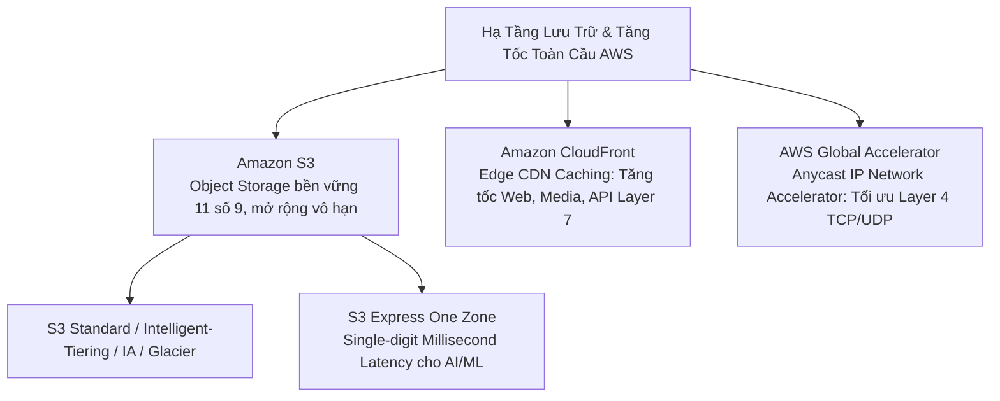
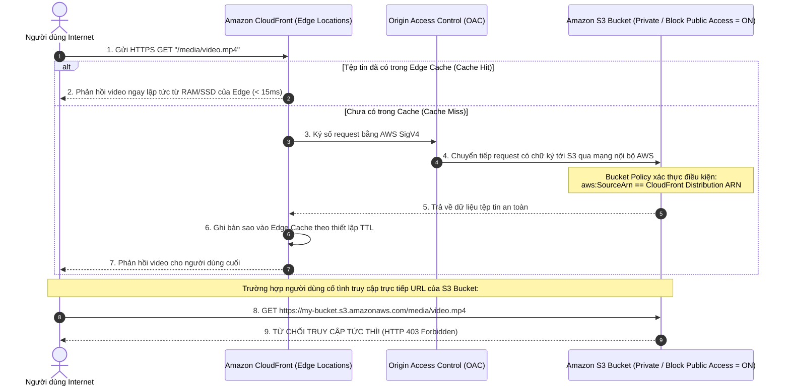

# Tài Liệu Học Tập Chuyên Sâu: Amazon S3 & Amazon CloudFront (Lưu Trữ Đối Tượng, Bảo Mật & Mạng Phân Phối Nội Dung Toàn Cầu)

> **Tài liệu chuẩn hóa kiến trúc đám mây**: Hướng dẫn toàn diện theo tiêu chuẩn Principal AWS Solutions Architect & Senior Cloud DevOps Engineer (Cập nhật phiên bản kiến trúc mới nhất 2026).  
> **Ngôn ngữ**: Tiếng Việt chuyên ngành (Bảo lưu toàn bộ thuật ngữ chuyên ngành tiếng Anh chuẩn AWS).  
> **Mục tiêu**: Phục vụ thi chứng chỉ cấp độ Professional/Specialty (**SAA-C03, SAP-C02, DOP-C02**) và vận hành hệ thống cấp độ doanh nghiệp (**Production-grade**).  
> **Các bài giảng liên quan**: Chương 12 (S3 Intro), Chương 13 (Advanced S3), Chương 14 (S3 Security), Chương 15 (CloudFront & Global Accelerator).

---

## 6.1. Tổng Quan Dịch Vụ (Service Overview)

### 1. Định nghĩa chuẩn xác và Phân nhóm dịch vụ
Hệ sinh thái lưu trữ đối tượng và phân phối nội dung đám mây của AWS bao gồm 3 trụ cột kiến trúc cốt lõi:



1. **Amazon Simple Storage Service (Amazon S3)**: Dịch vụ lưu trữ đối tượng (**Object Storage**) được quản lý toàn diện trên quy mô đám mây toàn cầu, cung cấp khả năng lưu trữ không giới hạn dung lượng với độ bền dữ liệu (**Durability**) đạt tiêu chuẩn công nghiệp **99.999999999% (11 số 9)**.
2. **Amazon CloudFront**: Mạng lưới phân phối nội dung toàn cầu (**Content Delivery Network - CDN**), lưu trữ tạm thời (**Edge Caching**) dữ liệu tại hàng trăm điểm biên (**Points of Presence - PoPs / Edge Locations**) trên khắp thế giới để tăng tốc độ phân phối nội dung tĩnh, video streaming, API động với độ trễ tối thiểu và tích hợp phòng thủ chu vi mạng với **AWS WAF**.
3. **AWS Global Accelerator**: Dịch vụ mạng tầng truyền vận (Layer 4) giúp tăng tốc độ truyền tải gói tin của ứng dụng toàn cầu bằng cách cung cấp **2 địa chỉ Anycast IP tĩnh** cố định, dẫn hướng lưu lượng người dùng đi thẳng vào mạng cáp quang riêng tốc độ cao của AWS (**AWS Global Backbone**) tại điểm biên gần nhất.

---

### 2. Bài toán cốt lõi mà S3 & CloudFront giải quyết

1. **Lưu trữ dữ liệu phi cấu trúc vô hạn (Unstructured Big Data)**: Lưu trữ từ vài Kilobyte đến hàng chục Petabyte các tệp tài liệu, hình ảnh, video, dữ liệu phân tích Data Lake mà không bao giờ phải lo lắng về việc cạn ổ đĩa hay mở rộng phân vùng.
2. **Loại bỏ hiện tượng thắt cổ chai băng thông (Origin Offload)**: CloudFront lưu cache nội dung tại điểm biên, hấp thụ tới **80% - 95%** lưu lượng truy cập từ người dùng cuối, giải phóng hoàn toàn áp lực tải cho các máy chủ gốc (S3, EC2, ALB).
3. **Bảo vệ an ninh tại biên (Edge Security)**: Kết hợp CloudFront với **AWS WAF**, **AWS Shield** và **Origin Access Control (OAC)** để chặn đứng các cuộc tấn công DDoS, quét lỗ hổng SQLi, XSS trước khi chúng kịp chạm tới hạ tầng VPC.

---

### 3. Khi nào KHÔNG nên dùng S3 (Anti-patterns & Giải pháp thay thế)

* ❌ **Lưu trữ dữ liệu thay đổi liên tục theo từng block nhỏ (Frequent Random Read/Write Updates)**: S3 là lưu trữ đối tượng, mỗi lần sửa đổi 1 byte thì toàn bộ đối tượng phải được ghi đè hoàn toàn (Overwrite). Tuyệt đối không dùng S3 làm ổ cứng cài đặt hệ điều hành hoặc cơ sở dữ liệu giao dịch.  
  👉 *Giải pháp thay thế*: Sử dụng **Amazon EBS** (`gp3` / `io2 Block Express`).
* ❌ **Ứng dụng yêu cầu hệ thống tệp chia sẻ tương thích chuẩn POSIX (File Locking, Directory Hierarchy)**: S3 không có cấu trúc thư mục thật sự và không hỗ trợ các lệnh POSIX như file locking, append data.  
  👉 *Giải pháp thay thế*: Sử dụng **Amazon EFS** (cho Linux) hoặc **Amazon FSx**.
* ❌ **Truy vấn phân tích thời gian thực yêu cầu độ trễ dưới 1 mili-giây**: Truy vấn S3 thông thường có độ trễ First-byte từ 100ms – 200ms.  
  👉 *Giải pháp thay thế*: Sử dụng **Amazon ElastiCache for Valkey/Redis** hoặc **Amazon S3 Express One Zone** (độ trễ single-digit millisecond).

---

## 6.2. Các Khái Niệm, Kiến Trúc & Vận Hành Cốt Lõi (Core Concepts, Security & Day-2 Operations)

### 1. Cấu trúc đối tượng & Định dạng truy cập (S3 Object Anatomy)

* **Buckets (Thùng chứa)**: Vùng chứa gốc cấp cao nhất. Tên S3 Bucket mang tính **duy nhất trên toàn cầu (Globally Unique)** xuyên suốt mọi tài khoản AWS trên thế giới.
* **Objects (Đối tượng)**: Bao gồm:
  - **Key (Khóa)**: Chuỗi ký tự định danh đường dẫn đầy đủ của tệp tin (ví dụ: `data/2026/reports/q1.parquet`). Dấu gạch chéo `/` chỉ là tiền tố (**Prefix**) logic, S3 bên dưới là không gian phẳng (**Flat namespace**).
  - **Value**: Nội dung dữ liệu (kích thước từ 0 byte tới **tối đa 5 TB** cho một object đơn lẻ; bắt buộc phải dùng **Multi-part Upload** cho tệp tin > 5 GB).
  - **Version ID**: Định danh phiên bản khi bật **S3 Versioning**.
  - **Metadata**: Thông tin mô tả hệ thống (`Content-Type`, `Cache-Control`) hoặc do người dùng tự định nghĩa (`x-amz-meta-*`).
* ⚠️ **LƯU Ý THI CỬ & KIẾN TRÚC 2026 - ĐỊNH DẠNG URL**:
  - **S3 Path-Style Access `[Deprecated]`**: `https://s3.amazonaws.com/bucket-name/key` hiện đã bị AWS ngừng khuyến nghị và không hỗ trợ cho các bucket tạo mới.
  - **Virtual-Hosted Style Access (Bắt buộc chuẩn)**: `https://bucket-name.s3.region.amazonaws.com/key`.

---

### 2. Bảng phân tích chi tiết các tầng lưu trữ S3 (S3 Storage Classes 2026)

| Tầng lưu trữ (Storage Class) | Độ bền (Durability) | Độ sẵn sàng (SLA) | Phạm vi địa lý | Thời gian lưu tối thiểu | Phí truy xuất dữ liệu | Kịch bản sử dụng chuẩn mực |
| :--- | :--- | :--- | :--- | :--- | :--- | :--- |
| **S3 Standard** | 99.999999999% (11 số 9) | 99.99% | Đa AZs ($\ge$ 3 AZ) | Không áp dụng | **0$ (Miễn phí)** | Dữ liệu nóng truy cập thường xuyên, website tĩnh, CDN origin. |
| **S3 Express One Zone** | 99.999999999% | 99.95% | **Duy nhất 1 AZ** | Không áp dụng | **0$ (Miễn phí)** | **Nhanh hơn gấp 10 lần**, độ trễ mili-giây một chữ số; dành cho AI/ML Training, Apache Spark, truy vấn tài chính cao tần. |
| **S3 Intelligent-Tiering** | 99.999999999% | 99.9% | Đa AZs ($\ge$ 3 AZ) | Không áp dụng | **0$ (Miễn phí)** | **Không rõ quy luật truy cập**: Tự động chuyển tầng giữa Frequent, Infrequent, Archive Instant mà không lo phí truy xuất phạt. |
| **S3 Standard-IA** | 99.999999999% | 99.9% | Đa AZs ($\ge$ 3 AZ) | **30 ngày** | **$0.01 / GiB** | Dữ liệu ít truy cập nhưng khi cần phải tải về ngay lập tức (Sao lưu Disaster Recovery). |
| **S3 One Zone-IA** | 99.999999999% | 99.5% | **Duy nhất 1 AZ** | **30 ngày** | **$0.01 / GiB** | Bản sao lưu phụ có thể tái tạo lại được; rủi ro mất dữ liệu nếu AZ đó gặp thảm họa. |
| **S3 Glacier Instant Retrieval** | 99.999999999% | 99.9% | Đa AZs ($\ge$ 3 AZ) | **90 ngày** | **$0.03 / GiB** | Dữ liệu lưu trữ y tế, hồ sơ khách hàng chỉ truy cập 1 lần mỗi quý nhưng cần lấy lại trong **mili-giây**. |
| **S3 Glacier Flexible Retrieval** | 99.999999999% | 99.99% | Đa AZs ($\ge$ 3 AZ) | **90 ngày** | Có phí (Trừ Bulk) | Lưu trữ dài hạn: Expedited (1–5 phút), Standard (3–5 giờ), Bulk (5–12 giờ miễn phí). |
| **S3 Glacier Deep Archive** | 99.999999999% | 99.99% | Đa AZs ($\ge$ 3 AZ) | **180 ngày** | Có phí | Lưu trữ tuân thủ pháp lý 7–10 năm; giá rẻ nhất thế giới (< $1/TB/tháng). Thời gian rút dữ liệu từ 12 đến 48 giờ. |

---

### 3. Vòng đời dữ liệu & Bảo vệ dữ liệu (Lifecycle Rules, Versioning & Object Lock)

#### A. S3 Lifecycle Rules
* **Transition Actions**: Tự động chuyển đổi tầng lưu trữ rẻ hơn theo thời gian (ví dụ: tạo file $\rightarrow$ sau 30 ngày sang Standard-IA $\rightarrow$ sau 90 ngày sang Glacier Flexible $\rightarrow$ sau 365 ngày sang Deep Archive).
* **Expiration Actions**: Tự động xóa vĩnh viễn các đối tượng cũ hoặc các phiên bản cũ (**Noncurrent Versions**) sau số ngày chỉ định.
* **Quy tắc dọn dẹp phân đoạn dở dang**: Bắt buộc cấu hình hành động `AbortIncompleteMultipartUpload` sau 7 ngày để thu hồi dung lượng rác tích tụ.

#### B. S3 Versioning & MFA Delete
* Khi bật **S3 Versioning**: Mọi thao tác ghi đè sẽ tạo phiên bản mới (**Version ID** mới). Khi xóa tệp tin, S3 không xóa dữ liệu mà chỉ chèn thêm một thẻ đánh dấu xóa (**Delete Marker**). Muốn khôi phục tệp, chỉ cần xóa thẻ Delete Marker.
* **MFA Delete**: Bắt buộc phải cung cấp mã OTP từ thiết bị phần cứng MFA của tài khoản **AWS Root Account** khi muốn **Xóa vĩnh viễn một Version** hoặc **Tắt tính năng Versioning**. Chống lại hành vi phá hoại dữ liệu từ tin tặc chiếm quyền admin.

#### C. S3 Object Lock (Mô hình WORM - Write Once, Read Many)
* **Compliance Mode (Chế độ tuân thủ pháp lý tuyệt đối)**: Không một ai (kể cả tài khoản AWS Root Account hay quản trị viên cao cấp nhất) có thể xóa hay ghi đè đối tượng trong suốt khoảng thời gian Retention đã thiết lập.
* **Governance Mode (Chế độ quản trị)**: Người dùng thông thường không thể xóa file, nhưng các tài khoản có quyền IAM đặc biệt (`s3:BypassGovernanceRetention`) có thể gỡ bỏ khóa hoặc xóa đối tượng khi cần thiết.
* **Legal Hold**: Khóa tệp tin vô thời hạn phục vụ công tác điều tra tư pháp cho đến khi được gỡ bỏ thủ công bằng cờ `OFF`.

---

### 4. An ninh & Mã hóa dữ liệu chuyên sâu (Security & Encryption)

```mermaid
flowchart TD
    S3Sec[An Ninh & Mã Hóa Amazon S3] --> Encrypt[Mã Hóa Lưu Trữ - Encryption at Rest]
    S3Sec --> Access[Kiểm Soát Truy Cập - Access Control]

    Encrypt --> SSES3[SSE-S3: Mặc định miễn phí / Khóa AES-256 do AWS quản lý]
    Encrypt --> SSEKMS[SSE-KMS: Quản lý khóa bằng KMS CMK / Audit CloudTrail]
    Encrypt --> S3BucketKey[S3 Bucket Keys: Giảm 99% chi phí KMS API calls]
    Encrypt --> DSSE[DSSE-KMS: Mã hóa 2 lớp độc lập chuẩn quốc phòng]
    Encrypt --> SSEC[SSE-C: Khách hàng tự truyền khóa qua HTTPS Header]

    Access --> BPA[Block Public Access: Chốt chặn an toàn cấp tài khoản/bucket]
    Access --> BucketPolicy[S3 Bucket Policy: JSON Policy cấp resource]
    Access --> Presigned[Pre-signed URLs: Cấp quyền tạm thời có thời hạn]
    Access --> ACLs[S3 ACLs [Deprecated]: Khuyến nghị tắt hoàn toàn Bucket Owner Enforced]
```

* ⚠️ **S3 ACLs `[Deprecated]`**: Access Control Lists là cơ chế phân quyền kế thừa cũ. Chuẩn mực bảo mật hiện nay yêu cầu kích hoạt tùy chọn **Bucket Owner Enforced** để vô hiệu hóa hoàn toàn ACLs và tập trung kiểm soát quyền qua **IAM Policies** và **S3 Bucket Policies**.
* **S3 Block Public Access (BPA)**: Chốt chặn bảo vệ an toàn 4 lớp tập trung, ngăn ngừa triệt để việc vô tình để lộ dữ liệu nhạy cảm ra Internet do cấu hình sai Bucket Policy hoặc ACLs.
* **S3 Bucket Keys**: Tính năng cốt lõi khi dùng `SSE-KMS`. Giúp S3 tự sinh khóa tạm thời cấp bucket, giảm số lượng cuộc gọi API tới AWS KMS tới **99%**, tiết kiệm hàng ngàn USD cho các kho dữ liệu lớn.

---

### 5. Amazon CloudFront vs AWS Global Accelerator

| Tiêu chuẩn kỹ thuật | Amazon CloudFront | AWS Global Accelerator |
| :--- | :--- | :--- |
| **Bản chất kiến trúc** | Mạng phân phối nội dung (**Content Delivery Network - CDN**). | Bộ tăng tốc lưu lượng mạng tầng truyền vận (**Network Accelerator**). |
| **Cơ chế hoạt động** | **Lưu bộ nhớ đệm (Edge Caching)** cho dữ liệu tĩnh tại hơn 600+ điểm biên. | **Không lưu Caching**. Định tuyến gói tin trực tiếp qua mạng trục cáp quang riêng của AWS. |
| **Tầng mạng (OSI Layers)** | Tầng ứng dụng: **Layer 7 (HTTP, HTTPS, WebSockets)**. | Tầng truyền vận: **Layer 4 (TCP và UDP)**. |
| **Địa chỉ IP** | Sử dụng tên miền DNS phân giải động của CloudFront. | Cung cấp **2 địa chỉ Anycast IP tĩnh cố định** toàn cầu. |
| **Bảo vệ an ninh** | Tích hợp **AWS WAF** trực tiếp tại điểm biên; chống DDoS bằng AWS Shield. | Tích hợp AWS Shield; giấu kín địa chỉ IP thật của máy chủ backend. |
| **Kịch bản sử dụng chuẩn** | Website tĩnh, tệp tin media, video streaming, REST API có thể cache. | Game đa người chơi thời gian thực, VoIP, IoT, ứng dụng tài chính yêu cầu IP tĩnh và độ trễ raw network cực thấp. |

---

## 6.3. Kiến Trúc Thực Tế và Luồng Vận Hành (Production Architecture & Workflow)

### 1. Sơ đồ bảo vệ S3 Origin an toàn tuyệt đối với CloudFront Origin Access Control (OAC)



* **Origin Access Identity (OAI) `[Deprecated]` vs Origin Access Control (OAC)**:  
  OAI là công cụ cũ với nhiều hạn chế (không hỗ trợ mã hóa SSE-KMS, không hỗ trợ các Region mới sau năm 2022, không hỗ trợ HTTP PUT/DELETE). **Origin Access Control (OAC)** là chuẩn mực bảo mật mới 2026, hỗ trợ 100% các phương thức HTTP, hỗ trợ mã hóa KMS với CMK và áp dụng chữ ký số bảo mật **AWS Signature Version 4 (SigV4)**.

---

### 2. So sánh CloudFront Functions vs Lambda@Edge

```mermaid
flowchart TD
    EdgeCompute[Điện Toán Tại Điểm Biên - CloudFront Edge Compute] --> CFF[CloudFront Functions\nSiêu nhẹ, Siêu tốc tại hơn 600+ PoPs]
    EdgeCompute --> LEdge[Lambda@Edge\nĐầy đủ tính năng tại Regional Edge Caches]

    CFF --> CFF_Props[Ngôn ngữ: JavaScript\nThời gian chạy: < 1 mili-giây\nRAM: 2 MB\nChi phí: Cực rẻ $0.10/1M reqs\nUse case: URL Rewrite, Header Manipulation, Token Validation]
    LEdge --> LEdge_Props[Ngôn ngữ: Node.js, Python\nThời gian chạy: Lên tới 30 giây\nRAM: Lên tới 10,000 MB\nTruy cập mạng: Được phép gọi API ngoài/DB\nUse case: Server-Side Rendering, Image Resizing, Auth phức tạp]
```

---

## 6.4. Bảng Tích Hợp với Các Dịch Vụ AWS Khác (Integration Table)

| Related AWS Service | Purpose (Mục đích tích hợp) | Integration Method (Phương thức kỹ thuật chính xác) | Practical Example (Ví dụ thực tiễn) |
| :--- | :--- | :--- | :--- |
| **AWS Lambda** | Xử lý dữ liệu hướng sự kiện hoặc biến đổi dữ liệu theo thời gian thực | **S3 Event Notifications** & **S3 Object Lambda** | Khi người dùng tải ảnh lên S3, Lambda tự động được kích hoạt để nén ảnh và tạo ảnh đại diện (Thumbnail). |
| **Amazon Athena** | Chạy truy vấn SQL phân tích trực tiếp trên các tệp tin dữ liệu lớn lưu trong S3 | **Serverless SQL Query Engine** kết hợp AWS Glue Data Catalog | Phân tích 500 GiB file log VPC Flow Logs dạng Parquet lưu trên S3 bằng câu lệnh `SELECT * FROM logs WHERE status = 'REJECT'`. |
| **AWS KMS** | Quản lý khóa mã hóa dữ liệu lưu trữ theo tiêu chuẩn FIPS 140-2 | Tích hợp **SSE-KMS** kết hợp **S3 Bucket Keys** | Mã hóa toàn bộ dữ liệu giao dịch tài chính bằng Customer Managed Key; tự động ghi nhật ký kiểm toán vào CloudTrail. |
| **AWS WAF** | Lọc và ngăn chặn các cuộc tấn công web Layer 7 ngay tại điểm biên | Gắn trực tiếp **Web ACL** vào CloudFront Distribution | Chặn đứng các đợt tấn công khai thác lỗ hổng SQL Injection và giới hạn tần suất request (Rate-based rules) trước khi chạm tới S3. |
| **Amazon SQS / SNS** | Phân phối thông báo sự kiện S3 tới nhiều dịch vụ hạ nguồn | Cấu hình **S3 Event Destination** (hỗ trợ lọc theo Prefix/Suffix) | Đẩy thông báo vào hàng đợi SQS mỗi khi có tệp tin hóa đơn định dạng `.pdf` mới được đẩy vào bucket. |
| **AWS Certificate Manager (ACM)** | Cung cấp chứng chỉ số SSL/TLS tùy chỉnh cho tên miền riêng trên CloudFront | Cấp phát chứng chỉ SSL/TLS miễn phí tại **Region `us-east-1`** | Gắn chứng chỉ `https://cdn.mycompany.com` vào CloudFront để phục vụ người dùng qua kết nối HTTPS an toàn. |

---

## 6.5. Bảng So Sánh Toàn Bộ Các Giải Pháp Lưu Trữ Đối Tượng & Tăng Tốc (Ecosystem Comparison)

| Dịch vụ AWS | Loại hình kiến trúc | Phạm vi địa lý | Độ trễ truy vấn | Khả năng Caching | Kịch bản sử dụng chuẩn mực |
| :--- | :--- | :--- | :--- | :--- | :--- |
| **Amazon S3 Standard** | Object Storage phân tán | Toàn Region ($\ge$ 3 AZs) | 100 – 200 mili-giây | Không | Kho lưu trữ dữ liệu trung tâm, Data Lake, backup, website tĩnh. |
| **S3 Express One Zone** | Object Storage hiệu năng cao | **1 Availability Zone** | **Mili-giây 1 chữ số** | Không | Tác vụ huấn luyện Machine Learning/AI, phân tích Big Data thời gian thực. |
| **Amazon CloudFront** | Content Delivery Network (CDN) | **Toàn cầu (600+ PoPs)** | **< 15 mili-giây (Cache Hit)** |  **Có (Edge Caching)** | Tăng tốc phân phối website tĩnh, video streaming, bảo vệ chống DDoS Layer 7. |
| **AWS Global Accelerator** | Network Layer 4 Accelerator | Toàn cầu qua 2 Anycast IPs | Cực thấp (Raw Network) | ❌ **Không Caching** | Game trực tuyến thời gian thực, IoT, VoIP, ứng dụng tài chính yêu cầu IP tĩnh. |
| **Amazon EBS** | Block Storage ảo hóa qua mạng | 1 Availability Zone | Sub-millisecond | Không | Boot volume cho OS, cơ sở dữ liệu quan hệ (PostgreSQL, Oracle) trên EC2. |
| **Amazon EFS** | Shared File Storage (POSIX) | Toàn Region (Đa AZs) | Millisecond | Không | Thư mục chia sẻ mã nguồn Web Farm, container shared persistent volume. |

---

## 6.6. Mô Hình Tính Phí & Chiến Lược Tối Ưu Chi Phí (FinOps & Cost Optimization)

### 6.6.1. Bảng Phân Tích Cơ Chế Tính Phí Chi Tiết Của Amazon S3 & CloudFront

| Thành phần tính phí | Cơ chế tính phí (Pricing Dimensions) | Mức phí tham chiếu điển hình (US-East-1) | Bẫy chi phí nghiêm trọng (Cost Pitfalls) |
| :--- | :--- | :--- | :--- |
| **S3 Standard Storage** | • **$0.023 / GiB / tháng** ($23 / TB).<br>• Miễn phí truy xuất dữ liệu (Data Retrieval = $0.00). | PUT/POST: $0.005 / 1,000 reqs.<br>GET: $0.0004 / 1,000 reqs. | Lưu trữ dữ liệu lịch sử ít truy cập trên S3 Standard qua nhiều năm. |
| **S3 Intelligent-Tiering** | • Tự động chuyển tầng ($0.023 $\rightarrow$ $0.0125 $\rightarrow$ $0.004 $\rightarrow$ $0.00099).<br>• Phí giám sát: **$0.0025 / 1,000 objects / tháng**. | Miễn phí truy xuất 100%. | Áp dụng Intelligent-Tiering cho hàng chục triệu tệp tin có kích thước siêu nhỏ (< 128 KB). |
| **S3 Standard-IA** | • **$0.0125 / GiB / tháng** (Giảm 45%).<br>• **Phí truy xuất: $0.01 / GiB**. | Yêu cầu lưu tối thiểu **30 ngày** và tính dung lượng tối thiểu **128 KB/file**. | Chuyển các file 5–10 KB sang IA khiến dung lượng tính tiền bị thổi phồng lên 128 KB! |
| **S3 Glacier Deep Archive** | • **$0.00099 / GiB / tháng** (< $1 / TB / tháng - Rẻ nhất thế giới). | Tối thiểu lưu **180 ngày**.<br>Rút dữ liệu: 12 – 48 giờ. | Xóa file trước 180 ngày vẫn bị tính đủ tiền lưu trữ 180 ngày. |
| **Dữ liệu Multipart dở dang** | • **Tính nguyên giá S3 Standard ($0.023/GiB)** cho các phần dở dang (Incomplete Parts). | Ẩn hoàn toàn trong danh sách file thông thường! | Không cài đặt Lifecycle Rule `AbortIncompleteMultipartUpload`, mất hàng ngàn USD tiền rác! |
| **Amazon CloudFront DTO** | • Phí truyền tải ra Internet: ~$0.085/GB.<br>• **Truy xuất dữ liệu từ AWS Origin (S3/ALB) tới CloudFront: HOÀN TOÀN MIỄN PHÍ ($0.00)**. | 1 TB DTO đầu tiên mỗi tháng miễn phí vĩnh viễn. | Người dùng tải file trực tiếp từ S3 ra Internet thay vì đi qua CloudFront (S3 DTO đắt hơn). |
| **CloudFront Invalidation** | • **1,000 paths đầu tiên mỗi tháng miễn phí**.<br>• Sau đó: **$0.005 cho mỗi path**. | Invalidate `/*` chỉ tính là 1 path duy nhất. | CI/CD script invalidate từng file riêng lẻ (10,000 files = $45/lần deploy!). |

---

### 6.6.2. Chiến Lược Tối Ưu Hóa Chi Phí Theo 5 Kịch Bản Thực Tế (Use Cases Optimization)

#### Kịch bản 1: Tiêu Hủy Dữ Liệu Phân Đoạn Dở Dang Bằng S3 Lifecycle Rule
* **Bối cảnh thực tế**:
  Một ứng dụng chia sẻ video cho phép người dùng tải lên các file video dung lượng từ 500 MB đến 5 GB bằng cơ chế Multi-part Upload. Do sự cố mạng di động chập chờn, có tới 30% các phiên tải lên bị hủy giữa chừng. Sau 2 năm hoạt động, có tới **40 TB** dữ liệu phân đoạn dở dang nằm ẩn trong S3 Bucket.
  $$\text{Chi phí S3 Standard lãng phí} = 40,000 \text{ GiB} \times 0.023\$ = \mathbf{920.00\$/\text{tháng}}$$
* **Chiến lược tối ưu hóa**:
  - Tạo một quy tắc **S3 Lifecycle Rule** trên toàn bộ bucket:
    - Bật tùy chọn: `Abort incomplete multipart uploads`.
    - Thiết lập thời gian chờ: **7 ngày** kể từ ngày khởi tạo tải lên.
* **Kết quả tiết kiệm**:
  $$\text{Số tiền tiết kiệm} = \mathbf{920.00\$/\text{tháng}} \quad (\approx \mathbf{11,040\$/\text{năm}})$$
  **Thu hồi 100% dung lượng rác và tiết kiệm toàn bộ chi phí lãng phí**.

---

#### Kịch bản 2: Tối Ưu Chi Phí Data Lake 200 TB Bằng S3 Intelligent-Tiering
* **Bối cảnh thực tế**:
  Một kho dữ liệu Data Lake phân tích hành vi khách hàng lưu trữ **200 TB (200,000 GiB)** dữ liệu trên S3 Standard. Tần suất truy vấn dữ liệu giảm dần theo độ tuổi tệp tin nhưng không thể dự đoán chính xác tệp nào sẽ được truy vấn lại.
  $$\text{Chi phí S3 Standard ban đầu} = 200,000 \text{ GiB} \times 0.023\$ = \mathbf{4,600.00\$/\text{tháng}}$$
* **Chiến lược tối ưu hóa**:
  - Áp dụng **S3 Intelligent-Tiering** cho toàn bộ bucket. Phân bổ dữ liệu thực tế sau 90 ngày:
    - 40 TB ở tầng Frequent Access: $40,000 \times 0.023\$ = 920.00\$$
    - 60 TB ở tầng Infrequent Access (sau 30 ngày): $60,000 \times 0.0125\$ = 750.00\$$
    - 100 TB ở tầng Archive Instant Access (sau 90 ngày): $100,000 \times 0.004\$ = 400.00\$$
    - Phí giám sát tự động cho 10 triệu objects: $10,000 \times 0.0025\$ = 25.00\$$
  $$\text{Tổng chi phí sau tối ưu} = 920\$ + 750\$ + 400\$ + 25\$ = \mathbf{2,095.00\$/\text{tháng}}$$
* **Kết quả tiết kiệm**:
  $$\text{Số tiền tiết kiệm} = 4,600.00\$ - 2,095.00\$ = \mathbf{2,505.00\$/\text{tháng}} \quad (\approx \mathbf{30,060\$/\text{năm}})$$
  **Tỷ lệ tiết kiệm đạt ~54.5%**, hoàn toàn tự động và không có bất kỳ khoản phí phạt truy xuất nào.

---

#### Kịch bản 3: Kích Hoạt S3 Bucket Keys Giảm Phí Gọi KMS API Trên Data Lake
* **Bối cảnh thực tế**:
  Một kho lưu trữ hồ sơ tài chính chứa 80 triệu tệp tin Parquet được mã hóa bằng Customer Managed Key (`SSE-KMS`). Mỗi ngày các tác vụ Amazon Athena và AWS EMR quét dữ liệu, phát sinh **120 triệu lượt gọi API `kms:Decrypt` mỗi tháng**.
  $$\text{Chi phí KMS API ban đầu} = \frac{120,000,000}{10,000} \times 0.03\$ = \mathbf{360.00\$/\text{tháng}}$$
* **Chiến lược tối ưu hóa**:
  - Bật tính năng **S3 Bucket Keys** trên cấu hình mã hóa mặc định của S3 Bucket:
    ```bash
    aws s3api put-bucket-encryption --bucket my-finance-lake --server-side-encryption-configuration '{
      "Rules": [{"ApplyServerSideEncryptionByDefault": {"SSEAlgorithm": "aws:kms", "KMSMasterKeyId": "arn:aws:kms:..."}, "BucketKeyEnabled": true}]
    }'
    ```
  - Khi bật S3 Bucket Key, S3 sẽ sinh khóa tạm thời cấp bucket; số lượng cuộc gọi KMS API giảm tới **99%** (từ 120 triệu xuống còn ~1.2 triệu calls).
  $$\text{Chi phí KMS API sau tối ưu} = \frac{1,200,000}{10,000} \times 0.03\$ = \mathbf{3.60\$/\text{tháng}}$$
* **Kết quả tiết kiệm**:
  $$\text{Số tiền tiết kiệm} = 360.00\$ - 3.60\$ = \mathbf{356.40\$/\text{tháng}} \quad (\approx \mathbf{4,276\$/\text{năm}})$$
  **Tiết kiệm ngay 99% chi phí KMS API calls** mà không cần thay đổi bất kỳ dòng mã nguồn nào.

---

#### Kịch bản 4: Giảm Tải Băng Thông Internet Bằng CloudFront Edge Caching
* **Bối cảnh thực tế**:
  Trang web phân phối tài liệu hình ảnh trực tiếp từ S3 ra Internet với lưu lượng **60 TB/tháng**.
  $$\text{Phí S3 Data Transfer Out} = 60,000 \text{ GiB} \times 0.09\$ = \mathbf{5,400.00\$/\text{tháng}}$$
  $$\text{Phí S3 GET Requests (150 triệu lượt)} = 150,000 \times 0.0004\$ = 60.00\$$$
  $$\text{Tổng chi phí ban đầu} = \mathbf{5,460.00\$/\text{tháng}}$$
* **Chiến lược tối ưu hóa**:
  - Triển khai **Amazon CloudFront** đứng trước S3 kết hợp **Origin Access Control (OAC)**:
    1. Lưu lượng truyền từ S3 sang CloudFront là **$0.00 (Hoàn toàn miễn phí)**.
    2. Tỷ lệ trúng bộ nhớ đệm (Cache Hit Ratio) đạt 85%, chỉ 9 TB phải quay về S3.
    3. Đăng ký **CloudFront Security Savings Bundle** nhận chiết khấu 30% trên đơn giá DTO ra Internet ($0.085 $\rightarrow$ $0.0595/GiB).
  $$\text{Phí CloudFront DTO (60 TB)} = 60,000 \times 0.0595\$ = 3,570.00\$$$
  $$\text{Phí S3 GET Requests sau giảm tải 85%} = 22,500 \times 0.0004\$ = 9.00\$$$
  $$\text{Tổng chi phí sau tối ưu} = 3,570.00\$ + 9.00\$ = \mathbf{3,579.00\$/\text{tháng}}$$
* **Kết quả tiết kiệm**:
  $$\text{Số tiền tiết kiệm} = 5,460.00\$ - 3,579.00\$ = \mathbf{1,881.00\$/\text{tháng}} \quad (\approx \mathbf{22,572\$/\text{năm}})$$
  **Tỷ lệ tiết kiệm đạt ~34.5%**, trong khi tốc độ mở trang của người dùng nhanh hơn gấp 6 lần.

---

#### Kịch bản 5: Chuyển Đổi Chiến Lược Xóa Cache CloudFront (Invalidation vs Hash Naming)
* **Bối cảnh thực tế**:
  Hệ thống CI/CD tự động deploy frontend trung bình 5 lần/ngày. Mỗi lần deploy, script gọi invalidation từng file riêng lẻ cho 8,000 tệp tin tài nguyên:
  $$\text{Số lượng path tính phí mỗi lần} = 8,000 - 1,000 \text{ (free)} = 7,000 \text{ paths}$$
  $$\text{Chi phí 1 lần deploy} = 7,000 \times 0.005\$ = 35.00\$$$
  $$\text{Tổng chi phí 1 tháng (150 lần deploy)} = 150 \times 35.00\$ = \mathbf{5,250.00\$/\text{tháng}}$$
* **Chiến lược tối ưu hóa**:
  - Áp dụng kỹ thuật **Content-based Hash Naming** trong Webpack/Vite (ví dụ: `main.d41d8c.js`). Khi có code mới, tên file tự thay đổi, CloudFront tự động kéo file mới.
  - Script deploy CI/CD chỉ gửi duy nhất 1 lệnh invalidate cho file HTML gốc: `aws cloudfront create-invalidation --distribution-id XXX --paths /index.html`.
  - Toàn bộ 150 lần deploy chỉ tiêu tốn 150 paths, nằm trọn vẹn trong **1,000 paths miễn phí hàng tháng của AWS ($0.00)**.
* **Kết quả tiết kiệm**:
  $$\text{Số tiền tiết kiệm} = \mathbf{5,250.00\$/\text{tháng}} \quad (\approx \mathbf{63,000\$/\text{năm}})$$
  **Loại bỏ 100% chi phí phát sinh xóa cache lãng phí**.

---

## 6.7. Khắc Phục Sự Cố Thực Tế (Troubleshooting Guide)

| Vấn đề (Problem) | Nguyên nhân khả dĩ (Possible Causes) | Các bước điều tra (Investigation Steps - Metrics/Logs) | Giải pháp xử lý (Solution) | Biện pháp phòng ngừa (Prevention) |
| :--- | :--- | :--- | :--- | :--- |
| **Lỗi `HTTP 403 Forbidden` khi truy cập tệp tin trên S3** | 1. Bật tính năng S3 Block Public Access.<br>2. S3 Bucket Policy thiếu quyền cho phép.<br>3. File mã hóa bằng KMS nhưng caller thiếu quyền `kms:Decrypt`. | 1. Kiểm tra tab Permissions -> Block Public Access.<br>2. Xem Bucket Policy.<br>3. Xem CloudTrail log sự kiện `AccessDenied`. | Thêm quyền đọc trong Bucket Policy và cấp quyền giải mã KMS CMK cho IAM Principal. | Kiểm tra quyền truy cập bằng công cụ **IAM Policy Simulator** trước khi release. |
| **Lỗi `CORS (Cross-Origin Resource Sharing)` trên trình duyệt** | S3 bucket chưa cấu hình chính sách CORS cho phép domain của trang web gọi chéo tài nguyên. | Mở Developer Tools trên trình duyệt xem thông báo lỗi `No 'Access-Control-Allow-Origin' header is present`. | Vào S3 Bucket -> Permissions -> Thêm cấu hình CORS JSON cho phép Origin của website và phương thức `GET/PUT`. | Khai báo CORS chuẩn trong Terraform/CloudFormation khi tạo bucket. |
| **Người dùng qua CloudFront vẫn thấy nội dung cũ sau khi cập nhật S3** | Bản sao cũ vẫn đang được lưu trong bộ nhớ đệm **Edge Cache** của CloudFront do chưa hết thời hạn TTL. | Kiểm tra thông số Cache Behavior (Min TTL, Max TTL, Default TTL) trên CloudFront. | Tạo lệnh **Cache Invalidation** cho đường dẫn `/index.html` hoặc `/*` để xóa cache tức thì. | Đặt tên file kèm mã băm phiên bản (Hash Naming) thay vì ghi đè tệp tin cũ. |
| **Lỗi `CloudFront 502 Bad Gateway` hoặc `504 Gateway Timeout`** | • Chứng chỉ SSL/TLS trên Origin (ALB/EC2) đã hết hạn hoặc không khớp tên miền.<br>• Máy chủ Origin bị quá tải hoặc Security Group chặn dải IP của CloudFront. | 1. Xem CloudWatch Metric **`5xxErrorRate`** trên CloudFront.<br>2. Kiểm tra log web server trên Origin (Nginx/Apache error log). | Cập nhật chứng chỉ SSL hợp lệ trên Origin và tăng tham số `Origin Response Timeout` trên CloudFront. | Sử dụng **AWS Certificate Manager (ACM)** để chứng chỉ tự động gia hạn trước khi hết hạn. |
| **Lỗi `SlowDown / HTTP 503` khi tải dữ liệu S3 với lưu lượng khổng lồ** | Tốc độ request vượt quá giới hạn phân vùng prefix của S3 (**3,500 PUT/POST/DELETE và 5,500 GET requests/giây trên mỗi prefix**). | Xem CloudWatch Metric **`5xxErrors`** trên S3 bucket. | 1. Phân tán các tệp tin sang nhiều prefix khác nhau (ví dụ dùng hash prefix `bucket/a1b2/...`).<br>2. Đặt CloudFront phía trước để hứng tải. | Thiết kế cấu trúc thư mục phân tán prefix ngay từ ban đầu cho các hệ thống Big Data. |
| **Tốc độ upload tệp tin lớn lên S3 bị chậm hoặc rớt kết nối** | Đang tải file lớn đơn luồng thông thường qua khoảng cách địa lý xa. | Kiểm tra kích thước tệp tin (> 100 MB). | Bật tính năng **Multi-part Upload** đa luồng và kích hoạt **S3 Transfer Acceleration**. | Cấu hình AWS CLI với tham số tối ưu `max_concurrent_requests = 20`. |

---

## 6.8. Bộ Câu Hỏi Ôn Tập và Kiểm Tra Kiến Thức (Knowledge Review)

### A. Danh mục câu hỏi trắc nghiệm & Tình huống kiến trúc

#### Câu 1 (Core Concept)
Độ bền vững dữ liệu (**Durability**) của dịch vụ lưu trữ Amazon S3 Standard được cam kết theo tiêu chuẩn công nghiệp là bao nhiêu?
- A. 99.9% (3 số 9).
- B. 99.99% (4 số 9).
- C. 99.999999999% (11 số 9).
- D. 100% tuyệt đối.

#### Câu 2 (Core Concept)
Kích thước tối đa cho phép của một đối tượng (**Object**) đơn lẻ có thể lưu trữ trong Amazon S3 là bao nhiêu, và ở kích thước nào AWS bắt buộc phải sử dụng cơ chế **Multi-part Upload**?
- A. Tối đa 5 TB; bắt buộc Multi-part Upload khi tệp tin lớn hơn 5 GB.
- B. Tối đa 5 GB; bắt buộc Multi-part Upload khi tệp tin lớn hơn 100 MB.
- C. Tối đa 16 TB; bắt buộc Multi-part Upload khi tệp tin lớn hơn 5 TB.
- D. Tối đa không giới hạn; bắt buộc Multi-part Upload cho mọi tệp tin.

#### Câu 3 (Core Concept)
Tầng lưu trữ nào của Amazon S3 được thiết kế chuyên biệt để mang lại **độ trễ truy xuất một chữ số mili-giây (single-digit millisecond latency)** và tốc độ xử lý nhanh hơn tới 10 lần so với S3 Standard cho các tác vụ huấn luyện AI/ML?
- A. S3 Intelligent-Tiering.
- B. S3 Glacier Instant Retrieval.
- C. S3 Express One Zone.
- D. S3 Standard-IA.

#### Câu 4 (Core Concept - Security)
Chế độ nào của tính năng **S3 Object Lock** đảm bảo rằng ngay cả tài khoản quản trị tối cao **AWS Root Account** cũng tuyệt đối không thể xóa hay ghi đè đối tượng trong suốt khoảng thời gian Retention đã thiết lập?
- A. Governance Mode.
- B. Legal Hold.
- C. Compliance Mode.
- D. Strict Mode.

#### Câu 5 (Core Concept - Networking)
Điểm khác biệt cốt lõi nhất về mặt cơ chế hoạt động giữa **Amazon CloudFront** và **AWS Global Accelerator** là gì?
- A. CloudFront hoạt động ở Layer 4 không lưu cache; Global Accelerator hoạt động ở Layer 7 có lưu cache.
- B. CloudFront là mạng CDN có khả năng lưu trữ bộ nhớ đệm (**Caching**) tại điểm biên; trong khi Global Accelerator là bộ tăng tốc mạng tầng truyền vận (TCP/UDP) **không lưu bộ nhớ đệm**, sử dụng 2 địa chỉ Anycast IP tĩnh.
- C. CloudFront chỉ hỗ trợ giao thức UDP; Global Accelerator chỉ hỗ trợ HTTPS.
- D. Cả hai dịch vụ đều có cơ chế lưu trữ bộ nhớ đệm giống hệt nhau.

#### Câu 6 (Core Concept - Security Governance)
Cơ chế nào được AWS khuyến nghị chuẩn mực nhất hiện nay để bảo vệ an toàn cho S3 Bucket làm Origin, chỉ cho phép duy nhất Amazon CloudFront truy cập dữ liệu và hỗ trợ mã hóa SSE-KMS (thay thế cho cơ chế cũ OAI)?
- A. Origin Access Identity (OAI).
- B. Origin Access Control (OAC).
- C. S3 Bucket ACLs Public Read.
- D. IAM Instance Profile.

#### Câu 7 (Core Concept - Developer Utilities)
Làm thế nào một ứng dụng web có thể cho phép người dùng cuối tải trực tiếp một video dung lượng 3 GB lên một S3 Bucket riêng tư mà không cần cấp quyền tài khoản AWS và không cần truyền dữ liệu qua máy chủ backend của ứng dụng?
- A. Mở S3 Bucket sang chế độ Public cho toàn thế giới ghi đè.
- B. Cung cấp AWS Root Access Key trong mã nguồn frontend của trình duyệt.
- C. Máy chủ backend sinh một **S3 Pre-signed URL** với phương thức HTTP `PUT` và thời gian sống ngắn, sau đó gửi link đó cho trình duyệt người dùng tải file lên.
- D. Cấu hình CloudFront mở cổng FTP.

#### Câu 8 (Core Concept - Edge Compute)
Khi bạn cần thực hiện một tác vụ cực nhẹ như chuyển hướng URL (URL Rewrite), chỉnh sửa HTTP Headers hoặc kiểm tra JWT Token đơn giản tại hơn 600+ điểm biên của CloudFront với độ trễ dưới 1 mili-giây và chi phí rẻ nhất, công nghệ nào là lựa chọn tối ưu nhất?
- A. AWS Lambda@Edge.
- B. CloudFront Functions.
- C. Amazon EC2 Micro Instances.
- D. AWS Fargate Tasks.

#### Câu 9 (Scenario - FinOps Data Lake Cost Optimization)
Một doanh nghiệp quản lý kho dữ liệu Data Lake 100 TB trên S3 Standard. Dữ liệu sau khi nạp vào có mô hình truy cập ngẫu nhiên, một số tệp được phân tích nhiều lần trong tuần đầu, sau đó không ai truy cập trong nhiều tháng. Giải pháp nào giúp tự động tối ưu hóa chi phí lên tới hơn 50% mà không phải trả phí phạt truy xuất dữ liệu?
- A. Viết script cronjob chuyển toàn bộ sang S3 Standard-IA sau 30 ngày.
- B. Cấu hình S3 Lifecycle chuyển đổi toàn bộ đối tượng sang tầng **S3 Intelligent-Tiering**.
- C. Chuyển toàn bộ dữ liệu sang S3 Glacier Deep Archive ngay khi tải lên.
- D. Xóa bỏ toàn bộ các tệp tin có dung lượng lớn hơn 1 GB.

#### Câu 10 (Scenario - High-Volume KMS API Cost Reduction)
Một ứng dụng Fintech thực hiện hàng trăm triệu lượt đọc/ghi tệp tin hàng tháng trên S3 Bucket được mã hóa bằng khóa KMS Customer Managed Key (`SSE-KMS`). Hóa đơn AWS Cost Explorer báo cáo chi phí gọi KMS API vượt quá $1,000/tháng. Giải pháp kỹ thuật nào giúp giảm ngay 99% chi phí KMS API mà không làm suy giảm cấp độ an ninh bảo mật?
- A. Tắt hoàn toàn tính năng mã hóa trên S3 Bucket.
- B. Chuyển đổi toàn bộ dữ liệu sang lưu trữ trên Amazon EBS.
- C. Kích hoạt tính năng **S3 Bucket Keys** trên cấu hình mã hóa của S3 Bucket.
- D. Đổi sang sử dụng khóa mã hóa bất đối xứng RSA.

#### Câu 11 (Scenario - Incomplete Upload Cost Trap)
Một công ty viễn thông phát hiện dung lượng lưu trữ trên hóa đơn S3 lớn hơn gấp đôi dung lượng thực tế hiển thị trong danh mục tệp tin của console. Nguyên nhân khả dĩ nhất bên dưới là gì và giải pháp khắc phục triệt để là gì?
- A. S3 tính tiền gấp đôi cho tính năng mã hóa; giải pháp là tắt mã hóa.
- B. Các phần dữ liệu phân đoạn tải dở dang (**Incomplete Multipart Uploads**) bị đứt mạng vẫn nằm ẩn trong S3; giải pháp là tạo S3 Lifecycle Rule bật tùy chọn `Abort incomplete multipart uploads` sau 7 ngày.
- C. S3 tự động sao lưu dữ liệu sang Region khác; giải pháp là tắt Cross-Region Replication.
- D. Hệ thống file bị phân mảnh; giải pháp là defragment lại bucket.

#### Câu 12 (Scenario - Zero-Downtime Deployment Invalidation)
Một đội ngũ DevOps deploy phiên bản giao diện mới của ứng dụng web lên S3 làm Origin cho CloudFront. Sau khi tải code mới lên, họ cần cập nhật ngay giao diện cho người dùng toàn cầu mà không phát sinh thêm chi phí xóa cache ngoài gói miễn phí của AWS. Thao tác nào là chuẩn mực nhất?
- A. Gửi lệnh Invalidate toàn bộ 10,000 file riêng lẻ trong thư mục frontend.
- B. Xóa CloudFront Distribution và tạo lại cái mới.
- C. Áp dụng kỹ thuật gắn mã băm phiên bản vào tên file tĩnh (Hash Naming) và chỉ gửi 1 lệnh Invalidate duy nhất cho file gốc `/index.html` (chỉ tính 1 path).
- D. Khởi động lại toàn bộ các máy chủ Edge Locations của CloudFront.

---

### B. Đáp án Chi Tiết Bộ Câu Hỏi Ôn Tập (Answer Key & Explanations)

<details>
<summary>👉 Nhấp vào đây để xem toàn bộ đáp án chi tiết và giải thích kiến trúc</summary>

### Đáp án Câu 1: C
- **Giải thích**: Amazon S3 Standard cam kết độ bền dữ liệu đạt **99.999999999% (11 số 9)** mỗi năm bằng cách tự động nhân bản dữ liệu xuyên qua tối thiểu 3 Availability Zones độc lập về mặt địa lý.

### Đáp án Câu 2: A
- **Giải thích**: Giới hạn kích thước cho một object đơn lẻ trong S3 là **5 TB**. Đối với các tệp tin có dung lượng **lớn hơn 5 GB**, AWS bắt buộc người dùng phải sử dụng cơ chế **Multi-part Upload** (và khuyến nghị áp dụng cho mọi file > 100 MB để tăng tốc độ truyền tải và cho phép resume khi đứt mạng).

### Đáp án Câu 3: C
- **Giải thích**: **S3 Express One Zone** là tầng lưu trữ hiệu năng cao thế hệ mới, lưu trữ dữ liệu tại một AZ duy nhất được tối ưu hóa đặc biệt, cung cấp độ trễ phản hồi **mili-giây một chữ số** và thông lượng I/O cực đại cho các tác vụ AI/ML và Big Data.

### Đáp án Câu 4: C
- **Giải thích**: Trong **Compliance Mode** của S3 Object Lock, quy tắc khóa dữ liệu (WORM) được thực thi nghiêm ngặt tuyệt đối: không có bất kỳ ai, kể cả tài khoản Root của tài khoản AWS, có thể ghi đè hay xóa bỏ tệp tin trong suốt thời gian bảo vệ.

### Đáp án Câu 5: B
- **Giải thích**: **Amazon CloudFront** là mạng CDN tầng ứng dụng (Layer 7) có khả năng lưu trữ bộ nhớ đệm (**Caching**) tại điểm biên; trong khi **AWS Global Accelerator** là bộ tăng tốc mạng tầng truyền vận (Layer 4 TCP/UDP) **hoàn toàn không có tính năng Caching**, sử dụng 2 địa chỉ Anycast IP tĩnh để dẫn truyền lưu lượng vào mạng trục cáp quang riêng của AWS.

### Đáp án Câu 6: B
- **Giải thích**: **Origin Access Control (OAC)** là chuẩn mực bảo mật mới thay thế cho OAI cũ; OAC hỗ trợ đầy đủ các phương thức HTTP (GET, PUT, POST, DELETE), hỗ trợ mã hóa SSE-KMS với CMK và sử dụng chữ ký số bảo mật AWS SigV4.

### Đáp án Câu 7: C
- **Giải thích**: **S3 Pre-signed URL** cho phép chủ sở hữu bucket tạo ra một đường link tạm thời kèm chữ ký số xác thực để cấp quyền cho người dùng bên ngoài tải lên (HTTP `PUT`) hoặc tải xuống (HTTP `GET`) một tệp tin cụ thể mà không cần cung cấp tài khoản IAM.

### Đáp án Câu 8: B
- **Giải thích**: **CloudFront Functions** là môi trường điện toán siêu nhẹ tại hơn 600+ Edge PoPs của CloudFront, chuyên xử lý mã JavaScript với thời gian thực thi dưới 1 mili-giây, hoàn hảo cho các tác vụ như URL Rewrite, Header manipulation và kiểm tra token đơn giản với chi phí chỉ bằng 1/6 so với Lambda@Edge.

### Đáp án Câu 9: B
- **Giải thích**: **S3 Intelligent-Tiering** tự động theo dõi và di chuyển dữ liệu giữa các tầng lưu trữ (Frequent, Infrequent, Archive Instant) dựa trên tần suất truy cập thực tế, giúp tiết kiệm tới hơn 50% chi phí lưu trữ mà hoàn toàn không thu phí truy xuất dữ liệu phạt.

### Đáp án Câu 10: C
- **Giải thích**: Khi bật tính năng **S3 Bucket Keys**, Amazon S3 sẽ tự sinh ra một khóa tạm thời cấp bucket để mã hóa/giải mã các đối tượng trong cùng bucket, giúp cắt giảm tới **99% số lượng cuộc gọi API tới AWS KMS**, tiết kiệm hàng ngàn USD chi phí API.

### Đáp án Câu 11: B
- **Giải thích**: Khi tải tệp tin lớn bằng Multi-part Upload bị hủy giữa chừng, các phần dữ liệu đã nạp (Incomplete Parts) vẫn nằm âm thầm trong bucket và bị tính phí lưu trữ S3 Standard đầy đủ dù không hiển thị trên danh mục console. Giải pháp là tạo **S3 Lifecycle Rule** bật hành động `Abort incomplete multipart uploads` sau 7 ngày.

### Đáp án Câu 12: C
- **Giải thích**: Kỹ thuật **Hash Naming** đổi tên file tĩnh theo mã băm nội dung code giúp CloudFront tự động tải bản mới mà không cần xóa cache. DevOps chỉ cần invalidate duy nhất đường dẫn `/index.html`, vừa đảm bảo người dùng nhận bản mới tức thì vừa không bao giờ vượt quá hạn mức 1,000 paths miễn phí mỗi tháng của AWS.

</details>

---

## 6.9. Tóm Tắt và Danh Mục Kiểm Tra Kiến Thức (Summary & Learning Checklist)

### 7 Nguyên Tắc Kiến Trúc "Sống Còn" Của Amazon S3 & CloudFront (Golden Rules)
1. **Bảo mật Origin bằng CloudFront OAC**:  
   Tuyệt đối không mở S3 Bucket ra Public Internet; luôn bật tính năng **Block Public Access** và khóa chặt truy cập vào bucket chỉ cho phép duy nhất CloudFront thông qua **Origin Access Control (OAC)**.
2. **Quy tắc dọn dẹp Multipart dở dang**:  
   Luôn luôn kích hoạt quy tắc S3 Lifecycle Rule `AbortIncompleteMultipartUpload` (thời hạn 7 ngày) trên mọi bucket để ngăn ngừa rò rỉ ngân sách cho dữ liệu rác.
3. **Tiết kiệm 99% phí KMS với S3 Bucket Keys**:  
   Bất kỳ khi nào sử dụng mã hóa **SSE-KMS** trên S3, bắt buộc phải tích chọn bật tính năng **S3 Bucket Keys** để giảm 99% chi phí gọi KMS API.
4. **Phân tầng lưu trữ thông minh**:  
   Với dữ liệu Data Lake có mô hình truy cập ngẫu nhiên, luôn ưu tiên sử dụng **S3 Intelligent-Tiering** để tối ưu chi phí mà không lo bị tính phí phạt truy xuất dữ liệu.
5. **Cạm bẫy kích thước 128 KB trên S3 IA**:  
   Không chuyển đổi các tệp tin nhỏ hơn 128 KB sang **S3 Standard-IA** hoặc **One Zone-IA** vì AWS sẽ tự động làm tròn dung lượng tính tiền lên 128 KB cho mỗi file.
6. **Lựa chọn đúng công cụ Edge Compute**:  
   - Cần URL Rewrite, Header Manipulation, kiểm tra token đơn giản dưới 1ms $\rightarrow$ Chọn **CloudFront Functions**.  
   - Cần Server-Side Rendering (SSR), thay đổi kích thước ảnh, gọi API bên thứ ba $\rightarrow$ Chọn **Lambda@Edge**.
7. **Chiến lược Invalidation không tốn phí**:  
   Sử dụng mã băm phiên bản (Hash Naming) cho các file tĩnh và chỉ thực hiện Invalidate file gốc `/index.html` để nằm trọn trong hạn mức 1,000 paths miễn phí mỗi tháng.

---

### Liên Kết Nội Bộ và Tài Liệu Tham Khảo (Internal Links)
- 📖 [Ghi Chú Bài Học Chương 12-14: Amazon S3 Toàn Tập](../Lesson_Notes/12_13_14_Amazon_S3_Comprehensive.md)
- 📖 [Ghi Chú Bài Học Chương 15: CloudFront & Global Accelerator](../Lesson_Notes/15_CloudFront_Global_Accelerator.md)
- 📖 [Tài Liệu Chuyên Sâu: Amazon EBS, EFS & Lưu Trữ Đám Mây](./EBS_EFS_Storage.md)
- 📖 [Tài Liệu Chuyên Sâu: AWS KMS, Secrets Manager & Bảo Mật Dữ Liệu](./KMS_Security_Encryption.md)
- 📖 [Tài Liệu Chuyên Sâu: Amazon Route 53 & Hệ Thống DNS Đám Mây](./Route53_DNS.md)
- 📖 [Bảng Thuật Ngữ Kỹ Thuật Đám Mây Toàn Diện](../GLOSSARY.md)
- ⏭️ **Chuyên đề tiếp theo**: [Cân Bằng Tải & Tự Động Co Giãn: Elastic Load Balancing (ELB) & Auto Scaling Group (ASG)](./ELB_and_ASG_High_Availability.md)
