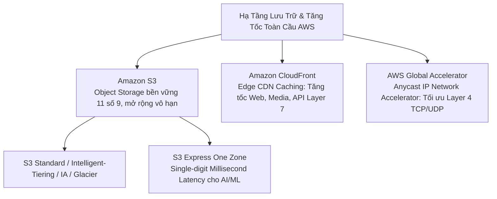
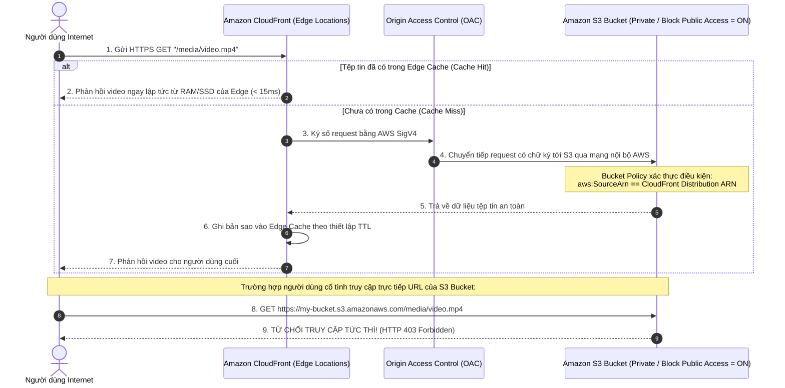

# Tài Liệu Học Tập Chuyên Sâu: Amazon S3 & Amazon CloudFront (Lưu Trữ Đối Tượng, Bảo Mật & Mạng Phân Phối Nội Dung Toàn Cầu)

> **Tài liệu chuẩn hóa kiến trúc đám mây**: Hướng dẫn toàn diện theo tiêu chuẩn Principal AWS Solutions Architect & Senior Cloud DevOps Engineer (Cập nhật phiên bản kiến trúc mới nhất 2026).  
> **Ngôn ngữ**: Tiếng Việt chuyên ngành (Bảo lưu toàn bộ thuật ngữ chuyên ngành tiếng Anh chuẩn AWS).  
> **Mục tiêu**: Phục vụ thi chứng chỉ cấp độ Professional/Specialty (**SAA-C03, SAP-C02, DOP-C02**) và vận hành hệ thống cấp độ doanh nghiệp (**Production-grade**).  
> **Các bài giảng liên quan**: Chương 12 (S3 Intro), Chương 13 (Advanced S3), Chương 14 (S3 Security), Chương 15 (CloudFront & Global Accelerator).

---

## 6.1. Tổng Quan Dịch Vụ (Service Overview)

### 1. Định nghĩa chuẩn xác và Phân nhóm dịch vụ
Hệ sinh thái lưu trữ đối tượng và phân phối nội dung đám mây của AWS bao gồm 3 trụ cột kiến trúc cốt lõi:



1. **Amazon Simple Storage Service (Amazon S3)**: Dịch vụ lưu trữ đối tượng (**Object Storage**) được quản lý toàn diện trên quy mô đám mây toàn cầu, cung cấp khả năng lưu trữ không giới hạn dung lượng với độ bền dữ liệu (**Durability**) đạt tiêu chuẩn công nghiệp **99.999999999% (11 số 9)**.
2. **Amazon CloudFront**: Mạng lưới phân phối nội dung toàn cầu (**Content Delivery Network - CDN**), lưu trữ tạm thời (**Edge Caching**) dữ liệu tại hàng trăm điểm biên (**Points of Presence - PoPs / Edge Locations**) trên khắp thế giới để tăng tốc độ phân phối nội dung tĩnh, video streaming, API động với độ trễ tối thiểu và tích hợp phòng thủ chu vi mạng với **AWS WAF**.
3. **AWS Global Accelerator**: Dịch vụ mạng tầng truyền vận (Layer 4) giúp tăng tốc độ truyền tải gói tin của ứng dụng toàn cầu bằng cách cung cấp **2 địa chỉ Anycast IP tĩnh** cố định, dẫn hướng lưu lượng người dùng đi thẳng vào mạng cáp quang riêng tốc độ cao của AWS (**AWS Global Backbone**) tại điểm biên gần nhất.

---

### 2. Bài toán cốt lõi mà S3 & CloudFront giải quyết

1. **Lưu trữ dữ liệu phi cấu trúc vô hạn (Unstructured Big Data)**: Lưu trữ từ vài Kilobyte đến hàng chục Petabyte các tệp tài liệu, hình ảnh, video, dữ liệu phân tích Data Lake mà không bao giờ phải lo lắng về việc cạn ổ đĩa hay mở rộng phân vùng.
2. **Loại bỏ hiện tượng thắt cổ chai băng thông (Origin Offload)**: CloudFront lưu cache nội dung tại điểm biên, hấp thụ tới **80% - 95%** lưu lượng truy cập từ người dùng cuối, giải phóng hoàn toàn áp lực tải cho các máy chủ gốc (S3, EC2, ALB).
3. **Bảo vệ an ninh tại biên (Edge Security)**: Kết hợp CloudFront với **AWS WAF**, **AWS Shield** và **Origin Access Control (OAC)** để chặn đứng các cuộc tấn công DDoS, quét lỗ hổng SQLi, XSS trước khi chúng kịp chạm tới hạ tầng VPC.

---

### 3. Khi nào KHÔNG nên dùng S3 (Anti-patterns & Giải pháp thay thế)

* ❌ **Lưu trữ dữ liệu thay đổi liên tục theo từng block nhỏ (Frequent Random Read/Write Updates)**: S3 là lưu trữ đối tượng, mỗi lần sửa đổi 1 byte thì toàn bộ đối tượng phải được ghi đè hoàn toàn (Overwrite). Tuyệt đối không dùng S3 làm ổ cứng cài đặt hệ điều hành hoặc cơ sở dữ liệu giao dịch.  
  👉 *Giải pháp thay thế*: Sử dụng **Amazon EBS** (`gp3` / `io2 Block Express`).
* ❌ **Ứng dụng yêu cầu hệ thống tệp chia sẻ tương thích chuẩn POSIX (File Locking, Directory Hierarchy)**: S3 không có cấu trúc thư mục thật sự và không hỗ trợ các lệnh POSIX như file locking, append data.  
  👉 *Giải pháp thay thế*: Sử dụng **Amazon EFS** (cho Linux) hoặc **Amazon FSx**.
* ❌ **Truy vấn phân tích thời gian thực yêu cầu độ trễ dưới 1 mili-giây**: Truy vấn S3 thông thường có độ trễ First-byte từ 100ms – 200ms.  
  👉 *Giải pháp thay thế*: Sử dụng **Amazon ElastiCache for Valkey/Redis** hoặc **Amazon S3 Express One Zone** (độ trễ single-digit millisecond).

---

## 6.2. Các Khái Niệm, Kiến Trúc & Vận Hành Cốt Lõi (Core Concepts, Security & Day-2 Operations)

### 1. Cấu trúc đối tượng & Định dạng truy cập (S3 Object Anatomy)

* **Buckets (Thùng chứa)**: Vùng chứa gốc cấp cao nhất. Tên S3 Bucket mang tính **duy nhất trên toàn cầu (Globally Unique)** xuyên suốt mọi tài khoản AWS trên thế giới.
* **Objects (Đối tượng)**: Bao gồm:
  - **Key (Khóa)**: Chuỗi ký tự định danh đường dẫn đầy đủ của tệp tin (ví dụ: `data/2026/reports/q1.parquet`). Dấu gạch chéo `/` chỉ là tiền tố (**Prefix**) logic, S3 bên dưới là không gian phẳng (**Flat namespace**).
  - **Value**: Nội dung dữ liệu (kích thước từ 0 byte tới **tối đa 5 TB** cho một object đơn lẻ; bắt buộc phải dùng **Multi-part Upload** cho tệp tin > 5 GB).
  - **Version ID**: Định danh phiên bản khi bật **S3 Versioning**.
  - **Metadata**: Thông tin mô tả hệ thống (`Content-Type`, `Cache-Control`) hoặc do người dùng tự định nghĩa (`x-amz-meta-*`).
* ⚠️ **LƯU Ý THI CỬ & KIẾN TRÚC 2026 - ĐỊNH DẠNG URL**:
  - **S3 Path-Style Access `[Deprecated]`**: `https://s3.amazonaws.com/bucket-name/key` hiện đã bị AWS ngừng khuyến nghị và không hỗ trợ cho các bucket tạo mới.
  - **Virtual-Hosted Style Access (Bắt buộc chuẩn)**: `https://bucket-name.s3.region.amazonaws.com/key`.

---

### 2. Bảng phân tích chi tiết các tầng lưu trữ S3 (S3 Storage Classes 2026)

| Tầng lưu trữ (Storage Class) | Độ bền (Durability) | Độ sẵn sàng (SLA) | Phạm vi địa lý | Thời gian lưu tối thiểu | Phí truy xuất dữ liệu | Kịch bản sử dụng chuẩn mực |
| :--- | :--- | :--- | :--- | :--- | :--- | :--- |
| **S3 Standard** | 99.999999999% (11 số 9) | 99.99% | Đa AZs ($\ge$ 3 AZ) | Không áp dụng | **0$ (Miễn phí)** | Dữ liệu nóng truy cập thường xuyên, website tĩnh, CDN origin. |
| **S3 Express One Zone** | 99.999999999% | 99.95% | **Duy nhất 1 AZ** | Không áp dụng | **0$ (Miễn phí)** | **Nhanh hơn gấp 10 lần**, độ trễ mili-giây một chữ số; dành cho AI/ML Training, Apache Spark, truy vấn tài chính cao tần. |
| **S3 Intelligent-Tiering** | 99.999999999% | 99.9% | Đa AZs ($\ge$ 3 AZ) | Không áp dụng | **0$ (Miễn phí)** | **Không rõ quy luật truy cập**: Tự động chuyển tầng giữa Frequent, Infrequent, Archive Instant mà không lo phí truy xuất phạt. |
| **S3 Standard-IA** | 99.999999999% | 99.9% | Đa AZs ($\ge$ 3 AZ) | **30 ngày** | **$0.01 / GiB** | Dữ liệu ít truy cập nhưng khi cần phải tải về ngay lập tức (Sao lưu Disaster Recovery). |
| **S3 One Zone-IA** | 99.999999999% | 99.5% | **Duy nhất 1 AZ** | **30 ngày** | **$0.01 / GiB** | Bản sao lưu phụ có thể tái tạo lại được; rủi ro mất dữ liệu nếu AZ đó gặp thảm họa. |
| **S3 Glacier Instant Retrieval** | 99.999999999% | 99.9% | Đa AZs ($\ge$ 3 AZ) | **90 ngày** | **$0.03 / GiB** | Dữ liệu lưu trữ y tế, hồ sơ khách hàng chỉ truy cập 1 lần mỗi quý nhưng cần lấy lại trong **mili-giây**. |
| **S3 Glacier Flexible Retrieval** | 99.999999999% | 99.99% | Đa AZs ($\ge$ 3 AZ) | **90 ngày** | Có phí (Trừ Bulk) | Lưu trữ dài hạn: Expedited (1–5 phút), Standard (3–5 giờ), Bulk (5–12 giờ miễn phí). |
| **S3 Glacier Deep Archive** | 99.999999999% | 99.99% | Đa AZs ($\ge$ 3 AZ) | **180 ngày** | Có phí | Lưu trữ tuân thủ pháp lý 7–10 năm; giá rẻ nhất thế giới (< $1/TB/tháng). Thời gian rút dữ liệu từ 12 đến 48 giờ. |

---

### 3. Vòng đời dữ liệu & Bảo vệ dữ liệu (Lifecycle Rules, Versioning & Object Lock)

#### A. S3 Lifecycle Rules
* **Transition Actions**: Tự động chuyển đổi tầng lưu trữ rẻ hơn theo thời gian (ví dụ: tạo file $\rightarrow$ sau 30 ngày sang Standard-IA $\rightarrow$ sau 90 ngày sang Glacier Flexible $\rightarrow$ sau 365 ngày sang Deep Archive).
* **Expiration Actions**: Tự động xóa vĩnh viễn các đối tượng cũ hoặc các phiên bản cũ (**Noncurrent Versions**) sau số ngày chỉ định.
* **Quy tắc dọn dẹp phân đoạn dở dang**: Bắt buộc cấu hình hành động `AbortIncompleteMultipartUpload` sau 7 ngày để thu hồi dung lượng rác tích tụ.

#### B. S3 Versioning & MFA Delete
* Khi bật **S3 Versioning**: Mọi thao tác ghi đè sẽ tạo phiên bản mới (**Version ID** mới). Khi xóa tệp tin, S3 không xóa dữ liệu mà chỉ chèn thêm một thẻ đánh dấu xóa (**Delete Marker**). Muốn khôi phục tệp, chỉ cần xóa thẻ Delete Marker.
* **MFA Delete**: Bắt buộc phải cung cấp mã OTP từ thiết bị phần cứng MFA của tài khoản **AWS Root Account** khi muốn **Xóa vĩnh viễn một Version** hoặc **Tắt tính năng Versioning**. Chống lại hành vi phá hoại dữ liệu từ tin tặc chiếm quyền admin.

#### C. S3 Object Lock (Mô hình WORM - Write Once, Read Many)
* **Compliance Mode (Chế độ tuân thủ pháp lý tuyệt đối)**: Không một ai (kể cả tài khoản AWS Root Account hay quản trị viên cao cấp nhất) có thể xóa hay ghi đè đối tượng trong suốt khoảng thời gian Retention đã thiết lập (*TD-Set1 Q54, TD-Set2 Q65, TD-Set4 Q19*).
* **Governance Mode (Chế độ quản trị)**: Người dùng thông thường không thể xóa file, nhưng các tài khoản có quyền IAM đặc biệt (`s3:BypassGovernanceRetention`) có thể gỡ bỏ khóa hoặc xóa đối tượng khi cần thiết.
* **Legal Hold**: Khóa tệp tin **vô thời hạn (indefinitely)** phục vụ công tác điều tra tư pháp cho đến khi được gỡ bỏ thủ công bằng cờ `OFF`, hoàn toàn độc lập với Retention Period (*TD-Set1 Q49*).

#### D. S3 Multi-Region Access Points (MRAP) & Global Accelerator
* **Bản chất**: Cung cấp một Endpoint toàn cầu duy nhất (`arn:aws:s3::account-id:accesspoint/mrap-alias`) để định tuyến lưu lượng truy cập tới nhiều S3 buckets nằm ở các AWS Regions khác nhau (*TD-Set1 Q49*).
* **Tích hợp AWS Global Accelerator**: Sử dụng mạng trục toàn cầu của AWS để tự động định tuyến các yêu cầu đọc/ghi của client tới S3 bucket gần nhất có độ trễ thấp nhất.
* **Failover Controls**: Cho phép chuyển đổi dự phòng lưu lượng giữa các Region trong vài phút khi một Region gặp sự cố mà không cần thay đổi cấu hình ứng dụng client.

#### E. S3 Batch Operations & S3 Inventory
* **S3 Batch Operations**: Cho phép thực thi một hành động duy nhất lên **hàng triệu hoặc hàng tỷ đối tượng** trong S3 một cách tự động (*TD-Set4 Q48*).
  - Hỗ trợ các hành động: Sao chép đối tượng (Copy), Kích hoạt hàm AWS Lambda, Thay thế thẻ (Replace tags), Thay đổi ACLs, Khôi phục từ Glacier (Restore), Thiết lập S3 Object Lock (Retention & Legal Hold).
  - Đầu vào công việc: Nhận danh sách đối tượng từ báo cáo **S3 Inventory (file CSV)** hoặc file manifest CSV tùy chỉnh.
* **S3 Inventory**: Cung cấp báo cáo định kỳ hàng ngày hoặc hàng tuần liệt kê toàn bộ danh sách đối tượng và metadata (kích thước, encryption status, storage class) trong bucket để thay thế cho câu lệnh `ListObjects` API vốn rất chậm và tốn kém khi bucket có hàng chục triệu tệp tin.

#### F. S3 Replication Time Control (RTC)
* Tính năng mở rộng của S3 Replication (áp dụng cho cả Cross-Region Replication - CRR và Same-Region Replication - SRR).
* **Cam kết SLA 99.9%**: Đảm bảo nhân bản **99.99% các đối tượng mới tải lên trong vòng 15 phút**, đi kèm hệ thống giám sát thời gian thực CloudWatch Metrics theo dõi độ trễ nhân bản.

---

### 4. An ninh & Mã hóa dữ liệu chuyên sâu (Security & Encryption)

```mermaid
flowchart TD
    S3Sec[An Ninh & Mã Hóa Amazon S3] --> Encrypt[Mã Hóa Lưu Trữ - Encryption at Rest]
    S3Sec --> Access[Kiểm Soát Truy Cập - Access Control]

    Encrypt --> SSES3[SSE-S3: Mặc định miễn phí / Khóa AES-256 do AWS quản lý]
    Encrypt --> SSEKMS[SSE-KMS: Quản lý khóa bằng KMS CMK / Audit CloudTrail]
    Encrypt --> S3BucketKey[S3 Bucket Keys: Giảm 99% chi phí KMS API calls]
    Encrypt --> DSSE[DSSE-KMS: Mã hóa 2 lớp độc lập chuẩn quốc phòng]
    Encrypt --> SSEC[SSE-C: Khách hàng tự truyền khóa qua HTTPS Header]

    Access --> BPA[Block Public Access: Chốt chặn an toàn cấp tài khoản/bucket]
    Access --> BucketPolicy[S3 Bucket Policy: JSON Policy cấp resource]
    Access --> Presigned[Pre-signed URLs: Cấp quyền tạm thời có thời hạn]
    Access --> ACLs[S3 ACLs [Deprecated]: Khuyến nghị tắt hoàn toàn Bucket Owner Enforced]
```

* ⚠️ **S3 ACLs `[Deprecated]`**: Access Control Lists là cơ chế phân quyền kế thừa cũ. Chuẩn mực bảo mật hiện nay yêu cầu kích hoạt tùy chọn **Bucket Owner Enforced** để vô hiệu hóa hoàn toàn ACLs và tập trung kiểm soát quyền qua **IAM Policies** và **S3 Bucket Policies**.
* **S3 Block Public Access (BPA)**: Chốt chặn bảo vệ an toàn 4 lớp tập trung, ngăn ngừa triệt để việc vô tình để lộ dữ liệu nhạy cảm ra Internet do cấu hình sai Bucket Policy hoặc ACLs.
* **S3 Bucket Keys**: Tính năng cốt lõi khi dùng `SSE-KMS`. Giúp S3 tự sinh khóa tạm thời cấp bucket, giảm số lượng cuộc gọi API tới AWS KMS tới **99%**, tiết kiệm hàng ngàn USD cho các kho dữ liệu lớn.

---

### 5. Amazon CloudFront vs AWS Global Accelerator

| Tiêu chuẩn kỹ thuật | Amazon CloudFront | AWS Global Accelerator |
| :--- | :--- | :--- |
| **Bản chất kiến trúc** | Mạng phân phối nội dung (**Content Delivery Network - CDN**). | Bộ tăng tốc lưu lượng mạng tầng truyền vận (**Network Accelerator**). |
| **Cơ chế hoạt động** | **Lưu bộ nhớ đệm (Edge Caching)** cho dữ liệu tĩnh tại hơn 600+ điểm biên. | **Không lưu Caching**. Định tuyến gói tin trực tiếp qua mạng trục cáp quang riêng của AWS. |
| **Tầng mạng (OSI Layers)** | Tầng ứng dụng: **Layer 7 (HTTP, HTTPS, WebSockets)**. | Tầng truyền vận: **Layer 4 (TCP và UDP)**. |
| **Địa chỉ IP** | Sử dụng tên miền DNS phân giải động của CloudFront. | Cung cấp **2 địa chỉ Anycast IP tĩnh cố định** toàn cầu. |
| **Bảo vệ an ninh** | Tích hợp **AWS WAF** trực tiếp tại điểm biên; chống DDoS bằng AWS Shield. | Tích hợp AWS Shield; giấu kín địa chỉ IP thật của máy chủ backend. |
| **Kịch bản sử dụng chuẩn** | Website tĩnh, tệp tin media, video streaming, REST API có thể cache. | Game đa người chơi thời gian thực, VoIP, IoT, ứng dụng tài chính yêu cầu IP tĩnh và độ trễ raw network cực thấp. |

---

### 6. CloudFront Origin Groups & Tự Động Chuyển Đổi Dự Phòng (Origin Failover)

* **Bản chất**: Cho phép cấu hình tính năng dự phòng sẵn sàng cao (**High Availability**) cho nguồn dữ liệu gốc của CloudFront bằng cách thiết lập một **Origin Group** chứa:
  - **Primary Origin**: Máy chủ gốc chính (ví dụ: S3 Bucket ở `us-east-1` hoặc ALB chính).
  - **Secondary Origin**: Máy chủ gốc phụ dự phòng (ví dụ: S3 Bucket ở `us-west-2` hoặc ALB phụ).
* **Cơ chế Failover tự động** (*TD-Set1 Q60*):
  - Khi người dùng gửi request, CloudFront luôn thử kết nối tới **Primary Origin** trước.
  - Nếu Primary Origin trả về một trong các mã lỗi HTTP cấu hình trước: **`500 Internal Server Error`**, **`502 Bad Gateway`**, **`503 Service Unavailable`**, **`504 Gateway Timeout`**, hoặc bị timeout kết nối, CloudFront sẽ **tự động chuyển hướng request sang Secondary Origin** ngay lập tức.
  - Người dùng cuối nhận được nội dung nguyên vẹn mà không bao giờ nhìn thấy trang báo lỗi sập server.

---

### 🏛️ I. Các Kịch Bản Kiến Trúc Chuẩn (Best Practice Scenarios)

#### 1. Tải Lên Tệp Lớn Siêu Tốc Xuyên Lục Địa: S3 Transfer Acceleration + Multipart Uploads
- **Tình huống thi**: Đội ngũ quay phim và phòng thí nghiệm tại Châu Âu và Châu Á cần tải các tệp video và dữ liệu khoa học dung lượng lớn (hàng Gigabytes tới Terabytes) lên một S3 bucket trung tâm tại Mỹ. Tốc độ tải lên qua Internet thông thường bị trễ và hay rớt kết nối.
- **Giải pháp tối ưu chuẩn AWS**:
  - Bật tính năng **Amazon S3 Transfer Acceleration (S3TA)** trên bucket: Tận dụng hơn 400+ Edge Locations toàn cầu của Amazon CloudFront. Dữ liệu từ client được định tuyến vào Edge gần nhất qua Internet ngắn, sau đó đi thẳng tới S3 bucket qua mạng trục cáp quang riêng tốc độ cao của AWS.
  - Kết hợp sử dụng **Multipart Upload**: Chia nhỏ tệp tin thành nhiều phần (parts) và tải lên song song đồng thời. Bắt buộc đối với tệp tin $> 5 \text{ GB}$ và khuyến nghị sử dụng cho bất kỳ tệp tin nào $> 100 \text{ MB}$.
  - **Quy tắc tính cước đặc biệt của S3TA**: Nếu tính năng S3TA không giúp tăng tốc độ truyền tải nhanh hơn so với Internet công cộng thông thường cho lượt truyền đó, **AWS sẽ hoàn toàn MIỄN PHÍ ($0.00)** cước phí Transfer Acceleration!

#### 2. Vượt Qua Giới Hạn Tốc Độ API (Throttling 503 SlowDown) Bằng Tiền Tố (Custom Prefixes)
- **Tình huống thi**: Ứng dụng phân tích dữ liệu lớn đọc/ghi hàng chục ngàn yêu cầu mỗi giây vào cùng một S3 bucket và liên tục bị lỗi `HTTP 503 SlowDown`.
- **Nguyên lý phân vùng của S3**:
  - AWS tự động mở rộng quy mô lưu trữ S3 dựa trên **Prefix** (tiền tố - đường dẫn thư mục ảo giữa tên bucket và tên tệp: `s3://bucket/prefix/object`).
  - Mỗi Prefix hỗ trợ tối đa:
    - **3,500 yêu cầu PUT / COPY / POST / DELETE mỗi giây**.
    - **5,500 yêu cầu GET / HEAD mỗi giây**.
  - **Giải pháp chuẩn**: Phân chia dữ liệu vào **nhiều Prefixes khác nhau** (ví dụ: chia theo `/folder1/`, `/folder2/`, hoặc băm hash MD5). Nếu chia dữ liệu ra 10 prefixes, throughput tổng thể của bucket sẽ tăng lên $10 \times 5,500 = 55,000 \text{ GET requests/s}$!

#### 3. Chống Ghi Đè & Chống Xóa Vĩnh Viễn Bằng S3 Object Lock Legal Hold
- **Tình huống thi**: Doanh nghiệp cần chuyển dữ liệu từ On-Premises lên S3 và phải đảm bảo dữ liệu không thể bị sửa đổi hoặc ghi đè vô thời hạn (indefinitely) để phục vụ điều tra pháp lý hoặc kiểm toán.
- **Giải pháp chuẩn**:
  - Bắt buộc **kích hoạt tính năng Versioning** trên S3 bucket trước (điều kiện tiên quyết để bật Object Lock).
  - Cấu hình **S3 Object Lock** với chế độ **Legal Hold**.
  - **Đặc tính**: Legal Hold không có ngày hết hạn cố định (no expiration date), duy trì tính bất biến vô thời hạn cho đến khi người có quyền hạn `s3:PutObjectLegalHold` chủ động gỡ bỏ.
  - *So sánh*: Chế độ Retention Period (kể cả Compliance mode) luôn có mốc thời gian hết hạn cụ thể, không đáp ứng trọn vẹn yêu cầu "vô thời hạn" (indefinitely).

#### 4. Khóa Chặt S3 Bucket Chỉ Cho Phép Phân Phối Qua Amazon CloudFront (OAC)
- **Tình huống thi**: Trang web tĩnh hoặc nội dung đa phương tiện lưu trữ trong S3 được phân phối toàn cầu qua CloudFront. Yêu cầu ngăn chặn người dùng bypass CloudFront để truy cập trực tiếp vào link S3 URL.
- **Giải pháp chuẩn**:
  - Giữ nguyên S3 bucket ở trạng thái **Private** (Block all public access).
  - Cấu hình **Origin Access Control (OAC)** (chuẩn khuyến nghị mới nhất, thay thế cho OAI cũ) trên CloudFront Distribution.
  - Cập nhật S3 Bucket Policy: Chỉ cấp quyền `s3:GetObject` cho Principal `cloudfront.amazonaws.com` với điều kiện `aws:SourceArn` trỏ chính xác về ARN của CloudFront Distribution.

#### 5. Tự Động Chuyển Đổi Dự Phòng Origin Bằng CloudFront Origin Groups — (TD-Set1 Q60)
- **Tình huống thi**: Website mạng xã hội phân phối nội dung tĩnh tới hàng triệu người dùng qua Amazon CloudFront. Thời gian gần đây, máy chủ gốc (Primary Origin) thỉnh thoảng gặp sự cố trả về mã lỗi `HTTP 500` hoặc `504 Gateway Timeout`. Cần giải pháp tự động chuyển hướng lưu lượng sang máy chủ gốc dự phòng (Secondary Origin) ngay lập tức mà không làm gián đoạn trải nghiệm người dùng.
- **Giải pháp chuẩn**:
  - Tạo một **Origin Group** trong CloudFront Distribution gồm: Primary Origin (chính) và Secondary Origin (dự phòng).
  - Cấu hình tiêu chí chuyển đổi dự phòng (**Criteria for failover**): Chọn các mã lỗi HTTP 500, 502, 503, 504.
  - Khi Primary Origin phản hồi mã lỗi trên, CloudFront tự động định tuyến lại truy vấn sang Secondary Origin trong tích tắc mà người dùng không nhìn thấy lỗi.

#### 6. Xử Lý Quy Mô Hàng Tỷ Đối Tượng Bằng S3 Batch Operations — (TD-Set4 Q48)
- **Tình huống thi**: Doanh nghiệp cần cập nhật cấu hình bảo mật hoặc gắn thẻ (Tagging) cho hơn 500 triệu đối tượng hiện có trong S3 bucket. Việc viết script duyệt qua từng object bằng API `ListObjects` và gọi lệnh update tuần tự mất nhiều tuần lễ và hay bị gián đoạn mạng.
- **Giải pháp chuẩn**:
  - Sử dụng báo cáo **S3 Inventory** để xuất ra danh sách tệp CSV chứa toàn bộ objects trong bucket.
  - Tạo một tác vụ **S3 Batch Operations** nạp file manifest CSV này làm đầu vào.
  - S3 Batch Operations tự động điều phối hàng ngàn luồng xử lý song song trên hạ tầng AWS để thực hiện hành động gắn thẻ hoặc thay đổi Object Lock cho 500 triệu đối tượng chỉ trong vài giờ với báo cáo kiểm toán chi tiết.

#### 7. Bảo Vệ Thùng Chứa Khỏi Hành Vi Phá Hoại Bằng S3 Versioning & MFA Delete — (TD-Set1 Q56)
- **Tình huống thi**: Nhóm kỹ sư DevOps quản trị cơ sở hạ tầng đám mây. Ban an ninh thông tin yêu cầu thiết lập cơ chế bảo vệ tối cao: ngay cả khi tài khoản quản trị viên bị lộ Access Keys thì kẻ tấn công cũng **hoàn toàn không thể xóa vĩnh viễn các phiên bản tệp tin** hoặc tắt tính năng phiên bản trên S3.
- **Giải pháp chuẩn**:
  - Bật tính năng **S3 Versioning** trên bucket.
  - Kích hoạt tính năng **MFA Delete** thông qua AWS CLI/API sử dụng thông tin định danh của tài khoản **AWS Root Account**.
  - Khi MFA Delete được bật, bất kỳ thao tác xóa vĩnh viễn một object version hoặc thao tác đổi trạng thái Versioning đều bắt buộc phải cung cấp mã OTP từ thiết bị phần cứng MFA của tài khoản Root.

---

### 🪤 II. Các Bẫy Thi Tinh Vi & Phân Tích Phương Án Sai (Exam Traps & Distractors)

#### 🪤 Bẫy 1: S3 Glacier Instant Retrieval — Lưu Trữ Ít Truy Cập Với Độ Trễ Millisecond — (CM-PT1 Q46)
- **Tình huống đề thi**: *"Doanh nghiệp cần lưu trữ dữ liệu y tế sau 30 ngày để tối ưu chi phí. Dữ liệu hiếm khi được đọc (vài tháng một lần), nhưng khi có ca cấp cứu thì bác sĩ bắt buộc phải truy xuất được tệp tin NGAY LẬP TỨC TRONG VÀI MILI-GIÂY (millisecond retrieval). Chọn tầng lưu trữ nào?"*
- **Các phương án bẫy**:
  - ❌ *Chọn S3 Glacier Flexible Retrieval*: Thời gian lấy dữ liệu mất từ 1 đến 5 phút (Expedited) hoặc 3 đến 5 giờ (Standard) -> Bác sĩ không thể chờ đợi.
  - ❌ *Chọn S3 Standard-IA*: Chi phí lưu trữ đắt hơn Glacier Instant Retrieval gần 3 lần ($0.0125/GB so với $0.004/GB).
- **Giải pháp ĐÚNG**: **S3 Glacier Instant Retrieval**.
  - Cung cấp tốc độ truy xuất mili-giây giống như S3 Standard.
  - Tiết kiệm tới 68% chi phí lưu trữ so với S3 Standard-IA.
  - Lưu ý quy định: Minimum storage duration là **90 ngày**.

#### 🪤 Bẫy 2: Sao Chép Đa Vùng S3 CRR Bắt Buộc Dùng AWS KMS Multi-Region Key — (U-PT2 Q46)
- **Tình huống đề thi**: *"S3 Bucket ở Region A được mã hóa bằng SSE-KMS. Cấu hình S3 Cross-Region Replication sang Region B bị lỗi giải mã."*
- **Nguyên nhân**: Khóa KMS tiêu chuẩn là tài nguyên Single-Region. Không thể giải mã ở Region B bằng khóa của Region A.
- **Giải pháp ĐÚNG**: Khởi tạo **AWS KMS Multi-Region Key** (`mrk-xxxx`) để chia sẻ chung key material xuyên các AWS Regions.

#### 🪤 Bẫy 3: Quy Tắc Chuyển Tầng Lifecycle Chỉ Đi Một Chiều Xuống (One-Way Downward) — (U-PT1 Q41)
- **Bẫy bất biến**: Lifecycle Rules chỉ hỗ trợ chuyển object từ tầng nóng xuống tầng lạnh hơn:
  $$\text{Standard} \rightarrow \text{Standard-IA} \rightarrow \text{Intelligent-Tiering} \rightarrow \text{Glacier Instant} \rightarrow \text{Glacier Flexible} \rightarrow \text{Deep Archive}$$
- **TUYỆT ĐỐI KHÔNG THỂ**:
  - Không thể cấu hình Lifecycle rule chuyển ngược từ Intelligent-Tiering lên Standard.
  - Không thể chuyển ngược từ Standard-IA lên Standard.
  - Không thể chuyển ngược từ Glacier lên các tầng trên bằng Lifecycle rule (chỉ có thể restore bản sao tạm thời).

#### 🪤 Bẫy 4: Mô Hình Vòng Đời Dữ Liệu Cho Raw Data Lake Zone — (U-PT2 Q58)
- **Mẫu kiến trúc chuẩn 3 giai đoạn**:
  1. **Giai đoạn 1 (0 – 30 ngày)**: **S3 Standard** (dữ liệu được các Glue ETL Jobs đọc/ghi hàng ngày với hiệu năng cao nhất).
  2. **Giai đoạn 2 (30 ngày – 5 năm)**: **S3 Standard-IA** (dữ liệu thô ít khi truy vấn, tiết kiệm chi phí, đáp ứng truy xuất nhanh khi kiểm toán đột xuất).
  3. **Giai đoạn 3 (Sau 5 năm)**: **S3 Glacier Flexible / Deep Archive** (lưu trữ tuân thủ pháp lý với chi phí rẻ nhất $0.00099/GB).

#### 🪤 Bẫy 5: S3 Object Lock Compliance Mode với Retention Period Cố Định — (CM-PT2 Q22, CM-PT1 Q01)
- **Tình huống đề thi**: *"Doanh nghiệp tài chính cần lưu trữ hồ sơ giao dịch trong đúng thời hạn 1 năm. Quy định pháp lý yêu cầu hồ sơ TUYỆT ĐỐI KHÔNG ĐƯỢC XÓA HOẶC GHI ĐÈ trong 1 năm này, kể cả bởi quản trị viên cấp cao nhất hay tài khoản Root, nhưng hồ sơ vẫn phải đọc được bình thường."*
- **Phân biệt rạch ròi 3 chế độ Object Lock**:
  - **Legal Hold**: Giữ vô thời hạn (indefinitely) cho các vụ kiện, không có ngày hết hạn; chỉ gỡ khi chủ động bỏ cờ.
  - **Governance Mode**: Vẫn có thể bị xóa bởi user có quyền IAM đặc biệt (`s3:BypassGovernanceRetention`).
  - **Compliance Mode**: **Không ai có thể xóa trước hạn (kể cả Root account)**. Không thể rút ngắn thời hạn retention period.
- **Giải pháp ĐÚNG**: Bật S3 Versioning $\rightarrow$ Cấu hình **S3 Object Lock ở Compliance Mode** với retention period 365 ngày.

#### 🪤 Bẫy 6: Chi Phí S3 Tăng Ẩn Do Tải Lên Đứt Quãng (Incomplete Multipart Uploads) — (CM-PT5 Q27)
- **Tình huống đề thi**: *"Doanh nghiệp duy trì 300 TB trong S3 Standard. Đội FinOps phát hiện hóa đơn lưu trữ S3 liên tục tăng hàng tháng mặc dù số lượng object và dung lượng thực tế không hề thay đổi. Đâu là nguyên nhân và giải pháp ít công vận hành nhất?"*
- **Nguyên nhân cốt lõi**:
  - Khi tải file lớn qua **Multipart Upload**, file được chia nhỏ thành nhiều parts. Nếu quá trình tải bị lỗi mạng hoặc đứt quãng giữa chừng mà client không gửi lệnh abort, **các parts dở dang vẫn nằm trong S3 và tiếp tục bị tính tiền lưu trữ ngầm hàng tháng**!
- **Giải pháp ĐÚNG**:
  - Cấu hình một **S3 Lifecycle Rule** với hành động **Abort incomplete multipart uploads**.
  - Thiết lập tự động dọn dẹp và xóa sạch các parts dở dang sau 7 ngày kể từ khi bắt đầu upload.

#### 🪤 Bẫy 7: Xử Lý Đợt Tăng Tải Tải File Đột Biến Bằng S3 Presigned URLs — (CM-PT6 Q33)
- **Tình huống đề thi**: *"Ứng dụng tổ chức sự kiện trực tiếp với hàng triệu người dùng đồng loạt upload ảnh/video tự sướng lên hệ thống. Cụm máy chủ EC2 backend bị nghẽn mạng và sập do không chịu nổi băng thông tải file trung gian. Cần giải pháp co giãn tốt với ít công vận hành nhất."*
- **Các phương án bẫy**:
  - ❌ *Tăng quy mô EC2 Auto Scaling lên hàng trăm máy*: Tốn kém chi phí, máy chủ vẫn phải nhận dữ liệu trung gian rồi mới đẩy lên S3.
  - ❌ *Cấp IAM Access Keys cho ứng dụng di động của người dùng*: Rủi ro bảo mật nghiêm trọng (rò rỉ IAM keys).
- **Giải pháp ĐÚNG**: Sử dụng **Amazon S3 Presigned URLs**.
  - Máy chủ backend chỉ xác thực người dùng và sinh nhanh một đường dẫn **Presigned URL** (hạn dùng vài phút) trả về cho ứng dụng client.
  - Client trực tiếp đẩy HTTP PUT file thẳng vào S3 bucket. Tận dụng băng thông không giới hạn và khả năng co giãn tự động của Amazon S3, giảm tải 100% cho cụm máy chủ backend.

#### 🪤 Bẫy 8: Tối Ưu Tải File Lớn Hàng Chục Gigabytes Bằng Multipart Upload và Parallel Byte-Ranges — (CM-PT6 Q05)
- **Tình huống đề thi**: *"Cần truyền tải các tệp tin hình ảnh vệ tinh có kích thước hàng chục Gigabytes từ On-Premises lên S3 với thông lượng tối đa và khả năng chịu lỗi mạng tốt nhất."*
- **Giải pháp ĐÚNG**:
  - Bắt buộc sử dụng **S3 Multipart Upload** (bắt buộc cho file > 5 GB, khuyến nghị cho file > 100 MB).
  - Kết hợp đọc/ghi song song theo dải byte (**Parallel Byte-Range Fetches**). Nếu một part bị lỗi mạng, chỉ cần tải lại duy nhất part đó mà không phải tải lại toàn bộ file từ đầu.

#### 🪤 Bẫy 9: Khắc Phục Lỗi `HTTP 503 Slow Down` Bằng Phân Bổ Tiền Tố (Custom Prefixes) — (U-PT1 Q15)
- **Tình huống đề thi**: *"Ứng dụng phân tích dữ liệu lớn đẩy liên tục hơn 15,000 yêu cầu PUT/GET mỗi giây vào một S3 Bucket duy nhất. Hệ thống bắt đầu nhận về hàng loạt mã lỗi `HTTP 503 Slow Down`. Làm thế nào để tăng quy mô hiệu năng đọc/ghi của S3 mà không bị bóp nghẽn?"*
- **Giới hạn cứng của S3 trên mỗi tiền tố (Prefix)**:
  - **3,500 yêu cầu PUT/COPY/POST/DELETE mỗi giây trên mỗi Prefix**.
  - **5,500 yêu cầu GET/HEAD mỗi giây trên mỗi Prefix**.
- **Các phương án bẫy**:
  - ❌ *Gửi yêu cầu tăng Service Quota cho S3*: Giới hạn RPS trên mỗi prefix là đặc tính kiến trúc phân vùng vật lý của S3, không phải soft quota tài khoản có thể xin tăng!
  - ❌ *Tạo thêm nhiều S3 Buckets độc lập*: Không cần thiết và gây xáo trộn tổ chức dữ liệu.
- **Giải pháp ĐÚNG**: **Phân bổ khóa đối tượng trên nhiều tiền tố (Custom Prefixes)**.
  - S3 tự động mở rộng phân vùng vật lý độc lập theo từng Prefix.
  - Ví dụ: Thay vì lưu toàn bộ tệp vào `bucket/data/file1`, `bucket/data/file2` (chung prefix `bucket/data/`), hãy phân tán sang các prefix ngẫu nhiên: `bucket/data/a1/file1`, `bucket/data/b2/file2`, `bucket/data/c3/file3` (mỗi prefix chịu được 3,500 PUT / 5,500 GET).
  - Với 10 prefixes độc lập, thông lượng hệ thống đạt tới **35,000 PUT/s và 55,000 GET/s**!

#### 🪤 Bẫy 10: Tăng Tốc Ứng Dụng Chơi Game UDP Bằng CloudFront — (TD-Set2 Q02)
- **Tình huống đề thi**: *"Công ty trò chơi điện tử phát triển game trực tuyến đa nền tảng (PS5, Xbox, Switch). Trò chơi giao tiếp qua các gói tin UDP thời gian thực và yêu cầu bảo toàn địa chỉ Client IP của người chơi để tính toán vị trí và ghép trận (Matchmaking). Đâu là giải pháp tối ưu mạng toàn cầu?"*
- **Các phương án bẫy**:
  - ❌ *Dùng Amazon CloudFront*: CloudFront là mạng CDN hoạt động ở Layer 7 (HTTP/HTTPS/WebSocket). Hoàn toàn **KHÔNG HỖ TRỢ giao thức UDP** và không phục vụ được ứng dụng game UDP!
  - ❌ *Dùng Route 53 Geolocation Routing*: Bản ghi DNS bị cache bởi ISP, không thể chuyển đổi tức thì khi có sự cố và không tối ưu hóa đường truyền mạng trục.
- **Giải pháp ĐÚNG**: Sử dụng **AWS Global Accelerator**.
  - Hoạt động ở Layer 4, hỗ trợ đầy đủ cả **TCP và UDP**.
  - Cung cấp 2 Anycast IP tĩnh toàn cầu và định tuyến qua mạng trục cáp quang riêng của AWS.
  - Hỗ trợ tính năng **Client IP Preservation** giúp backend nhận biết chính xác IP thật của người chơi.

#### 🪤 Bẫy 11: Bảo Vệ Dữ Liệu Bất Biến Vô Thời Hạn Cho Điều Tra: Legal Hold vs Retention Period — (TD-Set1 Q49)
- **Tình huống đề thi**: *"Cơ quan thuế lưu trữ hồ sơ tài liệu nhạy cảm trên S3. Do đang trong quá trình thanh tra tư pháp, tài liệu phải được bảo vệ chống ghi đè hoặc xóa BẤT BIẾN VÔ THỜI HẠN (indefinitely) cho đến khi có phán quyết của tòa án."*
- **Các phương án bẫy**:
  - ❌ *Dùng S3 Object Lock ở Compliance Mode với thời hạn 10 năm*: Mặc dù Compliance Mode ngăn chặn mọi người kể cả root xóa file, nhưng nó vẫn gắn với một khoảng thời gian hữu hạn cụ thể. Hết 10 năm file sẽ bị xóa được, không thỏa mãn tiêu chí "vô thời hạn" (indefinitely).
  - ❌ *Chỉ bật S3 Versioning*: User có quyền `s3:DeleteObjectVersion` vẫn có thể xóa vĩnh viễn các version cũ.
- **Giải pháp ĐÚNG**: Kích hoạt **S3 Object Lock** và thiết lập chế độ **Legal Hold**. Legal Hold không có ngày hết hạn; chỉ bị hủy bỏ khi người có quyền hạn chủ động gỡ cờ.

---

### 📊 III. Ma Trận Quyết Định Lớp Lưu Trữ S3 Nhanh (Exam Decision Matrix)

| Tình huống / Yêu cầu trong đề thi | Lớp lưu trữ / Dịch vụ S3 chuẩn | Lớp bị loại & Lý do | Đề thi thực chứng |
|:---|:---|:---|:---:|
| **Dữ liệu đọc/ghi thường xuyên, độ trễ millisecond** | **S3 Standard** | Các lớp IA/Glacier (tốn phí per-request) | CM-PT1 Q55 |
| **Khắc phục lỗi S3 HTTP 503 Slow Down khi tải cao** | **Phân tán Key trên nhiều Custom Prefixes** | Tăng Service Quota (S3 prefix limit là kiến trúc cố định) | U-PT1 Q15 |
| **Mẫu truy cập không rõ hoặc biến động liên tục** | **S3 Intelligent-Tiering** | S3 Standard (bỏ lỡ cơ hội tự động giảm giá) | TD-Set1 Q23 |
| **Dữ liệu ít đọc, cần lấy ngay tức thì (< 1s)** | **S3 Glacier Instant Retrieval** | Glacier Flexible (mất từ vài phút đến vài giờ) | CM-PT1 Q46 |
| **Dữ liệu sao lưu lâu năm, chấp nhận chờ 3-5 giờ** | **S3 Glacier Flexible Retrieval** | Glacier Deep Archive (chờ 12 giờ) | TD-Set1 Q40 |
| **Lưu trữ tuân thủ 7-10 năm, rẻ nhất thị trường** | **S3 Glacier Deep Archive** | Glacier Flexible (đắt hơn gấp 3 lần) | TD-Set1 Q37, TD-Set2 Q28 |
| **Dữ liệu phụ tái tạo được, tiết kiệm chi phí** | **S3 One Zone-IA** | Standard-IA (One Zone-IA rẻ hơn 20%) | CM-PT2 Q01 |
| **Chống ghi đè vô thời hạn phục vụ pháp lý điều tra** | **S3 Object Lock (Legal Hold)** | Retention Period (có ngày hết hạn) | TD-Set1 Q49 |
| **Bảo vệ bất biến cố định không ai xóa được kể cả root** | **S3 Object Lock (Compliance Mode)** | Governance Mode (admin có thể bypass xóa) | TD-Set1 Q54, TD-Set4 Q19 |
| **Ngăn chặn xóa vĩnh viễn version tệp kể cả khi lộ key** | **S3 Versioning + MFA Delete (Root MFA)** | Chỉ bật Versioning (vẫn xóa được version ID) | TD-Set1 Q56 |
| **Tự động chuyển dự phòng khi Origin lỗi 500/504** | **CloudFront Origin Groups & Origin Failover** | Tự viết script đổi DNS (chậm và gián đoạn) | TD-Set1 Q60 |
| **Thực hiện thao tác hàng loạt trên hàng trăm triệu file** | **S3 Batch Operations (kèm S3 Inventory)** | Viết script gọi SDK tuần tự (quá chậm, dễ đứt) | TD-Set4 Q48 |
| **Tăng tốc UDP game online và bảo toàn Client IP** | **AWS Global Accelerator** | Amazon CloudFront (chỉ hỗ trợ HTTP/HTTPS) | TD-Set2 Q02 |
| **Tải file lớn > 100 MB xuyên lục địa nhanh nhất** | **S3 Transfer Acceleration + Multipart** | Direct Connect / VPN (tốn kém và chậm triển khai) | TD-Set1 Q31 |
| **Bảo vệ nội dung S3 chỉ phát qua CloudFront** | **CloudFront Origin Access Control (OAC)** | CNAME / S3 Public Website Endpoint | TD-Set2 Q39 |
| **Hàng triệu user upload ảnh sự kiện không sập web tier** | **Amazon S3 Presigned URLs** | Scale EC2 hàng trăm máy (tốn kém & nghẽn I/O) | CM-PT6 Q33 |
| **Ngăn chặn chi phí ẩn do upload file lớn đứt quãng** | **S3 Lifecycle (Abort Incomplete Multipart Uploads)** | Quét script thủ công (dễ bỏ sót parts dở dang) | CM-PT5 Q27 |
| **Bảo vệ bất biến cố định 1 năm không ai xóa được** | **S3 Object Lock (Compliance Mode + Retention Period)** | Governance Mode (admin có thể bypass xóa) |
| **Hàng triệu user upload ảnh sự kiện không sập web tier** | **Amazon S3 Presigned URLs** | Scale EC2 hàng trăm máy (tốn kém & nghẽn I/O) |
| **Ngăn chặn chi phí ẩn do upload file lớn đứt quãng** | **S3 Lifecycle (Abort Incomplete Multipart Uploads)** | Quét script thủ công (dễ bỏ sót parts dở dang) |
| **Tải file vệ tinh/video hàng chục GB lên S3 tối ưu** | **S3 Multipart Upload + Parallel Byte-Ranges** | Tải đơn luồng (dễ rớt mạng, chậm chạp) |
| **Chỉ cho phép tài khoản trong cùng Organization đọc S3** | **S3 Bucket Policy điều kiện `aws:PrincipalOrgID`** | Cấp quyền theo từng IAM Role lẻ tẻ |

---

---

## 6.3. Kiến Trúc Thực Tế và Luồng Vận Hành (Production Architecture & Workflow)

### 1. Sơ đồ bảo vệ S3 Origin an toàn tuyệt đối với CloudFront Origin Access Control (OAC)



* **Origin Access Identity (OAI) `[Deprecated]` vs Origin Access Control (OAC)**:  
  OAI là công cụ cũ với nhiều hạn chế (không hỗ trợ mã hóa SSE-KMS, không hỗ trợ các Region mới sau năm 2022, không hỗ trợ HTTP PUT/DELETE). **Origin Access Control (OAC)** là chuẩn mực bảo mật mới 2026, hỗ trợ 100% các phương thức HTTP, hỗ trợ mã hóa KMS với CMK và áp dụng chữ ký số bảo mật **AWS Signature Version 4 (SigV4)**.

---

### 2. So sánh CloudFront Functions vs Lambda@Edge

```mermaid
flowchart TD
    EdgeCompute[Điện Toán Tại Điểm Biên - CloudFront Edge Compute] --> CFF[CloudFront Functions\nSiêu nhẹ, Siêu tốc tại hơn 600+ PoPs]
    EdgeCompute --> LEdge[Lambda@Edge\nĐầy đủ tính năng tại Regional Edge Caches]

    CFF --> CFF_Props[Ngôn ngữ: JavaScript\nThời gian chạy: < 1 mili-giây\nRAM: 2 MB\nChi phí: Cực rẻ $0.10/1M reqs\nUse case: URL Rewrite, Header Manipulation, Token Validation]
    LEdge --> LEdge_Props[Ngôn ngữ: Node.js, Python\nThời gian chạy: Lên tới 30 giây\nRAM: Lên tới 10,000 MB\nTruy cập mạng: Được phép gọi API ngoài/DB\nUse case: Server-Side Rendering, Image Resizing, Auth phức tạp]
```

---

## 6.4. Bảng Tích Hợp với Các Dịch Vụ AWS Khác (Integration Table)

| Related AWS Service | Purpose (Mục đích tích hợp) | Integration Method (Phương thức kỹ thuật chính xác) | Practical Example (Ví dụ thực tiễn) |
| :--- | :--- | :--- | :--- |
| **AWS Lambda** | Xử lý dữ liệu hướng sự kiện hoặc biến đổi dữ liệu theo thời gian thực | **S3 Event Notifications** & **S3 Object Lambda** | Khi người dùng tải ảnh lên S3, Lambda tự động được kích hoạt để nén ảnh và tạo ảnh đại diện (Thumbnail). |
| **Amazon Athena** | Chạy truy vấn SQL phân tích trực tiếp trên các tệp tin dữ liệu lớn lưu trong S3 | **Serverless SQL Query Engine** kết hợp AWS Glue Data Catalog | Phân tích 500 GiB file log VPC Flow Logs dạng Parquet lưu trên S3 bằng câu lệnh `SELECT * FROM logs WHERE status = 'REJECT'`. |
| **AWS KMS** | Quản lý khóa mã hóa dữ liệu lưu trữ theo tiêu chuẩn FIPS 140-2 | Tích hợp **SSE-KMS** kết hợp **S3 Bucket Keys** | Mã hóa toàn bộ dữ liệu giao dịch tài chính bằng Customer Managed Key; tự động ghi nhật ký kiểm toán vào CloudTrail. |
| **AWS WAF** | Lọc và ngăn chặn các cuộc tấn công web Layer 7 ngay tại điểm biên | Gắn trực tiếp **Web ACL** vào CloudFront Distribution | Chặn đứng các đợt tấn công khai thác lỗ hổng SQL Injection và giới hạn tần suất request (Rate-based rules) trước khi chạm tới S3. |
| **Amazon SQS / SNS** | Phân phối thông báo sự kiện S3 tới nhiều dịch vụ hạ nguồn | Cấu hình **S3 Event Destination** (hỗ trợ lọc theo Prefix/Suffix) | Đẩy thông báo vào hàng đợi SQS mỗi khi có tệp tin hóa đơn định dạng `.pdf` mới được đẩy vào bucket. |
| **AWS Certificate Manager (ACM)** | Cung cấp chứng chỉ số SSL/TLS tùy chỉnh cho tên miền riêng trên CloudFront | Cấp phát chứng chỉ SSL/TLS miễn phí tại **Region `us-east-1`** | Gắn chứng chỉ `https://cdn.mycompany.com` vào CloudFront để phục vụ người dùng qua kết nối HTTPS an toàn. |

---

## 6.5. Bảng So Sánh Toàn Bộ Các Giải Pháp Lưu Trữ Đối Tượng & Tăng Tốc (Ecosystem Comparison)

| Dịch vụ AWS | Loại hình kiến trúc | Phạm vi địa lý | Độ trễ truy vấn | Khả năng Caching | Kịch bản sử dụng chuẩn mực |
| :--- | :--- | :--- | :--- | :--- | :--- |
| **Amazon S3 Standard** | Object Storage phân tán | Toàn Region ($\ge$ 3 AZs) | 100 – 200 mili-giây | Không | Kho lưu trữ dữ liệu trung tâm, Data Lake, backup, website tĩnh. |
| **S3 Express One Zone** | Object Storage hiệu năng cao | **1 Availability Zone** | **Mili-giây 1 chữ số** | Không | Tác vụ huấn luyện Machine Learning/AI, phân tích Big Data thời gian thực. |
| **Amazon CloudFront** | Content Delivery Network (CDN) | **Toàn cầu (600+ PoPs)** | **< 15 mili-giây (Cache Hit)** |  **Có (Edge Caching)** | Tăng tốc phân phối website tĩnh, video streaming, bảo vệ chống DDoS Layer 7. |
| **AWS Global Accelerator** | Network Layer 4 Accelerator | Toàn cầu qua 2 Anycast IPs | Cực thấp (Raw Network) | ❌ **Không Caching** | Game trực tuyến thời gian thực, IoT, VoIP, ứng dụng tài chính yêu cầu IP tĩnh. |
| **Amazon EBS** | Block Storage ảo hóa qua mạng | 1 Availability Zone | Sub-millisecond | Không | Boot volume cho OS, cơ sở dữ liệu quan hệ (PostgreSQL, Oracle) trên EC2. |
| **Amazon EFS** | Shared File Storage (POSIX) | Toàn Region (Đa AZs) | Millisecond | Không | Thư mục chia sẻ mã nguồn Web Farm, container shared persistent volume. |

---

## 6.6. Mô Hình Tính Phí & Chiến Lược Tối Ưu Chi Phí (FinOps & Cost Optimization)

### 6.6.1. Bảng Phân Tích Cơ Chế Tính Phí Chi Tiết Của Amazon S3 & CloudFront

| Thành phần tính phí | Cơ chế tính phí (Pricing Dimensions) | Mức phí tham chiếu điển hình (US-East-1) | Bẫy chi phí nghiêm trọng (Cost Pitfalls) |
| :--- | :--- | :--- | :--- |
| **S3 Standard Storage** | • **$0.023 / GiB / tháng** ($23 / TB).<br>• Miễn phí truy xuất dữ liệu (Data Retrieval = $0.00). | PUT/POST: $0.005 / 1,000 reqs.<br>GET: $0.0004 / 1,000 reqs. | Lưu trữ dữ liệu lịch sử ít truy cập trên S3 Standard qua nhiều năm. |
| **S3 Intelligent-Tiering** | • Tự động chuyển tầng ($0.023 $\rightarrow$ $0.0125 $\rightarrow$ $0.004 $\rightarrow$ $0.00099).<br>• Phí giám sát: **$0.0025 / 1,000 objects / tháng**. | Miễn phí truy xuất 100%. | Áp dụng Intelligent-Tiering cho hàng chục triệu tệp tin có kích thước siêu nhỏ (< 128 KB). |
| **S3 Standard-IA** | • **$0.0125 / GiB / tháng** (Giảm 45%).<br>• **Phí truy xuất: $0.01 / GiB**. | Yêu cầu lưu tối thiểu **30 ngày** và tính dung lượng tối thiểu **128 KB/file**. | Chuyển các file 5–10 KB sang IA khiến dung lượng tính tiền bị thổi phồng lên 128 KB! |
| **S3 Glacier Deep Archive** | • **$0.00099 / GiB / tháng** (< $1 / TB / tháng - Rẻ nhất thế giới). | Tối thiểu lưu **180 ngày**.<br>Rút dữ liệu: 12 – 48 giờ. | Xóa file trước 180 ngày vẫn bị tính đủ tiền lưu trữ 180 ngày. |
| **Dữ liệu Multipart dở dang** | • **Tính nguyên giá S3 Standard ($0.023/GiB)** cho các phần dở dang (Incomplete Parts). | Ẩn hoàn toàn trong danh sách file thông thường! | Không cài đặt Lifecycle Rule `AbortIncompleteMultipartUpload`, mất hàng ngàn USD tiền rác! |
| **Amazon CloudFront DTO** | • Phí truyền tải ra Internet: ~$0.085/GB.<br>• **Truy xuất dữ liệu từ AWS Origin (S3/ALB) tới CloudFront: HOÀN TOÀN MIỄN PHÍ ($0.00)**. | 1 TB DTO đầu tiên mỗi tháng miễn phí vĩnh viễn. | Người dùng tải file trực tiếp từ S3 ra Internet thay vì đi qua CloudFront (S3 DTO đắt hơn). |
| **CloudFront Invalidation** | • **1,000 paths đầu tiên mỗi tháng miễn phí**.<br>• Sau đó: **$0.005 cho mỗi path**. | Invalidate `/*` chỉ tính là 1 path duy nhất. | CI/CD script invalidate từng file riêng lẻ (10,000 files = $45/lần deploy!). |

---

### 6.6.2. Chiến Lược Tối Ưu Hóa Chi Phí Theo 5 Kịch Bản Thực Tế (Use Cases Optimization)

#### Kịch bản 1: Tiêu Hủy Dữ Liệu Phân Đoạn Dở Dang Bằng S3 Lifecycle Rule
* **Bối cảnh thực tế**:
  Một ứng dụng chia sẻ video cho phép người dùng tải lên các file video dung lượng từ 500 MB đến 5 GB bằng cơ chế Multi-part Upload. Do sự cố mạng di động chập chờn, có tới 30% các phiên tải lên bị hủy giữa chừng. Sau 2 năm hoạt động, có tới **40 TB** dữ liệu phân đoạn dở dang nằm ẩn trong S3 Bucket.
  $$\text{Chi phí S3 Standard lãng phí} = 40,000 \text{ GiB} \times 0.023\$ = \mathbf{920.00\$/\text{tháng}}$$
* **Chiến lược tối ưu hóa**:
  - Tạo một quy tắc **S3 Lifecycle Rule** trên toàn bộ bucket:
    - Bật tùy chọn: `Abort incomplete multipart uploads`.
    - Thiết lập thời gian chờ: **7 ngày** kể từ ngày khởi tạo tải lên.
* **Kết quả tiết kiệm**:
  $$\text{Số tiền tiết kiệm} = \mathbf{920.00\$/\text{tháng}} \quad (\approx \mathbf{11,040\$/\text{năm}})$$
  **Thu hồi 100% dung lượng rác và tiết kiệm toàn bộ chi phí lãng phí**.

---

#### Kịch bản 2: Tối Ưu Chi Phí Data Lake 200 TB Bằng S3 Intelligent-Tiering
* **Bối cảnh thực tế**:
  Một kho dữ liệu Data Lake phân tích hành vi khách hàng lưu trữ **200 TB (200,000 GiB)** dữ liệu trên S3 Standard. Tần suất truy vấn dữ liệu giảm dần theo độ tuổi tệp tin nhưng không thể dự đoán chính xác tệp nào sẽ được truy vấn lại.
  $$\text{Chi phí S3 Standard ban đầu} = 200,000 \text{ GiB} \times 0.023\$ = \mathbf{4,600.00\$/\text{tháng}}$$
* **Chiến lược tối ưu hóa**:
  - Áp dụng **S3 Intelligent-Tiering** cho toàn bộ bucket. Phân bổ dữ liệu thực tế sau 90 ngày:
    - 40 TB ở tầng Frequent Access: $40,000 \times 0.023\$ = 920.00\$$
    - 60 TB ở tầng Infrequent Access (sau 30 ngày): $60,000 \times 0.0125\$ = 750.00\$$
    - 100 TB ở tầng Archive Instant Access (sau 90 ngày): $100,000 \times 0.004\$ = 400.00\$$
    - Phí giám sát tự động cho 10 triệu objects: $10,000 \times 0.0025\$ = 25.00\$$
  $$\text{Tổng chi phí sau tối ưu} = 920\$ + 750\$ + 400\$ + 25\$ = \mathbf{2,095.00\$/\text{tháng}}$$
* **Kết quả tiết kiệm**:
  $$\text{Số tiền tiết kiệm} = 4,600.00\$ - 2,095.00\$ = \mathbf{2,505.00\$/\text{tháng}} \quad (\approx \mathbf{30,060\$/\text{năm}})$$
  **Tỷ lệ tiết kiệm đạt ~54.5%**, hoàn toàn tự động và không có bất kỳ khoản phí phạt truy xuất nào.

---

#### Kịch bản 3: Kích Hoạt S3 Bucket Keys Giảm Phí Gọi KMS API Trên Data Lake
* **Bối cảnh thực tế**:
  Một kho lưu trữ hồ sơ tài chính chứa 80 triệu tệp tin Parquet được mã hóa bằng Customer Managed Key (`SSE-KMS`). Mỗi ngày các tác vụ Amazon Athena và AWS EMR quét dữ liệu, phát sinh **120 triệu lượt gọi API `kms:Decrypt` mỗi tháng**.
  $$\text{Chi phí KMS API ban đầu} = \frac{120,000,000}{10,000} \times 0.03\$ = \mathbf{360.00\$/\text{tháng}}$$
* **Chiến lược tối ưu hóa**:
  - Bật tính năng **S3 Bucket Keys** trên cấu hình mã hóa mặc định của S3 Bucket:
    ```bash
    aws s3api put-bucket-encryption --bucket my-finance-lake --server-side-encryption-configuration '{
      "Rules": [{"ApplyServerSideEncryptionByDefault": {"SSEAlgorithm": "aws:kms", "KMSMasterKeyId": "arn:aws:kms:..."}, "BucketKeyEnabled": true}]
    }'
    ```
  - Khi bật S3 Bucket Key, S3 sẽ sinh khóa tạm thời cấp bucket; số lượng cuộc gọi KMS API giảm tới **99%** (từ 120 triệu xuống còn ~1.2 triệu calls).
  $$\text{Chi phí KMS API sau tối ưu} = \frac{1,200,000}{10,000} \times 0.03\$ = \mathbf{3.60\$/\text{tháng}}$$
* **Kết quả tiết kiệm**:
  $$\text{Số tiền tiết kiệm} = 360.00\$ - 3.60\$ = \mathbf{356.40\$/\text{tháng}} \quad (\approx \mathbf{4,276\$/\text{năm}})$$
  **Tiết kiệm ngay 99% chi phí KMS API calls** mà không cần thay đổi bất kỳ dòng mã nguồn nào.

---

#### Kịch bản 4: Giảm Tải Băng Thông Internet Bằng CloudFront Edge Caching
* **Bối cảnh thực tế**:
  Trang web phân phối tài liệu hình ảnh trực tiếp từ S3 ra Internet với lưu lượng **60 TB/tháng**.
  $$\text{Phí S3 Data Transfer Out} = 60,000 \text{ GiB} \times 0.09\$ = \mathbf{5,400.00\$/\text{tháng}}$$
  $$\text{Phí S3 GET Requests (150 triệu lượt)} = 150,000 \times 0.0004\$ = 60.00\$$$
  $$\text{Tổng chi phí ban đầu} = \mathbf{5,460.00\$/\text{tháng}}$$
* **Chiến lược tối ưu hóa**:
  - Triển khai **Amazon CloudFront** đứng trước S3 kết hợp **Origin Access Control (OAC)**:
    1. Lưu lượng truyền từ S3 sang CloudFront là **$0.00 (Hoàn toàn miễn phí)**.
    2. Tỷ lệ trúng bộ nhớ đệm (Cache Hit Ratio) đạt 85%, chỉ 9 TB phải quay về S3.
    3. Đăng ký **CloudFront Security Savings Bundle** nhận chiết khấu 30% trên đơn giá DTO ra Internet ($0.085 $\rightarrow$ $0.0595/GiB).
  $$\text{Phí CloudFront DTO (60 TB)} = 60,000 \times 0.0595\$ = 3,570.00\$$$
  $$\text{Phí S3 GET Requests sau giảm tải 85%} = 22,500 \times 0.0004\$ = 9.00\$$$
  $$\text{Tổng chi phí sau tối ưu} = 3,570.00\$ + 9.00\$ = \mathbf{3,579.00\$/\text{tháng}}$$
* **Kết quả tiết kiệm**:
  $$\text{Số tiền tiết kiệm} = 5,460.00\$ - 3,579.00\$ = \mathbf{1,881.00\$/\text{tháng}} \quad (\approx \mathbf{22,572\$/\text{năm}})$$
  **Tỷ lệ tiết kiệm đạt ~34.5%**, trong khi tốc độ mở trang của người dùng nhanh hơn gấp 6 lần.

---

#### Kịch bản 5: Chuyển Đổi Chiến Lược Xóa Cache CloudFront (Invalidation vs Hash Naming)
* **Bối cảnh thực tế**:
  Hệ thống CI/CD tự động deploy frontend trung bình 5 lần/ngày. Mỗi lần deploy, script gọi invalidation từng file riêng lẻ cho 8,000 tệp tin tài nguyên:
  $$\text{Số lượng path tính phí mỗi lần} = 8,000 - 1,000 \text{ (free)} = 7,000 \text{ paths}$$
  $$\text{Chi phí 1 lần deploy} = 7,000 \times 0.005\$ = 35.00\$$$
  $$\text{Tổng chi phí 1 tháng (150 lần deploy)} = 150 \times 35.00\$ = \mathbf{5,250.00\$/\text{tháng}}$$
* **Chiến lược tối ưu hóa**:
  - Áp dụng kỹ thuật **Content-based Hash Naming** trong Webpack/Vite (ví dụ: `main.d41d8c.js`). Khi có code mới, tên file tự thay đổi, CloudFront tự động kéo file mới.
  - Script deploy CI/CD chỉ gửi duy nhất 1 lệnh invalidate cho file HTML gốc: `aws cloudfront create-invalidation --distribution-id XXX --paths /index.html`.
  - Toàn bộ 150 lần deploy chỉ tiêu tốn 150 paths, nằm trọn vẹn trong **1,000 paths miễn phí hàng tháng của AWS ($0.00)**.
* **Kết quả tiết kiệm**:
  $$\text{Số tiền tiết kiệm} = \mathbf{5,250.00\$/\text{tháng}} \quad (\approx \mathbf{63,000\$/\text{năm}})$$
  **Loại bỏ 100% chi phí phát sinh xóa cache lãng phí**.

---

## 6.7. Khắc Phục Sự Cố Thực Tế (Troubleshooting Guide)

| Vấn đề (Problem) | Nguyên nhân khả dĩ (Possible Causes) | Các bước điều tra (Investigation Steps - Metrics/Logs) | Giải pháp xử lý (Solution) | Biện pháp phòng ngừa (Prevention) |
| :--- | :--- | :--- | :--- | :--- |
| **Lỗi `HTTP 403 Forbidden` khi truy cập tệp tin trên S3** | 1. Bật tính năng S3 Block Public Access.<br>2. S3 Bucket Policy thiếu quyền cho phép.<br>3. File mã hóa bằng KMS nhưng caller thiếu quyền `kms:Decrypt`. | 1. Kiểm tra tab Permissions -> Block Public Access.<br>2. Xem Bucket Policy.<br>3. Xem CloudTrail log sự kiện `AccessDenied`. | Thêm quyền đọc trong Bucket Policy và cấp quyền giải mã KMS CMK cho IAM Principal. | Kiểm tra quyền truy cập bằng công cụ **IAM Policy Simulator** trước khi release. |
| **Lỗi `CORS (Cross-Origin Resource Sharing)` trên trình duyệt** | S3 bucket chưa cấu hình chính sách CORS cho phép domain của trang web gọi chéo tài nguyên. | Mở Developer Tools trên trình duyệt xem thông báo lỗi `No 'Access-Control-Allow-Origin' header is present`. | Vào S3 Bucket -> Permissions -> Thêm cấu hình CORS JSON cho phép Origin của website và phương thức `GET/PUT`. | Khai báo CORS chuẩn trong Terraform/CloudFormation khi tạo bucket. |
| **Người dùng qua CloudFront vẫn thấy nội dung cũ sau khi cập nhật S3** | Bản sao cũ vẫn đang được lưu trong bộ nhớ đệm **Edge Cache** của CloudFront do chưa hết thời hạn TTL. | Kiểm tra thông số Cache Behavior (Min TTL, Max TTL, Default TTL) trên CloudFront. | Tạo lệnh **Cache Invalidation** cho đường dẫn `/index.html` hoặc `/*` để xóa cache tức thì. | Đặt tên file kèm mã băm phiên bản (Hash Naming) thay vì ghi đè tệp tin cũ. |
| **Lỗi `CloudFront 502 Bad Gateway` hoặc `504 Gateway Timeout`** | • Chứng chỉ SSL/TLS trên Origin (ALB/EC2) đã hết hạn hoặc không khớp tên miền.<br>• Máy chủ Origin bị quá tải hoặc Security Group chặn dải IP của CloudFront. | 1. Xem CloudWatch Metric **`5xxErrorRate`** trên CloudFront.<br>2. Kiểm tra log web server trên Origin (Nginx/Apache error log). | Cập nhật chứng chỉ SSL hợp lệ trên Origin và tăng tham số `Origin Response Timeout` trên CloudFront. | Sử dụng **AWS Certificate Manager (ACM)** để chứng chỉ tự động gia hạn trước khi hết hạn. |
| **Lỗi `SlowDown / HTTP 503` khi tải dữ liệu S3 với lưu lượng khổng lồ** | Tốc độ request vượt quá giới hạn phân vùng prefix của S3 (**3,500 PUT/POST/DELETE và 5,500 GET requests/giây trên mỗi prefix**). | Xem CloudWatch Metric **`5xxErrors`** trên S3 bucket. | 1. Phân tán các tệp tin sang nhiều prefix khác nhau (ví dụ dùng hash prefix `bucket/a1b2/...`).<br>2. Đặt CloudFront phía trước để hứng tải. | Thiết kế cấu trúc thư mục phân tán prefix ngay từ ban đầu cho các hệ thống Big Data. |
| **Tốc độ upload tệp tin lớn lên S3 bị chậm hoặc rớt kết nối** | Đang tải file lớn đơn luồng thông thường qua khoảng cách địa lý xa. | Kiểm tra kích thước tệp tin (> 100 MB). | Bật tính năng **Multi-part Upload** đa luồng và kích hoạt **S3 Transfer Acceleration**. | Cấu hình AWS CLI với tham số tối ưu `max_concurrent_requests = 20`. |

---

---

## 6.8. Tóm Tắt và Danh Mục Kiểm Tra Kiến Thức (Summary & Learning Checklist)

### 7 Nguyên Tắc Kiến Trúc "Sống Còn" Của Amazon S3 & CloudFront (Golden Rules)
1. **Bảo mật Origin bằng CloudFront OAC**:  
   Tuyệt đối không mở S3 Bucket ra Public Internet; luôn bật tính năng **Block Public Access** và khóa chặt truy cập vào bucket chỉ cho phép duy nhất CloudFront thông qua **Origin Access Control (OAC)**.
2. **Quy tắc dọn dẹp Multipart dở dang**:  
   Luôn luôn kích hoạt quy tắc S3 Lifecycle Rule `AbortIncompleteMultipartUpload` (thời hạn 7 ngày) trên mọi bucket để ngăn ngừa rò rỉ ngân sách cho dữ liệu rác.
3. **Tiết kiệm 99% phí KMS với S3 Bucket Keys**:  
   Bất kỳ khi nào sử dụng mã hóa **SSE-KMS** trên S3, bắt buộc phải tích chọn bật tính năng **S3 Bucket Keys** để giảm 99% chi phí gọi KMS API.
4. **Phân tầng lưu trữ thông minh**:  
   Với dữ liệu Data Lake có mô hình truy cập ngẫu nhiên, luôn ưu tiên sử dụng **S3 Intelligent-Tiering** để tối ưu chi phí mà không lo bị tính phí phạt truy xuất dữ liệu.
5. **Cạm bẫy kích thước 128 KB trên S3 IA**:  
   Không chuyển đổi các tệp tin nhỏ hơn 128 KB sang **S3 Standard-IA** hoặc **One Zone-IA** vì AWS sẽ tự động làm tròn dung lượng tính tiền lên 128 KB cho mỗi file.
6. **Lựa chọn đúng công cụ Edge Compute**:  
   - Cần URL Rewrite, Header Manipulation, kiểm tra token đơn giản dưới 1ms $\rightarrow$ Chọn **CloudFront Functions**.  
   - Cần Server-Side Rendering (SSR), thay đổi kích thước ảnh, gọi API bên thứ ba $\rightarrow$ Chọn **Lambda@Edge**.
7. **Chiến lược Invalidation không tốn phí**:  
   Sử dụng mã băm phiên bản (Hash Naming) cho các file tĩnh và chỉ thực hiện Invalidate file gốc `/index.html` để nằm trọn trong hạn mức 1,000 paths miễn phí mỗi tháng.

---

### Liên Kết Nội Bộ và Tài Liệu Tham Khảo (Internal Links)
- 📖 [Ghi Chú Bài Học Chương 12-14: Amazon S3 Toàn Tập](../Lesson_Notes/12_13_14_Amazon_S3_Comprehensive.md)
- 📖 [Ghi Chú Bài Học Chương 15: CloudFront & Global Accelerator](../Lesson_Notes/15_CloudFront_Global_Accelerator.md)
- 📖 [Tài Liệu Chuyên Sâu: Amazon EBS, EFS & Lưu Trữ Đám Mây](./EBS_EFS_Storage.md)
- 📖 [Tài Liệu Chuyên Sâu: AWS KMS, Secrets Manager & Bảo Mật Dữ Liệu](./KMS_Security_Encryption.md)
- 📖 [Tài Liệu Chuyên Sâu: Amazon Route 53 & Hệ Thống DNS Đám Mây](./Route53_DNS.md)
- 📖 [Bảng Thuật Ngữ Kỹ Thuật Đám Mây Toàn Diện](../GLOSSARY.md)
- ⏭️ **Chuyên đề tiếp theo**: [Cân Bằng Tải & Tự Động Co Giãn: Elastic Load Balancing (ELB) & Auto Scaling Group (ASG)](./ELB_and_ASG_High_Availability.md)
