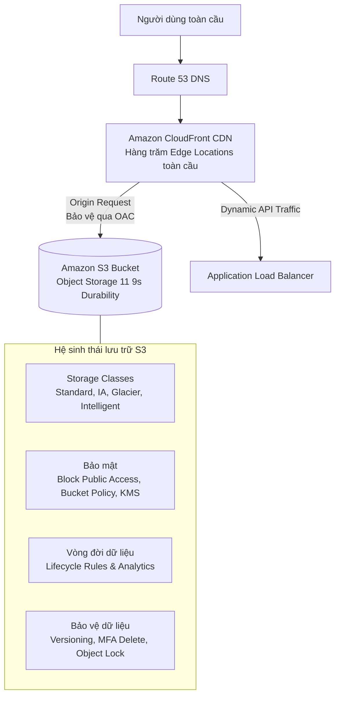
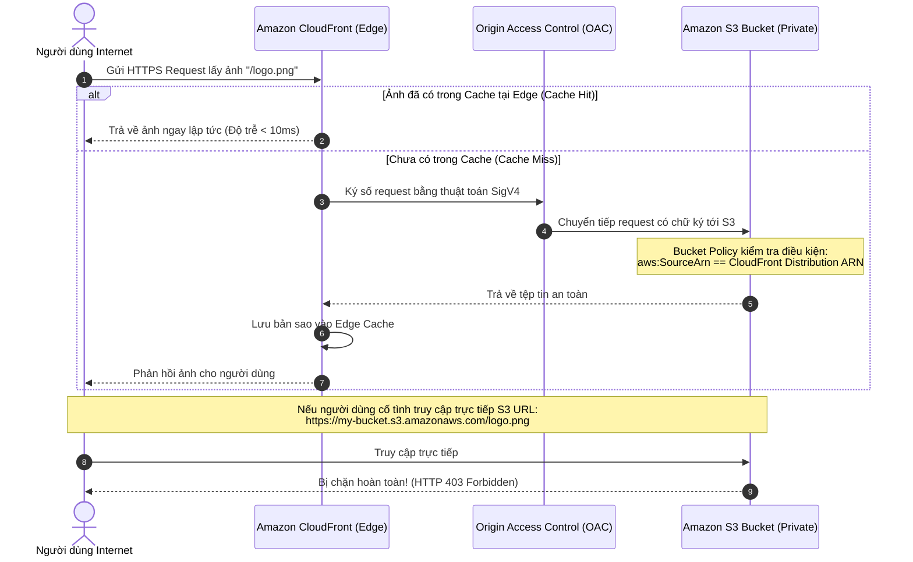

# Tài Liệu Học Tập Chuyên Sâu: Amazon S3 & Amazon CloudFront (Lưu Trữ Đối Tượng, Bảo Mật & Mạng Phân Phối Nội Dung Toàn Cầu)

> **Tài liệu chuẩn hóa kiến trúc đám mây**: Hướng dẫn toàn diện theo tiêu chuẩn Senior AWS Solutions Architect & Cloud DevOps Engineer.  
> **Ngôn ngữ**: Tiếng Việt (Bảo lưu toàn bộ thuật ngữ chuyên ngành tiếng Anh chuẩn AWS).  
> **Các bài giảng liên quan**: Chương 12 (S3 Intro), Chương 13 (Advanced S3), Chương 14 (S3 Security), Chương 15 (CloudFront & Global Accelerator).

---

## 6.1. Tổng Quan Dịch Vụ (Service Overview)

### Dịch vụ gì?
- **Amazon Simple Storage Service (Amazon S3)**: Dịch vụ lưu trữ đối tượng (Object Storage) qua mạng Internet được quản lý toàn diện của AWS, cung cấp khả năng mở rộng vô hạn, tính khả dụng cao và độ bền dữ liệu lên tới **99.999999999% (11 số 9)**.
- **Amazon CloudFront**: Mạng lưới phân phối nội dung toàn cầu (Content Delivery Network - CDN), lưu trữ tạm thời (cache) dữ liệu tại hàng trăm điểm biên (**Edge Locations**) trên khắp thế giới để tăng tốc độ phân phối trang web tĩnh, video, API và các tệp tin media với độ trễ thấp nhất.
- **AWS Global Accelerator**: Dịch vụ mạng giúp tăng tốc hiệu năng ứng dụng toàn cầu bằng cách cung cấp **2 địa chỉ Anycast IP tĩnh** để định tuyến lưu lượng người dùng đi vào mạng cáp quang riêng tốc độ cao (AWS Global Backbone) tại điểm biên gần nhất.

---

## 6.2. Các Khái Niệm và Thành Phần Cốt Lõi (Core Concepts and Components)



### 1. Cấu trúc đối tượng của Amazon S3
- **Buckets (Thùng chứa)**: Thư mục gốc chứa các đối tượng. Tên Bucket là **duy nhất trên toàn cầu (Globally Unique)** trên toàn bộ hệ thống AWS.
- **Objects (Đối tượng)**: Tệp tin lưu trữ trong S3, bao gồm:
  - **Key (Khóa)**: Đường dẫn đầy đủ của tệp (ví dụ: `uploads/2026/avatar.png`). Trong S3 không có khái niệm "thư mục" thật sự; các dấu gạch chéo `/` trong Key chỉ là chuỗi tiền tố (**Prefix**).
  - **Value**: Dữ liệu nội dung của tệp (kích thước từ 0 byte đến **tối đa 5 TB** cho một object đơn lẻ; nếu tải tệp > 5 GB bắt buộc phải dùng **Multi-part Upload**).
  - **Version ID**: Định danh phiên bản khi bật tính năng S3 Versioning.
  - **Metadata**: Cặp khóa-giá trị chứa thông tin hệ thống (Content-Type, Last-Modified) hoặc do người dùng tự định nghĩa.
  - **Tags**: Gắn nhãn để phân loại chi phí hoặc kích hoạt Lifecycle Rules.

### 2. Bảng So Sánh Các Tầng Lưu Trữ S3 (S3 Storage Classes)

| Tầng lưu trữ (Storage Class) | Độ bền (Durability) | Độ sẵn sàng (Availability) | Thời gian lưu tối thiểu | Phí truy xuất dữ liệu | Kịch bản sử dụng tối ưu |
| :--- | :--- | :--- | :--- | :--- | :--- |
| **S3 Standard** | 99.999999999% | 99.99% | Không | Không | Dữ liệu truy cập thường xuyên, website tĩnh, Big Data, phân phối nội dung. |
| **S3 Express One Zone** | 99.999999999% (1 AZ) | 99.95% | Không | Không | **Độ trễ millisecond**, xử lý AI/ML Training, Data Analytics hiệu năng cao nhất. |
| **S3 Intelligent-Tiering** | 99.999999999% | 99.9% | Không | Không (Có phí giám sát nhỏ/object) | Dữ liệu không rõ quy luật truy cập; **tự động chuyển tầng** tiết kiệm tiền mà không làm ảnh hưởng hiệu năng. |
| **S3 Standard-IA** | 99.999999999% | 99.9% | 30 ngày | **Có phí/GB** | Dữ liệu ít truy cập nhưng khi cần phải có ngay lập tức (Disaster Recovery backup). |
| **S3 One Zone-IA** | 99.999999999% (1 AZ) | 99.5% | 30 ngày | **Có phí/GB** | Dữ liệu sao lưu phụ có thể tạo lại được, không chịu được thảm họa mất cả AZ. |
| **S3 Glacier Instant** | 99.999999999% | 99.9% | 90 ngày | Có phí/GB | Lưu trữ lưu trữ y tế, hồ sơ ảnh truy cập 1 lần mỗi quý (lấy dữ liệu trong mili-giây). |
| **S3 Glacier Flexible** | 99.999999999% | 99.99% | 90 ngày | Có phí/GB | Dữ liệu lưu trữ cũ (Expedited: 1-5 phút, Standard: 3-5 giờ, Bulk: 5-12 giờ). |
| **S3 Glacier Deep Archive**| 99.999999999% | 99.99% | 180 ngày | Rẻ nhất AWS | Tuân thủ lưu trữ pháp lý 7-10 năm (Standard: 12 giờ, Bulk: 48 giờ). |

### 3. Vòng Đời Dữ Liệu & Tối Ưu Chi Phí (S3 Lifecycle Rules)
- **Transition Actions**: Tự động chuyển đổi các đối tượng sang tầng lưu trữ rẻ hơn theo thời gian (ví dụ: tạo file ➔ sau 30 ngày chuyển sang Standard-IA ➔ sau 90 ngày chuyển sang Glacier Flexible ➔ sau 365 ngày chuyển sang Deep Archive).
- **Expiration Actions**: Tự động xóa vĩnh viễn các đối tượng cũ hoặc các phiên bản cũ (Noncurrent versions) sau một khoảng thời gian xác định.

### 4. Bảo Vệ Dữ Liệu: Versioning, MFA Delete & Object Lock
- **S3 Versioning**: Khi bật tính năng này, việc ghi đè một tệp tin sẽ tạo ra một phiên bản mới; việc xóa tệp tin sẽ chỉ gắn thêm một thẻ **Delete Marker**. Muốn khôi phục tệp bị xóa nhầm, bạn chỉ cần xóa thẻ Delete Marker.
- **MFA Delete**: Bắt buộc phải cung cấp mã OTP từ thiết bị xác thực đa yếu tố (MFA) của tài khoản Root khi muốn **Xóa vĩnh viễn một Version** hoặc **Tắt tính năng Versioning**. Chặn đứng rủi ro bị hacker hoặc nhân viên bất hảo xóa sạch dữ liệu.
- **S3 Object Lock (Mô hình WORM - Write Once Read Many)**:
  - *Compliance Mode (Chế độ tuân thủ tuyệt đối)*: Không một ai (kể cả tài khoản AWS Root) có thể xóa hoặc sửa file trong suốt thời gian retention đã đặt.
  - *Governance Mode*: Người dùng thông thường không xóa được, nhưng người dùng có quyền IAM đặc biệt (`s3:BypassGovernanceRetention`) có thể xóa hoặc chỉnh sửa.
  - *Legal Hold*: Khóa tệp vô thời hạn phục vụ điều tra pháp lý cho đến khi gỡ cờ.

### 5. Mã Hóa Dữ Liệu Trên Amazon S3 (5 Phương thức)
1. **SSE-S3 (Khóa do AWS quản lý)**: Mã hóa mặc định cho toàn bộ S3 bucket mới (AES-256). Header: `"x-amz-server-side-encryption": "AES256"`.
2. **SSE-KMS (Khóa do AWS KMS quản lý)**: Cung cấp quyền kiểm soát chi tiết và nhật ký kiểm toán qua CloudTrail. Có giới hạn KMS Quota khi tải lượng request cực lớn. Header: `"x-amz-server-side-encryption": "aws:kms"`.
3. **DSSE-KMS (Dual-layer Server-Side Encryption)**: Mã hóa 2 lớp độc lập bằng KMS đáp ứng các tiêu chuẩn bảo mật quốc phòng khắt khe.
4. **SSE-C (Khóa do khách hàng cung cấp)**: Khách hàng tự quản lý khóa mã hóa và truyền khóa vào qua mỗi HTTP Header HTTPS; AWS không bao giờ lưu khóa này.
5. **Client-Side Encryption**: Khách hàng tự mã hóa dữ liệu trên máy tính trước khi gửi lên S3.

### 6. Amazon CloudFront vs AWS Global Accelerator

| Tiêu chuẩn so sánh | Amazon CloudFront | AWS Global Accelerator |
| :--- | :--- | :--- |
| **Bản chất công nghệ** | Mạng phân phối nội dung (**Content Delivery Network - CDN**). | Bộ tăng tốc mạng tầng truyền vận (**Network Accelerator**). |
| **Cơ chế hoạt động** | **Lưu bộ nhớ đệm (Caching)** các nội dung tĩnh (ảnh, video, html) tại Edge Locations. | **Không có Caching**. Chuyển tiếp lưu lượng mạng trực tiếp qua mạng cáp quang riêng của AWS. |
| **Giao thức hỗ trợ** | Tầng ứng dụng: **HTTP, HTTPS, WebSocket**. | Tầng truyền vận: **TCP và UDP**. |
| **Địa chỉ IP** | Sử dụng tên miền DNS động của CloudFront. | Cung cấp **2 địa chỉ Anycast IP tĩnh** cố định toàn cầu. |
| **Kịch bản sử dụng** | Tăng tốc website tĩnh, video streaming, API RESTful có thể cache. | Ứng dụng Game đa người chơi, VoIP, IoT, ứng dụng tài chính cần IP tĩnh và độ trễ cực thấp. |
| **Bảo vệ an ninh** | Tích hợp **AWS WAF** trực tiếp tại điểm biên; bảo vệ chống DDoS bằng AWS Shield. | Tích hợp AWS Shield; bảo vệ địa chỉ IP backend của bạn không bị lộ ra Internet. |

---

## 6.3. Kiến Trúc và Luồng Vận Hành (Architecture and Workflow)

### Sơ đồ bảo vệ S3 Bucket chỉ cho phép CloudFront truy cập bằng OAC (Origin Access Control)



---

## 6.4. Bảng Tích Hợp với Các Dịch Vụ AWS Khác (Integration Table)

| Related AWS Service | Purpose (Mục đích tích hợp) | Integration Method (Phương thức tích hợp) | Practical Example (Ví dụ thực tiễn) |
| :--- | :--- | :--- | :--- |
| **AWS Lambda** | Xử lý dữ liệu hướng sự kiện hoặc biến đổi dữ liệu theo thời gian thực | **S3 Event Notifications** & **S3 Object Lambda** | Khi người dùng tải ảnh lên S3, Lambda tự động được kích hoạt để nén ảnh và tạo ảnh đại diện (Thumbnail). |
| **Amazon Athena** | Chạy truy vấn SQL trực tiếp trên các tệp tin dữ liệu lưu trong S3 | Serverless SQL Query Engine | Phân tích 100GB file log VPC Flow Logs dạng CSV/Parquet lưu trên S3 bằng các câu lệnh `SELECT * FROM logs`. |
| **Amazon SQS / SNS** | Đẩy thông báo sự kiện khi có file mới được tạo hoặc bị xóa | S3 Event Destination | Bắn tin nhắn vào SQS Queue khi có file giao dịch tài chính mới được đẩy vào bucket để worker xử lý. |
| **AWS WAF** | Lọc và chặn lưu lượng web độc hại ngay tại điểm biên trước khi tới S3 | Gắn Web ACL lên CloudFront Distribution | Chặn các cuộc tấn công quét lỗ hổng SQL Injection và chặn các dải IP xấu trước khi chúng chạm tới S3. |

---

## 6.5. Ví Dụ Cấu Hình và Triển Khai Thực Tế (Configuration & CLI Examples)

### 1. Chính sách S3 Bucket Policy chuẩn mực chặn mọi truy cập không dùng HTTPS và chỉ cho phép CloudFront OAC

```json
{
  "Version": "2012-10-17",
  "Statement": [
    {
      "Sid": "EnforceTLSRequestsOnly",
      "Effect": "Deny",
      "Principal": "*",
      "Action": "s3:*",
      "Resource": [
        "arn:aws:s3:::my-secure-production-bucket",
        "arn:aws:s3:::my-secure-production-bucket/*"
      ],
      "Condition": {
        "Bool": {
          "aws:SecureTransport": "false"
        }
      }
    },
    {
      "Sid": "AllowCloudFrontServicePrincipalReadOnly",
      "Effect": "Allow",
      "Principal": {
        "Service": "cloudfront.amazonaws.com"
      },
      "Action": "s3:GetObject",
      "Resource": "arn:aws:s3:::my-secure-production-bucket/*",
      "Condition": {
        "StringEquals": {
          "AWS:SourceArn": "arn:aws:cloudfront::123456789012:distribution/EDFDVBD632BHDS5"
        }
      }
    }
  ]
}
```

### 2. Tải tệp tin lên S3 và tạo Pre-signed URL bằng AWS CLI

```bash
# 1. Tải tệp tin lên S3 sử dụng mã hóa KMS
aws s3 cp financial_report.pdf s3://my-secure-production-bucket/reports/ \
    --sse aws:kms \
    --sse-kms-key-id arn:aws:kms:ap-southeast-1:123456789012:key/xxxx-yyyy

# 2. Tạo một đường link Pre-signed URL cho phép khách hàng tải file trong vòng 30 phút (1800 giây)
aws s3 presign s3://my-secure-production-bucket/reports/financial_report.pdf \
    --expires-in 1800
```

---

## 6.6. Mô Hình Tính Phí Dịch Vụ & Chiến Lược Tối Ưu Chi Phí Theo Từng Use Case (S3 & CloudFront Cost Breakdown & Optimization)

Amazon S3 là dịch vụ lưu trữ giá rẻ, nhưng ở quy mô hàng chục đến hàng trăm Terabytes, các chi phí ẩn như **phí gọi API (Requests)**, **phí truy xuất dữ liệu (Retrieval fees)**, **dữ liệu phân đoạn dở dang (Incomplete Multipart Uploads)** và **phí truyền tải dữ liệu ra Internet (Data Transfer Out)** có thể chiếm phần lớn hóa đơn.

---

### 6.6.1. Bảng Phân Tích Cơ Chế Tính Phí Chi Tiết Của Amazon S3 & CloudFront

| Tầng Lưu Trữ / Dịch Vụ | Phí Lưu Trữ Hàng Tháng (Storage Fee) | Phí Gọi API / Requests | Phí Truy Xuất Dữ Liệu (Data Retrieval) | Thời Gian Lưu Trữ & Kích Thước Tối Thiểu |
| :--- | :--- | :--- | :--- | :--- |
| **S3 Standard** | **$0.023 / GB / tháng** ($23 / TB) | • PUT/POST: $0.005 / 1,000 reqs<br>• GET: $0.0004 / 1,000 reqs | **0$ (Miễn phí truy xuất)** | Không giới hạn thời gian, không giới hạn kích thước tối thiểu. |
| **S3 Intelligent-Tiering** | Tự động chuyển đổi giữa các tầng ($0.023 ➔ $0.0125 ➔ $0.004 ➔ $0.00099) | Tiêu chuẩn như Standard | **0$ (Miễn phí truy xuất)** | Phí giám sát tự động: **$0.0025 / 1,000 objects** (chỉ tính cho files > 128KB). |
| **S3 Standard-IA (Infrequent Access)** | **$0.0125 / GB / tháng** (Rẻ hơn 45% so với Standard) | PUT/POST: $0.01 / 1,000 reqs<br>GET: $0.001 / 1,000 reqs | **$0.01 / GB truy xuất** | • Tối thiểu **30 ngày** (xóa sớm vẫn tính đủ 30 ngày)<br>• Tối thiểu **128 KB** (file 10KB vẫn tính tiền 128KB). |
| **S3 One Zone-IA** | **$0.010 / GB / tháng** (Rẻ hơn 56% so với Standard) | Tương tự Standard-IA | **$0.01 / GB truy xuất** | • Tối thiểu **30 ngày**<br>• Tối thiểu **128 KB** (Lưu trong 1 AZ, rủi ro mất dữ liệu nếu AZ sập). |
| **S3 Glacier Flexible Retrieval** | **$0.0036 / GB / tháng** (Rẻ hơn 84% so với Standard) | Phí nạp/chuyển đổi: $0.03 / 1,000 reqs | • Expedited (1-5m): $0.03/GB<br>• Standard (3-5h): $0.01/GB<br>• Bulk (5-12h): **Miễn phí** | Tối thiểu **90 ngày** lưu trữ. |
| **S3 Glacier Deep Archive** | **$0.00099 / GB / tháng** (**<$1 / TB / tháng** - Rẻ nhất hành tinh!) | Phí nạp: $0.05 / 1,000 reqs | • Standard (12h): $0.02/GB<br>• Bulk (48h): $0.0025/GB | Tối thiểu **180 ngày** lưu trữ. Rút dữ liệu mất từ 12 đến 48 giờ. |
| **Amazon CloudFront** | • **Gói Free Tier vĩnh viễn**: 1 TB Data Transfer Out/tháng + 10,000,000 requests/tháng.<br>• Phí DTO ra Internet: ~$0.085/GB (Mỹ/Âu) đến ~$0.12/GB (Châu Á).<br>• **Truy xuất dữ liệu từ AWS Origin (S3/EC2/ALB) tới CloudFront: 0$ (HOÀN TOÀN MIỄN PHÍ)**.<br>• **Cache Invalidation**: 1,000 paths đầu tiên/tháng miễn phí, sau đó $0.005/path (`/*` tính là 1 path). |

---

### 6.6.2. Chiến Lược Tối Ưu Hóa Chi Phí Theo 5 Kịch Bản Thực Tế (Use Cases Optimization)

#### Use Case 1: Tiêu hủy dữ liệu phân đoạn dở dang (Abort Incomplete Multipart Uploads)
* **Vấn đề & Cạm bẫy chi phí nghiêm trọng**:
  - Khi ứng dụng tải file lớn (> 100MB) lên S3 bằng cơ chế Multipart Upload. Nếu quá trình tải bị đứt mạng hoặc ứng dụng gặp sự cố giữa chừng, các phần dữ liệu đã tải lên (Parts) vẫn nằm âm thầm trong S3 bucket.
  - Các phần này **không hiển thị trong danh sách file thông thường**, nhưng **AWS vẫn tính tiền lưu trữ ở mức giá S3 Standard ($0.023/GB) vĩnh viễn** cho đến khi có lệnh hủy!
  - Nhiều công ty bị mất hàng ngàn USD mỗi tháng chỉ để trả tiền cho các file multipart dở dang tích tụ qua nhiều năm.
* **Giải pháp Tối ưu kiến trúc**:
  - Tạo ngay một quy tắc **S3 Lifecycle Rule** trên tất cả các bucket:
    - Chọn hành động: `Abort incomplete multipart uploads`.
    - Thiết lập số ngày: **7 ngày** (tự động xóa sạch các phần tải dở dang sau 7 ngày).
* **Kết quả tiết kiệm**: Thu hồi hàng Terabytes dung lượng rác, tiết kiệm 100% chi phí lưu trữ cho dữ liệu hỏng.

#### Use Case 2: Tối ưu chi phí Kho dữ liệu Data Lake khổng lồ với S3 Intelligent-Tiering
* **Vấn đề & So sánh chi phí**:
  - Một Data Lake chứa **100 TB** dữ liệu phân tích. Các tệp tin được ghi vào liên tục, một số tệp phân tích thường xuyên trong tuần đầu, sau đó tần suất truy cập giảm dần ngẫu nhiên và không thể dự đoán trước.
  - *Nếu giữ toàn bộ trên S3 Standard*:
    $$\text{Chi phí S3 Standard} = 100,000 \text{ GB} \times 0.023\$ = \mathbf{2,300\$/\text{tháng}}$$
* **Giải pháp Tối ưu kiến trúc**:
  - Cấu hình S3 Lifecycle tự động chuyển toàn bộ đối tượng sang **S3 Intelligent-Tiering** sau khi tải lên.
  - Dữ liệu tự động phân bổ:
    - 20 TB truy cập thường xuyên (Frequent Access Tier): $20,000 \times 0.023\$ = 460\$$
    - 30 TB ít truy cập sau 30 ngày (Infrequent Access Tier): $30,000 \times 0.0125\$ = 375\$$
    - 50 TB không truy cập sau 90 ngày (Archive Instant Access Tier): $50,000 \times 0.004\$ = 200\$$
    - Phí giám sát (Monitoring fee cho ~10 triệu objects): $10,000 \times 0.0025\$ = 25\$$
    $$\text{Tổng chi phí sau tối ưu} = 460\$ + 375\$ + 200\$ + 25\$ = \mathbf{1,060\$/\text{tháng}}$$
* **Kết quả tiết kiệm**: Tiết kiệm ngay **$1,240/tháng (Giảm 54% chi phí)** hoàn toàn tự động mà không lo bị tính phí phạt truy xuất (Zero Retrieval Fees).

#### Use Case 3: Cạm bẫy chuyển đổi tệp tin nhỏ sang S3 Standard-IA (Small Objects Trap)
* **Vấn đề & Sai lầm phổ biến**:
  - Doanh nghiệp có 20 triệu tệp tin nhỏ (mỗi file chỉ khoảng **10 KB**, tổng dung lượng 200 GB) chứa icon và metadata.
  - Kỹ sư viết Lifecycle rule chuyển toàn bộ 20 triệu file sang **S3 Standard-IA** với hy vọng giảm giá lưu trữ từ $0.023 xuống $0.0125/GB.
  - **Hậu quả chi phí ngược (Cost Shock)**:
    1. *Phí gọi lệnh PUT/Lifecycle transition*: $20 \text{ triệu} \times (0.01\$ / 1,000) = \mathbf{200\$}$ ngay lập tức!
    2. *Quy định kích thước tối thiểu của S3 IA*: AWS tự động tính tiền tối thiểu **128 KB cho mỗi file** (dù file chỉ có 10 KB). Do đó, dung lượng tính tiền bị thổi phồng từ 200 GB lên thành: $20,000,000 \times 128 \text{ KB} \approx \mathbf{2,560 \text{ GB}}$!
    3. Hóa đơn lưu trữ thực tế trên IA: $2,560 \times 0.0125\$ = \mathbf{32\$/\text{tháng}}$ (trong khi để ở Standard chỉ tốn $200 \times 0.023\$ = \mathbf{4.60\$/\text{tháng}}$!).
* **Bài học kiến trúc**:
  - Tuyệt đối **KHÔNG chuyển đổi các tệp tin có kích thước < 128 KB sang S3 Standard-IA hoặc One Zone-IA**.
  - Đối với tệp tin nhỏ: Giữ nguyên ở S3 Standard, hoặc gom nhóm (Gzip, Tar, Parquet) thành các file lớn trước khi đẩy lên S3.

#### Use Case 4: Giảm tải phí Băng thông Internet bằng CloudFront Caching (Origin Offload)
* **Vấn đề & Cách tính tiền cũ**:
  - Website phân phối hình ảnh/video trực tiếp từ S3 ra Internet với lưu lượng 50 TB/tháng.
  - Phí Data Transfer Out trực tiếp từ S3 ra Internet:
    $$\text{Chi phí S3 DTO} = 50,000 \text{ GB} \times 0.09\$ = \mathbf{4,500\$/\text{tháng}}$$
    $$\text{Phí S3 GET requests (100 triệu lượt)} = 100,000 \times 0.0004\$ = 40.00\$$$
* **Giải pháp Tối ưu kiến trúc**:
  - Đặt **Amazon CloudFront** ở phía trước S3 Bucket, kết nối qua **Origin Access Control (OAC)**:
    1. Dữ liệu từ S3 chuyển tới CloudFront Edge Locations là **0$ (Hoàn toàn Miễn phí)**.
    2. Với tỷ lệ Cache Hit Ratio đạt 80%, chỉ có 10 TB thực sự phải quay về Origin S3.
    3. Đăng ký gói **CloudFront Security Savings Bundle** để được chiết khấu thêm tới 30% chi phí phân phối nội dung ra ngoài Internet.
* **Kết quả tiết kiệm**: Tiết kiệm hơn **$1,500/tháng (giảm > 33% chi phí)** đồng thời giảm tải 80% số lượng request vào S3 và tăng tốc độ tải file cho người dùng toàn cầu.

#### Use Case 5: Tối ưu chi phí Xóa Cache CloudFront (Invalidation vs Versioning)
* **Vấn đề & Cách tính tiền cũ**:
  - Đội ngũ CI/CD mỗi khi deploy phiên bản frontend mới lại gọi lệnh invalidation toàn bộ từng file: `aws cloudfront create-invalidation --paths /app/file1.js /app/file2.js ...` (10,000 files).
  - 1,000 file đầu tiên miễn phí, 9,000 file còn lại tốn: $9,000 \times 0.005\$ = \mathbf{45\$/\text{lần deploy}}$. Mỗi ngày deploy 4 lần tốn gần **$5,400/tháng** chỉ tiền xóa cache!
* **Giải pháp Tối ưu**:
  - Sử dụng cơ chế **File Versioning / Hash Naming** trong bản build frontend (ví dụ `app.8f3a1b.js`). Khi có bản mới, tên file tự thay đổi, CloudFront tự động tải file mới mà không cần invalidate.
  - Nếu bắt buộc phải xóa cache file HTML gốc: Chỉ invalidate đúng 1 đường dẫn duy nhất chứa ký tự đại diện: `/*` hoặc `/index.html` (**Tính là 1 path = 0$ hoàn toàn miễn phí**).
* **Kết quả tiết kiệm**: Cắt giảm 100% chi phí xóa cache phát sinh.

---

## 6.7. Khắc Phục Sự Cố Thực Tế (Troubleshooting Guide)

| Vấn đề (Problem) | Nguyên nhân khả dĩ (Possible Causes) | Các bước điều tra (Investigation Steps) | Giải pháp (Solution) | Biện pháp phòng ngừa (Prevention) |
| :--- | :--- | :--- | :--- | :--- |
| **Lỗi `HTTP 403 Forbidden` khi truy cập tệp tin trên S3** | 1. Bật tính năng S3 Block Public Access.<br>2. Bucket Policy thiếu quyền cho phép.<br>3. File mã hóa bằng KMS nhưng caller thiếu quyền `kms:Decrypt`. | 1. Kiểm tra tab Permissions -> Block Public Access.<br>2. Kiểm tra Bucket Policy.<br>3. Kiểm tra KMS Key Policy. | Thêm quyền đọc trong Bucket Policy và cấp quyền giải mã KMS cho caller. | Luôn kiểm tra quyền truy cập bằng IAM Policy Simulator. |
| **Người dùng ở trình duyệt gặp lỗi `CORS (Cross-Origin Resource Sharing)`** | S3 bucket chưa cấu hình CORS cho phép domain gọi chéo (Cross-origin) gọi vào. | Mở Developer Tools trên trình duyệt xem thông báo `No 'Access-Control-Allow-Origin' header is present`. | Vào cấu hình S3 Bucket -> Permissions -> Thêm cấu hình CORS JSON cho phép Origin của website. | Cấu hình đúng `AllowedOrigins` và `AllowedMethods` (GET, PUT). |
| **Vừa cập nhật file trên S3 nhưng người dùng qua CloudFront vẫn thấy file cũ** | CloudFront vẫn đang lưu giữ bản sao cũ trong **Edge Cache** (chưa hết thời gian TTL). | Kiểm tra cài đặt TTL trên Cache Behavior của CloudFront. | Tạo một lệnh **Cache Invalidation** trên CloudFront (ví dụ: path `/*` hoặc `/index.html`) để xóa cache ngay. | Đặt tên file kèm mã băm phiên bản (ví dụ: `style.v2.css`) thay vì ghi đè file cũ. |
| **Tốc độ tải tệp tin lớn lên S3 rất chậm hoặc thường xuyên bị đứt kết nối** | Đang sử dụng phương thức PUT đơn luồng thông thường thay vì tải đa luồng phân đoạn. | Xem dung lượng file tải lên có vượt quá 100MB không. | Bật tính năng **Multi-part Upload** và cân nhắc sử dụng **S3 Transfer Acceleration**. | Cấu hình AWS CLI với tham số tối ưu `max_concurrent_requests`. |

---

## 6.8. Bộ Câu Hỏi Ôn Tập và Kiểm Tra Kiến Thức (Knowledge Review)

### A. 10 Câu hỏi Cốt lõi (Core Concepts)
1. Độ bền vững dữ liệu (Durability) của dịch vụ lưu trữ Amazon S3 Standard đạt con số tiêu chuẩn là bao nhiêu?
2. Kích thước tối đa cho phép của một đối tượng (Object) đơn lẻ có thể lưu trữ trong Amazon S3 là bao nhiêu, và ở kích thước nào AWS bắt buộc phải sử dụng Multi-part Upload?
3. Tính năng nào của Amazon S3 cho phép tự động chuyển đổi đối tượng sang các tầng lưu trữ rẻ hơn mà người dùng không cần phải dự đoán quy luật truy cập dữ liệu?
4. Chế độ nào của **S3 Object Lock** đảm bảo rằng ngay cả tài khoản quản trị tối cao AWS Root Account cũng không thể xóa hay ghi đè tệp tin trong suốt thời gian bảo vệ?
5. Sự khác biệt cốt lõi nhất giữa **Amazon CloudFront** và **AWS Global Accelerator** là gì?
6. Cơ chế nào được AWS khuyến nghị sử dụng hiện nay để bảo vệ an toàn cho S3 Bucket làm Origin, chỉ cho phép duy nhất CloudFront truy cập vào (thay thế cho cơ chế cũ OAI)?
7. Làm thế nào bạn có thể cấp quyền tạm thời cho một khách hàng không có tài khoản AWS để họ có thể tải lên một video có dung lượng 2GB vào một S3 Bucket riêng tư của bạn?
8. Hai tầng lưu trữ nào của Amazon S3 chỉ lưu trữ dữ liệu tại **duy nhất một Availability Zone (Single AZ)** thay vì tối thiểu 3 AZs?
9. Khi bạn xóa một đối tượng trong một S3 Bucket đã được bật tính năng **Versioning**, hành động gì thực sự diễn ra bên dưới?
10. Mục đích chính của việc thực hiện thao tác **CloudFront Cache Invalidation** là gì?

---

### Đáp án Bộ Câu Hỏi Ôn Tập (Answer Key)

<details>
<summary>👉 Nhấp vào đây để xem toàn bộ đáp án chi tiết</summary>

1. **99.999999999% (11 số 9)**.
2. Kích thước tối đa của một Object là **5 TB**. Bắt buộc phải sử dụng **Multi-part Upload** khi đối tượng có dung lượng **vượt quá 5 GB** (và AWS khuyến nghị nên dùng cho mọi tệp tin lớn hơn 100 MB để tăng tốc độ truyền tải).
3. **S3 Intelligent-Tiering**.
4. **Compliance Mode (Chế độ tuân thủ)**.
5. **CloudFront** là mạng phân phối nội dung có khả năng lưu trữ bộ nhớ đệm (**Caching**) cho nội dung web và media tại điểm biên; trong khi **AWS Global Accelerator** là bộ tăng tốc mạng tầng truyền vận (Layer 4 TCP/UDP) **không có tính năng Caching**, sử dụng 2 địa chỉ Anycast IP tĩnh để chuyển tiếp dữ liệu thẳng vào mạng trục AWS.
6. **Origin Access Control (OAC)** (thay thế cho cơ chế Origin Access Identity - OAI cũ).
7. Tạo một **S3 Pre-signed URL** với quyền HTTP `PUT` và thiết lập thời gian hết hạn (ví dụ: 60 phút) rồi gửi đường link đó cho khách hàng.
8. **S3 One Zone-IA** và **S3 Express One Zone**.
9. AWS **không xóa vĩnh viễn dữ liệu**, mà sẽ chèn thêm một phiên bản mới gọi là **Delete Marker** (thẻ đánh dấu đã xóa). Khi truy vấn thông thường, tệp tin sẽ biến mất; nhưng người dùng có thể khôi phục lại bất kỳ lúc nào bằng cách xóa bỏ thẻ Delete Marker đó.
10. Dùng để **xóa bỏ cưỡng bức** các bản sao tệp tin cũ đang được lưu tạm (cache) tại các điểm biên Edge Locations của CloudFront, buộc CloudFront phải quay về Origin lấy tệp tin phiên bản mới nhất cho người dùng.
</details>

---

## 6.9. Tóm Tắt và Danh Mục Kiểm Tra Kiến Thức (Summary & Learning Checklist)

### 5 Khái niệm quan trọng nhất phải nhớ:
1. **S3 Durability 11 9s**: Đạt được nhờ cơ chế nhân bản dữ liệu tự động xuyên qua tối thiểu 3 Availability Zones.
2. **S3 Lifecycle Rules & Intelligent-Tiering**: Chìa khóa tự động hóa tối ưu chi phí lưu trữ cho Data Lake và Backup.
3. **Bảo mật S3 đa tầng**: Block Public Access, Bucket Policies, Encryption at Rest (SSE-KMS/SSE-S3), và Pre-signed URLs.
4. **CloudFront OAC**: Luôn khóa chặt S3 Origin và chỉ mở cửa cho CloudFront thông qua Origin Access Control.
5. **CloudFront (Caching Content) vs Global Accelerator (Anycast IP Proxy)**: Chọn CloudFront cho web/media; chọn Global Accelerator cho game, UDP, IP tĩnh và độ trễ raw network.

### Liên kết và Chủ đề tiếp theo:
- 📖 [Ghi Chú Bài Học Chương 12-14: Amazon S3 Toàn Tập](file:///n:/AWS_XBrain_Note/Lesson_Notes/12_13_14_Amazon_S3_Comprehensive.md)
- 📖 [Ghi Chú Bài Học Chương 15: CloudFront & Global Accelerator](file:///n:/AWS_XBrain_Note/Lesson_Notes/15_CloudFront_Global_Accelerator.md)
- 📖 [Bảng Thuật Ngữ Kỹ Thuật (GLOSSARY.md)](file:///n:/AWS_XBrain_Note/GLOSSARY.md)
- ⏭️ Tiếp tục chuyển sang chuyên đề: **Kiến Trúc Tách Rời Ứng Dụng: Amazon SQS, SNS & EventBridge**.
