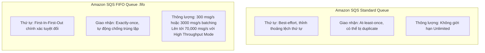
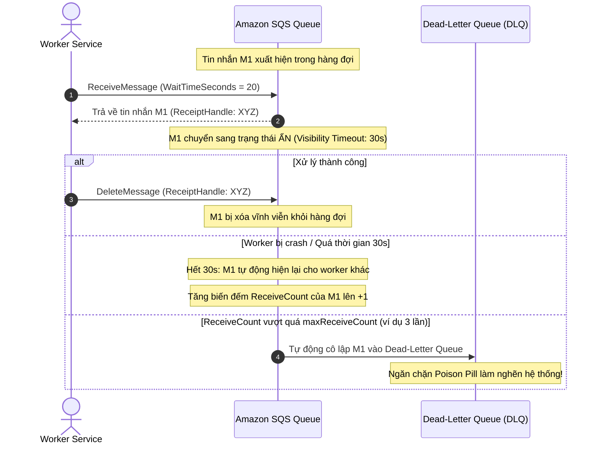
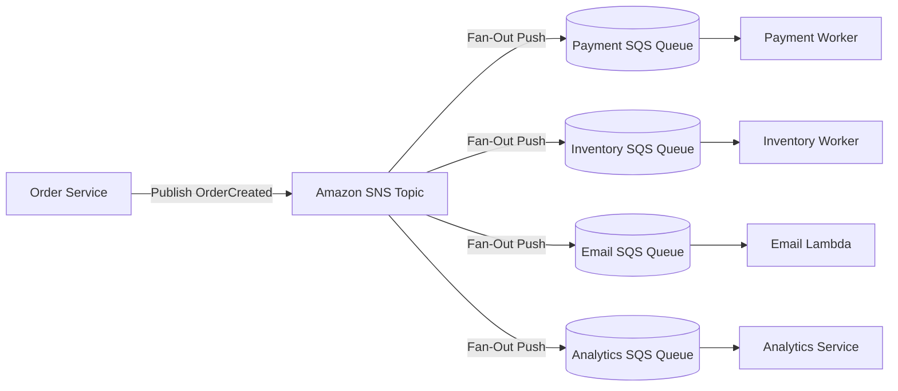
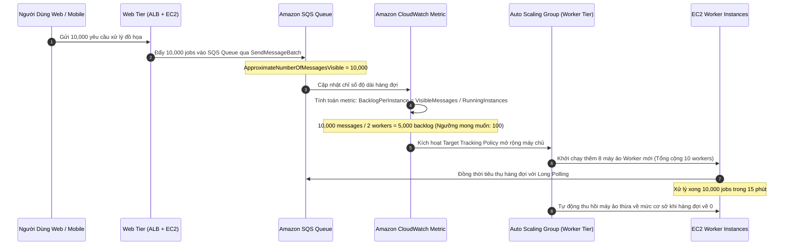

# Tài Liệu Học Tập Chuyên Sâu: Amazon SQS, SNS, EventBridge & Kinesis (Kiến Trúc Tách Rời & Hướng Sự Kiện)

> **Tài liệu chuẩn hóa kiến trúc đám mây**: Hướng dẫn toàn diện theo tiêu chuẩn Senior AWS Solutions Architect & Cloud DevOps Engineer (cập nhật mới nhất 2026).  
> **Ngôn ngữ**: Tiếng Việt (Bảo lưu toàn bộ thuật ngữ chuyên ngành tiếng Anh chuẩn AWS).  
> **Các dịch vụ liên quan**: Amazon SQS, Amazon SNS, Amazon EventBridge, Amazon Kinesis, Amazon MQ, Amazon AppFlow.

---

## 1. Tổng Quan Dịch Vụ (Service Overview)

### Dịch vụ gì?
Trong kiến trúc phần mềm phân tán, việc kết nối trực tiếp đồng bộ (Tight Coupling) giữa các dịch vụ là nguyên nhân hàng đầu dẫn đến sự cố sập đổ dây chuyền (Cascading Failures) và nghẽn cổ chai khi lưu lượng tăng đột biến. AWS cung cấp bộ giải pháp **Tách rời ứng dụng (Application Decoupling)** và **Kiến trúc hướng sự kiện (Event-Driven Architecture)** gồm:
1. **Amazon Simple Queue Service (Amazon SQS)**: Dịch vụ hàng đợi thông điệp (Message Queue) được quản lý toàn diện theo mô hình điểm-điểm (**Point-to-Point**), lưu trữ tạm thời các tin nhắn giữa bên gửi (Producer) và bên nhận (Consumer) với khả năng co giãn gần như vô hạn.
2. **Amazon Simple Notification Service (Amazon SNS)**: Dịch vụ thông báo và phát tán tin nhắn theo mô hình Xuất bản / Đăng ký (**Publish / Subscribe - Pub/Sub**), cho phép một Publisher gửi thông điệp tới hàng ngàn Subscribers cùng lúc (**Fan-Out Pattern**).
3. **Amazon EventBridge**: Bus sự kiện phi máy chủ (Serverless Event Bus) định tuyến các sự kiện từ ứng dụng nội bộ, dịch vụ AWS và ứng dụng SaaS bên ngoài (Datadog, Shopify, Zendesk) bằng bộ lọc JSON filter pattern thông minh, tích hợp sẵn **EventBridge Pipes** và **EventBridge Scheduler**.
4. **Amazon Kinesis**: Nền tảng tiếp nhận, đệm và xử lý dữ liệu phát trực tuyến theo thời gian thực (Real-time Streaming Data) ở quy mô cực lớn (hàng triệu bản ghi mỗi giây).
5. **Amazon MQ**: Dịch vụ môi giới tin nhắn được quản lý hỗ trợ các giao thức chuẩn công nghiệp (Apache ActiveMQ và RabbitMQ: MQTT, AMQP, STOMP) phục vụ cho việc di chuyển ứng dụng cũ (Legacy Migration) lên đám mây mà không cần tái cấu trúc mã nguồn.

---

## 2. Các Khái Niệm, Kiến Trúc & Vận Hành Cốt Lõi (Core Concepts, Security & Day-2 Operations)

### 1. Phân Tích Chi Tiết Amazon SQS: Standard vs FIFO Queues



- **Amazon SQS Standard Queue**:
  - Không giới hạn thông lượng tin nhắn mỗi giây (Unlimited Throughput).
  - Đảm bảo giao nhận **Tối thiểu một lần (At-least-once Delivery)**: Đôi khi consumer có thể nhận được 2 bản sao của cùng một tin nhắn do cơ chế phân tán của AWS.
  - Thứ tự tin nhắn là **Best-effort**: Thứ tự có thể bị xáo trộn nhẹ nếu tin nhắn đến dồn dập.
- **Amazon SQS FIFO Queue**:
  - Tên hàng đợi **bắt buộc phải kết thúc bằng hậu tố `.fifo`** (ví dụ: `payment-orders.fifo`).
  - Đảm bảo thứ tự nghiêm ngặt **First-In, First-Out** và xử lý **Đúng duy nhất một lần (Exactly-once Processing)** (`TD-Set1 Q40`, `TD-Set4 Q14`).
  - Cơ chế chống trùng lặp dựa trên **Message Deduplication ID** (hoặc Content-Based Deduplication băm nội dung SHA-256 trong khoảng thời gian cửa sổ 5 phút) (`TD-Set1 Q40`).
  - Phân nhóm tin nhắn bằng **Message Group ID**: Cho phép xử lý song song các nhóm khách hàng/đơn hàng khác nhau mà vẫn đảm bảo thứ tự tuyệt đối cho từng nhóm riêng lẻ (`TD-Set4 Q14`).
  - Hỗ trợ kiến trúc tách rời lai (**Hybrid Decoupled Architecture**): Hàng đợi SQS có thể được poll an toàn qua HTTPS từ các tiến trình chạy trên Amazon EC2, Amazon ECS containers, hoặc các máy chủ on-premises trong trung tâm dữ liệu truyền thống (`TD-Set2 Q13`).

---

### 2. Các Cơ Chế Vận Hành Sống Còn của Amazon SQS



- **Visibility Timeout (Thời gian ẩn tin nhắn)**:
  - Khi một consumer nhận được tin nhắn, tin nhắn không bị xóa ngay mà tạm thời ẩn đi (mặc định 30 giây) để các consumer khác không đọc trùng.
  - Consumer phải chủ động gọi `DeleteMessage` kèm theo chuỗi `ReceiptHandle` sau khi xử lý xong.
  - **Kỹ thuật xử lý tác vụ kéo dài**: Nếu tác vụ xử lý tin nhắn tốn nhiều thời gian hơn mức thiết lập mặc định (ví dụ xử lý tốn 2 phút trong khi visibility timeout là 30 giây), tin nhắn sẽ xuất hiện trở lại và bị worker khác xử lý trùng lặp! Để khắc phục, worker consumer phải chủ động gọi API **`ChangeMessageVisibility`** để gia hạn thêm thời gian trước khi visibility timeout hết hạn (`TD-Set3 Q10`).
- **Dead-Letter Queue (DLQ) & DLQ Redrive**:
  - Khi một tin nhắn bị lỗi cú pháp hoặc mã nguồn bị bug khiến worker bị crash liên tục, tin nhắn sẽ bị nhận lại nhiều lần.
  - Khi số lần nhận vượt quá `maxReceiveCount` (ví dụ: 3 - 5 lần), SQS tự động chuyển tin nhắn sang Dead-Letter Queue (DLQ) để cô lập "viên thuốc độc" (**Poison Pill**) tránh làm treo toàn bộ worker fleet (`TD-Set2 Q47`).
  - Tính năng **DLQ Redrive** cho phép quản trị viên điều tra lỗi, cập nhật mã nguồn ứng dụng, và đẩy toàn bộ tin nhắn lỗi từ DLQ quay trở lại hàng đợi chính chỉ bằng 1 thao tác click chuột hoặc CLI.
- **Short Polling vs Long Polling**:
  - *Short Polling (`WaitTimeSeconds = 0`)*: Trả lời ngay lập tức dù hàng đợi rỗng, gây lãng phí hàng triệu API calls rỗng.
  - *Long Polling (`WaitTimeSeconds = 1 đến 20`)*: SQS giữ kết nối tối đa 20 giây chờ có tin nhắn mới rồi mới trả về, giúp tiết kiệm 99% chi phí API và giảm độ trễ phản hồi.

---

### 3. Mô Hình Fan-Out Pattern (SNS kết hợp SQS)



- **Nguyên lý Fan-Out**: Một thông điệp xuất bản vào SNS Topic được tự động nhân bản và đẩy song song vào nhiều hàng đợi SQS độc lập (`TD-Set5 Q64`).
- **Lợi ích**:
  - Tách rời hoàn toàn nhà xuất bản khỏi các đối tượng tiêu thụ.
  - Nếu một dịch vụ bị lỗi (ví dụ Email Service bị sập), các tin nhắn vẫn nằm an toàn trong Email SQS Queue mà không làm ảnh hưởng đến dịch vụ thanh toán hay trừ kho.
  - Áp dụng **SNS Subscription Filter Policy**: Thiết lập bộ lọc trên các Message Attributes (ví dụ: `event_type = "ORDER_COMPLETED"` hoặc `quote_type = "CAR_INSURANCE"`), giúp từng SQS queue chỉ nhận đúng luồng tin nhắn phù hợp mà không cần viết mã Lambda trung gian (`TD-Set2 Q36`).

---

### 4. Amazon EventBridge: Event Bus, Pipes & Scheduler

- **Amazon EventBridge Event Bus**:
  - Bus sự kiện định tuyến các event dựa trên cấu trúc JSON pattern:
    ```json
    {
      "source": ["ecommerce.orders"],
      "detail-type": ["OrderPlaced"],
      "detail": {
        "status": ["PAID"],
        "total": [{ "numeric": [">", 500] }]
      }
    }
    ```
- **EventBridge Pipes**:
  - Cung cấp kết nối điểm-điểm (Point-to-Point) tích hợp sẵn giữa Nguồn (Source: DynamoDB Streams, Kinesis, SQS) và Đích (Target: Step Functions, Lambda, API Destinations) với các bước lọc (**Filtering**) và làm giàu dữ liệu (**Enrichment**) mà không cần viết mã nguồn trung gian.
- **EventBridge Scheduler**:
  - Dịch vụ đặt lịch tác vụ phi máy chủ thế hệ mới, cho phép lập lịch hàng triệu tác vụ định kỳ (Cron/Rate) hoặc tác vụ kích hoạt một lần duy nhất (**One-time Schedules**) với độ trễ thấp và độ tin cậy cao.

---

### 5. Amazon AppFlow (Tích Hợp Dữ Liệu SaaS Không Cần Viết Code)
- **Bản chất:** Dịch vụ tích hợp hoàn toàn được quản lý (Fully Managed) cho phép tự động hóa luồng truyền dữ liệu 2 chiều bảo mật giữa các ứng dụng **SaaS** (như Salesforce, ServiceNow, SAP, Zendesk, Marketo, Slack, Google Analytics) và các dịch vụ AWS (như **Amazon S3, Amazon Redshift**) mà **không cần viết code**.
- **Tính năng nổi bật:**
  - Hỗ trợ chạy theo lịch (Scheduled), theo sự kiện (Event-triggered) hoặc theo yêu cầu (On-demand), đồng thời tích hợp sẵn khả năng lọc (filtering), ánh xạ trường dữ liệu (mapping), che giấu dữ liệu nhạy cảm (masking) và xác thực (validation).
  - Tích hợp trực tiếp với **AWS PrivateLink** để truyền dữ liệu từ các đối tác SaaS hỗ trợ PrivateLink (như Salesforce, Trend Micro, Snowflake) vào thẳng VPC/S3/Redshift mà **không đi qua mạng Internet công cộng**.
- **Bẫy thi SAA-C03:** Khi gặp bài toán *"Ingest dữ liệu khách hàng từ Salesforce hoặc phiếu hỗ trợ từ ServiceNow/Zendesk vào S3 hoặc Redshift định kỳ/theo sự kiện một cách bảo mật (qua PrivateLink) với LEAST development effort"* -> Chọn **Amazon AppFlow** (không dùng Lambda tự viết API poller hay AWS DMS).

#### So Sánh: Amazon EventBridge vs Amazon AppFlow

| Tiêu chí | Amazon EventBridge | Amazon AppFlow |
| :--- | :--- | :--- |
| **Bản chất** | Serverless **Event Bus** chuyên định tuyến các **sự kiện (Events)** nhỏ thời gian thực | Dịch vụ tích hợp truyền tải **luồng dữ liệu lớn (Bulk / Incremental Data Transfer)** 2 chiều |
| **Quy mô dữ liệu** | Payload nhỏ (tối đa 256 KB cho mỗi sự kiện JSON) | Dữ liệu lớn (hàng Gigabytes / Terabytes dữ liệu bảng, đối tượng) |
| **Mục đích chính** | Kích hoạt tác vụ (Event-driven): Lambda, Step Functions, SNS khi có sự kiện thay đổi trạng thái | Đồng bộ và nạp dữ liệu (Data Ingestion/Sync): Ingest dữ liệu SaaS vào S3 Data Lake, Redshift Data Warehouse |
| **Bảo mật kết nối** | HTTPS / VPC Endpoints | Tích hợp gốc với **AWS PrivateLink** cho kết nối SaaS riêng tư không qua Internet |
| **Lập trình** | Yêu cầu định nghĩa JSON filter patterns | Giao diện kéo thả No-Code: mapping trường, filtering, data masking tự động |

---

### 🏛️ I. Các Kịch Bản Kiến Trúc Chuẩn (Best Practice Scenarios)

#### 1. Đảm Bảo Thứ Tự Tuyệt Đối & Chống Trùng Lặp Bằng SQS FIFO Queues
- **Tình huống thi**: Ứng dụng ngân hàng giao dịch tài chính hoặc hệ thống đặt vé xem phim trực tuyến yêu cầu các lệnh đặt hàng phải được xử lý chính xác theo đúng thứ tự gửi đến (First-In, First-Out) và tuyệt đối không được phép có tin nhắn xử lý lặp lại (No Duplicates).
- **Giải pháp tối ưu chuẩn AWS**:
  - Khởi tạo hàng đợi **Amazon SQS FIFO Queue** (tên hàng đợi bắt buộc có đuôi `.fifo`).
  - **Cơ chế chống trùng lặp (Exactly-Once Processing)**: Sử dụng **Message Deduplication ID** (hoặc kích hoạt tính năng Content-Based Deduplication sử dụng thuật toán hash SHA-256). Các tin nhắn gửi trong khoảng thời gian cửa sổ 5 phút (5-minute deduplication interval) mang cùng deduplication ID sẽ bị loại bỏ tự động.
  - **Cơ chế gom nhóm xử lý tuần tự**: Sử dụng **Message Group ID**: Các tin nhắn trong cùng một Group ID sẽ được xử lý tuần tự nghiêm ngặt, trong khi các Group ID khác nhau có thể được xử lý song song đồng thời bởi nhiều worker.

#### 2. Tăng Tốc Thông Lượng SQS FIFO Lên Tới 70,000 Tin Nhắn/Giây
- **Tình huống thi**: Ứng dụng thanh toán quy mô lớn sử dụng SQS FIFO nhưng gặp giới hạn thông lượng mặc định của hàng đợi FIFO là 300 giao dịch/giây (Transactions Per Second - TPS).
- **Giải pháp chuẩn**:
  - **Kỹ thuật Batching**: Gửi hoặc nhận tin nhắn theo lô (tối đa 10 tin nhắn/lô) -> Nâng thông lượng lên **3,000 tin nhắn/giây**.
  - **Kích hoạt High Throughput Mode for FIFO Queues**: Chuyển đổi sang chế độ Deduplication Scope theo Group ID và FIFO Throughput Limit theo từng Message Group ID -> Mở rộng thông lượng co giãn lên tới **70,000 tin nhắn/giây**!

#### 3. Mô Hình Kiến Trúc Fan-Out (Amazon SNS + Nhiều Hàng Đợi Amazon SQS)
- **Tình huống thi**: Khi người dùng tải lên một video mới, video đó cần được xử lý đồng thời bởi 3 dịch vụ độc lập: (1) Dịch vụ tạo ảnh đại diện Thumbnail, (2) Dịch vụ trích xuất phụ đề AI, và (3) Dịch vụ quét nội dung vi phạm bản quyền. Nếu 1 dịch vụ bị lỗi, 2 dịch vụ còn lại không được phép bị ảnh hưởng.
- **Giải pháp chuẩn**:
  - Khi có sự kiện upload, ứng dụng xuất bản một thông điệp duy nhất vào **Amazon SNS Topic**.
  - Tạo **3 SQS Queues riêng biệt** đại diện cho 3 dịch vụ và đăng ký (Subscribe) cả 3 queues này vào cùng một SNS Topic.
  - SNS tự động nhân bản (**Fan-Out**) thông điệp thành 3 bản gửi vào 3 hàng đợi. Mỗi worker xử lý với tốc độ riêng của mình và có hàng đợi DLQ riêng nếu gặp lỗi.

#### 4. Trì Hoãn Thời Gian Xử Lý Tin Nhắn Bằng SQS Delay Queues
- **Tình huống thi**: Ứng dụng cần hoãn việc xử lý đơn hàng mới trong vòng 10 phút sau khi người dùng đăng ký để cho phép người dùng có thời gian chỉnh sửa thông tin hoặc hủy đơn.
- **Giải pháp chuẩn**:
  - Sử dụng tính năng **SQS Delay Queues**: Cấu hình tham số `DelaySeconds` (tối đa 900 giây / 15 phút, mặc định là 0).
  - Mọi tin nhắn gửi vào hàng đợi sẽ ở trạng thái vô hình (Invisible) đối với các workers trong suốt khoảng thời gian Delay này và chỉ xuất hiện sẵn sàng để poll sau khi hết thời gian hoãn.

---

### 🪤 II. Các Bẫy Thi Tinh Vi & Phân Tích Phương Án Sai (Exam Traps & Distractors)

#### 🪤 Bẫy 1: Phân Ưu Tiên Tin Nhắn SQS — Multiple Queues, KHÔNG phải FIFO — (U-PT6 Q20)
- **Tình huống đề thi**: *"Hệ thống xử lý tin nhắn cần phân tầng ưu tiên (tin nhắn từ khách hàng VIP/Pro được xử lý ngay lập tức trước tin nhắn của khách hàng miễn phí/Lite). Giải pháp SQS nào đúng?"*
- **Bẫy thi cực kỳ phổ biến**: Chọn SQS FIFO vì nghĩ FIFO = "ưu tiên thứ tự". **SAI HOÀN TOÀN** — FIFO chỉ đảm bảo First-In-First-Out theo thời gian gửi, hoàn toàn không có khái niệm độ ưu tiên giữa các tin nhắn.
- **Giải pháp ĐÚNG (Priority Queue Pattern)**:
  - Tạo **2 SQS Standard Queue riêng biệt**: `pro-queue` và `lite-queue`.
  - Cấu hình worker (EC2 hoặc Lambda): **Luôn poll `pro-queue` trước**, chỉ khi `pro-queue` hoàn toàn trống mới chuyển sang poll `lite-queue`.

#### 🪤 Bẫy 2: Migrate Hệ Thống SFTP Truyền Thống Lên AWS — AWS Transfer Family — (U-PT2 Q04)
- **Tình huống đề thi**: *"Ứng dụng on-premises sử dụng giao thức SFTP để truyền các tệp báo cáo đối tác. Doanh nghiệp cần di chuyển kho lưu trữ lên AWS S3 mà không phải sửa đổi mã nguồn client của đối tác và không muốn quản lý máy chủ."*
- **Các phương án bẫy**:
  - ❌ *Tự dựng EC2 cài OpenSSH SFTP server*: Tốn công vá lỗi OS, quản trị máy chủ, rủi ro bảo mật.
  - ❌ *Dùng AWS DataSync*: DataSync là công cụ đồng bộ dữ liệu định kỳ, không cung cấp giao diện endpoint SFTP cho các client bên ngoài kết nối.
- **Giải pháp ĐÚNG**: Sử dụng **AWS Transfer Family**.
  - Dịch vụ Fully-Managed cung cấp endpoint SFTP/FTPS/FTP chuẩn.
  - Các client kết nối vào SFTP endpoint như bình thường, AWS Transfer Family tự động chuyển đổi và lưu trữ tệp trực tiếp vào **Amazon S3** hoặc **Amazon EFS**.

#### 🪤 Bẫy 3: Các Giao Thức Chuẩn Ngành AMQP / MQTT / JMS — Amazon MQ, KHÔNG phải SQS — (U-PT2 Q33)
- **Tình huống đề thi**: *"Doanh nghiệp chuyển đổi ứng dụng sử dụng RabbitMQ hoặc Apache ActiveMQ lên AWS mà không muốn tái cấu trúc lại mã nguồn giao thức."*
- **Nguyên lý bất biến**:
  - Amazon SQS là dịch vụ độc quyền của AWS, sử dụng giao thức HTTPS và AWS SDK riêng. SQS **HOÀN TOÀN KHÔNG HỖ TRỢ** các giao thức nhắn tin chuẩn ngành như: **AMQP, MQTT, STOMP, OpenWire, hay JMS**.
  - **Giải pháp ĐÚNG**: Sử dụng **Amazon MQ** (dịch vụ message broker được quản lý hỗ trợ Apache ActiveMQ và RabbitMQ).

#### 🪤 Bẫy 4: Chuyển Đổi Lưu Lượng Tức Thì Bypass DNS Cache — Global Accelerator Traffic Dial — (U-PT2 Q43, CM-PT1 Q40)
- **Tình huống đề thi**: *"Doanh nghiệp cần triển khai Blue-Green toàn cầu, yêu cầu chuyển đổi hoặc rollback 100% lưu lượng sang môi trường mới trong vài giây mà không bị cản trở bởi việc lưu cache DNS của các client."*
- **Giải pháp ĐÚNG**: Sử dụng **AWS Global Accelerator với Traffic Dial**.
  - Route 53 phụ thuộc vào DNS caching của client và ISP, rollback có thể mất hàng giờ.
  - Global Accelerator sử dụng 2 IP Anycast tĩnh và điều phối luồng tại các máy chủ Edge của mạng trục AWS, giúp chuyển đổi lưu lượng tức thì trong vài giây.

#### 🪤 Bẫy 5: Lưu Trữ & Phát Lại Sự Kiện Trong 30 Ngày Bằng EventBridge Archive & Replay — (CM-PT2 Q21)
- **Tình huống đề thi**: *"Ứng dụng microservices sử dụng bus sự kiện để trao đổi thông điệp. Yêu cầu hệ thống phải lưu trữ toàn bộ các thông điệp sự kiện trong vòng 30 ngày và có khả năng phát lại (replay) các sự kiện khi có dịch vụ mới ra đời với ít công sức phát triển nhất (LEAST development effort)."*
- **Các phương án bẫy**:
  - ❌ *Tạo Lambda trigger lưu event vào DynamoDB hoặc S3*: Tốn công viết code, kiểm thử, quản lý TTL và viết thêm script replay.
  - ❌ *Gửi bản sao sang SQS và tăng retention lên 30 ngày*: SQS chỉ hỗ trợ lưu tối đa 14 ngày (`MessageRetentionPeriod = 14 days`) và không có cơ chế replay native.
- **Giải pháp ĐÚNG**: Kích hoạt tính năng **Amazon EventBridge Archive and Replay**.
  - Tính năng tích hợp sẵn (Built-in) trên Event Bus. Chỉ cần đặt tên archive và thiết lập retention period là 30 ngày.
  - Khi cần phát lại, gọi API hoặc nhấn Replay trên Console/CloudFormation để bơm lại toàn bộ sự kiện lịch sử vào target service trong khoảng thời gian mong muốn mà không cần viết 1 dòng code!

#### 🪤 Bẫy 6: Lọc Tin Nhắn Theo Nội Dung Chi Tiết Bằng EventBridge Rules — (CM-PT5 Q20)
- **Tình huống đề thi**: *"API Gateway chuyển tiếp các request giao dịch đến các microservices hạ nguồn khác nhau tùy theo thuộc tính của payload JSON (ví dụ: giao dịch giá trị lớn > \$10,000 cần gửi tới fraud detection). Cần giải pháp lọc tin nhắn với ít chi phí vận hành nhất."*
- **Giải pháp ĐÚNG**: Chuyển request từ API Gateway thẳng vào **Amazon EventBridge Event Bus** và cấu hình **EventBridge Rules với Content-based Event Patterns**.
  - EventBridge hỗ trợ lọc theo giá trị số học (`"amount": [{"numeric": [">", 10000]}]`), tiền tố, danh sách giá trị hoặc sự hiện diện của trường JSON trực tiếp mà không cần dựng thêm Lambda function để parse code.

#### 🪤 Bẫy 7: Xử Lý Giao Dịch Đúng Thứ Tự & Chống Trùng Lặp Bằng SQS FIFO — (TD-Set1 Q40, TD-Set4 Q14, CM-PT5 Q08)
- **Tình huống đề thi**: *"Hệ thống thanh toán trực tuyến cần xử lý giao dịch tài chính từ hàng ngàn khách hàng khác nhau. Yêu cầu tuyệt đối không được xử lý lặp giao dịch và phải bảo toàn thứ tự nghiêm ngặt (Strict Ordering) theo từng khách hàng với nỗ lực quản trị thấp nhất."*
- **Các phương án bẫy**:
  - ❌ *Dùng SQS Standard kết hợp DynamoDB để kiểm tra trùng*: Quá phức tạp, phát sinh độ trễ đọc/ghi và không đảm bảo thứ tự First-In-First-Out.
  - ❌ *Gán chung một `MessageGroupId` cho toàn bộ tin nhắn*: Làm giảm hiệu năng xử lý vì hàng đợi FIFO chỉ xử lý tuần tự từng tin một trên cùng 1 group ID!
- **Giải pháp ĐÚNG**: Sử dụng **Amazon SQS FIFO Queue** (`TD-Set1 Q40`).
  - Thiết lập **`MessageGroupId`** gán theo Customer ID hoặc Order ID (`TD-Set4 Q14`): Cho phép nhiều consumers xử lý song song các nhóm khách hàng khác nhau mà vẫn đảm bảo 100% thứ tự chuẩn xác cho từng khách hàng riêng biệt.
  - Cấu hình **`MessageDeduplicationId`** (hoặc Content-Based Deduplication băm SHA-256) để tự động loại bỏ mọi tin nhắn trùng lặp gửi vào trong cửa sổ 5 phút (`TD-Set1 Q40`).

#### 🪤 Bẫy 8: Tăng Tốc Độ Xử Lý SQS FIFO Lên 3,000 TPS Bằng Batching — (TD-Set1 Q40, U-PT1 Q43)
- **Tình huống đề thi**: *"Hệ thống sử dụng SQS FIFO Queue để bảo toàn thứ tự, nhưng lưu lượng giao dịch tăng cao vượt quá giới hạn 300 transactions/second gây ứ đọng hàng đợi. Làm cách nào để tăng thông lượng lên tới 3,000 tin nhắn/giây mà vẫn giữ nguyên SQS FIFO?"*
- **Các phương án bẫy**:
  - ❌ *Chuyển sang SQS Standard*: Sẽ làm mất tính năng bảo toàn thứ tự nghiêm ngặt và có thể gây xử lý trùng lặp giao dịch!
  - ❌ *Tạo thêm hàng chục SQS FIFO Queues độc lập*: Phức tạp trong việc điều phối và gom nhóm dữ liệu.
- **Giải pháp ĐÚNG**: Sử dụng kỹ thuật **Batching (gửi và nhận theo lô)** thông qua các API `SendMessageBatch` và `ReceiveMessageBatch` (tối đa 10 tin nhắn/batch), hoặc bật tính năng **High Throughput for FIFO Queues**.
  - Bằng cách gửi theo lô 10 tin nhắn/request, thông lượng của SQS FIFO tăng vọt gấp 10 lần: từ **300 msgs/s lên tới 3,000 msgs/s** mà vẫn đảm bảo 100% thứ tự chuẩn xác (`TD-Set1 Q40`)!

#### 🪤 Bẫy 9: Tự Động Co Giãn Đội Worker Theo Độ Dài Hàng Đợi SQS: Backlog per Instance — (TD-Set1 Q04, TD-Set6 Q60, U-PT6 Q41)
- **Tình huống đề thi**: *"Đội máy chủ EC2 Auto Scaling làm nhiệm vụ lấy và xử lý các tác vụ từ hàng đợi SQS. Tải công việc tăng đột biến trong giờ cao điểm nhưng các worker chỉ xử lý I/O nên CPU không tăng cao. Cần cấu hình chính sách Auto Scaling nào để kịp thời xử lý backlog hàng đợi?"*
- **Các phương án bẫy**:
  - ❌ *Scale theo CPUUtilization trung bình*: Worker có thể dùng ít CPU khi đang giải nén hoặc chờ đợi mạng, khiến ASG không scale kịp khi hàng đợi có cả triệu tin nhắn (`TD-Set1 Q04`)!
  - ❌ *Scale trực tiếp theo metric `ApproximateNumberOfMessagesVisible`*: Nếu số lượng instance tăng từ 1 lên 10, tổng tin nhắn vẫn vậy sẽ khiến hệ thống liên tục tăng máy ảo vô tội vạ.
- **Giải pháp ĐÚNG**: Tạo một **CloudWatch Custom Metric** tính toán chỉ số **Backlog per Instance**:
  $$\text{Backlog per Instance} = \frac{\text{ApproximateNumberOfMessagesVisible}}{\text{ASG Capacity (Số lượng Instances đang chạy)}}$$
  Sau đó cấu hình **Target Tracking Scaling Policy** (hoặc Step Scaling Policy [`TD-Set6 Q60`]) bám sát chỉ số này (ví dụ: duy trì 50 tin nhắn tồn đọng trên mỗi instance) (`TD-Set1 Q04`).

#### 🪤 Bẫy 10: Tác Vụ Xử Lý Kéo Dài Bị Xử Lý Trùng Lặp: Visibility Timeout & ChangeMessageVisibility — (TD-Set3 Q10)
- **Tình huống đề thi**: *"Một tiến trình worker EC2 nhận tin nhắn từ hàng đợi SQS để render video. Thời gian render trung bình mất 4 phút, nhưng Visibility Timeout của hàng đợi đang để mặc định là 30 giây. Hậu quả là sau 30 giây, tin nhắn lại xuất hiện trong hàng đợi và bị một worker khác nhận xử lý, gây lãng phí tài nguyên và xung đột file. Cần giải pháp xử lý thế nào?"*
- **Các phương án bẫy**:
  - ❌ *Xóa tin nhắn ngay khi vừa nhận bằng `DeleteMessage`*: Nếu worker bị crash giữa chừng trong lúc render, tin nhắn sẽ bị mất vĩnh viễn không thể phục hồi!
  - ❌ *Chuyển sang dùng SQS FIFO*: SQS FIFO vẫn có Visibility Timeout và vẫn gặp lỗi xử lý trùng lặp nếu tác vụ chạy quá thời gian timeout!
- **Giải pháp ĐÚNG**: 
  - Worker tiếp tục xử lý và định kỳ gọi API **`ChangeMessageVisibility`** để gia hạn thêm thời gian ẩn của tin nhắn trước khi Visibility Timeout ban đầu kết thúc (`TD-Set3 Q10`).
  - Hoặc cấu hình giá trị `VisibilityTimeout` của hàng đợi lên mức đủ an toàn (ví dụ 5-10 phút, tối đa 12 giờ) và chỉ gọi `DeleteMessage` sau khi render hoàn tất thành công.

#### 🪤 Bẫy 11: Cô Lập "Viên Thuốc Độc" Bằng SQS Dead-Letter Queue (DLQ) — (TD-Set2 Q47)
- **Tình huống đề thi**: *"Một vài tin nhắn trong hàng đợi SQS có định dạng payload bị lỗi khiến consumer liên tục bị crash exception mỗi khi nhận tin nhắn. Các tin nhắn này liên tục xuất hiện lại trong hàng đợi, làm tắc nghẽn toàn bộ hệ thống xử lý. Cần giải pháp gì để tự động cô lập các tin nhắn lỗi này?"*
- **Giải pháp ĐÚNG**: Cấu hình **Dead-Letter Queue (DLQ)** với tham số **`maxReceiveCount`** (ví dụ: đặt là 3 hoặc 5) (`TD-Set2 Q47`).
  - Khi một tin nhắn bị nhận không thành công vượt quá `maxReceiveCount` lần, SQS sẽ tự động chuyển tin nhắn đó sang hàng đợi DLQ riêng biệt.
  - Sau khi sửa lỗi mã nguồn, quản trị viên có thể dùng **DLQ Redrive** để đẩy tin nhắn từ DLQ quay lại hàng đợi chính xử lý bình thường.

#### 🪤 Bẫy 12: Đẩy Đồng Thời Tới Nhiều Hàng Đợi Phân Tán Bằng SNS Fanout Pattern — (TD-Set5 Q64)
- **Tình huống đề thi**: *"Một ứng dụng thương mại điện tử sau khi nhận đơn hàng cần đồng thời kích hoạt 3 hệ thống: thanh toán (Payment), đóng gói (Packaging), và gửi hóa đơn (Invoice). Yêu cầu mỗi hệ thống phải xử lý độc lập và có tốc độ tiêu thụ tin nhắn riêng biệt mà không làm gián đoạn lẫn nhau."*
- **Giải pháp ĐÚNG**: Áp dụng mô hình **Fan-Out: Amazon SNS Topic + Nhiều Amazon SQS Queues** (`TD-Set5 Q64`).
  - Đơn hàng được publish 1 lần duy nhất vào SNS Topic.
  - SNS tự động nhân bản và đẩy song song vào từng SQS Queue của Payment, Packaging và Invoice. Các worker fleet độc lập tự poll từ queue riêng để xử lý.

#### 🪤 Bẫy 13: Lọc Luồng Tin Nhắn Đăng Ký SNS Không Cần Mã Lambda: Subscription Filter Policy — (TD-Set2 Q36)
- **Tình huống đề thi**: *"Một công ty bảo hiểm sử dụng SNS Topic để nhận các yêu cầu báo giá. Có nhiều loại báo giá khác nhau (bảo hiểm xe hơi, bảo hiểm nhà, bảo hiểm y tế). Cần định tuyến từng loại báo giá vào đúng SQS Queue chuyên trách mà KHÔNG cần viết thêm hàm Lambda để kiểm tra."*
- **Các phương án bẫy**:
  - ❌ *Tạo một Lambda function subscribe vào SNS để phân loại payload rồi gửi vào các SQS queues*: Hoạt động được nhưng tốn chi phí Lambda và thêm công sức quản trị mã nguồn.
- **Giải pháp ĐÚNG**: Cấu hình **SNS Subscription Filter Policy** trên các **Message Attributes** của từng subscription (`TD-Set2 Q36`).
  - Publisher chỉ cần đính kèm thuộc tính `quote_type = "car"`. SNS sẽ tự động lọc và chỉ đẩy tin nhắn đó vào `car-insurance-queue`, hoàn toàn không tốn chi phí tính toán trung gian.

#### 🪤 Bẫy 14: Tối Ưu Chi Phí Và Thông Lượng SQS Bằng Message Batching — (U-PT4 Q23)
- **Tình huống đề thi**: *"Hệ thống thương mại điện tử gửi và nhận hàng triệu tin nhắn mỗi giờ qua Amazon SQS. Chi phí gọi API của SQS bắt đầu tăng cao. Doanh nghiệp muốn tăng thông lượng truyền tải tin nhắn và cắt giảm chi phí gọi API mà không làm thay đổi kiến trúc cơ bản."*
- **Giải pháp ĐÚNG**: Sử dụng tính năng **Batch Messages (Gửi và nhận theo lô)**:
  - Sử dụng các API lô: `SendMessageBatch`, `ReceiveMessageBatch`, và `DeleteMessageBatch`.
  - Mỗi mẻ (batch) cho phép gom tối đa **10 tin nhắn** (tổng dung lượng không quá 256 KB).
  - AWS tính phí API của 1 batch (10 tin nhắn) tương đương với phí của **1 request đơn lẻ** $\rightarrow$ Giúp giảm tới **10 lần chi phí gọi API SQS** và tăng đáng kể thông lượng I/O cho worker!

#### 🪤 Bẫy 15: Tách Rời Bằng 2 Hàng Đợi SQS Kết Hợp Co Giãn ASG — (U-PT4 Q04)
- **Tình huống đề thi**: *"Công ty logistics vận hành hệ thống gồm 2 giai đoạn: tiếp nhận đơn hàng (job intake) và xử lý đơn hàng (job processing). Tải công việc ở 2 giai đoạn biến động độc lập và không đồng đều. Cần thiết kế kiến trúc phân tách hoàn toàn 2 tầng và co giãn các máy chủ worker tự động dựa trên số lượng đơn hàng tồn đọng."*
- **Giải pháp ĐÚNG**: Thiết lập **2 hàng đợi Amazon SQS độc lập** (Queue 1 hứng job intake, Queue 2 chứa các job sẵn sàng xử lý).
  - Các máy chủ EC2 worker được cấu hình poll từ hàng đợi liên quan.
  - Cấu hình **Auto Scaling Groups tự động co giãn dựa trên số lượng tin nhắn trong từng hàng đợi** (`ApproximateNumberOfMessagesVisible`).

#### 🪤 Bẫy 16: Làm Sạch Dữ Liệu Nhạy Cảm (PII Masking) Bằng Kinesis + Lambda — (U-PT4 Q30)
- **Tình huống đề thi**: *"Doanh nghiệp dịch vụ tài chính nhận luồng giao dịch thẻ tín dụng trực tiếp liên tục. Các ứng dụng nội bộ cần đọc luồng dữ liệu thô ban đầu để phân tích gian lận, nhưng các đối tác và dịch vụ bên ngoài chỉ được phép truy cập dữ liệu đã được xóa bỏ các thông tin nhận dạng cá nhân nhạy cảm (PII - Personally Identifiable Information). Cần thiết kế kiến trúc streaming tối ưu."*
- **Giải pháp ĐÚNG**: Đẩy luồng giao dịch trực tiếp vào **Amazon Kinesis Data Streams**.
  - Các ứng dụng nội bộ kết nối trực tiếp vào stream để tiêu thụ dữ liệu thô nguyên bản.
  - Tích hợp một hàm **AWS Lambda** làm consumer để đọc luồng, tự động lọc và xóa (masking) các trường PII nhạy cảm khỏi từng bản ghi giao dịch, sau đó ghi các bản ghi đã làm sạch vào **Amazon DynamoDB** để các đối tác bên ngoài truy vấn!

#### 🪤 Bẫy 17: Băng Thông Đọc Riêng Biệt 2MB/s/Shard Với Kinesis Enhanced Fan-Out — (U-PT4 Q33)
- **Tình huống đề thi**: *"Một cụm ứng dụng Big Data có 5 ứng dụng phân tích thời gian thực khác nhau cùng đọc dữ liệu đồng thời từ một Amazon Kinesis Data Stream duy nhất. Khi cả 5 ứng dụng cùng poll dữ liệu, hệ thống liên tục gặp lỗi `ProvisionedThroughputExceededException` do cạn kiệt băng thông đọc của shard. Cần giải pháp gì để mỗi ứng dụng có đường truyền đọc riêng biệt mà không phải nhân đôi số lượng shard?"*
- **Nguyên lý kiến trúc của Kinesis Consumers**:
  - **Standard Consumer (GetRecords)**: Toàn bộ các consumers phải chia sẻ chung tổng băng thông đọc là **2 MB/giây trên mỗi shard** (thông qua cơ chế kéo HTTP polling). Nếu có 5 consumers cùng đọc 1 shard thì mỗi consumer chỉ còn được chia trung bình 400 KB/s!
  - **Enhanced Fan-Out (EFO)**: Cung cấp băng thông đọc chuyên dụng **2 MB/giây CHO TỪNG CONSUMER trên mỗi shard** (thông qua cơ chế đẩy HTTP/2 server-push).
- **Giải pháp ĐÚNG**: Kích hoạt tính năng **Enhanced Fan-Out** cho các ứng dụng đọc; 5 ứng dụng sẽ nhận được $$ 5 \times 2 \text{ MB/s} = 10 \text{ MB/s} $$ trên mỗi shard mà không gây nghẽn!

#### 🪤 Bẫy 18: Tự Động Xử Lý Lỗi Tin Nhắn Bằng Dead-Letter Queue (DLQ) — (U-PT4 Q47)
- **Tình huống đề thi**: *"Ứng dụng thương mại điện tử gặp hiện tượng một số thông điệp mua hàng bị lỗi cú pháp khiến worker xử lý thất bại và crash liên tục. Những thông điệp độc hại này (poison pills) cứ trôi ngược lại hàng đợi và làm tê liệt các worker khác. Cần cơ chế tự động xử lý các tin nhắn lỗi này mà không làm gián đoạn luồng mua hàng bình thường."*
- **Giải pháp ĐÚNG**: Cấu hình **Amazon SQS Dead-Letter Queue (DLQ)** với ngưỡng **`maxReceiveCount`**. Khi một tin nhắn bị xử lý lỗi và nhận lại quá số lần quy định, SQS sẽ tự động tách tin nhắn đó ra khỏi hàng đợi chính và chuyển sang DLQ để kỹ sư điều tra riêng.

#### 🪤 Bẫy 19: Amazon SQS Temporary Queues Cho Mô Hình Request-Response Thông Lượng Cao — (U-PT6 Q55)
- **Tình huống đề thi**: Ứng dụng phân tán yêu cầu giao tiếp hai chiều theo mô hình Yêu cầu - Phản hồi (Request-Response Messaging) qua hàng đợi với quy mô hàng ngàn client cùng lúc. Nếu mỗi client tạo một hàng đợi SQS vật lý độc lập thì chi phí API khởi tạo hàng đợi (`CreateQueue`) và xóa hàng đợi (`DeleteQueue`) quá lớn và chạm trần giới hạn API của AWS.
- **Giải pháp ĐÚNG**: Sử dụng **Amazon SQS Temporary Queue Client**.
  - Cho phép tạo các **hàng đợi ảo tạm thời (Virtual Temporary Queues)** được dồn kênh (multiplexed) trên cùng một hàng đợi vật lý duy nhất.
  - Tiết kiệm chi phí API, loại bỏ độ trễ khởi tạo hàng đợi và tự động dọn dẹp hàng đợi ảo khi client ngắt kết nối.

#### 🪤 Bẫy 20: Amazon Simple Workflow Service (Amazon SWF) Cho Kiến Trúc Phân Tán Hybrid — (TD-Set2 Q13)
- **Tình huống đề thi**: Hệ thống xử lý đơn hàng phức tạp có các bước phối hợp chạy giữa các máy chủ on-premises và các máy ảo EC2 trên đám mây, bao gồm cả các tác vụ can thiệp thủ công của con người (Human-in-the-loop tasks). Đề thi hỏi hai dịch vụ nào của AWS giúp điều phối và tách rời các thành phần của hệ thống lai này?
- **Giải pháp ĐÚNG**: **Amazon SQS** và **Amazon SWF (Simple Workflow Service)**.
  - SQS cung cấp hàng đợi tin nhắn đệm giữa các tầng kiến trúc.
  - SWF theo dõi trạng thái luồng công việc (Stateful Coordination), điều phối tuần tự hoặc song song giữa máy tính On-Premises, EC2 và tác vụ do con người duyệt/ký xác nhận.

#### 🪤 Bẫy 21: Bẫy Thời Gian Lưu Trữ Mặc Định 4 Ngày Của SQS (Tối Đa 14 Ngày) — (TD-Set5 Q43)
- **Tình huống đề thi**: Một ứng dụng báo cáo tài chính tích lũy các giao dịch vào hàng đợi SQS Standard. Một tiến trình Batch job được lập lịch chạy định kỳ **2 tuần một lần (14 ngày)** để lấy toàn bộ giao dịch về kết chuyển sổ sách. Khi kiểm tra, kế toán phát hiện mất dữ liệu của tuần đầu tiên!
- **Nguyên nhân cốt lõi**: Hàng đợi Amazon SQS có thuộc tính **`MessageRetentionPeriod` mặc định chỉ là 4 ngày (345,600 giây)**! Sau 4 ngày, các tin nhắn chưa được xử lý sẽ bị xóa vĩnh viễn khỏi hàng đợi mà không gửi sang DLQ.
- **Giải pháp ĐÚNG**: Bắt buộc phải cấu hình tăng tham số **`MessageRetentionPeriod` lên mức tối đa là 14 ngày (1,209,600 giây)**. (Nếu chu kỳ batch $> 14$ ngày, bắt buộc phải lưu tin nhắn vào Amazon S3).

#### 🪤 Bẫy 22: Quy Trình 3 Bước Di Chuyển Từ SQS Standard Sang SQS FIFO — (U-PT3 Q02)
- **Tình huống đề thi**: Doanh nghiệp đang dùng hàng đợi SQS Standard, nay yêu cầu nghiệp vụ bắt buộc phải xử lý giao dịch đúng thứ tự tuyệt đối và chống trùng lặp. Kỹ sư tìm tùy chọn chuyển đổi trực tiếp trên AWS Console nhưng không thấy.
- **Quy tắc bất biến của AWS**: **KHÔNG THỂ chuyển đổi một hàng đợi Standard hiện có sang FIFO Queue (hoặc ngược lại)**.
- **Quy trình 3 bước chuẩn**:
  1. Xóa hàng đợi Standard cũ và tạo một hàng đợi mới có đuôi tên bắt buộc là **`.fifo`**.
  2. Cập nhật mã nguồn ứng dụng producer để gửi kèm `MessageGroupId` và `MessageDeduplicationId`.
  3. Đảm bảo thông lượng thiết kế nằm trong giới hạn của FIFO: **300 transactions/second** (hoặc **3,000 transactions/second khi dùng batching** 10 tin nhắn/request).

#### 🪤 Bẫy 23: SQS Delay Queues vs Message Timers — (U-PT6 Q37)
- **SQS Delay Queues (Cấp độ toàn hàng đợi)**: Đặt tham số `DelaySeconds` (từ 0 đến 900 giây / 15 phút) trên cấu hình hàng đợi. Mọi tin nhắn mới gửi vào hàng đợi này đều bị ẩn đi trong khoảng thời gian delay trước khi hiển thị cho consumer poll (`U-PT6 Q37`).
- **Message Timers (Cấp độ từng tin nhắn riêng lẻ)**: Đặt thuộc tính `DelaySeconds` cụ thể trên từng tin nhắn khi gọi `SendMessage`. Tin nhắn nào có timer sẽ bị hoãn theo thời gian riêng của nó mà không ảnh hưởng tới các tin nhắn khác trong cùng hàng đợi.

#### 🪤 Bẫy 24: Xử Lý Nghẽn SNS-to-Lambda Do Chạm Trần Account Concurrency & Cấu Hình Cross-Account — (U-PT1 Q34, CM-PT1 Q61)
- **Nghẽn do trần Concurrency** (`U-PT1 Q34`): SNS đẩy thông báo bất đồng bộ sang Lambda với tốc độ hàng chục ngàn tin nhắn/giây, khiến số lượng thực thi đồng thời của hàm Lambda nhanh chóng chạm trần giới hạn **Account Concurrency (mặc định 1,000 concurrent executions)**. Hậu quả là các Lambda function khác trong toàn bộ tài khoản AWS bị nghẽn (throttled).
  - *Giải pháp*: Chèn một **hàng đợi Amazon SQS vào giữa SNS và Lambda (SNS $\rightarrow$ SQS $\rightarrow$ Lambda)**. SQS đóng vai trò là bộ đệm làm mịn lưu lượng (rate-limiting buffer) và Lambda Event Source Mapping sẽ lấy dữ liệu theo từng lô có kiểm soát mà không làm ngập lụt tài khoản!
- **Cấu hình Cross-Account SNS-to-Lambda** (`CM-PT1 Q61`): Khi SNS Topic ở Account A đẩy sang Lambda ở Account B, cần cấu hình 2 chiều: (1) Resource-based Policy trên Lambda cho phép `sns.amazonaws.com` gọi `lambda:InvokeFunction`, và (2) Topic Policy trên SNS cho phép Account B subscribe.

#### 🪤 Bẫy 25: Tin Nhắn SMS Hai Chiều Với AWS End User Messaging SMS (Amazon Pinpoint) + SNS — (TD-Set6 Q61)
- **Tình huống đề thi**: Ứng dụng ngân hàng muốn gửi mã OTP hoặc thông báo nhắc nợ qua SMS cho khách hàng, đồng thời cho phép khách hàng phản hồi lại bằng tin nhắn (ví dụ: soạn `YES` để xác nhận giao dịch).
- **Giải pháp ĐÚNG**: Sử dụng **Amazon SNS kết hợp AWS End User Messaging SMS (trước đây là Amazon Pinpoint)**.
  - Cấu hình số điện thoại chuyên dụng (Dedicated Long Code hoặc Short Code) hỗ trợ **Two-Way SMS**.
  - Khi khách hàng nhắn tin phản hồi, tin nhắn đến được chuyển tiếp vào một SNS Topic hoặc Amazon SQS Queue để backend tự động xử lý.

#### 🪤 Bẫy 26: Tổng Hợp Các Mẫu Sự Kiện Amazon EventBridge Thực Chiến — (TD-Set4 Q08, TD-Set6 Q03, TD-Set8 Q05, TD-Set5 Q44, CM-PT2 Q41, CM-PT2 Q54, CM-PT3 Q62, CM-PT4 Q05, CM-PT6 Q01, U-PT2 Q02)
- **Bắt sự kiện suy giảm sức khỏe hạ tầng AWS** (`TD-Set4 Q08`): Dùng EventBridge bắt sự kiện `source: "aws.health"` khi có bảo trì phần cứng máy chủ EC2 hoặc sự cố Region để tự động gửi thông báo qua SNS.
- **Cảnh báo hết hạn chứng chỉ SSL/TLS** (`TD-Set6 Q03`): Dùng EventBridge bắt sự kiện `source: "aws.acm"`, `detail-type: "ACM Certificate Approaching Expiration"` trước 45 ngày để cảnh báo đội ngũ hạ tầng.
- **Ngăn chặn xóa nhầm khóa KMS bằng SSM Automation** (`TD-Set8 Q05`): EventBridge bắt sự kiện CloudTrail `eventName: "ScheduleKeyDeletion"` trên AWS KMS và ngay lập tức kích hoạt **SSM Automation Runbook gọi `CancelKeyDeletion`** để bảo vệ dữ liệu tối mật!
- **Lọc cảnh báo phát hiện dữ liệu nhạy cảm của Amazon Macie** (`TD-Set5 Q44`, `CM-PT2 Q41`, `CM-PT4 Q63`): EventBridge Rule lọc các phát hiện có độ nghiêm trọng cao (`severity: "HIGH"`) từ Macie để tự động khóa quyền truy cập công khai của S3 Bucket.
- **Lập lịch định kỳ chạy ECS Fargate Task** (`CM-PT2 Q54`, `CM-PT3 Q62`, `CM-PT4 Q05`, `CM-PT6 Q01`, `U-PT2 Q02`): Sử dụng **EventBridge Schedule Rule (hoặc EventBridge Scheduler)** định kỳ gọi API `RunTask` trên cụm ECS Fargate để chạy các batch job xử lý hàng ngày/hàng tuần với chi phí tối ưu nhất.

---

### 📊 III. Ma Trận Quyết Định Tách Rời Kiến Trúc Nhanh (Exam Decision Matrix)

| Tình huống / Yêu cầu trong đề thi | Giải pháp chuẩn AWS | Giải pháp bị loại & Lý do | Tham chiếu đề thi |
|:---|:---|:---|:---|
| **Đảm bảo thứ tự tuyệt đối & chống trùng lặp theo nhóm đơn** | **SQS FIFO Queue (`.fifo`) + `MessageGroupId` & `MessageDeduplicationId`** | SQS Standard (chỉ đảm bảo Best-effort, At-Least-Once) | `TD-Set1 Q40`, `TD-Set4 Q14` |
| **Tăng thông lượng SQS FIFO từ 300 lên 3,000 TPS** | **Batching (`SendMessageBatch` 10 msgs) / High Throughput Mode** | Đổi sang SQS Standard (mất thứ tự nghiêm ngặt) | `TD-Set1 Q40`, `U-PT1 Q43` |
| **Tối ưu chi phí và thông lượng gọi API SQS hàng loạt** | **Message Batching (`SendMessageBatch`, `ReceiveMessageBatch`)** | Gửi/nhận từng message đơn lẻ (tốn gấp 10 lần phí API) | `U-PT4 Q23` |
| **Phân tách 2 giai đoạn xử lý đơn hàng và scale worker** | **2 Hàng đợi SQS độc lập + ASG co giãn theo SQS Backlog** | Dùng 1 hàng đợi chung (gây nghẽn và lẫn lộn trạng thái) | `U-PT4 Q04` |
| **Nhiều consumer cùng đọc 1 shard Kinesis không bị nghẽn** | **Kinesis Enhanced Fan-Out (2MB/s chuyên dụng/consumer)** | Standard Consumer (bị giới hạn chia sẻ 2MB/s toàn shard) | `U-PT4 Q33` |
| **Làm sạch PII từ streaming data trước khi lưu kho** | **Kinesis Data Streams + Lambda Masking + DynamoDB** | Lưu raw vào DB rồi quét batch (đối tác đọc phải PII) | `U-PT4 Q30` |
| **Xử lý tin nhắn lỗi liên tục làm sập worker (Poison Pill)** | **SQS Dead-Letter Queue (DLQ) + `maxReceiveCount`** | Để tin nhắn lặp lại vô tận trong hàng đợi chính | `TD-Set2 Q47`, `U-PT4 Q47` |
| **Worker xử lý tác vụ lâu hơn visibility timeout mặc định** | **Gọi API `ChangeMessageVisibility` để gia hạn thời gian ẩn** | Xóa tin nhắn trước khi xử lý (mất dữ liệu nếu worker crash) | `TD-Set3 Q10` |
| **Scale ASG worker EC2 theo độ dài hàng đợi SQS** | **Target Tracking / Step Scaling theo Backlog per Instance** | Target Tracking theo CPU (không phản ánh đúng tải I/O hàng đợi) | `TD-Set1 Q04`, `TD-Set6 Q60` |
| **Kích hoạt batch job container Fargate khi có file S3 mới** | **S3 Event Notification $\rightarrow$ SQS Queue $\rightarrow$ ECS Fargate Auto Scaling** | Polling S3 định kỳ bằng cronjob (chậm, tốn chi phí API S3) | `TD-Set1 Q59`, `TD-Set1 Q15` |
| **1 sự kiện xuất bản cần đẩy đồng thời tới nhiều dịch vụ độc lập** | **Mô hình Fan-Out: Amazon SNS Topic + Nhiều SQS Queues** | Gửi tuần tự từ ứng dụng (dễ lỗi, chậm trễ, nghẽn mạng) | `TD-Set5 Q64` |
| **Định tuyến tin nhắn SNS vào từng SQS Queue theo loại dữ liệu** | **SNS Subscription Filter Policy trên Message Attributes** | Dựng hàm Lambda trung gian để phân loại payload JSON | `TD-Set2 Q36` |
| **Tách rời kiến trúc lai giữa EC2/Fargate và On-Premises data center** | **Amazon SQS Queue (hỗ trợ polling an toàn qua HTTPS) & Amazon SWF** | Mở cổng socket TCP trực tiếp qua Internet (kém an toàn) | `TD-Set2 Q13` |
| **Phân tầng ưu tiên tin nhắn (Khách VIP vs Khách thường)** | **Multiple SQS Queues (Priority Queue Pattern: poll VIP trước)** | SQS FIFO (FIFO không có cơ chế phân tầng độ ưu tiên) | `U-PT6 Q20` |
| **Migrate RabbitMQ / ActiveMQ mà không muốn sửa đổi mã nguồn** | **Amazon MQ (hỗ trợ đầy đủ AMQP, MQTT, OpenWire, JMS)** | Amazon SQS (SQS chỉ hỗ trợ giao thức AWS SDK/HTTPS độc quyền) | `U-PT2 Q33` |
| **Khách hàng bên ngoài kết nối SFTP đẩy file báo cáo vào S3** | **AWS Transfer Family (Fully-managed SFTP endpoint)** | Tự dựng EC2 cài OpenSSH SFTP server (tốn công vá lỗi) | `U-PT2 Q04` |
| **Hoãn thời gian xử lý tin nhắn đơn hàng mới tới 15 phút** | **SQS Delay Queues (`DelaySeconds` lên tới 900s)** | Viết vòng lặp sleep trong mã nguồn worker (lãng phí CPU) | `U-PT6 Q37` |
| **Lưu trữ & phát lại tin nhắn sự kiện trong vòng 30 ngày** | **Amazon EventBridge Archive and Replay** | SQS (SQS chỉ lưu tối đa 14 ngày và không hỗ trợ replay) | `CM-PT2 Q21` |
| **Lọc và định tuyến sự kiện JSON dựa trên nội dung chi tiết** | **Amazon EventBridge Rules (Content-based Event Filtering)** | Viết code Lambda tự giải mã và chuyển tiếp JSON | `CM-PT5 Q20` |
| **Hàng đợi tạm thời request-response cho hàng ngàn clients** | **SQS Temporary Queue Client (Virtual Queues)** | Tạo physical queues hàng loạt (chạm trần API limit) | `U-PT6 Q55` |
| **Batch job 2 tuần/lần bị mất dữ liệu tuần đầu** | **Tăng SQS `MessageRetentionPeriod` lên 14 ngày (tối đa)** | Giữ mặc định 4 ngày (bị xóa mất sau 4 ngày) | `TD-Set5 Q43` |
| **Chuyển đổi Standard Queue sang FIFO** | **Xóa Standard, tạo mới với hậu tố `.fifo`** | Đổi trực tiếp trên hàng đợi hiện có (AWS không hỗ trợ) | `U-PT3 Q02` |
| **SNS đẩy quá tải làm cạn kiệt Concurrency của Lambda** | **Chèn SQS Queue ở giữa (SNS $\rightarrow$ SQS $\rightarrow$ Lambda)** | Để SNS đẩy trực tiếp không giới hạn rate | `U-PT1 Q34` |
| **Tin nhắn SMS tương tác 2 chiều với khách hàng** | **Amazon SNS + AWS End User Messaging SMS (Pinpoint)** | SNS SMS thông thường (chỉ gửi 1 chiều ra ngoài) | `TD-Set6 Q61` |
| **Tự động hủy lịch xóa khóa KMS khi có người kích hoạt** | **EventBridge Rule (ScheduleKeyDeletion) $\rightarrow$ SSM Automation** | Đợi admin kiểm tra console thủ công (dễ trễ hạn xóa) | `TD-Set8 Q05` |

---

## 3. Kiến Trúc Thực Tế và Luồng Vận Hành (Production Architecture & Workflow)

### Kiến trúc Tự Động Co Giãn Worker EC2 Dựa Trên Độ Sâu Hàng Đợi SQS (Backlog Per Instance)



---

## 4. Bảng Tích Hợp với Các Dịch Vụ AWS Khác (Integration Table)

| Related AWS Service | Purpose (Mục đích tích hợp) | Integration Method (Phương thức tích hợp) | Practical Example (Ví dụ thực tiễn) |
| :--- | :--- | :--- | :--- |
| **AWS Lambda** | Tự động xử lý tin nhắn ngay khi xuất hiện trong queue | Event Source Mapping | Lambda tự động poll SQS theo từng batch (10-100 tin nhắn) và tự động scale concurrency theo độ dài hàng đợi. |
| **Amazon EC2 Auto Scaling** | Co giãn số lượng máy chủ worker dựa trên tải công việc thực tế | Custom Metric `BacklogPerInstance` | Tự động tăng số lượng máy ảo chuyển đổi video khi số lượng video chờ trong SQS vượt quá 500 file. |
| **Amazon S3** | Xử lý tin nhắn vượt quá dung lượng tối đa 256 KB | **Amazon SQS Extended Client** | Tin nhắn nặng 5 MB được lưu vào S3, SQS chỉ mang chuỗi con trỏ (S3 Pointer Payload), client tự động tải file từ S3. |
| **AWS Step Functions** | Điều phối các quy trình nghiệp vụ bất đồng bộ phức tạp | Task Token Integration (`.waitForTaskToken`) | Step Functions gửi tin nhắn vào SQS kèm Task Token và tạm dừng; khi nhân viên duyệt đơn xong, gửi token về để tiếp tục luồng. |
| **AWS KMS** | Mã hóa an toàn nội dung thông điệp trong hàng đợi và topic | Server-Side Encryption (SSE-KMS) | Tự động mã hóa dữ liệu thẻ tín dụng trong SQS bằng Customer Managed Key (CMK) tuân thủ tiêu chuẩn PCI-DSS. |
| **Amazon CloudWatch** | Giám sát độ sâu hàng đợi và phát hiện tắc nghẽn | CloudWatch Alarms & Metrics | Bắn cảnh báo cho đội ngũ trực ban nếu chỉ số `ApproximateAgeOfOldestMessage` vượt quá 1,800 giây (30 phút). |

---

## 5. Bảng So Sánh Trong Hệ Sinh Thái AWS (Ecosystem Comparison)

### So sánh các dịch vụ Messaging, Event Bus & Data Streaming

| Tiêu chuẩn so sánh | Amazon SQS | Amazon SNS | Amazon EventBridge | Amazon Kinesis Data Streams | Amazon MQ |
| :--- | :--- | :--- | :--- | :--- | :--- |
| **Mô hình kiến trúc** | **Point-to-Point (Queue)**: 1 producer gửi, 1 consumer tiêu thụ. | **Pub/Sub (Topic)**: 1 publisher phát tán tới hàng ngàn subscribers. | **Event Bus**: Định tuyến sự kiện đa nguồn qua JSON filtering rules. | **Real-time Streaming**: Dữ liệu luồng phân mảnh (Shards) cho big data. | **Message Broker**: Dịch vụ môi giới tin nhắn chuẩn công nghiệp (ActiveMQ/RabbitMQ). |
| **Cơ chế truyền dữ liệu** | **Pull Model**: Consumer chủ động thăm dò và kéo tin nhắn về. | **Push Model**: SNS tự động đẩy tin nhắn tới HTTP, SQS, Lambda, Email, SMS. | **Push Model**: EventBridge tự động đẩy tới hơn 20 đích AWS và API Destinations. | **Pull Model**: Các consumer độc lập chủ động đọc qua Shard Iterator. | Hỗ trợ cả **Push và Pull** tùy theo giao thức (JMS, AMQP, STOMP). |
| **Thời gian lưu giữ dữ liệu**| Từ 1 phút đến **14 ngày** (mặc định 4 ngày). | **Không lưu trữ**: Tin nhắn biến mất nếu không có subscriber sẵn sàng. | Lưu trữ sự kiện qua tính năng **Event Archive & Replay**. | Từ **1 ngày đến 365 ngày** (mặc định 24 giờ). | Lưu trữ theo cấu hình hàng đợi của broker engine. |
| **Khả năng đọc lại (Replay)** | ❌ Không (tin nhắn bị xóa vĩnh viễn sau khi xử lý). | ❌ Không hỗ trợ đọc lại tin cũ. |  **Hỗ trợ Event Replay** từ Event Archive. |  **Đọc lại tùy ý** trong khoảng thời gian retention window. | ❌ Phụ thuộc vào tính năng của RabbitMQ/ActiveMQ. |
| **Thông lượng (Throughput)** | Standard: Gần như vô hạn.<br>FIFO: Lên tới 70,000 msg/s. | Gần như vô hạn (hàng triệu tin nhắn/giây). | Rất lớn (hàng chục ngàn events/giây, nâng hạn mức linh hoạt). | 1 MB/s in và 2 MB/s out trên mỗi Shard (co giãn bằng số lượng shards). | Giới hạn bởi cấu hình phần cứng của broker instance. |
| **Khuyến nghị sử dụng** | Tách rời các microservices, xử lý tác vụ nền, hấp thụ lưu lượng đỉnh đột biến. | Phát tán thông báo, gửi email/SMS, kiến trúc Fan-Out tới SQS/Lambda. | Kiến trúc hướng sự kiện trung tâm, định tuyến sự kiện SaaS và AWS services. | Thu thập log dung lượng lớn, clickstream người dùng, cảm biến IoT thời gian thực. | Di chuyển ứng dụng legacy từ on-prem lên AWS mà không sửa đổi giao thức mã nguồn. |

---

## 6. Mô Hình Tính Phí & Chiến Lược Tối Ưu Chi Phí (FinOps & Cost Optimization)

### 6.1. Bảng Cấu Trúc Định Giá Chi Tiết

| Thành phần Dịch Vụ | Đơn giá AWS niêm yết | Cơ chế đo lường | Ghi chú tối ưu hóa chi phí FinOps |
| :--- | :--- | :--- | :--- |
| **Amazon SQS (Standard)** | **\$0.40 / 1 triệu requests** | Tính trên mỗi API call (khối 64 KB) | 1,000,000 requests miễn phí mỗi tháng (Free Tier vĩnh viễn). |
| **Amazon SQS (FIFO)** | **\$0.50 / 1 triệu requests** | Tính trên mỗi API call (khối 64 KB) | 1,000,000 requests miễn phí mỗi tháng; dùng batching để giảm chi phí. |
| **Amazon SNS (Publish)** | **\$0.50 / 1 triệu requests** | Miễn phí 1 triệu publish đầu/tháng | Đẩy sang SQS và Lambda hoàn toàn **miễn phí delivery**. |
| **Amazon SNS (Delivery)** | SQS/Lambda: **\$0.00**<br>HTTP: **\$0.60/1M**<br>SMS: **\$0.01 - \$0.05/SMS** | Tính theo số lượng thông báo chuyển phát | Sử dụng Subscription Filter Policy để tránh bắn tin thừa cho subscribers. |
| **EventBridge (AWS Events)** | **\$0.00** | Miễn phí không giới hạn sự kiện | Tận dụng tối đa sự kiện hệ thống AWS thay vì chạy code polling định kỳ. |
| **EventBridge (Custom Events)** | **\$1.00 / 1 triệu events** | Tính trên mỗi sự kiện tự tạo (khối 64 KB) | Chỉ gửi metadata/references trong event, lưu trữ payload lớn trên S3. |
| **Kinesis Data Streams (Provisioned)** | **\$0.015 / Shard-giờ** (~\\$11/tháng/shard)<br>+ **\$0.014 / 1M PUT units** | Tính theo số lượng Shards duy trì | Không dùng Kinesis cho bài toán task queue đơn giản; dùng SQS rẻ hơn 98%. |

---

### 6.2. 5 Kịch Bản Tối Ưu Hóa Chi Phí Thực Tế (FinOps Scenarios)

#### Kịch bản 1: Chuyển đổi Short Polling sang Long Polling trên Amazon SQS
- **Bối cảnh**: Hệ thống vận hành 8 worker instances chạy vòng lặp liên tục gọi `ReceiveMessage` với thời gian chờ mặc định `WaitTimeSeconds = 0` (Short Polling). Hàng đợi chỉ có đơn hàng vào ban ngày, ban đêm hầu như rỗng.
- **Tính toán chi phí khi Short Polling**:
  - Mỗi worker gửi trung bình 8 requests/giây để thăm dò hàng đợi:
  $$\text{Số requests} = 8 \text{ workers} \times 8 \text{ req/s} \times 86{,}400 \text{ s} \times 30 \text{ ngày} = 165{,}888{,}000 \text{ requests/tháng}$$
  $$\text{Cost}_{\text{Short}} = \left( \frac{165{,}888{,}000 - 1{,}000{,}000}{1{,}000{,}000} \right) \times \$0.40 = \$65.95/\text{tháng}$$
  *(Doanh nghiệp có 30 hàng đợi microservices lãng phí gần \$2,000/tháng chỉ để nhận phản hồi rỗng!)*
- **Giải pháp tối ưu**:
  - Cấu hình thuộc tính cấp hàng đợi `ReceiveMessageWaitTimeSeconds = 20` (Long Polling 20 giây tối đa).
  - Khi hàng đợi rỗng, mỗi worker chỉ gửi tối đa 3 requests/phút:
  $$\text{Số requests mới} = 8 \times 3 \times 1{,}440 \times 30 = 1{,}036{,}800 \text{ requests/tháng}$$
  $$\text{Cost}_{\text{Long}} = \left( \frac{1{,}036{,}800 - 1{,}000{,}000}{1{,}000{,}000} \right) \times \$0.40 = \$0.01/\text{tháng}$$
- **Hiệu quả kinh tế**:
  $$\text{Tiết kiệm} = \$65.95 - \$0.01 = \$65.94/\text{tháng} \quad (\$791/\text{năm}) \implies \text{Tiết kiệm } 99.98\% \text{ chi phí polling}$$

#### Kịch bản 2: Gom nhóm tin nhắn theo lô (SQS Batch API: SendMessageBatch & DeleteMessageBatch)
- **Bối cảnh**: Một ứng dụng tiếp nhận 30 triệu sự kiện thanh toán mỗi tháng. Ứng dụng gọi `SendMessage` và `DeleteMessage` từng tin nhắn riêng lẻ.
- **Tính toán chi phí ban đầu**:
  $$\text{Số API calls} = 30 \text{M gửi} + 30 \text{M nhận} + 30 \text{M xóa} = 90{,}000{,}000 \text{ calls}$$
  $$\text{Cost}_{\text{Single}} = \left( \frac{90{,}000{,}000 - 1{,}000{,}000}{1{,}000{,}000} \right) \times \$0.40 = \$35.60/\text{tháng}$$
- **Giải pháp tối ưu**:
  - Phía Producer gom 10 tin nhắn vào bộ đệm bộ nhớ cục bộ và gọi **`SendMessageBatch`** (1 API call gửi 10 tin nhắn).
  - Phía Consumer nhận tối đa 10 tin nhắn/lần (`MaxNumberOfMessages = 10`) và gọi **`DeleteMessageBatch`**:
  $$\text{Số API calls mới} = \frac{90{,}000{,}000}{10} = 9{,}000{,}000 \text{ calls}$$
  $$\text{Cost}_{\text{Batch}} = \left( \frac{9{,}000{,}000 - 1{,}000{,}000}{1{,}000{,}000} \right) \times \$0.40 = \$3.20/\text{tháng}$$
- **Hiệu quả kinh tế**:
  $$\text{Tiết kiệm} = \$35.60 - \$3.20 = \$32.40/\text{tháng} \quad (\$388/\text{năm}) \implies \text{Cắt giảm } 91\% \text{ chi phí API SQS}$$

#### Kịch bản 3: Ngăn chặn kích hoạt Lambda thừa thãi bằng SNS Subscription Filter Policy
- **Bối cảnh**: Một SNS Topic tập trung nhận 60 triệu sự kiện nghiệp vụ mỗi tháng. Topic này Fan-Out tới một hàm Lambda xử lý riêng cho sự kiện hủy đơn (`OrderCancelled` - chỉ chiếm 2% = 1.2 triệu sự kiện). Do không lọc tại SNS, Lambda bị kích hoạt cả 60 triệu lần và kiểm tra `if (event.type !== 'OrderCancelled') return;` trong mã nguồn.
- **Tính toán chi phí chạy Lambda thừa (128 MB RAM, chạy 100 ms)**:
  $$\text{Cost}_{\text{Lambda\_Wasted}} = 58{,}800{,}000 \times 0.1 \text{ s} \times \left( \frac{128}{1024} \right) \times \$0.0000166667 + \left( \frac{58.8\text{M}}{1\text{M}} \times \$0.20 \right) \approx \$24.00/\text{tháng}$$
  *(Ngoài ra còn lãng phí trần Concurrency của tài khoản và ghi rác hàng triệu log lines vào CloudWatch!)*
- **Giải pháp tối ưu**:
  - Cấu hình **SNS Subscription Filter Policy** trên gói đăng ký của Lambda:
    ```json
    { "event_type": ["OrderCancelled"] }
    ```
  - SNS lọc tại tầng messaging (hoàn toàn miễn phí) và chỉ chuyển tiếp đúng 1.2 triệu sự kiện thực sự cần xử lý.
- **Hiệu quả kinh tế**:
  $$\text{Cắt giảm } 98\% \text{ số lần kích hoạt Lambda vô ích, bảo vệ hoàn toàn trần Concurrency}$$

#### Kịch bản 4: Phân định điểm giao thoa kinh tế giữa Amazon SQS và Kinesis Data Streams
- **Bối cảnh**: Kỹ sư chọn Kinesis Data Streams (cấu hình mặc định 8 Shards Provisioned) để truyền tin nhắn giữa Web Server và Task Worker với lưu lượng thực tế 4 triệu bản ghi/tháng.
- **Tính toán chi phí Kinesis Shard-hours**:
  $$\text{Cost}_{\text{Kinesis}} = 8 \text{ shards} \times \$0.015/\text{giờ} \times 730 \text{ giờ} + \left( \frac{4\text{M}}{1\text{M}} \times \$0.014 \right) \approx \$87.66/\text{tháng}$$
- **Giải pháp tối ưu**:
  - Đánh giá kiến trúc: Tác vụ chỉ là xử lý đơn hàng độc lập, không yêu cầu đọc lại (Replay) dữ liệu, không có nhiều hệ thống Analytics khác nhau đọc chung luồng.
  - Chuyển sang **Amazon SQS Standard**:
  $$\text{Cost}_{\text{SQS}} = \left( \frac{4{,}000{,}000 - 1{,}000{,}000}{1{,}000{,}000} \right) \times \$0.40 = \$1.20/\text{tháng}$$
- **Hiệu quả kinh tế**:
  $$\text{Tiết kiệm} = \$87.66 - \$1.20 = \$86.46/\text{tháng} \quad (\$1{,}037/\text{năm}) \implies \text{Tiết kiệm } 98.6\% \text{ chi phí}$$

#### Kịch bản 5: Tận dụng EventBridge AWS-Emitted Events Miễn Phí thay vì Polling Cron Jobs
- **Bối cảnh**: Đội ngũ DevOps duy trì 2 máy ảo EC2 `t3.micro` (\$0.0104/giờ) chạy các script Python liên tục gọi DescribeInstances, DescribeSnapshots mỗi 30 giây để phát hiện máy ảo tắt hoặc snapshot hoàn tất.
- **Tính toán chi phí máy chủ Polling**:
  $$\text{Cost}_{\text{Polling}} = 2 \times \$0.0104 \times 730 = \$15.18/\text{tháng}$$
- **Giải pháp tối ưu**:
  - Tắt toàn bộ máy ảo và script polling.
  - Sử dụng **Amazon EventBridge Default Event Bus**. Toàn bộ các dịch vụ AWS tự động phát hành sự kiện trạng thái (System Events) vào EventBus mặc định **hoàn toàn MIỄN PHÍ (\$0.00)**.
  - Cấu hình EventBridge Rule kích hoạt thẳng Lambda function khi có sự kiện.
- **Hiệu quả kinh tế**:
  $$\text{Tiết kiệm } 100\% \text{ chi phí máy chủ, đồng thời giảm độ trễ phản hồi từ 30 giây xuống còn <1 giây}$$

---

## 7. Khắc Phục Sự Cố Thực Tế (Troubleshooting Guide)

| Tình huống sự cố (Problem) | Nguyên nhân cốt lõi (Root Cause) | Các bước điều tra & Chỉ số giám sát (Metrics & Logs) | Giải pháp khắc phục (Remediation) | Biện pháp phòng ngừa (Prevention) |
| :--- | :--- | :--- | :--- | :--- |
| **Một tin nhắn bị xử lý lặp đi lặp lại nhiều lần liên tục** | Thời gian xử lý của Worker lâu hơn giá trị **Visibility Timeout**, khiến tin nhắn hiện lại và bị worker khác nhận. | - So sánh thời gian xử lý thực tế với giá trị Visibility Timeout.<br>- Giám sát CloudWatch metric `ApproximateNumberOfMessagesNotVisible`. | Tăng giá trị Visibility Timeout lên gấp 2-3 lần thời gian xử lý tối đa, hoặc gọi `ChangeMessageVisibility` trong code. | Cấu hình Dead-Letter Queue (DLQ) với `maxReceiveCount = 3` để tự động cô lập tin nhắn lỗi. |
| **Worker tốn quá nhiều chi phí nhận tin rỗng từ SQS** | Đang sử dụng cơ chế Short Polling (`ReceiveMessageWaitTimeSeconds = 0`). | - Giám sát CloudWatch metric `NumberOfEmptyReceives` trên namespace `AWS/SQS`. | Chuyển sang sử dụng **Long Polling** bằng cách đặt `WaitTimeSeconds = 20` trên hàm receive hoặc tại cấu hình hàng đợi. | Cấu hình Long Polling mặc định ở cấp độ hàng đợi (Queue level). |
| **Hàng đợi SQS FIFO bị tắc nghẽn hoàn toàn không xử lý tiếp được** | Tin nhắn đầu tiên bị lỗi (Poison Pill) và chưa được xóa khỏi hàng đợi, làm chặn toàn bộ các tin nhắn sau có cùng **Message Group ID**. | - Kiểm tra lỗi exception của consumer khi xử lý tin nhắn đầu hàng đợi.<br>- Giám sát `ApproximateAgeOfOldestMessage`. | Sửa lỗi của worker hoặc cấu hình Dead-Letter Queue cho hàng đợi FIFO để tự động tách tin nhắn lỗi ra ngoài. | Xử lý khối `try...catch` toàn diện và gửi tin nhắn lỗi vào DLQ thủ công nếu gặp ngoại lệ nghiệp vụ. |
| **Kinesis Data Streams báo lỗi `ProvisionedThroughputExceededException`** | Tốc độ ghi dữ liệu của Producer vượt quá hạn mức 1 MB/s hoặc 1,000 records/s trên một Shard cụ thể. | - Giám sát CloudWatch metric `WriteProvisionedThroughputExceeded` theo ShardId. | 1. Tăng số lượng Shards (Sharding Resplitting).<br>2. Chuyển sang chế độ **Kinesis On-Demand Mode**.<br>3. Áp dụng Exponential Backoff trong SDK. | Thiết kế Partition Key có độ phân tán cao (High Cardinality) như UUID để chia đều tải giữa các Shards. |
| **Lambda xử lý luồng DynamoDB Streams bị trễ nghiêm trọng** | Hàm Lambda bị lỗi crash liên tục trên một bản ghi hoặc thời gian xử lý của Lambda quá lâu so với tốc độ ghi dữ liệu. | - Giám sát CloudWatch metric **`IteratorAge`** của Lambda (chỉ số tính bằng mili-giây). | 1. Bật tính năng **BisectBatchOnFunctionError** để Lambda tự động chia nhỏ batch khi gặp lỗi.<br>2. Cấu hình On-failure Destination gửi lỗi sang SQS. | Tối ưu hóa code Lambda và giới hạn `BatchSize` hợp lý. |

---

## 8. Tóm Tắt và Danh Mục Kiểm Tra Kiến Thức (Summary & Learning Checklist)

### 7 Nguyên Tắc Vàng Kiến Trúc Hướng Sự Kiện AWS (Golden Rules)
1. **Luôn bật Long Polling (20s)**: Thiết lập `ReceiveMessageWaitTimeSeconds = 20` trên SQS để triệt tiêu 99% chi phí API nhận tin rỗng.
2. **Luôn cấu hình Dead-Letter Queue (DLQ)**: Cô lập ngay các tin nhắn độc hại (Poison Pills) để bảo vệ hàng đợi chính khỏi tắc nghẽn vô tận.
3. **Mô hình Fan-Out cho tính linh hoạt**: Kết hợp SNS Topic với nhiều SQS Queues để phát tán thông điệp 1-nhiều mà không làm nghẽn dịch vụ gửi.
4. **Lọc tại nguồn với Filter Policy**: Sử dụng SNS Subscription Filter Policy hoặc EventBridge Rules để loại bỏ tin nhắn rác trước khi chạm tới Lambda.
5. **Gom nhóm tin nhắn bằng Batch APIs**: Dùng `SendMessageBatch` và `DeleteMessageBatch` để giảm 90% số lượng cuộc gọi API SQS.
6. **Mặc định dùng SQS cho Task Workers**: Chỉ chuyển sang Kinesis khi thực sự cần đọc song song đa consumer hoặc replay chuỗi thời gian.
7. **Tận dụng sự kiện hệ thống EventBridge miễn phí**: Thay thế hoàn toàn các script cron-job polling bằng EventBridge Default Bus.

---

### Danh Mục Kiểm Tra Năng Lực (Learning Checklist)
- [ ] Tôi phân biệt được sự khác biệt giữa SQS Standard Queue và SQS FIFO Queue.
- [ ] Tôi hiểu rõ nguyên lý hoạt động của Visibility Timeout và cách khắc phục khi tin nhắn bị nhận lặp lại.
- [ ] Tôi biết cách cấu hình Dead-Letter Queue (DLQ) và sử dụng tính năng DLQ Redrive.
- [ ] Tôi giải thích được mô hình kiến trúc Fan-Out kết hợp giữa SNS và SQS.
- [ ] Tôi phân biệt được trường hợp sử dụng tối ưu giữa SQS, SNS, EventBridge và Kinesis.
- [ ] Tôi hiểu nguyên lý hoạt động của EventBridge Pipes và EventBridge Scheduler.
- [ ] Tôi biết cách thiết lập chỉ số `BacklogPerInstance` để Auto Scaling Group của EC2 co giãn chính xác theo tải SQS.

---

### Liên kết và Tài liệu Liên quan
- 📖 [Ghi Chú Bài Học Chương 17: Decoupling Applications](../Lesson_Notes/17_Decoupling_SQS_SNS_Kinesis.md)
- 📖 [Bảng Thuật Ngữ Kỹ Thuật (GLOSSARY.md)](../GLOSSARY.md)
- ⏭️ Tiếp tục chuyển sang chuyên đề: [Giám Sát & Truy Vết Toàn Diện: Amazon CloudWatch & AWS CloudTrail](./CloudWatch_CloudTrail_Observability.md).
