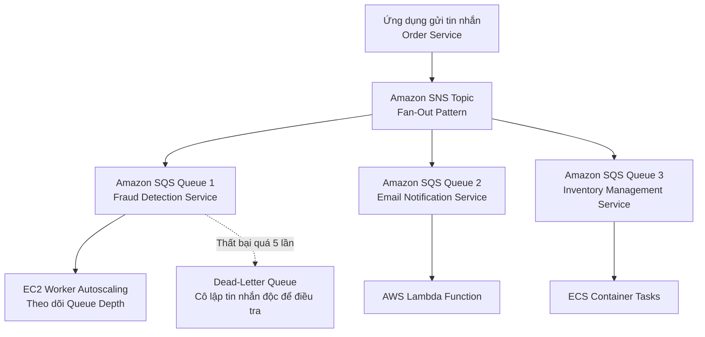

# Tài Liệu Học Tập Chuyên Sâu: Amazon SQS, SNS, EventBridge & Kinesis (Kiến Trúc Tách Rời & Hướng Sự Kiện)

> **Tài liệu chuẩn hóa kiến trúc đám mây**: Hướng dẫn toàn diện theo tiêu chuẩn Senior AWS Solutions Architect & Cloud DevOps Engineer.  
> **Ngôn ngữ**: Tiếng Việt (Bảo lưu toàn bộ thuật ngữ chuyên ngành tiếng Anh chuẩn AWS).  
> **Các bài giảng liên quan**: Chương 17 (Decoupling applications: SQS, SNS, Kinesis, ActiveMQ: Bài 182 đến Bài 197).

---

## 6.1. Tổng Quan Dịch Vụ (Service Overview)

### Dịch vụ gì?
Trong kiến trúc phần mềm hiện đại, việc kết nối trực tiếp (Tight Coupling) giữa các dịch vụ là nguyên nhân hàng đầu dẫn đến sự cố lan truyền (Cascading Failures) và tắc nghẽn cổ chai khi lưu lượng tăng đột biến. AWS cung cấp bộ giải pháp **Tách rời ứng dụng (Application Decoupling)** và **Kiến trúc hướng sự kiện (Event-Driven Architecture)** gồm:
1. **Amazon Simple Queue Service (Amazon SQS)**: Dịch vụ hàng đợi thông điệp (Message Queue) được quản lý toàn diện đầu tiên của AWS, cho phép tách rời các thành phần theo mô hình điểm-điểm (**Point-to-Point**), lưu trữ tạm thời các tin nhắn giữa bên gửi (Producer) và bên nhận (Consumer).
2. **Amazon Simple Notification Service (Amazon SNS)**: Dịch vụ thông báo và phát tán tin nhắn theo mô hình Xuất bản / Đăng ký (**Publish / Subscribe - Pub/Sub**), cho phép một Publisher phát tin nhắn tới hàng ngàn Subscribers cùng lúc (**1-to-Many / Fan-Out Pattern**).
3. **Amazon EventBridge**: Bus sự kiện phi máy chủ (Serverless Event Bus) định tuyến các sự kiện từ ứng dụng của bạn, các dịch vụ AWS và ứng dụng SaaS bên ngoài (Zendesk, Datadog) bằng các bộ lọc JSON pattern thông minh.
4. **Amazon Kinesis**: Nền tảng tiếp nhận và xử lý dữ liệu phát trực tuyến theo thời gian thực (Real-time Streaming Data) ở quy mô cực lớn (hàng trăm ngàn bản ghi mỗi giây).
5. **Amazon MQ**: Dịch vụ môi giới tin nhắn được quản lý hỗ trợ các giao thức chuẩn công nghiệp (Apache ActiveMQ và RabbitMQ, hỗ trợ MQTT, AMQP, STOMP) phục vụ cho việc di chuyển ứng dụng cũ (Legacy Migration) lên cloud mà không cần viết lại mã nguồn.

---

## 6.2. Các Khái Niệm và Thành Phần Cốt Lõi (Core Concepts and Components)



### 1. Phân tích chi tiết Amazon SQS (Standard vs FIFO Queues)

| Tiêu chuẩn so sánh | SQS Standard Queue | SQS FIFO Queue |
| :--- | :--- | :--- |
| **Thứ tự tin nhắn** | **Tối ưu hóa thứ tự (Best-effort ordering)**: Thỉnh thoảng tin nhắn có thể đến lệch thứ tự gửi. | **Chính xác tuyệt đối (First-In, First-Out)**: Tin nhắn gửi trước chắc chắn được nhận trước. |
| **Số lần nhận tin** | **Tối thiểu một lần (At-least-once delivery)**: Đôi khi có thể bị nhân đôi tin nhắn (Duplicate messages). | **Đúng duy nhất một lần (Exactly-once processing)**: Tự động loại bỏ tin nhắn trùng lặp (Deduplication). |
| **Thông lượng xử lý** | **Gần như vô hạn (Unlimited Throughput)**. | Mặc định: **300 msg/s** (hoặc 3,000 msg/s khi dùng batching); lên tới 70,000 msg/s với High Throughput Mode. |
| **Quy ước đặt tên** | Tên bất kỳ (ví dụ: `my-queue`). | **Bắt buộc phải kết thúc bằng đuôi `.fifo`** (ví dụ: `orders.fifo`). |
| **Kịch bản sử dụng** | Tải công việc phi trạng thái, chấp nhận trùng lặp, cần scale cực lớn. | Giao dịch tài chính ngân hàng, xuất vé máy bay, đơn hàng mua sắm theo thứ tự thời gian. |

### 2. Các cơ chế vận hành cốt lõi của Amazon SQS
- **Message Visibility Timeout (Khoảng thời gian ẩn tin nhắn)**:
  - Khi một consumer nhận được một tin nhắn từ SQS, tin nhắn đó **không bị xóa ngay lập tức** mà sẽ bị ẩn đi đối với các consumer khác trong một khoảng thời gian (mặc định là **30 giây**).
  - Nếu consumer xử lý thành công, nó phải chủ động gọi lệnh `DeleteMessage` để xóa vĩnh viễn tin nhắn khỏi hàng đợi.
  - Nếu consumer bị sập hoặc gặp lỗi trước khi xóa, khi hết thời gian Visibility Timeout, tin nhắn sẽ tự động hiện lại trong hàng đợi để một consumer khác nhận và xử lý lại.
  - *Thay đổi linh hoạt*: Consumer có thể gọi API `ChangeMessageVisibility` để xin gia hạn thêm thời gian nếu tác vụ mất nhiều phút để hoàn tất.
- **Dead-Letter Queue (DLQ - Hàng đợi thông điệp lỗi)**:
  - Nếu một tin nhắn bị xử lý thất bại nhiều lần (vượt quá ngưỡng `maxReceiveCount`), SQS sẽ tự động chuyển tin nhắn đó sang một hàng đợi chuyên biệt gọi là DLQ.
  - Giúp ngăn chặn hiện tượng tin nhắn độc hại (Poison Pill) làm nghẽn toàn bộ hàng đợi, cho phép kỹ sư phân tích nguyên nhân gốc rễ và sử dụng tính năng **DLQ Redrive** để đẩy tin nhắn trở lại hàng đợi chính sau khi sửa lỗi phần mềm.
- **Long Polling (Thăm dò thời gian dài)**:
  - Khi consumer yêu cầu tin nhắn từ hàng đợi rỗng, nếu dùng **Short Polling** (thăm dò ngắn), SQS sẽ trả lời ngay lập tức là không có tin nhắn (tốn kém chi phí gọi API rác).
  - **Long Polling** cho phép consumer chờ đợi từ **1 đến 20 giây** để SQS kịp tiếp nhận tin nhắn mới và trả về ngay lập tức, giúp **giảm đáng kể chi phí gọi API và giảm độ trễ xử lý**.

### 3. Mô hình Fan-Out Pattern (Kết hợp SNS và SQS)
- **Vấn đề**: Khi một đơn hàng mới được tạo, có 5 dịch vụ độc lập cần biết thông tin này (Dịch vụ thanh toán, Dịch vụ kho, Dịch vụ gửi email, Dịch vụ phân tích dữ liệu, Dịch vụ chống gian lận). Nếu Order Service phải gửi 5 request HTTP tuần tự tới 5 dịch vụ, hệ thống sẽ chậm và nếu 1 dịch vụ chết thì đơn hàng bị tắc.
- **Giải pháp**: Order Service chỉ phát duy nhất 1 tin nhắn vào **Amazon SNS Topic**. 
  - 5 hàng đợi **Amazon SQS** của 5 dịch vụ nói trên cùng đăng ký (Subscribe) vào SNS Topic này.
  - SNS tự động nhân bản (Fan-out) tin nhắn đó đẩy vào đồng thời cả 5 hàng đợi SQS.
  - Mỗi dịch vụ tự đọc tin nhắn từ hàng đợi riêng của mình theo tốc độ xử lý độc lập mà không ảnh hưởng lẫn nhau.

### 4. Amazon Kinesis: Data Streams vs Data Firehose
- **Amazon Kinesis Data Streams**:
  - Dành cho truyền tải dữ liệu luồng thời gian thực tùy chỉnh (Custom Real-time Streaming).
  - Phân mảnh thành các **Shards** (mỗi Shard cung cấp năng lực: 1 MB/s hoặc 1,000 records/s đầu vào; 2 MB/s đầu ra).
  - Lưu giữ dữ liệu từ **1 đến 365 ngày**, cho phép nhiều consumer đọc lại dữ liệu theo nhiều tốc độ khác nhau.
- **Amazon Data Firehose (trước đây là Kinesis Data Firehose)**:
  - Dịch vụ luồng dữ liệu **gần thời gian thực (Near Real-time)** hoàn toàn phi máy chủ (Serverless), tự động co giãn 100%.
  - Tự động nạp dữ liệu trực tiếp vào các đích lưu trữ: **Amazon S3**, **Amazon Redshift**, **Amazon OpenSearch**, hoặc dịch vụ SaaS bên thứ 3 (Datadog, Splunk).
  - Có cơ chế gom nhóm (Buffer theo kích thước từ 1MB-128MB hoặc thời gian từ 60s-900s) và hỗ trợ tự động biến đổi định dạng dữ liệu (chuyển đổi từ JSON sang Apache Parquet/ORC).

---

## 6.3. Bảng So Sánh Toàn Bộ Các Dịch Vụ Messaging & Streaming Trên AWS

| Dịch vụ | Mô hình tích hợp | Cơ chế tiêu thụ dữ liệu | Khả năng giữ lại dữ liệu | Kịch bản sử dụng tối ưu |
| :--- | :--- | :--- | :--- | :--- |
| **Amazon SQS** | Point-to-Point (Queue) | **Pull model** (Consumer chủ động kéo tin nhắn về) | Từ 1 phút đến **14 ngày** (mặc định 4 ngày) | Tách rời các ứng dụng web/worker, điều tiết tải, hấp thụ lưu lượng đỉnh. |
| **Amazon SNS** | Pub/Sub (1-to-Many) | **Push model** (SNS chủ động bắn tin nhắn tới subscriber) | **Không giữ lại** (Tin nhắn biến mất nếu không có ai nhận) | Bắn thông báo đẩy di động, gửi email/SMS, kiến trúc Fan-Out tới SQS/Lambda. |
| **Amazon EventBridge**| Event Bus (Pub/Sub) | **Push model** (Định tuyến sự kiện qua Rules) | Lưu trữ sự kiện qua tính năng Event Archive | Tích hợp sự kiện giữa các dịch vụ AWS và ứng dụng SaaS bên thứ 3. |
| **Amazon Kinesis** | Real-time Streaming | **Pull model** (Nhiều consumer đọc song song qua Shards) | Từ **1 ngày đến 365 ngày** | Thu thập log ứng dụng khổng lồ, dữ liệu clickstream người dùng, cảm biến IoT. |
| **Amazon MQ** | Message Broker chuẩn | Hỗ trợ cả Push và Pull | Theo tiêu chuẩn JMS/AMQP | Di chuyển ứng dụng có sẵn dùng RabbitMQ/ActiveMQ lên AWS mà không sửa code. |

---

## 6.4. Bảng Tích Hợp với Các Dịch Vụ AWS Khác (Integration Table)

| Related AWS Service | Purpose (Mục đích tích hợp) | Integration Method (Phương thức tích hợp) | Practical Example (Ví dụ thực tiễn) |
| :--- | :--- | :--- | :--- |
| **Auto Scaling Group (ASG)** | Tự động điều chỉnh số lượng máy chủ xử lý dựa trên số lượng tin nhắn trong hàng đợi | CloudWatch Metric: `ApproximateNumberOfMessagesVisible` | Khi số lượng đơn hàng chờ xử lý trong SQS vượt quá 5,000 tin nhắn, ASG tự động bật thêm 5 máy ảo EC2 worker. |
| **AWS Lambda** | Tự động thực thi hàm xử lý ngay khi có tin nhắn mới | Event Source Mapping (Lambda tự động poll SQS) | Lambda tự động đọc theo lô (Batching 10 tin nhắn/lần) từ SQS để ghi dữ liệu vào DynamoDB. |
| **AWS KMS** | Mã hóa an toàn nội dung thông điệp trong hàng đợi và topic | Server-Side Encryption (SSE-KMS) | Toàn bộ dữ liệu tin nhắn gửi qua SQS và SNS được mã hóa tự động bằng khóa KMS trước khi ghi vào đĩa. |

---

## 6.5. Mô Hình Tính Phí Dịch Vụ & Chiến Lược Tối Ưu Chi Phí Theo Từng Use Case (Messaging & Decoupling Cost Breakdown & Optimization)

Trong kiến trúc hướng sự kiện (Event-Driven Architecture) và hệ thống vi dịch vụ (Microservices), các dịch vụ gửi nhận tin nhắn đóng vai trò huyết mạch. Mặc dù chi phí trên từng đơn vị tin nhắn rất nhỏ (vài chục cent trên 1 triệu requests), nhưng với các hệ thống quy mô lớn xử lý hàng trăm triệu sự kiện mỗi ngày, việc chọn sai công cụ hoặc cấu hình sai vòng lặp polling có thể biến cước phí messaging thành một khoản chi khổng lồ.

### 6.5.1. Bảng Cấu Trúc Định Giá Chi Tiết (Pricing Dimensions Matrix)

| Dịch Vụ Messaging | Có tính phí hay Miễn phí? | Cơ chế tính phí chi tiết (Pricing Dimensions) | Mức phí tham chiếu điển hình (US/Singapore) | Lưu ý rủi ro chi phí (Cost Pitfalls) |
| :--- | :--- | :--- | :--- | :--- |
| **Amazon SQS** | Miễn phí 1M requests/tháng | 1. **Cước API Request**: Tính theo số lượt gọi `SendMessage`, `ReceiveMessage`, `DeleteMessage`.<br>2. **Đơn vị Request Size**: Mỗi khối dữ liệu 64 KB tính là 1 request (tin nhắn 256 KB = 4 requests). | - **Free Tier**: 1,000,000 requests/tháng miễn phí vĩnh viễn.<br>- **Standard**: **$0.40 / 1 triệu requests**.<br>- **FIFO**: **$0.50 / 1 triệu requests**. | Sử dụng **Short Polling** với chu kỳ lặp liên tục khi hàng đợi rỗng tạo ra hàng trăm triệu request vô ích, gây tốn tiền lãng phí. |
| **Amazon SNS** | Miễn phí 1M publish/tháng | 1. **Publish Requests**: Cước xuất bản tin nhắn vào Topic.<br>2. **Delivery Deliveries**: Cước phân phối tin nhắn tới các endpoint khác nhau. | - **Publish**: **$0.50 / 1 triệu requests**.<br>- **SQS/Lambda Delivery**: **$0.00** (Miễn phí delivery).<br>- **HTTP/HTTPS Delivery**: **$0.60 / 1 triệu**.<br>- **Email**: **$2.00 / 100,000 emails**.<br>- **SMS**: **$0.01 - $0.05 / SMS** (Rất đắt tùy quốc gia). | Bật Fan-Out gửi tin nhắn sang hàng loạt Lambda không cần thiết hoặc lạm dụng gửi tin nhắn SMS trực tiếp từ SNS thay vì đối tác chuyên dụng. |
| **Amazon EventBridge** | Miễn phí sự kiện từ AWS | 1. **AWS-emitted Events**: Sự kiện phát từ dịch vụ AWS là **MIỄN PHÍ 100%**.<br>2. **Custom Events**: Sự kiện tự tạo phát từ mã nguồn ứng dụng qua API `PutEvents`.<br>3. **Đơn vị Payload**: Khối 64 KB = 1 event. | - **AWS Services Events**: **$0.00**.<br>- **Custom Events**: **$1.00 / 1 triệu events**.<br>- **Cross-Account / Third-party SaaS**: **$1.00 / 1 triệu events**.<br>- **EventBridge Pipes**: **$0.40 / 1 triệu requests**. | Gửi dữ liệu cồng kềnh (megabytes) trực tiếp qua payload EventBridge thay vì lưu vào S3 và chỉ gửi metadata/reference qua EventBridge. |
| **Amazon Kinesis Data Streams** | Tính phí theo giờ & throughput | 1. **Shard Hour** (Provisioned Mode): Cước duy trì từng Shard.<br>2. **PUT Payload Units**: Đơn vị 25 KB/unit.<br>3. **Data Retention**: Cước lưu trữ vượt quá 24 giờ. | - **Provisioned**: **$0.015 / Shard-giờ** (~$11/tháng/shard) + **$0.014 / 1 triệu PUT units**.<br>- **On-Demand**: **$0.04 / stream-giờ** + **$0.08 / GB data in** + **$0.04 / GB data out**. | Cấp phát dư thừa quá nhiều Shards trong khi lưu lượng thực tế rất thấp, hoặc quên xóa Stream thử nghiệm. |
| **Amazon MQ** | Tính phí theo Instance | Trả tiền theo loại máy chủ (Broker instance size: `mq.t3.micro`, `mq.m5.large`) và dung lượng lưu trữ EBS. | Từ **~$0.03/giờ** (~$22/tháng cho t3.micro) đến hàng trăm USD/tháng cho cụm Active/Standby Multi-AZ. | Chọn Amazon MQ khi xây dựng ứng dụng mới toanh (Greenfield) thay vì dùng dịch vụ Serverless bản địa như SQS/SNS/EventBridge. |

---

### 6.5.2. 5 Kịch Bản Tối Ưu Hóa Chi Phí Kiến Trúc Thực Tế (Architectural Cost Optimization Use Cases)

#### Use Case 1: Chuyển đổi Short Polling sang Long Polling trên SQS (Triệt tiêu 99% Empty Receives)
- **Bối cảnh**: Hệ thống có 5 worker instances chạy vòng lặp vô tận gọi `ReceiveMessage` từ SQS với thời gian chờ mặc định `WaitTimeSeconds = 0` (Short Polling). Hàng đợi chỉ có đơn hàng vào ban ngày, ban đêm hầu như không có tin nhắn.
- **Rủi ro chi phí**: Mỗi worker gửi trung bình 10 requests/giây để kiểm tra hàng đợi:
  - Tổng số request: 5 worker * 10 req/s * 86,400 s * 30 ngày = **129,600,000 requests/tháng**.
  - Chi phí SQS: (129.6M - 1M free) * $0.40 = **$51.44/tháng** chỉ để nhận các phản hồi rỗng (Empty Receives)! Nếu doanh nghiệp có 40 microservices, tổng số tiền lãng phí lên tới hơn **$2,000/tháng**.
- **Giải pháp tối ưu**:
  - Cấu hình thuộc tính cấp hàng đợi `ReceiveMessageWaitTimeSeconds = 20` (Long Polling 20 giây tối đa).
  - Khi hàng đợi rỗng, mỗi worker chỉ gửi tối đa 3 requests/phút.
- **Hiệu quả kinh tế**:
  - Tổng số request khi không có tin nhắn giảm xuống: 5 * 3 * 1,440 * 30 = **648,000 requests/tháng**.
  - Nằm gọn trong hạn mức **1 triệu requests Miễn Phí của SQS Free Tier ($0.00/tháng)**.
  - **Tiết kiệm 100% chi phí gọi rỗng**, đồng thời giảm tải tiêu thụ CPU trên các máy chủ worker.

#### Use Case 2: Gom nhóm tin nhắn theo lô (SQS Batching API: SendMessageBatch & DeleteMessageBatch)
- **Bối cảnh**: Một ứng dụng thương mại điện tử gửi 20 triệu tin nhắn sự kiện mỗi tháng lên SQS Standard. Đoạn mã hiện tại gọi `SendMessage` và `DeleteMessage` từng tin nhắn riêng lẻ.
- **Chi phí ban đầu**:
  - Chi phí gửi: 20 triệu * $0.40 / 1M = $8.00.
  - Chi phí xóa: 20 triệu * $0.40 / 1M = $8.00.
  - Chi phí nhận: ~20 triệu = $8.00. Tổng cộng: **$24.00/tháng** (ở quy mô 500 triệu tin nhắn, con số này là **$600/tháng**).
- **Giải pháp tối ưu**:
  - Tối ưu mã nguồn ở cả phía Producer và Consumer bằng cách sử dụng các hàm Batch:
    - Phía Producer: Gom dữ liệu vào bộ đệm bộ nhớ cục bộ (buffer) tối đa 10 tin nhắn hoặc 500ms, sau đó gọi **`SendMessageBatch`** (1 API call gửi được tối đa 10 tin nhắn).
    - Phía Consumer: Nhận 10 tin nhắn/lần (`MaxNumberOfMessages = 10`) và gọi **`DeleteMessageBatch`** sau khi xử lý xong lô.
- **Hiệu quả kinh tế**:
  - Số lượng API calls giảm tới **90%** (từ 60 triệu calls xuống còn 6 triệu calls).
  - Giảm ngay 90% hóa đơn tiền cước SQS API, đồng thời tăng băng thông xử lý (throughput) của toàn hệ thống lên gấp nhiều lần.

#### Use Case 3: Sử dụng SNS Subscription Filter Policy để ngăn chặn lãng phí kích hoạt Lambda
- **Bối cảnh**: Hệ thống sử dụng một SNS Topic tập trung phát hành toàn bộ 50 triệu sự kiện nghiệp vụ mỗi tháng (OrderCreated, OrderPaid, OrderCancelled, InventoryUpdated, UserLogin...). Topic này Fan-Out tới một AWS Lambda chuyên phụ trách gửi email khi đơn hàng bị hủy (`OrderCancelled` - loại sự kiện này chỉ chiếm 2% = 1 triệu sự kiện).
- **Rủi ro chi phí**: Do không lọc tại SNS Topic, SNS tự động kích hoạt Lambda Function cho toàn bộ **50 triệu sự kiện**. Bên trong code Lambda, lập trình viên viết: `if (event.type !== 'OrderCancelled') return;`.
  - Phí kích hoạt Lambda thừa thãi: 49 triệu lượt kích hoạt vô ích tốn chi phí compute, tiêu tốn hạn mức Lambda Concurrency (nguy cơ nghẽn các tác vụ khác) và ghi log thừa vào CloudWatch.
- **Giải pháp tối ưu**:
  - Thiết lập **SNS Subscription Filter Policy** trên gói đăng ký của Lambda:
    ```json
    {
      "event_type": ["OrderCancelled"]
    }
    ```
  - SNS sẽ chủ động kiểm tra Message Attributes và **chỉ chuyển tiếp đúng 1 triệu tin nhắn phù hợp** sang Lambda, loại bỏ 49 triệu tin nhắn còn lại hoàn toàn miễn phí tại tầng SNS.
- **Hiệu quả kinh tế**:
  - Giảm 98% số lần kích hoạt Lambda, tiết kiệm hàng chục USD chi phí compute và CloudWatch Logs ingestion, đồng thời bảo vệ trần Concurrency của tài khoản.

#### Use Case 4: Kinesis Data Streams vs Amazon SQS - Điểm giao thoa chi phí kinh tế
- **Bối cảnh**: Đội ngũ kỹ sư chọn Kinesis Data Streams (cấu hình mặc định 6 Shards Provisioned) cho một bài toán kết nối giữa Web Server và Worker xử lý báo cáo với lưu lượng trung bình 3 triệu bản ghi/tháng.
- **Rủi ro chi phí**:
  - Cước Kinesis Shard-hours: 6 shards * $0.015/giờ * 730 giờ = **$65.70/tháng**.
  - Cước PUT payload units: 3M * $0.014 / 1M = $0.04.
  - Tổng chi phí: **~$65.74/tháng** dù hệ thống hầu như nhàn rỗi trong phần lớn thời gian.
- **Giải pháp tối ưu**:
  - Đánh giá lại yêu cầu kiến trúc: Tác vụ chỉ là xử lý tác vụ thông thường (Task Worker), không yêu cầu Replay lại luồng dữ liệu theo thời gian, không có nhiều hệ thống Analytics khác nhau đọc chung một luồng.
  - Di chuyển từ Kinesis sang **Amazon SQS Standard**:
    - Phí SQS cho 3 triệu tin nhắn: (3M - 1M free) * $0.40 / 1M = **$0.80/tháng**.
- **Hiệu quả kinh tế**:
  - Chi phí giảm từ $65.74 xuống còn **$0.80/tháng (Tiết kiệm 98.8% chi phí)**.
  - *Quy tắc kiến trúc*: Chỉ sử dụng Kinesis khi có nhu cầu Streaming dữ liệu thực sự (nhiều consumer đọc song song, xử lý dữ liệu theo chuỗi thời gian, IoT ingestion); với mọi bài toán Decoupling microservices và task worker thông thường, SQS luôn là lựa chọn vượt trội về chi phí.

#### Use Case 5: Tận dụng EventBridge AWS-Emitted Events Miễn Phí thay vì Polling liên tục
- **Bối cảnh**: Đội ngũ vận hành viết các đoạn mã Python chạy trên máy chủ EC2 hoặc Lambda định kỳ 1 phút/lần (Cron Job) gọi AWS API để kiểm tra xem có EC2 instance nào vừa bị tắt, S3 Object mới tải lên, hoặc RDS snapshot hoàn tất hay không để kích hoạt quy trình tự động hóa.
- **Rủi ro chi phí**: Vòng lặp polling liên tục tiêu tốn tài nguyên máy chủ compute, phát sinh cước API requests và luôn có độ trễ (trễ tối đa 1 phút theo chu kỳ cron).
- **Giải pháp tối ưu**:
  - Tắt toàn bộ mã nguồn polling định kỳ.
  - Sử dụng **Amazon EventBridge Default Event Bus**. Tất cả các dịch vụ AWS tự động phát hành sự kiện trạng thái (System Events) vào EventBus mặc định **hoàn toàn MIỄN PHÍ ($0.00)**.
  - Thiết lập EventBridge Rules khớp với sự kiện:
    ```json
    {
      "source": ["aws.ec2"],
      "detail-type": ["EC2 Instance State-change Notification"],
      "detail": { "state": ["stopped", "terminated"] }
    }
    ```
- **Hiệu quả kinh tế**:
  - Chi phí nhận và định tuyến sự kiện qua EventBridge là **$0.00**.
  - Tiêu diệt hoàn toàn chi phí máy chủ chạy polling, giảm độ trễ phản hồi từ 1 phút xuống còn **dưới 1 giây (Near Real-time)**.

---

## 6.6. Khắc Phục Sự Cố Thực Tế (Troubleshooting Guide)

| Vấn đề (Problem) | Nguyên nhân khả dĩ (Possible Causes) | Các bước điều tra (Investigation Steps) | Giải pháp (Solution) | Biện pháp phòng ngừa (Prevention) |
| :--- | :--- | :--- | :--- | :--- |
| **Một tin nhắn bị xử lý lặp đi lặp lại nhiều lần liên tục** | Thời gian xử lý của Worker lâu hơn giá trị **Visibility Timeout**, khiến tin nhắn hiện lại và bị worker khác nhận. | So sánh thời gian xử lý thực tế của code với giá trị Visibility Timeout trên hàng đợi. | Tăng giá trị Visibility Timeout lên gấp 2-3 lần thời gian xử lý tối đa, hoặc gọi `ChangeMessageVisibility` trong code. | Cấu hình Dead-Letter Queue (DLQ) để cô lập tin nhắn sau 3-5 lần thử lại thất bại. |
| **Worker tốn quá nhiều chi phí gọi API nhận tin rỗng từ SQS** | Đang sử dụng cơ chế Short Polling (thời gian `ReceiveMessageWaitTimeSeconds = 0`). | Xem metric `NumberOfEmptyReceives` trên CloudWatch. | Chuyển sang sử dụng **Long Polling** bằng cách đặt `WaitTimeSeconds = 20` trong lệnh gọi nhận tin nhắn. | Cấu hình Long Polling ở cấp độ hàng đợi mặc định (Queue level). |
| **Tin nhắn trong SQS FIFO bị tắc nghẽn hoàn toàn không xử lý tiếp được** | Tin nhắn đầu tiên bị lỗi và chưa được xóa khỏi hàng đợi, làm chặn toàn bộ các tin nhắn sau có cùng **Message Group ID**. | Kiểm tra lỗi của consumer khi xử lý tin nhắn đầu hàng đợi. | Khắc phục lỗi của worker hoặc cấu hình Dead-Letter Queue cho hàng đợi FIFO để tự động đẩy tin nhắn lỗi ra ngoài. | Xử lý try-catch ngoại lệ toàn diện trong mã nguồn của consumer. |
| **Kinesis Data Streams báo lỗi `ProvisionedThroughputExceededException`** | Tốc độ ghi dữ liệu của Producer vượt quá hạn mức 1 MB/s hoặc 1,000 records/s trên một Shard cụ thể. | Xem metric `WriteProvisionedThroughputExceeded` trên CloudWatch. | Tăng thêm số lượng Shards (Sharding Scaling) hoặc chuyển sang chế độ **Kinesis On-Demand Mode**. | Sử dụng Partition Key có độ phân tán cao (High Cardinality) để chia đều tải giữa các Shards. |

---

## 6.7. Bộ Câu Hỏi Ôn Tập và Kiểm Tra Kiến Thức (Knowledge Review)

### A. 10 Câu hỏi Cốt lõi (Core Concepts)
1. Thời gian lưu trữ tối đa (Maximum Message Retention Period) của một tin nhắn trong Amazon SQS là bao nhiêu ngày?
2. Khái niệm **Visibility Timeout** trong Amazon SQS có ý nghĩa gì đối với các consumer khác trong hệ thống?
3. Để đảm bảo rằng các tin nhắn giao dịch mua sắm luôn được xử lý theo đúng thứ tự thời gian và không bao giờ bị xử lý trùng lặp, bạn phải sử dụng loại hàng đợi SQS nào?
4. Đuôi tên bắt buộc của một hàng đợi Amazon SQS FIFO là gì?
5. Sự khác biệt giữa **Short Polling** và **Long Polling** trong Amazon SQS là gì?
6. Mô hình kiến trúc nào cho phép một tin nhắn xuất bản từ Amazon SNS có thể được gửi đồng thời vào nhiều hàng đợi Amazon SQS khác nhau để xử lý song song?
7. Khi một tin nhắn trong Amazon SQS bị xử lý thất bại liên tục quá số lần quy định, nó sẽ được chuyển tới đâu để tránh làm tắc nghẽn hàng đợi chính?
8. Amazon Data Firehose có thể nạp dữ liệu trực tiếp vào những đích lưu trữ nào phổ biến trên AWS?
9. Dịch vụ nào của AWS cung cấp cụm môi giới tin nhắn được quản lý hoàn toàn cho các ứng dụng đang sử dụng Apache ActiveMQ hoặc RabbitMQ?
10. Tại sao việc gắn kết Auto Scaling Group của EC2 với độ dài hàng đợi SQS lại tối ưu hơn là chỉ dựa trên chỉ số CPU thông thường?

---

### Đáp án Bộ Câu Hỏi Ôn Tập (Answer Key)

<details>
<summary>👉 Nhấp vào đây để xem toàn bộ đáp án chi tiết</summary>

1. Tối đa **14 ngày** (mặc định là 4 ngày).
2. Là khoảng thời gian mà một tin nhắn sau khi được nhận bởi một consumer sẽ tạm thời **bị ẩn đi đối với tất cả các consumer khác**, giúp ngăn chặn việc nhiều worker cùng xử lý trùng một tin nhắn tại cùng một thời điểm.
3. **Amazon SQS FIFO Queue**.
4. Bắt buộc phải kết thúc bằng đuôi **`.fifo`** (ví dụ: `transactions.fifo`).
5. **Short Polling** trả về kết quả ngay lập tức ngay cả khi hàng đợi rỗng (dẫn đến nhiều response rỗng gây tốn chi phí); trong khi **Long Polling** chờ đợi tối đa **20 giây** để có tin nhắn mới xuất hiện rồi mới trả về, giúp giảm chi phí gọi API và tăng tốc độ xử lý.
6. **Mô hình Fan-Out Pattern (SNS kết hợp SQS)**.
7. Chuyển vào **Dead-Letter Queue (DLQ)**.
8. **Amazon S3**, **Amazon Redshift**, **Amazon OpenSearch Service**, hoặc các công cụ SaaS bên thứ 3 (Splunk, Datadog).
9. **Amazon MQ**.
10. Vì có nhiều tình huống hàng đợi có tới hàng chục ngàn tin nhắn đang chờ xử lý nhưng CPU của máy chủ hiện tại chưa kịp tăng vọt (hoặc ứng dụng bị thắt nút cổ chai I/O), việc theo dõi metric `ApproximateNumberOfMessagesVisible` giúp ASG tăng máy chủ kịp thời trước khi hàng đợi bị tràn.
</details>

---

## 6.8. Tóm Tắt và Danh Mục Kiểm Tra Kiến Thức (Summary & Learning Checklist)

### 5 Khái niệm quan trọng nhất phải nhớ:
1. **SQS = Pull, Decoupling**: Lưu trữ tin nhắn an toàn; hỗ trợ Standard (tốc độ cao) và FIFO (đúng thứ tự, chống trùng).
2. **SNS = Push, Fan-Out**: Phát tán thông báo 1-nhiều tới hàng ngàn hàng đợi SQS, email, SMS.
3. **Visibility Timeout & DLQ**: Chìa khóa đảm bảo tin nhắn không bị xử lý trùng lặp và cô lập tin nhắn lỗi.
4. **Long Polling (20s)**: Luôn bật để tiết kiệm chi phí gọi API SQS.
5. **Kinesis vs SQS**: Kinesis dành cho dữ liệu luồng phân tích thời gian thực có nhiều consumer đọc lại; SQS dành cho giao việc từng tin nhắn giữa các microservices.

### Liên kết và Chủ đề tiếp theo:
- 📖 [Ghi Chú Bài Học Chương 17: Decoupling Applications](file:///n:/AWS_XBrain_Note/Lesson_Notes/17_Decoupling_SQS_SNS_Kinesis.md)
- 📖 [Bảng Thuật Ngữ Kỹ Thuật (GLOSSARY.md)](file:///n:/AWS_XBrain_Note/GLOSSARY.md)
- ⏭️ Tiếp tục chuyển sang chuyên đề: **Công Nghệ Đóng Gói Container: Amazon ECS, AWS Fargate & EKS**.
