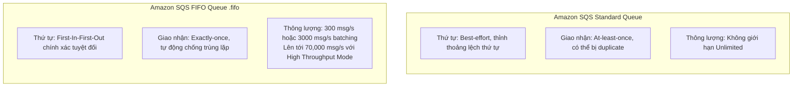
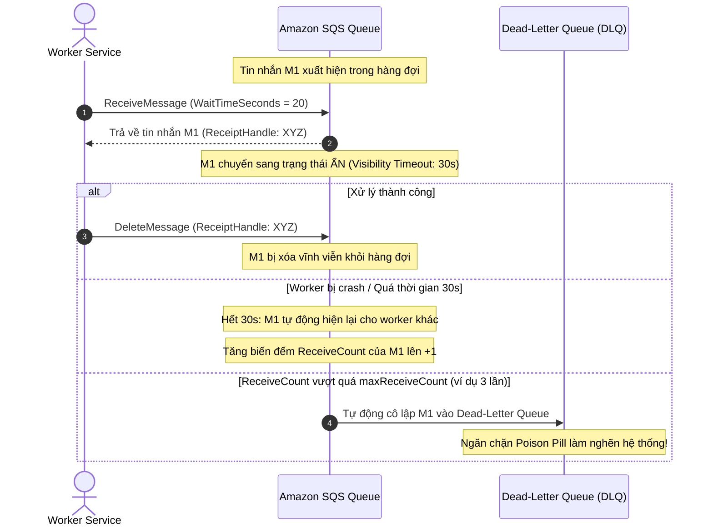
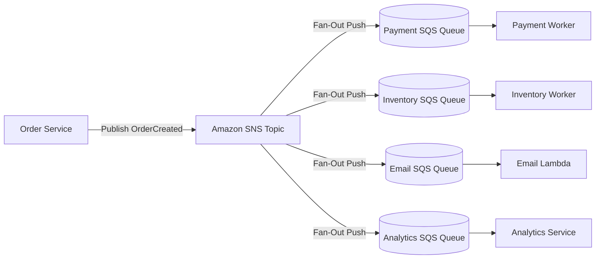
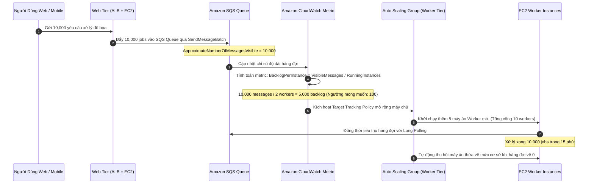

# Tài Liệu Học Tập Chuyên Sâu: Amazon SQS, SNS, EventBridge & Kinesis (Kiến Trúc Tách Rời & Hướng Sự Kiện)

> **Tài liệu chuẩn hóa kiến trúc đám mây**: Hướng dẫn toàn diện theo tiêu chuẩn Senior AWS Solutions Architect & Cloud DevOps Engineer (cập nhật mới nhất 2026).  
> **Ngôn ngữ**: Tiếng Việt (Bảo lưu toàn bộ thuật ngữ chuyên ngành tiếng Anh chuẩn AWS).  
> **Các dịch vụ liên quan**: Amazon SQS, Amazon SNS, Amazon EventBridge, Amazon Kinesis, Amazon MQ.

---

## 6.1. Tổng Quan Dịch Vụ (Service Overview)

### Dịch vụ gì?
Trong kiến trúc phần mềm phân tán, việc kết nối trực tiếp đồng bộ (Tight Coupling) giữa các dịch vụ là nguyên nhân hàng đầu dẫn đến sự cố sập đổ dây chuyền (Cascading Failures) và nghẽn cổ chai khi lưu lượng tăng đột biến. AWS cung cấp bộ giải pháp **Tách rời ứng dụng (Application Decoupling)** và **Kiến trúc hướng sự kiện (Event-Driven Architecture)** gồm:
1. **Amazon Simple Queue Service (Amazon SQS)**: Dịch vụ hàng đợi thông điệp (Message Queue) được quản lý toàn diện theo mô hình điểm-điểm (**Point-to-Point**), lưu trữ tạm thời các tin nhắn giữa bên gửi (Producer) và bên nhận (Consumer) với khả năng co giãn gần như vô hạn.
2. **Amazon Simple Notification Service (Amazon SNS)**: Dịch vụ thông báo và phát tán tin nhắn theo mô hình Xuất bản / Đăng ký (**Publish / Subscribe - Pub/Sub**), cho phép một Publisher gửi thông điệp tới hàng ngàn Subscribers cùng lúc (**Fan-Out Pattern**).
3. **Amazon EventBridge**: Bus sự kiện phi máy chủ (Serverless Event Bus) định tuyến các sự kiện từ ứng dụng nội bộ, dịch vụ AWS và ứng dụng SaaS bên ngoài (Datadog, Shopify, Zendesk) bằng bộ lọc JSON filter pattern thông minh, tích hợp sẵn **EventBridge Pipes** và **EventBridge Scheduler**.
4. **Amazon Kinesis**: Nền tảng tiếp nhận, đệm và xử lý dữ liệu phát trực tuyến theo thời gian thực (Real-time Streaming Data) ở quy mô cực lớn (hàng triệu bản ghi mỗi giây).
5. **Amazon MQ**: Dịch vụ môi giới tin nhắn được quản lý hỗ trợ các giao thức chuẩn công nghiệp (Apache ActiveMQ và RabbitMQ: MQTT, AMQP, STOMP) phục vụ cho việc di chuyển ứng dụng cũ (Legacy Migration) lên đám mây mà không cần tái cấu trúc mã nguồn.

---

## 6.2. Các Khái Niệm, Kiến Trúc & Vận Hành Cốt Lõi (Core Concepts, Security & Day-2 Operations)

### 1. Phân Tích Chi Tiết Amazon SQS: Standard vs FIFO Queues



- **Amazon SQS Standard Queue**:
  - Không giới hạn thông lượng tin nhắn mỗi giây.
  - Đảm bảo giao nhận **Tối thiểu một lần (At-least-once Delivery)**: Đôi khi consumer có thể nhận được 2 bản sao của cùng một tin nhắn do cơ chế phân tán của AWS.
  - Thứ tự tin nhắn là **Best-effort**: Thứ tự có thể bị xáo trộn nhẹ nếu tin nhắn đến dồn dập.
- **Amazon SQS FIFO Queue**:
  - Tên hàng đợi **bắt buộc phải kết thúc bằng hậu tố `.fifo`** (ví dụ: `payment-orders.fifo`).
  - Đảm bảo thứ tự nghiêm ngặt **First-In, First-Out** và xử lý **Đúng duy nhất một lần (Exactly-once Processing)**.
  - Cơ chế chống trùng lặp dựa trên **Message Deduplication ID** (hoặc Content-Based Deduplication băm nội dung SHA-256 trong khoảng thời gian cửa sổ 5 phút).
  - Phân nhóm tin nhắn bằng **Message Group ID**: Cho phép xử lý song song các nhóm khách hàng khác nhau mà vẫn đảm bảo thứ tự tuyệt đối cho từng nhóm riêng lẻ.

---

### 2. Các Cơ Chế Vận Hành Sống Còn của Amazon SQS



- **Visibility Timeout (Thời gian ẩn tin nhắn)**:
  - Khi một consumer nhận được tin nhắn, tin nhắn không bị xóa ngay mà tạm thời ẩn đi (mặc định 30 giây) để các consumer khác không đọc trùng.
  - Consumer phải chủ động gọi `DeleteMessage` kèm theo chuỗi `ReceiptHandle` sau khi xử lý xong.
  - Nếu tác vụ kéo dài, consumer có thể gọi API `ChangeMessageVisibility` để gia hạn thêm thời gian.
- **Dead-Letter Queue (DLQ) & DLQ Redrive**:
  - Khi một tin nhắn bị lỗi cú pháp hoặc mã nguồn bị bug khiến worker bị crash liên tục, tin nhắn sẽ bị nhận lại nhiều lần.
  - Khi số lần nhận vượt quá `maxReceiveCount` (ví dụ: 3 - 5 lần), SQS tự động chuyển tin nhắn sang DLQ để cô lập "viên thuốc độc" (**Poison Pill**).
  - Tính năng **DLQ Redrive** cho phép quản trị viên điều tra lỗi, cập nhật mã nguồn ứng dụng, và đẩy toàn bộ tin nhắn lỗi từ DLQ quay trở lại hàng đợi chính chỉ bằng 1 thao tác click chuột hoặc CLI.
- **Short Polling vs Long Polling**:
  - *Short Polling (`WaitTimeSeconds = 0`)*: Trả lời ngay lập tức dù hàng đợi rỗng, gây lãng phí hàng triệu API calls rỗng.
  - *Long Polling (`WaitTimeSeconds = 1 đến 20`)*: SQS giữ kết nối tối đa 20 giây chờ có tin nhắn mới rồi mới trả về, giúp tiết kiệm 99% chi phí API và giảm độ trễ phản hồi.

---

### 3. Mô Hình Fan-Out Pattern (SNS kết hợp SQS)



- **Nguyên lý Fan-Out**: Một thông điệp xuất bản vào SNS Topic được tự động nhân bản và đẩy vào nhiều hàng đợi SQS độc lập.
- **Lợi ích**:
  - Tách rời hoàn toàn nhà xuất bản khỏi các đối tượng tiêu thụ.
  - Nếu một dịch vụ bị lỗi (ví dụ Email Service bị sập), các tin nhắn vẫn nằm an toàn trong Email SQS Queue mà không làm ảnh hưởng đến dịch vụ thanh toán hay trừ kho.
  - Áp dụng **SNS Subscription Filter Policy** để từng subscriber chỉ nhận đúng các tin nhắn mình quan tâm (ví dụ: Analytics chỉ nhận đơn có giá trị `amount > 1000`).

---

### 4. Amazon EventBridge: Event Bus, Pipes & Scheduler

- **Amazon EventBridge Event Bus**:
  - Bus sự kiện định tuyến các event dựa trên cấu trúc JSON pattern:
    ```json
    {
      "source": ["ecommerce.orders"],
      "detail-type": ["OrderPlaced"],
      "detail": {
        "status": ["PAID"],
        "total": [{ "numeric": [">", 500] }]
      }
    }
    ```
- **EventBridge Pipes**:
  - Cung cấp kết nối điểm-điểm (Point-to-Point) tích hợp sẵn giữa Nguồn (Source: DynamoDB Streams, Kinesis, SQS) và Đích (Target: Step Functions, Lambda, API Destinations) với các bước lọc (**Filtering**) và làm giàu dữ liệu (**Enrichment**) mà không cần viết mã nguồn trung gian.
- **EventBridge Scheduler**:
  - Dịch vụ đặt lịch tác vụ phi máy chủ thế hệ mới, cho phép lập lịch hàng triệu tác vụ định kỳ (Cron/Rate) hoặc tác vụ kích hoạt một lần duy nhất (**One-time Schedules**) với độ trễ thấp và độ tin cậy cao.

---

## 6.3. Kiến Trúc Thực Tế và Luồng Vận Hành (Production Architecture & Workflow)

### Kiến trúc Tự Động Co Giãn Worker EC2 Dựa Trên Độ Sâu Hàng Đợi SQS (Backlog Per Instance)



---

## 6.4. Bảng Tích Hợp với Các Dịch Vụ AWS Khác (Integration Table)

| Related AWS Service | Purpose (Mục đích tích hợp) | Integration Method (Phương thức tích hợp) | Practical Example (Ví dụ thực tiễn) |
| :--- | :--- | :--- | :--- |
| **AWS Lambda** | Tự động xử lý tin nhắn ngay khi xuất hiện trong queue | Event Source Mapping | Lambda tự động poll SQS theo từng batch (10-100 tin nhắn) và tự động scale concurrency theo độ dài hàng đợi. |
| **Amazon EC2 Auto Scaling** | Co giãn số lượng máy chủ worker dựa trên tải công việc thực tế | Custom Metric `BacklogPerInstance` | Tự động tăng số lượng máy ảo chuyển đổi video khi số lượng video chờ trong SQS vượt quá 500 file. |
| **Amazon S3** | Xử lý tin nhắn vượt quá dung lượng tối đa 256 KB | **Amazon SQS Extended Client** | Tin nhắn nặng 5 MB được lưu vào S3, SQS chỉ mang chuỗi con trỏ (S3 Pointer Payload), client tự động tải file từ S3. |
| **AWS Step Functions** | Điều phối các quy trình nghiệp vụ bất đồng bộ phức tạp | Task Token Integration (`.waitForTaskToken`) | Step Functions gửi tin nhắn vào SQS kèm Task Token và tạm dừng; khi nhân viên duyệt đơn xong, gửi token về để tiếp tục luồng. |
| **AWS KMS** | Mã hóa an toàn nội dung thông điệp trong hàng đợi và topic | Server-Side Encryption (SSE-KMS) | Tự động mã hóa dữ liệu thẻ tín dụng trong SQS bằng Customer Managed Key (CMK) tuân thủ tiêu chuẩn PCI-DSS. |
| **Amazon CloudWatch** | Giám sát độ sâu hàng đợi và phát hiện tắc nghẽn | CloudWatch Alarms & Metrics | Bắn cảnh báo cho đội ngũ trực ban nếu chỉ số `ApproximateAgeOfOldestMessage` vượt quá 1,800 giây (30 phút). |

---

## 6.5. Bảng So Sánh Trong Hệ Sinh Thái AWS (Ecosystem Comparison)

### So sánh các dịch vụ Messaging, Event Bus & Data Streaming

| Tiêu chuẩn so sánh | Amazon SQS | Amazon SNS | Amazon EventBridge | Amazon Kinesis Data Streams | Amazon MQ |
| :--- | :--- | :--- | :--- | :--- | :--- |
| **Mô hình kiến trúc** | **Point-to-Point (Queue)**: 1 producer gửi, 1 consumer tiêu thụ. | **Pub/Sub (Topic)**: 1 publisher phát tán tới hàng ngàn subscribers. | **Event Bus**: Định tuyến sự kiện đa nguồn qua JSON filtering rules. | **Real-time Streaming**: Dữ liệu luồng phân mảnh (Shards) cho big data. | **Message Broker**: Dịch vụ môi giới tin nhắn chuẩn công nghiệp (ActiveMQ/RabbitMQ). |
| **Cơ chế truyền dữ liệu** | **Pull Model**: Consumer chủ động thăm dò và kéo tin nhắn về. | **Push Model**: SNS tự động đẩy tin nhắn tới HTTP, SQS, Lambda, Email, SMS. | **Push Model**: EventBridge tự động đẩy tới hơn 20 đích AWS và API Destinations. | **Pull Model**: Các consumer độc lập chủ động đọc qua Shard Iterator. | Hỗ trợ cả **Push và Pull** tùy theo giao thức (JMS, AMQP, STOMP). |
| **Thời gian lưu giữ dữ liệu**| Từ 1 phút đến **14 ngày** (mặc định 4 ngày). | **Không lưu trữ**: Tin nhắn biến mất nếu không có subscriber sẵn sàng. | Lưu trữ sự kiện qua tính năng **Event Archive & Replay**. | Từ **1 ngày đến 365 ngày** (mặc định 24 giờ). | Lưu trữ theo cấu hình hàng đợi của broker engine. |
| **Khả năng đọc lại (Replay)** | ❌ Không (tin nhắn bị xóa vĩnh viễn sau khi xử lý). | ❌ Không hỗ trợ đọc lại tin cũ. |  **Hỗ trợ Event Replay** từ Event Archive. |  **Đọc lại tùy ý** trong khoảng thời gian retention window. | ❌ Phụ thuộc vào tính năng của RabbitMQ/ActiveMQ. |
| **Thông lượng (Throughput)** | Standard: Gần như vô hạn.<br>FIFO: Lên tới 70,000 msg/s. | Gần như vô hạn (hàng triệu tin nhắn/giây). | Rất lớn (hàng chục ngàn events/giây, nâng hạn mức linh hoạt). | 1 MB/s in và 2 MB/s out trên mỗi Shard (co giãn bằng số lượng shards). | Giới hạn bởi cấu hình phần cứng của broker instance. |
| **Khuyến nghị sử dụng** | Tách rời các microservices, xử lý tác vụ nền, hấp thụ lưu lượng đỉnh đột biến. | Phát tán thông báo, gửi email/SMS, kiến trúc Fan-Out tới SQS/Lambda. | Kiến trúc hướng sự kiện trung tâm, định tuyến sự kiện SaaS và AWS services. | Thu thập log dung lượng lớn, clickstream người dùng, cảm biến IoT thời gian thực. | Di chuyển ứng dụng legacy từ on-prem lên AWS mà không sửa đổi giao thức mã nguồn. |

---

## 6.6. Mô Hình Tính Phí & Chiến Lược Tối Ưu Chi Phí (FinOps & Cost Optimization)

### 6.6.1. Bảng Cấu Trúc Định Giá Chi Tiết

| Thành phần Dịch Vụ | Đơn giá AWS niêm yết | Cơ chế đo lường | Ghi chú tối ưu hóa chi phí FinOps |
| :--- | :--- | :--- | :--- |
| **Amazon SQS (Standard)** | **$0.40 / 1 triệu requests** | Tính trên mỗi API call (khối 64 KB) | 1,000,000 requests miễn phí mỗi tháng (Free Tier vĩnh viễn). |
| **Amazon SQS (FIFO)** | **$0.50 / 1 triệu requests** | Tính trên mỗi API call (khối 64 KB) | 1,000,000 requests miễn phí mỗi tháng; dùng batching để giảm chi phí. |
| **Amazon SNS (Publish)** | **$0.50 / 1 triệu requests** | Miễn phí 1 triệu publish đầu/tháng | Đẩy sang SQS và Lambda hoàn toàn **miễn phí delivery**. |
| **Amazon SNS (Delivery)** | SQS/Lambda: **$0.00**<br>HTTP: **$0.60/1M**<br>SMS: **$0.01 - $0.05/SMS** | Tính theo số lượng thông báo chuyển phát | Sử dụng Subscription Filter Policy để tránh bắn tin thừa cho subscribers. |
| **EventBridge (AWS Events)** | **$0.00** | Miễn phí không giới hạn sự kiện | Tận dụng tối đa sự kiện hệ thống AWS thay vì chạy code polling định kỳ. |
| **EventBridge (Custom Events)** | **$1.00 / 1 triệu events** | Tính trên mỗi sự kiện tự tạo (khối 64 KB) | Chỉ gửi metadata/references trong event, lưu trữ payload lớn trên S3. |
| **Kinesis Data Streams (Provisioned)** | **$0.015 / Shard-giờ** (~$11/tháng/shard)<br>+ **$0.014 / 1M PUT units** | Tính theo số lượng Shards duy trì | Không dùng Kinesis cho bài toán task queue đơn giản; dùng SQS rẻ hơn 98%. |

---

### 6.6.2. 5 Kịch Bản Tối Ưu Hóa Chi Phí Thực Tế (FinOps Scenarios)

#### Kịch bản 1: Chuyển đổi Short Polling sang Long Polling trên Amazon SQS
- **Bối cảnh**: Hệ thống vận hành 8 worker instances chạy vòng lặp liên tục gọi `ReceiveMessage` với thời gian chờ mặc định `WaitTimeSeconds = 0` (Short Polling). Hàng đợi chỉ có đơn hàng vào ban ngày, ban đêm hầu như rỗng.
- **Tính toán chi phí khi Short Polling**:
  - Mỗi worker gửi trung bình 8 requests/giây để thăm dò hàng đợi:
  $$\text{Số requests} = 8 \text{ workers} \times 8 \text{ req/s} \times 86{,}400 \text{ s} \times 30 \text{ ngày} = 165{,}888{,}000 \text{ requests/tháng}$$
  $$\text{Cost}_{\text{Short}} = \left( \frac{165{,}888{,}000 - 1{,}000{,}000}{1{,}000{,}000} \right) \times \$0.40 = \$65.95/\text{tháng}$$
  *(Doanh nghiệp có 30 hàng đợi microservices lãng phí gần $2,000/tháng chỉ để nhận phản hồi rỗng!)*
- **Giải pháp tối ưu**:
  - Cấu hình thuộc tính cấp hàng đợi `ReceiveMessageWaitTimeSeconds = 20` (Long Polling 20 giây tối đa).
  - Khi hàng đợi rỗng, mỗi worker chỉ gửi tối đa 3 requests/phút:
  $$\text{Số requests mới} = 8 \times 3 \times 1{,}440 \times 30 = 1{,}036{,}800 \text{ requests/tháng}$$
  $$\text{Cost}_{\text{Long}} = \left( \frac{1{,}036{,}800 - 1{,}000{,}000}{1{,}000{,}000} \right) \times \$0.40 = \$0.01/\text{tháng}$$
- **Hiệu quả kinh tế**:
  $$\text{Tiết kiệm} = \$65.95 - \$0.01 = \$65.94/\text{tháng} \quad (\$791/\text{năm}) \implies \text{Tiết kiệm } 99.98\% \text{ chi phí polling}$$

#### Kịch bản 2: Gom nhóm tin nhắn theo lô (SQS Batch API: SendMessageBatch & DeleteMessageBatch)
- **Bối cảnh**: Một ứng dụng tiếp nhận 30 triệu sự kiện thanh toán mỗi tháng. Ứng dụng gọi `SendMessage` và `DeleteMessage` từng tin nhắn riêng lẻ.
- **Tính toán chi phí ban đầu**:
  $$\text{Số API calls} = 30 \text{M gửi} + 30 \text{M nhận} + 30 \text{M xóa} = 90{,}000{,}000 \text{ calls}$$
  $$\text{Cost}_{\text{Single}} = \left( \frac{90{,}000{,}000 - 1{,}000{,}000}{1{,}000{,}000} \right) \times \$0.40 = \$35.60/\text{tháng}$$
- **Giải pháp tối ưu**:
  - Phía Producer gom 10 tin nhắn vào bộ đệm bộ nhớ cục bộ và gọi **`SendMessageBatch`** (1 API call gửi 10 tin nhắn).
  - Phía Consumer nhận tối đa 10 tin nhắn/lần (`MaxNumberOfMessages = 10`) và gọi **`DeleteMessageBatch`**:
  $$\text{Số API calls mới} = \frac{90{,}000{,}000}{10} = 9{,}000{,}000 \text{ calls}$$
  $$\text{Cost}_{\text{Batch}} = \left( \frac{9{,}000{,}000 - 1{,}000{,}000}{1{,}000{,}000} \right) \times \$0.40 = \$3.20/\text{tháng}$$
- **Hiệu quả kinh tế**:
  $$\text{Tiết kiệm} = \$35.60 - \$3.20 = \$32.40/\text{tháng} \quad (\$388/\text{năm}) \implies \text{Cắt giảm } 91\% \text{ chi phí API SQS}$$

#### Kịch bản 3: Ngăn chặn kích hoạt Lambda thừa thãi bằng SNS Subscription Filter Policy
- **Bối cảnh**: Một SNS Topic tập trung nhận 60 triệu sự kiện nghiệp vụ mỗi tháng. Topic này Fan-Out tới một hàm Lambda xử lý riêng cho sự kiện hủy đơn (`OrderCancelled` - chỉ chiếm 2% = 1.2 triệu sự kiện). Do không lọc tại SNS, Lambda bị kích hoạt cả 60 triệu lần và kiểm tra `if (event.type !== 'OrderCancelled') return;` trong mã nguồn.
- **Tính toán chi phí chạy Lambda thừa (128 MB RAM, chạy 100 ms)**:
  $$\text{Cost}_{\text{Lambda\_Wasted}} = 58{,}800{,}000 \times 0.1 \text{ s} \times \left( \frac{128}{1024} \right) \times \$0.0000166667 + \left( \frac{58.8\text{M}}{1\text{M}} \times \$0.20 \right) \approx \$24.00/\text{tháng}$$
  *(Ngoài ra còn lãng phí trần Concurrency của tài khoản và ghi rác hàng triệu log lines vào CloudWatch!)*
- **Giải pháp tối ưu**:
  - Cấu hình **SNS Subscription Filter Policy** trên gói đăng ký của Lambda:
    ```json
    { "event_type": ["OrderCancelled"] }
    ```
  - SNS lọc tại tầng messaging (hoàn toàn miễn phí) và chỉ chuyển tiếp đúng 1.2 triệu sự kiện thực sự cần xử lý.
- **Hiệu quả kinh tế**:
  $$\text{Cắt giảm } 98\% \text{ số lần kích hoạt Lambda vô ích, bảo vệ hoàn toàn trần Concurrency}$$

#### Kịch bản 4: Phân định điểm giao thoa kinh tế giữa Amazon SQS và Kinesis Data Streams
- **Bối cảnh**: Kỹ sư chọn Kinesis Data Streams (cấu hình mặc định 8 Shards Provisioned) để truyền tin nhắn giữa Web Server và Task Worker với lưu lượng thực tế 4 triệu bản ghi/tháng.
- **Tính toán chi phí Kinesis Shard-hours**:
  $$\text{Cost}_{\text{Kinesis}} = 8 \text{ shards} \times \$0.015/\text{giờ} \times 730 \text{ giờ} + \left( \frac{4\text{M}}{1\text{M}} \times \$0.014 \right) \approx \$87.66/\text{tháng}$$
- **Giải pháp tối ưu**:
  - Đánh giá kiến trúc: Tác vụ chỉ là xử lý đơn hàng độc lập, không yêu cầu đọc lại (Replay) dữ liệu, không có nhiều hệ thống Analytics khác nhau đọc chung luồng.
  - Chuyển sang **Amazon SQS Standard**:
  $$\text{Cost}_{\text{SQS}} = \left( \frac{4{,}000{,}000 - 1{,}000{,}000}{1{,}000{,}000} \right) \times \$0.40 = \$1.20/\text{tháng}$$
- **Hiệu quả kinh tế**:
  $$\text{Tiết kiệm} = \$87.66 - \$1.20 = \$86.46/\text{tháng} \quad (\$1{,}037/\text{năm}) \implies \text{Tiết kiệm } 98.6\% \text{ chi phí}$$

#### Kịch bản 5: Tận dụng EventBridge AWS-Emitted Events Miễn Phí thay vì Polling Cron Jobs
- **Bối cảnh**: Đội ngũ DevOps duy trì 2 máy ảo EC2 `t3.micro` ($0.0104/giờ) chạy các script Python liên tục gọi DescribeInstances, DescribeSnapshots mỗi 30 giây để phát hiện máy ảo tắt hoặc snapshot hoàn tất.
- **Tính toán chi phí máy chủ Polling**:
  $$\text{Cost}_{\text{Polling}} = 2 \times \$0.0104 \times 730 = \$15.18/\text{tháng}$$
- **Giải pháp tối ưu**:
  - Tắt toàn bộ máy ảo và script polling.
  - Sử dụng **Amazon EventBridge Default Event Bus**. Toàn bộ các dịch vụ AWS tự động phát hành sự kiện trạng thái (System Events) vào EventBus mặc định **hoàn toàn MIỄN PHÍ ($0.00)**.
  - Cấu hình EventBridge Rule kích hoạt thẳng Lambda function khi có sự kiện.
- **Hiệu quả kinh tế**:
  $$\text{Tiết kiệm } 100\% \text{ chi phí máy chủ, đồng thời giảm độ trễ phản hồi từ 30 giây xuống còn <1 giây}$$

---

## 6.7. Khắc Phục Sự Cố Thực Tế (Troubleshooting Guide)

| Tình huống sự cố (Problem) | Nguyên nhân cốt lõi (Root Cause) | Các bước điều tra & Chỉ số giám sát (Metrics & Logs) | Giải pháp khắc phục (Remediation) | Biện pháp phòng ngừa (Prevention) |
| :--- | :--- | :--- | :--- | :--- |
| **Một tin nhắn bị xử lý lặp đi lặp lại nhiều lần liên tục** | Thời gian xử lý của Worker lâu hơn giá trị **Visibility Timeout**, khiến tin nhắn hiện lại và bị worker khác nhận. | - So sánh thời gian xử lý thực tế với giá trị Visibility Timeout.<br>- Giám sát CloudWatch metric `ApproximateNumberOfMessagesNotVisible`. | Tăng giá trị Visibility Timeout lên gấp 2-3 lần thời gian xử lý tối đa, hoặc gọi `ChangeMessageVisibility` trong code. | Cấu hình Dead-Letter Queue (DLQ) với `maxReceiveCount = 3` để tự động cô lập tin nhắn lỗi. |
| **Worker tốn quá nhiều chi phí nhận tin rỗng từ SQS** | Đang sử dụng cơ chế Short Polling (`ReceiveMessageWaitTimeSeconds = 0`). | - Giám sát CloudWatch metric `NumberOfEmptyReceives` trên namespace `AWS/SQS`. | Chuyển sang sử dụng **Long Polling** bằng cách đặt `WaitTimeSeconds = 20` trên hàm receive hoặc tại cấu hình hàng đợi. | Cấu hình Long Polling mặc định ở cấp độ hàng đợi (Queue level). |
| **Hàng đợi SQS FIFO bị tắc nghẽn hoàn toàn không xử lý tiếp được** | Tin nhắn đầu tiên bị lỗi (Poison Pill) và chưa được xóa khỏi hàng đợi, làm chặn toàn bộ các tin nhắn sau có cùng **Message Group ID**. | - Kiểm tra lỗi exception của consumer khi xử lý tin nhắn đầu hàng đợi.<br>- Giám sát `ApproximateAgeOfOldestMessage`. | Sửa lỗi của worker hoặc cấu hình Dead-Letter Queue cho hàng đợi FIFO để tự động tách tin nhắn lỗi ra ngoài. | Xử lý khối `try...catch` toàn diện và gửi tin nhắn lỗi vào DLQ thủ công nếu gặp ngoại lệ nghiệp vụ. |
| **Kinesis Data Streams báo lỗi `ProvisionedThroughputExceededException`** | Tốc độ ghi dữ liệu của Producer vượt quá hạn mức 1 MB/s hoặc 1,000 records/s trên một Shard cụ thể. | - Giám sát CloudWatch metric `WriteProvisionedThroughputExceeded` theo ShardId. | 1. Tăng số lượng Shards (Sharding Resplitting).<br>2. Chuyển sang chế độ **Kinesis On-Demand Mode**.<br>3. Áp dụng Exponential Backoff trong SDK. | Thiết kế Partition Key có độ phân tán cao (High Cardinality) như UUID để chia đều tải giữa các Shards. |
| **Lambda xử lý luồng DynamoDB Streams bị trễ nghiêm trọng** | Hàm Lambda bị lỗi crash liên tục trên một bản ghi hoặc thời gian xử lý của Lambda quá lâu so với tốc độ ghi dữ liệu. | - Giám sát CloudWatch metric **`IteratorAge`** của Lambda (chỉ số tính bằng mili-giây). | 1. Bật tính năng **BisectBatchOnFunctionError** để Lambda tự động chia nhỏ batch khi gặp lỗi.<br>2. Cấu hình On-failure Destination gửi lỗi sang SQS. | Tối ưu hóa code Lambda và giới hạn `BatchSize` hợp lý. |

---

## 6.8. Bộ Câu Hỏi Ôn Tập và Kiểm Tra Kiến Thức (Knowledge Review)

### A. Nhóm Câu Hỏi Cốt Lõi (Core Concepts)

#### Câu 1: Thời gian lưu trữ tối đa (Maximum Message Retention Period) cho phép của một tin nhắn trong Amazon SQS là bao nhiêu ngày?
<details>
<summary>👉 Nhấp để xem đáp án chi tiết</summary>

- **Đáp án**: Tối đa là **14 ngày** (giá trị mặc định là 4 ngày).
- **Giải thích**: Người dùng có thể tùy chỉnh thời gian lưu trữ tin nhắn trong khoảng từ 1 phút đến 14 ngày. Nếu sau 14 ngày tin nhắn chưa được tiêu thụ và xóa bỏ bởi bất kỳ consumer nào, SQS sẽ tự động xóa vĩnh viễn tin nhắn đó khỏi hàng đợi.
</details>

#### Câu 2: Khái niệm Visibility Timeout trong Amazon SQS có ý nghĩa gì đối với các consumer khác trong hệ thống?
<details>
<summary>👉 Nhấp để xem đáp án chi tiết</summary>

- **Đáp án**: Là khoảng thời gian mà một tin nhắn sau khi được nhận bởi một consumer sẽ tạm thời **bị ẩn đi đối với tất cả các consumer khác**.
- **Giải thích**: Cơ chế này ngăn chặn việc nhiều worker cùng nhận và xử lý trùng lặp một tin nhắn tại cùng một thời điểm. Sau khi hết thời gian Visibility Timeout (mặc định 30 giây), nếu worker ban đầu chưa gọi lệnh `DeleteMessage` (ví dụ do máy chủ bị sập), tin nhắn sẽ tự động hiện lại trong hàng đợi để worker khác tiếp nhận và xử lý lại.
</details>

#### Câu 3: Để đảm bảo các giao dịch mua bán chứng khoán luôn được xử lý theo đúng trình tự thời gian và không bao giờ bị trùng lặp, bạn phải sử dụng loại hàng đợi SQS nào và đuôi tên bắt buộc là gì?
<details>
<summary>👉 Nhấp để xem đáp án chi tiết</summary>

- **Đáp án**: **Amazon SQS FIFO Queue**, và đuôi tên bắt buộc phải kết thúc bằng **`.fifo`** (ví dụ: `stock-orders.fifo`).
- **Giải thích**: SQS FIFO đảm bảo thứ tự First-In, First-Out chính xác tuyệt đối và loại bỏ tin nhắn trùng lặp trong cửa sổ 5 phút dựa trên Message Deduplication ID.
</details>

---

### B. Nhóm Câu Hỏi Tình Huống & Xử Lý Sự Cố (Scenarios & Troubleshooting)

#### Câu 4: Một ứng dụng thương mại điện tử cần phát tán thông tin đơn hàng mới đồng thời tới 4 hệ thống backend độc lập (Thanh toán, Trừ kho, Gửi email, và Chống gian lận). Nếu một hệ thống bị nghẽn mạng thì không được phép làm ảnh hưởng tới các hệ thống còn lại. Mô hình kiến trúc nào tối ưu nhất?
- (A) Order Service gọi đồng thời 4 API REST qua giao thức HTTPS.
- (B) Mô hình Fan-Out: Order Service xuất bản tin nhắn vào một Amazon SNS Topic; 4 hàng đợi Amazon SQS độc lập của 4 hệ thống đăng ký (Subscribe) vào Topic này.
- (C) Lưu toàn bộ đơn hàng vào một bảng DynamoDB và cho 4 hệ thống quét (Scan) bảng liên tục.
- (D) Tạo một cụm Amazon MQ và mở 4 kết nối WebSocket tới 4 dịch vụ.
<details>
<summary>👉 Nhấp để xem đáp án chi tiết</summary>

- **Đáp án đúng**: **(B)**
- **Giải thích chuyên sâu**:
  - Mô hình **Fan-Out (SNS kết hợp SQS)** là mẫu thiết kế kinh điển trên AWS.
  - Order Service chỉ cần gửi 1 request duy nhất vào SNS Topic. SNS tự động nhân bản thông điệp vào 4 hàng đợi SQS riêng biệt.
  - Mỗi hệ thống tiêu thụ tin nhắn từ hàng đợi của riêng mình với tốc độ độc lập. Nếu hệ thống Email bị chậm hoặc sập, tin nhắn vẫn được lưu an toàn trong Email Queue tối đa 14 ngày mà không gây nghẽn dịch vụ Thanh toán hay Trừ kho.
</details>

#### Câu 5: Hệ thống xử lý ảnh trên EC2 sử dụng Auto Scaling Group. Ban giám đốc nhận thấy khi lưu lượng tăng đột biến, hệ thống bị chậm mất 30 phút mới bật thêm máy chủ mới, vì CPU của máy chủ hiện tại chưa vượt ngưỡng 80%. Bạn sẽ đề xuất cải tiến chỉ số giám sát nào cho Auto Scaling?
- (A) Chuyển sang theo dõi chỉ số Network In của máy ảo EC2.
- (B) Thiết lập Target Tracking Policy dựa trên chỉ số tùy biến `BacklogPerInstance` (bằng tổng số tin nhắn chờ trong SQS chia cho số lượng máy ảo hiện có).
- (C) Tăng dung lượng RAM của máy chủ EC2 lên gấp đôi.
- (D) Đổi sang dùng hàng đợi SQS FIFO.
<details>
<summary>👉 Nhấp để xem đáp án chi tiết</summary>

- **Đáp án đúng**: **(B)**
- **Giải thích chuyên sâu**:
  - Theo dõi CPU thường có độ trễ lớn và không phản ánh chính xác khối lượng công việc đang ùn ứ trong hàng đợi (đặc biệt khi tác vụ bị nghẽn do I/O disk hoặc mạng).
  - Sử dụng chỉ số **`BacklogPerInstance = ApproximateNumberOfMessagesVisible / RunningInstancesCount`** trên CloudWatch giúp ASG tính toán chính xác cần thêm bao nhiêu máy chủ ngay khi hàng đợi bắt đầu tăng, giúp hệ thống mở rộng kịp thời trước khi người dùng bị ảnh hưởng.
</details>

---

### C. Nhóm Câu Hỏi Phỏng Vấn Chuyên Sâu (Solutions Architect & DevOps)

#### Câu 6: "Hãy phân tích sự khác nhau bản chất giữa Amazon SQS và Amazon Kinesis Data Streams, và đưa ra các tiêu chí quyết định khi nào nên chọn dịch vụ nào?"
<details>
<summary>👉 Nhấp để xem đáp án chi tiết</summary>

- **Sự khác biệt bản chất**:
  - **Amazon SQS**:
    - Mô hình điểm-điểm (Queue): Một tin nhắn chỉ được tiêu thụ bởi **một consumer duy nhất**, sau đó tin nhắn bị xóa khỏi hàng đợi.
    - Không thể đọc lại (Replay) tin nhắn đã xử lý.
    - Quản lý co giãn tự động theo từng tin nhắn, không cần quy hoạch dung lượng trước.
  - **Amazon Kinesis Data Streams**:
    - Mô hình luồng dữ liệu (Data Stream): Dữ liệu được lưu trữ trong luồng theo chuỗi thời gian (từ 1 đến 365 ngày).
    - Hỗ trợ **nhiều consumer khác nhau đọc song song cùng một luồng dữ liệu** ở các vị trí và tốc độ độc lập mà không ảnh hưởng lẫn nhau.
    - Hỗ trợ **Replay**: Có thể tua lại quá khứ để chạy lại thuật toán phân tích dữ liệu.
    - Cần quản lý dung lượng qua Shards (1MB/s vào, 2MB/s ra trên mỗi Shard) hoặc dùng chế độ On-Demand.
- **Tiêu chí quyết định**:
  - Chọn **SQS**: Cho các bài toán Decoupling microservices thông thường, xử lý đơn hàng, background workers, hấp thụ tải đột biến, gửi việc theo từng tác vụ riêng rẽ.
  - Chọn **Kinesis**: Cho các bài toán Big Data Streaming, thu thập log thời gian thực hàng triệu sự kiện/giây, phân tích clickstream website, cảm biến IoT telemetry cần nạp liên tục vào Data Lake.
</details>

#### Câu 7: "EventBridge Pipes là gì và nó giúp đơn giản hóa kiến trúc Serverless như thế nào so với việc tự viết Lambda trung gian?"
<details>
<summary>👉 Nhấp để xem đáp án chi tiết</summary>

- **Bản chất**: **EventBridge Pipes** là tính năng cung cấp kết nối điểm-điểm (Point-to-Point Integration) tích hợp sẵn giữa một Nguồn sự kiện (Source) và một Đích xử lý (Target).
- **Quy trình 4 bước tích hợp sẵn**:
  1. **Source**: Nhận sự kiện từ SQS, Kinesis, DynamoDB Streams, Kafka.
  2. **Filter**: Lọc sự kiện bằng JSON syntax (loại bỏ dữ liệu không cần thiết hoàn toàn miễn phí).
  3. **Enrichment**: Làm giàu dữ liệu bằng cách tự động gọi Lambda, Step Functions hoặc API Destination để bổ sung thông tin từ database ngoài.
  4. **Target**: Đẩy dữ liệu vào Step Functions, Kinesis, SQS, SNS, hoặc Event Bus.
- **Lợi ích so với tự viết Lambda**:
  - **Loại bỏ "Glue Code"**: Không cần phải viết, duy trì, kiểm thử và vá lỗi các hàm Lambda trung gian chỉ làm nhiệm vụ đọc queue rồi đẩy sang dịch vụ khác.
  - **Tiết kiệm chi phí**: Không tốn cước compute của Lambda.
  - **Giảm độ trễ**: Tích hợp hạ tầng gốc của AWS mang lại độ trễ xử lý cực thấp và độ tin cậy tuyệt đối.
</details>

---

## 6.9. Tóm Tắt và Danh Mục Kiểm Tra Kiến Thức (Summary & Learning Checklist)

### 7 Nguyên Tắc Vàng Kiến Trúc Hướng Sự Kiện AWS (Golden Rules)
1. **Luôn bật Long Polling (20s)**: Thiết lập `ReceiveMessageWaitTimeSeconds = 20` trên SQS để triệt tiêu 99% chi phí API nhận tin rỗng.
2. **Luôn cấu hình Dead-Letter Queue (DLQ)**: Cô lập ngay các tin nhắn độc hại (Poison Pills) để bảo vệ hàng đợi chính khỏi tắc nghẽn vô tận.
3. **Mô hình Fan-Out cho tính linh hoạt**: Kết hợp SNS Topic với nhiều SQS Queues để phát tán thông điệp 1-nhiều mà không làm nghẽn dịch vụ gửi.
4. **Lọc tại nguồn với Filter Policy**: Sử dụng SNS Subscription Filter Policy hoặc EventBridge Rules để loại bỏ tin nhắn rác trước khi chạm tới Lambda.
5. **Gom nhóm tin nhắn bằng Batch APIs**: Dùng `SendMessageBatch` và `DeleteMessageBatch` để giảm 90% số lượng cuộc gọi API SQS.
6. **Mặc định dùng SQS cho Task Workers**: Chỉ chuyển sang Kinesis khi thực sự cần đọc song song đa consumer hoặc replay chuỗi thời gian.
7. **Tận dụng sự kiện hệ thống EventBridge miễn phí**: Thay thế hoàn toàn các script cron-job polling bằng EventBridge Default Bus.

---

### Danh Mục Kiểm Tra Năng Lực (Learning Checklist)
- [ ] Tôi phân biệt được sự khác biệt giữa SQS Standard Queue và SQS FIFO Queue.
- [ ] Tôi hiểu rõ nguyên lý hoạt động của Visibility Timeout và cách khắc phục khi tin nhắn bị nhận lặp lại.
- [ ] Tôi biết cách cấu hình Dead-Letter Queue (DLQ) và sử dụng tính năng DLQ Redrive.
- [ ] Tôi giải thích được mô hình kiến trúc Fan-Out kết hợp giữa SNS và SQS.
- [ ] Tôi phân biệt được trường hợp sử dụng tối ưu giữa SQS, SNS, EventBridge và Kinesis.
- [ ] Tôi hiểu nguyên lý hoạt động của EventBridge Pipes và EventBridge Scheduler.
- [ ] Tôi biết cách thiết lập chỉ số `BacklogPerInstance` để Auto Scaling Group của EC2 co giãn chính xác theo tải SQS.

---

### Liên kết và Tài liệu Liên quan
- 📖 [Ghi Chú Bài Học Chương 17: Decoupling Applications](../Lesson_Notes/17_Decoupling_SQS_SNS_Kinesis.md)
- 📖 [Bảng Thuật Ngữ Kỹ Thuật (GLOSSARY.md)](../GLOSSARY.md)
- ⏭️ Tiếp tục chuyển sang chuyên đề: [Giám Sát & Truy Vết Toàn Diện: Amazon CloudWatch & AWS CloudTrail](./CloudWatch_CloudTrail_Observability.md).
