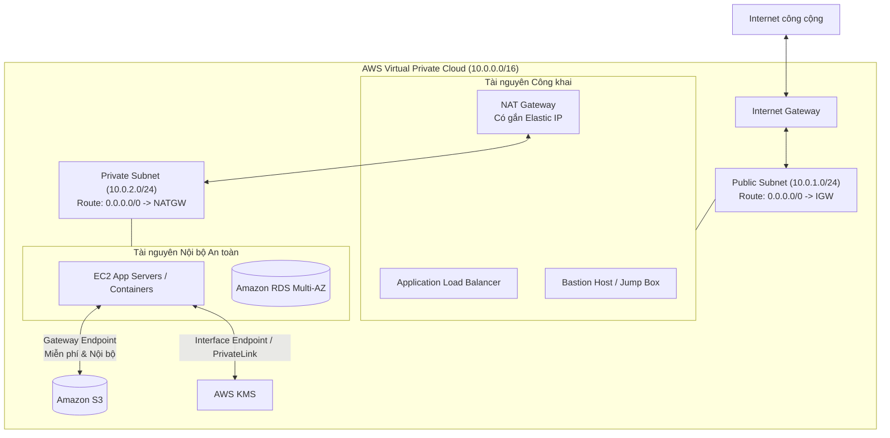
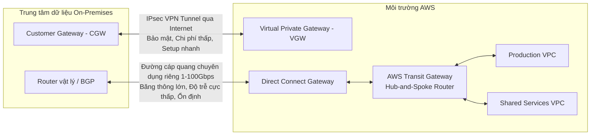
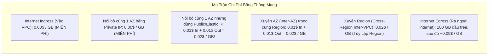

# Tài Liệu Học Tập Chuyên Sâu: Amazon VPC & Kiến Trúc Mạng Đám Mây Doanh Nghiệp (Virtual Private Cloud)

> **Tài liệu chuẩn hóa kiến trúc đám mây**: Hướng dẫn toàn diện theo tiêu chuẩn Senior AWS Solutions Architect & Cloud DevOps Engineer.  
> **Ngôn ngữ**: Tiếng Việt (Bảo lưu toàn bộ thuật ngữ chuyên ngành tiếng Anh chuẩn AWS).  
> **Các bài giảng liên quan**: Chương 27 (Networking - VPC: Bài 313 đến Bài 350).

---

## 6.1. Tổng Quan Dịch Vụ (Service Overview)

### Dịch vụ gì?
**Amazon Virtual Private Cloud (Amazon VPC)** là nền tảng mạng riêng ảo cô lập logic dành riêng cho tài khoản AWS của bạn. VPC mang lại toàn quyền kiểm soát môi trường mạng ảo, bao gồm việc lựa chọn dải địa chỉ IP (CIDR), tạo các mạng con (Subnets), cấu hình bảng định tuyến (Route Tables), cổng kết nối mạng (Network Gateways), và các lớp tường lửa bảo vệ nhiều tầng (Security Groups & Network ACLs).

### Tầm quan trọng sống còn:
Mọi kiến trúc hạ tầng tính toán (EC2, ECS, RDS, Lambda in VPC, Redshift) đều bắt buộc phải hoạt động bên trong một VPC. Thiết kế VPC chuẩn mực là bước đi đầu tiên quyết định sự an toàn, khả năng mở rộng quy mô, và chi phí truyền dữ liệu của toàn bộ hệ thống doanh nghiệp trên AWS.

---

## 6.2. Các Khái Niệm và Thành Phần Cốt Lõi (Core Concepts and Components)

### 1. Dải địa chỉ IP và Quy tắc 5 Địa chỉ IP Dành Riêng (5 Reserved IPs)
- **Dải CIDR cho phép trong VPC**: Từ `/16` (tối đa 65,536 IPs) đến `/28` (tối thiểu 16 IPs).
- **Quy tắc 5 địa chỉ IP bị AWS giữ lại trên MỖI Subnet**:
  *Ví dụ với Subnet `10.0.0.0/24` (tổng cộng 256 địa chỉ IP, nhưng **chỉ có 251 IP khả dụng** cho máy ảo)*:
  1. `10.0.0.0`: **Network Address** (Địa chỉ mạng).
  2. `10.0.0.1`: **VPC Router** (Địa chỉ bộ định tuyến nội bộ của AWS).
  3. `10.0.0.2`: **DNS Server** (Địa chỉ máy chủ phân giải tên miền AmazonProvidedDNS).
  4. `10.0.0.3`: **Future Use** (Dành riêng cho các tính năng mở rộng trong tương lai của AWS).
  5. `10.0.0.255`: **Network Broadcast Address** (Địa chỉ quảng bá - AWS không hỗ trợ broadcast nhưng vẫn giữ lại theo chuẩn IP).

### 2. So Sánh Hai Lớp Tường Lửa: Security Groups vs Network ACLs (NACLs)

| Tiêu chuẩn so sánh | Security Group (SG) | Network ACL (NACL) |
| :--- | :--- | :--- |
| **Cấp độ hoạt động** | **Cấp độ Card mạng ảo (ENI / Instance Level)**. | **Cấp độ Mạng con (Subnet Level)**. |
| **Quy tắc trạng thái** | **Stateful (Có trạng thái)**: Traffic vào được cho phép thì traffic phản hồi tự động được đi ra. | **Stateless (Phi trạng thái)**: Phải mở cả chiều Inbound và chiều Outbound riêng biệt (kèm Ephemeral Ports). |
| **Loại luật hỗ trợ** | **Chỉ hỗ trợ luật CHO PHÉP (ALLOW only)**. | **Hỗ trợ cả luật ALLOW và luật CHẶN (DENY)**. |
| **Thứ tự xử lý luật** | Toàn bộ các luật được đánh giá đồng thời. | **Xử lý theo số thứ tự (Rule Number từ 1 đến 32766)**; luật số nhỏ hơn được ưu tiên xử lý trước. |
| **Kịch bản chặn IP xấu**| **Không thể chặn 1 IP cụ thể** (chỉ có thể không cho phép). | **Lý tưởng để chặn tức thời một địa chỉ IP hacker** (Ví dụ: Rule 100: Deny `203.0.113.5/32`). |

### 3. Giải Pháp Ra Internet Cho Mạng Riêng: NAT Instances vs NAT Gateways

| Tiêu chuẩn | NAT Instance (Tự dựng trên EC2) | NAT Gateway (Dịch vụ quản lý của AWS) |
| :--- | :--- | :--- |
| **Quản trị hạ tầng** | Tự quản trị OS, cấu hình iptables, vá lỗi bảo mật. | Hoàn toàn được AWS quản lý (Fully Managed). |
| **Tính khả dụng cao** | **Kém**: Chạy trên 1 EC2 duy nhất (SPOF); muốn HA phải tự viết script chuyển đổi ENI phức tạp. | **Rất cao**: Tự động dự phòng trong 1 AZ; triển khai đa AZ bằng cách tạo 1 NAT GW cho mỗi AZ. |
| **Băng thông** | Phụ thuộc vào kích cỡ máy ảo EC2. | **Tự động mở rộng từ 5 Gbps lên tới 100 Gbps**. |
| **Yêu cầu mạng** | Phải tắt thuộc tính **Source/Destination Check** trên card mạng ENI. | Không cần tắt Source/Dest check; bắt buộc gắn **Elastic IP**. |
| **Chi phí** | Chi phí máy ảo EC2 On-Demand/Spot. | Phí cố định theo giờ (~0.045$/h) + **Phí xử lý dữ liệu theo GB** (0.045$/GB). |

### 4. Kết Nối Riêng Tư: VPC Endpoints (Gateway vs Interface Endpoints)
- **VPC Endpoint** cho phép tài nguyên trong Private Subnet kết nối an toàn tới các dịch vụ AWS bên ngoài mà **không cần đi qua Internet Gateway, NAT Gateway hay Public IP**.
- **Hai loại VPC Endpoints**:
  1. **Gateway Endpoints**:
     - Hoạt động như một đích đến trong **Bảng định tuyến (Route Table target)**.
     - **HOÀN TOÀN MIỄN PHÍ**.
     - **Chỉ hỗ trợ duy nhất 2 dịch vụ**: **Amazon S3** và **Amazon DynamoDB**.
  2. **Interface Endpoints (AWS PrivateLink)**:
     - Tạo ra một card mạng ảo **ENI riêng** nằm trực tiếp bên trong subnet của bạn với địa chỉ Private IP nội bộ.
     - **Tính phí**: Phí theo giờ duy trì ENI + Phí truyền dữ liệu theo GB.
     - Hỗ trợ hầu hết tất cả các dịch vụ AWS còn lại (CloudWatch, SQS, SNS, KMS, Secrets Manager, ECR...) và các dịch vụ của đối tác thứ ba.

### 5. Kết Nối Doanh Nghiệp & Mạng Lai (Hybrid Connectivity)

1. **AWS Site-to-Site VPN**:
   - Kết nối mạng riêng ảo qua Internet công cộng bằng giao thức **IPsec**.
   - Cần **Customer Gateway (CGW)** ở phía On-Premises và **Virtual Private Gateway (VGW)** ở phía AWS. Thiết lập nhanh chóng trong 30 phút, chi phí thấp, lưu lượng được mã hóa an toàn.
2. **AWS Direct Connect (DX)**:
   - Đường cáp quang vật lý chuyên dụng riêng biệt nối từ Trung tâm dữ liệu của bạn tới điểm kết nối của AWS (không đi qua Internet công cộng).
   - Băng thông khổng lồ (1 Gbps, 10 Gbps, 100 Gbps), độ trễ cực thấp, tính ổn định tuyệt đối; thích hợp cho việc truyền dữ liệu Big Data hàng ngày.
   - *Kết hợp chuẩn mực*: **Direct Connect + Site-to-Site VPN** (vừa tận dụng đường truyền tốc độ cao vừa mã hóa IPsec toàn bộ dữ liệu trên đường truyền, hoặc dùng VPN làm đường dự phòng khi Direct Connect đứt cáp).
3. **AWS Transit Gateway (TGW)**:
   - Bộ định tuyến trung tâm thông minh theo mô hình **Hub-and-Spoke**, thay thế cho mạng lưới kết nối chéo phức tạp (Mesh VPC Peering).
   - Hỗ trợ **Transitive Routing** (Định tuyến bắc cầu): Cho phép hàng trăm VPC và mạng On-Premises giao tiếp xuyên suốt với nhau thông qua một cổng trung chuyển duy nhất.

---

## 6.3. Bảng Tích Hợp với Các Dịch Vụ AWS Khác (Integration Table)

| Related AWS Service | Purpose (Mục đích tích hợp) | Integration Method (Phương thức tích hợp) | Practical Example (Ví dụ thực tiễn) |
| :--- | :--- | :--- | :--- |
| **Amazon Athena** | Phân tích và truy vấn nhật ký gói tin mạng | **VPC Flow Logs** đẩy về S3 ➔ Athena SQL | Truy vấn tìm kiếm các địa chỉ IP bên ngoài gửi nhiều gói tin bị REJECT nhất trong ngày qua bảng `vpc_flow_logs`. |
| **AWS Network Firewall** | Tường lửa kiểm tra sâu gói tin mạng (Deep Packet Inspection) | Gắn Firewall Endpoint vào Subnet chuyên dụng | Quét và chặn các gói tin chứa mã độc hoặc ngăn chặn máy chủ nội bộ kết nối tới các tên miền lừa đảo (Domain filtering). |
| **AWS KMS** | Quản lý khóa mã hóa cho các kết nối VPN và Flow Logs | KMS CMK Encryption | Mã hóa toàn bộ dữ liệu nhật ký lưu lượng VPC Flow Logs trước khi ghi vào CloudWatch Logs hoặc S3. |

---

## 6.4. Mô Hình Tính Phí Dịch Vụ Mạng & Chiến Lược Tối Ưu Chi Phí Theo Từng Use Case (VPC Cost Breakdown & Optimization)

Trong thiết kế kiến trúc đám mây AWS, **Chi phí Mạng (Networking & Data Transfer Costs)** là một trong những nguồn phát sinh chi phí tiềm ẩn ("Silent Budget Killer") lớn nhất nếu kỹ sư không nắm vững cơ chế định tuyến và mô hình tính tiền.

---

### 6.4.1. Bản Đồ Cơ Chế Tính Phí Các Thành Phần Mạng (VPC Pricing Model)

| Thành phần Dịch vụ (Component) | Có tính phí hay Miễn phí? | Cơ chế tính phí chi tiết (Pricing Dimensions) | Lưu ý rủi ro chi phí (Cost Pitfalls) |
| :--- | :--- | :--- | :--- |
| **VPC, Subnets, Route Tables, Internet Gateway (IGW), Security Groups, NACLs** | **MIỄN PHÍ 100%** | Khởi tạo, duy trì và sử dụng không giới hạn hoàn toàn miễn phí. | Không có chi phí cố định cho hạ tầng mạng cốt lõi này. |
| **VPC Peering (Cùng Region)** | **MIỄN PHÍ KẾT NỐI** | **0$ / giờ** kết nối, **0$ / GB** phí xử lý dữ liệu. Chỉ tính phí Data Transfer liên AZ ($0.01/GB mỗi chiều). | Rẻ nhất để kết nối giữa 2 hoặc 3 VPC trong cùng Region. |
| **NAT Gateway** | **TÍNH PHÍ ĐẮP KÉP** | 1. **Phí giờ cố định**: ~$0.045 / giờ / NAT GW (~$32.40 / tháng / AZ). 2. **Phí xử lý dữ liệu (Data Processing)**: ~$0.045 / GB. 3. **Phí Data Transfer Out ra Internet**: ~$0.09 / GB. | Nếu tải 10 TB dữ liệu từ Private Subnet lên S3 qua NAT Gateway sẽ tốn thêm **$450/tháng** tiền vô ích! |
| **VPC Gateway Endpoints (S3 & DynamoDB)** | **MIỄN PHÍ 100%** | **0$ / giờ**, **0$ / GB** dữ liệu truyền tải. | Luôn luôn phải bật cho mọi VPC có truy cập tới S3 hoặc DynamoDB. |
| **VPC Interface Endpoints (AWS PrivateLink)** | **TÍNH PHÍ** | 1. **Phí giờ ENI**: ~$0.01 / giờ / AZ (~$7.20 / tháng / AZ). 2. **Phí xử lý dữ liệu**: ~$0.01 / GB. | Cần cân nhắc giữa số lượng AZ triển khai Endpoint và lưu lượng truyền tải thực tế. |
| **AWS Transit Gateway (TGW)** | **TÍNH PHÍ CAO** | 1. **Phí kết nối (Attachment fee)**: ~$0.05 / giờ / VPC attachment (~$36.00 / tháng / VPC). 2. **Phí xử lý dữ liệu**: ~$0.02 / GB. | Chỉ nên dùng khi có nhiều hơn 5-10 VPC kết nối phức tạp (Mesh) hoặc kết nối đa tài khoản + On-Premises. |
| **AWS Site-to-Site VPN** | **TÍNH PHÍ** | 1. **Phí kết nối**: ~$0.05 / giờ / VPN connection (~$36.00 / tháng). 2. **Phí Data Transfer Out** trả về On-Premises (~$0.09 / GB). | Dù không có traffic chạy qua thì phí duy trì kết nối vẫn được tính 24/7. |
| **AWS Direct Connect (DX)** | **TÍNH PHÍ CỐ ĐỊNH + DTO RẺ** | 1. **Phí cổng (Port fee)**: 1G (~$0.30/h ≈ $216/tháng), 10G (~$2.25/h ≈ $1,620/tháng). 2. **Phí Data Transfer Out (DTO)**: Giảm xuống chỉ còn **~$0.02 / GB** (so với $0.09 / GB của Internet). | Cực kỳ tiết kiệm chi phí băng thông nếu doanh nghiệp truyền tải từ hàng chục đến hàng trăm Terabytes/tháng. |
| **Địa chỉ Public IPv4** | **TÍNH PHÍ MỌI TRƯỜNG HỢP** | Kể từ 01/02/2024: AWS tính phí **$0.005 / giờ / Public IPv4** (~$3.65 / tháng / IP) cho cả IP đang gắn (In-use) và IP nhàn rỗi (Idle). | Cần giảm thiểu gán Public IP cho máy ảo, chuyển sang Private Subnet + SSM. |
| **VPC Flow Logs** | **TÍNH PHÍ THEO NƠI LƯU TRỮ** | - Đẩy về **CloudWatch Logs**: $0.50 / GB phí nạp (Ingestion) + $0.03 / GB lưu trữ/tháng. - Đẩy về **Amazon S3**: ~$0.023 / GB lưu trữ (rẻ hơn 20 lần!). | Bật Flow Logs trên VPC lưu lượng lớn đẩy về CloudWatch Logs sẽ gây nổ hóa đơn hàng nghìn USD! |

---

### 6.4.2. Bản Đồ Chi Phí Băng Thông Truyền Tải Dữ Liệu (Data Transfer Costs Matrix)

---

### 6.4.3. Chiến Lược Tối Ưu Hóa Chi Phí Theo 8 Kịch Bản Thực Tế (Use Cases Optimization)

#### Use Case 1: Tải dữ liệu lớn từ EC2 trong Private Subnet lên S3 hoặc DynamoDB
* **Vấn đề & Cách tính tiền cũ**:
  - Máy ảo EC2 trong Private Subnet gửi dữ liệu backup/log lên Amazon S3 qua NAT Gateway mặc định.
  - Chi phí: NAT Gateway tính phí xử lý dữ liệu **$0.045 / GB**.
  - Ví dụ: Ứng dụng đẩy **20 TB** log/backup lên S3 mỗi tháng:
    $$\text{Chi phí NAT GW} = 20,000 \text{ GB} \times 0.045\$/\text{GB} = \mathbf{900\$/\text{tháng}}$$
* **Giải pháp Tối ưu kiến trúc**:
  - Tạo một **VPC Gateway Endpoint** cho Amazon S3 và DynamoDB, gắn trực tiếp vào Route Table của Private Subnet.
  - Gateway Endpoint hoạt động ở tầng định tuyến, **hoàn toàn MIỄN PHÍ** ($0/giờ, $0/GB). Lưu lượng đi thẳng qua mạng Backbone riêng của AWS mà không cần qua NAT Gateway.
  - **Kết quả tiết kiệm**: Tiết kiệm ngay **$900/tháng (100% chi phí chuyển tải)**, đồng thời tăng băng thông và giảm độ trễ truy xuất S3.

#### Use Case 2: Kiến trúc NAT Gateway cho Môi trường Dev/Test vs Production
* **Vấn đề & Cách tính tiền cũ**:
  - Triển khai kiến trúc chuẩn High Availability (HA) với 3 Availability Zones (AZ-a, AZ-b, AZ-c).
  - Khởi tạo 3 NAT Gateways (mỗi AZ 1 chiếc) cho cả môi trường Development và Production.
  - Chi phí cố định cho 3 NAT Gateways:
    $$\text{Chi phí cố định} = 3 \times (0.045\$ \times 24 \times 30) = \mathbf{97.20\$/\text{tháng / VPC}}$$
  - Với 3 môi trường Dev, Test, UAT: Tốn gần **$300/tháng** chỉ để duy trì các NAT Gateway gần như không hoạt động.
* **Giải pháp Tối ưu kiến trúc**:
  - **Môi trường Production**: Giữ nguyên kiến trúc **Multi-NAT Gateway** (1 NAT GW cho mỗi AZ) để đảm bảo High Availability, tránh trường hợp 1 AZ bị sự cố làm mất kết nối Internet của toàn bộ hệ thống.
  - **Môi trường Dev / Test / Staging**: Chỉ tạo **1 NAT Gateway duy nhất** đặt tại Public Subnet của AZ-a. Cấu hình Route Table của tất cả Private Subnet ở cả 3 AZ trỏ về NAT Gateway duy nhất này.
  - **Kết quả tiết kiệm**: Cắt giảm 2 NAT Gateway cho mỗi VPC non-production, tiết kiệm **$64.80/tháng trên mỗi VPC**, giảm hơn 66% hóa đơn NAT cố định.

#### Use Case 3: Kết nối giữa nhiều VPC trong cùng tổ chức (VPC Peering vs Transit Gateway)
* **Vấn đề & So sánh chi phí**:
  - Một doanh nghiệp có 4 VPC cần trao đổi dữ liệu với nhau (ví dụ: Dev, Staging, Prod, Shared Services).
  - *Nếu dùng Transit Gateway*: Phải tạo 4 attachments. Chi phí = $4 \times 0.05 \times 720 = \mathbf{144\$/\text{tháng}}$ (chưa tính phí $0.02/GB xử lý dữ liệu).
  - *Nếu dùng VPC Peering*: Khởi tạo kết nối điểm-điểm giữa các VPC. Chi phí = **0$ tiền duy trì cố định, 0$ tiền xử lý dữ liệu**.
* **Giải pháp Tối ưu kiến trúc**:
  - **Quy tắc vàng (Rule of Thumb)**:
    - Khi số lượng VPC **nhỏ hơn hoặc bằng 5-10 VPCs** và mô hình lưu lượng ổn định: Sử dụng **VPC Peering** để đạt chi phí tối thiểu ($0 cố định).
    - Khi số lượng VPC **từ hàng chục đến hàng trăm VPCs** và kết nối qua lại phức tạp (Full Mesh) hoặc cần kết nối bắc cầu (Transitive Routing) với Direct Connect / On-Premises: Sử dụng **AWS Transit Gateway** để giảm thiểu chi phí quản lý vận hành (Operational Overhead), chấp nhận chi phí TGW để tránh bẫy lỗi định tuyến.

#### Use Case 4: Cụm máy chủ xử lý dữ liệu lớn (Big Data, Kafka, Elasticsearch, Distributed DB)
* **Vấn đề & Cách tính tiền cũ**:
  - Cụm Kafka broker hoặc MongoDB replica được triển khai phân tán ngẫu nhiên qua 3 AZs.
  - Khi producer gửi dữ liệu và broker thực hiện replication dữ liệu nội bộ liên tục (ví dụ: 50 TB/tháng xuyên AZ):
  - Chi phí truyền dữ liệu Inter-AZ:
    $$\text{Chi phí Inter-AZ} = 50,000 \text{ GB} \times (0.01\$ \text{ Out} + 0.01\$ \text{ In}) = \mathbf{1,000\$/\text{tháng}}$$
* **Giải pháp Tối ưu kiến trúc**:
  - Đối với các cụm máy chủ xử lý tác vụ tính toán chuyên sâu (HPC, Batch Processing, Analytics) không yêu cầu tính sẵn sàng cao đa vùng: Gom toàn bộ vào **cùng 1 Availability Zone** và sử dụng **Cluster Placement Group**.
    - Chi phí Data Transfer nội bộ trong cùng 1 AZ bằng Private IP = **0$ / GB (Hoàn toàn Miễn phí)**.
    - Đạt băng thông card mạng tối đa lên tới 100 Gbps và độ trễ cực thấp (< 1ms).
  - Đối với các dịch vụ bắt buộc phải chạy Multi-AZ: Sử dụng cơ chế định tuyến **AZ-Affinity** (Client ở AZ nào thì ưu tiên gọi Service/Read-Replica ở AZ đó thông qua ALB hoặc Service Discovery) để hạn chế tối đa các luồng dữ liệu xuyên AZ.

#### Use Case 5: Cắt giảm chi phí Địa chỉ Public IPv4 ($0.005/h)
* **Vấn đề & Cách tính tiền cũ**:
  - Kể từ ngày 01/02/2024, AWS áp dụng mức phí **$0.005 / giờ** cho TẤT CẢ địa chỉ Public IPv4.
  - Một doanh nghiệp có 40 máy ảo EC2 đặt ở Public Subnet để kỹ sư SSH, 5 Bastion Hosts, 3 NAT Gateway EIPs:
    $$\text{Chi phí IPv4} = 48 \text{ IPs} \times 0.005\$ \times 720 = \mathbf{172.80\$/\text{tháng}}$$
* **Giải pháp Tối ưu kiến trúc**:
  - **Loại bỏ hoàn toàn Bastion Host và Public IP trên EC2**: Đưa toàn bộ máy ảo EC2 vào **Private Subnet** (tắt chế độ Auto-assign Public IPv4).
  - **Sử dụng AWS Systems Manager (SSM) Session Manager**: Cho phép kỹ sư DevOps truy cập shell máy chủ từ AWS Console/CLI qua kênh bảo mật IAM mà không cần mở Port 22, không cần Public IP và không cần Bastion Host.
  - **Chỉ công khai các điểm truy cập cần thiết**: Đặt Application Load Balancer (ALB) hoặc API Gateway ở Public Subnet làm cổng vào duy nhất cho người dùng.
  - **Kết quả tiết kiệm**: Tiết kiệm hàng trăm USD mỗi tháng tiền IPv4, đồng thời tăng cường đáng kể tính bảo mật cho toàn bộ hạ tầng (Zero Public Exposure).

#### Use Case 6: Phục vụ lưu lượng Web & Tải File ra ngoài Internet
* **Vấn đề & Cách tính tiền cũ**:
  - Máy chủ EC2 hoặc S3 trực tiếp phân phối hình ảnh, video và giao diện web cho người dùng Internet trên toàn thế giới.
  - Mức phí Data Transfer Out từ EC2/S3 ra Internet rất đắt: **~$0.09 / GB**.
  - Ví dụ phân phối 50 TB/tháng: $50,000 \times 0.09\$ = \mathbf{4,500\$/\text{tháng}}$.
* **Giải pháp Tối ưu kiến trúc**:
  - Triển khai **Amazon CloudFront** ở phía trước làm tầng CDN caching:
    1. Dữ liệu truyền từ EC2 / ALB / S3 tới CloudFront Edge Locations là **0$ (HOÀN TOÀN MIỄN PHÍ - Free Origin Fetch)**.
    2. Với tỷ lệ Cache Hit đạt 75%, 37.5 TB dữ liệu được phân phối trực tiếp từ Edge Cache.
    3. Đăng ký chương trình **CloudFront Security Savings Bundle** để được chiết khấu lên đến 30% chi phí phân phối nội dung ra Internet.
  - **Kết quả tiết kiệm**: Tiết kiệm từ 30% đến 60% tổng chi phí băng thông phân phối toàn cầu, tăng tốc độ tải trang cho người dùng cuối gấp 5 lần.

#### Use Case 7: Di chuyển khối lượng dữ liệu khổng lồ giữa On-Premises và AWS (Hybrid Cloud)
* **Vấn đề & So sánh chi phí**:
  - Doanh nghiệp cần đồng bộ 100 TB dữ liệu sao lưu mỗi tháng từ AWS trở lại Data Center On-Premises.
  - *Nếu truyền qua AWS Site-to-Site VPN (qua mạng Internet)*:
    $$\text{Chi phí DTO Internet} = 100,000 \text{ GB} \times 0.09\$ = \mathbf{9,000\$/\text{tháng}}$$
  - *Nếu truyền qua AWS Direct Connect (DX)*:
    - Phí cổng Direct Connect 1 Gbps cố định: ~$216/tháng.
    - Phí Data Transfer Out qua DX giảm xuống chỉ còn **$0.02 / GB**:
      $$\text{Chi phí DTO Direct Connect} = 100,000 \text{ GB} \times 0.02\$ = 2,000\$$
      $$\text{Tổng chi phí DX} = 216\$ + 2,000\$ = \mathbf{2,216\$/\text{tháng}}$$
* **Kết quả tối ưu**:
  - Tiết kiệm **$6,784/tháng (~75% chi phí)** so với việc truyền dữ liệu qua Internet VPN.
  - Đường truyền cáp quang vật lý đạt tính ổn định tuyệt đối và độ trễ dưới 5ms.

#### Use Case 8: Thu thập và kiểm toán nhật ký mạng (VPC Flow Logs Optimization)
* **Vấn đề & Cách tính tiền cũ**:
  - Bật VPC Flow Logs để kiểm tra an ninh trên toàn bộ VPC bận rộn với hàng chục dịch vụ Microservices.
  - Đẩy toàn bộ log (ví dụ: 1 TB log thô/tháng) vào Amazon CloudWatch Logs:
    - Phí nạp dữ liệu (Log Ingestion): $1,000 \text{ GB} \times 0.50\$ = \mathbf{500\$/\text{tháng}}$.
    - Phí lưu trữ dữ liệu (Log Storage): $1,000 \text{ GB} \times 0.03\$ = \mathbf{30\$/\text{tháng}}$.
* **Giải pháp Tối ưu kiến trúc**:
  - Cấu hình đích đến của VPC Flow Logs trực tiếp vào **Amazon S3**:
    - Phí nạp dữ liệu vào S3: **0$ / GB (Miễn phí nạp)**.
    - Phí lưu trữ S3 Standard: $1,000 \text{ GB} \times 0.023\$ = \mathbf{23\$/\text{tháng}}$.
    - Thiết lập S3 Lifecycle Rule tự động nén và đẩy log sang **S3 Glacier Deep Archive** sau 30 ngày (chi phí lưu trữ chỉ còn **$0.00099 / GB / tháng**).
  - Khi cần điều tra sự cố bảo mật: Sử dụng **Amazon Athena** để truy vấn trực tiếp file log trên S3 bằng câu lệnh SQL tiêu chuẩn (chỉ tốn $5 / TB dữ liệu được quét).
  - **Kết quả tiết kiệm**: Giảm chi phí lưu trữ và phân tích nhật ký mạng từ $530/tháng xuống dưới **$25/tháng (Tiết kiệm > 95%)**.

---

## 6.5. Khắc Phục Sự Cố Thực Tế (Troubleshooting Guide)

| Vấn đề (Problem) | Nguyên nhân khả dĩ (Possible Causes) | Các bước điều tra (Investigation Steps) | Giải pháp (Solution) | Biện pháp phòng ngừa (Prevention) |
| :--- | :--- | :--- | :--- | :--- |
| **Máy ảo trong Public Subnet không thể truy cập Internet** | 1. Chưa gắn Internet Gateway vào VPC. 2. Route Table thiếu đường `0.0.0.0/0 -> igw`. 3. Máy ảo không có Public IPv4. | 1. Kiểm tra Route Table của Subnet. 2. Kiểm tra xem instance có Public IP không. | Gắn IGW vào VPC, thêm luật định tuyến ra IGW và cấp Elastic IP cho máy ảo. | Bật tính năng "Auto-assign public IPv4" trên Public Subnet. |
| **Máy ảo trong Private Subnet không thể tải bản vá lỗi từ Internet** | 1. NAT Gateway đặt nhầm vào Private Subnet. 2. Route Table của Private Subnet chưa trỏ `0.0.0.0/0 -> nat-gateway`. 3. NAT Gateway chưa gắn Elastic IP. | 1. Kiểm tra vị trí đặt NAT Gateway (phải nằm ở Public Subnet). 2. Kiểm tra Route Table của Private Subnet. | Đặt NAT Gateway vào đúng Public Subnet và cấu hình bảng định tuyến cho Private Subnet. | Thiết kế sơ đồ mạng rõ ràng trước khi khởi tạo hạ tầng. |
| **Hai VPC đã thiết lập VPC Peering nhưng không ping thấy nhau** | 1. Dải CIDR của 2 VPC bị trùng lặp (Overlapping CIDR). 2. Bảng định tuyến của CẢ HAI VPC chưa được cập nhật đường dẫn sang nhau. 3. Security Group chặn giao thức ICMP/TCP. | 1. Kiểm tra Route Table của VPC A xem có trỏ dải CIDR của VPC B sang Peering Connection (`pcx-xxxx`) chưa và ngược lại. 2. Kiểm tra Security Group. | Cập nhật Route Table ở cả 2 đầu và mở Security Group cho phép traffic từ dải IP đối tác. | Nhớ nguyên tắc: Thiết lập Peering phải cập nhật Route Table ở cả hai phía. |
| **Máy ảo bị chặn kết nối dù Security Group đã mở đúng cổng** | Bị chặn bởi **Network ACL (NACL)** ở tầng Subnet (do có luật DENY hoặc quên mở dải cổng tạm thời Ephemeral Ports 1024-65535 ở chiều Outbound). | Bật **VPC Flow Logs** để kiểm tra gói tin bị `REJECT` ở tầng nào (SG hay NACL). | Mở cổng phản hồi Ephemeral Ports trên NACL Inbound/Outbound. | Giữ Network ACL ở trạng thái mặc định (Allow all) trừ khi có nhu cầu chặn IP cụ thể. |

---

## 6.6. Bộ Câu Hỏi Ôn Tập và Kiểm Tra Kiến Thức (Knowledge Review)

### A. 10 Câu hỏi Cốt lõi (Core Concepts)
1. Trong một Subnet có dải mạng `10.0.1.0/24`, tổng số địa chỉ IPv4 khả dụng thực tế mà bạn có thể cấp phát cho máy ảo EC2 là bao nhiêu?
2. Sự khác biệt cốt lõi nhất về mặt trạng thái (Stateful vs Stateless) giữa Security Groups và Network ACLs là gì?
3. Hai dịch vụ AWS nào được hỗ trợ kết nối miễn phí thông qua **VPC Gateway Endpoints**?
4. Điều kiện kỹ thuật bắt buộc khi cấu hình một **NAT Gateway** để máy ảo trong Private Subnet có thể kết nối ra ngoài Internet là gì?
5. Tính năng kết nối nào của AWS cho phép bạn liên kết hàng trăm VPC và mạng On-Premises lại với nhau theo cấu trúc hình sao (Hub-and-Spoke) và hỗ trợ định tuyến bắc cầu (Transitive Routing)?
6. Tại sao kết nối **VPC Peering** không hỗ trợ tính năng định tuyến bắc cầu (Non-transitive)?
7. Bạn muốn ghi lại toàn bộ thông tin các gói tin IP mạng đi vào và đi ra khỏi các card mạng ảo ENI trong VPC (bao gồm cờ ACCEPT hoặc REJECT) để phục vụ kiểm toán an ninh, bạn phải bật tính năng gì?
8. Dịch vụ nào cung cấp đường truyền cáp quang vật lý chuyên dụng riêng biệt từ trung tâm dữ liệu On-Premises tới AWS mà không đi qua mạng Internet công cộng?
9. Cổng mạng nào (Network Port) và giao thức nào được sử dụng để kết nối vào máy chủ Linux thông qua Bastion Host (Jump Box)?
10. Loại Internet Gateway nào được thiết kế chuyên biệt để chỉ cho phép máy ảo sử dụng địa chỉ **IPv6** kết nối ra ngoài Internet nhưng ngăn chặn Internet kết nối chủ động vào trong?

---

### Đáp án Bộ Câu Hỏi Ôn Tập (Answer Key)

👉 Nhấp vào đây để xem toàn bộ đáp án chi tiết

1. **251 địa chỉ IP** (Tổng số 256 trừ đi 5 địa chỉ IP mà AWS giữ lại riêng cho mục đích quản trị mạng: Network, Router, DNS, Future use, Broadcast).
2. **Security Groups là Stateful (Có trạng thái)**: Khi một kết nối Inbound được cho phép, kết nối Outbound phản hồi tự động được thông suốt; trong khi **Network ACLs là Stateless (Phi trạng thái)**: Bắt buộc phải mở cả 2 chiều Inbound và Outbound riêng biệt.
3. **Amazon S3** và **Amazon DynamoDB**.
4. NAT Gateway **bắt buộc phải được đặt trong một Public Subnet** (Subnet có Route Table trỏ trực tiếp ra Internet Gateway) và **phải được gắn một địa chỉ IP tĩnh công khai (Elastic IP)**.
5. **AWS Transit Gateway**.
6. Vì AWS thiết kế VPC Peering là kết nối điểm-điểm trực tiếp giữa 2 VPC riêng biệt (Point-to-Point); nếu VPC A nối với VPC B, và VPC B nối với VPC C, thì VPC A không thể tự động đi xuyên qua B để sang C được. Muốn A sang C, bạn bắt buộc phải tạo thêm Peering giữa A và C, hoặc sử dụng Transit Gateway.
7. Bật tính năng **VPC Flow Logs**.
8. **AWS Direct Connect**.
9. Cổng **Port 22** (giao thức **SSH**).
10. **Egress-Only Internet Gateway** (đóng vai trò tương tự như NAT Gateway của mạng IPv4 nhưng dành riêng cho không gian địa chỉ IPv6).

---

## 6.7. Tóm Tắt và Danh Mục Kiểm Tra Kiến Thức (Summary & Learning Checklist)

### 5 Khái niệm quan trọng nhất phải nhớ:
1. **Quy tắc 5 IPs dành riêng**: Luôn trừ 5 IP khi tính toán dung lượng subnet.
2. **SG (Stateful, ENI level) vs NACL (Stateless, Subnet level, hỗ trợ Deny rule)**.
3. **NAT Gateway**: Đặt ở Public Subnet + gắn Elastic IP; Private Subnet trỏ `0.0.0.0/0` vào NAT GW.
4. **VPC Endpoints**: Gateway Endpoints (S3/DynamoDB, miễn phí); Interface Endpoints (PrivateLink, trả phí qua ENI).
5. **Transit Gateway**: Giải pháp tối thượng cho kiến trúc mạng doanh nghiệp đa VPC và Hybrid Cloud.

### Liên kết và Chủ đề tiếp theo:
- 📖 [Ghi Chú Bài Học Chương 27: Mạng VPC Toàn Tập](file:///n:/AWS_XBrain_Note/Lesson_Notes/27_Networking_VPC_Comprehensive.md)
- 📖 [Bảng Thuật Ngữ Kỹ Thuật (GLOSSARY.md)](file:///n:/AWS_XBrain_Note/GLOSSARY.md)
- ⏭️ Tiếp tục chuyển sang chuyên đề: **Giám Sát, Kiểm Toán & Khả Năng Quan Sát: Amazon CloudWatch, CloudTrail & AWS Config**.
