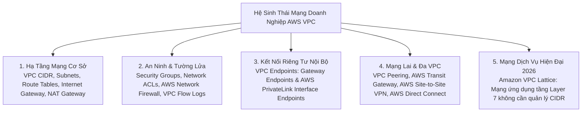
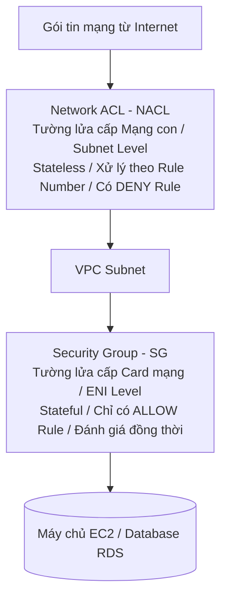
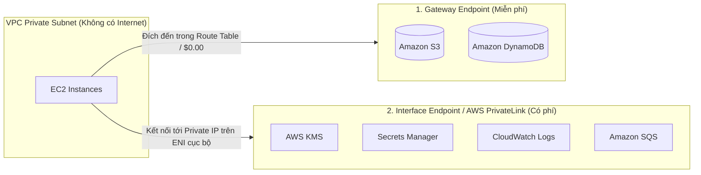
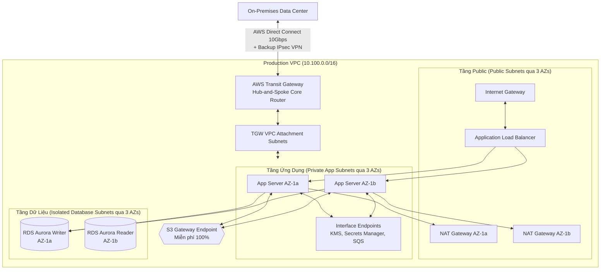

# Tài Liệu Học Tập Chuyên Sâu: Amazon VPC & Kiến Trúc Mạng Đám Mây Doanh Nghiệp (Virtual Private Cloud)

> **Tài liệu chuẩn hóa kiến trúc đám mây**: Hướng dẫn toàn diện theo tiêu chuẩn Principal AWS Solutions Architect & Senior Cloud DevOps Engineer (Cập nhật phiên bản kiến trúc mới nhất 2026).  
> **Ngôn ngữ**: Tiếng Việt chuyên ngành (Bảo lưu toàn bộ thuật ngữ chuyên ngành tiếng Anh chuẩn AWS).  
> **Mục tiêu**: Phục vụ thi chứng chỉ cấp độ Professional/Specialty (**SAA-C03, SAP-C02, DOP-C02**) và vận hành hệ thống cấp độ doanh nghiệp (**Production-grade**).  
> **Các bài giảng liên quan**: Chương 27 (Networking - VPC: Bài 313 đến Bài 350).

---

## 6.1. Tổng Quan Dịch Vụ (Service Overview)

### 1. Định nghĩa chuẩn xác và Phân nhóm dịch vụ
**Amazon Virtual Private Cloud (Amazon VPC)** là nền tảng mạng riêng ảo cô lập về mặt logic dành riêng cho tài khoản AWS của bạn. VPC trao toàn quyền kiểm soát môi trường mạng ảo, bao gồm việc lựa chọn dải địa chỉ IP (CIDR), phân chia các mạng con (Subnets), cấu hình bảng định tuyến (Route Tables), cổng kết nối mạng (Network Gateways), và các lớp tường lửa bảo mật đa tầng (Security Groups & Network ACLs).

1. **Amazon VPC Core**: Nền tảng mạng cơ sở cô lập logic, nơi bắt buộc mọi tài nguyên tính toán (EC2, RDS, ECS, Lambda trong VPC) phải vận hành.
2. **AWS Transit Gateway (TGW)**: Bộ định tuyến trung tâm thông minh theo mô hình **Hub-and-Spoke**, cho phép kết nối hàng ngàn VPC và mạng trung tâm dữ liệu On-Premises với nhau qua một cổng duy nhất, hỗ trợ định tuyến bắc cầu (**Transitive Routing**).
3. **AWS PrivateLink & VPC Endpoints**: Kênh truyền thông riêng tư an toàn giúp các máy chủ trong Private Subnet kết nối tới các dịch vụ AWS hoặc dịch vụ SaaS của bên thứ ba mà **không cần đi qua Internet Gateway, NAT Gateway hay lộ Public IP**.
4. **Amazon VPC Lattice (Chuẩn mực 2026)**: Dịch vụ mạng tầng ứng dụng (**Application Networking Service**) giúp kết nối, bảo mật và giám sát các cuộc gọi giữa các dịch vụ (Service-to-Service) xuyên qua nhiều VPC và nhiều tài khoản AWS mà **không cần quan tâm đến xung đột dải địa chỉ IP (Overlapping CIDR) hay bảng định tuyến phức tạp**.

---

### 2. Bài toán cốt lõi mà VPC giải quyết

1. **Cô lập tuyệt đối môi trường mạng (Tenant Isolation)**: Đảm bảo tài nguyên của doanh nghiệp hoàn toàn tách biệt với các khách hàng khác trên đám mây của AWS.
2. **Phân vùng an ninh chuyên sâu (Defense in Depth)**: Thiết kế mô hình mạng nhiều lớp: **Public Subnet** (cho Load Balancers), **Private App Subnet** (cho máy chủ ứng dụng), và **Isolated Database Subnet** (hoàn toàn không có đường ra Internet).
3. **Mở rộng kết nối mạng lai an toàn (Hybrid Connectivity)**: Kết nối liền mạch trung tâm dữ liệu On-Premises với AWS qua đường cáp quang chuyên dụng **AWS Direct Connect** hoặc đường hầm mã hóa **AWS Site-to-Site VPN (IPsec)**.

---

### 3. Khi nào KHÔNG nên dùng hoặc Giải pháp thay thế

* ❌ **Kết nối Microservices xuyên tài khoản bị trùng lặp dải IP (Overlapping CIDRs)**: VPC Peering và Transit Gateway không thể kết nối hai mạng có dải IP trùng nhau (ví dụ cả hai bên đều dùng `10.0.0.0/16`).  
  👉 *Giải pháp thay thế*: Sử dụng **AWS PrivateLink** hoặc **Amazon VPC Lattice**.
* ❌ **Ứng dụng Serverless không có nhu cầu truy cập tài nguyên nội bộ trong VPC**: Gán Lambda vào VPC không cần thiết sẽ làm tăng độ phức tạp quản lý IP và tốn tài nguyên ENI.  
  👉 *Giải pháp thay thế*: Để Lambda chạy ở môi trường ngoài VPC mặc định để gọi S3/DynamoDB qua Internet an toàn.

---

## 6.2. Các Khái Niệm, Kiến Trúc & Vận Hành Cốt Lõi (Core Concepts, Security & Day-2 Operations)

### 1. Dải địa chỉ IP & Quy tắc 5 Địa chỉ IP Dành Riêng (The 5 Reserved IPs per Subnet)

* **Dải CIDR cho phép trong VPC**: Từ `/16` (tối đa 65,536 IPs) đến `/28` (tối thiểu 16 IPs).
* ⚠️ **QUY TẮC BẤT BIẾN TRONG THI CỬ VÀ QUY HOẠCH**: AWS luôn giữ lại **5 địa chỉ IP đầu và cuối** trên **MỖI Subnet** cho mục đích quản trị mạng nội bộ:
  *Ví dụ với Subnet `10.0.1.0/24` (tổng cộng 256 địa chỉ IP theo lý thuyết, nhưng **chỉ có đúng 251 IP khả dụng** cho máy ảo EC2)*:
  1. `10.0.1.0`: **Network Address** (Địa chỉ mạng của Subnet).
  2. `10.0.1.1`: **VPC Router** (Địa chỉ bộ định tuyến nội bộ mặc định của AWS).
  3. `10.0.1.2`: **DNS Server** (Địa chỉ máy chủ phân giải tên miền AmazonProvidedDNS / Route 53 Resolver).
  4. `10.0.1.3`: **Future Use** (Dành riêng cho các tính năng mở rộng trong tương lai của AWS).
  5. `10.0.1.255`: **Network Broadcast Address** (Địa chỉ quảng bá - AWS không hỗ trợ broadcast nhưng vẫn bảo lưu theo chuẩn IP).

---

### 2. So Sánh Hai Lớp Tường Lửa Mạng: Security Groups vs Network ACLs

| Tiêu chuẩn so sánh | Security Group (SG) | Network ACL (NACL) |
| :--- | :--- | :--- |
| **Cấp độ hoạt động** | **Cấp độ Card mạng ảo (ENI / Instance Level)**. | **Cấp độ Mạng con (Subnet Level)**. |
| **Quy tắc trạng thái** | **Stateful (Có trạng thái)**: Traffic vào được chấp thuận thì traffic phản hồi tự động được đi ra mà không cần mở rule Outbound. | **Stateless (Phi trạng thái)**: Bắt buộc phải mở cả chiều Inbound và chiều Outbound riêng biệt (kèm dải Ephemeral Ports). |
| **Loại luật hỗ trợ** | **Chỉ hỗ trợ luật CHO PHÉP (ALLOW only)**. | **Hỗ trợ cả luật CHO PHÉP (ALLOW) và luật CHẶN (DENY)**. |
| **Thứ tự xử lý luật** | Toàn bộ các luật được đánh giá đồng thời. | **Xử lý theo số thứ tự (Rule Number từ 1 đến 32766)**; số nhỏ hơn được ưu tiên thực thi trước. |
| **Chặn địa chỉ IP xấu** | **Không thể chặn 1 IP cụ thể** (chỉ có thể không cấp quyền). | **Lý tưởng để chặn tức thời một địa chỉ IP hacker** (Ví dụ: Rule 100: Deny `203.0.113.5/32`). |
| **Phạm vi bảo vệ** | Chỉ bảo vệ các tài nguyên được gán SG đó. | Bảo vệ toàn bộ tất cả tài nguyên nằm trong Subnet. |

---

### 3. Phân biệt giải pháp ra Internet cho mạng riêng: NAT Gateways vs NAT Instances

| Tiêu chuẩn kỹ thuật | NAT Gateway (Dịch vụ quản lý hoàn toàn của AWS) | NAT Instance (Tự cài đặt trên EC2) `[Legacy]` |
| :--- | :--- | :--- |
| **Quản trị hạ tầng** | **AWS quản lý 100%**: Không cần bảo trì OS, tự vá lỗi. | Khách hàng tự cài đặt Linux, cấu hình iptables, tự vá lỗi OS. |
| **Tính sẵn sàng cao (HA)** | **Tự động dự phòng trong 1 AZ**; mở rộng đa AZ bằng cách tạo 1 NAT GW cho mỗi AZ. | **Kém (SPOF)**: Chạy trên 1 EC2; muốn HA phải tự viết script chuyển đổi ENI phức tạp. |
| **Băng thông mạng** | **Tự động co giãn từ 5 Gbps lên tới 100 Gbps**. | Giới hạn theo băng thông card mạng của kiểu máy EC2 đã chọn. |
| **Cấu hình card mạng** | Không cần can thiệp; bắt buộc phải gắn **Elastic IP**. | **Bắt buộc phải tắt cờ `Source/Destination Check`** trên card mạng ENI. |
| **Cơ chế tính phí** | Phí theo giờ duy trì (~$0.045/h) + **Phí xử lý dữ liệu ($0.045/GB)**. | Tính phí máy ảo EC2 On-Demand hoặc Spot + phí ổ đĩa EBS. |

---

### 4. Kết nối riêng tư: VPC Endpoints (Gateway vs Interface Endpoints)

* **Bản chất**: Cho phép tài nguyên trong Private Subnet kết nối an toàn tới các dịch vụ AWS mà **không cần đi qua Internet Gateway, NAT Gateway hay Public IP**.

1. **Gateway Endpoints**:
   - Hoạt động như một đích đến trong **Bảng định tuyến (Route Table Target)**.
   - **HOÀN TOÀN MIỄN PHÍ ($0.00/giờ, $0.00/GB)**.
   - **Chỉ hỗ trợ duy nhất 2 dịch vụ**: **Amazon S3** và **Amazon DynamoDB**.
2. **Interface Endpoints (AWS PrivateLink)**:
   - Khởi tạo một card mạng ảo **ENI riêng** nằm trực tiếp bên trong subnet của bạn với địa chỉ Private IP nội bộ.
   - **Có tính phí**: Phí giờ duy trì ENI (~$0.01/giờ/AZ) + Phí xử lý dữ liệu (~$0.01/GB).
   - Hỗ trợ hầu hết tất cả các dịch vụ AWS còn lại (KMS, Secrets Manager, CloudWatch, SQS, SNS, ECR...) và các dịch vụ SaaS của bên thứ ba.

---

### 5. Kết nối doanh nghiệp và Mạng lai (Hybrid Cloud Connectivity)

1. **AWS Site-to-Site VPN**:
   - Thiết lập đường hầm mạng riêng ảo bảo mật qua Internet công cộng bằng giao thức **IPsec**.
   - Yêu cầu cấu hình **Customer Gateway (CGW)** tại phía trung tâm dữ liệu On-Premises và **Virtual Private Gateway (VGW)** hoặc **Transit Gateway (TGW)** tại phía AWS.
   - Ưu điểm: Triển khai nhanh chóng trong 30 phút, chi phí thấp, dữ liệu được mã hóa mạnh mẽ.
2. **AWS Direct Connect (DX)**:
   - Đường cáp quang vật lý chuyên dụng riêng biệt kết nối trực tiếp từ trung tâm dữ liệu của bạn tới điểm hiện diện của AWS (hoàn toàn không đi qua mạng Internet công cộng).
   - Băng thông khổng lồ (1 Gbps, 10 Gbps, 100 Gbps), độ trễ cực thấp và ổn định tuyệt đối; cước truyền dữ liệu ra Internet (Data Transfer Out) rẻ hơn tới **75%** so với đường truyền thông thường.
3. **AWS Transit Gateway (TGW)**:
   - Bộ điều phối mạng trung tâm thông minh theo cấu trúc hình sao (**Hub-and-Spoke**), thay thế cho mạng lưới kết nối chéo phức tạp (Mesh VPC Peering).
   - Hỗ trợ **Transitive Routing (Định tuyến bắc cầu)**: Cho phép hàng trăm VPC, VPN và Direct Connect giao tiếp xuyên suốt với nhau thông qua một cổng trung chuyển duy nhất.

---

## 6.3. Kiến Trúc Thực Tế và Luồng Vận Hành (Production Architecture & Workflow)

### Sơ đồ kiến trúc VPC chuẩn Enterprise Multi-AZ 3-Tier kết hợp Transit Gateway và Direct Connect

---

## 6.4. Bảng Tích Hợp với Các Dịch Vụ AWS Khác (Integration Table)

| Related AWS Service | Purpose (Mục đích tích hợp) | Integration Method (Phương thức kỹ thuật chính xác) | Practical Example (Ví dụ thực tiễn) |
| :--- | :--- | :--- | :--- |
| **Amazon Athena** | Phân tích và truy vấn nhật ký gói tin mạng toàn diện | **VPC Flow Logs** đẩy về S3 $\rightarrow$ Athena SQL Query | Truy vấn tìm kiếm top 10 địa chỉ IP bên ngoài gửi nhiều gói tin bị REJECT nhất trong ngày qua bảng `vpc_flow_logs`. |
| **AWS Network Firewall** | Tường lửa kiểm tra sâu gói tin mạng (Deep Packet Inspection) | Gắn **Firewall Endpoint** vào Subnet chuyên dụng trên đường định tuyến | Quét và chặn đứng các gói tin chứa mã độc hoặc ngăn chặn máy chủ nội bộ kết nối tới các tên miền lừa đảo (Domain filtering). |
| **AWS KMS** | Quản lý khóa mã hóa cho các kết nối VPN và dữ liệu nhật ký | Tích hợp **KMS CMK** với VPC Flow Logs và Site-to-Site VPN | Mã hóa toàn bộ dữ liệu nhật ký lưu lượng mạng trước khi ghi vào CloudWatch Logs hoặc S3 Bucket. |
| **AWS Systems Manager** | Truy cập dòng lệnh máy chủ an toàn không cần Bastion Host | **SSM Session Manager** kết hợp Interface Endpoints | Kỹ sư truy cập bash shell của máy ảo trong Private Subnet mà không cần mở cổng SSH 22 và không cần Public IP. |
| **AWS Route 53 Resolver** | Cầu nối phân giải tên miền mạng lai giữa On-Premises và VPC | **Resolver Inbound & Outbound Endpoints** | Cho phép máy ảo trong VPC phân giải được tên miền máy chủ nội bộ `server.corp.local` tại trung tâm dữ liệu On-Premises. |

---

## 6.5. Bảng So Sánh Các Giải Pháp Kết Nối Mạng Trong Hệ Sinh Thái AWS (Ecosystem Comparison)

| Giải pháp kết nối | Băng thông hỗ trợ | Độ trễ mạng | Hỗ trợ Transitive Routing | Xung đột dải IP (Overlapping CIDR) | Chi phí kết nối | Kịch bản sử dụng chuẩn mực |
| :--- | :--- | :--- | :--- | :--- | :--- | :--- |
| **VPC Peering** | Không giới hạn (Băng thông EC2) | Rất thấp (Cùng Region) | ❌ **KHÔNG** (Non-transitive) | ❌ **BỊ LỖI** (Không thể kết nối) | **MIỄN PHÍ kết nối** ($0/h, $0/GB) | Kết nối giữa 2–5 VPC trong cùng tổ chức có dải IP không trùng nhau. |
| **AWS Transit Gateway** | Tới 50 Gbps trên mỗi attachment | Thấp (1–2 ms qua hub) |  **CÓ HỖ TRỢ** (Transitive) | ❌ **BỊ LỖI** (Yêu cầu định tuyến CIDR) | **TÍNH PHÍ** ($0.05/h/VPC + $0.02/GB) | Mô hình Hub-and-Spoke kết nối hàng chục đến hàng trăm VPC và On-Premises. |
| **AWS PrivateLink** | Hàng chục Gbps | Cực thấp | ❌ Không áp dụng |  **CHO PHÉP** (Ánh xạ qua ENI riêng) | Phí ENI ($0.01/h) + Phí dữ liệu ($0.01/GB) | Chia sẻ dịch vụ API an toàn cho khách hàng/đối tác mà không để lộ mạng VPC. |
| **Amazon VPC Lattice** | Hàng chục Gbps | Cực thấp |  Tự động ở Layer 7 |  **HOÀN TOÀN HỖ TRỢ** | Tính phí theo số dịch vụ + cước xử lý dữ liệu | Mạng kết nối Microservices và Container hiện đại không cần quản lý mạng CIDR. |
| **AWS Direct Connect** | 1 Gbps đến 100 Gbps | **Cực thấp & Ổn định** |  (Khi kết hợp với TGW) | ❌ Bị lỗi nếu trùng CIDR | Phí cổng vật lý cao + Cước DTO rẻ ($0.02/GB) | Kết nối mạng trục doanh nghiệp lớn, truyền dữ liệu Big Data hàng ngày. |

---

## 6.6. Mô Hình Tính Phí & Chiến Lược Tối Ưu Chi Phí (FinOps & Cost Optimization)

### 6.6.1. Bảng Phân Tích Cơ Chế Tính Phí Chi Tiết Của Mạng VPC

| Thành phần tính phí | Cơ chế tính phí chi tiết (Pricing Dimensions) | Mức phí tham chiếu điển hình (US-East-1) | Bẫy chi phí nghiêm trọng (Cost Pitfalls) |
| :--- | :--- | :--- | :--- |
| **VPC, Subnets, Route Tables, IGW** | **HOÀN TOÀN MIỄN PHÍ ($0.00)**. | **$0.00** | Không có chi phí cố định cho hạ tầng mạng cốt lõi này. |
| **VPC Peering (Cùng Region)** | **MIỄN PHÍ KẾT NỐI ($0.00/h, $0.00/GB)**. | $0.00 | Chỉ tính phí truyền dữ liệu liên AZ ($0.01/GB mỗi chiều) nếu máy ảo nằm ở 2 AZ khác nhau. |
| **NAT Gateway** | • Phí cố định: **~$0.045 / giờ / NAT GW** (~$32.40/tháng/AZ). • Phí xử lý dữ liệu: **$0.045 / GB**. | Rất đắt nếu truyền tải dữ liệu lớn ra ngoài. | Tải hàng chục Terabytes dữ liệu lên S3 qua NAT Gateway thay vì dùng Gateway Endpoint miễn phí. |
| **VPC Gateway Endpoints** | **HOÀN TOÀN MIỄN PHÍ ($0.00/giờ, $0.00/GB)**. | **$0.00** (Dành cho S3 & DynamoDB). | Quên không bật Gateway Endpoint, để dữ liệu S3 đi vòng qua NAT Gateway tốn tiền. |
| **VPC Interface Endpoints (PrivateLink)**| • Phí duy trì ENI: **$0.01 / giờ / AZ** (~$7.20/tháng/AZ). • Phí xử lý dữ liệu: **$0.01 / GB**. | Cần tính toán số lượng AZ triển khai. | Tạo Interface Endpoints trên tất cả các AZ cho các dịch vụ hầu như không phát sinh lưu lượng. |
| **AWS Transit Gateway (TGW)** | • Phí kết nối: **$0.05 / giờ / VPC attachment** (~$36.00/tháng/VPC). • Phí xử lý dữ liệu: **$0.02 / GB**. | Khá tốn kém ở quy mô nhỏ. | Dùng Transit Gateway khi chỉ có 2 VPC cần kết nối với nhau thay vì dùng VPC Peering miễn phí. |
| **Địa chỉ Public IPv4** | • Áp dụng từ 2024–2026: **$0.005 / giờ / IP** (~$3.65/tháng) cho TẤT CẢ Public IPv4. | $3.65 / tháng / IP. | Bật `Auto-assign Public IP` cho hàng chục máy ảo backend trong Public Subnet. |

---

### 6.6.2. Chiến Lược Tối Ưu Hóa Chi Phí Theo 5 Kịch Bản Thực Tế (Use Cases Optimization)

#### Kịch bản 1: Tiêu Diệt Chi Phí NAT Gateway Bằng S3 Gateway Endpoint
* **Bối cảnh thực tế**:
  Một cụm máy chủ xử lý dữ liệu trong Private Subnet đẩy **30 TB (30,000 GiB)** file nén và log lên Amazon S3 mỗi tháng thông qua đường ra Internet của NAT Gateway mặc định.
  $$\text{Chi phí NAT Gateway Data Processing} = 30,000 \text{ GiB} \times 0.045\$/\text{GiB} = \mathbf{1,350.00\$/\text{tháng}}$$
* **Chiến lược tối ưu hóa**:
  - Tạo một **VPC Gateway Endpoint** cho Amazon S3 và gắn trực tiếp vào Route Table của Private Subnet.
  - Gateway Endpoint hoạt động ở tầng định tuyến, **hoàn toàn MIỄN PHÍ 100% ($0.00/giờ, $0.00/GB)**. Toàn bộ lưu lượng 30 TB đi thẳng qua mạng trục AWS Backbone.
* **Kết quả tiết kiệm**:
  $$\text{Số tiền tiết kiệm} = \mathbf{1,350.00\$/\text{tháng}} \quad (\approx \mathbf{16,200\$/\text{năm}})$$
  **Tiết kiệm 100% chi phí xử lý dữ liệu S3**, đồng thời tăng tốc độ truyền tải tệp tin lên gấp 3 lần.

---

#### Kịch bản 2: Phân Tách Cấu Hình NAT Gateway Giữa Môi Trường Dev/Test và Production
* **Bối cảnh thực tế**:
  Kỹ sư áp dụng chung template Terraform bật 3 NAT Gateways (mỗi chiếc ở 1 AZ để đảm bảo HA) cho cả 3 môi trường phát triển: Dev, QA, Staging.
  $$\text{Chi phí cố định 3 NAT GWs / VPC} = 3 \times 0.045\$ \times 720 \text{ giờ} = 97.20\$/\text{tháng}$$
  $$\text{Tổng chi phí 3 môi trường non-prod} = 3 \times 97.20\$ = \mathbf{291.60\$/\text{tháng}}$$
* **Chiến lược tối ưu hóa**:
  - **Môi trường Production**: Giữ nguyên 3 NAT Gateways trên 3 AZs để đảm bảo SLA tính sẵn sàng cao.
  - **Môi trường Dev / QA / Staging**: Thu gọn lại chỉ dùng **1 NAT Gateway duy nhất** đặt tại AZ-a. Định tuyến tất cả Private Subnets ở cả 3 AZ trỏ về NAT Gateway duy nhất này.
  $$\text{Chi phí 1 NAT GW / VPC} = 1 \times 0.045\$ \times 720 \text{ giờ} = 32.40\$/\text{tháng}$$
  $$\text{Tổng chi phí 3 môi trường mới} = 3 \times 32.40\$ = \mathbf{97.20\$/\text{tháng}}$$
* **Kết quả tiết kiệm**:
  $$\text{Số tiền tiết kiệm} = 291.60\$ - 97.20\$ = \mathbf{194.40\$/\text{tháng}} \quad (\approx \mathbf{2,332\$/\text{năm}})$$
  **Cắt giảm ngay 66.7% chi phí cố định NAT Gateway** trên các môi trường thử nghiệm.

---

#### Kịch bản 3: Lựa Chọn Giữa VPC Peering và Transit Gateway Cho Cụm 4 VPC
* **Bối cảnh thực tế**:
  Một doanh nghiệp có 4 VPCs (Dev, QA, Staging, Shared Services) trong cùng Region cần trao đổi dữ liệu với nhau (mỗi tháng phát sinh khoảng 5 TB dữ liệu trao đổi nội bộ).
  - *Nếu sử dụng AWS Transit Gateway*:
    $$\text{Phí Attachment (4 VPCs)} = 4 \times 0.05\$ \times 720 \text{ giờ} = 144.00\$$$
    $$\text{Phí Data Processing (5 TB)} = 5,000 \text{ GiB} \times 0.02\$ = 100.00\$$$
    $$\text{Tổng chi phí Transit Gateway} = 144.00\$ + 100.00\$ = \mathbf{244.00\$/\text{tháng}}$$
* **Chiến lược tối ưu hóa**:
  - Với quy mô nhỏ dưới 5–10 VPCs, thiết lập các kết nối **VPC Peering** điểm-điểm trực tiếp giữa các VPC.
  - VPC Peering trong cùng Region **hoàn toàn MIỄN PHÍ cước duy trì kết nối ($0.00) và MIỄN PHÍ cước xử lý dữ liệu ($0.00)**.
* **Kết quả tiết kiệm**:
  $$\text{Số tiền tiết kiệm} = \mathbf{244.00\$/\text{tháng}} \quad (\approx \mathbf{2,928\$/\text{năm}})$$
  **Tiết kiệm 100% chi phí điều phối mạng** mà độ trễ truyền dữ liệu lại thấp hơn.

---

#### Kịch bản 4: Xóa Bỏ Public IPv4 Và Bastion Hosts Bằng SSM Session Manager
* **Bối cảnh thực tế**:
  Doanh nghiệp duy trì 35 máy ảo EC2 trong Public Subnet được bật cờ `Auto-assign Public IP` ($0.005/giờ/IP) và duy trì 2 Bastion Hosts để các lập trình viên SSH vào làm việc.
  $$\text{Chi phí Public IPv4 (37 IPs)} = 37 \text{ IPs} \times 0.005\$ \times 720 \text{ giờ} = 133.20\$$$
  $$\text{Chi phí máy ảo 2 Bastion Hosts (t3.medium)} = 2 \times 0.0416\$ \times 720 = 59.90\$$$
  $$\text{Tổng chi phí ban đầu} = 133.20\$ + 59.90\$ = \mathbf{193.10\$/\text{tháng}}$$
* **Chiến lược tối ưu hóa**:
  1. Đưa toàn bộ 35 máy ảo vào **Private Subnet** (tắt chế độ Auto-assign Public IP).
  2. Xóa bỏ hoàn toàn 2 máy chủ Bastion Hosts.
  3. Sử dụng **AWS Systems Manager Session Manager** (kết hợp VPC Endpoint) để truy cập dòng lệnh trực tiếp qua trình duyệt/CLI mà không cần Public IP và không cần mở cổng 22.
* **Kết quả tiết kiệm**:
  $$\text{Số tiền tiết kiệm} = \mathbf{193.10\$/\text{tháng}} \quad (\approx \mathbf{2,317\$/\text{năm}})$$
  **Tiết kiệm 100% chi phí phát sinh**, đồng thời nâng cấp kiến trúc an ninh lên chuẩn Zero Public Exposure.

---

#### Kịch bản 5: Tối Ưu Hóa Chi Phí Thu Thập Nhật Ký Mạng VPC Flow Logs
* **Bối cảnh thực tế**:
  Bật VPC Flow Logs trên một hệ thống bận rộn phát sinh **2 TB (2,000 GiB)** log mạng mỗi tháng, cấu hình đẩy trực tiếp vào Amazon CloudWatch Logs:
  $$\text{Phí Ingestion CloudWatch Logs} = 2,000 \text{ GiB} \times 0.50\$ = 1,000.00\$$$
  $$\text{Phí lưu trữ CloudWatch Logs} = 2,000 \text{ GiB} \times 0.03\$ = 60.00\$$$
  $$\text{Tổng chi phí ban đầu} = \mathbf{1,060.00\$/\text{tháng}}$$
* **Chiến lược tối ưu hóa**:
  - Cấu hình đích đến của VPC Flow Logs trực tiếp vào **Amazon S3**:
    - Phí nạp dữ liệu vào S3: **$0.00 / GiB (Hoàn toàn miễn phí)**.
    - Phí lưu trữ S3 Standard: $2,000 \text{ GiB} \times 0.023\$ = 46.00\$$
    - Thiết lập S3 Lifecycle Rule tự động chuyển log sang **S3 Glacier Deep Archive** sau 30 ngày ($0.00099/GiB).
  - Sử dụng **Amazon Athena** truy vấn trực tiếp file log trên S3 khi cần điều tra sự cố.
* **Kết quả tiết kiệm**:
  $$\text{Số tiền tiết kiệm} = 1,060.00\$ - 46.00\$ = \mathbf{1,014.00\$/\text{tháng}} \quad (\approx \mathbf{12,168\$/\text{năm}})$$
  **Tỷ lệ tiết kiệm đạt ~95.7%**, loại bỏ hoàn toàn bẫy nổ chi phí log nạp vào CloudWatch.

---

## 6.7. Khắc Phục Sự Cố Thực Tế (Troubleshooting Guide)

| Vấn đề (Problem) | Nguyên nhân khả dĩ (Possible Causes) | Các bước điều tra (Investigation Steps - Metrics/Logs) | Giải pháp xử lý (Solution) | Biện pháp phòng ngừa (Prevention) |
| :--- | :--- | :--- | :--- | :--- |
| **Máy ảo trong Public Subnet không thể truy cập Internet** | 1. Chưa gắn Internet Gateway (IGW) vào VPC. 2. Route Table thiếu dòng định tuyến `0.0.0.0/0 -> igw-xxxx`. 3. Máy ảo không có Public IPv4 hoặc Elastic IP. | 1. Kiểm tra Route Table gắn với Subnet. 2. Kiểm tra thuộc tính IPv4 Public IP của instance. 3. Dùng công cụ **VPC Reachability Analyzer**. | Gắn IGW vào VPC, thêm luật định tuyến ra IGW và cấp Elastic IP cho máy ảo. | Bật tính năng "Auto-assign public IPv4" trên Public Subnet. |
| **Máy ảo trong Private Subnet không thể tải bản vá từ Internet** | 1. NAT Gateway đặt nhầm vào Private Subnet. 2. Route Table của Private Subnet chưa trỏ `0.0.0.0/0 -> nat-xxxx`. 3. NAT Gateway chưa được gắn Elastic IP. | 1. Kiểm tra Subnet chứa NAT Gateway (phải là Public Subnet có route ra IGW). 2. Xem CloudWatch Metric **`BytesInFromDestination`** trên NAT Gateway. | Đặt NAT Gateway vào đúng Public Subnet và cập nhật Route Table của Private Subnet trỏ ra NAT Gateway. | Kiểm tra sơ đồ kiến trúc mạng cẩn thận trước khi triển khai máy chủ. |
| **Hai VPC đã kết nối VPC Peering nhưng không thể ping thấy nhau** | 1. Bảng định tuyến của CẢ HAI VPC chưa được cập nhật dải CIDR của nhau trỏ về `pcx-xxxx`. 2. Security Group của máy đích chặn giao thức ICMP/TCP. 3. Dải CIDR của 2 VPC bị trùng lặp. | 1. Kiểm tra Route Table ở cả 2 VPC. 2. Kiểm tra Inbound Rules của Security Group. 3. Xem cờ `REJECT` trong **VPC Flow Logs**. | Thêm route ở cả 2 đầu bảng định tuyến và mở Security Group cho phép dải CIDR của VPC đối tác. | Luôn nhớ nguyên tắc: Cấu hình VPC Peering bắt buộc phải cập nhật Route Table ở CẢ HAI ĐẦU. |
| **Gói tin bị chặn dù Security Group đã mở đúng cổng** | Bị chặn bởi **Network ACL (NACL)** ở tầng Subnet (có luật DENY số nhỏ hơn, hoặc quên mở dải cổng tạm thời **Ephemeral Ports 1024–65535** ở chiều Outbound). | Bật **VPC Flow Logs** kiểm tra dòng log: nếu có cờ `REJECT` xuất hiện trước khi tới ENI thì do NACL chặn. | Mở dải cổng phản hồi Ephemeral Ports trên NACL Inbound/Outbound. | Giữ Network ACL ở cấu hình mặc định (Allow all) trừ khi có nhu cầu chặn IP độc hại cụ thể. |
| **Chi phí NAT Gateway tăng vọt bất thường** | Lưu lượng truy cập dịch vụ S3 hoặc DynamoDB dung lượng lớn bị đi vòng qua NAT Gateway thay vì dùng Gateway Endpoint. | Xem CloudWatch Metric **`BytesInFromSource`** trên NAT Gateway và phân tích VPC Flow Logs xem IP đích. | Khởi tạo ngay **VPC Gateway Endpoint** cho S3 và DynamoDB trên Route Table của Private Subnet. | Luôn tạo Gateway Endpoint cho S3/DynamoDB ngay khi vừa tạo VPC mới. |
| **Không thể thiết lập kết nối giữa 2 VPC do trùng dải mạng (Overlapping CIDR)** | Cả hai VPC đều sử dụng cùng một dải địa chỉ IP (ví dụ: cùng là `10.0.0.0/16`), khiến bộ định tuyến không thể phân biệt gói tin. | Kiểm tra dải CIDR của cả 2 VPC. | Sử dụng **AWS PrivateLink** hoặc triển khai **Amazon VPC Lattice** để giao tiếp ở tầng ứng dụng mà không phụ thuộc vào IP CIDR. | Quy hoạch phân bổ dải mạng CIDR tập trung ngay từ đầu cho toàn doanh nghiệp. |

---

## 6.8. Bộ Câu Hỏi Ôn Tập và Kiểm Tra Kiến Thức (Knowledge Review)

### A. Danh mục câu hỏi trắc nghiệm & Tình huống kiến trúc

#### Câu 1 (Core Concept)
Trong một Subnet có dải mạng `10.0.1.0/24`, tổng số địa chỉ IPv4 khả dụng thực tế mà kỹ sư có thể cấp phát cho các máy ảo EC2 là bao nhiêu?
- A. 256 địa chỉ IP.
- B. 254 địa chỉ IP.
- C. 251 địa chỉ IP.
- D. 250 địa chỉ IP.

#### Câu 2 (Core Concept)
Điểm khác biệt cốt lõi nhất về mặt cơ chế trạng thái (**Stateful vs Stateless**) giữa Security Groups và Network ACLs là gì?
- A. Security Groups là Stateless; Network ACLs là Stateful.
- B. **Security Groups là Stateful (Có trạng thái)**: Khi kết nối Inbound được cho phép, kết nối Outbound phản hồi tự động được thông qua; trong khi **Network ACLs là Stateless (Phi trạng thái)**: Bắt buộc phải mở cả 2 chiều Inbound và Outbound riêng biệt.
- C. Cả hai đều có cơ chế Stateful giống nhau.
- D. Cả hai đều là Stateless.

#### Câu 3 (Core Concept)
Hai dịch vụ nào của AWS được hỗ trợ kết nối riêng tư nội bộ **hoàn toàn MIỄN PHÍ ($0.00)** thông qua **VPC Gateway Endpoints**?
- A. Amazon S3 và Amazon SQS.
- B. Amazon S3 và Amazon DynamoDB.
- C. Amazon RDS và Amazon ElastiCache.
- D. AWS KMS và AWS Secrets Manager.

#### Câu 4 (Core Concept - Networking)
Điều kiện kỹ thuật bắt buộc khi cấu hình một **NAT Gateway** để các máy ảo trong Private Subnet có thể kết nối ra ngoài Internet là gì?
- A. NAT Gateway phải đặt trong Private Subnet và không cần IP.
- B. NAT Gateway **bắt buộc phải được đặt trong một Public Subnet** (Subnet có Route trỏ ra Internet Gateway) và **phải được gắn một Elastic IP**.
- C. NAT Gateway phải được gắn vào tất cả các máy ảo EC2.
- D. Phải tắt tính năng Source/Destination Check trên NAT Gateway.

#### Câu 5 (Core Concept - Hybrid & Multi-VPC)
Dịch vụ nào của AWS đóng vai trò như một bộ định tuyến trung tâm theo mô hình **Hub-and-Spoke**, cho phép kết nối hàng ngàn VPC và mạng trung tâm dữ liệu On-Premises lại với nhau và hỗ trợ định tuyến bắc cầu (**Transitive Routing**)?
- A. VPC Peering.
- B. Virtual Private Gateway (VGW).
- C. AWS Transit Gateway (TGW).
- D. AWS Direct Connect Gateway.

#### Câu 6 (Core Concept - Architecture Limitations)
Tại sao kết nối **VPC Peering** lại không hỗ trợ tính năng định tuyến bắc cầu (**Non-transitive Routing**)?
- A. Vì giới hạn phần cứng của cáp mạng AWS.
- B. Vì VPC Peering được thiết kế là kết nối điểm-điểm trực tiếp giữa 2 VPC; nếu VPC A nối với B và B nối với C, traffic từ A không thể tự động đi xuyên qua B để sang C được.
- C. Vì VPC Peering chỉ hoạt động trên giao thức UDP.
- D. Vì VPC Peering bắt buộc phải dùng địa chỉ Public IP.

#### Câu 7 (Core Concept - Security Auditing)
Tính năng nào của Amazon VPC cho phép bạn ghi lại toàn bộ thông tin các gói tin IP mạng đi vào và đi ra khỏi các card mạng ảo ENI (bao gồm địa chỉ IP nguồn/đích, cổng, và cờ ACCEPT/REJECT) để phục vụ kiểm toán an ninh?
- A. AWS CloudTrail.
- B. Amazon VPC Flow Logs.
- C. Amazon Inspector.
- D. AWS Trusted Advisor.

#### Câu 8 (Core Concept - Physical Connectivity)
Dịch vụ nào cung cấp một đường truyền cáp quang vật lý chuyên dụng riêng biệt từ trung tâm dữ liệu On-Premises của doanh nghiệp tới điểm hiện diện của AWS mà hoàn toàn không đi qua mạng Internet công cộng?
- A. AWS Site-to-Site VPN.
- B. AWS Direct Connect.
- C. Amazon CloudFront.
- D. AWS Client VPN.

#### Câu 9 (Scenario - S3 High Data Transfer Cost Through NAT)
Một ứng dụng phân tích dữ liệu chạy trên 20 máy ảo EC2 trong Private Subnet tải 40 TB dữ liệu từ Amazon S3 mỗi tháng, làm phát sinh hóa đơn gần $1,800 riêng tiền phí NAT Gateway Data Processing. Giải pháp kiến trúc nào giúp triệt tiêu 100% chi phí xử lý dữ liệu này mà không cần di chuyển máy chủ sang Public Subnet?
- A. Nâng cấp NAT Gateway lên băng thông 100 Gbps.
- B. Tạo một **VPC Gateway Endpoint cho Amazon S3** và gắn vào Route Table của Private Subnet.
- C. Tạo Interface Endpoint cho S3.
- D. Cấp phát Elastic IP cho từng máy ảo EC2 trong Private Subnet.

#### Câu 10 (Scenario - Overlapping CIDR Inter-Service Communication)
Hai công ty vừa sáp nhập và cần kết nối các dịch vụ Microservices giữa VPC của Công ty A (`10.0.0.0/16`) và VPC của Công ty B (`10.0.0.0/16`). Do hai VPC bị trùng lặp hoàn toàn dải địa chỉ IP (Overlapping CIDR), kết nối VPC Peering và Transit Gateway đều báo lỗi. Giải pháp kỹ thuật nào cho phép các dịch vụ giao tiếp với nhau mà không cần cấu hình lại IP của toàn bộ mạng?
- A. Sử dụng Internet Gateway kết nối qua mạng công cộng.
- B. Triển khai **AWS PrivateLink** (tạo Endpoint Service phía Provider và Interface Endpoint phía Consumer) hoặc sử dụng **Amazon VPC Lattice**.
- C. Thay đổi Subnet Mask từ /16 sang /24.
- D. Cài đặt thêm card mạng phụ ENI trên máy chủ.

#### Câu 11 (Scenario - Zero Public Exposure Security Mandate)
Một ngân hàng yêu cầu toàn bộ máy chủ EC2 quản trị cơ sở dữ liệu và backend phải nằm trong mạng hoàn toàn cô lập, không có địa chỉ Public IP và không được mở cổng SSH 22, nhưng các kỹ sư DevOps vẫn phải truy cập được vào shell máy chủ để bảo trì. Giải pháp kiến trúc nào đáp ứng hoàn hảo yêu cầu này?
- A. Đặt một Bastion Host trong Public Subnet và mở cổng 22.
- B. Sử dụng **AWS Systems Manager Session Manager** kết hợp các **VPC Interface Endpoints** (cho SSM, SSMMessages và EC2Messages).
- C. Cấu hình phần mềm TeamViewer trên máy chủ.
- D. Mở cổng RDP 3389 ra Internet.

#### Câu 12 (Scenario - Cost-Effective Multi-VPC Architecture)
Một doanh nghiệp có 4 VPCs trong cùng một Region cần trao đổi dữ liệu với nhau với lưu lượng thấp (dưới 2 TB/tháng). Giải pháp kết nối nào mang lại chi phí duy trì cố định rẻ nhất ($0.00/tháng)?
- A. AWS Transit Gateway với 4 attachments.
- B. **VPC Peering** (thiết lập các kết nối Peering trực tiếp giữa các cặp VPC).
- C. AWS Site-to-Site VPN dạng Mesh.
- D. AWS Direct Connect.

---

### B. Đáp án Chi Tiết Bộ Câu Hỏi Ôn Tập (Answer Key & Explanations)

👉 Nhấp vào đây để xem toàn bộ đáp án chi tiết và giải thích kiến trúc

### Đáp án Câu 1: C
- **Giải thích**: Dải mạng `/24` có tổng cộng $2^{32-24} = 256$ địa chỉ IP. Theo quy định bất biến của AWS, luôn có **5 địa chỉ IP bị giữ lại** trên mỗi Subnet (Network, VPC Router, DNS, Future use, Broadcast). Do đó, số lượng IP thực tế có thể sử dụng là $256 - 5 = \mathbf{251}$ địa chỉ IP.

### Đáp án Câu 2: B
- **Giải thích**: **Security Groups là Stateful**: Nếu gói tin Inbound được chấp thuận đi vào, gói tin phản hồi Outbound tự động được phép đi ra. Ngược lại, **Network ACLs là Stateless**: Bắt buộc phải khai báo tường minh cả luật Inbound và luật Outbound (kèm mở dải cổng tạm thời Ephemeral Ports 1024–65535) thì gói tin mới truyền thông được hai chiều.

### Đáp án Câu 3: B
- **Giải thích**: **VPC Gateway Endpoints** là tính năng định tuyến miễn phí 100% của AWS và **chỉ hỗ trợ duy nhất 2 dịch vụ: Amazon S3 và Amazon DynamoDB**. Toàn bộ các dịch vụ AWS khác (KMS, SQS, Secrets Manager...) đều sử dụng **Interface Endpoints (AWS PrivateLink)** và có tính phí duy trì ENI + phí dữ liệu.

### Đáp án Câu 4: B
- **Giải thích**: Để có thể chuyển tiếp gói tin từ Private Subnet ra ngoài Internet và nhận gói tin phản hồi, **NAT Gateway bắt buộc phải được đặt trong một Public Subnet** (Subnet có Route Table trỏ trực tiếp `0.0.0.0/0` ra Internet Gateway) và **phải được gắn một địa chỉ IP tĩnh công khai (Elastic IP)**.

### Đáp án Câu 5: C
- **Giải thích**: **AWS Transit Gateway (TGW)** hoạt động như một bộ định tuyến ảo trung tâm hỗ trợ mô hình hình sao (Hub-and-Spoke), có khả năng liên kết hàng ngàn VPC và hỗ trợ tính năng định tuyến bắc cầu (**Transitive Routing**), giải quyết triệt để sự phức tạp của mạng lưới kết nối chéo VPC Peering.

### Đáp án Câu 6: B
- **Giải thích**: Bản chất của **VPC Peering** là kết nối điểm-điểm trực tiếp (Point-to-Point) giữa 2 VPC riêng biệt và **không hỗ trợ định tuyến bắc cầu (Non-transitive)**. Nếu VPC A kết nối với B, và B kết nối với C, gói tin từ A không thể mượn đường B để sang C; muốn kết nối, bạn bắt buộc phải tạo kết nối Peering trực tiếp giữa A và C.

### Đáp án Câu 7: B
- **Giải thích**: **Amazon VPC Flow Logs** là tính năng giám sát mạng chuyên dụng, ghi lại toàn bộ siêu dữ liệu (metadata) của các luồng gói tin IP đi qua các card mạng ảo ENI trong VPC (bao gồm IP nguồn/đích, Port nguồn/đích, Protocol, Action: ACCEPT hoặc REJECT), hỗ trợ đẩy log về S3 hoặc CloudWatch Logs.

### Đáp án Câu 8: B
- **Giải thích**: **AWS Direct Connect** là giải pháp mạng vật lý chuyên dụng, kết nối trực tiếp từ trung tâm dữ liệu của khách hàng tới điểm hiện diện của AWS thông qua đường cáp quang viễn thông riêng biệt, đem lại băng thông lớn, độ trễ cực thấp và bảo mật tối đa mà không đi qua Internet công cộng.

### Đáp án Câu 9: B
- **Giải thích**: Khi sử dụng **VPC Gateway Endpoint cho S3**, toàn bộ lưu lượng giữa EC2 trong Private Subnet và S3 sẽ đi thẳng qua mạng trục AWS Backbone mà không đi qua NAT Gateway. Gateway Endpoint hoàn toàn **MIỄN PHÍ ($0.00)**, giúp cắt giảm 100% chi phí xử lý dữ liệu của NAT Gateway.

### Đáp án Câu 10: B
- **Giải thích**: Khi hai VPC bị trùng lặp dải địa chỉ IP (**Overlapping CIDRs**), các giải pháp định tuyến ở tầng mạng IP như Peering hay Transit Gateway đều không thể hoạt động. **AWS PrivateLink** hoặc **Amazon VPC Lattice** hoạt động bằng cách ánh xạ dịch vụ sang một ENI riêng hoặc định tuyến ở tầng ứng dụng (Layer 7), cho phép giao tiếp an toàn mà không cần thay đổi cấu trúc IP mạng.

### Đáp án Câu 11: B
- **Giải thích**: **AWS Systems Manager Session Manager** cho phép kết nối terminal bảo mật vào EC2 thông qua kênh mã hóa của AWS API mà không cần mở cổng 22 và không cần Public IP. Khi kết hợp với các **VPC Interface Endpoints**, toàn bộ lưu lượng quản trị sẽ nằm hoàn toàn bên trong mạng nội bộ VPC (Zero Public Exposure).

### Đáp án Câu 12: B
- **Giải thích**: Với số lượng nhỏ (4 VPCs trong cùng Region), **VPC Peering** là giải pháp tiết kiệm nhất vì **hoàn toàn MIỄN PHÍ cước duy trì kết nối ($0.00/tháng)** và miễn phí cước xử lý dữ liệu; trong khi Transit Gateway sẽ tốn tối thiểu $144/tháng tiền cước duy trì các attachments.

---

## 6.9. Tóm Tắt và Danh Mục Kiểm Tra Kiến Thức (Summary & Learning Checklist)

### 7 Nguyên Tắc Kiến Trúc "Sống Còn" Của Amazon VPC (Golden Rules)
1. **Luôn trừ 5 địa chỉ IP dành riêng**:  
   Khi thiết kế dải mạng Subnet, luôn nhớ công thức: $\text{Số IP khả dụng} = 2^{(32 - \text{Prefix})} - 5$.
2. **Kích hoạt S3 Gateway Endpoint ngay khi tạo VPC**:  
   Luôn tạo **VPC Gateway Endpoint** cho Amazon S3 và DynamoDB trên Route Table của Private Subnet để triệt tiêu 100% chi phí NAT Gateway và tăng tốc truyền dữ liệu.
3. **Phân biệt rạch ròi Security Groups và Network ACLs**:  
   - Cần tường lửa bảo vệ máy ảo, có trạng thái (Stateful) $\rightarrow$ Dùng **Security Groups**.  
   - Cần tường lửa cấp Subnet, chặn một địa chỉ IP độc hại cụ thể $\rightarrow$ Dùng luật DENY trên **Network ACLs**.
4. **Quy tắc triển khai NAT Gateway tối ưu**:  
   Môi trường Production bắt buộc dùng Multi-NAT Gateway (1 chiếc/AZ để đảm bảo HA); môi trường Dev/Test/QA chỉ dùng duy nhất 1 NAT Gateway để tiết kiệm 66% chi phí.
5. **Loại bỏ Public IPv4 và Bastion Hosts**:  
   Chuyển toàn bộ máy ảo vào Private Subnet và sử dụng **AWS Systems Manager Session Manager** để kết nối an toàn mà không tốn phí $0.005/giờ/IP.
6. **Lựa chọn đúng giữa VPC Peering và Transit Gateway**:  
   - Dưới 5–10 VPCs kết nối đơn giản $\rightarrow$ Dùng **VPC Peering** (miễn phí $0.00).  
   - Hàng chục đến hàng trăm VPCs, cần Transitive Routing hoặc kết nối mạng lai Hybrid $\rightarrow$ Dùng **AWS Transit Gateway**.
7. **Đẩy VPC Flow Logs về Amazon S3**:  
   Với các VPC có lưu lượng lớn, luôn cấu hình đẩy Flow Logs trực tiếp về **Amazon S3** và phân tích bằng **Amazon Athena** để tiết kiệm tới 95% chi phí so với việc nạp log vào CloudWatch Logs.

---

### Liên Kết Nội Bộ và Tài Liệu Tham Khảo (Internal Links)
- 📖 [Ghi Chú Bài Học Chương 27: Mạng VPC Toàn Tập](../Lesson_Notes/27_Networking_VPC_Comprehensive.md)
- 📖 [Tài Liệu Chuyên Sâu: Amazon EC2 & Kiến Trúc Tính Toán](./EC2_Elastic_Compute_Cloud.md)
- 📖 [Tài Liệu Chuyên Sâu: Elastic Load Balancing & Auto Scaling Groups](./ELB_and_ASG_High_Availability.md)
- 📖 [Tài Liệu Chuyên Sâu: Amazon Route 53 & Hệ Thống DNS Đám Mây](./Route53_DNS.md)
- 📖 [Tài Liệu Chuyên Sâu: AWS KMS, Secrets Manager & Bảo Mật Dữ Liệu](./KMS_Security_Encryption.md)
- 📖 [Bảng Thuật Ngữ Kỹ Thuật Đám Mây Toàn Diện](../GLOSSARY.md)
- ⏭️ **Chuyên đề tiếp theo**: [Quản Lý Danh Tính & Phân Quyền Truy Cập: AWS IAM](./IAM_Identity_and_Access_Management.md)
