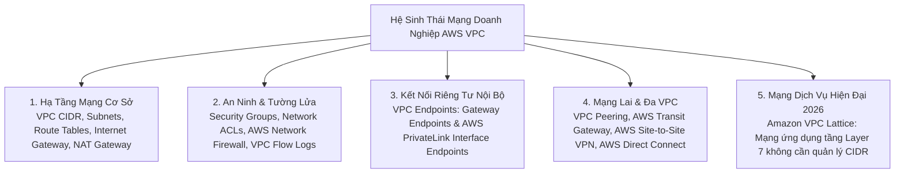
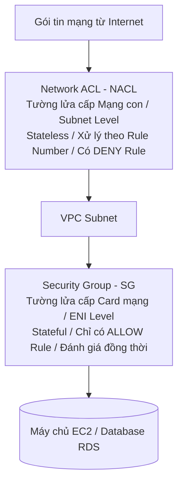
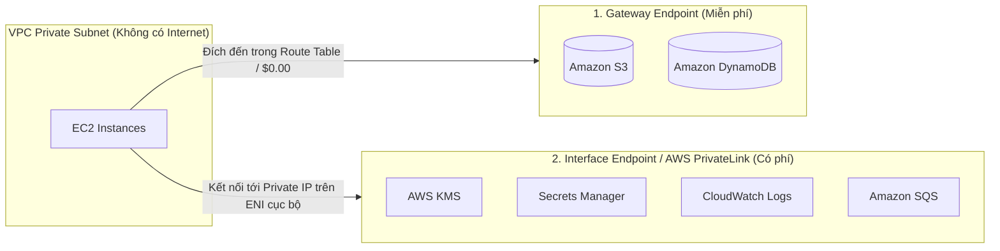
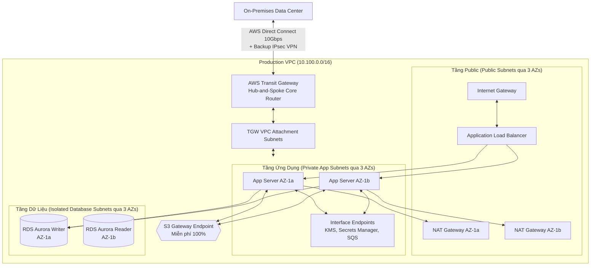

# Tài Liệu Học Tập Chuyên Sâu: Amazon VPC & Kiến Trúc Mạng Đám Mây Doanh Nghiệp (Virtual Private Cloud)

> **Tài liệu chuẩn hóa kiến trúc đám mây**: Hướng dẫn toàn diện theo tiêu chuẩn Principal AWS Solutions Architect & Senior Cloud DevOps Engineer (Cập nhật phiên bản kiến trúc mới nhất 2026).  
> **Ngôn ngữ**: Tiếng Việt chuyên ngành (Bảo lưu toàn bộ thuật ngữ chuyên ngành tiếng Anh chuẩn AWS).  
> **Mục tiêu**: Phục vụ thi chứng chỉ cấp độ Professional/Specialty (**SAA-C03, SAP-C02, DOP-C02**) và vận hành hệ thống cấp độ doanh nghiệp (**Production-grade**).  
> **Các bài giảng liên quan**: Chương 27 (Networking - VPC: Bài 313 đến Bài 350).

---

## 6.1. Tổng Quan Dịch Vụ (Service Overview)

### 1. Định nghĩa chuẩn xác và Phân nhóm dịch vụ
**Amazon Virtual Private Cloud (Amazon VPC)** là nền tảng mạng riêng ảo cô lập về mặt logic dành riêng cho tài khoản AWS của bạn. VPC trao toàn quyền kiểm soát môi trường mạng ảo, bao gồm việc lựa chọn dải địa chỉ IP (CIDR), phân chia các mạng con (Subnets), cấu hình bảng định tuyến (Route Tables), cổng kết nối mạng (Network Gateways), và các lớp tường lửa bảo mật đa tầng (Security Groups & Network ACLs).

1. **Amazon VPC Core**: Nền tảng mạng cơ sở cô lập logic, nơi bắt buộc mọi tài nguyên tính toán (EC2, RDS, ECS, Lambda trong VPC) phải vận hành.
2. **AWS Transit Gateway (TGW)**: Bộ định tuyến trung tâm thông minh theo mô hình **Hub-and-Spoke**, cho phép kết nối hàng ngàn VPC và mạng trung tâm dữ liệu On-Premises với nhau qua một cổng duy nhất, hỗ trợ định tuyến bắc cầu (**Transitive Routing**).
3. **AWS PrivateLink & VPC Endpoints**: Kênh truyền thông riêng tư an toàn giúp các máy chủ trong Private Subnet kết nối tới các dịch vụ AWS hoặc dịch vụ SaaS của bên thứ ba mà **không cần đi qua Internet Gateway, NAT Gateway hay lộ Public IP**.
4. **Amazon VPC Lattice (Chuẩn mực 2026)**: Dịch vụ mạng tầng ứng dụng (**Application Networking Service**) giúp kết nối, bảo mật và giám sát các cuộc gọi giữa các dịch vụ (Service-to-Service) xuyên qua nhiều VPC và nhiều tài khoản AWS mà **không cần quan tâm đến xung đột dải địa chỉ IP (Overlapping CIDR) hay bảng định tuyến phức tạp**.

---

### 2. Bài toán cốt lõi mà VPC giải quyết

1. **Cô lập tuyệt đối môi trường mạng (Tenant Isolation)**: Đảm bảo tài nguyên của doanh nghiệp hoàn toàn tách biệt với các khách hàng khác trên đám mây của AWS.
2. **Phân vùng an ninh chuyên sâu (Defense in Depth)**: Thiết kế mô hình mạng nhiều lớp: **Public Subnet** (cho Load Balancers), **Private App Subnet** (cho máy chủ ứng dụng), và **Isolated Database Subnet** (hoàn toàn không có đường ra Internet).
3. **Mở rộng kết nối mạng lai an toàn (Hybrid Connectivity)**: Kết nối liền mạch trung tâm dữ liệu On-Premises với AWS qua đường cáp quang chuyên dụng **AWS Direct Connect** hoặc đường hầm mã hóa **AWS Site-to-Site VPN (IPsec)**.

---

### 3. Khi nào KHÔNG nên dùng hoặc Giải pháp thay thế

* ❌ **Kết nối Microservices xuyên tài khoản bị trùng lặp dải IP (Overlapping CIDRs)**: VPC Peering và Transit Gateway không thể kết nối hai mạng có dải IP trùng nhau (ví dụ cả hai bên đều dùng `10.0.0.0/16`).  
  👉 *Giải pháp thay thế*: Sử dụng **AWS PrivateLink** hoặc **Amazon VPC Lattice**.
* ❌ **Ứng dụng Serverless không có nhu cầu truy cập tài nguyên nội bộ trong VPC**: Gán Lambda vào VPC không cần thiết sẽ làm tăng độ phức tạp quản lý IP và tốn tài nguyên ENI.  
  👉 *Giải pháp thay thế*: Để Lambda chạy ở môi trường ngoài VPC mặc định để gọi S3/DynamoDB qua Internet an toàn.

---

## 6.2. Các Khái Niệm, Kiến Trúc & Vận Hành Cốt Lõi (Core Concepts, Security & Day-2 Operations)

### 1. Dải địa chỉ IP & Quy tắc 5 Địa chỉ IP Dành Riêng (The 5 Reserved IPs per Subnet)

* **Dải CIDR cho phép trong VPC**: Từ `/16` (tối đa 65,536 IPs) đến `/28` (tối thiểu 16 IPs).
* ⚠️ **QUY TẮC BẤT BIẾN TRONG THI CỬ VÀ QUY HOẠCH**: AWS luôn giữ lại **5 địa chỉ IP đầu và cuối** trên **MỖI Subnet** cho mục đích quản trị mạng nội bộ:
  *Ví dụ với Subnet `10.0.1.0/24` (tổng cộng 256 địa chỉ IP theo lý thuyết, nhưng **chỉ có đúng 251 IP khả dụng** cho máy ảo EC2)*:
  1. `10.0.1.0`: **Network Address** (Địa chỉ mạng của Subnet).
  2. `10.0.1.1`: **VPC Router** (Địa chỉ bộ định tuyến nội bộ mặc định của AWS).
  3. `10.0.1.2`: **DNS Server** (Địa chỉ máy chủ phân giải tên miền AmazonProvidedDNS / Route 53 Resolver).
  4. `10.0.1.3`: **Future Use** (Dành riêng cho các tính năng mở rộng trong tương lai của AWS).
  5. `10.0.1.255`: **Network Broadcast Address** (Địa chỉ quảng bá - AWS không hỗ trợ broadcast nhưng vẫn bảo lưu theo chuẩn IP).

---

### 2. So Sánh Hai Lớp Tường Lửa Mạng: Security Groups vs Network ACLs

| Tiêu chuẩn so sánh | Security Group (SG) | Network ACL (NACL) |
| :--- | :--- | :--- |
| **Cấp độ hoạt động** | **Cấp độ Card mạng ảo (ENI / Instance Level)**. | **Cấp độ Mạng con (Subnet Level)**. |
| **Quy tắc trạng thái** | **Stateful (Có trạng thái)**: Traffic vào được chấp thuận thì traffic phản hồi tự động được đi ra mà không cần mở rule Outbound. | **Stateless (Phi trạng thái)**: Bắt buộc phải mở cả chiều Inbound và chiều Outbound riêng biệt (kèm dải Ephemeral Ports). |
| **Loại luật hỗ trợ** | **Chỉ hỗ trợ luật CHO PHÉP (ALLOW only)**. | **Hỗ trợ cả luật CHO PHÉP (ALLOW) và luật CHẶN (DENY)**. |
| **Thứ tự xử lý luật** | Toàn bộ các luật được đánh giá đồng thời. | **Xử lý theo số thứ tự (Rule Number từ 1 đến 32766)**; số nhỏ hơn được ưu tiên thực thi trước. |
| **Chặn địa chỉ IP xấu** | **Không thể chặn 1 IP cụ thể** (chỉ có thể không cấp quyền). | **Lý tưởng để chặn tức thời một địa chỉ IP hacker** (Ví dụ: Rule 100: Deny `203.0.113.5/32`). |
| **Phạm vi bảo vệ** | Chỉ bảo vệ các tài nguyên được gán SG đó. | Bảo vệ toàn bộ tất cả tài nguyên nằm trong Subnet. |

---

### 3. Phân biệt giải pháp ra Internet cho mạng riêng: NAT Gateways vs NAT Instances

| Tiêu chuẩn kỹ thuật | NAT Gateway (Dịch vụ quản lý hoàn toàn của AWS) | NAT Instance (Tự cài đặt trên EC2) `[Legacy]` |
| :--- | :--- | :--- |
| **Quản trị hạ tầng** | **AWS quản lý 100%**: Không cần bảo trì OS, tự vá lỗi. | Khách hàng tự cài đặt Linux, cấu hình iptables, tự vá lỗi OS. |
| **Tính sẵn sàng cao (HA)** | **Tự động dự phòng trong 1 AZ**; mở rộng đa AZ bằng cách tạo 1 NAT GW cho mỗi AZ. | **Kém (SPOF)**: Chạy trên 1 EC2; muốn HA phải tự viết script chuyển đổi ENI phức tạp. |
| **Băng thông mạng** | **Tự động co giãn từ 5 Gbps lên tới 100 Gbps**. | Giới hạn theo băng thông card mạng của kiểu máy EC2 đã chọn. |
| **Cấu hình card mạng** | Không cần can thiệp; bắt buộc phải gắn **Elastic IP**. | **Bắt buộc phải tắt cờ `Source/Destination Check`** trên card mạng ENI. |
| **Cơ chế tính phí** | Phí theo giờ duy trì (~$0.045/h) + **Phí xử lý dữ liệu ($0.045/GB)**. | Tính phí máy ảo EC2 On-Demand hoặc Spot + phí ổ đĩa EBS. |

---

### 4. Kết nối riêng tư: VPC Endpoints (Gateway vs Interface Endpoints)

* **Bản chất**: Cho phép tài nguyên trong Private Subnet kết nối an toàn tới các dịch vụ AWS mà **không cần đi qua Internet Gateway, NAT Gateway hay Public IP**.

1. **Gateway Endpoints**:
   - Hoạt động như một đích đến trong **Bảng định tuyến (Route Table Target)**.
   - **HOÀN TOÀN MIỄN PHÍ ($0.00/giờ, $0.00/GB)**.
   - **Chỉ hỗ trợ duy nhất 2 dịch vụ**: **Amazon S3** và **Amazon DynamoDB**.
2. **Interface Endpoints (AWS PrivateLink)**:
   - Khởi tạo một card mạng ảo **ENI riêng** nằm trực tiếp bên trong subnet của bạn với địa chỉ Private IP nội bộ.
   - **Có tính phí**: Phí giờ duy trì ENI (~$0.01/giờ/AZ) + Phí xử lý dữ liệu (~$0.01/GB).
   - Hỗ trợ hầu hết tất cả các dịch vụ AWS còn lại (KMS, Secrets Manager, CloudWatch, SQS, SNS, ECR...) và các dịch vụ SaaS của bên thứ ba.

---

### 5. Kết nối doanh nghiệp và Mạng lai (Hybrid Cloud Connectivity)

1. **AWS Site-to-Site VPN**:
   - Thiết lập đường hầm mạng riêng ảo bảo mật qua Internet công cộng bằng giao thức **IPsec**.
   - Yêu cầu cấu hình **Customer Gateway (CGW)** tại phía trung tâm dữ liệu On-Premises và **Virtual Private Gateway (VGW)** hoặc **Transit Gateway (TGW)** tại phía AWS.
   - Ưu điểm: Triển khai nhanh chóng trong 30 phút, chi phí thấp, dữ liệu được mã hóa mạnh mẽ.
2. **AWS Direct Connect (DX)**:
   - Đường cáp quang vật lý chuyên dụng riêng biệt kết nối trực tiếp từ trung tâm dữ liệu của bạn tới điểm hiện diện của AWS (hoàn toàn không đi qua mạng Internet công cộng).
   - Băng thông khổng lồ (1 Gbps, 10 Gbps, 100 Gbps), độ trễ cực thấp và ổn định tuyệt đối; cước truyền dữ liệu ra Internet (Data Transfer Out) rẻ hơn tới **75%** so với đường truyền thông thường.
3. **AWS Transit Gateway (TGW)**:
   - Bộ điều phối mạng trung tâm thông minh theo cấu trúc hình sao (**Hub-and-Spoke**), thay thế cho mạng lưới kết nối chéo phức tạp (Mesh VPC Peering).
   - Hỗ trợ **Transitive Routing (Định tuyến bắc cầu)**: Cho phép hàng trăm VPC, VPN và Direct Connect giao tiếp xuyên suốt với nhau thông qua một cổng trung chuyển duy nhất.

---

### 🏛️ I. Các Kịch Bản Kiến Trúc Chuẩn (Best Practice Scenarios)

#### 1. Kiến trúc Bảo mật Đa Tầng Tham Chiếu Security Group ID (Security Group Chaining)
- **Tình huống thi**: Ứng dụng Web nhiều tầng (Web Tier -> App Tier -> Database Tier). Yêu cầu đảm bảo Database chỉ nhận kết nối từ Web/App instances, không cho phép truy cập từ bất kỳ nguồn nào khác kể cả trong cùng VPC.
- **Giải pháp tối ưu chuẩn AWS**:
  - Không bao giờ mở IP CIDR (ví dụ: `10.0.0.0/16`) cho Database Security Group.
  - Tại Inbound Rule của **Database SG**: Cấu hình Source là **ID của Web SG** (ví dụ: `sg-01234567web`) trên cổng 3306 (MySQL) hoặc 5432 (PostgreSQL) hoặc 1433 (MSSQL).
  - **Lợi ích**: Dù Auto Scaling Group của Web Tier co giãn thêm hàng trăm instances với IP động, Database vẫn tự động chấp nhận kết nối an toàn mà không cần cập nhật rule thủ công.

#### 2. Kết Nối Riêng Tư Không Cần Internet Bằng VPC Endpoints
- **Tình huống thi**: EC2 / Lambda trong Private Subnet cần đọc/ghi S3 hoặc DynamoDB với chi phí thấp nhất và không có Internet Gateway / NAT Gateway.
- **Giải pháp chuẩn**:
  - Sử dụng **Gateway VPC Endpoints** cho **Amazon S3** và **Amazon DynamoDB**.
  - **Đặc tính**: Miễn phí cước phí hoàn toàn ($0.00/tháng), cấu hình bằng cách thêm Prefix List route vào Route Table của Private Subnet.
  - Đối với các dịch vụ khác (SQS, SNS, Kinesis, Secrets Manager, CloudWatch): Bắt buộc dùng **Interface VPC Endpoints (AWS PrivateLink)** (tính phí theo ENI giờ + GB dữ liệu).

#### 3. Quản Trị EC2 Trong Private Subnet Bằng Systems Manager Session Manager (Zero Bastion)
- **Tình huống thi**: Quản trị viên cần SSH/RDP vào máy chủ EC2 trong Isolated Private Subnet (không có Internet Gateway, không có NAT Gateway) mà không vi phạm nguyên tắc an ninh.
- **Giải pháp chuẩn**:
  - Triển khai **3 Interface VPC Endpoints** trong VPC:
    1. `com.amazonaws.<region>.ssm`
    2. `com.amazonaws.<region>.ssmmessages` (bắt buộc cho Session Manager interactive channel)
    3. `com.amazonaws.<region>.ec2messages`
  - Gán IAM Role với policy `AmazonSSMManagedInstanceCore` cho EC2 instance.
  - Kết nối thông qua AWS Console hoặc AWS CLI (`aws ssm start-session`). Không cần mở cổng 22/3389 ở Security Group Inbound.

#### 4. Mạng Hub-and-Spoke Quy Mô Doanh Nghiệp Với AWS Transit Gateway
- **Tình huống thi**: Doanh nghiệp mở rộng lên hàng chục đến hàng trăm VPCs cần kết nối với nhau và kết nối về Datacenter On-Premises qua Direct Connect hoặc VPN.
- **Giải pháp chuẩn**:
  - Thay thế mô hình Full-Mesh VPC Peering phức tạp (cần $N(N-1)/2$ kết nối) bằng **AWS Transit Gateway (TGW)**.
  - Transit Gateway đóng vai trò Cloud Router hỗ trợ **Transitive Routing** (VPC A -> TGW -> VPC B hoặc On-Premises), chia sẻ tập trung qua AWS RAM (Resource Access Manager).

---

### 🪤 II. Các Bẫy Thi Tinh Vi & Phân Tích Phương Án Sai (Exam Traps & Distractors)

#### 🪤 Bẫy 1: Hai VPC Trùng Dải IP CIDR Cần Kết Nối Bảo Mật (Overlapping CIDRs) — (CM-PT1 Q02)
- **Tình huống đề thi**: *"Đội IT chạy ứng dụng trong VPC A, đội Vận hành chạy trên VPC B. Cả 2 VPC đều dùng dải IP trùng nhau (ví dụ: cùng là `10.0.0.0/16`). Làm sao để đội Vận hành gọi API sang ứng dụng của IT an toàn?"*
- **Các phương án bẫy**:
  - ❌ *VPC Peering*: Giới hạn kỹ thuật bất biến của AWS: VPC Peering **không bao giờ hỗ trợ overlapping CIDRs** vì bảng định tuyến không thể phân biệt đích đến.
  - ❌ *AWS Transit Gateway*: TGW định tuyến dựa trên IP CIDR, cũng sẽ bị xung đột route table.
  - ❌ *IPsec VPN Tunnel giữa 2 VPC*: Vẫn phụ thuộc routing IP truyền thống.
- **Giải pháp ĐÚNG duy nhất**: **AWS PrivateLink**.
  - VPC A tạo Network Load Balancer (NLB) đứng trước ứng dụng và tạo **Endpoint Service**.
  - VPC B tạo **Interface VPC Endpoint (ENI)** trỏ tới Endpoint Service đó.
  - Giao tiếp diễn ra qua IP cục bộ của ENI trong VPC B, hoàn toàn che giấu dải IP của VPC A và bỏ qua xung đột CIDR.

#### 🪤 Bẫy 2: Phân Giải DNS Lai Hai Chiều Giữa AWS & On-Premises (Hybrid DNS) — (CM-PT1 Q41, U-PT1 Q20)
- **Tình huống đề thi**: *"Doanh nghiệp cần thiết lập phân giải DNS hai chiều giữa mạng văn phòng On-Premises và AWS VPC. Cần cấu hình Route 53 Resolver như thế nào?"*
- **Quy tắc nhớ chiều bất biến (nhìn từ góc độ AWS)**:
  - 📥 **Inbound Endpoint**: Dành cho luồng truy vấn **ĐI VÀO** AWS (On-Premises DNS Server forward truy vấn tên miền `*.aws.internal` tới IP của Inbound Endpoint để Route 53 giải quyết).
  - 📤 **Outbound Endpoint**: Dành cho luồng truy vấn **ĐI RA NGOÀI** AWS (Máy chủ EC2 trong VPC muốn phân giải tên miền nội bộ `*.corp.local` của On-Premises -> Route 53 Resolver dùng Outbound Endpoint + Forwarding Rules chuyển tiếp về DNS Server của On-Premises).
- **Bẫy thi phổ biến**: Đề bài tráo đổi Inbound và Outbound hoặc chỉ cấu hình 1 chiều mà yêu cầu phân giải hai chiều.

#### 🪤 Bẫy 3: Mạng IPv6 Trong Private Subnet Chỉ Cho Phép Ra Internet — (CM-PT1 Q33)
- **Tình huống đề thi**: *"Ứng dụng chạy trên dải IPv6 trong private subnet cần tải các bản vá từ Internet nhưng phải ngăn chặn hoàn toàn mọi kết nối khởi tạo từ Internet vào máy chủ."*
- **Các phương án bẫy**:
  - ❌ *Dùng NAT Gateway*: NAT Gateway chỉ hỗ trợ dịch địa chỉ cho **IPv4**, hoàn toàn không hoạt động với IPv6 (IPv6 vốn là địa chỉ toàn cầu công khai, không cần NAT).
  - ❌ *Dùng Internet Gateway*: IGW thông thường cho phép kết nối 2 chiều (cả Inbound và Outbound), vi phạm yêu cầu bảo mật.
- **Giải pháp ĐÚNG**: **Egress-Only Internet Gateway (outbound-only IGW)**.
  - Cho phép lưu lượng IPv6 từ instance khởi tạo đi ra ngoài Internet.
  - Chặn triệt để mọi luồng kết nối khởi tạo từ bên ngoài Internet đi vào instance.

#### 🪤 Bẫy 4: Truy Cập S3/DynamoDB Từ On-Premises Qua AWS Direct Connect — (U-PT6 Q03)
- **Tình huống đề thi**: *"Doanh nghiệp có đường truyền AWS Direct Connect từ On-Premises. Họ muốn sao lưu lượng lớn dữ liệu lên Amazon S3 qua đường truyền riêng tư này với băng thông cao và không đi qua mạng Internet công cộng."*
- **Các phương án bẫy**:
  - ❌ *Cấu hình Private VIF*: Private VIF chỉ định tuyến tới Private IP bên trong VPC (EC2, RDS). Amazon S3 là dịch vụ Public của AWS, nằm ngoài VPC.
  - ❌ *Dùng Gateway VPC Endpoint qua Private VIF*: Gateway Endpoint không thể định tuyến qua Direct Connect / VPN / Peering.
- **Giải pháp ĐÚNG**: Cấu hình **Public Virtual Interface (Public VIF)** trên Direct Connect connection.
  - Public VIF quảng bá các dải IP công khai của AWS (bao gồm S3, DynamoDB) tới router của On-Premises qua giao thức BGP.
  - Lưu lượng đi trực tiếp từ On-Premises tới S3 qua đường cáp vật lý Direct Connect mà không chạm vào Internet công cộng.

#### 🪤 Bẫy 5: Yêu Cầu Bắt Buộc Để Route 53 Private Hosted Zone Hoạt Động Trong VPC — (U-PT2 Q60)
- **Tình huống đề thi**: *"Sau khi tạo Route 53 Private Hosted Zone và liên kết với VPC, các máy chủ EC2 vẫn không phân giải được tên miền nội bộ."*
- **Nguyên nhân cốt lõi**: Bắt buộc phải bật đồng thời cả 2 cờ cấu hình mạng trên VPC:
  1. `enableDnsHostnames = true` (gán DNS hostname cho instances có public IP).
  2. `enableDnsSupport = true` (cho phép VPC sử dụng máy chủ AmazonProvidedDNS tại địa chỉ IP cơ sở `10.x.x.2`).
- Nếu `enableDnsSupport = false`, mọi truy vấn phân giải Private Hosted Zone đều bị từ chối.

---

### 📊 III. Ma Trận Quyết Định Kết Nối Mạng Nhanh (Exam Decision Matrix)

| Tình huống / Yêu cầu trong đề thi | Giải pháp chuẩn AWS | Giải pháp bị loại & Lý do |
|:---|:---|:---|
| **2 VPC trùng IP CIDR cần giao tiếp an toàn** | **AWS PrivateLink** (NLB + Interface Endpoint) | Loại VPC Peering / TGW (lỗi xung đột route) |
| **Kết nối ít VPC (< 10 VPCs), chi phí tối thiểu** | **VPC Peering** ($0 cước kết nối) | Loại Transit Gateway (tốn phí attachment hàng tháng) |
| **Hàng chục VPCs + On-Prem, Transitive Routing** | **AWS Transit Gateway** | Loại VPC Peering (không hỗ trợ bắc cầu) |
| **EC2 Private truy cập S3 / DynamoDB miễn phí** | **Gateway VPC Endpoint** | Loại NAT Gateway (tốn phí data processing) |
| **EC2 Private truy cập SQS / SSM / Secrets Manager** | **Interface VPC Endpoint** (PrivateLink) | Gateway Endpoint không hỗ trợ các dịch vụ này |
| **Quản trị EC2 không mở port 22 / không Public IP** | **Systems Manager Session Manager** | Loại Bastion Host (tốn chi phí & rủi ro bảo mật) |
| **On-Prem giải quyết DNS của AWS** | **Route 53 Resolver Inbound Endpoint** | Loại Outbound Endpoint (sai chiều truy vấn) |
| **AWS VPC giải quyết DNS nội bộ của On-Prem** | **Route 53 Resolver Outbound Endpoint** | Loại Inbound Endpoint (sai chiều truy vấn) |
| **IPv6 trong Private Subnet cần ra Internet** | **Egress-Only Internet Gateway** | Loại NAT Gateway (chỉ hỗ trợ IPv4) |
| **On-Premises truy cập S3 qua Direct Connect** | **Direct Connect Public VIF** | Loại Private VIF (chỉ truy cập VPC nội bộ) |
| **Truyền dữ liệu nhạy cảm qua Direct Connect an toàn** | **Direct Connect + Site-to-Site VPN (IPsec)** | Direct Connect đơn thuần chưa được mã hóa at-transit |

---

---

---

## 6.3. Kiến Trúc Thực Tế và Luồng Vận Hành (Production Architecture & Workflow)

### Sơ đồ kiến trúc VPC chuẩn Enterprise Multi-AZ 3-Tier kết hợp Transit Gateway và Direct Connect

---

## 6.4. Bảng Tích Hợp với Các Dịch Vụ AWS Khác (Integration Table)

| Related AWS Service | Purpose (Mục đích tích hợp) | Integration Method (Phương thức kỹ thuật chính xác) | Practical Example (Ví dụ thực tiễn) |
| :--- | :--- | :--- | :--- |
| **Amazon Athena** | Phân tích và truy vấn nhật ký gói tin mạng toàn diện | **VPC Flow Logs** đẩy về S3 $\rightarrow$ Athena SQL Query | Truy vấn tìm kiếm top 10 địa chỉ IP bên ngoài gửi nhiều gói tin bị REJECT nhất trong ngày qua bảng `vpc_flow_logs`. |
| **AWS Network Firewall** | Tường lửa kiểm tra sâu gói tin mạng (Deep Packet Inspection) | Gắn **Firewall Endpoint** vào Subnet chuyên dụng trên đường định tuyến | Quét và chặn đứng các gói tin chứa mã độc hoặc ngăn chặn máy chủ nội bộ kết nối tới các tên miền lừa đảo (Domain filtering). |
| **AWS KMS** | Quản lý khóa mã hóa cho các kết nối VPN và dữ liệu nhật ký | Tích hợp **KMS CMK** với VPC Flow Logs và Site-to-Site VPN | Mã hóa toàn bộ dữ liệu nhật ký lưu lượng mạng trước khi ghi vào CloudWatch Logs hoặc S3 Bucket. |
| **AWS Systems Manager** | Truy cập dòng lệnh máy chủ an toàn không cần Bastion Host | **SSM Session Manager** kết hợp Interface Endpoints | Kỹ sư truy cập bash shell của máy ảo trong Private Subnet mà không cần mở cổng SSH 22 và không cần Public IP. |
| **AWS Route 53 Resolver** | Cầu nối phân giải tên miền mạng lai giữa On-Premises và VPC | **Resolver Inbound & Outbound Endpoints** | Cho phép máy ảo trong VPC phân giải được tên miền máy chủ nội bộ `server.corp.local` tại trung tâm dữ liệu On-Premises. |

---

## 6.5. Bảng So Sánh Các Giải Pháp Kết Nối Mạng Trong Hệ Sinh Thái AWS (Ecosystem Comparison)

| Giải pháp kết nối | Băng thông hỗ trợ | Độ trễ mạng | Hỗ trợ Transitive Routing | Xung đột dải IP (Overlapping CIDR) | Chi phí kết nối | Kịch bản sử dụng chuẩn mực |
| :--- | :--- | :--- | :--- | :--- | :--- | :--- |
| **VPC Peering** | Không giới hạn (Băng thông EC2) | Rất thấp (Cùng Region) | ❌ **KHÔNG** (Non-transitive) | ❌ **BỊ LỖI** (Không thể kết nối) | **MIỄN PHÍ kết nối** ($0/h, $0/GB) | Kết nối giữa 2–5 VPC trong cùng tổ chức có dải IP không trùng nhau. |
| **AWS Transit Gateway** | Tới 50 Gbps trên mỗi attachment | Thấp (1–2 ms qua hub) |  **CÓ HỖ TRỢ** (Transitive) | ❌ **BỊ LỖI** (Yêu cầu định tuyến CIDR) | **TÍNH PHÍ** ($0.05/h/VPC + $0.02/GB) | Mô hình Hub-and-Spoke kết nối hàng chục đến hàng trăm VPC và On-Premises. |
| **AWS PrivateLink** | Hàng chục Gbps | Cực thấp | ❌ Không áp dụng |  **CHO PHÉP** (Ánh xạ qua ENI riêng) | Phí ENI ($0.01/h) + Phí dữ liệu ($0.01/GB) | Chia sẻ dịch vụ API an toàn cho khách hàng/đối tác mà không để lộ mạng VPC. |
| **Amazon VPC Lattice** | Hàng chục Gbps | Cực thấp |  Tự động ở Layer 7 |  **HOÀN TOÀN HỖ TRỢ** | Tính phí theo số dịch vụ + cước xử lý dữ liệu | Mạng kết nối Microservices và Container hiện đại không cần quản lý mạng CIDR. |
| **AWS Direct Connect** | 1 Gbps đến 100 Gbps | **Cực thấp & Ổn định** |  (Khi kết hợp với TGW) | ❌ Bị lỗi nếu trùng CIDR | Phí cổng vật lý cao + Cước DTO rẻ ($0.02/GB) | Kết nối mạng trục doanh nghiệp lớn, truyền dữ liệu Big Data hàng ngày. |

---

## 6.6. Mô Hình Tính Phí & Chiến Lược Tối Ưu Chi Phí (FinOps & Cost Optimization)

### 6.6.1. Bảng Phân Tích Cơ Chế Tính Phí Chi Tiết Của Mạng VPC

| Thành phần tính phí | Cơ chế tính phí chi tiết (Pricing Dimensions) | Mức phí tham chiếu điển hình (US-East-1) | Bẫy chi phí nghiêm trọng (Cost Pitfalls) |
| :--- | :--- | :--- | :--- |
| **VPC, Subnets, Route Tables, IGW** | **HOÀN TOÀN MIỄN PHÍ ($0.00)**. | **$0.00** | Không có chi phí cố định cho hạ tầng mạng cốt lõi này. |
| **VPC Peering (Cùng Region)** | **MIỄN PHÍ KẾT NỐI ($0.00/h, $0.00/GB)**. | $0.00 | Chỉ tính phí truyền dữ liệu liên AZ ($0.01/GB mỗi chiều) nếu máy ảo nằm ở 2 AZ khác nhau. |
| **NAT Gateway** | • Phí cố định: **~$0.045 / giờ / NAT GW** (~$32.40/tháng/AZ). • Phí xử lý dữ liệu: **$0.045 / GB**. | Rất đắt nếu truyền tải dữ liệu lớn ra ngoài. | Tải hàng chục Terabytes dữ liệu lên S3 qua NAT Gateway thay vì dùng Gateway Endpoint miễn phí. |
| **VPC Gateway Endpoints** | **HOÀN TOÀN MIỄN PHÍ ($0.00/giờ, $0.00/GB)**. | **$0.00** (Dành cho S3 & DynamoDB). | Quên không bật Gateway Endpoint, để dữ liệu S3 đi vòng qua NAT Gateway tốn tiền. |
| **VPC Interface Endpoints (PrivateLink)**| • Phí duy trì ENI: **$0.01 / giờ / AZ** (~$7.20/tháng/AZ). • Phí xử lý dữ liệu: **$0.01 / GB**. | Cần tính toán số lượng AZ triển khai. | Tạo Interface Endpoints trên tất cả các AZ cho các dịch vụ hầu như không phát sinh lưu lượng. |
| **AWS Transit Gateway (TGW)** | • Phí kết nối: **$0.05 / giờ / VPC attachment** (~$36.00/tháng/VPC). • Phí xử lý dữ liệu: **$0.02 / GB**. | Khá tốn kém ở quy mô nhỏ. | Dùng Transit Gateway khi chỉ có 2 VPC cần kết nối với nhau thay vì dùng VPC Peering miễn phí. |
| **Địa chỉ Public IPv4** | • Áp dụng từ 2024–2026: **$0.005 / giờ / IP** (~$3.65/tháng) cho TẤT CẢ Public IPv4. | $3.65 / tháng / IP. | Bật `Auto-assign Public IP` cho hàng chục máy ảo backend trong Public Subnet. |

---

### 6.6.2. Chiến Lược Tối Ưu Hóa Chi Phí Theo 5 Kịch Bản Thực Tế (Use Cases Optimization)

#### Kịch bản 1: Tiêu Diệt Chi Phí NAT Gateway Bằng S3 Gateway Endpoint
* **Bối cảnh thực tế**:
  Một cụm máy chủ xử lý dữ liệu trong Private Subnet đẩy **30 TB (30,000 GiB)** file nén và log lên Amazon S3 mỗi tháng thông qua đường ra Internet của NAT Gateway mặc định.
  $$\text{Chi phí NAT Gateway Data Processing} = 30,000 \text{ GiB} \times 0.045\$/\text{GiB} = \mathbf{1,350.00\$/\text{tháng}}$$
* **Chiến lược tối ưu hóa**:
  - Tạo một **VPC Gateway Endpoint** cho Amazon S3 và gắn trực tiếp vào Route Table của Private Subnet.
  - Gateway Endpoint hoạt động ở tầng định tuyến, **hoàn toàn MIỄN PHÍ 100% ($0.00/giờ, $0.00/GB)**. Toàn bộ lưu lượng 30 TB đi thẳng qua mạng trục AWS Backbone.
* **Kết quả tiết kiệm**:
  $$\text{Số tiền tiết kiệm} = \mathbf{1,350.00\$/\text{tháng}} \quad (\approx \mathbf{16,200\$/\text{năm}})$$
  **Tiết kiệm 100% chi phí xử lý dữ liệu S3**, đồng thời tăng tốc độ truyền tải tệp tin lên gấp 3 lần.

---

#### Kịch bản 2: Phân Tách Cấu Hình NAT Gateway Giữa Môi Trường Dev/Test và Production
* **Bối cảnh thực tế**:
  Kỹ sư áp dụng chung template Terraform bật 3 NAT Gateways (mỗi chiếc ở 1 AZ để đảm bảo HA) cho cả 3 môi trường phát triển: Dev, QA, Staging.
  $$\text{Chi phí cố định 3 NAT GWs / VPC} = 3 \times 0.045\$ \times 720 \text{ giờ} = 97.20\$/\text{tháng}$$
  $$\text{Tổng chi phí 3 môi trường non-prod} = 3 \times 97.20\$ = \mathbf{291.60\$/\text{tháng}}$$
* **Chiến lược tối ưu hóa**:
  - **Môi trường Production**: Giữ nguyên 3 NAT Gateways trên 3 AZs để đảm bảo SLA tính sẵn sàng cao.
  - **Môi trường Dev / QA / Staging**: Thu gọn lại chỉ dùng **1 NAT Gateway duy nhất** đặt tại AZ-a. Định tuyến tất cả Private Subnets ở cả 3 AZ trỏ về NAT Gateway duy nhất này.
  $$\text{Chi phí 1 NAT GW / VPC} = 1 \times 0.045\$ \times 720 \text{ giờ} = 32.40\$/\text{tháng}$$
  $$\text{Tổng chi phí 3 môi trường mới} = 3 \times 32.40\$ = \mathbf{97.20\$/\text{tháng}}$$
* **Kết quả tiết kiệm**:
  $$\text{Số tiền tiết kiệm} = 291.60\$ - 97.20\$ = \mathbf{194.40\$/\text{tháng}} \quad (\approx \mathbf{2,332\$/\text{năm}})$$
  **Cắt giảm ngay 66.7% chi phí cố định NAT Gateway** trên các môi trường thử nghiệm.

---

#### Kịch bản 3: Lựa Chọn Giữa VPC Peering và Transit Gateway Cho Cụm 4 VPC
* **Bối cảnh thực tế**:
  Một doanh nghiệp có 4 VPCs (Dev, QA, Staging, Shared Services) trong cùng Region cần trao đổi dữ liệu với nhau (mỗi tháng phát sinh khoảng 5 TB dữ liệu trao đổi nội bộ).
  - *Nếu sử dụng AWS Transit Gateway*:
    $$\text{Phí Attachment (4 VPCs)} = 4 \times 0.05\$ \times 720 \text{ giờ} = 144.00\$$$
    $$\text{Phí Data Processing (5 TB)} = 5,000 \text{ GiB} \times 0.02\$ = 100.00\$$$
    $$\text{Tổng chi phí Transit Gateway} = 144.00\$ + 100.00\$ = \mathbf{244.00\$/\text{tháng}}$$
* **Chiến lược tối ưu hóa**:
  - Với quy mô nhỏ dưới 5–10 VPCs, thiết lập các kết nối **VPC Peering** điểm-điểm trực tiếp giữa các VPC.
  - VPC Peering trong cùng Region **hoàn toàn MIỄN PHÍ cước duy trì kết nối ($0.00) và MIỄN PHÍ cước xử lý dữ liệu ($0.00)**.
* **Kết quả tiết kiệm**:
  $$\text{Số tiền tiết kiệm} = \mathbf{244.00\$/\text{tháng}} \quad (\approx \mathbf{2,928\$/\text{năm}})$$
  **Tiết kiệm 100% chi phí điều phối mạng** mà độ trễ truyền dữ liệu lại thấp hơn.

---

#### Kịch bản 4: Xóa Bỏ Public IPv4 Và Bastion Hosts Bằng SSM Session Manager
* **Bối cảnh thực tế**:
  Doanh nghiệp duy trì 35 máy ảo EC2 trong Public Subnet được bật cờ `Auto-assign Public IP` ($0.005/giờ/IP) và duy trì 2 Bastion Hosts để các lập trình viên SSH vào làm việc.
  $$\text{Chi phí Public IPv4 (37 IPs)} = 37 \text{ IPs} \times 0.005\$ \times 720 \text{ giờ} = 133.20\$$$
  $$\text{Chi phí máy ảo 2 Bastion Hosts (t3.medium)} = 2 \times 0.0416\$ \times 720 = 59.90\$$$
  $$\text{Tổng chi phí ban đầu} = 133.20\$ + 59.90\$ = \mathbf{193.10\$/\text{tháng}}$$
* **Chiến lược tối ưu hóa**:
  1. Đưa toàn bộ 35 máy ảo vào **Private Subnet** (tắt chế độ Auto-assign Public IP).
  2. Xóa bỏ hoàn toàn 2 máy chủ Bastion Hosts.
  3. Sử dụng **AWS Systems Manager Session Manager** (kết hợp VPC Endpoint) để truy cập dòng lệnh trực tiếp qua trình duyệt/CLI mà không cần Public IP và không cần mở cổng 22.
* **Kết quả tiết kiệm**:
  $$\text{Số tiền tiết kiệm} = \mathbf{193.10\$/\text{tháng}} \quad (\approx \mathbf{2,317\$/\text{năm}})$$
  **Tiết kiệm 100% chi phí phát sinh**, đồng thời nâng cấp kiến trúc an ninh lên chuẩn Zero Public Exposure.

---

#### Kịch bản 5: Tối Ưu Hóa Chi Phí Thu Thập Nhật Ký Mạng VPC Flow Logs
* **Bối cảnh thực tế**:
  Bật VPC Flow Logs trên một hệ thống bận rộn phát sinh **2 TB (2,000 GiB)** log mạng mỗi tháng, cấu hình đẩy trực tiếp vào Amazon CloudWatch Logs:
  $$\text{Phí Ingestion CloudWatch Logs} = 2,000 \text{ GiB} \times 0.50\$ = 1,000.00\$$$
  $$\text{Phí lưu trữ CloudWatch Logs} = 2,000 \text{ GiB} \times 0.03\$ = 60.00\$$$
  $$\text{Tổng chi phí ban đầu} = \mathbf{1,060.00\$/\text{tháng}}$$
* **Chiến lược tối ưu hóa**:
  - Cấu hình đích đến của VPC Flow Logs trực tiếp vào **Amazon S3**:
    - Phí nạp dữ liệu vào S3: **$0.00 / GiB (Hoàn toàn miễn phí)**.
    - Phí lưu trữ S3 Standard: $2,000 \text{ GiB} \times 0.023\$ = 46.00\$$
    - Thiết lập S3 Lifecycle Rule tự động chuyển log sang **S3 Glacier Deep Archive** sau 30 ngày ($0.00099/GiB).
  - Sử dụng **Amazon Athena** truy vấn trực tiếp file log trên S3 khi cần điều tra sự cố.
* **Kết quả tiết kiệm**:
  $$\text{Số tiền tiết kiệm} = 1,060.00\$ - 46.00\$ = \mathbf{1,014.00\$/\text{tháng}} \quad (\approx \mathbf{12,168\$/\text{năm}})$$
  **Tỷ lệ tiết kiệm đạt ~95.7%**, loại bỏ hoàn toàn bẫy nổ chi phí log nạp vào CloudWatch.

---

## 6.7. Khắc Phục Sự Cố Thực Tế (Troubleshooting Guide)

| Vấn đề (Problem) | Nguyên nhân khả dĩ (Possible Causes) | Các bước điều tra (Investigation Steps - Metrics/Logs) | Giải pháp xử lý (Solution) | Biện pháp phòng ngừa (Prevention) |
| :--- | :--- | :--- | :--- | :--- |
| **Máy ảo trong Public Subnet không thể truy cập Internet** | 1. Chưa gắn Internet Gateway (IGW) vào VPC. 2. Route Table thiếu dòng định tuyến `0.0.0.0/0 -> igw-xxxx`. 3. Máy ảo không có Public IPv4 hoặc Elastic IP. | 1. Kiểm tra Route Table gắn với Subnet. 2. Kiểm tra thuộc tính IPv4 Public IP của instance. 3. Dùng công cụ **VPC Reachability Analyzer**. | Gắn IGW vào VPC, thêm luật định tuyến ra IGW và cấp Elastic IP cho máy ảo. | Bật tính năng "Auto-assign public IPv4" trên Public Subnet. |
| **Máy ảo trong Private Subnet không thể tải bản vá từ Internet** | 1. NAT Gateway đặt nhầm vào Private Subnet. 2. Route Table của Private Subnet chưa trỏ `0.0.0.0/0 -> nat-xxxx`. 3. NAT Gateway chưa được gắn Elastic IP. | 1. Kiểm tra Subnet chứa NAT Gateway (phải là Public Subnet có route ra IGW). 2. Xem CloudWatch Metric **`BytesInFromDestination`** trên NAT Gateway. | Đặt NAT Gateway vào đúng Public Subnet và cập nhật Route Table của Private Subnet trỏ ra NAT Gateway. | Kiểm tra sơ đồ kiến trúc mạng cẩn thận trước khi triển khai máy chủ. |
| **Hai VPC đã kết nối VPC Peering nhưng không thể ping thấy nhau** | 1. Bảng định tuyến của CẢ HAI VPC chưa được cập nhật dải CIDR của nhau trỏ về `pcx-xxxx`. 2. Security Group của máy đích chặn giao thức ICMP/TCP. 3. Dải CIDR của 2 VPC bị trùng lặp. | 1. Kiểm tra Route Table ở cả 2 VPC. 2. Kiểm tra Inbound Rules của Security Group. 3. Xem cờ `REJECT` trong **VPC Flow Logs**. | Thêm route ở cả 2 đầu bảng định tuyến và mở Security Group cho phép dải CIDR của VPC đối tác. | Luôn nhớ nguyên tắc: Cấu hình VPC Peering bắt buộc phải cập nhật Route Table ở CẢ HAI ĐẦU. |
| **Gói tin bị chặn dù Security Group đã mở đúng cổng** | Bị chặn bởi **Network ACL (NACL)** ở tầng Subnet (có luật DENY số nhỏ hơn, hoặc quên mở dải cổng tạm thời **Ephemeral Ports 1024–65535** ở chiều Outbound). | Bật **VPC Flow Logs** kiểm tra dòng log: nếu có cờ `REJECT` xuất hiện trước khi tới ENI thì do NACL chặn. | Mở dải cổng phản hồi Ephemeral Ports trên NACL Inbound/Outbound. | Giữ Network ACL ở cấu hình mặc định (Allow all) trừ khi có nhu cầu chặn IP độc hại cụ thể. |
| **Chi phí NAT Gateway tăng vọt bất thường** | Lưu lượng truy cập dịch vụ S3 hoặc DynamoDB dung lượng lớn bị đi vòng qua NAT Gateway thay vì dùng Gateway Endpoint. | Xem CloudWatch Metric **`BytesInFromSource`** trên NAT Gateway và phân tích VPC Flow Logs xem IP đích. | Khởi tạo ngay **VPC Gateway Endpoint** cho S3 và DynamoDB trên Route Table của Private Subnet. | Luôn tạo Gateway Endpoint cho S3/DynamoDB ngay khi vừa tạo VPC mới. |
| **Không thể thiết lập kết nối giữa 2 VPC do trùng dải mạng (Overlapping CIDR)** | Cả hai VPC đều sử dụng cùng một dải địa chỉ IP (ví dụ: cùng là `10.0.0.0/16`), khiến bộ định tuyến không thể phân biệt gói tin. | Kiểm tra dải CIDR của cả 2 VPC. | Sử dụng **AWS PrivateLink** hoặc triển khai **Amazon VPC Lattice** để giao tiếp ở tầng ứng dụng mà không phụ thuộc vào IP CIDR. | Quy hoạch phân bổ dải mạng CIDR tập trung ngay từ đầu cho toàn doanh nghiệp. |

---

---

## 6.8. Tóm Tắt và Danh Mục Kiểm Tra Kiến Thức (Summary & Learning Checklist)

### 7 Nguyên Tắc Kiến Trúc "Sống Còn" Của Amazon VPC (Golden Rules)
1. **Luôn trừ 5 địa chỉ IP dành riêng**:  
   Khi thiết kế dải mạng Subnet, luôn nhớ công thức: $\text{Số IP khả dụng} = 2^{(32 - \text{Prefix})} - 5$.
2. **Kích hoạt S3 Gateway Endpoint ngay khi tạo VPC**:  
   Luôn tạo **VPC Gateway Endpoint** cho Amazon S3 và DynamoDB trên Route Table của Private Subnet để triệt tiêu 100% chi phí NAT Gateway và tăng tốc truyền dữ liệu.
3. **Phân biệt rạch ròi Security Groups và Network ACLs**:  
   - Cần tường lửa bảo vệ máy ảo, có trạng thái (Stateful) $\rightarrow$ Dùng **Security Groups**.  
   - Cần tường lửa cấp Subnet, chặn một địa chỉ IP độc hại cụ thể $\rightarrow$ Dùng luật DENY trên **Network ACLs**.
4. **Quy tắc triển khai NAT Gateway tối ưu**:  
   Môi trường Production bắt buộc dùng Multi-NAT Gateway (1 chiếc/AZ để đảm bảo HA); môi trường Dev/Test/QA chỉ dùng duy nhất 1 NAT Gateway để tiết kiệm 66% chi phí.
5. **Loại bỏ Public IPv4 và Bastion Hosts**:  
   Chuyển toàn bộ máy ảo vào Private Subnet và sử dụng **AWS Systems Manager Session Manager** để kết nối an toàn mà không tốn phí $0.005/giờ/IP.
6. **Lựa chọn đúng giữa VPC Peering và Transit Gateway**:  
   - Dưới 5–10 VPCs kết nối đơn giản $\rightarrow$ Dùng **VPC Peering** (miễn phí $0.00).  
   - Hàng chục đến hàng trăm VPCs, cần Transitive Routing hoặc kết nối mạng lai Hybrid $\rightarrow$ Dùng **AWS Transit Gateway**.
7. **Đẩy VPC Flow Logs về Amazon S3**:  
   Với các VPC có lưu lượng lớn, luôn cấu hình đẩy Flow Logs trực tiếp về **Amazon S3** và phân tích bằng **Amazon Athena** để tiết kiệm tới 95% chi phí so với việc nạp log vào CloudWatch Logs.

---

### Liên Kết Nội Bộ và Tài Liệu Tham Khảo (Internal Links)
- 📖 [Ghi Chú Bài Học Chương 27: Mạng VPC Toàn Tập](../Lesson_Notes/27_Networking_VPC_Comprehensive.md)
- 📖 [Tài Liệu Chuyên Sâu: Amazon EC2 & Kiến Trúc Tính Toán](./EC2_Elastic_Compute_Cloud.md)
- 📖 [Tài Liệu Chuyên Sâu: Elastic Load Balancing & Auto Scaling Groups](./ELB_and_ASG_High_Availability.md)
- 📖 [Tài Liệu Chuyên Sâu: Amazon Route 53 & Hệ Thống DNS Đám Mây](./Route53_DNS.md)
- 📖 [Tài Liệu Chuyên Sâu: AWS KMS, Secrets Manager & Bảo Mật Dữ Liệu](./KMS_Security_Encryption.md)
- 📖 [Bảng Thuật Ngữ Kỹ Thuật Đám Mây Toàn Diện](../GLOSSARY.md)
- ⏭️ **Chuyên đề tiếp theo**: [Quản Lý Danh Tính & Phân Quyền Truy Cập: AWS IAM](./IAM_Identity_and_Access_Management.md)
