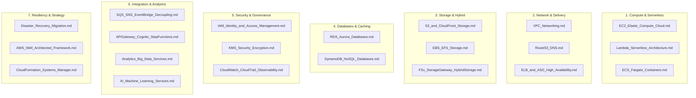

# 🗺️ Master Knowledge Map: Bản Đồ Tri Thức Đồng Bộ Đề Thi & Tài Liệu AWS Services

> **Tài liệu chuẩn hóa kiến trúc & luyện thi cấp cao**: Bảng tổng hợp liên kết toàn diện giữa **1,129+ câu hỏi đề thi thực hành** (*Cloud_Mentor PT1–PT6*, *Tutorials Dojo Set 1–6 & Set 8*, *Udemy PT1–PT4 & PT6*) và hệ thống **21 tài liệu chuyên sâu** trong thư mục `AWS_Services`.  
> **Ngôn ngữ**: Tiếng Việt chuyên ngành (bảo lưu thuật ngữ kiến trúc AWS chuẩn quốc tế).  
> **Mục tiêu**: Tra cứu tức thì giải pháp kiến trúc, bẫy thi và tài liệu tương ứng cho mọi kịch bản xuất hiện trong kỳ thi **AWS Certified Solutions Architect (SAA-C03, SAP-C02)**.

---

## 📑 Mục Lục Điều Hướng Nhanh

1. [Phân Nhóm Theo Miền Kiến Trúc (Architecture Domains)](#1-phân-nhóm-theo-miền-kiến-trúc-architecture-domains)
2. [Bảng Ma Trận Tra Cứu Kịch Bản Đề Thi Sang Tài Liệu (Scenario-to-Doc Mapping)](#2-bảng-ma-trận-tra-cứu-kịch-bản-đề-thi-sang-tài-liệu-scenario-to-doc-mapping)
3. [Chỉ Mục Tra Cứu Theo Dịch Vụ AWS (Alphabetical Service Index)](#3-chỉ-mục-tra-cứu-theo-dịch-vụ-aws-alphabetical-service-index)
4. [Nguyên Tắc "3 Không - 3 Luôn" Khi Giải Đề Thi AWS](#4-nguyên-tắc-3-không---3-luôn-khi-giải-đề-thi-aws)

---

## 1. Phân Nhóm Theo Miền Kiến Trúc (Architecture Domains)

---

## 2. Bảng Ma Trận Tra Cứu Kịch Bản Đề Thi Sang Tài Liệu (Scenario-to-Doc Mapping)

Bảng dưới đây ánh xạ các tình huống, từ khóa "bẫy" và câu hỏi trọng tâm từ 3 bộ đề thực hành lớn sang đúng tài liệu chi tiết và vị trí mục/bẫy tương ứng:

| Miền Kiến Trúc / Dịch Vụ | Tình huống / Từ khóa đề thi | Giải pháp Chuẩn AWS & Điểm Quyết Định | Nguồn Đề Thi | Tài Liệu Chi Tiết & Bẫy Cần Đọc |
| :--- | :--- | :--- | :--- | :--- |
| **Storage & Caching** | Phân phối nội dung toàn cầu, tiết kiệm chi phí tối đa, người dùng tập trung tại Mỹ & Châu Âu | Chọn **CloudFront Price Class 100** hoặc **Price Class 200** (không dùng Price Class All; phân biệt với Geo-restrictions chặn truy cập) | `TD-Set3 Q18`, `U-PT1 Q12` | [S3_and_CloudFront_Storage.md](./S3_and_CloudFront_Storage.md#27-quản-trị-chi-phí-cloudfront-price-classes-vs-geo-restrictions)   *(Mục 2.7 & Bẫy 18)* |
| **Storage Lifecycle** | Lưu trữ tệp tạm thời có vòng đời $< 30$ ngày, yêu cầu chi phí thấp nhất | Giữ ở **S3 Standard**, KHÔNG chuyển sang S3 Standard-IA (Standard-IA phạt tối thiểu 30 ngày lưu trữ + phí retrieval) | `TD-Set4 Q12`, `U-PT2 Q45` | [S3_and_CloudFront_Storage.md](./S3_and_CloudFront_Storage.md)   *(Bẫy 19)* |
| **High Performance Upload** | Tải tệp dung lượng lớn ($> 100$ MB hoặc GB/TB) từ khắp nơi trên thế giới về S3 trung tâm | Kết hợp **S3 Multipart Upload** + **S3 Transfer Acceleration** (sử dụng mạng trục AWS Edge Locations) | `TD-Set1 Q14`, `CM-PT1 Q15` | [S3_and_CloudFront_Storage.md](./S3_and_CloudFront_Storage.md)   *(Bẫy 20)* |
| **Shared File Storage** | Container Fargate / Lambda / Serverless cần dùng chung file system với user root bị cô lập | Dùng **EFS Access Points** cấu hình POSIX UID/GID và giới hạn thư mục gốc | `TD-Set2 Q19`, `U-PT4 Q16` | [EBS_EFS_Storage.md](./EBS_EFS_Storage.md#24-amazon-efs-access-points--chia-sẻ-tệp-tin-cho-serverlesscontainers)   *(Mục 2.4 & Bẫy 16)* |
| **Snapshot Automation** | Tự động hóa lịch chụp và xoay vòng snapshot EBS/RDS theo chính sách tuân thủ | Sử dụng **Amazon Data Lifecycle Manager (DLM)** (không viết script cron Lambda tốn công bảo trì) | `CM-PT2 Q18`, `TD-Set3 Q29` | [EBS_EFS_Storage.md](./EBS_EFS_Storage.md)   *(Bẫy 17)* |
| **Databases** | Dung lượng RDS database tăng trưởng nhanh, tránh downtime và gián đoạn vận hành | Bật **RDS Storage Auto Scaling** (tự động mở rộng khi dung lượng trống $\le 10\%$, cooldown 6h, không reboot) | `U-PT1 Q14`, `TD-Set2 Q08` | [RDS_Aurora_Databases.md](./RDS_Aurora_Databases.md#c-amazon-rds-storage-auto-scaling)   *(Mục 2.4.C & Bẫy 17)* |
| **Database Security** | Xoay vòng mật khẩu cơ sở dữ liệu định kỳ không làm ngắt kết nối ứng dụng | Dùng **AWS Secrets Manager + Lambda Rotation Function** (cơ chế 2 nhãn phiên bản `AWSCURRENT` và `AWSPENDING`) | `TD-Set4 Q35`, `U-PT2 Q09` | [RDS_Aurora_Databases.md](./RDS_Aurora_Databases.md)   *(Mục 2.5 & Bẫy 16)* |
| **NoSQL Database** | Ứng dụng Document dạng JSON cần cơ sở dữ liệu serverless tự động co giãn tương thích MongoDB | **Amazon DocumentDB (Elastic Clusters / Serverless)** | `TD-Set3 Q42`, `U-PT3 Q18` | [RDS_Aurora_Databases.md](./RDS_Aurora_Databases.md)   *(Bẫy 18)* |
| **NoSQL / DynamoDB** | Đọc dữ liệu DynamoDB với độ trễ microsecond, nghiêm cấm sửa đổi code nghiệp vụ | Triển khai cụm **Amazon DynamoDB Accelerator (DAX)** (thay thế endpoint trong SDK, giữ nguyên code logic) | `U-PT1 Q06`, `TD-Set2 Q48`, `TD-Set3 Q04` | [DynamoDB_NoSQL_Databases.md](./DynamoDB_NoSQL_Databases.md#cụm-caching-tốc-độ-microsecond-với-dynamodb-accelerator-dax)   *(Mục 3 & Bẫy 8)* |
| **NoSQL / DynamoDB** | Ghi/đọc cục bộ đa vùng toàn cầu (Active-Active), RPO $< 1$s, xử lý xung đột đồng thời | **DynamoDB Global Tables** (yêu cầu Streams, cơ chế giải quyết xung đột **Last-writer-wins** theo timestamp) | `CM-PT2 Q43`, `U-PT4 Q38`, `U-PT4 Q53` | [DynamoDB_NoSQL_Databases.md](./DynamoDB_NoSQL_Databases.md#5-dynamodb-global-tables-kiến-trúc-đa-vùng-tự-động-nhân-bản-active-active)   *(Mục 2.5 & Bẫy 5, 7)* |
| **NoSQL / DynamoDB** | Khôi phục bảng về đúng giây cụ thể trước khi bị script làm hỏng dữ liệu | Kích hoạt **Point-in-Time Recovery (PITR)** (cửa sổ 35 ngày, khôi phục ra bảng mới, 0 tốn RCU/WCU) | `TD-Set1 Q25` | [DynamoDB_NoSQL_Databases.md](./DynamoDB_NoSQL_Databases.md#6-sao-lưu--khôi-phục-point-in-time-recovery-pitr-vs-on-demand-backup)   *(Mục 2.6 & Bẫy 6)* |
| **Serverless / Lambda** | Lambda trong VPC cần gọi RDS Private VÀ tải thư viện từ Internet công cộng | Gán Lambda vào **Private Subnet**, lưu lượng Internet định tuyến qua **NAT Gateway** (Lambda không có Public IP) | `TD-Set3 Q11`, `U-PT2 Q18` | [Lambda_Serverless_Architecture.md](./Lambda_Serverless_Architecture.md#26-kết-nối-mạng-lambda-trong-vpc-hyperplane-eni--internet-access)   *(Mục 2.6 & Bẫy 13)* |
| **Serverless / Lambda** | Xử lý lỗi "poison pill" trong hàng đợi Kinesis/DynamoDB Streams chặn toàn bộ shard | Cấu hình **BisectBatchOnFunctionError = true** kết hợp Maximum Retry Attempts và On-Failure Destination | `TD-Set2 Q35`, `U-PT3 Q42` | [Lambda_Serverless_Architecture.md](./Lambda_Serverless_Architecture.md#27-khả-năng-phục-hồi-khi-xử-lý-stream-stream-resiliency)   *(Mục 2.7 & Bẫy 14)* |
| **Serverless / API GW** | Ứng dụng chat real-time, bảng điều khiển tài chính đẩy dữ liệu 2 chiều liên tục | **API Gateway WebSocket APIs** (stateful persistent connection, duy trì Connection ID) | `TD-Set4 Q22`, `U-PT1 Q39` | [Lambda_Serverless_Architecture.md](./Lambda_Serverless_Architecture.md)   *(Bẫy 15)* & [APIGateway_Cognito_StepFunctions.md](./APIGateway_Cognito_StepFunctions.md) |
| **Network & HA** | Ứng dụng TCP/UDP non-HTTP, IP cố định cho đối tác whitelist firewall, định tuyến Anycast | **AWS Global Accelerator** (2 Static Anycast IPs, chạy trên AWS private backbone, bypass DNS caching) | `TD-Set1 Q48`, `U-PT3 Q15` | [ELB_and_ASG_High_Availability.md](./ELB_and_ASG_High_Availability.md#24-aws-global-accelerator-định-tuyến-bằng-anycast-ip-và-so-sánh-với-cloudfront)   *(Mục 2.4 & Bẫy 15)* |
| **Auto Scaling** | Lưu lượng tăng vọt đột ngột trong thời gian ngắn (flash sale, livestream) | Cấu hình **Step Scaling** thay vì Simple Scaling (loại bỏ thời gian cooldown giữa các bước tăng tải) | `TD-Set2 Q28`, `U-PT4 Q12` | [ELB_and_ASG_High_Availability.md](./ELB_and_ASG_High_Availability.md#25-các-chiến-lược-co-giãn-asg-step-scaling-vs-simple-scaling)   *(Mục 2.5 & Bẫy 16)* |
| **Hybrid DNS** | Phân giải tên miền 2 chiều giữa mạng On-Premises và AWS VPC | Phải tạo CẢ HAI: **Route 53 Resolver Inbound Endpoint** (On-prem $\rightarrow$ AWS) VÀ **Outbound Endpoint** kèm Forwarding Rules (AWS $\rightarrow$ On-prem) | `CM-PT1 Q41`, `TD-Set1 Q52` | [Route53_DNS.md](./Route53_DNS.md#bẫy-2-kiến-trúc-lai-hybrid-dns-giữa-on-premises-và-aws-vpc--cm-pt1-q41-td-set1-q52)   *(Bẫy 2)* |
| **ETL & Data Prep** | Data Analysts / Business Users cần làm sạch, chuẩn hóa dữ liệu trực quan không cần viết code | **AWS Glue DataBrew** (hơn 250 phép biến đổi visual sẵn có, lưu dưới dạng Recipes và Datasets) | `TD-Set5 Q14`, `U-PT4 Q22` | [Analytics_Big_Data_Services.md](./Analytics_Big_Data_Services.md#26-aws-glue-databrew-visual-data-preparation-no-code)   *(Mục 2.6 & Bẫy 8)* |
| **Specialized Databases** | Hệ thống kế toán, chuỗi cung ứng cần sổ cái bất biến, chứng minh được bằng mật mã | **Amazon QLDB** (Centralized Immutable Append-only Ledger, cấu trúc Merkle Tree SHA-256) | `TD-Set3 Q55`, `U-PT2 Q51` | [Analytics_Big_Data_Services.md](./Analytics_Big_Data_Services.md#27-amazon-qldb--amazon-keyspaces-các-cơ-sở-dữ-liệu-chuyên-dụng)   *(Mục 2.7 & Bẫy 9)* |
| **Specialized Databases** | Di chuyển cụm cơ sở dữ liệu Apache Cassandra lớn lên AWS không muốn quản lý máy chủ | **Amazon Keyspaces (for Apache Cassandra)** (Serverless, tương thích 100% CQL API) | `TD-Set4 Q61`, `U-PT3 Q58` | [Analytics_Big_Data_Services.md](./Analytics_Big_Data_Services.md#b-amazon-keyspaces-for-apache-cassandra)   *(Mục 2.7.B & Bẫy 10)* |
| **Backup & Compliance** | Ngăn chặn ransomware, mã hóa độc hại hoặc nhân sự nội bộ xóa bản sao lưu (WORM) | **AWS Backup Vault Lock** ở chế độ **Compliance Mode** (có thời gian làm nguội Cooling-off period 1–72h) | `CM-PT1 Q22`, `TD-Set6 Q14` | [Disaster_Recovery_Migration.md](./Disaster_Recovery_Migration.md#27-aws-backup-vault-lock--aws-backup-audit-manager)   *(Mục 2.7 & Bẫy 14)* |
| **Migration** | Thu thập thông số máy chủ và phân tích mối quan hệ phụ thuộc giữa các ứng dụng on-prem | **AWS Application Discovery Service** sử dụng **Agent-based** (AWS Application Discovery Agent) | `TD-Set2 Q42`, `U-PT1 Q59` | [Disaster_Recovery_Migration.md](./Disaster_Recovery_Migration.md#b-aws-application-discovery-service)   *(Mục 2.8.B & Bẫy 15)* |
| **Migration** | Theo dõi tiến độ di chuyển của nhiều công cụ (SMS, DMS, MGN) trên một bảng điều khiển duy nhất | **AWS Migration Hub** (Single pane of glass tracking) | `CM-PT3 Q19`, `U-PT4 Q31` | [Disaster_Recovery_Migration.md](./Disaster_Recovery_Migration.md#d-aws-migration-hub)   *(Mục 2.8.D & Bẫy 16)* |
| **Governance & IAM** | Cấm toàn bộ thành viên sử dụng dịch vụ nhạy cảm, nhưng lo lắng dịch vụ AWS bị ảnh hưởng | **Service Control Policies (SCPs)** (Lưu ý: SCPs **KHÔNG ảnh hưởng** Service-Linked Roles và Management Account) | `U-PT3 Q24`, `CM-PT6 Q12` | [IAM_Identity_and_Access_Management.md](./IAM_Identity_and_Access_Management.md#bẫy-13-phạm-vi-ảnh-hưởng-của-service-control-policies-scps--cm-pt6-q12-u-pt3-q24)   *(Bẫy 13)* |
| **VPC & Security** | Kết nối mạng an toàn giữa 2 VPC có dải IP trùng lặp (Overlapping CIDR) | Thiết lập **AWS PrivateLink** (Interface VPC Endpoint + NLB) | `TD-Set4 Q18`, `U-PT2 Q31` | [VPC_Networking.md](./VPC_Networking.md)   *(Mục 2 & Bẫy 12)* |
| **VPC & Security** | Chèn cụm tường lửa bên thứ ba (Palo Alto, Fortinet) kiểm tra lưu lượng trong VPC | Triển khai **Gateway Load Balancer (GWLB)** kèm GENEVE protocol (port 6081) | `TD-Set1 Q05`, `U-PT1 Q44` | [VPC_Networking.md](./VPC_Networking.md) & [ELB_and_ASG_High_Availability.md](./ELB_and_ASG_High_Availability.md) |
| **Security / EC2 Access** | Quản trị máy chủ EC2 an toàn không mở cổng SSH 22, không cần Bastion Host, ghi log đầy đủ | **AWS Systems Manager Session Manager** (kết hợp Interface Endpoint `ssmmessages`) | `TD-Set1 Q11`, `CM-PT2 Q09` | [CloudFormation_Systems_Manager.md](./CloudFormation_Systems_Manager.md) & [VPC_Networking.md](./VPC_Networking.md) |

---

## 3. Chỉ Mục Tra Cứu Theo Dịch Vụ AWS (Alphabetical Service Index)

Danh mục đối chiếu nhanh 40+ dịch vụ cốt lõi và tài liệu chuyên sâu tương ứng:

| Dịch vụ AWS | Tài Liệu Chứa Kiến Thức Trọng Tâm | Các Chủ Đề Cốt Lõi Được Bao Phủ |
| :--- | :--- | :--- |
| **Amazon API Gateway** | [APIGateway_Cognito_StepFunctions.md](./APIGateway_Cognito_StepFunctions.md) | REST vs HTTP vs WebSocket, Usage Plans, API Keys, Throttling, Caching |
| **Amazon Athena** | [Analytics_Big_Data_Services.md](./Analytics_Big_Data_Services.md) | Serverless SQL trên S3, Partitioning, Parquet/ORC, Phí \$5/TB scanned |
| **Amazon Aurora** | [RDS_Aurora_Databases.md](./RDS_Aurora_Databases.md) | Aurora Serverless v2, Global Database, Clone, Backtrack, Multi-AZ Cluster |
| **Amazon CloudFront** | [S3_and_CloudFront_Storage.md](./S3_and_CloudFront_Storage.md) | OAC (Origin Access Control), Price Classes, CloudFront Functions vs Lambda@Edge, Signed URLs/Cookies |
| **Amazon Cognito** | [APIGateway_Cognito_StepFunctions.md](./APIGateway_Cognito_StepFunctions.md) | User Pools (Authentication) vs Identity Pools (Authorization/Federation) |
| **Amazon DynamoDB** | [DynamoDB_NoSQL_Databases.md](./DynamoDB_NoSQL_Databases.md) | RCU/WCU, GSI vs LSI, On-Demand, DAX, Streams, Global Tables (Last-writer-wins), PITR |
| **Amazon EBS** | [EBS_EFS_Storage.md](./EBS_EFS_Storage.md) | gp3 vs io2 Block Express, Multi-Attach, Fast Snapshot Restore, DLM Lifecycles |
| **Amazon EC2** | [EC2_Elastic_Compute_Cloud.md](./EC2_Elastic_Compute_Cloud.md) | Spot Fleets, Placement Groups (Cluster/Spread/Partition), Tenancy, ODCR |
| **Amazon ECS / Fargate** | [ECS_Fargate_Containers.md](./ECS_Fargate_Containers.md) | Task Definitions, ECS Service, Capacity Providers, Fargate Spot |
| **Amazon EFS** | [EBS_EFS_Storage.md](./EBS_EFS_Storage.md) | Multi-AZ NFS, Storage Classes, Lifecycle Management, Access Points |
| **Amazon ElastiCache** | [RDS_Aurora_Databases.md](./RDS_Aurora_Databases.md) & [DynamoDB_NoSQL_Databases.md](./DynamoDB_NoSQL_Databases.md) | Redis vs Memcached, Cluster Mode, Caching Strategies (Lazy vs Write-through) |
| **Amazon EMR** | [Analytics_Big_Data_Services.md](./Analytics_Big_Data_Services.md) | Managed Hadoop/Spark, Master/Core/Task Nodes, Spot Instances cho Task nodes |
| **Amazon FSx** | [FSx_StorageGateway_HybridStorage.md](./FSx_StorageGateway_HybridStorage.md) | FSx for Windows File Server, FSx for Lustre (HPC), FSx for NetApp ONTAP |
| **Amazon Kinesis** | [Analytics_Big_Data_Services.md](./Analytics_Big_Data_Services.md) | Data Streams vs Data Firehose vs Data Analytics, Shard Capacity, Resharding |
| **Amazon OpenSearch** | [Analytics_Big_Data_Services.md](./Analytics_Big_Data_Services.md) | Full-text search, Log analytics, Tích hợp qua DynamoDB Streams / Kinesis |
| **Amazon QLDB** | [Analytics_Big_Data_Services.md](./Analytics_Big_Data_Services.md) | Sổ cái bất biến (Immutable Ledger), Mã hóa Merkle Tree SHA-256 |
| **Amazon RDS** | [RDS_Aurora_Databases.md](./RDS_Aurora_Databases.md) | Multi-AZ vs Read Replicas, Storage Auto Scaling, Automated Backups |
| **Amazon Redshift** | [Analytics_Big_Data_Services.md](./Analytics_Big_Data_Services.md) | Data Warehouse, Redshift Serverless, Redshift Spectrum, Concurrency Scaling |
| **Amazon Route 53** | [Route53_DNS.md](./Route53_DNS.md) | Routing Policies, Alias vs CNAME, Resolver Inbound/Outbound Endpoints |
| **Amazon S3** | [S3_and_CloudFront_Storage.md](./S3_and_CloudFront_Storage.md) | Storage Classes, Lifecycle Rules, S3 Object Lock (Compliance vs Governance), Replication |
| **Amazon SNS** | [SQS_SNS_EventBridge_Decoupling.md](./SQS_SNS_EventBridge_Decoupling.md) | Pub/Sub, Fanout pattern, Message Filtering, SMS/Email delivery |
| **Amazon SQS** | [SQS_SNS_EventBridge_Decoupling.md](./SQS_SNS_EventBridge_Decoupling.md) | Standard vs FIFO, Visibility Timeout, DLQ, Long Polling (20s), Backlog Metric |
| **AWS Application Discovery** | [Disaster_Recovery_Migration.md](./Disaster_Recovery_Migration.md) | Agentless Collector (OVA) vs Application Discovery Agent (Network Dependencies) |
| **AWS Backup** | [Disaster_Recovery_Migration.md](./Disaster_Recovery_Migration.md) | Centralized Backup, Vault Lock (WORM), Backup Audit Manager, Cross-Region Copy |
| **AWS CloudFormation** | [CloudFormation_Systems_Manager.md](./CloudFormation_Systems_Manager.md) | Stacks, Nested Stacks, StackSets (đa tài khoản/đa vùng), Drift Detection |
| **AWS CloudTrail** | [CloudWatch_CloudTrail_Observability.md](./CloudWatch_CloudTrail_Observability.md) | Management Events vs Data Events, CloudTrail Insights, Multi-region Trail |
| **AWS CloudWatch** | [CloudWatch_CloudTrail_Observability.md](./CloudWatch_CloudTrail_Observability.md) | Metrics, Logs, Metric Filters, Alarms, Network Monitor, Container Insights |
| **AWS Direct Connect** | [VPC_Networking.md](./VPC_Networking.md) | Private VIF vs Public VIF vs Transit VIF, Direct Connect Gateway, MACsec |
| **AWS Global Accelerator** | [ELB_and_ASG_High_Availability.md](./ELB_and_ASG_High_Availability.md) | Static Anycast IPs, Bỏ qua DNS Cache, Hỗ trợ TCP/UDP, Tối ưu độ trễ VoIP/Gaming |
| **AWS Glue / DataBrew** | [Analytics_Big_Data_Services.md](./Analytics_Big_Data_Services.md) | Data Catalog, Crawlers, ETL Jobs, Glue DataBrew (Visual Recipes) |
| **AWS KMS** | [KMS_Security_Encryption.md](./KMS_Security_Encryption.md) | AWS Managed vs Customer Managed Keys (CMK), Envelope Encryption, Multi-Region Keys |
| **AWS Lambda** | [Lambda_Serverless_Architecture.md](./Lambda_Serverless_Architecture.md) | Event Source Mapping, VPC Networking (Hyperplane ENI), SnapStart, Stream Resiliency |
| **AWS Migration Hub** | [Disaster_Recovery_Migration.md](./Disaster_Recovery_Migration.md) | Bảng điều khiển quản lý tiến độ di chuyển tập trung tích hợp các công cụ |
| **AWS Organizations / SCP** | [IAM_Identity_and_Access_Management.md](./IAM_Identity_and_Access_Management.md) | Organizational Units (OUs), Service Control Policies (SCPs), Miễn trừ Service-Linked Roles |
| **AWS Secrets Manager** | [RDS_Aurora_Databases.md](./RDS_Aurora_Databases.md) & [KMS_Security_Encryption.md](./KMS_Security_Encryption.md) | Tự động xoay vòng mật khẩu (Rotation) với Lambda, tích hợp RDS/Aurora |
| **AWS Step Functions** | [APIGateway_Cognito_StepFunctions.md](./APIGateway_Cognito_StepFunctions.md) | Standard Workflows (chạy tới 1 năm, Exactly-once) vs Express Workflows (At-least-once, tải cao) |
| **AWS Systems Manager** | [CloudFormation_Systems_Manager.md](./CloudFormation_Systems_Manager.md) | Parameter Store, Session Manager, Patch Manager, Run Command |
| **AWS Transit Gateway** | [VPC_Networking.md](./VPC_Networking.md) | Hub-and-Spoke topology, TGW Route Tables, Peering, Multicast |
| **AWS WAF & Shield** | [AWS_Well_Architected_Framework.md](./AWS_Well_Architected_Framework.md) & [S3_and_CloudFront_Storage.md](./S3_and_CloudFront_Storage.md) | Web ACLs, SQL Injection / XSS protection, Rate-based Rules, Shield Standard vs Advanced |

---

## 4. Nguyên Tắc "3 Không - 3 Luôn" Khi Giải Đề Thi AWS

### ❌ 3 ĐIỀU TUYỆT ĐỐI KHÔNG CHỌN:
1. **Không chọn giải pháp thủ công hoặc custom script** khi đã có dịch vụ AWS Native (ví dụ: không viết Lambda cron chụp snapshot khi đã có *Data Lifecycle Manager* hay *AWS Backup*; không viết script kiểm tra drift khi CloudFormation đã có sẵn *Drift Detection*).
2. **Không routing lưu lượng nội bộ AWS qua Internet công cộng** (luôn chọn *VPC Endpoints* - Gateway hoặc Interface Endpoint thay vì NAT Gateway khi kết nối các dịch vụ như S3, DynamoDB, SQS, Secrets Manager).
3. **Không lưu trữ file có tuổi thọ dưới 30 ngày lên S3 Standard-IA** (vì phí phạt lưu trữ tối thiểu 30 ngày của Standard-IA sẽ làm chi phí cao hơn cả S3 Standard).

### ✅ 3 ĐIỀU LUÔN PHẢI ƯU TIÊN:
1. **Luôn ưu tiên tính sẵn sàng cao (High Availability) trải rộng ít nhất 2 Availability Zones** (bất kỳ phương án nào chỉ đặt trên 1 AZ đều bị loại bỏ ngay khi câu hỏi yêu cầu "Highly Available" hoặc "Resilient").
2. **Luôn bảo vệ dữ liệu sản xuất bằng đa tầng phòng thủ** (kết hợp *Deletion Protection*, *MFA Delete*, *Object Lock/Vault Lock*, và *Point-in-Time Recovery - PITR*).
3. **Tách rời các thành phần kiến trúc bằng hàng đợi bất đồng bộ** (*Decouple with SQS/EventBridge*) để chống quá tải tầng lưu trữ và cho phép từng tầng co giãn độc lập.

---

### Liên Kết Đến Tất Cả Tài Liệu Chuyên Sâu (All Services Reference)
- 🖥️ [EC2 Elastic Compute Cloud](./EC2_Elastic_Compute_Cloud.md)
- ⚡ [Lambda Serverless Architecture](./Lambda_Serverless_Architecture.md)
- 🐳 [ECS & Fargate Containers](./ECS_Fargate_Containers.md)
- 🌐 [VPC Networking](./VPC_Networking.md)
- 🚦 [Route 53 DNS](./Route53_DNS.md)
- ⚖️ [ELB & ASG High Availability](./ELB_and_ASG_High_Availability.md)
- 📦 [S3 & CloudFront Storage](./S3_and_CloudFront_Storage.md)
- 💾 [EBS & EFS Storage](./EBS_EFS_Storage.md)
- 🏢 [FSx & Storage Gateway Hybrid Storage](./FSx_StorageGateway_HybridStorage.md)
- 🗄️ [RDS & Aurora Databases](./RDS_Aurora_Databases.md)
- ⚡ [DynamoDB & NoSQL Databases](./DynamoDB_NoSQL_Databases.md)
- 🔐 [IAM Identity & Access Management](./IAM_Identity_and_Access_Management.md)
- 🔑 [KMS Security & Encryption](./KMS_Security_Encryption.md)
- 📊 [CloudWatch, CloudTrail & Observability](./CloudWatch_CloudTrail_Observability.md)
- 📬 [SQS, SNS & EventBridge Decoupling](./SQS_SNS_EventBridge_Decoupling.md)
- 🚪 [API Gateway, Cognito & Step Functions](./APIGateway_Cognito_StepFunctions.md)
- 📈 [Analytics & Big Data Services](./Analytics_Big_Data_Services.md)
- 🤖 [AI & Machine Learning Services](./AI_Machine_Learning_Services.md)
- 🛡️ [Disaster Recovery & Migration](./Disaster_Recovery_Migration.md)
- 🏗️ [AWS Well-Architected Framework](./AWS_Well_Architected_Framework.md)
- 📜 [CloudFormation & Systems Manager](./CloudFormation_Systems_Manager.md)

