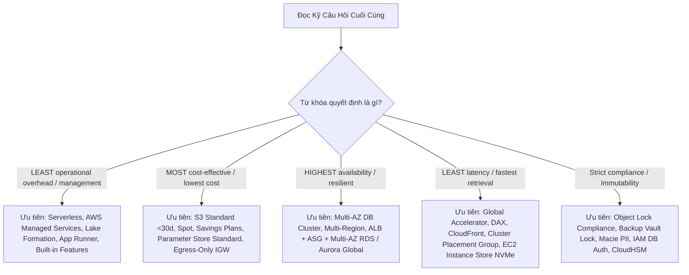
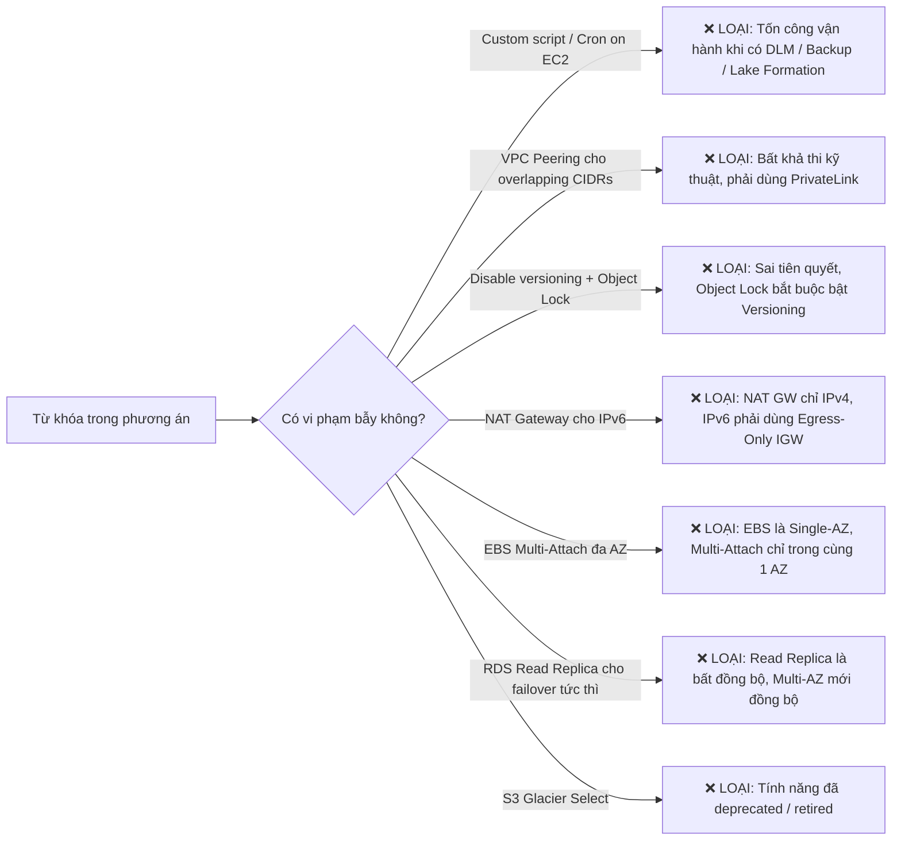
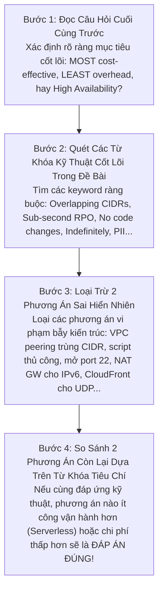

# 📘 Bộ Từ Điển Thuật Ngữ & Cẩm Nang Giải Mã Đề Thi AWS SAA-C03 (Exam Vocabulary & Keyword Playbook)

> **Mục tiêu**: Cung cấp từ điển thuật ngữ chuyên biệt và bộ quy tắc giải mã từ khóa (Keyword Clues) trong các đề thi AWS Certified Solutions Architect - Associate (**SAA-C03**).  
> **Nguồn trích xuất thực chứng**: Tổng hợp và chuẩn hóa trực tiếp từ **1,064 câu hỏi thực chiến** qua 17 bộ đề thi thực hành chuyên sâu:
> - **Cloud Mentor (PT1 đến PT6)**: 390 câu hỏi tình huống chuyên sâu.
> - **Udemy Stephane Maarek (PT1, PT2, PT3, PT6)**: 260 câu hỏi chuẩn hóa cấu trúc đề thi AWS.
> - **Tutorials Dojo - Jon Bonso (Set 1 đến Set 6 & Set 8)**: 414 câu hỏi thực chiến với giải thích chi tiết đáp án đúng/sai, sơ đồ kiến trúc và cheat sheets.  
> **Tài liệu liên kết**: [Bảng thuật ngữ kỹ thuật tổng quan (GLOSSARY.md)](./GLOSSARY.md) | [Thư viện 21 chuyên đề AWS Services](./AWS_Services/) | [Bộ đề Cloud Mentor (PT1 - PT6)](./Practices_Test/Cloud_Mentor/) | [Bộ đề Udemy (PT1 - PT6)](./Practices_Test/Udemy/) | [Bộ đề Tutorials Dojo (Set 1 - Set 6, Set 8)](./Practices_Test/Dojo/)

---

## 📌 Mục Lục Điều Hướng

1. [Phần 1: Từ Khóa Định Hướng Quyết Định & Ràng Buộc Tiêu Chí (Exam Decision Qualifiers & Constraints)](#phần-1-từ-khóa-định-hướng-quyết-định--ràng-buộc-tiêu-chí)
2. [Phần 2: Bẫy Đề Thi & Từ Khóa Cảnh Báo Phương Án Sai (Exam Traps & Distractor Keywords)](#phần-2-bẫy-đề-thi--từ-khóa-cảnh-báo-phương-án-sai)
3. [Phần 3: Bộ Từ Vựng Tiếng Anh Thông Thường & Cụm Từ Ngữ Cảnh Đề Thi (General Exam Vocabulary & Question-Stem Lexicon)](#phần-3-bộ-từ-vựng-tiếng-anh-thông-thường--cụm-từ-ngữ-cảnh-đề-thi)
4. [Phần 4: Ma Trận Ánh Xạ Từ Khóa $\rightarrow$ Dịch Vụ & Kiến Trúc Chuẩn (Scenario Trigger $\rightarrow$ Target Architecture Mapping)](#phần-4-ma-trận-ánh-xạ-từ-khóa--kiến-trúc-chuẩn)
5. [Phần 5: Từ Điển Thuật Ngữ Anh - Việt Chuyên Biệt Cho Đề Thi (A-Z Exam Vocabulary with Exam Scenarios)](#phần-5-từ-điển-thuật-ngữ-anh---việt-chuyên-biệt-cho-đề-thi)
6. [Phần 6: Chiến Lược Đọc Đề & Kỹ Thuật Loại Trừ 4 Bước (4-Step Question Breakdown & Elimination Strategy)](#phần-6-chiến-lược-đọc-đề--kỹ-thuật-loại-trừ-4-bước)

---

## Phần 1: Từ Khóa Định Hướng Quyết Định & Ràng Buộc Tiêu Chí

Trong kỳ thi AWS SAA-C03, các câu hỏi luôn chứa **từ khóa định hướng (Qualifiers)** ở cuối câu hỏi (như *"Which solution is MOST cost-effective?"* hoặc *"Which solution requires the LEAST operational overhead?"*). Đây chính là "kim chỉ nam" giúp bạn chọn đúng giữa 2 đáp án đều khả thi về mặt kỹ thuật.



### 1.1. Nhóm Tiêu Chí Vận Hành (Operational Overhead)

| Cụm từ khóa trong đề (Keyword Phrase) | Ý nghĩa bản chất | Xu hướng đáp án ĐÚNG (Target Solution) | Xu hướng đáp án SAI (Distractor / Anti-pattern) |
| :--- | :--- | :--- | :--- |
| **LEAST operational overhead**<br>**LEAST administrative effort**<br>**LEAST management overhead** | Đòi hỏi giải pháp ít phải tự tay cài đặt, bảo trì, vá lỗi hệ điều hành hoặc viết code script tùy chỉnh nhất. | • **AWS Managed Services**: RDS Proxy, AWS Transfer Family, AWS DataSync, AWS App Runner.<br>• **Centralized Governance**: AWS Lake Formation (quản lý Data Lake đa tài khoản), AWS Control Tower (Landing Zone tự động).<br>• **Serverless**: AWS Fargate, AWS Lambda, Amazon EventBridge.<br>• **Tính năng tích hợp sẵn**: EventBridge Archive, Amazon DLM, S3 Lifecycle. | • Tự dựng EC2 instance để chạy phần mềm (SFTP server, NAT instance, OpenVPN).<br>• Viết script Lambda kết hợp EventBridge cron để snapshot/backup hoặc sao chép S3 thủ công.<br>• Tự quản lý cụm Docker swarm / Kubernetes trên EC2 hoặc tự cài đặt Apache Kafka trên EC2. |
| **Without changing application code**<br>**No code changes required** | Ứng dụng legacy hoặc ứng dụng đóng gói bên thứ 3 không được phép sửa đổi logic mã nguồn. | • **Amazon EFS** (mount NFS chuẩn POSIX giữ nguyên đường dẫn file hệ thống).<br>• **Amazon FSx for Windows File Server** (chuẩn SMB, tích hợp AD).<br>• **AWS Transfer Family** (giữ nguyên client SFTP/FTP/FTPS).<br>• **Amazon DocumentDB** (tương thích MongoDB không đổi code).<br>• **RDS Proxy** (chỉ đổi DB endpoint connection string).<br>• **Amazon MQ** (giữ nguyên giao thức JMS, AMQP, MQTT). | • Chuyển đổi mã nguồn sang gọi S3 SDK API (`PutObject`, `GetObject`).<br>• Viết lại kiến trúc ứng dụng sang DynamoDB hoặc microservices hướng sự kiện. |
| **Without managing infrastructure**<br>**Serverless architecture** | Loại bỏ hoàn toàn việc cấp phát, vá lỗi máy chủ vật lý hoặc máy ảo EC2. | • AWS Lambda, AWS Fargate, AWS App Runner, Amazon Aurora Serverless v2, DynamoDB, Amazon API Gateway, Amazon S3. | • Amazon EC2, EKS với self-managed EC2 worker nodes, Amazon RDS truyền thống với instance sizing cố định. |
| **Multi-account centralized data lake**<br>**Granular column/row access control** | Xây dựng kho dữ liệu dùng chung xuyên nhiều tài khoản AWS với phân quyền chi tiết tới cấp cột/dòng. | • **AWS Lake Formation** (tập trung hóa metadata, phân quyền granular trên Glue Data Catalog, chia sẻ dữ liệu không sao chép). | • Thiết lập Amazon Data Firehose ở từng account để copy data về một S3 trung tâm.<br>• Tự viết custom Lambda script đồng bộ dữ liệu S3 cross-account. |

### 1.2. Nhóm Tiêu Chí Chi Phí (Cost Optimization)

| Cụm từ khóa trong đề (Keyword Phrase) | Ý nghĩa bản chất | Xu hướng đáp án ĐÚNG (Target Solution) | Xu hướng đáp án SAI (Distractor / Anti-pattern) |
| :--- | :--- | :--- | :--- |
| **MOST cost-effective**<br>**LOWEST cost**<br>**Minimize overall costs** | Chi phí tổng thể hàng tháng thấp nhất (tính cả phí lưu trữ, phí truy xuất, phí tính toán và phí mạng). | • **Workload gián đoạn / dev test**: Aurora Serverless v2, Spot Instances, On-Demand DynamoDB.<br>• **Workload ổn định 24/7**: Compute Savings Plans, Reserved Instances.<br>• **Lưu trữ cấu hình / biến môi trường**: AWS Systems Manager Parameter Store (Standard tier miễn phí $0.00).<br>• **Traffic IPv6 ra Internet**: Egress-Only Internet Gateway (miễn phí) thay vì NAT Gateway ($0.045/giờ + data). | • Duy trì máy ảo On-Demand chạy 24/7 cho môi trường dev/test chỉ dùng vài giờ/ngày.<br>• Sử dụng AWS Secrets Manager khi chỉ cần lưu biến cấu hình không xoay vòng ($0.40/secret/tháng).<br>• Chọn S3 Standard-IA cho dữ liệu tạm xóa sau < 30 ngày (bị phạt 30 ngày tối thiểu).<br>• Cấu hình Provisioned IOPS (io2) khi gp3 hoặc Instance Store đã đủ đáp ứng yêu cầu. |
| **Intermittent usage**<br>**Spiky workloads**<br>**Unpredictable traffic** | Lưu lượng truy cập không đều đặn, có đợt tăng vọt đột ngột rồi giảm về 0, không dự đoán được trước. | • **Amazon Aurora Serverless v2** (scale theo ACU tức thì từ 0.5 đến 128 ACUs).<br>• **Amazon DynamoDB On-Demand capacity mode**.<br>• **AWS Lambda** (tính tiền theo ms chạy thực tế). | • Provisioned RDS instance chạy liên tục gây lãng phí dung lượng nhàn rỗi.<br>• DynamoDB Provisioned capacity mode (bị bóp nghẹt hoặc cấp thừa gây tốn kém). |
| **Predictable workload**<br>**Off-peak batch window** | Lưu lượng tải tăng giảm theo khung giờ cố định và lặp lại chính xác mỗi ngày. | • **EC2 Auto Scaling Scheduled Scaling** (chủ động bật máy trước giờ cao điểm).<br>• **On-Demand Capacity Reservations (ODCR)** (đảm bảo chắc chắn có dung lượng compute trong AZ cụ thể).<br>• **Savings Plans / Reserved Instances** cho mức tải nền tối thiểu (baseline). | • Dynamic Target Tracking Scaling (phải chờ metric CPU tăng mới bắt đầu scale, gây trễ vài phút ban đầu).<br>• Sử dụng On-Demand thuần túy không cam kết gây lãng phí chi phí. |

### 1.3. Nhóm Tiêu Chí Khả Dụng & Kiên Cường (Availability & Resilience)

| Cụm từ khóa trong đề (Keyword Phrase) | Ý nghĩa bản chất | Xu hướng đáp án ĐÚNG (Target Solution) | Xu hướng đáp án SAI (Distractor / Anti-pattern) |
| :--- | :--- | :--- | :--- |
| **HIGH AVAILABILITY (HA)**<br>**Fault-tolerant**<br>**Resilient to an AZ outage** | Hệ thống phải duy trì hoạt động không gián đoạn kể cả khi toàn bộ một Availability Zone (AZ) bị sập. | • **Multi-AZ Architecture**: ALB trải rộng tối thiểu 2 Public Subnets + Auto Scaling Group phân bổ trên tối thiểu 2 Private Subnets + Amazon RDS Multi-AZ DB Instance hoặc Multi-AZ DB Cluster.<br>• Lưu trữ: Amazon EFS, S3, hoặc FSx Multi-AZ (bản chất Multi-AZ). | • Single-AZ deployment.<br>• Gắn ổ đĩa Amazon EBS (EBS chỉ tồn tại trong 1 AZ duy nhất).<br>• Sử dụng RDS Read Replica cho HA (Read Replica mặc định nhân bản bất đồng bộ, không tự động failover đồng bộ như Multi-AZ standby). |
| **Sub-second RPO**<br>**Sub-minute RTO**<br>**Multi-region disaster recovery** | Yêu cầu khôi phục thảm họa đa vùng với độ mất mát dữ liệu dưới 1 giây và phục hồi trong vài phút. | • **Amazon Aurora Global Database** (nhân bản dữ liệu liên vùng ở tầng lưu trữ trong < 1 giây, failover < 1 phút).<br>• **Amazon DynamoDB Global Tables** (multi-region active-active). | • Tự viết script sao chép snapshot RDS hàng giờ sang Region khác (RPO = hàng giờ).<br>• RDS Cross-Region Read Replica truyền thống (replication lag có thể từ vài giây đến vài phút). |
| **Sub-35 second failover**<br>**Readable standby instances** | Yêu cầu thời gian chuyển đổi dự phòng cơ sở dữ liệu dưới 35 giây và tận dụng được máy dự phòng để đọc. | • **Amazon RDS Multi-AZ DB Cluster** (gồm 1 Primary + 2 Readable Standbys trải trên 3 AZs; commit nhanh gấp 2 lần và failover dưới 35 giây). | • Amazon RDS Multi-AZ DB Instance truyền thống (standby thụ động không thể truy vấn đọc, failover mất từ 60–120 giây). |
| **Distribute read traffic equally**<br>**Auto-scale read replicas** | Phân bổ đều lưu lượng đọc sang các bản sao cơ sở dữ liệu mà không cần can thiệp thủ công. | • **Amazon Aurora Reader Endpoint** (tự động cân bằng tải Round-Robin giữa tất cả các Read Replicas trong cụm).<br>• **Aurora Auto Scaling** (tự động tăng/giảm số lượng Read Replicas dựa trên CPU hoặc Connection count). | • Tự cấu hình hardcode IP/endpoint của từng Read Replica riêng lẻ trong code ứng dụng.<br>• Sử dụng Cluster Endpoint cho các truy vấn đọc (Cluster Endpoint chỉ trỏ vào Primary Writer). |
| **Zero downtime**<br>**Without downtime** | Quá trình nâng cấp, mở rộng hoặc di chuyển dữ liệu không được phép làm ngắt quãng dịch vụ của người dùng. | • **Amazon RDS Storage Auto Scaling** (tự động tăng dung lượng đĩa online không downtime).<br>• **AWS DataSync** (đồng bộ dữ liệu nền sang FSx Multi-AZ mới trước khi cutover).<br>• **Route 53 / Global Accelerator** chuyển hướng lưu lượng. | • Chỉnh sửa in-place chuyển đổi FSx Single-AZ sang Multi-AZ (AWS không hỗ trợ in-place).<br>• Khôi phục DB từ snapshot thủ công rồi đổi DNS (mất từ 15-30 phút downtime). |

### 1.4. Nhóm Tiêu Chí Hiệu Năng & Độ Trễ (Performance & Latency)

| Cụm từ khóa trong đề (Keyword Phrase) | Ý nghĩa bản chất | Xu hướng đáp án ĐÚNG (Target Solution) | Xu hướng đáp án SAI (Distractor / Anti-pattern) |
| :--- | :--- | :--- | :--- |
| **Sub-millisecond latency**<br>**Microsecond latency** | Độ trễ xử lý cực thấp dưới 1 mili-giây cho các giao dịch nhạy cảm hoặc bộ đệm dữ liệu. | • **Amazon ElastiCache for Redis / Memcached** (in-memory caching).<br>• **DynamoDB Accelerator (DAX)** (cache tầng bộ nhớ cho DynamoDB).<br>• **Amazon FSx for Lustre** (hệ thống file tính toán HPC). | • Truy vấn trực tiếp vào đĩa cứng RDS hoặc DynamoDB qua mạng WAN.<br>• Amazon EFS (độ trễ chuẩn NFS thường từ 1–5 mili-giây). |
| **Tightly-coupled node-to-node**<br>**HPC inter-node latency** | Tác vụ tính toán hiệu năng cao cần băng thông mạng tối đa và độ trễ giao tiếp giữa các node thấp nhất. | • **Cluster Placement Group** (gom cụm các máy ảo vào cùng 1 tủ rack mạng trong 1 AZ duy nhất, đạt băng thông tới 100 Gbps). | • Spread Placement Group (phân tán máy ảo trên các rack khác nhau).<br>• Triển khai máy ảo đa AZ (Multi-AZ tăng độ trễ mạng giữa các node). |
| **Temporary high IOPS / Scratch**<br>**Maximum sequential I/O** | Dữ liệu tạm thời (cache, buffer, scratch, swap) cần tốc độ đọc/ghi ngẫu nhiên hoặc tuần tự cực đại. | • **EC2 Instance Store (NVMe SSD)** (ổ đĩa vật lý gắn trực tiếp vào server host, thông lượng hàng triệu IOPS, miễn phí kèm instance). | • Provisioned IOPS SSD (`io2` Block Express) (tốn kém chi phí lớn cho dữ liệu tạm thời).<br>• Amazon EFS qua mạng. |
| **Bypass DNS caching**<br>**Instant traffic failover**<br>**Preserve client IP address** | Người dùng hoặc nhà mạng cache bản ghi DNS; cần chuyển đổi traffic tức thì và giữ nguyên IP người dùng cuối cho giao thức TCP/UDP. | • **AWS Global Accelerator** (sử dụng 2 Anycast IP tĩnh cố định, điều hướng traffic ở tầng mạng trục AWS backbone, bảo toàn Client IP qua Proxy Protocol/TCP). | • Giảm TTL của Route 53 xuống 0 hoặc 60 giây (nhiều client/ISP vẫn phớt lờ TTL và cache theo ý họ).<br>• Sử dụng CloudFront cho traffic UDP hoặc gaming không qua HTTP/HTTPS. |

### 1.5. Nhóm Tiêu Chí Bảo Mật & Tuân Thủ (Security & Compliance)

| Cụm từ khóa trong đề (Keyword Phrase) | Ý nghĩa bản chất | Xu hướng đáp án ĐÚNG (Target Solution) | Xu hướng đáp án SAI (Distractor / Anti-pattern) |
| :--- | :--- | :--- | :--- |
| **Indefinitely**<br>**Protected against overwriting indefinitely** | Dữ liệu phải được bảo vệ không bị ghi đè hay xóa bỏ vô thời hạn, không có ngày hết hạn xác định. | • **Amazon S3 Object Lock với Legal Hold** (Legal Hold không có ngày hết hạn, chỉ mất hiệu lực khi được gỡ bỏ rõ ràng). | • S3 Object Lock Retention Period (kể cả Compliance mode vẫn phải thiết lập số ngày/năm cụ thể, hết hạn sẽ xóa được).<br>• Bật S3 Versioning đơn thuần (vẫn có thể ghi đè tạo version mới hoặc xóa marker). |
| **Prevent deletion even by the root user**<br>**Strict compliance (WORM)** | Tuân thủ quy định pháp lý ngặt nghèo (SEC 17a-4), Write Once Read Many; không ai (kể cả root) có quyền xóa trước hạn. | • **S3 Object Lock ở Compliance Mode**.<br>• **AWS Backup Vault Lock ở Compliance Mode**.<br>• **EBS Snapshot Lock ở Compliance Mode**. | • S3 Object Lock Governance Mode (user có quyền `s3:BypassGovernanceRetention` hoặc tài khoản root vẫn có thể xóa).<br>• IAM Policy Deny (tài khoản root hoặc admin có thể sửa policy). |
| **Discover PII / Sensitive data in S3**<br>**Beyond object inventory** | Tự động quét, phân loại và cảnh báo dữ liệu nhạy cảm (thẻ tín dụng, số hộ chiếu, CCCD) nằm trong S3 bucket. | • **Amazon Macie** (sử dụng Machine Learning và pattern matching phát hiện PII trong S3). | • S3 Inventory (chỉ liệt kê metadata danh sách file, không đọc nội dung bên trong file).<br>• Amazon Inspector (chỉ quét lỗ hổng CVE trên EC2, ECR và Lambda). |
| **Zero hardcoded credentials**<br>**Temporary auth token for Database** | Kết nối an toàn vào database mà không dùng mật khẩu tĩnh, dùng danh tính IAM và token tạm thời. | • **IAM Database Authentication** (sinh token xác thực ngắn hạn 15 phút qua IAM, bắt buộc mã hóa SSL/TLS). | • Hardcode username/password trong tệp cấu hình ứng dụng.<br>• Lưu mật khẩu tĩnh trong Security Group (Security Group không lưu thông tin đăng nhập). |
| **Retain control over key material**<br>**FIPS 140-2 Level 3 HSM control** | Doanh nghiệp phải nắm toàn quyền tạo và sở hữu phần cứng bảo mật riêng, đáp ứng chuẩn an ninh cấp cao. | • **AWS KMS với Custom Key Store backed by AWS CloudHSM**.<br>• **AWS KMS với Imported Key Material (BYOK)**. | • AWS Managed Keys (AWS tự sinh và tự xoay vòng).<br>• SSE-S3 (AWS quản lý toàn bộ).<br>• KMS Customer Managed Key mặc định (chạy trên HSM dùng chung của AWS). |

---

## Phần 2: Bẫy Đề Thi & Từ Khóa Cảnh Báo Phương Án Sai

Nhận diện phương án sai (Distractors) nhanh chóng là kỹ năng quan trọng nhất để làm bài thi trong thời gian quy định. Dưới đây là các "dấu hiệu nhận diện phương án bẫy" xuất hiện lặp đi lặp lại:



### Bảng 2.1: Tổng Hợp 20 Bẫy Thi Kinh Điển (The 20 Deadly Exam Traps)

| # | Phương án bẫy (Distractor Trap) | Tại sao SAI về bản chất kiến trúc? | Giải pháp ĐÚNG tương ứng | Đề thi thực chứng |
| :---: | :--- | :--- | :--- | :---: |
| **1** | *"Thiết lập VPC Peering giữa 2 VPC có dải IP trùng nhau (Overlapping CIDRs)"* | VPC Peering và Transit Gateway hoàn toàn KHÔNG hỗ trợ định tuyến gói tin giữa 2 dải CIDR trùng lặp IP. | Sử dụng **AWS PrivateLink** (giao tiếp qua Interface Endpoint ENI độc lập CIDR). | CM-PT1 Q02 |
| **2** | *"Tắt Versioning rồi cấu hình S3 Object Lock"* | S3 Object Lock bắt buộc bucket phải bật S3 Versioning trước mới có thể kích hoạt được. | Bật Versioning trước $\rightarrow$ Kích hoạt S3 Object Lock. | CM-PT1 Q01 |
| **3** | *"Dùng NAT Gateway để cho phép EC2 IPv6 ra Internet an toàn"* | NAT Gateway chỉ hoạt động cho giao thức IPv4. Không hỗ trợ địa chỉ IPv6. | Sử dụng **Egress-Only Internet Gateway** (miễn phí, outbound-only IPv6). | CM-PT1 Q33, TD-Set1 Q57 |
| **4** | *"Gắn chung 1 ổ đĩa EBS gp3 vào nhiều EC2 instance ở các AZ khác nhau"* | Ổ đĩa EBS về mặt vật lý bị giới hạn trong duy nhất **1 Availability Zone**. Không thể mount xuyên AZ. | Sử dụng **Amazon EFS** (hỗ trợ mount đồng thời trên hàng trăm EC2 xuyên Multi-AZ). | CM-PT2 Q01, TD-Set1 Q07 |
| **5** | *"Viết script Lambda tùy chỉnh kích hoạt bởi EventBridge cron để chụp snapshot"* | Tốn công viết code, test và bảo trì trong khi AWS đã cung cấp dịch vụ quản lý vòng đời bản chụp chuyên dụng. | Sử dụng **Amazon Data Lifecycle Manager (DLM)** hoặc **AWS Backup**. | CM-PT1 Q65, CM-PT3 Q41 |
| **6** | *"Tạo Bastion Host trong Public Subnet mở cổng SSH 22 ra Internet"* | Mở cổng SSH 22 ra Internet công cộng là rủi ro bảo mật lớn (bị quét brute-force) và tốn chi phí quản lý máy chủ. | Sử dụng **AWS Systems Manager Session Manager** (không cần mở cổng inbound, không cần public IP). | CM-PT1 Q19, TD-Set6 Q54 |
| **7** | *"Dùng S3 Standard-IA cho các file tạm thời bị xóa sau 10 đến 15 ngày"* | S3 Standard-IA có quy định thời gian lưu trữ tối thiểu là **30 ngày** (Minimum Storage Duration). Xóa sớm vẫn bị tính đủ 30 ngày. | Sử dụng **Amazon S3 Standard** (không có quy định ngày lưu trữ tối thiểu, tính tiền theo giây thực tế). | CM-PT1 Q55 |
| **8** | *"Gán IAM Role cho EC2 instance để ứng dụng chạy trong container ECS lấy quyền"* | Ứng dụng chạy trong container ECS phải lấy quyền từ Task Role. Nếu gán vào Instance Role sẽ vi phạm Least Privilege. | Sử dụng **ECS Task Role** (phân quyền riêng cho từng task độc lập). | CM-PT2 Q20 |
| **9** | *"Cấu hình Route 53 Weighted Routing để chuyển đổi traffic tức thì giữa 2 Region"* | Bản ghi DNS bị cache bởi các Recursive Resolvers của ISP và máy trạm người dùng theo TTL, không thể chuyển đổi tức thì. | Sử dụng **AWS Global Accelerator** (Anycast IPs, chuyển đổi traffic tức thời qua Traffic Dial). | CM-PT1 Q40, CM-PT6 Q48 |
| **10** | *"Tự nâng cấp in-place file system FSx for Windows từ Single-AZ lên Multi-AZ"* | AWS không hỗ trợ sửa đổi trực tiếp (in-place modification) một FSx file system từ Single-AZ thành Multi-AZ. | Tạo file system Multi-AZ mới $\rightarrow$ dùng **AWS DataSync** để đồng bộ dữ liệu sang không downtime. | CM-PT1 Q05, TD-Set1 Q55 |
| **11** | *"Dùng AWS Glue ETL để xử lý streaming ingestion thời gian thực (real-time < 1s)"* | AWS Glue là dịch vụ batch ETL theo lô, có độ trễ khởi động job tính bằng phút; không phục vụ real-time streaming. | Sử dụng **Amazon Kinesis Data Streams** hoặc **Amazon Managed Streaming for Apache Kafka (MSK)**. | CM-PT1 Q06, TD-Set1 Q08 |
| **12** | *"Dùng Customer Managed Keys (CMK) khi đề bài chỉ yêu cầu mã hóa cơ bản với ít chi phí nhất"* | Khóa CMK phát sinh phí duy trì $1/tháng/khóa và phí gọi KMS API ($0.03/10,000 requests). | Sử dụng **SSE-S3 (Amazon S3 Managed Keys)** (miễn phí hoàn toàn, không tốn công cấu hình). | CM-PT1 Q01, CM-PT6 Q14 |
| **13** | *"Dùng CloudFront để tăng tốc cho ứng dụng chơi game UDP hoặc giao thức phi HTTP"* | Amazon CloudFront chỉ hỗ trợ các giao thức web HTTP, HTTPS và WebSocket. Hoàn toàn không hỗ trợ giao thức UDP. | Sử dụng **AWS Global Accelerator** (hỗ trợ cả TCP và UDP, 2 Anycast IP tĩnh, tối ưu routing). | TD-Set2 Q02 |
| **14** | *"Dùng RDS Read Replica để thay thế Multi-AZ Standby nhằm đảm bảo nhân bản đồng bộ"* | RDS Read Replica sử dụng cơ chế nhân bản **bất đồng bộ (asynchronous)**, có replication lag; chỉ Multi-AZ mới là **đồng bộ (synchronous)**. | Cấu hình **RDS Multi-AZ Deployment** (hoặc Aurora Replicas trên shared storage fleet). | TD-Set1 Q01, TD-Set2 Q15 |
| **15** | *"Dùng AWS Secrets Manager để lưu các biến môi trường cấu hình tĩnh không cần xoay vòng"* | Secrets Manager tốn phí $0.40/secret/tháng + $0.05/10,000 API calls; lãng phí khi dữ liệu không cần tự động xoay vòng. | Sử dụng **AWS Systems Manager Parameter Store** (Standard Tier miễn phí hoàn toàn $0.00). | TD-Set3 Q33, TD-Set4 Q35 |
| **16** | *"Tự dựng nhiều pipeline Amazon Data Firehose xuyên hàng chục tài khoản để gom dữ liệu S3"* | Rất tốn công cấu hình, khó quản lý phân quyền và nhân bản dữ liệu gây tốn kém chi phí lưu trữ S3. | Sử dụng **AWS Lake Formation** (chia sẻ cross-account không sao chép dữ liệu, phân quyền granular cấp cột/dòng). | TD-Set1 Q02, TD-Set6 Q63 |
| **17** | *"Mua ổ đĩa EBS Provisioned IOPS (io2) làm bộ đệm cache tạm thời cho ứng dụng máy tính"* | EBS io2 rất đắt đỏ; và việc mount qua mạng SAN nội bộ vẫn có độ trễ cao hơn đĩa gắn cục bộ máy chủ vật lý. | Sử dụng **EC2 Instance Store (NVMe SSD)** (gắn trực tiếp vào bus PCIe của host, tốc độ cực đại, không tính thêm phí). | TD-Set4 Q27, TD-Set3 Q24 |
| **18** | *"Khi ASG chấm dứt instance lỗi, dữ liệu log ứng dụng trên đĩa bị mất do ASG tắt máy ngay lập tức"* | Mặc định ASG sẽ xóa ngay instance khi unhealthy, làm biến mất các ephemeral logs cần thiết cho điều tra nguyên nhân. | Thêm **ASG Lifecycle Hook (`Terminating:Wait`)** để tạm dừng quy trình tắt máy, cho phép đẩy logs về CloudWatch. | TD-Set5 Q45 |
| **19** | *"Cố gắng thêm instance mới vào Cluster Placement Group đang chạy và bị lỗi Insufficient Capacity"* | Tủ rack mạng hiện tại của cluster đã hết chỗ cắm server vật lý; không thể nhét thêm máy ảo mới vào lúc runtime. | **Stop toàn bộ các instance** trong Placement Group rồi Start lại tất cả cùng lúc để AWS cấp phát rack mới. | TD-Set6 Q13 |
| **20** | *"Dùng S3 Glacier Select để truy vấn trực tiếp dữ liệu lưu trữ lạnh trong S3 Glacier"* | S3 Glacier Select và S3 Select đã bị AWS ngừng cung cấp (retired / deprecated) cho khách hàng mới từ 2024. | Sử dụng **Amazon Athena** hoặc chuyển dữ liệu sang S3 Standard / Glacier Instant Retrieval để truy vấn. | TD-Set2 Q34, TD-Set3 Q36 |
| **21** | *"Dùng CloudFront Price Classes để chặn người dùng từ Châu Á truy cập nội dung"* | **Price Classes** kiểm soát việc AWS dùng những Edge Location nào để phân phối nội dung (tối ưu chi phí băng thông), **không phải** chặn người dùng theo vị trí địa lý. | Dùng **CloudFront Geographic Restrictions (Geo-Restrictions)** để chặn người dùng theo quốc gia; Price Class 100/200 chỉ để cắt giảm chi phí Edge Location. | TD-Set3 Q18, U-PT1 Q12 |
| **22** | *"Dùng Aurora Global Database thay cho DynamoDB Global Tables khi cần Active-Active Multi-Region writes"* | Aurora Global Database có **1 Writer Region duy nhất**; các Secondary Regions chỉ nhận Read. Người dùng Châu Âu ghi dữ liệu phải đi xuyên đại dương về Writer Region $\rightarrow$ Vi phạm kiến trúc Active-Active. | Sử dụng **Amazon DynamoDB Global Tables** (Multi-Active, mọi Region đều nhận Write, giải quyết xung đột bằng Last-writer-wins). | CM-PT2 Q43, U-PT4 Q38, U-PT4 Q53 |
| **23** | *"Dùng On-Demand Backup DynamoDB để khôi phục về trạng thái trước khi script chạy sai 2 giờ trước"* | On-Demand Backup chỉ khôi phục về đúng thời điểm chụp snapshot (ví dụ 00:00 đêm qua); mất toàn bộ dữ liệu từ đêm đến khi sự cố xảy ra. | Kích hoạt **DynamoDB PITR (Point-in-Time Recovery)** để khôi phục về **bất kỳ giây nào** trong vòng **35 ngày liên tục** (RPO ~ 1s). | TD-Set1 Q25 |
| **24** | *"Dùng ElastiCache Redis để tăng tốc đọc DynamoDB khi ứng dụng không được phép sửa code"* | ElastiCache yêu cầu ứng dụng **phải sửa code** để tự triển khai logic Cache-Aside (kiểm tra hit/miss, nạp dữ liệu, invalidate cache). | Sử dụng **Amazon DAX (DynamoDB Accelerator)**: chỉ cần đổi endpoint SDK sang DAX Cluster URL, giữ 100% logic nghiệp vụ nguyên vẹn. | U-PT1 Q06, TD-Set2 Q48, TD-Set3 Q04 |
| **25** | *"Dùng AWS Backup Vault Lock ở Governance Mode để đảm bảo ransomware không thể xóa backup"* | Governance Mode vẫn cho phép người có quyền IAM đặc biệt (`backup:DeleteBackupVaultLockConfiguration`) gỡ bỏ Vault Lock trước khi hết Cooling-off period. | Chỉ **Compliance Mode** của Backup Vault Lock mới hoàn toàn ngăn chặn WORM bị vô hiệu hóa, kể cả tài khoản AWS Root sau khi hết giai đoạn Cooling-off (1–72 giờ). | CM-PT1 Q22, TD-Set6 Q14 |
| **26** | *"Lambda trong VPC chỉ cần gắn vào Public Subnet là vừa truy cập được RDS Private vừa ra Internet"* | Lambda trong VPC **không có Public IP** dù đặt trong Public Subnet. Muốn Lambda ra Internet, bắt buộc gán Lambda vào **Private Subnet** và định tuyến outbound qua **NAT Gateway** nằm ở Public Subnet. | Mô hình đúng: Lambda → Private Subnet → NAT Gateway (Public Subnet) → Internet. Đồng thời truy cập RDS Private Endpoint trong cùng VPC. | TD-Set3 Q11, U-PT2 Q18 |
| **27** | *"Thêm Discovery Agent (ADS) vào tất cả máy chủ để lấy dữ liệu CPU/RAM thống kê migration"* | Agentless Collector OVA cũng lấy được CPU/RAM/disk usage. Discovery Agent chuyên sâu hơn khi cần **dependency mapping** (theo dõi kết nối mạng TCP/IP giữa các tiến trình). | Dùng **Agentless Collector (OVA)** khi chỉ cần thống kê tài nguyên; dùng **Application Discovery Agent** khi cần **ánh xạ phụ thuộc mạng** giữa các ứng dụng để lên kế hoạch nhóm migration wave. | TD-Set2 Q42, U-PT1 Q59 |
| **28** | *"Dùng DataSync hoặc VPN upload 50 TB dữ liệu qua đường truyền mạng 10–20 Mbps"* | 50 TB dữ liệu qua đường truyền 10 Mbps sẽ mất hơn **460 ngày liên tục** để hoàn tất, rủi ro đứt gãy mạng rất cao. | Sử dụng thiết bị phần cứng **AWS Snowball Edge Storage Optimized (80 TB)**: chép dữ liệu cục bộ tốc độ cao qua cổng 10/25 GbE trong vài giờ rồi gửi bưu chính về AWS để nạp trực tiếp vào S3. | TD-Set1 Q41, U-PT2 Q35 |
| **29** | *"Dùng AWS DMS đơn thuần để di chuyển cơ sở dữ liệu Oracle sang Aurora PostgreSQL"* | AWS DMS chỉ sao chép dữ liệu và tạo bảng cơ bản. DMS **KHÔNG chuyển đổi** được stored procedures, triggers, PL/SQL hay kiểu dữ liệu đặc thù giữa 2 hệ quản trị khác nhau (**Heterogeneous**). | Bắt buộc kết hợp **AWS Schema Conversion Tool (AWS SCT)** để chuyển đổi schema/code trước $\rightarrow$ sau đó dùng **AWS Database Migration Service (AWS DMS)** sao chép dữ liệu (Full Load + CDC). | CM-PT4 Q15, TD-Set2 Q51 |
| **30** | *"Dùng Amazon Inspector để phát hiện các cuộc tấn công dò mật khẩu SSH/RDP hoặc xâm nhập runtime"* | Amazon Inspector là công cụ quét tĩnh lỗ hổng phần mềm (**CVE**) và cấu hình mạng hở trên EC2/Lambda/ECR. Inspector **KHÔNG phân tích hành vi** hay phát hiện tấn công runtime. | Sử dụng **Amazon GuardDuty** (ứng dụng Machine Learning phân tích CloudTrail, VPC Flow Logs, DNS Logs để phát hiện tấn công brute-force, compromised credentials, crypto mining). | TD-Set1 Q62, U-PT3 Q12 |
| **31** | *"Dùng S3 File Gateway khi ứng dụng on-premises đòi hỏi giao thức khối iSCSI có độ trễ cực thấp"* | S3 File Gateway chỉ cung cấp giao thức **tệp (NFS/SMB)**, hoàn toàn không hỗ trợ giao thức **khối (iSCSI Block)**. | Sử dụng **AWS Storage Gateway - Volume Gateway (Stored Volumes)** (dữ liệu chính tại chỗ, snapshot lên S3) hoặc **Volume Gateway (Cached Volumes)** (dữ liệu chính trên S3, cache tại chỗ) hỗ trợ iSCSI chuẩn. | CM-PT3 Q33, TD-Set3 Q15 |
| **32** | *"Dùng Elastic Network Adapter (ENA) thông thường cho các bài toán mô phỏng song song HPC liên node"* | ENA dùng giao thức mạng TCP truyền thống đi qua ngăn xếp nhân hệ điều hành (OS kernel stack), gây độ trễ biến động (jitter) và nghẽn khi hàng ngàn node giao tiếp MPI/NCCL. | Sử dụng **Elastic Fabric Adapter (EFA)** kết hợp **Cluster Placement Group**. EFA hỗ trợ **OS-bypass** (bỏ qua nhân OS), cho phép ứng dụng HPC/ML giao tiếp trực tiếp với card mạng ở độ trễ microsecond. | TD-Set4 Q50, U-PT3 Q48 |
| **33** | *"Tạo Web ACL trên AWS WAF để ngăn chặn các đòn tấn công DDoS SYN Flood ở Layer 3 và 4"* | AWS WAF là tường lửa ứng dụng hoạt động ở **Layer 7 (HTTP/HTTPS)**, hoàn toàn không nhìn thấy và không thể can thiệp các gói tin tầng mạng/vận chuyển Layer 3/4. | Sử dụng **AWS Shield Standard** (bảo vệ tự động miễn phí L3/L4 trên CloudFront, Route 53, ALB) hoặc **AWS Shield Advanced** (hỗ trợ đội ứng cứu 24/7 SRT và bảo hiểm chi phí mở rộng). | TD-Set2 Q17, CM-PT5 Q40 |
| **34** | *"Dùng AWS DataSync để cho phép đối tác bên ngoài tải file lên S3 qua giao thức SFTP"* | DataSync là dịch vụ đồng bộ hóa dữ liệu tự động giữa các hệ thống lưu trữ nội bộ; DataSync **không cung cấp máy chủ SFTP** cho người dùng cuối kết nối. | Sử dụng **AWS Transfer Family** (cung cấp endpoint SFTP, FTPS, FTP, AS2 được quản lý hoàn toàn, xác thực qua AD/IAM và lưu trực tiếp vào S3 hoặc EFS). | TD-Set3 Q40, U-PT1 Q28 |
| **35** | *"Nhầm lẫn giữa 2 chiến lược Disaster Recovery: Pilot Light và Warm Standby"* | Pilot Light: Dữ liệu (DB) được nhân bản liên tục, nhưng máy chủ tính toán (EC2) **hoàn toàn TẮT / 0 instance** (chỉ có AMI/IaC sẵn sàng bật khi thảm họa). Warm Standby: Một cụm máy chủ thu nhỏ (**scaled-down fleet**) luôn **CHẠY 24/7**, sẵn sàng scale up ngay lập tức. | Chọn **Pilot Light** khi ưu tiên chi phí thấp hơn (RTO tính bằng hàng chục phút). Chọn **Warm Standby** khi yêu cầu RTO ngắn hơn (tính bằng phút) và chấp nhận duy trì một lượng instance nhỏ chạy liên tục. | TD-Set1 Q39, U-PT4 Q29 |
| **36** | *"Tự viết script cron trên EC2 gọi REST API để đồng bộ dữ liệu Salesforce vào Amazon Redshift"* | Rất tốn công lập trình, phải tự quản lý xác thực OAuth, rate limit của Salesforce, và dữ liệu phải truyền qua Internet công cộng. | Sử dụng **AWS AppFlow** (dịch vụ tích hợp SaaS no-code được quản lý hoàn toàn, tự động lập lịch/kích hoạt theo sự kiện, mã hóa KMS, và truyền qua mạng riêng **AWS PrivateLink**). | TD-Set5 Q18, U-PT6 Q31 |

---

## Phần 3: Bộ Từ Vựng Tiếng Anh Thông Thường & Cụm Từ Ngữ Cảnh Đề Thi (General Exam Vocabulary & Question-Stem Lexicon)

Khi làm bài thi AWS SAA-C03 (và các chứng chỉ AWS cấp độ Professional / Specialty), rào cản lớn nhất của nhiều thí sinh không chỉ là tên các dịch vụ AWS mà là **vốn từ vựng tiếng Anh thông thường (General English Vocabulary), động từ hành động, danh từ ngữ cảnh kinh doanh, và các mệnh đề ràng buộc** được dùng để gài bẫy hoặc định hướng lựa chọn đáp án.

Dưới đây là 4 bảng từ vựng thông thường thiết yếu nhất được trích xuất trực tiếp từ văn cảnh của hơn **1,000 câu hỏi thi thực chiến** (Tutorials Dojo, Udemy, Cloud Mentor):

### 3.1. Động Từ Hành Động & Vận Hành Hệ Thống (Action & Operational Verbs)

| Động từ tiếng Anh (Verb) | Nghĩa tiếng Việt chuyên ngành | Ví dụ câu đề thi thực tế (Exam Context) | Định hướng giải pháp / Dấu hiệu nhận biết |
| :--- | :--- | :--- | :--- |
| **Alleviate** | Làm dịu bớt, giảm tải áp lực | *"Alleviate high read pressure on the primary RDS database instance..."* | Thêm **Amazon ElastiCache** (in-memory) hoặc **RDS Read Replicas** để gánh tải đọc. |
| **Mitigate** | Giảm nhẹ rủi ro, phòng ngừa thiệt hại | *"Mitigate the impact of an unexpected Availability Zone outage..."* | Thiết kế kiến trúc **Multi-AZ** (ALB + ASG + Multi-AZ RDS / Aurora). |
| **Leverage** | Tận dụng triệt để năng lực/tính năng sẵn có | *"Leverage existing corporate Active Directory credentials for AWS login..."* | Sử dụng **AWS IAM Identity Center** hoặc **Active Directory Connector**. |
| **Circumvent / Bypass** | Vượt qua, tránh né rào cản | *"Bypass client DNS caching to achieve near-instant traffic failover..."* | Dùng **AWS Global Accelerator** (Anycast IPs) thay vì Route 53 DNS. |
| **Streamline** | Tinh giản, loại bỏ thủ tục rườm rà | *"Streamline account vending with preapproved security baselines..."* | Triển khai **AWS Control Tower Account Factory**. |
| **Mandate / Be mandated** | Bắt buộc tuân thủ theo quy định/pháp luật | *"Company policy mandates that all data at rest must be encrypted..."* | Bật mã hóa **AWS KMS CMK** hoặc Default Encryption. |
| **Stipulate / Be stipulated** | Quy định rõ ràng trong hợp đồng/SLA | *"Compliance stipulations require audit logs to remain immutable for 7 years..."* | Sử dụng **Amazon S3 Object Lock ở Compliance Mode**. |
| **Adhere to / Comply with** | Tuân thủ theo các tiêu chuẩn kỹ thuật/pháp lý | *"Adhere to strict PCI-DSS regulations regarding credit card data..."* | Sử dụng **AWS CloudHSM** hoặc **AWS Config Conformance Packs**. |
| **Jeopardize** | Gây nguy hiểm, làm tổn hại đến hệ thống | *"Ensure batch jobs do not jeopardize production OLTP performance..."* | Tách biệt traffic bằng **Aurora Custom Endpoints** hoặc Read Replica. |
| **Withstand** | Chịu đựng, chống chọi được thảm họa | *"Withstand the complete failure of an entire AWS Region with sub-minute RTO..."* | Sử dụng **Aurora Global Database** kết hợp **Route 53 Failover**. |
| **Hamper / Hinder / Impede** | Cản trở, làm chậm trễ tiến trình | *"Heavy nightly ETL scripts hamper real-time transaction processing..."* | Tách rời tác vụ qua **Amazon SQS** và chạy trên **AWS Fargate / AWS Batch**. |
| **Deter** | Răn đe, ngăn chặn trước khi xảy ra | *"Deter brute-force login attempts and automated malicious bots..."* | Kích hoạt **AWS WAF Rate-based Rules** và **Amazon GuardDuty**. |
| **Deplete** | Làm cạn kiệt tài nguyên hệ thống | *"Sudden bursts of Lambda functions deplete database connection pools..."* | Đặt **Amazon RDS Proxy** ở giữa để tái sử dụng connection pool. |
| **Rectify / Remediate** | Khắc phục, sửa chữa sai lệch cấu hình | *"Automatically remediate non-compliant Security Groups that open port 22..."* | **AWS Config Rules** kết hợp **SSM Automation Runbooks**. |
| **Troubleshoot / Diagnose** | Điều tra, chẩn đoán nguyên nhân gốc rễ | *"Troubleshoot intermittent HTTP 504 Gateway Timeout errors..."* | Bật **ALB Access Logs** và phân tích độ trễ target qua Athena. |
| **Triage** | Phân loại và xử lý sự cố theo ưu tiên | *"Triage incoming customer complaint emails based on sentiment score..."* | Sử dụng **Amazon Comprehend** (`DetectSentiment`). |
| **Pinpoint** | Chỉ ra chính xác điểm lỗi/nút thắt | *"Pinpoint distributed microservices latency bottlenecks across the stack..."* | Kích hoạt phân tích truy vết **AWS X-Ray** (`Tracing: Active`). |
| **Salvage** | Cứu vớt dữ liệu trước khi bị hủy | *"Salvage application log files before an unhealthy EC2 instance is terminated..."* | Sử dụng **Auto Scaling Lifecycle Hook (`Terminating:Wait`)**. |
| **Orchestrate** | Điều phối quy trình phân tán nhiều bước | *"Orchestrate a multi-step ETL pipeline with conditional branching and retries..."* | Sử dụng **AWS Step Functions (State Machines)**. |
| **Curate / Aggregate** | Gom góp, tinh lọc và tổng hợp dữ liệu | *"Curate and aggregate raw IoT telemetry data before loading into data lake..."* | **Amazon Kinesis Data Firehose** với Dynamic Partitioning / AWS Glue. |
| **Decouple** | Phân rã, tách rời các tầng kiến trúc | *"Decouple the frontend web tier from the backend order processing fleet..."* | Đặt hàng đợi **Amazon SQS** làm vùng đệm giữa 2 tầng. |
| **Offload** | San sẻ bớt gánh nặng xử lý | *"Offload static web asset requests from backend EC2 compute nodes..."* | Chuyển static content sang **Amazon S3** và phân phối qua **CloudFront**. |
| **Throttle** | Bóp nghẹt, giới hạn tốc độ lưu lượng | *"Throttle client requests to avoid overwhelming the downstream microservices..."* | **API Gateway Usage Plans & Throttling** (Token Bucket Algorithm). |
| **Drain / Deregister** | Rút cạn kết nối an toàn trước khi dừng | *"Drain active HTTP connections before terminating backend instances..."* | Cấu hình **ELB Deregistration Delay / Connection Draining**. |
| **Converge** | Hội tụ, đồng thuận trạng thái nhất quán | *"Ensure that all distributed read replicas converge to the latest state..."* | Cơ chế nhân bản lưu trữ chia sẻ của **Amazon Aurora**. |
| **Linger** | Tồn đọng kéo dài, vương vấn | *"Ensure that expired user sessions do not linger in memory..."* | Thiết lập **ElastiCache Redis TTL (Time-To-Live)**. |
| **Forfeit** | Đánh mất, từ bỏ quyền lợi | *"Achieve the lowest possible compute cost without forfeiting high availability..."* | Phối hợp **Spot Instances + On-Demand Instances** trong Auto Scaling Group. |
| **Enforce** | Ép buộc tuân thủ trên diện rộng | *"Enforce that no member accounts can modify or delete VPC Flow Logs..."* | Gán **Service Control Policy (SCP)** ở cấp Root/OU trong AWS Organizations. |
| **Provision** | Cấp phát, khởi tạo tài nguyên hạ tầng | *"Provision compute resources automatically as demand increases..."* | Auto Scaling, Fargate, hoặc IaC qua **AWS CloudFormation**. |
| **Deprecate / Obsolete** | Đánh dấu lỗi thời, ngưng khuyến khích | *"Replace deprecated S3 Select scripts with modern analytical queries..."* | Di chuyển sang **Amazon Athena** hoặc S3 Object Lambda. |
| **Reconcile** | Đối soát, làm khớp dữ liệu | *"Reconcile payment ledger transactions with daily bank statements..."* | Chạy batch job phân tích phân tán qua **AWS Batch / EMR**. |
| **Quarantine** | Cách ly phần tử nghi ngờ độc hại | *"Quarantine suspicious files uploaded to S3 that trigger antivirus alerts..."* | Di chuyển file sang **Quarantine S3 Bucket riêng biệt** qua Lambda. |
| **Redrive** | Đẩy lại tin nhắn lỗi để xử lý lại | *"Redrive failed messages from Dead-Letter Queue back to source queue..."* | Sử dụng tính năng **SQS DLQ Redrive**. |
| **Disseminate / Broadcast** | Phổ biến, phát tán rộng rãi đồng thời | *"Disseminate urgent price alert notifications to millions of mobile devices..."* | Mô hình **Amazon SNS Fan-Out** tới SQS và mobile push. |
| **Refactor / Rearchitect** | Tái cấu trúc mã nguồn hoặc kiến trúc | *"Rearchitect a legacy monolithic app into event-driven microservices..."* | Sử dụng **API Gateway + AWS Lambda + EventBridge**. |
| **Decommission** | Cho ngừng hoạt động vĩnh viễn và tháo dỡ | *"Decommission on-premises tape libraries and move archival data to cloud..."* | **AWS Storage Gateway Tape Gateway** chuyển băng từ lên S3 Glacier. |
| **Intercept** | Đón chặn luồng sự kiện giữa chừng | *"Intercept incoming packets to perform deep inspection for malicious payloads..."* | **AWS Network Firewall** hoặc **Gateway Load Balancer (GWLB)**. |
| **Preempt** | Chiếm quyền, ngắt quãng đột ngột | *"Workloads that can tolerate being preempted with a 2-minute warning..."* | **Amazon EC2 Spot Instances**. |
| **Hibernate** | Cho máy ngủ đông, lưu RAM vào đĩa | *"Hibernate instances to preserve application state and avoid restart latency..."* | Kích hoạt tính năng **EC2 Hibernation** (lưu RAM vào Root EBS). |
| **Flap / Thrash** | Dao động liên tục bật/tắt bất ổn định | *"Prevent Auto Scaling from flapping up and down during rapid load swings..."* | Tăng **Cooldown Period** hoặc dùng **Target Tracking Scaling**. |
| **Ingest** | Tiếp nhận và nạp luồng dữ liệu thô | *"Ingest real-time streaming clickstream data at massive scale..."* | **Amazon Kinesis Data Streams** / **Amazon MSK**. |
| **Propagate** | Lan truyền, nhân bản cập nhật | *"Propagate route updates automatically across peered VPC networks..."* | Cấu hình **Transit Gateway Route Table Propagation**. |
| **Disperse / Disseminate** | Phân tán rải đều tài nguyên | *"Disperse compute workloads evenly across physical server racks..."* | Cấu hình **Spread Placement Group**. |
| **Truncate / Expunge** | Cắt bớt / Xóa sạch hoàn toàn không thể phục hồi | *"Ensure old audit records are safely expunged after the 7-year retention mark..."* | Thiết lập **S3 Lifecycle Expiration Rules**. |
| **Substantiate** | Chứng minh tính xác thực, có căn cứ | *"Substantiate compliance with external auditors using forensic log evidence..."* | **CloudTrail Log File Integrity Validation** (SHA-256 HMAC). |
| **Reshard** | Phân chia lại shard (tách Split / gộp Merge) | *"Reshard the Kinesis stream to absorb unpredictable surge in sensor telemetry..."* | Kinesis Data Streams: gọi `SplitShard` để tăng capacity hoặc `MergeShards` để giảm chi phí. |
| **Backtrack** | Tua ngược thời gian dữ liệu không cần snapshot | *"Backtrack the Aurora database to 15 minutes prior to a destructive SQL query..."* | **Amazon Aurora Backtrack** (hoàn nguyên dữ liệu trong vài chục giây mà không tạo DB instance mới). |
| **Deduplicate** | Khử trùng lặp dữ liệu hoặc tin nhắn | *"Deduplicate financial payment transactions across a distributed queue fleet..."* | **Amazon SQS FIFO** (`MessageDeduplicationId`) hoặc lưu trữ **FSx for NetApp ONTAP**. |
| **Co-locate** | Đặt chung tài nguyên gần nhau về mặt vật lý | *"Co-locate tightly-coupled compute nodes on the same underlying physical rack..."* | Cấu hình **Cluster Placement Group** trong 1 Availability Zone. |
| **Tier** | Phân tầng dữ liệu tự động theo tần suất truy cập | *"Automatically tier objects between frequent and infrequent access without retrieval fees..."* | **Amazon S3 Intelligent-Tiering** hoặc tự động phân tầng trên **FSx for NetApp ONTAP**. |
| **Impersonate / Assume** | Giả định danh tính, mượn quyền tạm thời | *"Allow cross-account deployments by assuming an IAM execution role via STS..."* | Gọi API `sts:AssumeRole` để lấy temporary security credentials (AccessKey, SecretKey, SessionToken). |
| **Anonymize / Mask** | Ẩn danh hóa, làm mờ dữ liệu nhạy cảm PII | *"Anonymize customer PII data before sharing datasets with external partners..."* | **AWS Glue DataBrew Data Masking** hoặc **CloudWatch Logs Data Protection**. |
| **Federate** | Liên kết xác thực danh tính từ IdP bên ngoài | *"Federate corporate Active Directory users with AWS using SAML 2.0..."* | **AWS IAM Identity Center** hoặc **IAM SAML 2.0 Identity Provider**. |

---

### 3.2. Danh Từ Ngữ Cảnh, Trạng Thái Vận Hành & Khái Niệm Kinh Doanh (Contextual Nouns & Failure Modes)

| Danh từ tiếng Anh (Noun) | Nghĩa tiếng Việt chuyên ngành | Ý nghĩa kiến trúc bài thi & Ví dụ thực tế | Hướng suy luận đáp án |
| :--- | :--- | :--- | :--- |
| **Outage** | Sự cố mất điện, sập toàn bộ dịch vụ | *"Survive a total Availability Zone outage without losing data..."* | Yêu cầu kiến trúc **Multi-AZ** hoặc **Multi-Region Disaster Recovery**. |
| **Bottleneck** | Điểm nghẽn, nút thắt cổ chai | *"Identify the root cause of database I/O bottlenecks during peak traffic..."* | Cần nâng cấp **EBS gp3/io2**, bật **Read Replica**, hoặc thêm **ElastiCache**. |
| **Backlog** | Khối lượng công việc/tin nhắn tồn đọng | *"A growing SQS message backlog indicates worker processing delays..."* | Auto Scaling theo metric **Backlog per Instance** (SQS + ASG). |
| **Spike / Surge** | Đợt tăng vọt đột ngột về lưu lượng | *"Traffic surges during marketing flash sales..."* | Cần hệ thống có tính co giãn tức thì: **Aurora Serverless v2**, **DAX**, **ASG**. |
| **Glitch / Anomaly** | Sự cố nhỏ bất thường, hiện tượng dị thường | *"Detect unexpected billing anomalies across accounts..."* | Kích hoạt **AWS Cost Anomaly Detection** sử dụng Machine Learning. |
| **Loophole / Vulnerability** | Lỗ hổng bảo mật, kẽ hở quy trình | *"Prevent security loopholes caused by overly permissive IAM policies..."* | Sử dụng **IAM Access Analyzer** và áp dụng **Least Privilege**. |
| **Caveat** | Lưu ý cảnh báo, điểm hạn chế cần biết | *"A major caveat of S3 Standard-IA is the 30-day minimum billable duration..."* | Không dùng Standard-IA cho file tồn tại < 30 ngày (dùng S3 Standard rẻ hơn). |
| **Prerequisite** | Điều kiện tiên quyết bắt buộc phải có trước | *"Enabling Versioning is a strict prerequisite for S3 Object Lock..."* | Loại các phương án cố bật Object Lock trên bucket tắt Versioning. |
| **Constraint** | Ràng buộc khắt khe không được vi phạm | *"Under strict regulatory constraints regarding key ownership..."* | Chọn **KMS Customer Managed Keys** hoặc **CloudHSM** thay vì AWS managed. |
| **Trade-off** | Sự đánh đổi giữa các tiêu chí | *"The fundamental trade-off between read consistency and low latency..."* | So sánh **Strongly Consistent** (chậm hơn) vs **Eventually Consistent** (nhanh). |
| **Contingency / Fallback** | Phương án dự phòng khi đường chính đứt | *"Provide a static fallback error page if backend APIs fail..."* | Cấu hình **CloudFront Origin Groups** với failover sang S3. |
| **Failover** | Quy trình chuyển đổi sang máy dự phòng | *"Automatic failover to the standby replica in under 35 seconds..."* | **Amazon RDS Multi-AZ DB Cluster** (1 Primary + 2 Readable Standbys). |
| **Cutover** | Thời điểm chuyển giao chính thức sang hệ mới | *"Perform the final DNS cutover during off-peak hours..."* | Dùng **AWS DMS** đồng bộ liên tục rồi đổi DNS qua **Route 53**. |
| **Rollback** | Hoàn nguyên về trạng thái cũ khi lỗi | *"Automatic rollback of CloudFormation stack when deployment alarms trigger..."* | Sử dụng **CloudFormation Rollback Triggers** hoặc **CodeDeploy Canary**. |
| **Safeguard / Countermeasure**| Lá chắn an toàn, biện pháp phòng vệ | *"Implement safeguards against accidental bucket deletion..."* | Bật **MFA Delete**, **S3 Object Lock**, hoặc **SCP Deny Bucket Deletion**. |
| **Cadence** | Nhịp độ, chu kỳ lặp lại định kỳ | *"Batch jobs running on an hourly cadence..."* | Lập lịch bằng **Amazon EventBridge Scheduler** hoặc **AWS Batch**. |
| **Telemetry** | Dữ liệu đo đạc từ xa (metrics/logs) | *"Ingest real-time vehicle telemetry data..."* | Đẩy vào **Kinesis Data Streams** $\rightarrow$ xử lý qua **Kinesis Data Analytics**. |
| **Blast Radius** | Bán kính ảnh hưởng / thiệt hại sự cố | *"Limit the blast radius of a security compromise to a single workload..."* | Phân tách môi trường bằng **Multi-Account AWS Organizations**. |
| **Demarcation Line** | Đường phân định ranh giới trách nhiệm | *"The demarcation line in the AWS Shared Responsibility Model..."* | Khách hàng chịu trách nhiệm *Security IN the Cloud*; AWS chịu *OF the Cloud*. |
| **Parity** | Tính ngang bằng, tương đương tuyệt đối | *"Ensure data parity between primary and disaster recovery databases..."* | Sử dụng **AWS DMS Data Validation** kiểm tra tính nhất quán. |
| **Taxonomy** | Hệ thống phân loại cấu trúc chuẩn hóa | *"Establish a uniform tagging taxonomy for cost allocation..."* | Kích hoạt **User-Defined Cost Allocation Tags** trong AWS Billing. |
| **Stopgap / Workaround** | Giải pháp tình thế tạm thời chống cháy | *"Implement a stopgap caching layer before rebuilding the database..."* | Đặt **ElastiCache Redis** phía trước cơ sở dữ liệu hiện hữu. |
| **Boilerplate** | Đoạn mã / cấu hình mẫu dùng lặp lại | *"Eliminate repetitive boilerplate infrastructure provisioning..."* | Tạo **CloudFormation StackSets** hoặc **Terraform Modules**. |
| **Carbon Footprint** | Dấu chân phát thải carbon môi trường | *"Measure and minimize the enterprise cloud carbon footprint..."* | Trụ cột **Sustainability**: Sử dụng **AWS Graviton** và chuyển sang Serverless. |
| **Allowance / Quota** | Hạn mức cấp phép của dịch vụ | *"Hit the AWS regional account concurrency quota for Lambda..."* | Yêu cầu tăng quota trong **Service Quotas Console** hoặc dùng SQS buffer. |
| **Poison Pill** | Tin nhắn lỗi làm sập worker liên tục | *"A malformed JSON payload acting as a poison pill in the queue..."* | Cách ly tự động sang **SQS Dead-Letter Queue (DLQ)** qua `maxReceiveCount`. |
| **Replication Lag** | Độ trễ sao chép dữ liệu phân tán | *"High replication lag on read replicas during heavy write batches..."* | Chuyển sang **Amazon Aurora** (lag < 100ms) hoặc dùng **Multi-AZ DB Cluster**. |
| **Hot Partition** | Phân vùng bị quá nhiệt do khóa dồn dập | *"I/O throttling caused by a hot partition in a DynamoDB table..."* | Chọn khóa **Partition Key có High Cardinality** hoặc kỹ thuật **Key Salting**. |
| **Cascading Failure** | Sự cố sụp đổ dây chuyền | *"Prevent downstream service outages from causing cascading failures..."* | Tách rời bằng **SQS Queue buffering** và mô hình **Circuit Breaker**. |
| **Cold Start** | Khởi động nguội container/hàm | *"Latency penalty incurred during container initialization on first request..."* | Kích hoạt **Lambda Provisioned Concurrency** hoặc **Lambda SnapStart**. |
| **Configuration Drift** | Hiện tượng sai lệch cấu hình theo thời gian | *"Manual modifications causing configuration drift from IaC templates..."* | Dùng **CloudFormation Drift Detection** hoặc **SSM State Manager**. |
| **Single Point of Failure (SPOF)**| Điểm lỗi đơn lẻ có thể làm sập cả hệ thống | *"A single EC2 NAT instance deployed in one public subnet represents a SPOF..."* | Thay bằng **NAT Gateway phân bổ trên từng Availability Zone**. |
| **Audit Trail** | Dấu vết kiểm toán bất biến của các thao tác | *"Maintain an immutable audit trail of all management API calls..."* | **AWS CloudTrail** xuất log về S3 bật **Log File Integrity Validation**. |
| **Throughput** | Thông lượng truyền tải dữ liệu | *"Workloads requiring sustained high sequential throughput of 500 MB/s..."* | Chọn ổ đĩa **Amazon EBS Throughput Optimized HDD (`st1`)**. |
| **Payload** | Phần dữ liệu thực tế mang theo trong request| *"The maximum request payload size for synchronous Lambda invocation is 6 MB..."* | Lưu payload lớn vào **S3** và chỉ truyền URL/Object Key qua tin nhắn. |
| **Quorum** | Số lượng node tối thiểu để biểu quyết | *"Maintain an odd number of nodes to reach consensus quorum..."* | Cụm cluster Multi-AZ (3 nodes trên 3 AZs để tránh split-brain). |
| **Footprint** | Phạm vi chiếm dụng tài nguyên/chi phí | *"Minimize the operational footprint of legacy Windows applications..."* | Chuyển sang **AWS App Runner** hoặc **Amazon ECS on Fargate**. |
| **Jitter** | Độ trễ ngẫu nhiên cộng thêm vào retry | *"Add jitter to exponential backoff to prevent thundering herd spikes..."* | Sử dụng thuật toán **Full Jitter** trong AWS SDK khi retry API calls bị throttle. |
| **Thundering Herd Problem** | Hiện tượng bão truy vấn đồng loạt vào hệ thống | *"A sudden surge of retrying clients crashing the recovering database..."* | Giải quyết bằng **Exponential Backoff with Jitter** và caching với TTL ngẫu nhiên. |
| **Split-Brain** | Phân rã não bộ trong cụm phân tán | *"Ensure a minimum 3-node odd quorum to prevent split-brain partition..."* | Phân bổ node trên **tối thiểu 3 Availability Zones** (ví dụ MSK, EKS etcd). |
| **Circuit Breaker** | Cơ chế ngắt mạch tự động chống sập lan chuyền | *"Implement a circuit breaker to quickly fail fast when downstream services lag..."* | Kết hợp **Step Functions**, **SQS Dead-Letter Queue** và Lambda timeout handling. |
| **Idempotency Token** | Chuỗi mã định danh chống tạo trùng lặp | *"Pass an idempotency token with API requests to prevent duplicate orders..."* | Cung cấp `ClientRequestToken` trong EC2 `RunInstances` hoặc `MessageDeduplicationId` trong SQS FIFO. |
| **Canary Deployment** | Triển khai chim báo bão thử nghiệm cho tập nhỏ | *"Deploy new application revisions using canary traffic shifting..."* | **AWS CodeDeploy** (ví dụ `Canary10Percent5Minutes`) kết hợp CloudWatch Alarms. |

---

### 3.3. Tính Từ Miêu Tả Đặc Tính Kiến Trúc & Ràng Buộc (Architectural Adjectives & Constraint Modifiers)

| Tính từ tiếng Anh (Adjective) | Nghĩa tiếng Việt chuyên ngành | Ý nghĩa kỹ thuật & Ứng dụng trong bài thi | Dấu hiệu chọn đáp án |
| :--- | :--- | :--- | :--- |
| **Intermittent / Sporadic** | Ngắt quãng, không đều đặn, lúc có lúc không | *"An application with intermittent usage patterns during weekdays..."* | Ưu tiên giải pháp co giãn tự động về 0: **Aurora Serverless v2**, **Lambda**. |
| **Idempotent** | Tính lũy thừa: gọi nhiều lần như gọi 1 lần | *"Ensure message consumption is idempotent to prevent duplicate billing..."* | Sử dụng **SQS FIFO** với `MessageDeduplicationId`. |
| **Transient** | Tạm thời, thoáng qua, có thể tự hết | *"Tolerate transient network glitches with exponential backoff..."* | Dùng cơ chế **Retry with Jitter** trong AWS SDK thay vì báo lỗi ngay. |
| **Chronic** | Kéo dài kinh niên, liên tục tái diễn | *"Chronic memory exhaustion on EC2 virtual machines..."* | Cài đặt **Unified CloudWatch Agent** để đo RAM và nâng instance type. |
| **Mission-Critical** | Cực kỳ quan trọng với sự sống còn công ty | *"A mission-critical financial core requiring zero data loss (RPO = 0)..."* | **Multi-Region Active-Active**, **Aurora Global Database**, **Synchronous Multi-AZ**. |
| **Stringent** | Nghiêm ngặt, khắt khe về mặt quy định | *"Adhere to stringent banking compliance requiring WORM storage..."* | Chọn **S3 Object Lock Compliance Mode** hoặc **CloudHSM**. |
| **Meticulous** | Tỉ mỉ, chi tiết đến từng dữ liệu nhỏ | *"Meticulous tracking of individual S3 object downloads..."* | Phải bật **CloudTrail S3 Data Events** (`s3:GetObject`). |
| **Viable / Feasible** | Khả thi về mặt kỹ thuật và chi phí | *"Identify the most economically viable architecture..."* | So sánh chi phí thực tế giữa các phương án đáp ứng được bài toán. |
| **Cost-Prohibitive** | Đắt đỏ đến mức không thể chấp nhận được | *"Running provisioned instances 24/7 for sporadic testing is cost-prohibitive..."* | Chuyển sang **Spot Instances** hoặc **Serverless**. |
| **Turnkey / Out-of-the-Box** | Có sẵn dùng ngay, cắm vào là chạy | *"An out-of-the-box solution to detect sensitive PII in text documents..."* | Chọn **Amazon Comprehend** (`DetectPiiEntities`) thay vì tự code ML. |
| **Bespoke / Customized** | May đo riêng, tự viết script phức tạp | *"Replace bespoke backup scripts with AWS native automation..."* | Dùng **AWS Backup** hoặc **Amazon Data Lifecycle Manager (DLM)**. |
| **Agnostic** | Bất khả tri, độc lập không phụ thuộc nền tảng | *"A cloud-agnostic container orchestration platform..."* | **Amazon EKS** (Kubernetes chuẩn) thay vì Amazon ECS độc quyền. |
| **Fine-Grained** | Chi tiết, mịn màng tới cấp trường/cột | *"Fine-grained row and column level access control on data warehouse..."* | Chọn **AWS Lake Formation** hoặc **Amazon Redshift Dynamic Data Masking**. |
| **Coarse-Grained** | Thô ráp, ở cấp độ tổng thể lớn | *"Coarse-grained bucket-wide access permissions..."* | S3 Bucket Policy thông thường (chỉ cấp theo cả bucket/prefix). |
| **Resilient** | Kiên cường, tự phục hồi sau sự cố | *"Design a resilient architecture that recovers automatically from node failure..."* | **Auto Scaling + ALB Health Checks + Multi-AZ RDS**. |
| **Fault-Tolerant** | Chịu lỗi, không ngừng dịch vụ khi hỏng hóc | *"A fault-tolerant web fleet capable of surviving the loss of one entire AZ..."* | ASG phân bổ đều trên 3 AZs với capacity đủ gánh tải khi 1 AZ sập. |
| **Durable** | Bền vững, bảo toàn dữ liệu không suy hao | *"Amazon S3 is designed for 99.999999999% (11 9's) of data durability..."* | S3, EFS (dữ liệu được nhân bản tự động qua nhiều AZ vật lý). |
| **Stateless** | Phi trạng thái, không giữ phiên cục bộ | *"Stateless web servers that can be terminated at any time without user impact..."* | Lưu trữ user session trong **ElastiCache** hoặc **DynamoDB**. |
| **Stateful** | Có trạng thái, phụ thuộc dữ liệu phiên | *"Stateful applications requiring shared POSIX filesystem access across nodes..."* | Sử dụng **Amazon EFS** (NFSv4 chia sẻ cho nhiều máy chủ). |
| **Immutable** | Bất biến, không thể sửa đổi hay xóa | *"Immutable audit archives that cannot be deleted even by root credentials..."* | **S3 Object Lock** hoặc **AWS Backup Vault Lock** ở Compliance Mode. |
| **Ephemeral** | Ngắn ngủi, tạm thời, mất khi tắt máy | *"EC2 Instance Store provides high-speed ephemeral block storage..."* | Chỉ dùng cho cache, buffer, swap; không dùng lưu database chính. |
| **Volatile** | Dễ bay hơi, biến động nhanh | *"Data held in volatile memory is lost upon instance reboot or crash..."* | Dùng **EC2 Hibernation** để flush dữ liệu RAM xuống đĩa EBS mã hóa. |
| **Burgeoning / Bursty** | Tăng trưởng bùng nổ, đột biến dữ dội | *"Burgeoning data ingest rates from thousands of newly deployed sensors..."* | Mở rộng shard tự động trên **Amazon Kinesis Data Streams**. |
| **Unmetered** | Miễn cước định mức, không tính theo dung lượng | *"AWS Shield Standard provides unmetered protection against Layer 3/4 attacks..."* | Tích hợp sẵn và miễn phí trên CloudFront, Route 53 và ALB. |
| **Steady-State** | Trạng thái ổn định, lưu lượng đều đặn | *"A steady-state baseline traffic volume running 24/7 year-round..."* | Mua **Compute Savings Plans** hoặc **Reserved Instances** để giảm tới 72%. |
| **Tamper-Proof** | Chống giả mạo, không thể bị can thiệp lén | *"Create a tamper-proof log archive for legal proceedings..."* | Bật **CloudTrail Log File Integrity Validation** + **S3 Object Lock**. |
| **Non-Repudiable** | Chống chối bỏ, có bằng chứng pháp lý rõ ràng | *"Ensure non-repudiation of administrative changes in the production VPC..."* | Ghi nhận danh tính người gọi, IP và thời gian qua **AWS CloudTrail**. |
| **Idempotent** | Tính lũy thừa: gọi nhiều lần như gọi 1 lần | *"Ensure message consumption is idempotent to prevent duplicate billing..."* | Sử dụng **SQS FIFO** với `MessageDeduplicationId`. |
| **Preemptible** | Có thể bị thu hồi trước hạn bất cứ lúc nào | *"Fault-tolerant batch rendering on preemptible compute instances..."* | Sử dụng **Amazon EC2 Spot Instances** để tiết kiệm tới 90% chi phí. |
| **Heterogeneous** | Dị thể, không cùng loại công nghệ | *"Heterogeneous database migration from on-premises Oracle to Aurora MySQL..."* | Bắt buộc kết hợp **AWS SCT (Schema Conversion Tool)** và **AWS DMS**. |
| **Homogeneous** | Đồng thể, cùng loại công nghệ | *"Homogeneous migration from on-premises PostgreSQL to Amazon RDS PostgreSQL..."* | Dùng **AWS DMS** trực tiếp hoặc công cụ native (`pg_dump`/`pg_restore`). |
| **Monolithic** | Nguyên khối, cồng kềnh khó mở rộng | *"Break apart a monolithic codebase into decoupled microservices..."* | Phân tách qua **API Gateway**, **Lambda** và **SQS/EventBridge**. |
| **Synchronous** | Đồng bộ, caller phải chờ kết quả ngay | *"Synchronous microservice calls leading to cascading latency and timeouts..."* | Chuyển sang gọi bất đồng bộ (**Asynchronous**) qua hàng đợi **SQS**. |
| **Asynchronous** | Bất đồng bộ, phản hồi nhận lệnh ngay | *"Asynchronous event-driven image processing upon user upload..."* | Kích hoạt qua **S3 Event Notifications $\rightarrow$ SQS $\rightarrow$ Lambda/Fargate**. |
| **Bidirectional** | Hai chiều, thông suốt cả 2 hướng | *"Bidirectional DNS resolution between on-premises DNS and AWS Route 53..."* | Cần tạo cả **Route 53 Resolver Inbound Endpoint** VÀ **Outbound Endpoint**. |
| **Unidirectional** | Một chiều | *"Unidirectional outbound internet access for IPv6-enabled EC2 instances..."* | Sử dụng **Egress-Only Internet Gateway** (chặn chiều inbound từ Internet). |
| **Eventually Consistent** | Nhất quán cuối cùng: dữ liệu đồng bộ sau vài mili-giây | *"DynamoDB defaults to eventually consistent reads for lower latency..."* | Dùng mặc định cho ứng dụng chịu được độ trễ nhỏ; tiết kiệm 50% RCU so với Strongly Consistent. |
| **Strongly Consistent** | Nhất quán chặt: đọc ngay sau ghi thấy giá trị mới nhất | *"Use strongly consistent reads for financial transaction verification..."* | Thêm `ConsistentRead: true` trong DynamoDB API; tốn gấp đôi RCU so với Eventually Consistent. |
| **Active-Active** | Mô hình đa vùng: mọi vùng đều nhận ghi và đọc đồng thời | *"Multi-region active-active architecture for sub-10ms local reads and writes..."* | **DynamoDB Global Tables** (Active-Active với Last-writer-wins); ngược với Aurora Global Database (Active-Passive: 1 Writer). |
| **Active-Passive** | Mô hình dự phòng: 1 vùng chính nhận ghi, vùng còn lại chỉ đọc | *"An active-passive DR setup where the secondary region is read-only..."* | Aurora Global Database (Secondary Regions chỉ đọc), RDS Cross-Region Read Replica. |
| **Anycast** | Phát tán địa chỉ IP tới nhiều điểm địa lý, client đến điểm gần nhất | *"Two static Anycast IP addresses routed via AWS backbone..."* | **AWS Global Accelerator** (2 Anycast IPs bất biến, không cần thay đổi IP khi mở Region mới). |
| **Write-Through** | Ghi đồng thời vào cache và database để đảm bảo đồng bộ | *"DAX uses write-through caching to keep the Item Cache synchronized..."* | DAX tự động ghi thẳng vào cả cache lẫn DynamoDB; không cần invalidate cache thủ công sau thao tác ghi. |
| **Write-Back (Lazy Write)** | Chỉ ghi vào cache trước, database được cập nhật sau | *"Write-back caching can improve write performance but risks data loss..."* | Rủi ro mất dữ liệu nếu cache node sập trước khi flush sang database; ít dùng trong kiến trúc AWS. |
| **Cache-Aside (Lazy Loading)** | Ứng dụng tự kiểm tra cache, khi miss mới đọc DB rồi nạp vào cache | *"Implement cache-aside pattern with ElastiCache to reduce RDS load..."* | Phổ biến với ElastiCache Redis; ứng dụng **phải sửa code** để quản lý logic kiểm tra/nạp/xóa cache. |
| **Cooling-off Period** | Thời gian làm nguội trước khi khóa có hiệu lực bất biến | *"Backup Vault Lock has a cooling-off period of 1 to 72 hours..."* | **AWS Backup Vault Lock**: trong thời gian cooling-off, admin vẫn có thể xóa Lock; sau đó Lock trở thành bất biến (không thể gỡ dù là Root). |
| **Last-Writer-Wins** | Giải quyết xung đột: bản ghi có timestamp mới nhất chiến thắng | *"DynamoDB Global Tables resolve conflicts using the last-writer-wins strategy..."* | Cơ chế mặc định của DynamoDB Global Tables khi 2 Region ghi vào cùng 1 item đồng thời; không có cơ chế rollback tự động. |
| **High Cardinality** | Độ biến thiên cao: nhiều giá trị phân tán khác nhau | *"Choose a high-cardinality partition key to avoid DynamoDB hot partitions..."* | Tốt: UserID (UUID), TransactionID. Xấu: Status, Country, Boolean (chỉ 2–3 giá trị, gây Hot Partition). |
| **Write Sharding / Key Salting** | Thêm hậu tố ngẫu nhiên vào khóa để phân tán tải đều hơn | *"Apply write sharding with a random suffix to distribute writes across shards..."* | Thêm hậu tố số ngẫu nhiên `1..N` vào Partition Key; khi đọc phải query song song `N` giá trị rồi merge kết quả. |
| **Poison Pill** | Tin nhắn lỗi làm crash worker liên tục, chặn tiến trình xử lý | *"A malformed event acting as a poison pill blocked the entire Kinesis shard..."* | SQS: cách ly qua **DLQ** (`maxReceiveCount`). Kinesis/DynamoDB Streams: bật **`BisectBatchOnFunctionError`** để chia đôi batch, cô lập record lỗi. |
| **Shard** | Đơn vị phân vùng dữ liệu và thông lượng trong luồng dữ liệu | *"Each Kinesis shard supports up to 1 MB/s ingest and 2 MB/s read..."* | Kinesis Data Streams: cần Resharding (tăng/giảm shard) thủ công hoặc qua `UpdateShardCount`. Mỗi shard đọc được bởi 1 consumer (trừ Enhanced Fan-Out). |
| **Enhanced Fan-Out** | Cho phép nhiều consumer đọc từ cùng 1 Kinesis shard đồng thời | *"Enhanced fan-out provides dedicated 2 MB/s per-consumer per-shard throughput..."* | Kinesis Data Streams: mỗi consumer đăng ký Enhanced Fan-Out nhận **2 MB/s riêng biệt** (không chia sẻ), push qua HTTP/2. Phát sinh thêm phí. |
| **Deterministic** | Xác định, kết quả nhất quán theo quy tắc | *"Deterministic hash function distributing rows evenly across physical shards..."* | Cơ chế băm **Partition Key** trong Amazon DynamoDB. |
| **Seamless** | Mượt mà, liền mạch, người dùng không nhận ra | *"Seamless cutover with zero downtime and uninterrupted user sessions..."* | Chuyển đổi traffic mượt qua **AWS Global Accelerator** hoặc **Route 53**. |
| **Pervasive** | Lan tỏa sâu rộng, bao quát toàn diện | *"Pervasive encryption enforced across all S3 buckets in all accounts..."* | Áp dụng **AWS Control Tower Guardrails** hoặc **SCP Enforce Encryption**. |

---

### 3.4. Cụm Từ Cố Định, Thành Ngữ Kỹ Thuật & Cấu Trúc Câu Hỏi (Collocations & Question Stems)

Trong đề thi AWS, có những cụm từ cố định đóng vai trò như **tín hiệu chỉ đường (Clue Triggers)**. Khi nhìn thấy các cụm từ này, bạn có thể loại ngay 2-3 phương án sai mà không cần đọc hết câu:

| Cụm từ trong đề thi (Collocation / Question Stem) | Ý nghĩa bản chất | Hướng tư duy kiến trúc & Đáp án mục tiêu |
| :--- | :--- | :--- |
| **"With the LEAST operational overhead"**<br>**"With the LEAST administrative effort"** | Tìm giải pháp tốn ít công cài đặt, quản trị, vá lỗi nhất | 🎯 **Ưu tiên số 1**: Serverless (Lambda, Fargate, App Runner).<br>🎯 **Ưu tiên số 2**: Managed Services (RDS, Transfer Family, Lake Formation, DLM).<br>❌ **Loại ngay**: Tự dựng EC2 cài software, tự viết script cron/Lambda. |
| **"At the LOWEST cost"**<br>**"Which solution is MOST cost-effective?"** | Tối ưu hóa chi phí thực tế hàng tháng | 🎯 **Ưu tiên**: S3 Standard cho dữ liệu <30 ngày, Spot Instances cho batch, Parameter Store Standard ($0), Savings Plans cho 24/7.<br>❌ **Loại ngay**: Provisioned IOPS io2 khi không cần, Secrets Manager cho config tĩnh, S3 Standard-IA cho file ngắn hạn. |
| **"Without changing application code"**<br>**"No code modifications required"** | Không được phép sửa mã nguồn ứng dụng | 🎯 **Ưu tiên**: Amazon EFS (NFS POSIX), FSx for Windows (SMB), AWS Transfer Family (SFTP endpoint), DocumentDB (MongoDB), Amazon MQ.<br>❌ **Loại ngay**: Đổi sang gọi S3 SDK API (`GetObject`/`PutObject`), đổi sang DynamoDB. |
| **"Without managing servers / infrastructure"** | Kiến trúc phi máy chủ hoàn toàn | 🎯 **Ưu tiên**: AWS Lambda, AWS Fargate, AWS App Runner, Aurora Serverless v2, DynamoDB, API Gateway.<br>❌ **Loại ngay**: Amazon EC2, EKS với self-managed EC2 worker nodes. |
| **"Without downtime"**<br>**"With zero downtime"** | Không gây gián đoạn dịch vụ của người dùng | 🎯 **Ưu tiên**: RDS Storage Auto Scaling (online expansion), AWS DataSync đồng bộ nền, Route 53 Weighted DNS cutover, Blue/Green Deployment.<br>❌ **Loại ngay**: Khôi phục DB từ snapshot thủ công rồi đổi endpoint, sửa in-place FSx Single-AZ sang Multi-AZ. |
| **"Without manual intervention"**<br>**"Automate the remediation process"** | Hoàn toàn tự động, loại bỏ thao tác thủ công | 🎯 **Ưu tiên**: AWS Config Rules + SSM Automation Runbooks, CloudWatch Alarms + EC2 Auto-Recovery, EventBridge + Lambda.<br>❌ **Loại ngay**: Gửi email SNS thông báo cho sysadmin để vào sửa thủ công. |
| **"Single Point of Failure (SPOF)"** | Hệ thống đang có điểm lỗi đơn lẻ nguy hiểm | 🎯 **Cách khắc phục**: Triển khai Multi-AZ, tạo 1 NAT Gateway riêng cho mỗi AZ, dùng ALB phân phối tới nhiều instances. |
| **"In-flight requests / Data in-flight"** | Yêu cầu hoặc dữ liệu đang lưu chuyển dở dang | 🎯 **Xử lý**: ELB Deregistration Delay / Connection Draining (chờ request hoàn tất trước khi tắt máy), SQS Visibility Timeout. |
| **"Data at-rest vs Data in-transit"** | Dữ liệu lưu trên đĩa vs truyền qua mạng | 🎯 **At-rest**: AWS KMS, SSE-S3, CloudHSM.<br>🎯 **In-transit**: SSL/TLS Certificate từ ACM, HTTPS, IPsec VPN. |
| **"Round-Trip Time (RTT)"** | Thời gian trọn vòng một gói tin mạng | 🎯 **Đo lường & Tối ưu**: CloudWatch Network Monitor (đo RTT Hybrid), AWS Global Accelerator (giảm RTT toàn cầu qua AWS backbone). |
| **"Cold start penalty"** | Hình phạt độ trễ khi khởi động nguội | 🎯 **Khắc phục**: Lambda Provisioned Concurrency, Lambda SnapStart cho Java. |
| **"Blast radius containment"** | Thu hẹp tối đa phạm vi ảnh hưởng khi bị hack | 🎯 **Thiết kế**: Mô hình Multi-Account với AWS Organizations, phân vùng qua SCPs, VPC Subnet isolation. |
| **"Adherence to compliance"** | Tuân thủ tiêu chuẩn pháp lý (HIPAA, PCI-DSS) | 🎯 **Công cụ**: AWS Config Conformance Packs, AWS Audit Manager, AWS Macie (quét PII). |
| **"High-cardinality partition key"** | Khóa phân vùng có nhiều giá trị biến thiên | 🎯 **Mục đích**: Phân bổ đều dữ liệu và I/O, chống triệt để hiện tượng Hot Partition trong Amazon DynamoDB. |
| **"Exponential backoff with jitter"** | Thử lại tăng dần thời gian kèm độ ngẫu nhiên | 🎯 **Mục đích**: Xử lý lỗi `ThrottlingException` (HTTP 429) khi gọi AWS API vượt quá hạn mức rate limit. |
| **"Sub-second RPO and sub-minute RTO"** | Mất dữ liệu < 1s và phục hồi trong < 1 phút | 🎯 **Giải pháp duy nhất**: **Amazon Aurora Global Database** (storage-level cross-region replication). |
| **"Poison pill message isolation"** | Cô lập tin nhắn lỗi gây crash worker | 🎯 **Giải pháp duy nhất**: **Amazon SQS Dead-Letter Queue (DLQ)** với tham số `maxReceiveCount`. |
| **"BisectBatchOnFunctionError"** | Cách ly record lỗi trong Kinesis/DynamoDB Streams batch | 🎯 Bật `BisectBatchOnFunctionError = true` cho Lambda Event Source Mapping của Kinesis / DynamoDB Streams: khi batch bị lỗi, Lambda tự động chia đôi batch để tìm và cô lập chính xác record "poison pill", tránh tình trạng toàn bộ shard bị chặn. |
| **"Last-writer-wins"** | Giải quyết xung đột ghi đồng thời trong DynamoDB Global Tables | 🎯 Cơ chế mặc định của DynamoDB Global Tables: không có cơ chế phân tán khóa 2 pha (2PC); timestamp của thao tác ghi gần nhất nhất chiến thắng và được nhân bản ra tất cả các Region. |
| **"Cooling-off period (1–72 hours)"** | Giai đoạn làm nguội của AWS Backup Vault Lock | 🎯 Trong vòng 1–72 giờ sau khi kích hoạt Vault Lock, admin vẫn có thể xóa Lock. Sau thời gian này (Compliance Mode), Lock trở thành **bất biến vĩnh viễn** — không thể gỡ dù là AWS Root. |
| **"Sub-10ms local reads and writes"** | Yêu cầu độ trễ cực thấp cho ứng dụng toàn cầu | 🎯 **DynamoDB Global Tables** (ghi cục bộ, đồng bộ liên vùng < 1s). Không phải Aurora Global Database (ghi phải về 1 Primary Region). |
| **"Agentless vs Agent-based discovery"** | Thu thập thông tin on-premises trước khi migration | 🎯 **Agentless Collector (OVA VMware)**: Thống kê CPU/RAM/disk, không cần cài agent. **Application Discovery Agent**: Thêm network dependency mapping (tiến trình nào kết nối tiến trình nào), cần thiết khi lên kế hoạch migration wave. |
| **"On-Failure Destination (SQS/SNS)"** | Nơi nhận tin nhắn lỗi sau khi Lambda thất bại xử lý stream | 🎯 Cấu hình `DestinationConfig.OnFailure` trong Event Source Mapping của Lambda: khi vượt `MaximumRetryAttempts` hoặc `MaximumRecordAgeInSeconds`, record lỗi được gửi sang **SQS Queue** hoặc **SNS Topic** để phân tích sau. |
| **"WebSocket API (stateful 2-way push)"** | Kết nối 2 chiều liên tục, server chủ động đẩy dữ liệu về client | 🎯 **API Gateway WebSocket APIs**: Duy trì `ConnectionID` cho mỗi kết nối; server dùng `@connections` API để đẩy data về client bất kỳ lúc nào. Phân biệt với REST API (request-response một chiều). |
| **"RCU/WCU Calculation"** | Công thức tính toán capacity units DynamoDB | 🎯 WCU: $\lceil \text{size(KB)} / 1\text{KB} \rceil$ per write/s. RCU Strongly Consistent: $\lceil \text{size(KB)} / 4\text{KB} \rceil$ per read/s. RCU Eventually Consistent: chia đôi kết quả trên. |

---

## Phần 4: Ma Trận Ánh Xạ Từ Khóa $\rightarrow$ Kiến Trúc Chuẩn

Dưới đây là bảng "phản xạ có điều kiện" được đúc kết từ **1,064 câu hỏi thực chiến** (Cloud Mentor, Udemy, Tutorials Dojo):

```mermaid
mindmap
  root((Bí Kíp Phản Xạ Đề Thi))
    Lưu Trữ Storage
      ["Chia sẻ nhiều EC2 + POSIX" --> Amazon EFS]
      ["Chia sẻ Windows SMB + Active Directory" --> FSx for Windows]
      ["Chia sẻ đa giao thức NFS/SMB/iSCSI block" --> FSx for NetApp ONTAP]
      ["HPC + Machine Learning + S3 Native" --> FSx for Lustre]
      ["Bảo vệ không bị ghi đè vô thời hạn" --> S3 Object Lock Legal Hold]
      ["Bảo vệ bản sao lưu không thể xóa kể cả root" --> Backup Vault Lock Compliance]
      ["Quản lý hàng tỷ object S3 theo lô" --> S3 Batch Operations]
      ["Tải file lớn GBs tăng tốc upload" --> S3 Multipart Upload]
    Mạng Networking
      ["Overlapping CIDRs giữa 2 VPC" --> AWS PrivateLink]
      ["IPv6 chỉ đi ra Internet" --> Egress-Only Internet Gateway]
      ["Kiểm tra gói tin sâu L3-L7 + FQDN filter" --> AWS Network Firewall / GWLB]
      ["Bypass DNS cache + Anycast IP tĩnh + UDP" --> AWS Global Accelerator]
      ["Truy cập S3 / DynamoDB từ Private Subnet miễn phí" --> Gateway VPC Endpoint]
      ["Chia sẻ TGW / Subnet đa tài khoản" --> AWS Resource Access Manager RAM]
      ["DNS 2 chiều Hybrid giữa On-Prem & AWS" --> Route 53 Resolver Inbound + Outbound]
      ["Nhiều domain SSL chung 1 ALB" --> ALB Server Name Indication SNI]
    Cơ Sở Dữ Liệu Databases
      ["Dev/Test không chạy 24/7 + spiky" --> Aurora Serverless v2]
      ["Traffic NoSQL không dự đoán được" --> DynamoDB On-Demand]
      ["Cân bằng tải đọc giữa các Aurora Replicas" --> Aurora Built-in Reader Endpoint]
      ["Tách riêng workload báo cáo và sản xuất" --> Aurora Custom Endpoints]
      ["Kết nối DB không mật khẩu qua IAM token" --> IAM Database Authentication]
      ["Multi-Region Disaster Recovery RPO < 1s" --> Aurora Global Database]
      ["Giảm tải câu lệnh SELECT báo cáo" --> RDS Read Replica]
      ["Tự động tăng đĩa DB không downtime" --> RDS Storage Auto Scaling]
    Tính Toán Compute
      ["Truy cập EC2 private không mở port 22" --> SSM Session Manager]
      ["Tác vụ HPC cụm máy ảo độ trễ < 1ms" --> Cluster Placement Group]
      ["Khởi động nhanh không mất dữ liệu RAM" --> EC2 Hibernation]
      ["Đệm tạm thời IOPS cực đại không tính phí" --> EC2 Instance Store NVMe]
      ["Giữ chỗ chắc chắn máy ảo trong 1 AZ" --> On-Demand Capacity Reservations ODCR]
      ["Container không cần quản lý cụm/VPC" --> AWS App Runner]
```

### Bảng 4.1: Chi Tiết Ánh Xạ Ngữ Cảnh Đề Thi Sang Giải Pháp Chuẩn

| Tình huống / Từ khóa trong đề thi (Scenario Trigger) | Dịch vụ / Giải pháp chuẩn của AWS (Target Architecture) | Lý do kiến trúc & Bài học kinh nghiệm | Câu hỏi thực chứng |
| :--- | :--- | :--- | :---: |
| Hai VPC có dải IP trùng nhau (**Overlapping CIDRs**) cần kết nối an toàn | **AWS PrivateLink** (VPC Endpoint Service) | VPC Peering và Transit Gateway không thể định tuyến nếu trùng CIDR; PrivateLink dùng ENI IP độc lập. | CM-PT1 Q02, TD-Set5 Q03 |
| EC2 trong Private Subnet cần kết nối console an toàn, **không mở port 22**, không Internet | **AWS Systems Manager Session Manager** (kèm Interface Endpoints cho `ssmmessages`) | Loại bỏ Bastion Host; giao tiếp hoàn toàn qua TLS nội bộ, kiểm soát qua IAM và ghi log phiên vào S3/CloudWatch. | CM-PT1 Q19, TD-Set6 Q54 |
| Chuyển đổi FSx for Windows từ Single-AZ sang Multi-AZ **không downtime** | Tạo FSx Multi-AZ mới $\rightarrow$ dùng **AWS DataSync** đồng bộ dữ liệu | FSx không cho sửa in-place; DataSync tự động copy dữ liệu nền, chỉ cutover trong vài phút. | CM-PT1 Q05, TD-Set1 Q55 |
| Giới hạn truy cập S3 chỉ cho các tài khoản trong cùng **AWS Organization** | S3 Bucket Policy với Condition Key **`aws:PrincipalOrgID`** | Điều kiện `aws:PrincipalOrgID` tự động áp dụng cho mọi tài khoản thành viên hiện tại và tương lai. | CM-PT1 Q09 |
| Quản lý tập trung Data Lake xuyên nhiều tài khoản, **phân quyền chi tiết cấp cột/dòng** | **AWS Lake Formation** | Tự động hóa đăng ký S3, kiểm soát truy cập tập trung qua Glue Data Catalog mà không cần copy data sang từng account. | TD-Set1 Q02, TD-Set6 Q63 |
| Chia sẻ tài nguyên mạng (Subnets, Transit Gateway, Route 53 Rules) **xuyên các tài khoản** | **AWS Resource Access Manager (RAM)** | Cho phép chia sẻ tài nguyên an toàn trong AWS Organization mà không cần duplicate tài nguyên, tiết kiệm chi phí. | TD-Set1 Q03 |
| Hệ thống file chia sẻ tương thích Windows, hỗ trợ **cả giao thức SMB và giao thức khối iSCSI** | **Amazon FSx for NetApp ONTAP** | Dịch vụ quản lý duy nhất hỗ trợ cả file (NFS, SMB) và block (iSCSI), hỗ trợ Multi-AZ, deduplication, compression. | TD-Set1 Q10, TD-Set8 Q18 |
| Đòi hỏi xác thực vào MySQL/PostgreSQL RDS bằng **token tạm thời, không dùng mật khẩu** | **IAM Database Authentication** | Sử dụng token ngắn hạn 15 phút sinh bởi AWS STS; bắt buộc mã hóa kết nối SSL/TLS; bảo mật vượt trội. | TD-Set1 Q18, TD-Set5 Q52 |
| Tăng tốc ứng dụng game UDP toàn cầu, **yêu cầu bảo toàn Client IP** và bỏ qua DNS cache | **AWS Global Accelerator** | 2 Anycast IP tĩnh, định tuyến qua AWS backbone, hỗ trợ cả TCP/UDP và duy trì Client IP đích thực. | TD-Set2 Q02 |
| Phát hiện và cảnh báo rò rỉ thông tin nhạy cảm cá nhân (**Personally Identifiable Information - PII**) trong S3 | **Amazon Macie** | Sử dụng Machine Learning quét sâu nội dung object trong S3 để phát hiện số thẻ, hộ chiếu, CMND, cảnh báo vi phạm. | TD-Set1 Q44, TD-Set5 Q44 |
| Bảo vệ tài liệu không bị xóa/sửa **vô thời hạn** theo yêu cầu pháp lý điều tra | **Amazon S3 Object Lock với Legal Hold** | Legal Hold độc lập với Retention Period, không có ngày hết hạn; chỉ bị gỡ bởi người có quyền IAM rõ ràng. | TD-Set1 Q49, TD-Set4 Q19 |
| Phân loại traffic đọc trong cụm Aurora: traffic nặng cho máy lớn, báo cáo cho máy nhỏ | **Amazon Aurora Custom Endpoints** | Tạo các endpoint tùy chỉnh gom nhóm các instance theo loại workload; tách biệt traffic báo cáo khỏi OLTP. | TD-Set1 Q51, TD-Set3 Q58 |
| Chia sẻ file Windows SMB quy mô lớn, gom nhiều file system thành **một không gian tên duy nhất** | **FSx for Windows File Server với DFS Namespaces** | DFS Namespaces kết hợp nhiều file system dưới một đường dẫn chia sẻ duy nhất (`\\domain\shared`), tăng dung lượng và tính sẵn sàng. | TD-Set1 Q55 |
| EC2 IPv6 trong Private Subnet cần ra Internet tải bản vá, **kết hợp kiểm tra gói tin sâu FQDN** | **Egress-Only Internet Gateway** kết hợp **AWS Network Firewall** | Egress-Only IGW cho phép outbound IPv6; Network Firewall kiểm tra gói tin L3-L7 và lọc FQDN độc hại. | TD-Set1 Q57, TD-Set2 Q60 |
| Triển khai nhiều domain HTTPS độc lập trên cùng một bộ cân bằng tải Application Load Balancer | **ALB với Server Name Indication (SNI)** | Binds nhiều chứng chỉ SSL/ACM vào cùng một HTTPS listener (port 443); ALB tự động chọn chứng chỉ đúng theo client hostname. | TD-Set3 Q20 |
| Cụm tính toán HPC bị nghẽn mạng; khi bổ sung máy ảo mới gặp lỗi **Insufficient Capacity Error** | **Cluster Placement Group** $\rightarrow$ Dừng (Stop) toàn bộ máy rồi khởi động (Start) lại | Dừng toàn bộ cluster để giải phóng rack cũ, AWS sẽ tìm tủ rack mới đủ chỗ cho toàn bộ số lượng máy đã tăng. | TD-Set6 Q13, TD-Set3 Q14 |
| Ứng dụng Windows mất nhiều phút để khởi động; muốn tắt máy ngoài giờ nhưng **mở lại nhanh tức thì** | Bật tính năng **EC2 Hibernation** | Lưu trạng thái bộ nhớ RAM xuống ổ đĩa gốc EBS đã mã hóa; khi bật lại máy chỉ mất vài giây nạp lại RAM nguyên trạng. | TD-Set3 Q52 |
| Tải dữ liệu streaming vào đồng thời **Amazon S3, OpenSearch Service, và Splunk** | **Amazon Data Firehose** (trước đây là Kinesis Data Firehose) | Dịch vụ serverless tự động gom lô (batch), chuyển đổi (transform) và nạp streaming vào S3, Redshift, OpenSearch, Splunk. | TD-Set3 Q46 |
| Cần ổ đĩa tốc độ cực đại (IOPS ngẫu nhiên/tuần tự hàng triệu) làm **bộ đệm tạm thời (scratch/swap)** | **EC2 Instance Store (NVMe SSD)** | Gắn trực tiếp vào bus phần cứng máy chủ host; thông lượng vượt trội so với EBS; dữ liệu mất khi instance stop/terminate. | TD-Set4 Q27, TD-Set3 Q24 |
| Chạy các thao tác xử lý hàng loạt trên **hàng tỷ object trong S3** (gắn tag, copy, restore, lock) | **S3 Batch Operations** | Tự động hóa xử lý object quy mô lớn dựa trên danh sách S3 Inventory CSV hoặc manifest mà không cần viết script phức tạp. | TD-Set4 Q48 |
| Tạm dừng việc chấm dứt máy ảo của Auto Scaling Group để **thu thập nhật ký ứng dụng về CloudWatch** | Cấu hình **ASG Lifecycle Hook (`Terminating:Wait`)** | Tạm giữ instance ở trạng thái chờ trước khi bị xóa sổ, kích hoạt Lambda/SSM đẩy log còn sót lại lên CloudWatch Logs. | TD-Set5 Q45 |
| Điều chuyển linh hoạt tỷ lệ lưu lượng người dùng giữa 2 Region mà **không cần sửa bản ghi DNS** | **Route 53 Geoproximity Routing Policy** kết hợp **Routing Bias** | Sử dụng Routing Bias (-99 đến +99) mở rộng hoặc thu hẹp "vùng phủ sóng địa lý" của Region tương ứng một cách mượt mà. | TD-Set2 Q59 |
| Chống giả mạo bản ghi DNS và chống đầu độc bộ đệm (**DNS Cache Poisoning / Spoofing**) | Kích hoạt **DNSSEC (Domain Name System Security Extensions)** | Ký số mật mã lên các bản ghi DNS; client xác thực tính toàn vẹn của câu trả lời phân giải tên miền. | TD-Set5 Q5 |
| Đảm bảo dung lượng máy tính EC2 luôn sẵn sàng trong **1 AZ cụ thể vào khung giờ định kỳ** | **On-Demand Capacity Reservations (ODCR)** | Đặt chỗ chắc chắn năng lực tính toán vật lý trong AZ mong muốn; có thể kết hợp với Savings Plans để hưởng chiết khấu. | TD-Set6 Q35 |
| Triển khai ứng dụng container hóa nhanh chóng **không cần cấu hình VPC, Load Balancer hay EKS** | **AWS App Runner** | Dịch vụ serverless hoàn toàn cho container web app: tự động build từ source code/image, scale tự động, tích hợp HTTPS. | TD-Set2 Q55, TD-Set5 Q33 |
| Phân phối lưu lượng DNS ngẫu nhiên tới tối đa 8 địa chỉ IP máy chủ độc lập kèm kiểm tra sức khỏe | **Route 53 Multivalue Answer Routing Policy** | Trả về tối đa 8 bản ghi IP ngẫu nhiên còn sống (healthy); hỗ trợ cân bằng tải đơn giản ở tầng DNS cho client. | TD-Set8 Q15 |
| Multi-Region Active-Active ghi đọc cục bộ, RPO < 1s, giải quyết conflict bằng timestamp | **DynamoDB Global Tables** | Replication qua DynamoDB Streams (`NEW_AND_OLD_IMAGES`), cơ chế **Last-writer-wins**, version 2019.11.21; Active-Active ≠ Aurora Global (Active-Passive). | CM-PT2 Q43, U-PT4 Q38, U-PT4 Q53 |
| Khôi phục bảng DynamoDB về đúng giây trước khi sự cố, không downtime bảng hiện tại | **DynamoDB Point-in-Time Recovery (PITR)** | Cửa sổ **35 ngày** liên tục; RPO ~ 1 giây; luôn tạo **bảng mới** (không ghi đè bảng đang chạy); không tiêu tốn RCU/WCU. | TD-Set1 Q25 |
| Microsecond read latency cho DynamoDB, nghiêm cấm sửa đổi logic ứng dụng | **Amazon DynamoDB Accelerator (DAX)** | Zero code change: đổi endpoint SDK sang DAX Cluster URL; tự động Item Cache và Query Cache; write-through đảm bảo đồng bộ. | U-PT1 Q06, TD-Set2 Q48, TD-Set3 Q04 |
| Chuẩn hóa, làm sạch dữ liệu trực quan (no-code) cho Data Analyst không phải kỹ sư Data | **AWS Glue DataBrew** | 250+ built-in transforms; lưu thành **Recipes** tái sử dụng; Profile Jobs đánh giá chất lượng data; không cần Spark/Python. | TD-Set5 Q14, U-PT4 Q22 |
| Hệ thống kế toán, chuỗi cung ứng cần sổ cái **tập trung** bất biến, chứng minh toàn vẹn bằng mật mã | **Amazon QLDB** | Append-only Journal; SHA-256 Merkle Tree; **Centralized** (tập trung, không phi tập trung như Blockchain) ≠ Amazon Managed Blockchain. | TD-Set3 Q55, U-PT2 Q51 |
| Di chuyển cụm Apache Cassandra lên AWS không muốn quản lý hạ tầng, giữ CQL API | **Amazon Keyspaces (for Apache Cassandra)** | Serverless, tương thích 100% CQL API; không cần quản lý nodes, Cassandra clusters hay JVM tuning. | TD-Set4 Q61, U-PT3 Q58 |
| Container Serverless (Fargate/Lambda) cần mount EFS với user/group cụ thể và cô lập thư mục | **Amazon EFS Access Points** | Tự động thêm POSIX UID/GID; giới hạn root directory; IAM authorization (`ClientMount`, `ClientWrite`); serverless mount không cần agent. | TD-Set2 Q19, U-PT4 Q16 |
| Giảm chi phí phân phối CloudFront cho người dùng tập trung ở Mỹ/EU, **không cần** Edge Châu Á/Úc | **CloudFront Price Class 100** (North America + Europe only) | Price Class cắt bớt Edge Locations dùng để phục vụ content → chi phí băng thông thấp hơn. **Khác hoàn toàn** với Geo-Restrictions (chặn truy cập của người dùng). | TD-Set3 Q18, U-PT1 Q12 |
| Ngăn ransomware xóa bản sao lưu: kể cả Root user cũng không thể xóa trong retention period | **AWS Backup Vault Lock - Compliance Mode** | Sau cooling-off period (1–72h), ngay cả AWS Root không thể gỡ Lock; Governance Mode khác: vẫn có thể gỡ nếu có quyền IAM đặc biệt. | CM-PT1 Q22, TD-Set6 Q14 |
| Khảo sát dependency giữa các tiến trình on-premises để lên kế hoạch migration theo nhóm (wave) | **AWS Application Discovery Service - Application Discovery Agent** | Agentless OVA: chỉ lấy CPU/RAM/disk stats. Agent: thêm **network TCP dependency mapping** (tiến trình nào kết nối tiến trình nào). | TD-Set2 Q42, U-PT1 Q59 |
| Lambda trong VPC cần truy cập cả RDS Private Endpoint VÀ tải thư viện từ Internet | Lambda phải ở **Private Subnet** → ra Internet qua **NAT Gateway** (ở Public Subnet) | Lambda trong VPC **không có Public IP** dù đặt ở Public Subnet. NAT Gateway là điểm duy nhất cung cấp outbound Internet cho Private Subnet. | TD-Set3 Q11, U-PT2 Q18 |
| Kiểm tra tính toàn vẹn của batch Kinesis Streams khi Lambda bị lỗi, cô lập "poison pill" record | Bật **`BisectBatchOnFunctionError = true`** trong Lambda Event Source Mapping | Khi batch fail, Lambda chia đôi batch thành 2 phần và retry từng phần riêng biệt để tìm chính xác record lỗi; kết hợp với `MaximumRetryAttempts` và `DestinationConfig.OnFailure`. | TD-Set2 Q35, U-PT3 Q42 |
| Di chuyển 50–100 TB dữ liệu lên S3 với đường truyền mạng hạn chế (10–20 Mbps) | **AWS Snowball Edge Storage Optimized (80 TB)** | Truyền 50 TB qua 10 Mbps mất hơn 460 ngày; dùng thiết bị vật lý Snowball Edge sao chép cục bộ tốc độ cao và ship bưu chính. | TD-Set1 Q41, U-PT2 Q35 |
| Di chuyển cơ sở dữ liệu dị thể (**Heterogeneous**) từ Oracle/SQL Server sang Aurora | **AWS Schema Conversion Tool (SCT)** kết hợp **AWS Database Migration Service (DMS)** | Bắt buộc dùng SCT chuyển đổi trước schema, views, stored procedures và triggers; sau đó dùng DMS sao chép dữ liệu Full Load + CDC. | CM-PT4 Q15, TD-Set2 Q51 |
| Phát hiện tấn công brute-force SSH/RDP, đào tiền ảo, hoặc credentials bị xâm nhập runtime | **Amazon GuardDuty** | Phân tích luồng log thông minh (CloudTrail, VPC Flow Logs, DNS Logs, EKS audit logs) bằng Machine Learning không cần cài agent. | TD-Set1 Q62, U-PT3 Q12 |
| Tự động quét lỗ hổng phần mềm (**CVE**) và kiểm tra hở cổng mạng trên EC2, Lambda, ECR | **Amazon Inspector** | Quét tự động các lỗ hổng phần mềm đã biết và network reachability ngoài ý muốn trên máy ảo và container images. | TD-Set2 Q31, CM-PT3 Q28 |
| Tập trung hóa cảnh báo bảo mật từ GuardDuty, Inspector, Macie và chấm điểm tuân thủ chuẩn CIS | **AWS Security Hub** | Bảng điều khiển CSPM tập trung tổng hợp findings, tự động đánh giá tuân thủ CIS AWS Foundations Benchmark, PCI-DSS, FSBP. | TD-Set1 Q43, U-PT2 Q54 |
| Ứng dụng on-premises cần ổ đĩa khối iSCSI có độ trễ cực thấp tại chỗ, sao lưu snapshot lên S3 | **AWS Storage Gateway - Volume Gateway (Stored Volumes)** | Lưu trữ toàn bộ dữ liệu chính tại chỗ (Local Primary Storage 1–16 TB), tự động chụp bản sao lưu bất đồng bộ lên S3 dưới dạng EBS snapshots. | CM-PT3 Q33, TD-Set3 Q15 |
| Ứng dụng on-premises cần ổ đĩa khối iSCSI dung lượng lớn, lưu trữ chính trên S3 và cache tại chỗ | **AWS Storage Gateway - Volume Gateway (Cached Volumes)** | Lưu trữ chính trên S3 (lên tới 32 TB), chỉ lưu dữ liệu truy cập thường xuyên trong cache cục bộ, giảm tối đa chi phí ổ cứng on-premises. | TD-Set4 Q11, CM-PT2 Q35 |
| Thay thế hệ thống sao lưu băng từ vật lý (Physical Tape Library) bằng lưu trữ đám mây | **AWS Storage Gateway - Tape Gateway** | Tương thích chuẩn iSCSI-VTL với các phần mềm backup hiện có (Veeam, Commvault), lưu trữ băng ảo trên S3 Glacier và Glacier Deep Archive. | CM-PT4 Q40, TD-Set5 Q11 |
| Đối tác bên ngoài cần gửi nhận file định kỳ qua **SFTP/FTPS** vào S3 mà không đổi client | **AWS Transfer Family** | Cung cấp endpoint SFTP/FTPS/FTP/AS2 được quản lý hoàn toàn, trỏ trực tiếp vào S3 bucket hoặc EFS, xác thực qua AD hoặc IAM. | TD-Set3 Q40, U-PT1 Q28 |
| Đồng bộ dữ liệu tốc độ cao giữa NFS/SMB on-premises và S3/EFS/FSx không downtime | **AWS DataSync** | Nhanh hơn 10x so với rsync/scp, tự động tăng tốc truyền tải mạng, kiểm tra toàn vẹn dữ liệu TLS, lên lịch tự động và giới hạn băng thông. | CM-PT1 Q05, TD-Set1 Q55 |
| Tính toán song song HPC (Message Passing Interface - MPI) đa node với độ trễ microsecond | **Elastic Fabric Adapter (EFA)** kết hợp **Cluster Placement Group** | EFA hỗ trợ cơ chế OS-bypass (bỏ qua kernel stack), giao tiếp trực tiếp phần cứng mạng đạt độ trễ siêu thấp và thông lượng cực đại. | TD-Set4 Q50, U-PT3 Q48 |
| Tự động hóa di chuyển máy chủ vật lý hoặc máy ảo lên EC2 (**Lift-and-Shift**) thời gian cutover tối thiểu | **AWS Application Migration Service (AWS MGN)** | Sao chép dữ liệu liên tục ở cấp độ khối (Block-level replication), thử nghiệm không gián đoạn, cutover trong vài phút. | CM-PT3 Q19, TD-Set4 Q45 |
| Quản lý dữ liệu quan hệ phức tạp, mạng lưới liên kết dày đặc (mạng xã hội, phát hiện gian lận) | **Amazon Neptune** | Cơ sở dữ liệu đồ thị (Graph Database) chuẩn ACID, hỗ trợ ngôn ngữ truy vấn Apache TinkerPop Gremlin và W3C SPARQL. | TD-Set2 Q45, U-PT1 Q42 |
| Tích hợp luồng sự kiện streaming tương thích mã nguồn mở Apache Kafka trên AWS | **Amazon Managed Streaming for Apache Kafka (Amazon MSK)** | Quản lý cụm Kafka hoàn toàn, tương thích 100% Kafka API, MSK Connect, tự động co giãn broker và lưu trữ. | CM-PT1 Q06, TD-Set6 Q20 |
| Chiến lược DR chi phí thấp: Database chạy liên tục, máy chủ tính toán tắt hoàn toàn chỉ bật khi thảm họa | **Pilot Light Disaster Recovery** | RPO tính bằng giây/phút (DB replicated), RTO tính bằng hàng chục phút (khởi động máy ảo EC2 từ AMIs/IaC templates khi có thảm họa). | TD-Set1 Q39, U-PT4 Q29 |
| Chiến lược DR RTO ngắn: Cụm máy chủ thu nhỏ (scaled-down fleet) chạy 24/7 sẵn sàng scale up ngay | **Warm Standby Disaster Recovery** | RPO gần bằng 0, RTO tính bằng vài phút (hệ thống thu nhỏ chạy sẵn 24/7 ở secondary region, chỉ cần scale capacity lên khi thảm họa). | TD-Set3 Q50, U-PT2 Q25 |
| Tích hợp dữ liệu SaaS (Salesforce, ServiceNow, Slack) an toàn vào S3/Redshift qua PrivateLink | **AWS AppFlow** | Tích hợp SaaS hai chiều no-code, hỗ trợ kích hoạt theo lịch hoặc sự kiện, mã hóa KMS và chạy trên mạng riêng AWS PrivateLink. | TD-Set5 Q18, U-PT6 Q31 |

---

## Phần 5: Từ Điển Thuật Ngữ Anh - Việt Chuyên Biệt Cho Đề Thi

Dưới đây là bảng giải nghĩa chi tiết hơn 90 thuật ngữ cốt lõi xuất hiện liên tục trong các đề thi AWS Solutions Architect:

### Nhóm A – C: Kiến Trúc & Điện Toán

* **Anycast IP**: Địa chỉ IP tĩnh công khai được quảng bá từ mạng lưới hàng trăm Edge Locations của AWS trên toàn cầu thông qua BGP. Người dùng kết nối tới điểm biên gần nhất, sau đó traffic đi qua mạng trục tốc độ cao của AWS (*AWS Global Accelerator*).
* **App Runner**: Dịch vụ PaaS/Serverless cho container của AWS. Giúp triển khai ứng dụng web và API container hóa chỉ trong vài cú nhấp chuột mà không cần cấu hình cụm ECS, EKS, ALB hay VPC.
* **Aurora Custom Endpoints**: Địa chỉ kết nối tùy chỉnh trong cụm Amazon Aurora cho phép nhóm một tập hợp các DB instance (ví dụ: nhóm các máy có RAM lớn dành riêng cho truy vấn báo cáo, nhóm máy thường cho ứng dụng web).
* **Aurora Replica**: Bản sao chỉ đọc (Read Replica) của cụm Amazon Aurora. Chia sẻ chung một tầng lưu trữ (Storage Fleet 6 bản sao), có thể tự động thăng cấp thành Primary Instance trong vòng dưới 30 giây khi có sự cố.
* **Auto-Recovery**: Tính năng của CloudWatch Alarm tự động phục hồi máy ảo EC2 khi gặp lỗi phần cứng vật lý (`StatusCheckFailed_System`) bằng cách chuyển máy ảo sang server vật lý mới nguyên vẹn mà giữ nguyên IP, EBS và metadata.
* **Burstable Performance**: Khái niệm hiệu năng tăng cường của các dòng máy EC2 dòng `t` (`t3`, `t4g`). Máy tích lũy **CPU Credits** khi nhàn rỗi và tiêu thụ credits để vượt ngưỡng cơ sở (Baseline) khi có tải đột biến.
* **Capacity Reservation (ODCR)**: Tính năng đặt chỗ trước năng lực tính toán EC2 tại một Availability Zone cụ thể trong một khoảng thời gian nhất định, đảm bảo không bao giờ bị lỗi thiếu tài nguyên (`InsufficientInstanceCapacity`).
* **Cluster Placement Group**: Cấu hình gom cụm các máy ảo EC2 vào cùng một tủ rack mạng trong 1 Availability Zone duy nhất. Đạt băng thông lên tới 100 Gbps và độ trễ cực thấp (< 1 mili-giây) phục vụ tính toán hiệu năng cao (HPC).
* **Cognito Identity Pools (Federated Identities)**: Cấp phát thông tin định danh tạm thời của AWS (AWS IAM temporary credentials) để người dùng cuối có quyền truy cập trực tiếp vào các tài nguyên AWS (như S3, DynamoDB).
* **Cognito User Pools**: Thư mục quản lý người dùng (User Directory) cung cấp tính năng đăng ký, đăng nhập, xác thực đa yếu tố (MFA) và liên kết mạng xã hội (Google, Facebook, SAML).
* **Control Tower**: Dịch vụ thiết lập môi trường đa tài khoản AWS chuẩn doanh nghiệp (Landing Zone) một cách tự động, đi kèm các rào chắn kiểm soát (Guardrails) phòng ngừa và phát hiện.

### Nhóm D – F: Dữ Liệu & Lưu Trữ

* **Data Lifecycle Manager (DLM)**: Dịch vụ tự động hóa quản lý vòng đời bản sao lưu cho EBS volumes và EBS-backed AMIs. Cho phép định nghĩa lịch chụp, thời gian lưu giữ và tự động copy cross-region mà không cần viết script.
* **Dead-Letter Queue (DLQ)**: Hàng đợi thư chết của Amazon SQS hoặc SNS dùng để cách ly các tin nhắn bị lỗi xử lý nhiều lần (vượt ngưỡng `maxReceiveCount`), ngăn chặn hiện tượng tin nhắn độc (**Poison Pill**) làm nghẽn hệ thống.
* **DFS Namespaces (Distributed File System)**: Tính năng của Windows Server và FSx for Windows cho phép nhóm các thư mục chia sẻ trên nhiều file system khác nhau thành một cây thư mục logic duy nhất.
* **DNSSEC (Domain Name System Security Extensions)**: Tiêu chuẩn an ninh mạng tăng cường cho DNS, sử dụng chữ ký số mật mã để xác thực phản hồi DNS, bảo vệ người dùng khỏi tấn công giả mạo DNS (DNS spoofing/cache poisoning).
* **DynamoDB Accelerator (DAX)**: Bộ nhớ đệm in-memory được quản lý hoàn toàn dành riêng cho DynamoDB, giảm độ trễ đọc từ mili-giây xuống micro-giây cho các ứng dụng có tần suất đọc dữ liệu cực lớn.
* **DynamoDB On-Demand Mode**: Chế độ thanh toán theo số lượng request đọc/ghi thực tế của DynamoDB. Tự động co giãn tức thì đáp ứng hàng trăm ngàn request/giây mà không cần dự đoán dung lượng hay cấu hình auto-scaling.
* **Egress-Only Internet Gateway**: Cổng mạng VPC chuyên dụng cho IPv6. Cho phép các máy chủ trong Private Subnet khởi tạo kết nối ra ngoài Internet nhưng chặn đứng hoàn toàn mọi kết nối từ bên ngoài Internet đi vào.
* **Envelope Encryption**: Cơ chế mã hóa phong bì của AWS KMS. Dữ liệu được mã hóa bằng Data Key, sau đó chính Data Key được mã hóa bằng KMS Key (KMS Root Key) và lưu trữ kèm theo dữ liệu bản mã.
* **FSx for Lustre**: Hệ thống tệp tin POSIX song song hiệu năng cao được quản lý của AWS. Tích hợp trực tiếp với S3 bucket, cung cấp băng thông hàng trăm GB/s và độ trễ sub-millisecond cho AI/ML và HPC.
* **FSx for NetApp ONTAP**: Hệ thống lưu trữ doanh nghiệp đa giao thức (hỗ trợ cả NFS, SMB, và **iSCSI Block Storage**), hỗ trợ nhân bản SnapMirror, chống trùng lặp (deduplication) và nén dữ liệu.
* **FSx for Windows File Server**: Hệ thống tệp tin chia sẻ chuẩn SMB của Microsoft được quản lý trên AWS. Hỗ trợ tích hợp Microsoft Active Directory, Windows ACLs, DFS Namespaces và triển khai Multi-AZ.

### Nhóm G – M: Quản Trị & Mạng

* **Gateway Load Balancer (GWLB)**: Bộ cân bằng tải hoạt động ở Layer 3/4 chuyên dùng để triển khai, mở rộng và quản lý phi đội thiết bị mạng ảo bên thứ 3 (Firewalls, IDS/IPS). Sử dụng giao thức GENEVE trên cổng UDP 6081.
* **Gateway VPC Endpoint**: Điểm cuối mạng VPC miễn phí được cấu hình trực tiếp vào bảng định tuyến (Route Table) để kết nối riêng tư với **Amazon S3** và **Amazon DynamoDB** mà không cần NAT Gateway.
* **Geoproximity Routing**: Chính sách định tuyến của Route 53 cho phép điều hướng traffic dựa trên vị trí địa lý của người dùng và tài nguyên, sử dụng **Routing Bias** để chủ động mở rộng hoặc thu hẹp vùng phục vụ.
* **Global Accelerator**: Dịch vụ mạng sử dụng mạng trục toàn cầu của AWS và 2 địa chỉ Anycast IP tĩnh để cải thiện tính sẵn sàng và hiệu năng truy cập ứng dụng toàn cầu, bỏ qua bộ đệm DNS của client và bảo toàn Client IP.
* **Golden AMI**: Bản ảnh máy ảo chuẩn hóa đã được cài đặt sẵn hệ điều hành, các bản vá bảo mật và agent giám sát cần thiết của doanh nghiệp, dùng làm khuôn mẫu để khởi chạy hàng loạt EC2 instance.
* **GuardDuty RDS Protection**: Tính năng chuyên sâu của Amazon GuardDuty sử dụng Machine Learning để phân tích các nỗ lực đăng nhập bất thường vào Amazon RDS (như tấn công dò mật khẩu brute-force).
* **IAM Database Authentication**: Phương thức xác thực người dùng vào MySQL/PostgreSQL RDS bằng token ngắn hạn 15 phút do IAM sinh ra, loại bỏ hoàn toàn việc lưu mật khẩu tĩnh trong ứng dụng.
* **Instance Store**: Ổ đĩa thể rắn (NVMe SSD) gắn trực tiếp vật lý vào máy chủ chủ quản của EC2. Cung cấp tốc độ đọc/ghi IOPS cực cao nhưng là bộ nhớ tạm thời (**ephemeral** - mất dữ liệu khi stop/terminate).
* **Interface VPC Endpoint (AWS PrivateLink)**: Điểm cuối VPC sử dụng Card mạng ảo (ENI) gắn vào subnet với địa chỉ IP riêng nội bộ để kết nối tới các dịch vụ AWS hoặc dịch vụ đối tác độc lập với dải CIDR.
* **Lake Formation**: Dịch vụ quản lý trung tâm dữ liệu hồ (Data Lake) của AWS, giúp đơn giản hóa việc thiết lập, bảo mật và chia sẻ dữ liệu đa tài khoản với phân quyền chi tiết tới cấp hàng và cột.
* **Lifecycle Hook**: Tính năng của Auto Scaling Group cho phép tạm dừng tiến trình khởi chạy (`Pending:Wait`) hoặc chấm dứt máy ảo (`Terminating:Wait`) để thực hiện các thao tác cấu hình hoặc sao lưu log.
* **Macie**: Dịch vụ an ninh sử dụng Machine Learning và đối sánh mẫu (pattern matching) để tự động phát hiện, phân loại và bảo vệ thông tin nhận dạng cá nhân (PII) được lưu trữ trong Amazon S3.
* **Multi-AZ DB Cluster**: Kiến trúc triển khai RDS gồm 1 Primary Writer và **2 Readable Standby Instances** trải rộng trên 3 Availability Zones, cung cấp khả năng đọc trên standby và failover dưới 35 giây.
* **Multivalue Answer Routing**: Chính sách định tuyến Route 53 trả về tối đa 8 bản ghi IP ngẫu nhiên còn sống (healthy), đóng vai trò như bộ cân bằng tải DNS cơ bản.

### Nhóm N – S: Bảo Mật & Lưu Lượng

* **Network ACL (NACL)**: Tường lửa ảo ở cấp độ Subnet. **Stateless** (phi trạng thái, phải cấu hình cả luật Inbound và Outbound), hỗ trợ cả luật ALLOW và DENY theo thứ tự số thứ tự (Rule Number).
* **Network Firewall**: Tường lửa mạng có trạng thái (Stateful) được quản lý của AWS, triển khai ở cấp độ VPC để kiểm tra sâu gói tin (L3-L7), lọc URL/FQDN và ngăn chặn xâm nhập (IPS/IDS).
* **Object Lock Compliance Mode**: Chế độ khóa đối tượng bảo vệ nghiêm ngặt nhất của S3. Ngăn chặn bất kỳ ai (kể cả tài khoản AWS Root) xóa hoặc sửa đổi object trước khi hết thời hạn lưu giữ (Retention Period).
* **Object Lock Legal Hold**: Chế độ giữ pháp lý của S3 Object Lock. Ngăn chặn việc ghi đè hoặc xóa object vô thời hạn mà không cần đặt ngày hết hạn; chỉ bị hủy bỏ khi người có quyền chủ động gỡ Legal Hold.
* **Origin Access Control (OAC)**: Tính năng bảo mật hiện đại của Amazon CloudFront thay thế OAI cũ. Đảm bảo người dùng chỉ có thể truy cập các file trong S3 bucket thông qua CloudFront CDN mà không thể truy cập trực tiếp qua URL S3.
* **Presigned URL**: Đường dẫn URL tạm thời được tạo ra bằng IAM credentials của ứng dụng, cấp quyền giới hạn thời gian cho người dùng cuối tải lên (PUT) hoặc tải xuống (GET) trực tiếp một object cụ thể trên S3 mà không cần cấp quyền IAM cho người dùng.
* **RDS Proxy**: Tầng kết nối đệm thông minh cho Amazon RDS. Quản lý việc tái sử dụng connection pool, bảo vệ database khỏi cạn kiệt tài nguyên kết nối từ các ứng dụng Serverless (AWS Lambda), và giảm thời gian failover tới 66%.
* **Resource Access Manager (RAM)**: Dịch vụ cho phép chia sẻ tài nguyên AWS (như Subnet, Transit Gateway, Route 53 Resolver Rules) giữa các tài khoản AWS trong cùng Organization mà không làm nhân bản tài nguyên.
* **Route 53 Resolver Endpoints**: 
  - **Inbound Endpoint**: Cho phép hệ thống DNS nội bộ On-Premises chuyển tiếp truy vấn phân giải tên miền riêng của AWS VPC (`*.amazonaws.com` hoặc private zones).
  - **Outbound Endpoint**: Cho phép các máy chủ trong AWS VPC chuyển tiếp truy vấn phân giải tên miền nội bộ của trung tâm dữ liệu On-Premises (`*.corp.internal`).
* **S3 Batch Operations**: Tính năng quản lý lưu lượng lớn của S3 cho phép thực hiện một hành động duy nhất (như copy, thay thế tag, invoke Lambda, khôi phục Glacier, bật Object Lock) lên hàng tỷ đối tượng cùng lúc.
* **S3 Multi-Region Access Points (MRAP)**: Điểm cuối truy cập toàn cầu duy nhất cho nhiều S3 bucket ở các Region khác nhau, tích hợp mạng trục AWS Global Accelerator để định tuyến request tới bucket gần nhất với độ trễ thấp nhất.
* **S3 Replication Time Control (RTC)**: Tính năng cam kết SLA của S3 đảm bảo nhân bản 99.99% các object giữa các bucket (CRR hoặc SRR) trong vòng 15 phút.
* **Server Name Indication (SNI)**: Phần mở rộng của giao thức TLS cho phép máy chủ web (hoặc Application Load Balancer) gắn nhiều chứng chỉ SSL/TLS trên cùng một cổng lắng nghe và tự động phục vụ chứng chỉ đúng dựa theo tên miền mà client yêu cầu.

### Nhóm T – Z: Tự Động Hóa & Tối Ưu

* **Service Control Policy (SCP)**: Chính sách kiểm soát dịch vụ của AWS Organizations. Đóng vai trò là rào chắn an ninh (Guardrail) đặt ra ranh giới quyền hạn tối đa cho các tài khoản thành viên. Lệnh `Deny` trong SCP có quyền lực tuyệt đối, phủ quyết mọi quyền của Admin/Root tài khoản con.
* **SnapStart**: Tính năng tăng tốc khởi động cho AWS Lambda (Java/Python). Chụp snapshot trạng thái bộ nhớ và đĩa sau khi khởi tạo (Init Phase) và lưu lại; khi có request đến, Lambda chỉ cần nạp lại snapshot trong vài mili-giây thay vì chạy lại quy trình Init từ đầu.
* **Spot Fleet**: Tập hợp các máy ảo EC2 Spot (kết hợp On-Demand) được quản lý tự động theo chiến lược giá hoặc dung lượng đa dạng (Diversified Pool) để tối ưu chi phí tới 90% cho các tác vụ tính toán chịu lỗi.
* **Target Tracking Scaling**: Chính sách co giãn tự động của Auto Scaling Group hoạt động giống như bộ điều nhiệt (Thermostat). Bạn đặt ra mục tiêu (ví dụ: `Average CPU = 60%`), ASG sẽ tự động tăng/giảm số máy chủ để giữ metric ổn định quanh mức này.
* **Transit Gateway (TGW)**: Hub định tuyến mạng trung tâm đám mây đóng vai trò như một Router ảo khổng lồ, kết nối hàng ngàn VPC và mạng On-Premises qua VPN/Direct Connect theo mô hình mạng hình sao (Hub-and-Spoke).
* **Transit VIF (Virtual Interface)**: Giao diện mạng ảo chuyên dụng của AWS Direct Connect dùng để kết nối đường truyền vật lý Direct Connect vào AWS Transit Gateway thông qua Direct Connect Gateway.
* **Warm Pool**: Nhóm các máy ảo EC2 được khởi tạo sẵn ở trạng thái dừng (stopped) trong Auto Scaling Group, giúp rút ngắn thời gian khởi động ứng dụng nặng từ hàng chục phút xuống dưới 30 giây khi có tải đột biến.
* **WORM (Write Once, Read Many)**: Nguyên lý lưu trữ bất biến: dữ liệu chỉ được ghi duy nhất một lần và không thể bị chỉnh sửa, ghi đè hay xóa bỏ trong suốt vòng đời quy định để đáp ứng các tiêu chuẩn tài chính và pháp lý.

### Nhóm Mới: Bổ Sung Từ Phiên Rà Soát Đề Thi (Session Update)

* **Active-Active Replication**: Mô hình nhân bản đa vùng cho phép **tất cả các vùng (Regions) đều có thể thực hiện thao tác ghi (Write) và đọc (Read)** đồng thời. Mỗi thay đổi được nhân bản sang các vùng còn lại. Ví dụ: **DynamoDB Global Tables** (v2019.11.21). Phân biệt với Active-Passive (chỉ 1 Writer, còn lại là Read-Only).

* **Active-Passive Replication**: Mô hình nhân bản phổ biến trong DR: **1 Region/node chính (Primary) nhận toàn bộ thao tác ghi**; các Region/node phụ chỉ nhận đọc và sẵn sàng thăng cấp lên Primary khi failover. Ví dụ: **Aurora Global Database** (1 Primary Writer, tối đa 5 Secondary Read Regions).

* **Anycast IP**: Địa chỉ IP tĩnh được quảng bá đồng thời từ nhiều điểm mạng (Edge Locations) trên toàn cầu qua giao thức BGP. Client tự động kết nối tới điểm biên mạng AWS gần nhất về mặt khoảng cách định tuyến (hop count), sau đó traffic tiếp tục qua mạng backbone tốc độ cao của AWS. **AWS Global Accelerator** sử dụng 2 Anycast IPs tĩnh.

* **AWS Application Discovery Service (ADS)**: Dịch vụ giúp thu thập dữ liệu máy chủ on-premises phục vụ lên kế hoạch migration. Hai phương thức:
  - **Agentless Collector (OVA VMware)**: Thu thập thống kê CPU, RAM, disk, network utilization từ VMware vCenter. Không cần cài phần mềm trên từng máy.
  - **Application Discovery Agent**: Cài trực tiếp trên từng máy chủ; ngoài thống kê cơ bản còn thu thập **Network Dependency Maps** (xem tiến trình nào kết nối tới tiến trình nào qua TCP/IP, giúp nhóm các ứng dụng có phụ thuộc vào cùng một Migration Wave).

* **AWS Backup Vault Lock (WORM)**: Tính năng khóa Vault bảo vệ bản sao lưu bất biến trong AWS Backup. Hai chế độ:
  - **Governance Mode**: Người dùng có quyền IAM đặc biệt (`backup:DeleteBackupVaultLockConfiguration`) vẫn có thể gỡ Lock.
  - **Compliance Mode**: Sau khi hết **Cooling-off Period (1–72 giờ)**, không AI — kể cả AWS Root Account — có thể gỡ Lock hoặc xóa backup trong thời hạn retention. Đây là mức bảo vệ chống ransomware cao nhất.

* **AWS Migration Hub**: Dịch vụ bảng điều khiển tập trung (**Single Pane of Glass**) theo dõi tiến độ di chuyển (migration progress) của ứng dụng và máy chủ từ on-premises lên AWS. Tích hợp dữ liệu từ nhiều công cụ migration như AWS Application Migration Service (MGN), AWS DMS, AWS Server Migration Service (SMS). Mỗi server và ứng dụng được hiển thị trên một timeline thống nhất.

* **Cache-Aside Pattern (Lazy Loading)**: Cơ chế caching phổ biến khi sử dụng ElastiCache Redis: Ứng dụng tự kiểm tra cache trước (Cache Lookup), nếu **Cache Miss** mới truy vấn database rồi nạp vào cache. Ưu điểm: chỉ lưu dữ liệu thực sự được đọc. Nhược điểm: Yêu cầu **sửa code ứng dụng** (khác với DAX cho DynamoDB - zero code change).

* **BisectBatchOnFunctionError**: Thuộc tính cấu hình trong Lambda Event Source Mapping cho Kinesis Data Streams và DynamoDB Streams. Khi bật (`true`), Lambda tự động chia đôi batch bị lỗi và retry từng nửa riêng biệt, giúp cô lập chính xác **record "poison pill"** làm crash Lambda mà không cần tắt toàn bộ shard. Kết hợp với `MaximumRetryAttempts` và `DestinationConfig.OnFailure` (gửi record lỗi sang SQS/SNS để phân tích).

* **CloudFront Price Classes**: Cơ chế kiểm soát chi phí phân phối nội dung CloudFront bằng cách giới hạn tập hợp Edge Locations (Points of Presence) được sử dụng. **Không phải** cơ chế chặn truy cập người dùng (dùng Geo-Restrictions cho mục đích đó):
  - `PriceClass_All`: Tất cả Edge Locations toàn cầu (cao nhất về hiệu năng và chi phí).
  - `PriceClass_200`: Phần lớn Edge Locations (loại bỏ một số vùng đắt đỏ nhất).
  - `PriceClass_100`: Chỉ các Edge Locations tại Bắc Mỹ và Châu Âu (rẻ nhất, phù hợp khi người dùng tập trung ở Mỹ/EU).

* **DynamoDB Global Tables (v2019.11.21)**: Giải pháp cơ sở dữ liệu phân tán toàn cầu Active-Active do AWS quản lý hoàn toàn. Người dùng có thể ghi và đọc tại bất kỳ Region nào trong danh sách replica tables. Dữ liệu được đồng bộ hóa hai chiều qua DynamoDB Streams (cấu hình `NEW_AND_OLD_IMAGES`). Cơ chế giải quyết xung đột: **Last-writer-wins** (timestamp gần nhất chiến thắng). Yêu cầu: bảng phải có cùng tên và schema, Streams phải bật trước khi thêm Region.

* **DynamoDB PITR (Point-in-Time Recovery)**: Tính năng sao lưu liên tục của Amazon DynamoDB, bảo vệ dữ liệu trong cửa sổ **35 ngày liên tục**. Cho phép khôi phục bảng về **bất kỳ giây nào** trong 35 ngày (RPO = ~1 giây). Quá trình khôi phục không tốn RCU/WCU của bảng hiện tại và **luôn tạo ra một bảng mới** (không ghi đè bảng đang chạy). Phân biệt với On-Demand Backup (snapshot tại thời điểm cụ thể, lưu vĩnh viễn, nhưng RPO = khoảng thời gian từ snapshot cuối đến khi sự cố xảy ra).

* **EFS Access Points**: Điểm truy cập được quản lý cho Amazon EFS, giúp đơn giản hóa cách các ứng dụng containerized và serverless truy cập EFS. Mỗi Access Point:
  - Tự động áp dụng **POSIX User ID (UID) và Group ID (GID)** cụ thể cho mọi request file system (không phụ thuộc vào UID thực tế của người dùng Linux).
  - Giới hạn quyền truy cập vào **một thư mục gốc (root directory)** cụ thể (người dùng không thể leo lên thư mục cha).
  - Kết hợp với **IAM Policy** để kiểm soát quyền mount (`elasticfilesystem:ClientMount`) và ghi (`elasticfilesystem:ClientWrite`).
  - Phù hợp cho môi trường **AWS Fargate, AWS Lambda** (không cần thiết lập uid/gid phức tạp trong container).

* **Glue DataBrew**: Dịch vụ chuẩn bị dữ liệu trực quan (Visual Data Preparation) của AWS dành cho Data Analysts và Business Users mà không cần kiến thức lập trình. Các khái niệm cốt lõi:
  - **Dataset**: Kết nối tới nguồn dữ liệu (S3, Redshift, RDS, Glue Data Catalog).
  - **Recipe**: Danh sách các bước biến đổi dữ liệu (transformation steps) được lưu và tái sử dụng (hơn 250 transforms tích hợp sẵn).
  - **Project**: Môi trường làm việc tương tác cho phép xem trước dữ liệu thực tế và thử nghiệm Recipe.
  - **Profile Job**: Phân tích thống kê chất lượng dữ liệu (data quality metrics: missing values, outliers, distribution).
  - **Recipe Job**: Áp dụng Recipe lên Dataset và xuất kết quả ra S3.

* **Hyperplane ENI (Elastic Network Interface)**: Kiến trúc mạng nội bộ của AWS giúp Lambda function kết nối vào VPC hiệu quả hơn. Thay vì tạo ENI riêng cho mỗi lần thực thi Lambda, AWS tạo **Hyperplane ENIs dùng chung** cho các function trong cùng subnet/security group. Giúp loại bỏ tình trạng ENI throttling và giảm thời gian cold start mạng từ hàng chục giây xuống vài mili-giây.

* **Amazon Keyspaces (for Apache Cassandra)**: Dịch vụ cơ sở dữ liệu NoSQL phân tán serverless của AWS tương thích 100% với Apache Cassandra Query Language (**CQL**). Ứng dụng Cassandra không cần sửa code để di chuyển lên Keyspaces. AWS tự quản lý nodes, ring topology và compaction. Phân biệt với DynamoDB: Keyspaces hỗ trợ CQL và mô hình dữ liệu Cassandra; DynamoDB dùng API riêng với mô hình Key-Value/Document.

* **Last-Writer-Wins**: Cơ chế giải quyết xung đột ghi đồng thời (write conflict resolution) của **Amazon DynamoDB Global Tables**. Khi hai client ở hai Region khác nhau đồng thời ghi vào cùng một item, AWS so sánh timestamp của từng thao tác ghi và chọn bản ghi có timestamp **gần nhất (Most Recent)** làm phiên bản chiến thắng; phiên bản này được nhân bản ra tất cả các Region còn lại. Không có cơ chế rollback tự động hay thông báo lỗi cho client.

* **Amazon QLDB (Quantum Ledger Database)**: Cơ sở dữ liệu sổ cái (Ledger Database) **tập trung, bất biến (Immutable), có thể xác minh bằng mật mã (Cryptographically Verifiable)**. Mọi thay đổi dữ liệu được ghi vào **Journal** append-only và bảo vệ bởi cấu trúc **SHA-256 Merkle Tree**. QLDB là **Centralized** (có một bên tin cậy kiểm soát), khác với **Amazon Managed Blockchain** (phi tập trung, nhiều bên không tin cậy nhau). Phù hợp cho: hệ thống kế toán nội bộ, chuỗi cung ứng (supply chain), hồ sơ DMV, lịch sử giao dịch tài chính.

* **RDS Storage Auto Scaling**: Tính năng tự động mở rộng dung lượng lưu trữ của Amazon RDS khi database hết chỗ. Kích hoạt khi: (1) dung lượng trống ≤ 10% (hoặc < 5 GB) liên tục trong **5 phút**; (2) đã qua **6 giờ** kể từ lần scale cuối. Mở rộng **không gây downtime** (online expansion không reboot). Dung lượng tối đa đặt được là **64 TiB**. Phân biệt với DynamoDB Auto Scaling (thay đổi RCU/WCU theo tải requests).

* **Route 53 Resolver Endpoints (Hybrid DNS)**:
  - **Inbound Endpoint**: Tạo các ENI trong VPC với địa chỉ IP tĩnh riêng; hệ thống DNS on-premises cấu hình conditional forwarding gửi truy vấn tên miền AWS private zones (`*.vpc.internal`, `*.amazonaws.com`) về các IP này. Hướng: **On-Premises → AWS**.
  - **Outbound Endpoint + Forwarding Rules**: Lambda DNS trong VPC chuyển tiếp truy vấn tên miền on-premises (`*.corp.local`) ra các DNS server on-premises qua Direct Connect hoặc VPN. Hướng: **AWS → On-Premises**. Chia sẻ Rules qua **AWS RAM** cho nhiều VPC trong Organization.
  - **Lưu ý thi quan trọng**: Để có DNS **bidirectional (2 chiều)**, bắt buộc phải triển khai **CẢ HAI** Inbound và Outbound Endpoints. Chỉ có một trong hai là one-way (một chiều).

* **Step Scaling (Auto Scaling)**: Chính sách co giãn tự động của Auto Scaling Group hoạt động theo **nhiều bậc thang (steps)** tỷ lệ thuận với mức độ vi phạm ngưỡng. Khác với Simple Scaling (phải chờ cooldown period giữa các lần scale), Step Scaling **loại bỏ cooldown**, cho phép thêm ngay nhiều máy hơn khi tải tiếp tục tăng vọt. Phù hợp cho traffic bùng nổ đột ngột không theo quy luật (flash sale, viral content).

* **WebSocket API (API Gateway)**: Loại API trong Amazon API Gateway duy trì **kết nối liên tục 2 chiều (stateful persistent connection)** giữa client và server. Mỗi kết nối được định danh bằng `connectionId`. Server có thể chủ động đẩy dữ liệu về bất kỳ client nào đang kết nối qua `@connections` API mà không cần client poll. Phù hợp cho: ứng dụng chat, bảng điều khiển giá tài chính real-time, multiplayer gaming, collaborative editing. Phân biệt với **REST API** (request-response một chiều, không lưu trạng thái kết nối).

* **AWS AppFlow**: Dịch vụ tích hợp SaaS hoàn toàn được quản lý (Fully Managed No-code SaaS Integration). Cho phép truyền dữ liệu an toàn hai chiều giữa các ứng dụng SaaS (Salesforce, ServiceNow, Slack, Marketo, Zendesk, Google Analytics) và các dịch vụ AWS (S3, Redshift, Snowflake). Hỗ trợ kích hoạt theo lịch, theo sự kiện (Event-driven qua webhooks) hoặc theo yêu cầu (On-demand). Tích hợp mã hóa **AWS KMS** và kết nối qua mạng riêng nội bộ **AWS PrivateLink** (không bao giờ đi qua Internet công cộng).

* **AWS Application Migration Service (AWS MGN)**: Dịch vụ di chuyển máy chủ tự động hàng đầu của AWS (thay thế cho CloudEndure Migration và Server Migration Service - SMS). Thực hiện di chuyển theo chiến lược **Rehost (Lift-and-Shift)** bằng cách cài một Replication Agent nhẹ trên máy chủ nguồn (vật lý, ảo hóa VMware/Hyper-V hoặc đám mây khác). Dữ liệu được sao chép liên tục ở cấp độ khối (**Block-level replication**) vào EBS volumes tạm trong AWS, cho phép chạy thử nghiệm diễn tập không ảnh hưởng hệ thống đang chạy và chỉ mất vài phút cutover chuyển đổi chính thức.

* **AWS DataSync**: Dịch vụ truyền dữ liệu trực tuyến tốc độ cao và tự động giữa các hệ thống lưu trữ on-premises (NFS, SMB, HDFS, Object storage) và AWS (S3, EFS, FSx for Windows, FSx for Lustre, FSx for NetApp ONTAP, FSx for OpenZFS), hoặc giữa các dịch vụ lưu trữ AWS xuyên Region/Account. Tốc độ truyền nhanh hơn tới **10 lần** so với các công cụ mã nguồn mở nhờ giao thức truyền tải mạng tối ưu riêng của AWS; tích hợp sẵn tính năng kiểm tra toàn vẹn dữ liệu (Data Integrity Validation), mã hóa TLS khi truyền tải và tự động lên lịch định kỳ.

* **AWS Elastic Fabric Adapter (EFA)**: Card mạng ảo tăng cường dành riêng cho các máy ảo Amazon EC2 phục vụ tác vụ tính toán hiệu năng cao (**HPC**) và huấn luyện Machine Learning quy mô lớn. EFA cung cấp cơ chế **OS-bypass** (bỏ qua ngăn xếp nhân hệ điều hành) thông qua thư viện Libfabric, cho phép ứng dụng giao tiếp trực tiếp với card mạng phần cứng, mang lại độ trễ cực thấp và ổn định cho các bài toán phân tán chạy qua Message Passing Interface (**MPI**) hoặc NVIDIA Collective Communications Library (**NCCL**). Khác với Elastic Network Adapter (ENA) chỉ hỗ trợ tối đa 100 Gbps giao thức mạng TCP truyền thống.

* **Amazon GuardDuty**: Dịch vụ phát hiện mối đe dọa an ninh thông minh (Intelligent Threat Detection) hoạt động liên tục 24/7 mà **hoàn toàn không cần cài đặt agent** trên máy chủ. GuardDuty áp dụng Machine Learning, phát hiện bất thường và nguồn cấp dữ liệu tình báo mối đe dọa (Threat Intelligence) để phân tích liên tục hàng tỷ sự kiện từ: **AWS CloudTrail Management & Data Events**, **VPC Flow Logs**, **DNS Query Logs**, **EKS Audit Logs**, và **RDS Login Activity**. Cảnh báo các hành vi nguy hiểm như máy chủ bị chiếm quyền đào tiền ảo (Crypto-mining), rò rỉ Access Keys, hoặc tấn công dò mật khẩu brute-force.

* **Amazon Inspector**: Dịch vụ quản lý lỗ hổng bảo mật tự động (Automated Vulnerability Management) của AWS. Hoạt động bằng cách quét liên tục các máy ảo EC2 (thông qua SSM Agent tích hợp), hình ảnh container trong **Amazon ECR**, và mã nguồn các hàm **AWS Lambda** để tìm kiếm các lỗ hổng phần mềm đã biết (**Common Vulnerabilities and Exposures - CVE**) và các cấu hình mạng không an toàn (Network Reachability Issues). Báo cáo chi tiết điểm số rủi ro (Inspector Score) và đề xuất các gói vá lỗi hệ điều hành.

* **Amazon Managed Streaming for Apache Kafka (Amazon MSK)**: Dịch vụ quản lý cụm Apache Kafka phân tán hoàn toàn của AWS. Cung cấp khả năng tương thích 100% với mã nguồn mở Apache Kafka, cho phép doanh nghiệp di chuyển các ứng dụng Kafka hiện có lên AWS mà không cần sửa đổi mã nguồn. MSK tự động giám sát sức khỏe cụm máy chủ broker, tự động thay thế node lỗi, tự động mở rộng dung lượng lưu trữ đĩa EBS, hỗ trợ chế độ phi máy chủ (**MSK Serverless**), và tích hợp sâu với AWS IAM, KMS, và VPC Security Groups.

* **Amazon Neptune**: Dịch vụ cơ sở dữ liệu đồ thị (Graph Database) được quản lý hoàn toàn, nhanh và tin cậy của AWS, được tối ưu hóa đặc biệt để lưu trữ và điều hướng hàng tỷ mối quan hệ phức tạp giữa các thực thể dữ liệu. Hỗ trợ cả hai mô hình đồ thị phổ biến: **Property Graph** (truy vấn bằng Apache TinkerPop Gremlin hoặc openCypher) và **W3C RDF** (truy vấn bằng SPARQL). Rất phù hợp cho các kịch bản: đồ thị mạng xã hội, công cụ gợi ý sản phẩm theo thời gian thực (Recommendation Engines), phát hiện gian lận tài chính (Fraud Detection), và đồ thị tri thức (Knowledge Graphs).

* **AWS Schema Conversion Tool (AWS SCT)**: Công cụ chuyển đổi lược đồ và mã nguồn chuyên dụng dùng trong các dự án di chuyển cơ sở dữ liệu dị thể (**Heterogeneous Database Migration**). SCT tự động trích xuất, phân tích và chuyển đổi cấu hình bảng (Schema), views, stored procedures, functions, triggers và các câu lệnh SQL đặc thù từ hệ quản trị nguồn (như Oracle, Microsoft SQL Server, IBM DB2) sang hệ quản trị đích trên AWS (như Amazon Aurora MySQL, Amazon Aurora PostgreSQL, Amazon Redshift). Bất kỳ đoạn mã nào không chuyển đổi tự động được sẽ được SCT gắn cờ cảnh báo kèm hướng dẫn chuyển đổi thủ công.

* **AWS Security Hub**: Dịch vụ quản lý tư thế an ninh đám mây (**Cloud Security Posture Management - CSPM**) đóng vai trò như một trung tâm điều hành an ninh mạng (SOC) thống nhất cho doanh nghiệp. Security Hub tự động thu thập, chuẩn hóa định dạng (theo chuẩn AWS Security Finding Format - ASFF) và phân loại mức độ ưu tiên cho tất cả các cảnh báo an ninh đến từ nhiều dịch vụ AWS: **Amazon GuardDuty**, **Amazon Inspector**, **Amazon Macie**, **IAM Access Analyzer**, **AWS Firewall Manager** và hàng chục công cụ an ninh của đối tác bên thứ 3. Đồng thời liên tục chấm điểm tuân thủ bảo mật tự động dựa trên các bộ tiêu chuẩn quốc tế: **CIS AWS Foundations Benchmark**, **PCI-DSS**, và **AWS Foundational Security Best Practices (FSBP)**.

* **AWS Snow Family**: Bộ thiết bị phần cứng vật lý chuyên dụng có độ bền cao của AWS dùng để truyền tải lượng lớn dữ liệu ngoại tuyến (Offline Data Transfer) hoặc thực hiện tính toán tại biên (Edge Computing) ở những nơi mạng kết nối Internet yếu, chập chờn hoặc không có:
  - **AWS Snowcone**: Thiết bị siêu nhỏ gọn, nhẹ chỉ 2.1 kg, chạy bằng pin, dung lượng 8 TB (HDD) hoặc 14 TB (SSD), có thể mang theo trong balo hoặc gắn trên thiết bị bay không người lái.
  - **AWS Snowball Edge Storage Optimized**: Dung lượng 80 TB hoặc 210 TB NVMe, 40 vCPUs, cổng mạng 10/25/100 GbE, tối ưu hóa cho di chuyển dữ liệu hàng chục đến hàng trăm Terabytes và lưu trữ cục bộ.
  - **AWS Snowball Edge Compute Optimized**: 104 vCPUs, 416 GB RAM, 42 TB lưu trữ, tích hợp GPU chuyên dụng (NVIDIA Tesla V100) cho các bài toán phân tích video và Machine Learning tại vùng biên hẻo lánh.
  - **AWS Snowmobile**: Xe container vận tải dài 14 mét bọc thép, kéo bằng đầu kéo container, dung lượng lên tới **100 PB (Petabytes)** cho mỗi chuyến xe, chuyên phục vụ di chuyển dữ liệu quy mô Exabytes (> 10 PB).

* **AWS Storage Gateway**: Cầu nối lưu trữ kết hợp lai (Hybrid Cloud Storage) cho phép các máy chủ và ứng dụng on-premises truy cập liền mạch vào các dịch vụ lưu trữ đám mây của AWS với độ trễ thấp thông qua bộ nhớ đệm cục bộ (Local Caching):
  - **Amazon S3 File Gateway**: Cung cấp giao thức chia sẻ tệp **NFS và SMB** cho người dùng on-premises; mỗi tệp được lưu trực tiếp dưới dạng một S3 object độc lập, duy trì metadata và hỗ trợ S3 Lifecycle, Object Lock.
  - **Amazon FSx File Gateway**: Cung cấp bộ đệm cục bộ độ trễ thấp cho các máy trạm Windows on-premises kết nối vào hệ thống tệp đám mây **FSx for Windows File Server**.
  - **Volume Gateway - Cached Volumes**: Lưu trữ toàn bộ dữ liệu chính trên Amazon S3 (dung lượng lên tới 32 TB mỗi ổ), chỉ lưu giữ dữ liệu truy cập thường xuyên nhất tại bộ đệm cục bộ on-premise, giúp tiết kiệm tối đa chi phí phần cứng lưu trữ tại chỗ. Giao tiếp qua giao thức khối **iSCSI Block Storage**.
  - **Volume Gateway - Stored Volumes**: Lưu trữ toàn bộ dữ liệu chính tại chỗ trên hạ tầng on-premises (từ 1 TB đến 16 TB), cung cấp độ trễ đọc/ghi siêu thấp cục bộ; đồng thời tự động sao lưu dự phòng bất đồng bộ lên Amazon S3 dưới dạng các bản chụp **EBS Snapshots**.
  - **Tape Gateway (VTL)**: Hoạt động như một thư viện băng từ ảo (Virtual Tape Library) tương thích iSCSI với các phần mềm sao lưu doanh nghiệp hiện có (như Veeam, Commvault, Veritas Backup Exec), lưu trữ các cuộn băng ảo vào **S3 Glacier Flexible Retrieval** và **S3 Glacier Deep Archive**, loại bỏ hoàn toàn chi phí mua sắm, vận chuyển và bảo dưỡng băng từ vật lý.

* **AWS Transfer Family**: Dịch vụ quản lý cổng truyền tải tệp tin an toàn (Secure File Transfer) hoàn toàn phi máy chủ của AWS. Cung cấp các endpoint công khai hoặc nội bộ hỗ trợ đầy đủ các giao thức truyền tệp tiêu chuẩn công nghiệp: **SFTP (SSH File Transfer Protocol)**, **FTPS (FTP over SSL/TLS)**, **FTP**, và **AS2 (Applicability Statement 2)**. Toàn bộ tệp tin tải lên được lưu trữ trực tiếp nguyên vẹn trên **Amazon S3** hoặc **Amazon EFS**. Hỗ trợ tích hợp xác thực người dùng linh hoạt với AWS IAM, Microsoft Active Directory, Okta hoặc API Gateway tùy chỉnh.

* **4 Chiến Lược Khôi Phục Thảm Họa (Disaster Recovery Strategies)**:
  - **1. Backup and Restore (Sao lưu & Khôi phục)**: RPO tính bằng giờ, RTO tính bằng ngày/24h+. Dữ liệu được sao lưu định kỳ lên S3/Glacier; khi thảm họa xảy ra mới bắt đầu tạo hạ tầng mới từ bản sao lưu. Chi phí rẻ nhất ($).
  - **2. Pilot Light (Ngọn lửa mồi)**: RPO tính bằng phút, RTO tính bằng hàng chục phút. Dữ liệu cốt lõi (Database) luôn chạy và được nhân bản liên tục sang Region dự phòng; toàn bộ máy chủ tính toán (EC2) **hoàn toàn TẮT (0 instance)**, chỉ lưu AMIs và CloudFormation templates sẵn sàng khởi động khi thảm họa. Chi phí thấp ($$).
  - **3. Warm Standby (Dự phòng ấm)**: RPO tính bằng giây, RTO tính bằng phút. Một phiên bản thu nhỏ (**scaled-down fleet**) nhưng hoạt động đầy đủ 24/7 của toàn bộ hệ thống được duy trì tại Region dự phòng. Khi thảm họa xảy ra, hệ thống tự động scale up số lượng máy chủ để gánh toàn bộ lưu lượng sản xuất. Chi phí trung bình ($$$).
  - **4. Multi-Region Multi-Active (Đa vùng đồng thời)**: RPO gần bằng 0, RTO tính bằng giây. Hệ thống chạy 100% công suất tại từ 2 Region trở lên, phục vụ lưu lượng người dùng đồng thời ở tất cả các vùng (Active-Active qua DynamoDB Global Tables, Aurora Global Database kết hợp Route 53/Global Accelerator). Tính sẵn sàng cao nhất, chi phí đắt đỏ nhất ($$$$).

---

## Phần 6: Chiến Lược Đọc Đề & Kỹ Thuật Loại Trừ 4 Bước

Đề thi SAA-C03 thường gồm 65 câu hỏi trong 130 phút (trung bình **2 phút / câu**). Các câu hỏi tình huống có độ dài từ 3 đến 5 đoạn văn. Áp dụng quy trình 4 bước chuẩn để tối ưu hóa thời gian và độ chính xác:



### Hướng Dẫn Thực Hành Chi Tiết 4 Bước

1. **Bước 1: Đọc lướt ngay câu hỏi cuối cùng của đề bài**:
   - Xác định bạn đang tìm kiếm điều gì: *"Which solution will meet these requirements with the LEAST operational overhead?"* hay *"Which solution is the MOST cost-effective?"*.
   - Việc này giúp não bộ bạn kích hoạt ngay bộ lọc tiêu chí trước khi đọc chi tiết kịch bản dài dòng.

2. **Bước 2: Đọc ngược lại kịch bản để gom các từ khóa kỹ thuật (Constraints & Clues)**:
   - Gạch chân các yếu tố sống còn:
     - Dạng dữ liệu (Streaming, Batch, Object, File, Relational, NoSQL, Block iSCSI).
     - Ràng buộc thời gian (RPO, RTO, Độ trễ sub-second, microsecond hay single-digit ms).
     - Ràng buộc thay đổi (Có được sửa code ứng dụng không? Không sửa đổi code $\rightarrow$ chọn EFS/FSx/DocumentDB/MQ).
     - Ràng buộc an ninh (WORM, PII, không mở port 22, không dùng mật khẩu tĩnh).

3. **Bước 3: Loại trừ ngay 2 phương án sai hiển nhiên (Distractors Elimination)**:
   - Áp dụng Bảng 2.1: Bất kỳ phương án nào tự viết script cron khi có dịch vụ managed, dùng VPC Peering cho CIDR trùng, mount EBS xuyên AZ, dùng CloudFront cho giao thức UDP, hoặc dùng Read Replica cho failover đồng bộ $\rightarrow$ **Gạch bỏ ngay lập tức**.

4. **Bước 4: Đối đầu 2 phương án vào "vòng chung kết"**:
   - Thường bạn sẽ còn lại 2 phương án đều giải quyết được bài toán về mặt chức năng.
   - Lúc này, hãy dùng tiêu chí ở Bước 1 để phân định:
     - Nếu tiêu chí là **LEAST operational overhead**: Chọn phương án dùng Serverless (App Runner, Lambda, Fargate) hoặc tính năng tích hợp sẵn của AWS (Lake Formation, Control Tower, DLM).
     - Nếu tiêu chí là **MOST cost-effective**: So sánh chi phí lưu trữ/tính toán thực tế (ví dụ: SSM Parameter Store Standard miễn phí so với Secrets Manager $0.40/tháng; S3 Standard rẻ hơn Standard-IA khi dữ liệu tồn tại < 30 ngày).

---

### Liên Kết Đến Các Bộ Đề Thi & Chuyên Đề Kiến Trúc

- 📝 [Bộ đề thi thực hành Tutorials Dojo - Jon Bonso (Set 1 đến Set 6 & Set 8 - 414 câu)](./Practices_Test/Dojo/)
- 📝 [Bộ đề thi thực hành Cloud Mentor (PT1 đến PT6 - 390 câu)](./Practices_Test/Cloud_Mentor/)
- 📝 [Bộ đề thi thực hành Udemy - Stephane Maarek (PT1 đến PT6 - 260 câu)](./Practices_Test/Udemy/)
- 📚 [Thư viện tài liệu chuyên sâu 21 chuyên đề Master AWS Services](./AWS_Services/)
- 📖 [Bảng thuật ngữ công nghệ Cloud & DevOps tổng quát (GLOSSARY.md)](./GLOSSARY.md)
