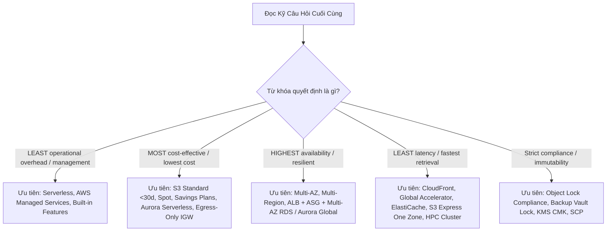
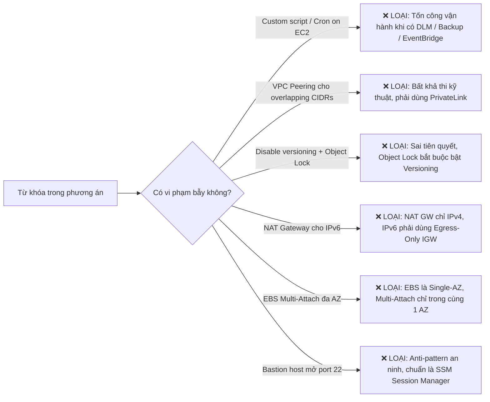
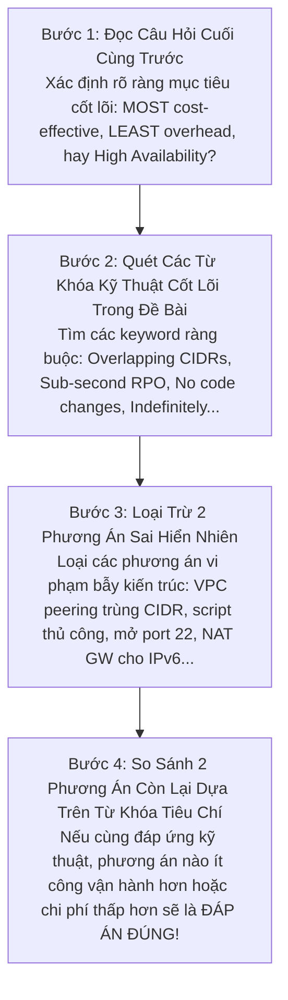

# 📘 Bộ Từ Điển Thuật Ngữ & Cẩm Nang Giải Mã Đề Thi AWS SAA-C03 (Exam Vocabulary & Keyword Playbook)

> **Mục tiêu**: Cung cấp từ điển thuật ngữ chuyên biệt và bộ quy tắc giải mã từ khóa (Keyword Clues) trong các đề thi AWS Certified Solutions Architect - Associate (**SAA-C03**).  
> **Nguồn trích xuất thực chứng**: Tổng hợp và chuẩn hóa trực tiếp từ **650 câu hỏi thực chiến** qua 10 bộ đề thi thực hành chuyên sâu (**Cloud Mentor PT1 đến PT6** - 390 câu & **Udemy Stephane Maarek PT1, PT2, PT3, PT6** - 260 câu).  
> **Tài liệu liên kết**: [Bảng thuật ngữ kỹ thuật tổng quan (GLOSSARY.md)](./GLOSSARY.md) | [Thư viện 21 chuyên đề AWS Services](./AWS_Services/) | [Bộ đề Cloud Mentor (PT1 - PT6)](./Practices_Test/Cloud_Mentor/) | [Bộ đề Udemy (PT1 - PT6)](./Practices_Test/Udemy/)

---

## 📌 Mục Lục Điều Hướng

1. [Phần 1: Từ Khóa Định Hướng Quyết Định & Ràng Buộc Tiêu Chí (Exam Decision Qualifiers & Constraints)](#phần-1-từ-khóa-định-hướng-quyết-định--ràng-buộc-tiêu-chí)
2. [Phần 2: Bẫy Đề Thi & Từ Khóa Cảnh Báo Phương Án Sai (Exam Traps & Distractor Keywords)](#phần-2-bẫy-đề-thi--từ-khóa-cảnh-báo-phương-án-sai)
3. [Phần 3: Động Từ Hành Động & Cụm Từ Ngữ Cảnh Kỹ Thuật (Technical Action Verbs & Phrasing)](#phần-3-động-từ-hành-động--cụm-từ-ngữ-cảnh-kỹ-thuật)
4. [Phần 4: Ma Trận Ánh Xạ Từ Khóa $\rightarrow$ Dịch Vụ & Kiến Trúc Chuẩn (Scenario Trigger $\rightarrow$ Target Architecture Mapping)](#phần-4-ma-trận-ánh-xạ-từ-khóa--kiến-trúc-chuẩn)
5. [Phần 5: Từ Điển Thuật Ngữ Anh - Việt Chuyên Biệt Cho Đề Thi (A-Z Exam Vocabulary with Exam Scenarios)](#phần-5-từ-điển-thuật-ngữ-anh---việt-chuyên-biệt-cho-đề-thi)
6. [Phần 6: Chiến Lược Đọc Đề & Kỹ Thuật Loại Trừ 4 Bước (4-Step Question Breakdown & Elimination Strategy)](#phần-6-chiến-lược-đọc-đề--kỹ-thuật-loại-trừ-4-bước)

---

## Phần 1: Từ Khóa Định Hướng Quyết Định & Ràng Buộc Tiêu Chí

Trong kỳ thi AWS SAA-C03, các câu hỏi luôn chứa **từ khóa định hướng (Qualifiers)** ở cuối câu hỏi (như *"Which solution is MOST cost-effective?"* hoặc *"Which solution requires the LEAST operational overhead?"*). Đây chính là "kim chỉ nam" giúp bạn chọn đúng giữa 2 đáp án đều khả thi về mặt kỹ thuật.



### 1.1. Nhóm Tiêu Chí Vận Hành (Operational Overhead)

| Cụm từ khóa trong đề (Keyword Phrase) | Ý nghĩa bản chất | Xu hướng đáp án ĐÚNG (Target Solution) | Xu hướng đáp án SAI (Distractor / Anti-pattern) |
| :--- | :--- | :--- | :--- |
| **LEAST operational overhead**<br>**LEAST administrative effort**<br>**LEAST management overhead** | Đòi hỏi giải pháp ít phải tự tay cài đặt, bảo trì, vá lỗi hệ điều hành hoặc viết code script tùy chỉnh nhất. | • **AWS Managed Services**: RDS Proxy, AWS Transfer Family, AWS DataSync.<br>• **Serverless**: AWS Fargate, AWS Lambda, Amazon EventBridge.<br>• **Tính năng tích hợp sẵn**: EventBridge Archive (thay vì code), Amazon DLM (thay vì Lambda cron), S3 Lifecycle. | • Tự dựng EC2 instance để chạy phần mềm (ví dụ: tự dựng SFTP server trên EC2).<br>• Viết script Lambda kết hợp EventBridge cron để snapshot/backup thủ công.<br>• Tự quản lý cụm Docker swarm / Kubernetes trên EC2. |
| **Without changing application code**<br>**No code changes required** | Ứng dụng legacy hoặc ứng dụng đóng gói bên thứ 3 không được phép sửa đổi logic mã nguồn. | • **Amazon EFS** (mount thư mục NFS chuẩn POSIX giữ nguyên đường dẫn file hệ thống).<br>• **AWS Transfer Family** (giữ nguyên client SFTP/FTP/FTPS).<br>• **RDS Proxy** (chỉ đổi DB endpoint connection string).<br>• **AWS Global Accelerator** / **Route 53**. | • Chuyển đổi mã nguồn sang gọi S3 SDK API (`PutObject`, `GetObject`).<br>• Viết lại kiến trúc ứng dụng sang microservices hướng sự kiện. |
| **Without managing infrastructure**<br>**Serverless architecture** | Loại bỏ hoàn toàn máy chủ vật lý hoặc máy ảo EC2. | • AWS Lambda, AWS Fargate, Amazon Aurora Serverless v2, DynamoDB, Amazon API Gateway, Amazon S3. | • Amazon EC2, EKS với managed node groups, Amazon RDS truyền thống với instance sizing cố định. |

### 1.2. Nhóm Tiêu Chí Chi Phí (Cost Optimization)

| Cụm từ khóa trong đề (Keyword Phrase) | Ý nghĩa bản chất | Xu hướng đáp án ĐÚNG (Target Solution) | Xu hướng đáp án SAI (Distractor / Anti-pattern) |
| :--- | :--- | :--- | :--- |
| **MOST cost-effective**<br>**LOWEST cost**<br>**Minimize overall costs** | Chi phí tổng thể hàng tháng thấp nhất (tính cả phí lưu trữ, phí truy xuất, phí tính toán và phí mạng). | • **Workload gián đoạn / dev test**: Aurora Serverless v2, Spot Instances, On-Demand DynamoDB.<br>• **Workload ổn định 24/7**: Compute Savings Plans, Reserved Instances.<br>• **Traffic IPv6 ra Internet**: Egress-Only Internet Gateway (miễn phí) thay vì NAT Gateway ($0.045/giờ + data). | • Duy trì máy ảo On-Demand chạy 24/7 cho môi trường dev/test chỉ dùng vài giờ/ngày.<br>• Chọn S3 Standard-IA cho dữ liệu tạm xóa sau < 30 ngày (bị phạt 30 ngày tối thiểu).<br>• Cấu hình Provisioned IOPS (io2) khi gp3 đã đủ đáp ứng yêu cầu. |
| **Intermittent usage**<br>**Spiky workloads**<br>**Unpredictable traffic** | Lưu lượng truy cập không đều đặn, có đợt tăng vọt đột ngột rồi giảm về 0, không dự đoán được trước. | • **Amazon Aurora Serverless v2** (scale theo ACU tức thì, hạ về min khi nhàn rỗi).<br>• **Amazon DynamoDB On-Demand capacity mode**.<br>• **AWS Lambda** (tính tiền theo ms chạy thực tế). | • Provisioned RDS instance chạy liên tục gây lãng phí dung lượng nhàn rỗi.<br>• DynamoDB Provisioned capacity mode (bị bóp nghẹt hoặc cấp thừa gây tốn kém). |
| **Predictable workload**<br>**Same time each day** | Lưu lượng tải tăng giảm theo khung giờ cố định và lặp lại chính xác mỗi ngày. | • **EC2 Auto Scaling Scheduled Scaling** (chủ động bật máy trước giờ cao điểm).<br>• **Savings Plans / Reserved Instances** cho mức tải nền tối thiểu (baseline). | • Dynamic Target Tracking Scaling (phải chờ metric CPU tăng mới bắt đầu scale, gây trễ vài phút ban đầu). |

### 1.3. Nhóm Tiêu Chí Khả Dụng & Kiên Cường (Availability & Resilience)

| Cụm từ khóa trong đề (Keyword Phrase) | Ý nghĩa bản chất | Xu hướng đáp án ĐÚNG (Target Solution) | Xu hướng đáp án SAI (Distractor / Anti-pattern) |
| :--- | :--- | :--- | :--- |
| **HIGH AVAILABILITY (HA)**<br>**Fault-tolerant**<br>**Resilient to an AZ outage** | Hệ thống phải duy trì hoạt động không gián đoạn kể cả khi toàn bộ một Availability Zone (AZ) bị sập. | • **Multi-AZ Architecture**: ALB trải rộng tối thiểu 2 Public Subnets + Auto Scaling Group phân bổ trên tối thiểu 2 Private Subnets + Amazon RDS Multi-AZ DB Instance.<br>• Lưu trữ: Amazon EFS hoặc S3 (bản chất Multi-AZ). | • Single-AZ deployment.<br>• Gắn ổ đĩa Amazon EBS (EBS chỉ tồn tại trong 1 AZ duy nhất).<br>• Sử dụng RDS Read Replica cho HA (Read Replica mặc định không tự động failover đồng bộ như Multi-AZ standby). |
| **Sub-second RPO**<br>**Sub-minute RTO**<br>**Multi-region disaster recovery** | Yêu cầu khôi phục thảm họa đa vùng với độ mất mát dữ liệu dưới 1 giây và phục hồi trong vài phút. | • **Amazon Aurora Global Database** (nhân bản dữ liệu liên vùng ở tầng lưu trữ trong < 1 giây, failover < 1 phút).<br>• **Amazon DynamoDB Global Tables** (multi-region active-active). | • Tự viết script sao chép snapshot RDS hàng giờ sang Region khác (RPO = hàng giờ).<br>• RDS Cross-Region Read Replica truyền thống (replication lag có thể từ vài giây đến vài phút). |
| **Zero downtime**<br>**Without downtime** | Quá trình nâng cấp, mở rộng hoặc di chuyển dữ liệu không được phép làm ngắt quãng dịch vụ của người dùng. | • **Amazon RDS Storage Auto Scaling** (tự động tăng dung lượng đĩa online không downtime).<br>• **AWS DataSync** (đồng bộ dữ liệu nền sang FSx Multi-AZ mới trước khi cutover).<br>• **Route 53 / Global Accelerator** chuyển hướng lưu lượng. | • Chỉnh sửa in-place chuyển đổi FSx Single-AZ sang Multi-AZ (AWS không hỗ trợ in-place).<br>• Khôi phục DB từ snapshot thủ công rồi đổi DNS (mất từ 15-30 phút downtime). |

### 1.4. Nhóm Tiêu Chí Hiệu Năng & Độ Trễ (Performance & Latency)

| Cụm từ khóa trong đề (Keyword Phrase) | Ý nghĩa bản chất | Xu hướng đáp án ĐÚNG (Target Solution) | Xu hướng đáp án SAI (Distractor / Anti-pattern) |
| :--- | :--- | :--- | :--- |
| **Sub-millisecond latency**<br>**Microsecond latency** | Độ trễ xử lý cực thấp dưới 1 mili-giây cho các giao dịch nhạy cảm. | • **Amazon ElastiCache for Redis / MemoryDB** (in-memory caching).<br>• **DynamoDB Accelerator (DAX)** (cache tầng bộ nhớ cho DynamoDB).<br>• **Amazon FSx for Lustre** (hệ thống file tính toán HPC). | • Truy vấn trực tiếp vào đĩa cứng RDS hoặc DynamoDB qua mạng WAN.<br>• Amazon EFS (độ trễ chuẩn NFS thường từ 1–5 mili-giây). |
| **Single-digit millisecond latency** | Độ trễ từ 1 đến 9 mili-giây cho ứng dụng web/API hoặc di động. | • **Amazon DynamoDB** (NoSQL single-digit ms at any scale).<br>• **Amazon S3 Express One Zone** (độ trễ đơn chữ số ms trong 1 AZ duy nhất).<br>• **AWS Local Zones** (đưa hạ tầng compute đặt sát thành phố của người dùng). | • Gọi database xuyên vùng địa lý (Cross-region DB queries).<br>• Sử dụng S3 Standard qua Internet công cộng. |
| **Bypass DNS caching**<br>**Instant traffic failover** | Người dùng hoặc nhà mạng cache bản ghi DNS khiến việc đổi IP qua Route 53 bị trễ (hết TTL mới nhận). | • **AWS Global Accelerator** (sử dụng 2 Anycast IP tĩnh cố định, điều hướng traffic ở tầng mạng trục AWS backbone thông qua Traffic Dial). | • Giảm TTL của Route 53 xuống 0 hoặc 60 giây (nhiều client/ISP vẫn phớt lờ TTL và cache theo ý họ). |

### 1.5. Nhóm Tiêu Chí Bảo Mật & Tuân Thủ (Security & Compliance)

| Cụm từ khóa trong đề (Keyword Phrase) | Ý nghĩa bản chất | Xu hướng đáp án ĐÚNG (Target Solution) | Xu hướng đáp án SAI (Distractor / Anti-pattern) |
| :--- | :--- | :--- | :--- |
| **Indefinitely**<br>**Protected against overwriting indefinitely** | Dữ liệu phải được bảo vệ không bị ghi đè hay xóa bỏ vô thời hạn, không có ngày hết hạn xác định. | • **Amazon S3 Object Lock với Legal Hold** (Legal Hold không có ngày hết hạn, chỉ mất hiệu lực khi được gỡ bỏ rõ ràng). | • S3 Object Lock Retention Period (kể cả Compliance mode vẫn phải thiết lập số ngày/năm cụ thể, hết hạn sẽ xóa được).<br>• Bật S3 Versioning đơn thuần (vẫn có thể ghi đè tạo version mới hoặc xóa marker). |
| **Prevent deletion even by the root user**<br>**Strict compliance (WORM)** | Tuân thủ quy định pháp lý ngặt nghèo (SEC 17a-4), Write Once Read Many; không ai (kể cả root) có quyền xóa trước hạn. | • **S3 Object Lock ở Compliance Mode**.<br>• **AWS Backup Vault Lock ở Compliance Mode**.<br>• **EBS Snapshot Lock ở Compliance Mode**. | • S3 Object Lock Governance Mode (user có quyền `s3:BypassGovernanceRetention` hoặc tài khoản root vẫn có thể xóa).<br>• IAM Policy Deny (tài khoản root hoặc admin có thể sửa policy). |
| **Retain control over key material**<br>**Self-manage key material** | Doanh nghiệp phải nắm toàn quyền tạo và sở hữu chuỗi bit của khóa mã hóa (Key Material), không để AWS tự sinh. | • **AWS KMS với Imported Key Material (BYOK)**.<br>• **Server-Side Encryption with Customer-Provided Keys (SSE-C)**.<br>• **AWS CloudHSM**. | • AWS Managed Keys (AWS tự sinh và tự xoay vòng).<br>• SSE-S3 (AWS quản lý toàn bộ).<br>• KMS Customer Managed Key mặc định (AWS KMS vẫn tự sinh key material trong KMS HSM). |

---

## Phần 2: Bẫy Đề Thi & Từ Khóa Cảnh Báo Phương Án Sai

Nhận diện phương án sai (Distractors) nhanh chóng là kỹ năng quan trọng nhất để làm bài thi trong thời gian quy định. Dưới đây là các "dấu hiệu nhận diện phương án bẫy" xuất hiện lặp đi lặp lại:



### Bảng 2.1: Tổng hợp 12 Bẫy Thi Kinh Điển (The 12 Deadly Exam Traps)

| # | Phương án bẫy (Distractor Trap) | Tại sao SAI về bản chất kiến trúc? | Giải pháp ĐÚNG tương ứng | Đề thi thực chứng |
| :---: | :--- | :--- | :--- | :---: |
| **1** | *"Thiết lập VPC Peering giữa 2 VPC có dải IP trùng nhau (Overlapping CIDRs)"* | VPC Peering và Transit Gateway hoàn toàn KHÔNG hỗ trợ định tuyến gói tin giữa 2 dải CIDR trùng lặp IP. | Sử dụng **AWS PrivateLink** (giao tiếp qua Interface Endpoint ENI độc lập CIDR). | CM-PT1 Q02 |
| **2** | *"Tắt Versioning rồi cấu hình S3 Object Lock"* | S3 Object Lock bắt buộc bucket phải bật S3 Versioning trước mới có thể kích hoạt được. | Bật Versioning trước $\rightarrow$ Kích hoạt S3 Object Lock. | CM-PT1 Q01 |
| **3** | *"Dùng NAT Gateway để cho phép EC2 IPv6 ra Internet an toàn"* | NAT Gateway chỉ hoạt động cho giao thức IPv4. Không hỗ trợ địa chỉ IPv6. | Sử dụng **Egress-Only Internet Gateway** (miễn phí, outbound-only IPv6). | CM-PT1 Q33, CM-PT2 Q09 |
| **4** | *"Gắn chung 1 ổ đĩa EBS gp3 vào nhiều EC2 instance ở các AZ khác nhau"* | Ổ đĩa EBS về mặt vật lý bị giới hạn trong duy nhất **1 Availability Zone**. Không thể mount xuyên AZ. | Sử dụng **Amazon EFS** (hỗ trợ mount đồng thời trên hàng trăm EC2 xuyên Multi-AZ). | CM-PT2 Q01, CM-PT1 Q18 |
| **5** | *"Viết script Lambda tùy chỉnh kích hoạt bởi EventBridge cron để chụp snapshot"* | Tốn công viết code, test và bảo trì trong khi AWS đã cung cấp dịch vụ quản lý vòng đời bản chụp chuyên dụng. | Sử dụng **Amazon Data Lifecycle Manager (DLM)** hoặc **AWS Backup**. | CM-PT1 Q65, CM-PT3 Q41 |
| **6** | *"Tạo Bastion Host trong Public Subnet mở cổng SSH 22 ra Internet"* | Mở cổng SSH 22 ra Internet công cộng là rủi ro bảo mật lớn (bị quét brute-force) và tốn chi phí quản lý máy chủ. | Sử dụng **AWS Systems Manager Session Manager** (không cần mở cổng inbound, không cần public IP). | CM-PT1 Q19 |
| **7** | *"Dùng S3 Standard-IA cho các file tạm thời bị xóa sau 10 đến 15 ngày"* | S3 Standard-IA có quy định thời gian lưu trữ tối thiểu là **30 ngày** (Minimum Storage Duration). Xóa sớm vẫn bị tính đủ 30 ngày. | Sử dụng **Amazon S3 Standard** (không có quy định ngày lưu trữ tối thiểu, tính tiền theo giây thực tế). | CM-PT1 Q55 |
| **8** | *"Gán IAM Role cho EC2 instance để ứng dụng chạy trong container ECS lấy quyền"* | Ứng dụng chạy trong container ECS phải lấy quyền từ Task Role. Nếu gán vào Instance Role sẽ vi phạm Least Privilege. | Sử dụng **ECS Task Role** (phân quyền riêng cho từng task độc lập). | CM-PT2 Q20 |
| **9** | *"Cấu hình Route 53 Weighted Routing để chuyển đổi traffic tức thì giữa 2 Region"* | Bản ghi DNS bị cache bởi các Recursive Resolvers của ISP và máy trạm người dùng theo TTL, không thể chuyển đổi tức thì. | Sử dụng **AWS Global Accelerator** (Anycast IPs, chuyển đổi traffic tức thời qua Traffic Dial). | CM-PT1 Q40, CM-PT6 Q48 |
| **10** | *"Tự nâng cấp in-place file system FSx for Windows từ Single-AZ lên Multi-AZ"* | AWS không hỗ trợ sửa đổi trực tiếp (in-place modification) một FSx file system từ Single-AZ thành Multi-AZ. | Tạo file system Multi-AZ mới $\rightarrow$ dùng **AWS DataSync** để đồng bộ dữ liệu sang không downtime. | CM-PT1 Q05 |
| **11** | *"Dùng AWS Glue ETL để xử lý streaming ingestion thời gian thực (real-time < 1s)"* | AWS Glue là dịch vụ batch ETL theo lô, có độ trễ khởi động job tính bằng phút; không phục vụ real-time streaming. | Sử dụng **Amazon Kinesis Data Streams** hoặc **Amazon Managed Streaming for Apache Kafka (MSK)**. | CM-PT1 Q06, CM-PT3 Q02 |
| **12** | *"Dùng Customer Managed Keys (CMK) khi đề bài chỉ yêu cầu mã hóa cơ bản với ít chi phí nhất"* | Khóa CMK phát sinh phí duy trì $1/tháng/khóa và phí gọi KMS API ($0.03/10,000 requests). | Sử dụng **SSE-S3 (Amazon S3 Managed Keys)** (miễn phí hoàn toàn, không tốn công cấu hình). | CM-PT1 Q01, CM-PT6 Q14 |

---

## Phần 3: Động Từ Hành Động & Cụm Từ Ngữ Cảnh Kỹ Thuật

| Động từ / Cụm từ (Action Phrasing) | Ý nghĩa kỹ thuật | Ngữ cảnh bài thi AWS thường gặp | Dịch vụ giải pháp điển hình |
| :--- | :--- | :--- | :--- |
| **Ingest** / Ingestion | Tiếp nhận và nạp dữ liệu thô từ hàng ngàn thiết bị hoặc nguồn bên ngoài vào đám mây. | *"Ingest streaming IoT telemetry data from millions of connected cars..."* | Amazon Kinesis Data Streams, Amazon MSK, API Gateway. |
| **Decouple** / Decoupling | Phân rã, tách rời các tầng kiến trúc để chúng không phụ thuộc trực tiếp vào nhau. | *"Decouple the frontend web tier from the backend order processing tier..."* | Amazon SQS (Message Queue), Amazon SNS, EventBridge. |
| **Offload** | San sẻ bớt gánh nặng xử lý cho một thành phần chuyên biệt khác để giảm tải cho hệ thống chính. | *"Offload heavy reporting and read-only queries from the primary database..."* | RDS Read Replicas, Amazon ElastiCache, Amazon CloudFront. |
| **Fan-out** | Phân phối 1 thông điệp duy nhất tới nhiều đối tượng tiêu thụ khác nhau cùng một lúc. | *"Fan out order notification events to fraud detection, shipping, and billing..."* | Amazon SNS Topic đăng ký nhiều SQS Queues hoặc Lambda. |
| **Throttle** / Throttling | Bóp nghẹt, giới hạn tốc độ xử lý hoặc lượng request để bảo vệ hệ thống backend khỏi bị quá tải. | *"Prevent backend databases from being overwhelmed during flash sales..."* | API Gateway Throttling Limits, SQS Queue buffering. |
| **Drain** / Deregistration Delay | Cho phép các kết nối mạng hiện tại tiếp tục xử lý nốt trước khi xóa instance khỏi cụm. | *"Ensure existing in-flight HTTP requests complete before terminating instances..."* | Elastic Load Balancing Connection Draining / Deregistration Delay. |
| **Failover** | Tự động chuyển đổi lưu lượng sang hệ thống dự phòng khi hệ thống chính gặp sự cố. | *"Automatically fail over to the standby instance within 60 seconds of hardware failure..."* | Amazon RDS Multi-AZ Failover, Route 53 Failover Routing. |
| **Remediate** | Tự động khắc phục, sửa chữa một tài nguyên khi phát hiện nó không tuân thủ chính sách an toàn. | *"Automatically remediate non-compliant S3 buckets that allow public access..."* | AWS Config Rules kết hợp AWS Systems Manager Automation. |
| **Orchestrate** | Điều phối một chuỗi các bước xử lý phân tán phức tạp có điều kiện rẽ nhánh và thử lại. | *"Orchestrate a multi-step serverless ETL workflow with error handling..."* | AWS Step Functions (State Machines). |
| **Enforce** | Ép buộc tuân thủ một quy tắc an ninh trên diện rộng mà không ai trong tài khoản con có thể gỡ. | *"Enforce that no member accounts can disable AWS CloudTrail logging..."* | AWS Organizations Service Control Policies (SCPs). |
| **Audit** | Kiểm toán, rà soát lại toàn bộ lịch sử hoạt động, quyền truy cập hoặc bản sao lưu dữ liệu. | *"Audit cross-account S3 bucket access and generate compliance reports..."* | IAM Access Analyzer, AWS CloudTrail, AWS Backup Audit Manager. |
| **Shard** / Sharding | Phân vùng dữ liệu thành các luồng/phân đoạn nhỏ để tăng băng thông xử lý song song. | *"Scale Kinesis Data Streams ingestion throughput by splitting busy shards..."* | Amazon Kinesis Data Streams Resharding. |

---

## Phần 4: Ma Trận Ánh Xạ Từ Khóa $\rightarrow$ Kiến Trúc Chuẩn

Dưới đây là bảng "phản xạ có điều kiện" được đúc kết từ 390 câu hỏi qua 6 bộ đề thi Cloud Mentor. Khi gặp cặp từ khóa này trong đề, hãy liên tưởng ngay đến giải pháp tương ứng:

```mermaid
mindmap
  root((Bí Kíp Phản Xạ Đề Thi))
    Lưu Trữ Storage
      ["Chia sẻ nhiều EC2 + POSIX" --> Amazon EFS]
      ["Chia sẻ Windows SMB + Active Directory" --> FSx for Windows]
      ["HPC + Machine Learning + S3 Native" --> FSx for Lustre]
      ["Bảo vệ không bị ghi đè vô thời hạn" --> S3 Object Lock Legal Hold]
      ["Bảo vệ bản sao lưu không thể xóa kể cả root" --> Backup Vault Lock Compliance]
      ["Tải file lớn GBs tăng tốc upload" --> S3 Multipart Upload]
    Mạng Networking
      ["Overlapping CIDRs giữa 2 VPC" --> AWS PrivateLink]
      ["IPv6 chỉ đi ra Internet" --> Egress-Only Internet Gateway]
      ["Tường lửa ảo kiểm tra gói tin sâu L3/L4" --> Gateway Load Balancer GWLB]
      ["Bypass DNS cache + Anycast IP tĩnh" --> AWS Global Accelerator]
      ["Truy cập S3 / DynamoDB từ Private Subnet miễn phí" --> Gateway VPC Endpoint]
      ["DNS 2 chiều Hybrid giữa On-Prem & AWS" --> Route 53 Resolver Inbound + Outbound]
    Cơ Sở Dữ Liệu
      ["Dev/Test không chạy 24/7 + spiky" --> Aurora Serverless v2]
      ["Traffic NoSQL không dự đoán được" --> DynamoDB On-Demand]
      ["Giảm tải câu lệnh SELECT báo cáo" --> RDS Read Replica]
      ["Multi-Region Disaster Recovery RPO < 1s" --> Aurora Global Database]
      ["Tự động tăng đĩa DB không downtime" --> RDS Storage Auto Scaling]
    Tính Toán Compute
      ["Truy cập EC2 private không mở port 22" --> SSM Session Manager]
      ["Tác vụ HPC cụm máy ảo độ trễ < 1ms" --> Cluster Placement Group]
      ["Microservices container ít công vận hành nhất" --> AWS App Runner / ECS Fargate]
      ["Chia sẻ thư viện dùng chung giữa nhiều Lambda" --> AWS Lambda Layers]
```

### Bảng 4.1: Chi tiết ánh xạ ngữ cảnh đề thi sang giải pháp chuẩn

| Tình huống / Từ khóa trong đề thi (Scenario Trigger) | Dịch vụ / Giải pháp chuẩn của AWS (Target Architecture) | Lý do kiến trúc & Bài học kinh nghiệm | Câu hỏi thực chứng |
| :--- | :--- | :--- | :---: |
| Hai VPC có dải IP trùng nhau (**Overlapping CIDRs**) cần kết nối an toàn | **AWS PrivateLink** (VPC Endpoint Service) | VPC Peering và Transit Gateway không thể định tuyến nếu trùng CIDR; PrivateLink dùng ENI IP độc lập. | CM-PT1 Q02 |
| EC2 trong Private Subnet cần kết nối console an toàn, **không mở port 22**, không Internet | **AWS Systems Manager Session Manager** (kèm Interface Endpoints cho `ssmmessages`) | Loại bỏ Bastion Host; giao tiếp hoàn toàn qua TLS nội bộ, kiểm soát qua IAM và ghi log phiên vào S3/CloudWatch. | CM-PT1 Q19 |
| Chuyển đổi FSx for Windows từ Single-AZ sang Multi-AZ **không downtime** | Tạo FSx Multi-AZ mới $\rightarrow$ dùng **AWS DataSync** đồng bộ dữ liệu | FSx không cho sửa in-place; DataSync tự động copy dữ liệu nền, chỉ cutover trong vài phút. | CM-PT1 Q05 |
| Giới hạn truy cập S3 chỉ cho các tài khoản trong cùng **AWS Organization** | S3 Bucket Policy với Condition Key **`aws:PrincipalOrgID`** | Điều kiện `aws:PrincipalOrgID` tự động áp dụng cho mọi tài khoản thành viên hiện tại và tương lai. | CM-PT1 Q09 |
| Chia sẻ thư viện mã nguồn dùng chung giữa nhiều hàm **AWS Lambda** | **AWS Lambda Layers** | Đóng gói thư viện vào layer riêng, đính kèm vào các hàm Lambda; cập nhật layer mà không cần deploy lại code. | CM-PT1 Q17 |
| Rút ngắn thời gian khởi động Java Lambda (**Cold Start**) mà không bị trùng UUID ngẫu nhiên | **Lambda SnapStart** với **Pre-snapshot Hook** (`CRaC Runtime.register`) | SnapStart chụp snapshot bộ nhớ; hook đảm bảo các giá trị ngẫu nhiên / credentials được sinh mới khi resume. | CM-PT1 Q27 |
| Tự động hóa kiểm tra tuân thủ chính sách sao lưu trên toàn bộ **Multi-Account** | **AWS Backup Audit Manager** kết hợp **AWS Config** | Tự động đối soát các bản backup với khung tuân thủ (controls framework) và xuất báo cáo kiểm toán. | CM-PT1 Q31 |
| Cho phép container có trạng thái trên **AWS Fargate** truy cập dữ liệu chia sẻ | Gắn ổ đĩa **Amazon EFS Volume** vào ECS Task Definition | Fargate chỉ hỗ trợ lưu trữ chia sẻ bền vững qua Amazon EFS; không hỗ trợ gắn ổ đĩa Amazon EBS. | CM-PT1 Q36 |
| Truyền file qua giao thức **SFTP** với bên thứ ba với **ít công vận hành nhất** | **AWS Transfer Family** (SFTP Connector / Server) | Dịch vụ được quản lý hoàn toàn, lưu trữ file trực tiếp vào S3 mà không cần tự dựng máy chủ SFTP trên EC2. | CM-PT2 Q05 |
| Di chuyển cụm dữ liệu **Hadoop HDFS** lên Amazon S3 bảo mật và tiết kiệm chi phí | **AWS DataSync** (hỗ trợ native HDFS location type) | DataSync tối ưu hóa băng thông, tự động mã hóa dữ liệu in-transit và kiểm tra tính toàn vẹn (checksum). | CM-PT2 Q06 |
| Cắt giảm chi phí **NAT Gateway** cho các EC2 chỉ cần gọi API ra ngoài có hỗ trợ IPv6 | Chuyển sang IPv6 và dùng **Egress-Only Internet Gateway** | Egress-Only IGW hoàn toàn miễn phí; thay thế NAT Gateway đắt đỏ ($0.045/giờ + $0.045/GB data). | CM-PT2 Q09 |
| Cần lưu trữ và truy xuất lại các sự kiện tin nhắn trong 30 ngày với **ít công phát triển nhất** | **Amazon EventBridge Archive and Replay** | Tính năng built-in trên Event Bus; lưu trữ toàn bộ event mà không cần viết code đẩy vào database. | CM-PT2 Q21 |
| Chèn thiết bị tường lửa ảo của bên thứ 3 (Palo Alto, Fortinet) để **kiểm tra gói tin sâu** | **Gateway Load Balancer (GWLB)** | Hoạt động ở OSI Layer 3/4, sử dụng giao thức GENEVE (port 6081) để dẫn traffic qua cụm tường lửa ảo co giãn. | CM-PT2 Q48 |
| Đọc ghi tệp tin tuần tự lớn (**Sequential I/O**), thông lượng lên đến 500 MB/s cho Big Data | Ổ đĩa **EBS Throughput Optimized HDD (`st1`)** | Tối ưu cho luồng dữ liệu tuần tự lớn (Log processing, Kafka, EMR); chi phí rẻ hơn nhiều so với SSD gp3. | CM-PT2 Q51 |
| Chia sẻ chiết khấu của **Savings Plans** trong mô hình Multi-Account | Mua và cấu hình từ **Management Account** của AWS Organizations | Chiết khấu Savings Plans tự động áp dụng chia sẻ cho toàn bộ các member accounts trong tổ chức. | CM-PT2 Q55 |
| Khóa bảo vệ bản chụp snapshot không bị xóa vô tình hay cố ý để **đáp ứng tuân thủ** | **Amazon EBS Snapshot Lock** ở chế độ Compliance Mode | Ngăn chặn bất kỳ ai (kể cả tài khoản Root) xóa snapshot trong khoảng thời gian khóa đã chỉ định. | CM-PT6 Q20 |
| Giảm thời gian gián đoạn (downtime) khi database RDS chuyển đổi dự phòng (**failover**) | Triển khai **Amazon RDS Proxy** | RDS Proxy duy trì các connection pool của ứng dụng và tự định tuyến lại sang DB standby trong vài giây. | CM-PT6 Q38 |
| Tải các tệp tin có kích thước nhiều Gigabytes lên S3 với **băng thông tối đa** | **S3 Multipart Upload** kết hợp đọc ghi song song theo byte range | Chia nhỏ file thành nhiều phần tải lên song song; có thể tạm dừng và tiếp tục khi gặp sự cố mạng. | CM-PT6 Q05 |
| Phát hiện và cắt giảm chi phí S3 Standard tăng cao do các đợt **upload bị đứt quãng dở dang** | **S3 Lifecycle Rule** với hành động **Abort Incomplete Multipart Uploads** | Tự động dọn dẹp các mảnh dữ liệu tải lên dở dang sau 7 ngày, tránh bị tính phí lưu trữ ngầm. | CM-PT5 Q27 |
| Phân quyền đặc quyền tối thiểu (Least-Privilege) cho từng Pod trong cụm Kubernetes | **IAM Roles for Service Accounts (IRSA)** với OIDC Identity Provider | Cấp quyền theo ServiceAccount; không gán IAM role vào EC2 Node để tránh dùng chung quyền. | U-PT1 Q04 |
| Khắc phục lỗi **`HTTP 503 Slow Down`** khi gửi hàng chục ngàn requests/giây vào S3 | **Phân bổ tiền tố (Custom Prefixes / Partitioning Keys)** | Mỗi prefix chịu được 3,500 PUT / 5,500 GET req/s; phân tán prefix giúp scale thông lượng không giới hạn. | U-PT1 Q15 |
| Di chuyển ứng dụng sử dụng RabbitMQ / ActiveMQ lên AWS mà **không sửa mã nguồn** | **Amazon MQ** (quản lý hoàn toàn cụm RabbitMQ hoặc Apache ActiveMQ) | Hỗ trợ chuẩn mở AMQP, JMS, MQTT, STOMP; chỉ cần đổi URL kết nối broker trong cấu hình code. | U-PT6 Q04 |
| Tuân thủ bản quyền phần mềm doanh nghiệp (BYOL) tính theo **Socket / Core vật lý** | **Amazon EC2 Dedicated Hosts** (kết hợp AWS License Manager) | Hiển thị chi tiết socket/core và ID máy chủ vật lý; kiểm soát placement và theo dõi giấy phép bản quyền. | U-PT6 Q34 |
| Kết nối Direct Connect tới **AWS Transit Gateway** để định tuyến hàng ngàn VPCs | Cấu hình **Transit Virtual Interface (Transit VIF)** qua Direct Connect Gateway | Private VIF chỉ gắn vào VGW; bắt buộc dùng Transit VIF khi kết nối Direct Connect với Transit Gateway. | U-PT3 Q31 |
| Mã hóa dữ liệu trên đường truyền cáp quang vật lý **AWS Direct Connect** | Thiết lập đường hầm **IPsec VPN chạy bên trên Direct Connect** (hoặc MACsec) | Direct Connect mặc định không mã hóa (Layer 2); chạy IPsec over Direct Connect đáp ứng tiêu chuẩn an ninh cao nhất. | U-PT1 Q42 |
| Mở rộng dung lượng lưu trữ On-Premises chi phí thấp, **dữ liệu chính nằm trên S3** | **AWS Storage Gateway - Cached Volumes** | Ổ đĩa cục bộ chỉ làm bộ đệm cache cho dữ liệu hay dùng; dữ liệu chính lưu trên S3 chi phí thấp. | U-PT3 Q60 |
| Thay thế kho băng từ vật lý tốn kém, giữ nguyên phần mềm sao lưu (Veeam, Commvault) | **AWS Storage Gateway - Tape Gateway (VTL)** | Giả lập thư viện băng từ ảo qua iSCSI VTL; lưu trữ dữ liệu lâu dài vào S3 Glacier / Deep Archive. | U-PT3 Q57 |
| Di chuyển máy chủ vật lý / ảo hóa lên EC2 với **thời gian ngừng hoạt động tối thiểu** | **AWS Application Migration Service (AWS MGN)** | Nhân bản liên tục cấp độ khối (Block-level replication); cutover tự động chỉ mất vài phút downtime. | U-PT6 Q60 |
| Tăng tốc độ xử lý hàng đợi **SQS FIFO lên 3,000 TPS** mà không mất thứ tự | Sử dụng thao tác **Batching** (`SendMessageBatch` tối đa 10 tin nhắn/lô) | Thao tác đơn lẻ chỉ đạt 300 TPS; gom lô 10 tin nhắn giúp thông lượng tăng gấp 10 lần mà vẫn bảo toàn FIFO. | U-PT1 Q43 |

---

## Phần 5: Từ Điển Thuật Ngữ Anh - Việt Chuyên Biệt Cho Đề Thi

Dưới đây là bảng giải nghĩa chi tiết hơn 60 thuật ngữ cốt lõi xuất hiện liên tục trong các đề thi AWS Solutions Architect:

### Nhóm A – C: Kiến Trúc & Điện Toán

* **Anycast IP**: Địa chỉ IP tĩnh công khai được quảng bá từ mạng lưới hàng trăm Edge Locations của AWS trên toàn cầu thông qua BGP. Người dùng kết nối tới điểm biên gần nhất, sau đó traffic đi qua mạng trục tốc độ cao của AWS (*AWS Global Accelerator*).
* **Aurora Replica**: Bản sao chỉ đọc (Read Replica) của cụm Amazon Aurora. Chia sẻ chung một tầng lưu trữ (Storage Fleet 6 bản sao), có thể tự động thăng cấp thành Primary Instance trong vòng dưới 30 giây khi có sự cố.
* **Auto-Recovery**: Tính năng của CloudWatch Alarm tự động phục hồi máy ảo EC2 khi gặp lỗi phần cứng vật lý (`StatusCheckFailed_System`) bằng cách chuyển máy ảo sang server vật lý mới nguyên vẹn mà giữ nguyên IP, EBS và metadata.
* **Burstable Performance**: Khái niệm hiệu năng tăng cường của các dòng máy EC2 dòng `t` (`t3`, `t4g`). Máy tích lũy **CPU Credits** khi nhàn rỗi và tiêu thụ credits để vượt ngưỡng cơ sở (Baseline) khi có tải đột biến.
* **Cluster Placement Group**: Cấu hình gom cụm các máy ảo EC2 vào cùng một tủ rack mạng trong 1 Availability Zone duy nhất. Đạt băng thông lên tới 100 Gbps và độ trễ cực thấp (< 1 mili-giây) phục vụ tính toán hiệu năng cao (HPC).

### Nhóm D – F: Dữ Liệu & Lưu Trữ

* **Data Lifecycle Manager (DLM)**: Dịch vụ tự động hóa quản lý vòng đời bản sao lưu cho EBS volumes và EBS-backed AMIs. Cho phép định nghĩa lịch chụp, thời gian lưu giữ và tự động copy cross-region mà không cần viết script.
* **Dead-Letter Queue (DLQ)**: Hàng đợi thư chết của Amazon SQS hoặc SNS dùng để cách ly các tin nhắn bị lỗi xử lý nhiều lần (vượt ngưỡng `maxReceiveCount`), ngăn chặn hiện tượng tin nhắn độc (**Poison Pill**) làm nghẽn hệ thống.
* **DynamoDB On-Demand Mode**: Chế độ thanh toán theo số lượng request đọc/ghi thực tế của DynamoDB. Tự động co giãn tức thì đáp ứng hàng trăm ngàn request/giây mà không cần dự đoán dung lượng hay cấu hình auto-scaling.
* **Egress-Only Internet Gateway**: Cổng mạng VPC chuyên dụng cho IPv6. Cho phép các máy chủ trong Private Subnet khởi tạo kết nối ra ngoài Internet nhưng chặn đứng hoàn toàn mọi kết nối từ bên ngoài Internet đi vào.
* **Envelope Encryption**: Cơ chế mã hóa phong bì của AWS KMS. Dữ liệu được mã hóa bằng Data Key, sau đó chính Data Key được mã hóa bằng KMS Key (KMS Root Key) và lưu trữ kèm theo dữ liệu bản mã.
* **FSx for Lustre**: Hệ thống tệp tin POSIX song song hiệu năng cao được quản lý của AWS. Tích hợp trực tiếp với S3 bucket, cung cấp băng thông hàng trăm GB/s và độ trễ sub-millisecond cho AI/ML và HPC.
* **FSx for Windows File Server**: Hệ thống tệp tin chia sẻ chuẩn SMB của Microsoft được quản lý trên AWS. Hỗ trợ tích hợp Microsoft Active Directory, Windows ACLs, và hỗ trợ triển khai Multi-AZ.

### Nhóm G – M: Quản Trị & Mạng

* **Gateway Load Balancer (GWLB)**: Bộ cân bằng tải hoạt động ở Layer 3/4 chuyên dùng để triển khai, mở rộng và quản lý phi đội thiết bị mạng ảo bên thứ 3 (Firewalls, IDS/IPS). Sử dụng giao thức GENEVE trên cổng UDP 6081.
* **Gateway VPC Endpoint**: Điểm cuối mạng VPC miễn phí được cấu hình trực tiếp vào bảng định tuyến (Route Table) để kết nối riêng tư với **Amazon S3** và **Amazon DynamoDB** mà không cần NAT Gateway.
* **Global Accelerator**: Dịch vụ mạng sử dụng mạng trục toàn cầu của AWS và 2 địa chỉ Anycast IP tĩnh để cải thiện tính sẵn sàng và hiệu năng truy cập ứng dụng toàn cầu, bỏ qua bộ đệm DNS của client.
* **Golden AMI**: Bản ảnh máy ảo chuẩn hóa đã được cài đặt sẵn hệ điều hành, các bản vá bảo mật và agent giám sát cần thiết của doanh nghiệp, dùng làm khuôn mẫu để khởi chạy hàng loạt EC2 instance.
* **GuardDuty RDS Protection**: Tính năng chuyên sâu của Amazon GuardDuty sử dụng Machine Learning để phân tích các nỗ lực đăng nhập bất thường vào Amazon RDS (như tấn công dò mật khẩu brute-force).
* **Interface VPC Endpoint (AWS PrivateLink)**: Điểm cuối VPC sử dụng Card mạng ảo (ENI) gắn vào subnet với địa chỉ IP riêng nội bộ để kết nối tới các dịch vụ AWS hoặc dịch vụ đối tác độc lập với dải CIDR.

### Nhóm N – S: Bảo Mật & Lưu Lượng

* **Network ACL (NACL)**: Tường lửa ảo ở cấp độ Subnet. **Stateless** (phi trạng thái, phải cấu hình cả luật Inbound và Outbound), hỗ trợ cả luật ALLOW và DENY theo thứ tự số thứ tự (Rule Number).
* **Object Lock Compliance Mode**: Chế độ khóa đối tượng bảo vệ nghiêm ngặt nhất của S3. Ngăn chặn bất kỳ ai (kể cả tài khoản AWS Root) xóa hoặc sửa đổi object trước khi hết thời hạn lưu giữ (Retention Period).
* **Object Lock Legal Hold**: Chế độ giữ pháp lý của S3 Object Lock. Ngăn chặn việc ghi đè hoặc xóa object vô thời hạn mà không cần đặt ngày hết hạn; chỉ bị hủy bỏ khi người có quyền chủ động gỡ Legal Hold.
* **Origin Access Control (OAC)**: Tính năng bảo mật hiện đại của Amazon CloudFront thay thế OAI cũ. Đảm bảo người dùng chỉ có thể truy cập các file trong S3 bucket thông qua CloudFront CDN mà không thể truy cập trực tiếp qua URL S3.
* **Presigned URL**: Đường dẫn URL tạm thời được tạo ra bằng IAM credentials của ứng dụng, cấp quyền giới hạn thời gian cho người dùng cuối tải lên (PUT) hoặc tải xuống (GET) trực tiếp một object cụ thể trên S3 mà không cần cấp quyền IAM cho người dùng.
* **RDS Proxy**: Tầng kết nối đệm thông minh cho Amazon RDS. Quản lý việc tái sử dụng connection pool, bảo vệ database khỏi cạn kiệt tài nguyên kết nối từ các ứng dụng Serverless (AWS Lambda), và giảm thời gian failover tới 66%.
* **Route 53 Resolver Endpoints**: 
  - **Inbound Endpoint**: Cho phép hệ thống DNS nội bộ On-Premises chuyển tiếp truy vấn phân giải tên miền riêng của AWS VPC (`*.amazonaws.com` hoặc private zones).
  - **Outbound Endpoint**: Cho phép các máy chủ trong AWS VPC chuyển tiếp truy vấn phân giải tên miền nội bộ của trung tâm dữ liệu On-Premises (`*.corp.internal`).

### Nhóm T – Z: Tự Động Hóa & Tối Ưu

* **Service Control Policy (SCP)**: Chính sách kiểm soát dịch vụ của AWS Organizations. Đóng vai trò là rào chắn an ninh (Guardrail) đặt ra ranh giới quyền hạn tối đa cho các tài khoản thành viên. Lệnh `Deny` trong SCP có quyền lực tuyệt đối, phủ quyết mọi quyền của Admin/Root tài khoản con.
* **SnapStart**: Tính năng tăng tốc khởi động cho AWS Lambda (Java/Python). Chụp snapshot trạng thái bộ nhớ và đĩa sau khi khởi tạo (Init Phase) và lưu lại; khi có request đến, Lambda chỉ cần nạp lại snapshot trong vài mili-giây thay vì chạy lại quy trình Init từ đầu.
* **Spot Fleet**: Tập hợp các máy ảo EC2 Spot (kết hợp On-Demand) được quản lý tự động theo chiến lược giá hoặc dung lượng đa dạng (Diversified Pool) để tối ưu chi phí tới 90% cho các tác vụ tính toán chịu lỗi.
* **Target Tracking Scaling**: Chính sách co giãn tự động của Auto Scaling Group hoạt động giống như bộ điều nhiệt (Thermostat). Bạn đặt ra mục tiêu (ví dụ: `Average CPU = 60%`), ASG sẽ tự động tăng/giảm số máy chủ để giữ metric ổn định quanh mức này.
* **Transit Gateway (TGW)**: Hub định tuyến mạng trung tâm đám mây đóng vai trò như một Router ảo khổng lồ, kết nối hàng ngàn VPC và mạng On-Premises qua VPN/Direct Connect theo mô hình mạng hình sao (Hub-and-Spoke).
* **WORM (Write Once, Read Many)**: Nguyên lý lưu trữ bất biến: dữ liệu chỉ được ghi duy nhất một lần và không thể bị chỉnh sửa, ghi đè hay xóa bỏ trong suốt vòng đời quy định để đáp ứng các tiêu chuẩn tài chính và pháp lý.

---

## Phần 6: Chiến Lược Đọc Đề & Kỹ Thuật Loại Trừ 4 Bước

Đề thi SAA-C03 thường gồm 65 câu hỏi trong 130 phút (trung bình **2 phút / câu**). Các câu hỏi tình huống có độ dài từ 3 đến 5 đoạn văn. Áp dụng quy trình 4 bước chuẩn để tối ưu hóa thời gian và độ chính xác:



### Hướng Dẫn Thực Hành Chi Tiết 4 Bước

1. **Bước 1: Đọc lướt ngay câu hỏi cuối cùng của đề bài**:
   - Xác định bạn đang tìm kiếm điều gì: *"Which solution will meet these requirements with the LEAST operational overhead?"* hay *"Which solution is the MOST cost-effective?"*.
   - Việc này giúp não bộ bạn kích hoạt ngay bộ lọc tiêu chí trước khi đọc chi tiết kịch bản dài dòng.

2. **Bước 2: Đọc ngược lại kịch bản để gom các từ khóa kỹ thuật (Constraints & Clues)**:
   - Gạch chân các yếu tố sống còn:
     - Dạng dữ liệu (Streaming, Batch, Object, File, Relational, NoSQL).
     - Ràng buộc thời gian (RPO, RTO, Độ trễ ms hay microsecond).
     - Ràng buộc thay đổi (Có được sửa code ứng dụng không? Có hạ tầng sẵn có không?).

3. **Bước 3: Loại trừ ngay 2 phương án sai hiển nhiên (Distractors Elimination)**:
   - Áp dụng Bảng 2.1: Bất kỳ phương án nào tự viết script cron khi có dịch vụ managed, dùng VPC Peering cho CIDR trùng, hay mount EBS xuyên AZ $\rightarrow$ **Gạch bỏ ngay lập tức**.

4. **Bước 4: Đối đầu 2 phương án vào "vòng chung kết"**:
   - Thường bạn sẽ còn lại 2 phương án đều giải quyết được bài toán về mặt chức năng.
   - Lúc này, hãy dùng tiêu chí ở Bước 1 để phân định:
     - Nếu tiêu chí là **LEAST operational overhead**: Chọn phương án dùng Serverless hoặc tính năng tích hợp sẵn của AWS.
     - Nếu tiêu chí là **MOST cost-effective**: So sánh chi phí lưu trữ/tính toán thực tế (ví dụ: S3 Standard rẻ hơn Standard-IA khi dữ liệu tồn tại < 30 ngày).

---

### Liên Kết Đến Các Bộ Đề Thi & Chuyên Đề Kiến Trúc

- 📝 [Bộ đề thi thực hành Cloud Mentor (PT1 đến PT6 - 390 câu)](./Practices_Test/Cloud_Mentor/)
- 📝 [Bộ đề thi thực hành Udemy - Stephane Maarek (PT1 đến PT6 - 260 câu)](./Practices_Test/Udemy/)
- 📚 [Thư viện tài liệu chuyên sâu 21 chuyên đề Master AWS Services](./AWS_Services/)
- 📖 [Bảng thuật ngữ công nghệ Cloud & DevOps tổng quát (GLOSSARY.md)](./GLOSSARY.md)
