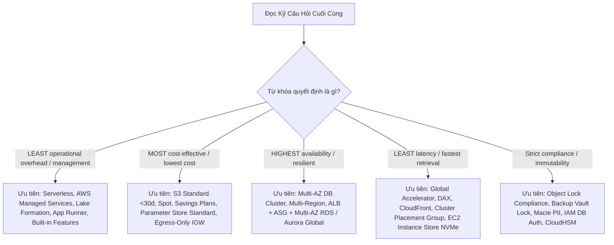
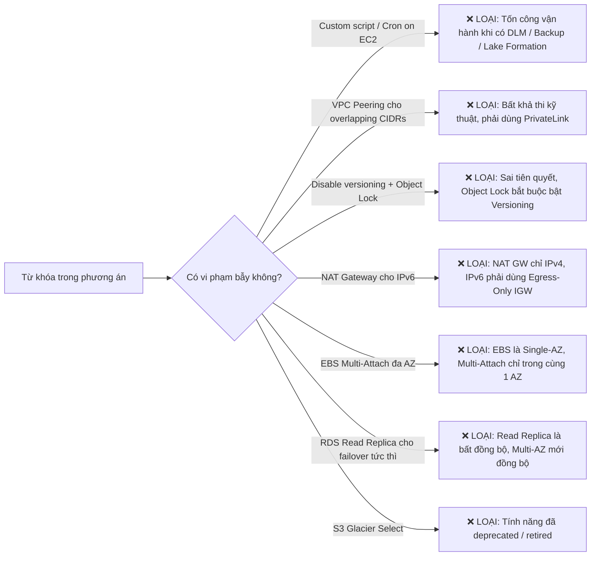
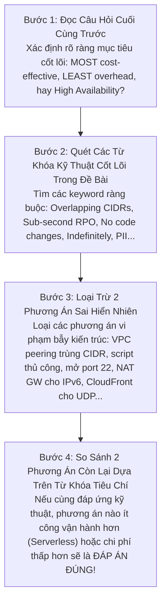

# 📘 Bộ Từ Điển Thuật Ngữ & Cẩm Nang Giải Mã Đề Thi AWS SAA-C03 (Exam Vocabulary & Keyword Playbook)

> **Mục tiêu**: Cung cấp từ điển thuật ngữ chuyên biệt và bộ quy tắc giải mã từ khóa (Keyword Clues) trong các đề thi AWS Certified Solutions Architect - Associate (**SAA-C03**).  
> **Nguồn trích xuất thực chứng**: Tổng hợp và chuẩn hóa trực tiếp từ **1,064 câu hỏi thực chiến** qua 17 bộ đề thi thực hành chuyên sâu:
> - **Cloud Mentor (PT1 đến PT6)**: 390 câu hỏi tình huống chuyên sâu.
> - **Udemy Stephane Maarek (PT1, PT2, PT3, PT6)**: 260 câu hỏi chuẩn hóa cấu trúc đề thi AWS.
> - **Tutorials Dojo - Jon Bonso (Set 1 đến Set 6 & Set 8)**: 414 câu hỏi thực chiến với giải thích chi tiết đáp án đúng/sai, sơ đồ kiến trúc và cheat sheets.  
> **Tài liệu liên kết**: [Bảng thuật ngữ kỹ thuật tổng quan (GLOSSARY.md)](./GLOSSARY.md) | [Thư viện 21 chuyên đề AWS Services](./AWS_Services/) | [Bộ đề Cloud Mentor (PT1 - PT6)](./Practices_Test/Cloud_Mentor/) | [Bộ đề Udemy (PT1 - PT6)](./Practices_Test/Udemy/) | [Bộ đề Tutorials Dojo (Set 1 - Set 6, Set 8)](./Practices_Test/Dojo/)

---

## 📌 Mục Lục Điều Hướng

1. [Phần 1: Từ Khóa Định Hướng Quyết Định & Ràng Buộc Tiêu Chí (Exam Decision Qualifiers & Constraints)](#phần-1-từ-khóa-định-hướng-quyết-định--ràng-buộc-tiêu-chí)
2. [Phần 2: Bẫy Đề Thi & Từ Khóa Cảnh Báo Phương Án Sai (Exam Traps & Distractor Keywords)](#phần-2-bẫy-đề-thi--từ-khóa-cảnh-báo-phương-án-sai)
3. [Phần 3: Động Từ Hành Động & Cụm Từ Ngữ Cảnh Kỹ Thuật (Technical Action Verbs & Phrasing)](#phần-3-động-từ-hành-động--cụm-từ-ngữ-cảnh-kỹ-thuật)
4. [Phần 4: Ma Trận Ánh Xạ Từ Khóa $\rightarrow$ Dịch Vụ & Kiến Trúc Chuẩn (Scenario Trigger $\rightarrow$ Target Architecture Mapping)](#phần-4-ma-trận-ánh-xạ-từ-khóa--kiến-trúc-chuẩn)
5. [Phần 5: Từ Điển Thuật Ngữ Anh - Việt Chuyên Biệt Cho Đề Thi (A-Z Exam Vocabulary with Exam Scenarios)](#phần-5-từ-điển-thuật-ngữ-anh---việt-chuyên-biệt-cho-đề-thi)
6. [Phần 6: Chiến Lược Đọc Đề & Kỹ Thuật Loại Trừ 4 Bước (4-Step Question Breakdown & Elimination Strategy)](#phần-6-chiến-lược-đọc-đề--kỹ-thuật-loại-trừ-4-bước)

---

## Phần 1: Từ Khóa Định Hướng Quyết Định & Ràng Buộc Tiêu Chí

Trong kỳ thi AWS SAA-C03, các câu hỏi luôn chứa **từ khóa định hướng (Qualifiers)** ở cuối câu hỏi (như *"Which solution is MOST cost-effective?"* hoặc *"Which solution requires the LEAST operational overhead?"*). Đây chính là "kim chỉ nam" giúp bạn chọn đúng giữa 2 đáp án đều khả thi về mặt kỹ thuật.



### 1.1. Nhóm Tiêu Chí Vận Hành (Operational Overhead)

| Cụm từ khóa trong đề (Keyword Phrase) | Ý nghĩa bản chất | Xu hướng đáp án ĐÚNG (Target Solution) | Xu hướng đáp án SAI (Distractor / Anti-pattern) |
| :--- | :--- | :--- | :--- |
| **LEAST operational overhead**<br>**LEAST administrative effort**<br>**LEAST management overhead** | Đòi hỏi giải pháp ít phải tự tay cài đặt, bảo trì, vá lỗi hệ điều hành hoặc viết code script tùy chỉnh nhất. | • **AWS Managed Services**: RDS Proxy, AWS Transfer Family, AWS DataSync, AWS App Runner.<br>• **Centralized Governance**: AWS Lake Formation (quản lý Data Lake đa tài khoản), AWS Control Tower (Landing Zone tự động).<br>• **Serverless**: AWS Fargate, AWS Lambda, Amazon EventBridge.<br>• **Tính năng tích hợp sẵn**: EventBridge Archive, Amazon DLM, S3 Lifecycle. | • Tự dựng EC2 instance để chạy phần mềm (SFTP server, NAT instance, OpenVPN).<br>• Viết script Lambda kết hợp EventBridge cron để snapshot/backup hoặc sao chép S3 thủ công.<br>• Tự quản lý cụm Docker swarm / Kubernetes trên EC2 hoặc tự cài đặt Apache Kafka trên EC2. |
| **Without changing application code**<br>**No code changes required** | Ứng dụng legacy hoặc ứng dụng đóng gói bên thứ 3 không được phép sửa đổi logic mã nguồn. | • **Amazon EFS** (mount NFS chuẩn POSIX giữ nguyên đường dẫn file hệ thống).<br>• **Amazon FSx for Windows File Server** (chuẩn SMB, tích hợp AD).<br>• **AWS Transfer Family** (giữ nguyên client SFTP/FTP/FTPS).<br>• **Amazon DocumentDB** (tương thích MongoDB không đổi code).<br>• **RDS Proxy** (chỉ đổi DB endpoint connection string).<br>• **Amazon MQ** (giữ nguyên giao thức JMS, AMQP, MQTT). | • Chuyển đổi mã nguồn sang gọi S3 SDK API (`PutObject`, `GetObject`).<br>• Viết lại kiến trúc ứng dụng sang DynamoDB hoặc microservices hướng sự kiện. |
| **Without managing infrastructure**<br>**Serverless architecture** | Loại bỏ hoàn toàn việc cấp phát, vá lỗi máy chủ vật lý hoặc máy ảo EC2. | • AWS Lambda, AWS Fargate, AWS App Runner, Amazon Aurora Serverless v2, DynamoDB, Amazon API Gateway, Amazon S3. | • Amazon EC2, EKS với self-managed EC2 worker nodes, Amazon RDS truyền thống với instance sizing cố định. |
| **Multi-account centralized data lake**<br>**Granular column/row access control** | Xây dựng kho dữ liệu dùng chung xuyên nhiều tài khoản AWS với phân quyền chi tiết tới cấp cột/dòng. | • **AWS Lake Formation** (tập trung hóa metadata, phân quyền granular trên Glue Data Catalog, chia sẻ dữ liệu không sao chép). | • Thiết lập Amazon Data Firehose ở từng account để copy data về một S3 trung tâm.<br>• Tự viết custom Lambda script đồng bộ dữ liệu S3 cross-account. |

### 1.2. Nhóm Tiêu Chí Chi Phí (Cost Optimization)

| Cụm từ khóa trong đề (Keyword Phrase) | Ý nghĩa bản chất | Xu hướng đáp án ĐÚNG (Target Solution) | Xu hướng đáp án SAI (Distractor / Anti-pattern) |
| :--- | :--- | :--- | :--- |
| **MOST cost-effective**<br>**LOWEST cost**<br>**Minimize overall costs** | Chi phí tổng thể hàng tháng thấp nhất (tính cả phí lưu trữ, phí truy xuất, phí tính toán và phí mạng). | • **Workload gián đoạn / dev test**: Aurora Serverless v2, Spot Instances, On-Demand DynamoDB.<br>• **Workload ổn định 24/7**: Compute Savings Plans, Reserved Instances.<br>• **Lưu trữ cấu hình / biến môi trường**: AWS Systems Manager Parameter Store (Standard tier miễn phí $0.00).<br>• **Traffic IPv6 ra Internet**: Egress-Only Internet Gateway (miễn phí) thay vì NAT Gateway ($0.045/giờ + data). | • Duy trì máy ảo On-Demand chạy 24/7 cho môi trường dev/test chỉ dùng vài giờ/ngày.<br>• Sử dụng AWS Secrets Manager khi chỉ cần lưu biến cấu hình không xoay vòng ($0.40/secret/tháng).<br>• Chọn S3 Standard-IA cho dữ liệu tạm xóa sau < 30 ngày (bị phạt 30 ngày tối thiểu).<br>• Cấu hình Provisioned IOPS (io2) khi gp3 hoặc Instance Store đã đủ đáp ứng yêu cầu. |
| **Intermittent usage**<br>**Spiky workloads**<br>**Unpredictable traffic** | Lưu lượng truy cập không đều đặn, có đợt tăng vọt đột ngột rồi giảm về 0, không dự đoán được trước. | • **Amazon Aurora Serverless v2** (scale theo ACU tức thì từ 0.5 đến 128 ACUs).<br>• **Amazon DynamoDB On-Demand capacity mode**.<br>• **AWS Lambda** (tính tiền theo ms chạy thực tế). | • Provisioned RDS instance chạy liên tục gây lãng phí dung lượng nhàn rỗi.<br>• DynamoDB Provisioned capacity mode (bị bóp nghẹt hoặc cấp thừa gây tốn kém). |
| **Predictable workload**<br>**Off-peak batch window** | Lưu lượng tải tăng giảm theo khung giờ cố định và lặp lại chính xác mỗi ngày. | • **EC2 Auto Scaling Scheduled Scaling** (chủ động bật máy trước giờ cao điểm).<br>• **On-Demand Capacity Reservations (ODCR)** (đảm bảo chắc chắn có dung lượng compute trong AZ cụ thể).<br>• **Savings Plans / Reserved Instances** cho mức tải nền tối thiểu (baseline). | • Dynamic Target Tracking Scaling (phải chờ metric CPU tăng mới bắt đầu scale, gây trễ vài phút ban đầu).<br>• Sử dụng On-Demand thuần túy không cam kết gây lãng phí chi phí. |

### 1.3. Nhóm Tiêu Chí Khả Dụng & Kiên Cường (Availability & Resilience)

| Cụm từ khóa trong đề (Keyword Phrase) | Ý nghĩa bản chất | Xu hướng đáp án ĐÚNG (Target Solution) | Xu hướng đáp án SAI (Distractor / Anti-pattern) |
| :--- | :--- | :--- | :--- |
| **HIGH AVAILABILITY (HA)**<br>**Fault-tolerant**<br>**Resilient to an AZ outage** | Hệ thống phải duy trì hoạt động không gián đoạn kể cả khi toàn bộ một Availability Zone (AZ) bị sập. | • **Multi-AZ Architecture**: ALB trải rộng tối thiểu 2 Public Subnets + Auto Scaling Group phân bổ trên tối thiểu 2 Private Subnets + Amazon RDS Multi-AZ DB Instance hoặc Multi-AZ DB Cluster.<br>• Lưu trữ: Amazon EFS, S3, hoặc FSx Multi-AZ (bản chất Multi-AZ). | • Single-AZ deployment.<br>• Gắn ổ đĩa Amazon EBS (EBS chỉ tồn tại trong 1 AZ duy nhất).<br>• Sử dụng RDS Read Replica cho HA (Read Replica mặc định nhân bản bất đồng bộ, không tự động failover đồng bộ như Multi-AZ standby). |
| **Sub-second RPO**<br>**Sub-minute RTO**<br>**Multi-region disaster recovery** | Yêu cầu khôi phục thảm họa đa vùng với độ mất mát dữ liệu dưới 1 giây và phục hồi trong vài phút. | • **Amazon Aurora Global Database** (nhân bản dữ liệu liên vùng ở tầng lưu trữ trong < 1 giây, failover < 1 phút).<br>• **Amazon DynamoDB Global Tables** (multi-region active-active). | • Tự viết script sao chép snapshot RDS hàng giờ sang Region khác (RPO = hàng giờ).<br>• RDS Cross-Region Read Replica truyền thống (replication lag có thể từ vài giây đến vài phút). |
| **Sub-35 second failover**<br>**Readable standby instances** | Yêu cầu thời gian chuyển đổi dự phòng cơ sở dữ liệu dưới 35 giây và tận dụng được máy dự phòng để đọc. | • **Amazon RDS Multi-AZ DB Cluster** (gồm 1 Primary + 2 Readable Standbys trải trên 3 AZs; commit nhanh gấp 2 lần và failover dưới 35 giây). | • Amazon RDS Multi-AZ DB Instance truyền thống (standby thụ động không thể truy vấn đọc, failover mất từ 60–120 giây). |
| **Distribute read traffic equally**<br>**Auto-scale read replicas** | Phân bổ đều lưu lượng đọc sang các bản sao cơ sở dữ liệu mà không cần can thiệp thủ công. | • **Amazon Aurora Reader Endpoint** (tự động cân bằng tải Round-Robin giữa tất cả các Read Replicas trong cụm).<br>• **Aurora Auto Scaling** (tự động tăng/giảm số lượng Read Replicas dựa trên CPU hoặc Connection count). | • Tự cấu hình hardcode IP/endpoint của từng Read Replica riêng lẻ trong code ứng dụng.<br>• Sử dụng Cluster Endpoint cho các truy vấn đọc (Cluster Endpoint chỉ trỏ vào Primary Writer). |
| **Zero downtime**<br>**Without downtime** | Quá trình nâng cấp, mở rộng hoặc di chuyển dữ liệu không được phép làm ngắt quãng dịch vụ của người dùng. | • **Amazon RDS Storage Auto Scaling** (tự động tăng dung lượng đĩa online không downtime).<br>• **AWS DataSync** (đồng bộ dữ liệu nền sang FSx Multi-AZ mới trước khi cutover).<br>• **Route 53 / Global Accelerator** chuyển hướng lưu lượng. | • Chỉnh sửa in-place chuyển đổi FSx Single-AZ sang Multi-AZ (AWS không hỗ trợ in-place).<br>• Khôi phục DB từ snapshot thủ công rồi đổi DNS (mất từ 15-30 phút downtime). |

### 1.4. Nhóm Tiêu Chí Hiệu Năng & Độ Trễ (Performance & Latency)

| Cụm từ khóa trong đề (Keyword Phrase) | Ý nghĩa bản chất | Xu hướng đáp án ĐÚNG (Target Solution) | Xu hướng đáp án SAI (Distractor / Anti-pattern) |
| :--- | :--- | :--- | :--- |
| **Sub-millisecond latency**<br>**Microsecond latency** | Độ trễ xử lý cực thấp dưới 1 mili-giây cho các giao dịch nhạy cảm hoặc bộ đệm dữ liệu. | • **Amazon ElastiCache for Redis / Memcached** (in-memory caching).<br>• **DynamoDB Accelerator (DAX)** (cache tầng bộ nhớ cho DynamoDB).<br>• **Amazon FSx for Lustre** (hệ thống file tính toán HPC). | • Truy vấn trực tiếp vào đĩa cứng RDS hoặc DynamoDB qua mạng WAN.<br>• Amazon EFS (độ trễ chuẩn NFS thường từ 1–5 mili-giây). |
| **Tightly-coupled node-to-node**<br>**HPC inter-node latency** | Tác vụ tính toán hiệu năng cao cần băng thông mạng tối đa và độ trễ giao tiếp giữa các node thấp nhất. | • **Cluster Placement Group** (gom cụm các máy ảo vào cùng 1 tủ rack mạng trong 1 AZ duy nhất, đạt băng thông tới 100 Gbps). | • Spread Placement Group (phân tán máy ảo trên các rack khác nhau).<br>• Triển khai máy ảo đa AZ (Multi-AZ tăng độ trễ mạng giữa các node). |
| **Temporary high IOPS / Scratch**<br>**Maximum sequential I/O** | Dữ liệu tạm thời (cache, buffer, scratch, swap) cần tốc độ đọc/ghi ngẫu nhiên hoặc tuần tự cực đại. | • **EC2 Instance Store (NVMe SSD)** (ổ đĩa vật lý gắn trực tiếp vào server host, thông lượng hàng triệu IOPS, miễn phí kèm instance). | • Provisioned IOPS SSD (`io2` Block Express) (tốn kém chi phí lớn cho dữ liệu tạm thời).<br>• Amazon EFS qua mạng. |
| **Bypass DNS caching**<br>**Instant traffic failover**<br>**Preserve client IP address** | Người dùng hoặc nhà mạng cache bản ghi DNS; cần chuyển đổi traffic tức thì và giữ nguyên IP người dùng cuối cho giao thức TCP/UDP. | • **AWS Global Accelerator** (sử dụng 2 Anycast IP tĩnh cố định, điều hướng traffic ở tầng mạng trục AWS backbone, bảo toàn Client IP qua Proxy Protocol/TCP). | • Giảm TTL của Route 53 xuống 0 hoặc 60 giây (nhiều client/ISP vẫn phớt lờ TTL và cache theo ý họ).<br>• Sử dụng CloudFront cho traffic UDP hoặc gaming không qua HTTP/HTTPS. |

### 1.5. Nhóm Tiêu Chí Bảo Mật & Tuân Thủ (Security & Compliance)

| Cụm từ khóa trong đề (Keyword Phrase) | Ý nghĩa bản chất | Xu hướng đáp án ĐÚNG (Target Solution) | Xu hướng đáp án SAI (Distractor / Anti-pattern) |
| :--- | :--- | :--- | :--- |
| **Indefinitely**<br>**Protected against overwriting indefinitely** | Dữ liệu phải được bảo vệ không bị ghi đè hay xóa bỏ vô thời hạn, không có ngày hết hạn xác định. | • **Amazon S3 Object Lock với Legal Hold** (Legal Hold không có ngày hết hạn, chỉ mất hiệu lực khi được gỡ bỏ rõ ràng). | • S3 Object Lock Retention Period (kể cả Compliance mode vẫn phải thiết lập số ngày/năm cụ thể, hết hạn sẽ xóa được).<br>• Bật S3 Versioning đơn thuần (vẫn có thể ghi đè tạo version mới hoặc xóa marker). |
| **Prevent deletion even by the root user**<br>**Strict compliance (WORM)** | Tuân thủ quy định pháp lý ngặt nghèo (SEC 17a-4), Write Once Read Many; không ai (kể cả root) có quyền xóa trước hạn. | • **S3 Object Lock ở Compliance Mode**.<br>• **AWS Backup Vault Lock ở Compliance Mode**.<br>• **EBS Snapshot Lock ở Compliance Mode**. | • S3 Object Lock Governance Mode (user có quyền `s3:BypassGovernanceRetention` hoặc tài khoản root vẫn có thể xóa).<br>• IAM Policy Deny (tài khoản root hoặc admin có thể sửa policy). |
| **Discover PII / Sensitive data in S3**<br>**Beyond object inventory** | Tự động quét, phân loại và cảnh báo dữ liệu nhạy cảm (thẻ tín dụng, số hộ chiếu, CCCD) nằm trong S3 bucket. | • **Amazon Macie** (sử dụng Machine Learning và pattern matching phát hiện PII trong S3). | • S3 Inventory (chỉ liệt kê metadata danh sách file, không đọc nội dung bên trong file).<br>• Amazon Inspector (chỉ quét lỗ hổng CVE trên EC2, ECR và Lambda). |
| **Zero hardcoded credentials**<br>**Temporary auth token for Database** | Kết nối an toàn vào database mà không dùng mật khẩu tĩnh, dùng danh tính IAM và token tạm thời. | • **IAM Database Authentication** (sinh token xác thực ngắn hạn 15 phút qua IAM, bắt buộc mã hóa SSL/TLS). | • Hardcode username/password trong tệp cấu hình ứng dụng.<br>• Lưu mật khẩu tĩnh trong Security Group (Security Group không lưu thông tin đăng nhập). |
| **Retain control over key material**<br>**FIPS 140-2 Level 3 HSM control** | Doanh nghiệp phải nắm toàn quyền tạo và sở hữu phần cứng bảo mật riêng, đáp ứng chuẩn an ninh cấp cao. | • **AWS KMS với Custom Key Store backed by AWS CloudHSM**.<br>• **AWS KMS với Imported Key Material (BYOK)**. | • AWS Managed Keys (AWS tự sinh và tự xoay vòng).<br>• SSE-S3 (AWS quản lý toàn bộ).<br>• KMS Customer Managed Key mặc định (chạy trên HSM dùng chung của AWS). |

---

## Phần 2: Bẫy Đề Thi & Từ Khóa Cảnh Báo Phương Án Sai

Nhận diện phương án sai (Distractors) nhanh chóng là kỹ năng quan trọng nhất để làm bài thi trong thời gian quy định. Dưới đây là các "dấu hiệu nhận diện phương án bẫy" xuất hiện lặp đi lặp lại:



### Bảng 2.1: Tổng Hợp 20 Bẫy Thi Kinh Điển (The 20 Deadly Exam Traps)

| # | Phương án bẫy (Distractor Trap) | Tại sao SAI về bản chất kiến trúc? | Giải pháp ĐÚNG tương ứng | Đề thi thực chứng |
| :---: | :--- | :--- | :--- | :---: |
| **1** | *"Thiết lập VPC Peering giữa 2 VPC có dải IP trùng nhau (Overlapping CIDRs)"* | VPC Peering và Transit Gateway hoàn toàn KHÔNG hỗ trợ định tuyến gói tin giữa 2 dải CIDR trùng lặp IP. | Sử dụng **AWS PrivateLink** (giao tiếp qua Interface Endpoint ENI độc lập CIDR). | CM-PT1 Q02 |
| **2** | *"Tắt Versioning rồi cấu hình S3 Object Lock"* | S3 Object Lock bắt buộc bucket phải bật S3 Versioning trước mới có thể kích hoạt được. | Bật Versioning trước $\rightarrow$ Kích hoạt S3 Object Lock. | CM-PT1 Q01 |
| **3** | *"Dùng NAT Gateway để cho phép EC2 IPv6 ra Internet an toàn"* | NAT Gateway chỉ hoạt động cho giao thức IPv4. Không hỗ trợ địa chỉ IPv6. | Sử dụng **Egress-Only Internet Gateway** (miễn phí, outbound-only IPv6). | CM-PT1 Q33, TD-Set1 Q57 |
| **4** | *"Gắn chung 1 ổ đĩa EBS gp3 vào nhiều EC2 instance ở các AZ khác nhau"* | Ổ đĩa EBS về mặt vật lý bị giới hạn trong duy nhất **1 Availability Zone**. Không thể mount xuyên AZ. | Sử dụng **Amazon EFS** (hỗ trợ mount đồng thời trên hàng trăm EC2 xuyên Multi-AZ). | CM-PT2 Q01, TD-Set1 Q07 |
| **5** | *"Viết script Lambda tùy chỉnh kích hoạt bởi EventBridge cron để chụp snapshot"* | Tốn công viết code, test và bảo trì trong khi AWS đã cung cấp dịch vụ quản lý vòng đời bản chụp chuyên dụng. | Sử dụng **Amazon Data Lifecycle Manager (DLM)** hoặc **AWS Backup**. | CM-PT1 Q65, CM-PT3 Q41 |
| **6** | *"Tạo Bastion Host trong Public Subnet mở cổng SSH 22 ra Internet"* | Mở cổng SSH 22 ra Internet công cộng là rủi ro bảo mật lớn (bị quét brute-force) và tốn chi phí quản lý máy chủ. | Sử dụng **AWS Systems Manager Session Manager** (không cần mở cổng inbound, không cần public IP). | CM-PT1 Q19, TD-Set6 Q54 |
| **7** | *"Dùng S3 Standard-IA cho các file tạm thời bị xóa sau 10 đến 15 ngày"* | S3 Standard-IA có quy định thời gian lưu trữ tối thiểu là **30 ngày** (Minimum Storage Duration). Xóa sớm vẫn bị tính đủ 30 ngày. | Sử dụng **Amazon S3 Standard** (không có quy định ngày lưu trữ tối thiểu, tính tiền theo giây thực tế). | CM-PT1 Q55 |
| **8** | *"Gán IAM Role cho EC2 instance để ứng dụng chạy trong container ECS lấy quyền"* | Ứng dụng chạy trong container ECS phải lấy quyền từ Task Role. Nếu gán vào Instance Role sẽ vi phạm Least Privilege. | Sử dụng **ECS Task Role** (phân quyền riêng cho từng task độc lập). | CM-PT2 Q20 |
| **9** | *"Cấu hình Route 53 Weighted Routing để chuyển đổi traffic tức thì giữa 2 Region"* | Bản ghi DNS bị cache bởi các Recursive Resolvers của ISP và máy trạm người dùng theo TTL, không thể chuyển đổi tức thì. | Sử dụng **AWS Global Accelerator** (Anycast IPs, chuyển đổi traffic tức thời qua Traffic Dial). | CM-PT1 Q40, CM-PT6 Q48 |
| **10** | *"Tự nâng cấp in-place file system FSx for Windows từ Single-AZ lên Multi-AZ"* | AWS không hỗ trợ sửa đổi trực tiếp (in-place modification) một FSx file system từ Single-AZ thành Multi-AZ. | Tạo file system Multi-AZ mới $\rightarrow$ dùng **AWS DataSync** để đồng bộ dữ liệu sang không downtime. | CM-PT1 Q05, TD-Set1 Q55 |
| **11** | *"Dùng AWS Glue ETL để xử lý streaming ingestion thời gian thực (real-time < 1s)"* | AWS Glue là dịch vụ batch ETL theo lô, có độ trễ khởi động job tính bằng phút; không phục vụ real-time streaming. | Sử dụng **Amazon Kinesis Data Streams** hoặc **Amazon Managed Streaming for Apache Kafka (MSK)**. | CM-PT1 Q06, TD-Set1 Q08 |
| **12** | *"Dùng Customer Managed Keys (CMK) khi đề bài chỉ yêu cầu mã hóa cơ bản với ít chi phí nhất"* | Khóa CMK phát sinh phí duy trì $1/tháng/khóa và phí gọi KMS API ($0.03/10,000 requests). | Sử dụng **SSE-S3 (Amazon S3 Managed Keys)** (miễn phí hoàn toàn, không tốn công cấu hình). | CM-PT1 Q01, CM-PT6 Q14 |
| **13** | *"Dùng CloudFront để tăng tốc cho ứng dụng chơi game UDP hoặc giao thức phi HTTP"* | Amazon CloudFront chỉ hỗ trợ các giao thức web HTTP, HTTPS và WebSocket. Hoàn toàn không hỗ trợ giao thức UDP. | Sử dụng **AWS Global Accelerator** (hỗ trợ cả TCP và UDP, 2 Anycast IP tĩnh, tối ưu routing). | TD-Set2 Q02 |
| **14** | *"Dùng RDS Read Replica để thay thế Multi-AZ Standby nhằm đảm bảo nhân bản đồng bộ"* | RDS Read Replica sử dụng cơ chế nhân bản **bất đồng bộ (asynchronous)**, có replication lag; chỉ Multi-AZ mới là **đồng bộ (synchronous)**. | Cấu hình **RDS Multi-AZ Deployment** (hoặc Aurora Replicas trên shared storage fleet). | TD-Set1 Q01, TD-Set2 Q15 |
| **15** | *"Dùng AWS Secrets Manager để lưu các biến môi trường cấu hình tĩnh không cần xoay vòng"* | Secrets Manager tốn phí $0.40/secret/tháng + $0.05/10,000 API calls; lãng phí khi dữ liệu không cần tự động xoay vòng. | Sử dụng **AWS Systems Manager Parameter Store** (Standard Tier miễn phí hoàn toàn $0.00). | TD-Set3 Q33, TD-Set4 Q35 |
| **16** | *"Tự dựng nhiều pipeline Amazon Data Firehose xuyên hàng chục tài khoản để gom dữ liệu S3"* | Rất tốn công cấu hình, khó quản lý phân quyền và nhân bản dữ liệu gây tốn kém chi phí lưu trữ S3. | Sử dụng **AWS Lake Formation** (chia sẻ cross-account không sao chép dữ liệu, phân quyền granular cấp cột/dòng). | TD-Set1 Q02, TD-Set6 Q63 |
| **17** | *"Mua ổ đĩa EBS Provisioned IOPS (io2) làm bộ đệm cache tạm thời cho ứng dụng máy tính"* | EBS io2 rất đắt đỏ; và việc mount qua mạng SAN nội bộ vẫn có độ trễ cao hơn đĩa gắn cục bộ máy chủ vật lý. | Sử dụng **EC2 Instance Store (NVMe SSD)** (gắn trực tiếp vào bus PCIe của host, tốc độ cực đại, không tính thêm phí). | TD-Set4 Q27, TD-Set3 Q24 |
| **18** | *"Khi ASG chấm dứt instance lỗi, dữ liệu log ứng dụng trên đĩa bị mất do ASG tắt máy ngay lập tức"* | Mặc định ASG sẽ xóa ngay instance khi unhealthy, làm biến mất các ephemeral logs cần thiết cho điều tra nguyên nhân. | Thêm **ASG Lifecycle Hook (`Terminating:Wait`)** để tạm dừng quy trình tắt máy, cho phép đẩy logs về CloudWatch. | TD-Set5 Q45 |
| **19** | *"Cố gắng thêm instance mới vào Cluster Placement Group đang chạy và bị lỗi Insufficient Capacity"* | Tủ rack mạng hiện tại của cluster đã hết chỗ cắm server vật lý; không thể nhét thêm máy ảo mới vào lúc runtime. | **Stop toàn bộ các instance** trong Placement Group rồi Start lại tất cả cùng lúc để AWS cấp phát rack mới. | TD-Set6 Q13 |
| **20** | *"Dùng S3 Glacier Select để truy vấn trực tiếp dữ liệu lưu trữ lạnh trong S3 Glacier"* | S3 Glacier Select và S3 Select đã bị AWS ngừng cung cấp (retired / deprecated) cho khách hàng mới từ 2024. | Sử dụng **Amazon Athena** hoặc chuyển dữ liệu sang S3 Standard / Glacier Instant Retrieval để truy vấn. | TD-Set2 Q34, TD-Set3 Q36 |

---

## Phần 3: Động Từ Hành Động & Cụm Từ Ngữ Cảnh Kỹ Thuật

| Động từ / Cụm từ (Action Phrasing) | Ý nghĩa kỹ thuật | Ngữ cảnh bài thi AWS thường gặp | Dịch vụ giải pháp điển hình |
| :--- | :--- | :--- | :--- |
| **Ingest** / Ingestion | Tiếp nhận và nạp dữ liệu thô từ hàng ngàn thiết bị hoặc nguồn bên ngoài vào đám mây. | *"Ingest streaming IoT telemetry data from millions of connected cars..."* | Amazon Kinesis Data Streams, Amazon MSK, API Gateway. |
| **Decouple** / Decoupling | Phân rã, tách rời các tầng kiến trúc để chúng không phụ thuộc trực tiếp vào nhau. | *"Decouple the frontend web tier from the backend order processing tier..."* | Amazon SQS (Message Queue), Amazon SNS, EventBridge. |
| **Offload** | San sẻ bớt gánh nặng xử lý cho một thành phần chuyên biệt khác để giảm tải cho hệ thống chính. | *"Offload heavy reporting and read-only queries from the primary database..."* | RDS Read Replicas, Amazon ElastiCache, Amazon CloudFront. |
| **Fan-out** | Phân phối 1 thông điệp duy nhất tới nhiều đối tượng tiêu thụ khác nhau cùng một lúc. | *"Fan out order notification events to fraud detection, shipping, and billing..."* | Amazon SNS Topic đăng ký nhiều SQS Queues hoặc Lambda. |
| **Throttle** / Throttling | Bóp nghẹt, giới hạn tốc độ xử lý hoặc lượng request để bảo vệ hệ thống backend khỏi bị quá tải. | *"Prevent backend databases from being overwhelmed during flash sales..."* | API Gateway Throttling Limits, SQS Queue buffering. |
| **Drain** / Deregistration Delay | Cho phép các kết nối mạng hiện tại tiếp tục xử lý nốt trước khi xóa instance khỏi cụm. | *"Ensure existing in-flight HTTP requests complete before terminating instances..."* | Elastic Load Balancing Connection Draining / Deregistration Delay. |
| **Failover** | Tự động chuyển đổi lưu lượng sang hệ thống dự phòng khi hệ thống chính gặp sự cố. | *"Automatically fail over to the standby instance within 60 seconds of hardware failure..."* | Amazon RDS Multi-AZ Failover, Route 53 Failover Routing. |
| **Remediate** | Tự động khắc phục, sửa chữa một tài nguyên khi phát hiện nó không tuân thủ chính sách an toàn. | *"Automatically remediate non-compliant S3 buckets that allow public access..."* | AWS Config Rules kết hợp AWS Systems Manager Automation. |
| **Orchestrate** | Điều phối một chuỗi các bước xử lý phân tán phức tạp có điều kiện rẽ nhánh và thử lại. | *"Orchestrate a multi-step serverless ETL workflow with error handling..."* | AWS Step Functions (State Machines). |
| **Enforce** | Ép buộc tuân thủ một quy tắc an ninh trên diện rộng mà không ai trong tài khoản con có thể gỡ. | *"Enforce that no member accounts can disable AWS CloudTrail logging..."* | AWS Organizations Service Control Policies (SCPs), Control Tower Guardrails. |
| **Audit** | Kiểm toán, rà soát lại toàn bộ lịch sử hoạt động, quyền truy cập hoặc bản sao lưu dữ liệu. | *"Audit cross-account S3 bucket access and generate compliance reports..."* | IAM Access Analyzer, AWS CloudTrail, AWS Backup Audit Manager. |
| **Shard** / Sharding | Phân vùng dữ liệu thành các luồng/phân đoạn nhỏ để tăng băng thông xử lý song song. | *"Scale Kinesis Data Streams ingestion throughput by splitting busy shards..."* | Amazon Kinesis Data Streams Resharding. |
| **Hibernate** | Đóng băng máy ảo EC2 bằng cách lưu toàn bộ nội dung RAM xuống đĩa cứng EBS gốc đã mã hóa. | *"Speed up EC2 application loading time without incurring on-demand compute cost during idle hours..."* | Amazon EC2 Hibernation (`/dev/xvda`). |
| **Intercept** | Tạm chặn quy trình khởi tạo hoặc chấm dứt của Auto Scaling Group để chạy script hoặc gom log. | *"Delay EC2 termination to push application logs to CloudWatch before the instance is destroyed..."* | Auto Scaling Group Lifecycle Hooks (`Terminating:Wait`). |
| **Offload TLS via SNI** | Cho phép bộ cân bằng tải phục vụ nhiều chứng chỉ số SSL/TLS khác nhau trên cùng một IP/cổng mạng. | *"Serve SSL traffic for multiple distinct domains using a single Application Load Balancer..."* | Application Load Balancer Server Name Indication (SNI). |
| **Pre-warm / Warm Pool** | Duy trì một nhóm máy ảo EC2 đã cài đặt sẵn ở trạng thái dừng (stopped) để sẵn sàng scale-out tức thì. | *"Drastically reduce scale-out latency for heavy Java applications that take 10 minutes to initialize..."* | Auto Scaling Group Warm Pools. |
| **Bias Routing** | Mở rộng hoặc thu hẹp phạm vi địa lý phục vụ lưu lượng của một tài nguyên mạng. | *"Shift traffic dynamically between two AWS Regions without changing DNS records..."* | Route 53 Geoproximity Routing Policy với Routing Bias (-99 đến +99). |

---

## Phần 4: Ma Trận Ánh Xạ Từ Khóa $\rightarrow$ Kiến Trúc Chuẩn

Dưới đây là bảng "phản xạ có điều kiện" được đúc kết từ **1,064 câu hỏi thực chiến** (Cloud Mentor, Udemy, Tutorials Dojo):

```mermaid
mindmap
  root((Bí Kíp Phản Xạ Đề Thi))
    Lưu Trữ Storage
      ["Chia sẻ nhiều EC2 + POSIX" --> Amazon EFS]
      ["Chia sẻ Windows SMB + Active Directory" --> FSx for Windows]
      ["Chia sẻ đa giao thức NFS/SMB/iSCSI block" --> FSx for NetApp ONTAP]
      ["HPC + Machine Learning + S3 Native" --> FSx for Lustre]
      ["Bảo vệ không bị ghi đè vô thời hạn" --> S3 Object Lock Legal Hold]
      ["Bảo vệ bản sao lưu không thể xóa kể cả root" --> Backup Vault Lock Compliance]
      ["Quản lý hàng tỷ object S3 theo lô" --> S3 Batch Operations]
      ["Tải file lớn GBs tăng tốc upload" --> S3 Multipart Upload]
    Mạng Networking
      ["Overlapping CIDRs giữa 2 VPC" --> AWS PrivateLink]
      ["IPv6 chỉ đi ra Internet" --> Egress-Only Internet Gateway]
      ["Kiểm tra gói tin sâu L3-L7 + FQDN filter" --> AWS Network Firewall / GWLB]
      ["Bypass DNS cache + Anycast IP tĩnh + UDP" --> AWS Global Accelerator]
      ["Truy cập S3 / DynamoDB từ Private Subnet miễn phí" --> Gateway VPC Endpoint]
      ["Chia sẻ TGW / Subnet đa tài khoản" --> AWS Resource Access Manager RAM]
      ["DNS 2 chiều Hybrid giữa On-Prem & AWS" --> Route 53 Resolver Inbound + Outbound]
      ["Nhiều domain SSL chung 1 ALB" --> ALB Server Name Indication SNI]
    Cơ Sở Dữ Liệu Databases
      ["Dev/Test không chạy 24/7 + spiky" --> Aurora Serverless v2]
      ["Traffic NoSQL không dự đoán được" --> DynamoDB On-Demand]
      ["Cân bằng tải đọc giữa các Aurora Replicas" --> Aurora Built-in Reader Endpoint]
      ["Tách riêng workload báo cáo và sản xuất" --> Aurora Custom Endpoints]
      ["Kết nối DB không mật khẩu qua IAM token" --> IAM Database Authentication]
      ["Multi-Region Disaster Recovery RPO < 1s" --> Aurora Global Database]
      ["Giảm tải câu lệnh SELECT báo cáo" --> RDS Read Replica]
      ["Tự động tăng đĩa DB không downtime" --> RDS Storage Auto Scaling]
    Tính Toán Compute
      ["Truy cập EC2 private không mở port 22" --> SSM Session Manager]
      ["Tác vụ HPC cụm máy ảo độ trễ < 1ms" --> Cluster Placement Group]
      ["Khởi động nhanh không mất dữ liệu RAM" --> EC2 Hibernation]
      ["Đệm tạm thời IOPS cực đại không tính phí" --> EC2 Instance Store NVMe]
      ["Giữ chỗ chắc chắn máy ảo trong 1 AZ" --> On-Demand Capacity Reservations ODCR]
      ["Container không cần quản lý cụm/VPC" --> AWS App Runner]
```

### Bảng 4.1: Chi Tiết Ánh Xạ Ngữ Cảnh Đề Thi Sang Giải Pháp Chuẩn

| Tình huống / Từ khóa trong đề thi (Scenario Trigger) | Dịch vụ / Giải pháp chuẩn của AWS (Target Architecture) | Lý do kiến trúc & Bài học kinh nghiệm | Câu hỏi thực chứng |
| :--- | :--- | :--- | :---: |
| Hai VPC có dải IP trùng nhau (**Overlapping CIDRs**) cần kết nối an toàn | **AWS PrivateLink** (VPC Endpoint Service) | VPC Peering và Transit Gateway không thể định tuyến nếu trùng CIDR; PrivateLink dùng ENI IP độc lập. | CM-PT1 Q02, TD-Set5 Q03 |
| EC2 trong Private Subnet cần kết nối console an toàn, **không mở port 22**, không Internet | **AWS Systems Manager Session Manager** (kèm Interface Endpoints cho `ssmmessages`) | Loại bỏ Bastion Host; giao tiếp hoàn toàn qua TLS nội bộ, kiểm soát qua IAM và ghi log phiên vào S3/CloudWatch. | CM-PT1 Q19, TD-Set6 Q54 |
| Chuyển đổi FSx for Windows từ Single-AZ sang Multi-AZ **không downtime** | Tạo FSx Multi-AZ mới $\rightarrow$ dùng **AWS DataSync** đồng bộ dữ liệu | FSx không cho sửa in-place; DataSync tự động copy dữ liệu nền, chỉ cutover trong vài phút. | CM-PT1 Q05, TD-Set1 Q55 |
| Giới hạn truy cập S3 chỉ cho các tài khoản trong cùng **AWS Organization** | S3 Bucket Policy với Condition Key **`aws:PrincipalOrgID`** | Điều kiện `aws:PrincipalOrgID` tự động áp dụng cho mọi tài khoản thành viên hiện tại và tương lai. | CM-PT1 Q09 |
| Quản lý tập trung Data Lake xuyên nhiều tài khoản, **phân quyền chi tiết cấp cột/dòng** | **AWS Lake Formation** | Tự động hóa đăng ký S3, kiểm soát truy cập tập trung qua Glue Data Catalog mà không cần copy data sang từng account. | TD-Set1 Q02, TD-Set6 Q63 |
| Chia sẻ tài nguyên mạng (Subnets, Transit Gateway, Route 53 Rules) **xuyên các tài khoản** | **AWS Resource Access Manager (RAM)** | Cho phép chia sẻ tài nguyên an toàn trong AWS Organization mà không cần duplicate tài nguyên, tiết kiệm chi phí. | TD-Set1 Q03 |
| Hệ thống file chia sẻ tương thích Windows, hỗ trợ **cả giao thức SMB và giao thức khối iSCSI** | **Amazon FSx for NetApp ONTAP** | Dịch vụ quản lý duy nhất hỗ trợ cả file (NFS, SMB) và block (iSCSI), hỗ trợ Multi-AZ, deduplication, compression. | TD-Set1 Q10, TD-Set8 Q18 |
| Đòi hỏi xác thực vào MySQL/PostgreSQL RDS bằng **token tạm thời, không dùng mật khẩu** | **IAM Database Authentication** | Sử dụng token ngắn hạn 15 phút sinh bởi AWS STS; bắt buộc mã hóa kết nối SSL/TLS; bảo mật vượt trội. | TD-Set1 Q18, TD-Set5 Q52 |
| Tăng tốc ứng dụng game UDP toàn cầu, **yêu cầu bảo toàn Client IP** và bỏ qua DNS cache | **AWS Global Accelerator** | 2 Anycast IP tĩnh, định tuyến qua AWS backbone, hỗ trợ cả TCP/UDP và duy trì Client IP đích thực. | TD-Set2 Q02 |
| Phát hiện và cảnh báo rò rỉ thông tin nhạy cảm cá nhân (**Personally Identifiable Information - PII**) trong S3 | **Amazon Macie** | Sử dụng Machine Learning quét sâu nội dung object trong S3 để phát hiện số thẻ, hộ chiếu, CMND, cảnh báo vi phạm. | TD-Set1 Q44, TD-Set5 Q44 |
| Bảo vệ tài liệu không bị xóa/sửa **vô thời hạn** theo yêu cầu pháp lý điều tra | **Amazon S3 Object Lock với Legal Hold** | Legal Hold độc lập với Retention Period, không có ngày hết hạn; chỉ bị gỡ bởi người có quyền IAM rõ ràng. | TD-Set1 Q49, TD-Set4 Q19 |
| Phân loại traffic đọc trong cụm Aurora: traffic nặng cho máy lớn, báo cáo cho máy nhỏ | **Amazon Aurora Custom Endpoints** | Tạo các endpoint tùy chỉnh gom nhóm các instance theo loại workload; tách biệt traffic báo cáo khỏi OLTP. | TD-Set1 Q51, TD-Set3 Q58 |
| Chia sẻ file Windows SMB quy mô lớn, gom nhiều file system thành **một không gian tên duy nhất** | **FSx for Windows File Server với DFS Namespaces** | DFS Namespaces kết hợp nhiều file system dưới một đường dẫn chia sẻ duy nhất (`\\domain\shared`), tăng dung lượng và tính sẵn sàng. | TD-Set1 Q55 |
| EC2 IPv6 trong Private Subnet cần ra Internet tải bản vá, **kết hợp kiểm tra gói tin sâu FQDN** | **Egress-Only Internet Gateway** kết hợp **AWS Network Firewall** | Egress-Only IGW cho phép outbound IPv6; Network Firewall kiểm tra gói tin L3-L7 và lọc FQDN độc hại. | TD-Set1 Q57, TD-Set2 Q60 |
| Triển khai nhiều domain HTTPS độc lập trên cùng một bộ cân bằng tải Application Load Balancer | **ALB với Server Name Indication (SNI)** | Binds nhiều chứng chỉ SSL/ACM vào cùng một HTTPS listener (port 443); ALB tự động chọn chứng chỉ đúng theo client hostname. | TD-Set3 Q20 |
| Cụm tính toán HPC bị nghẽn mạng; khi bổ sung máy ảo mới gặp lỗi **Insufficient Capacity Error** | **Cluster Placement Group** $\rightarrow$ Dừng (Stop) toàn bộ máy rồi khởi động (Start) lại | Dừng toàn bộ cluster để giải phóng rack cũ, AWS sẽ tìm tủ rack mới đủ chỗ cho toàn bộ số lượng máy đã tăng. | TD-Set6 Q13, TD-Set3 Q14 |
| Ứng dụng Windows mất nhiều phút để khởi động; muốn tắt máy ngoài giờ nhưng **mở lại nhanh tức thì** | Bật tính năng **EC2 Hibernation** | Lưu trạng thái bộ nhớ RAM xuống ổ đĩa gốc EBS đã mã hóa; khi bật lại máy chỉ mất vài giây nạp lại RAM nguyên trạng. | TD-Set3 Q52 |
| Tải dữ liệu streaming vào đồng thời **Amazon S3, OpenSearch Service, và Splunk** | **Amazon Data Firehose** (trước đây là Kinesis Data Firehose) | Dịch vụ serverless tự động gom lô (batch), chuyển đổi (transform) và nạp streaming vào S3, Redshift, OpenSearch, Splunk. | TD-Set3 Q46 |
| Cần ổ đĩa tốc độ cực đại (IOPS ngẫu nhiên/tuần tự hàng triệu) làm **bộ đệm tạm thời (scratch/swap)** | **EC2 Instance Store (NVMe SSD)** | Gắn trực tiếp vào bus phần cứng máy chủ host; thông lượng vượt trội so với EBS; dữ liệu mất khi instance stop/terminate. | TD-Set4 Q27, TD-Set3 Q24 |
| Chạy các thao tác xử lý hàng loạt trên **hàng tỷ object trong S3** (gắn tag, copy, restore, lock) | **S3 Batch Operations** | Tự động hóa xử lý object quy mô lớn dựa trên danh sách S3 Inventory CSV hoặc manifest mà không cần viết script phức tạp. | TD-Set4 Q48 |
| Tạm dừng việc chấm dứt máy ảo của Auto Scaling Group để **thu thập nhật ký ứng dụng về CloudWatch** | Cấu hình **ASG Lifecycle Hook (`Terminating:Wait`)** | Tạm giữ instance ở trạng thái chờ trước khi bị xóa sổ, kích hoạt Lambda/SSM đẩy log còn sót lại lên CloudWatch Logs. | TD-Set5 Q45 |
| Điều chuyển linh hoạt tỷ lệ lưu lượng người dùng giữa 2 Region mà **không cần sửa bản ghi DNS** | **Route 53 Geoproximity Routing Policy** kết hợp **Routing Bias** | Sử dụng Routing Bias (-99 đến +99) mở rộng hoặc thu hẹp "vùng phủ sóng địa lý" của Region tương ứng một cách mượt mà. | TD-Set2 Q59 |
| Chống giả mạo bản ghi DNS và chống đầu độc bộ đệm (**DNS Cache Poisoning / Spoofing**) | Kích hoạt **DNSSEC (Domain Name System Security Extensions)** | Ký số mật mã lên các bản ghi DNS; client xác thực tính toàn vẹn của câu trả lời phân giải tên miền. | TD-Set5 Q5 |
| Đảm bảo dung lượng máy tính EC2 luôn sẵn sàng trong **1 AZ cụ thể vào khung giờ định kỳ** | **On-Demand Capacity Reservations (ODCR)** | Đặt chỗ chắc chắn năng lực tính toán vật lý trong AZ mong muốn; có thể kết hợp với Savings Plans để hưởng chiết khấu. | TD-Set6 Q35 |
| Triển khai ứng dụng container hóa nhanh chóng **không cần cấu hình VPC, Load Balancer hay EKS** | **AWS App Runner** | Dịch vụ serverless hoàn toàn cho container web app: tự động build từ source code/image, scale tự động, tích hợp HTTPS. | TD-Set2 Q55, TD-Set5 Q33 |
| Phân phối lưu lượng DNS ngẫu nhiên tới tối đa 8 địa chỉ IP máy chủ độc lập kèm kiểm tra sức khỏe | **Route 53 Multivalue Answer Routing Policy** | Trả về tối đa 8 bản ghi IP ngẫu nhiên còn sống (healthy); hỗ trợ cân bằng tải đơn giản ở tầng DNS cho client. | TD-Set8 Q15 |

---

## Phần 5: Từ Điển Thuật Ngữ Anh - Việt Chuyên Biệt Cho Đề Thi

Dưới đây là bảng giải nghĩa chi tiết hơn 90 thuật ngữ cốt lõi xuất hiện liên tục trong các đề thi AWS Solutions Architect:

### Nhóm A – C: Kiến Trúc & Điện Toán

* **Anycast IP**: Địa chỉ IP tĩnh công khai được quảng bá từ mạng lưới hàng trăm Edge Locations của AWS trên toàn cầu thông qua BGP. Người dùng kết nối tới điểm biên gần nhất, sau đó traffic đi qua mạng trục tốc độ cao của AWS (*AWS Global Accelerator*).
* **App Runner**: Dịch vụ PaaS/Serverless cho container của AWS. Giúp triển khai ứng dụng web và API container hóa chỉ trong vài cú nhấp chuột mà không cần cấu hình cụm ECS, EKS, ALB hay VPC.
* **Aurora Custom Endpoints**: Địa chỉ kết nối tùy chỉnh trong cụm Amazon Aurora cho phép nhóm một tập hợp các DB instance (ví dụ: nhóm các máy có RAM lớn dành riêng cho truy vấn báo cáo, nhóm máy thường cho ứng dụng web).
* **Aurora Replica**: Bản sao chỉ đọc (Read Replica) của cụm Amazon Aurora. Chia sẻ chung một tầng lưu trữ (Storage Fleet 6 bản sao), có thể tự động thăng cấp thành Primary Instance trong vòng dưới 30 giây khi có sự cố.
* **Auto-Recovery**: Tính năng của CloudWatch Alarm tự động phục hồi máy ảo EC2 khi gặp lỗi phần cứng vật lý (`StatusCheckFailed_System`) bằng cách chuyển máy ảo sang server vật lý mới nguyên vẹn mà giữ nguyên IP, EBS và metadata.
* **Burstable Performance**: Khái niệm hiệu năng tăng cường của các dòng máy EC2 dòng `t` (`t3`, `t4g`). Máy tích lũy **CPU Credits** khi nhàn rỗi và tiêu thụ credits để vượt ngưỡng cơ sở (Baseline) khi có tải đột biến.
* **Capacity Reservation (ODCR)**: Tính năng đặt chỗ trước năng lực tính toán EC2 tại một Availability Zone cụ thể trong một khoảng thời gian nhất định, đảm bảo không bao giờ bị lỗi thiếu tài nguyên (`InsufficientInstanceCapacity`).
* **Cluster Placement Group**: Cấu hình gom cụm các máy ảo EC2 vào cùng một tủ rack mạng trong 1 Availability Zone duy nhất. Đạt băng thông lên tới 100 Gbps và độ trễ cực thấp (< 1 mili-giây) phục vụ tính toán hiệu năng cao (HPC).
* **Cognito Identity Pools (Federated Identities)**: Cấp phát thông tin định danh tạm thời của AWS (AWS IAM temporary credentials) để người dùng cuối có quyền truy cập trực tiếp vào các tài nguyên AWS (như S3, DynamoDB).
* **Cognito User Pools**: Thư mục quản lý người dùng (User Directory) cung cấp tính năng đăng ký, đăng nhập, xác thực đa yếu tố (MFA) và liên kết mạng xã hội (Google, Facebook, SAML).
* **Control Tower**: Dịch vụ thiết lập môi trường đa tài khoản AWS chuẩn doanh nghiệp (Landing Zone) một cách tự động, đi kèm các rào chắn kiểm soát (Guardrails) phòng ngừa và phát hiện.

### Nhóm D – F: Dữ Liệu & Lưu Trữ

* **Data Lifecycle Manager (DLM)**: Dịch vụ tự động hóa quản lý vòng đời bản sao lưu cho EBS volumes và EBS-backed AMIs. Cho phép định nghĩa lịch chụp, thời gian lưu giữ và tự động copy cross-region mà không cần viết script.
* **Dead-Letter Queue (DLQ)**: Hàng đợi thư chết của Amazon SQS hoặc SNS dùng để cách ly các tin nhắn bị lỗi xử lý nhiều lần (vượt ngưỡng `maxReceiveCount`), ngăn chặn hiện tượng tin nhắn độc (**Poison Pill**) làm nghẽn hệ thống.
* **DFS Namespaces (Distributed File System)**: Tính năng của Windows Server và FSx for Windows cho phép nhóm các thư mục chia sẻ trên nhiều file system khác nhau thành một cây thư mục logic duy nhất.
* **DNSSEC (Domain Name System Security Extensions)**: Tiêu chuẩn an ninh mạng tăng cường cho DNS, sử dụng chữ ký số mật mã để xác thực phản hồi DNS, bảo vệ người dùng khỏi tấn công giả mạo DNS (DNS spoofing/cache poisoning).
* **DynamoDB Accelerator (DAX)**: Bộ nhớ đệm in-memory được quản lý hoàn toàn dành riêng cho DynamoDB, giảm độ trễ đọc từ mili-giây xuống micro-giây cho các ứng dụng có tần suất đọc dữ liệu cực lớn.
* **DynamoDB On-Demand Mode**: Chế độ thanh toán theo số lượng request đọc/ghi thực tế của DynamoDB. Tự động co giãn tức thì đáp ứng hàng trăm ngàn request/giây mà không cần dự đoán dung lượng hay cấu hình auto-scaling.
* **Egress-Only Internet Gateway**: Cổng mạng VPC chuyên dụng cho IPv6. Cho phép các máy chủ trong Private Subnet khởi tạo kết nối ra ngoài Internet nhưng chặn đứng hoàn toàn mọi kết nối từ bên ngoài Internet đi vào.
* **Envelope Encryption**: Cơ chế mã hóa phong bì của AWS KMS. Dữ liệu được mã hóa bằng Data Key, sau đó chính Data Key được mã hóa bằng KMS Key (KMS Root Key) và lưu trữ kèm theo dữ liệu bản mã.
* **FSx for Lustre**: Hệ thống tệp tin POSIX song song hiệu năng cao được quản lý của AWS. Tích hợp trực tiếp với S3 bucket, cung cấp băng thông hàng trăm GB/s và độ trễ sub-millisecond cho AI/ML và HPC.
* **FSx for NetApp ONTAP**: Hệ thống lưu trữ doanh nghiệp đa giao thức (hỗ trợ cả NFS, SMB, và **iSCSI Block Storage**), hỗ trợ nhân bản SnapMirror, chống trùng lặp (deduplication) và nén dữ liệu.
* **FSx for Windows File Server**: Hệ thống tệp tin chia sẻ chuẩn SMB của Microsoft được quản lý trên AWS. Hỗ trợ tích hợp Microsoft Active Directory, Windows ACLs, DFS Namespaces và triển khai Multi-AZ.

### Nhóm G – M: Quản Trị & Mạng

* **Gateway Load Balancer (GWLB)**: Bộ cân bằng tải hoạt động ở Layer 3/4 chuyên dùng để triển khai, mở rộng và quản lý phi đội thiết bị mạng ảo bên thứ 3 (Firewalls, IDS/IPS). Sử dụng giao thức GENEVE trên cổng UDP 6081.
* **Gateway VPC Endpoint**: Điểm cuối mạng VPC miễn phí được cấu hình trực tiếp vào bảng định tuyến (Route Table) để kết nối riêng tư với **Amazon S3** và **Amazon DynamoDB** mà không cần NAT Gateway.
* **Geoproximity Routing**: Chính sách định tuyến của Route 53 cho phép điều hướng traffic dựa trên vị trí địa lý của người dùng và tài nguyên, sử dụng **Routing Bias** để chủ động mở rộng hoặc thu hẹp vùng phục vụ.
* **Global Accelerator**: Dịch vụ mạng sử dụng mạng trục toàn cầu của AWS và 2 địa chỉ Anycast IP tĩnh để cải thiện tính sẵn sàng và hiệu năng truy cập ứng dụng toàn cầu, bỏ qua bộ đệm DNS của client và bảo toàn Client IP.
* **Golden AMI**: Bản ảnh máy ảo chuẩn hóa đã được cài đặt sẵn hệ điều hành, các bản vá bảo mật và agent giám sát cần thiết của doanh nghiệp, dùng làm khuôn mẫu để khởi chạy hàng loạt EC2 instance.
* **GuardDuty RDS Protection**: Tính năng chuyên sâu của Amazon GuardDuty sử dụng Machine Learning để phân tích các nỗ lực đăng nhập bất thường vào Amazon RDS (như tấn công dò mật khẩu brute-force).
* **IAM Database Authentication**: Phương thức xác thực người dùng vào MySQL/PostgreSQL RDS bằng token ngắn hạn 15 phút do IAM sinh ra, loại bỏ hoàn toàn việc lưu mật khẩu tĩnh trong ứng dụng.
* **Instance Store**: Ổ đĩa thể rắn (NVMe SSD) gắn trực tiếp vật lý vào máy chủ chủ quản của EC2. Cung cấp tốc độ đọc/ghi IOPS cực cao nhưng là bộ nhớ tạm thời (**ephemeral** - mất dữ liệu khi stop/terminate).
* **Interface VPC Endpoint (AWS PrivateLink)**: Điểm cuối VPC sử dụng Card mạng ảo (ENI) gắn vào subnet với địa chỉ IP riêng nội bộ để kết nối tới các dịch vụ AWS hoặc dịch vụ đối tác độc lập với dải CIDR.
* **Lake Formation**: Dịch vụ quản lý trung tâm dữ liệu hồ (Data Lake) của AWS, giúp đơn giản hóa việc thiết lập, bảo mật và chia sẻ dữ liệu đa tài khoản với phân quyền chi tiết tới cấp hàng và cột.
* **Lifecycle Hook**: Tính năng của Auto Scaling Group cho phép tạm dừng tiến trình khởi chạy (`Pending:Wait`) hoặc chấm dứt máy ảo (`Terminating:Wait`) để thực hiện các thao tác cấu hình hoặc sao lưu log.
* **Macie**: Dịch vụ an ninh sử dụng Machine Learning và đối sánh mẫu (pattern matching) để tự động phát hiện, phân loại và bảo vệ thông tin nhận dạng cá nhân (PII) được lưu trữ trong Amazon S3.
* **Multi-AZ DB Cluster**: Kiến trúc triển khai RDS gồm 1 Primary Writer và **2 Readable Standby Instances** trải rộng trên 3 Availability Zones, cung cấp khả năng đọc trên standby và failover dưới 35 giây.
* **Multivalue Answer Routing**: Chính sách định tuyến Route 53 trả về tối đa 8 bản ghi IP ngẫu nhiên còn sống (healthy), đóng vai trò như bộ cân bằng tải DNS cơ bản.

### Nhóm N – S: Bảo Mật & Lưu Lượng

* **Network ACL (NACL)**: Tường lửa ảo ở cấp độ Subnet. **Stateless** (phi trạng thái, phải cấu hình cả luật Inbound và Outbound), hỗ trợ cả luật ALLOW và DENY theo thứ tự số thứ tự (Rule Number).
* **Network Firewall**: Tường lửa mạng có trạng thái (Stateful) được quản lý của AWS, triển khai ở cấp độ VPC để kiểm tra sâu gói tin (L3-L7), lọc URL/FQDN và ngăn chặn xâm nhập (IPS/IDS).
* **Object Lock Compliance Mode**: Chế độ khóa đối tượng bảo vệ nghiêm ngặt nhất của S3. Ngăn chặn bất kỳ ai (kể cả tài khoản AWS Root) xóa hoặc sửa đổi object trước khi hết thời hạn lưu giữ (Retention Period).
* **Object Lock Legal Hold**: Chế độ giữ pháp lý của S3 Object Lock. Ngăn chặn việc ghi đè hoặc xóa object vô thời hạn mà không cần đặt ngày hết hạn; chỉ bị hủy bỏ khi người có quyền chủ động gỡ Legal Hold.
* **Origin Access Control (OAC)**: Tính năng bảo mật hiện đại của Amazon CloudFront thay thế OAI cũ. Đảm bảo người dùng chỉ có thể truy cập các file trong S3 bucket thông qua CloudFront CDN mà không thể truy cập trực tiếp qua URL S3.
* **Presigned URL**: Đường dẫn URL tạm thời được tạo ra bằng IAM credentials của ứng dụng, cấp quyền giới hạn thời gian cho người dùng cuối tải lên (PUT) hoặc tải xuống (GET) trực tiếp một object cụ thể trên S3 mà không cần cấp quyền IAM cho người dùng.
* **RDS Proxy**: Tầng kết nối đệm thông minh cho Amazon RDS. Quản lý việc tái sử dụng connection pool, bảo vệ database khỏi cạn kiệt tài nguyên kết nối từ các ứng dụng Serverless (AWS Lambda), và giảm thời gian failover tới 66%.
* **Resource Access Manager (RAM)**: Dịch vụ cho phép chia sẻ tài nguyên AWS (như Subnet, Transit Gateway, Route 53 Resolver Rules) giữa các tài khoản AWS trong cùng Organization mà không làm nhân bản tài nguyên.
* **Route 53 Resolver Endpoints**: 
  - **Inbound Endpoint**: Cho phép hệ thống DNS nội bộ On-Premises chuyển tiếp truy vấn phân giải tên miền riêng của AWS VPC (`*.amazonaws.com` hoặc private zones).
  - **Outbound Endpoint**: Cho phép các máy chủ trong AWS VPC chuyển tiếp truy vấn phân giải tên miền nội bộ của trung tâm dữ liệu On-Premises (`*.corp.internal`).
* **S3 Batch Operations**: Tính năng quản lý lưu lượng lớn của S3 cho phép thực hiện một hành động duy nhất (như copy, thay thế tag, invoke Lambda, khôi phục Glacier, bật Object Lock) lên hàng tỷ đối tượng cùng lúc.
* **S3 Multi-Region Access Points (MRAP)**: Điểm cuối truy cập toàn cầu duy nhất cho nhiều S3 bucket ở các Region khác nhau, tích hợp mạng trục AWS Global Accelerator để định tuyến request tới bucket gần nhất với độ trễ thấp nhất.
* **S3 Replication Time Control (RTC)**: Tính năng cam kết SLA của S3 đảm bảo nhân bản 99.99% các object giữa các bucket (CRR hoặc SRR) trong vòng 15 phút.
* **Server Name Indication (SNI)**: Phần mở rộng của giao thức TLS cho phép máy chủ web (hoặc Application Load Balancer) gắn nhiều chứng chỉ SSL/TLS trên cùng một cổng lắng nghe và tự động phục vụ chứng chỉ đúng dựa theo tên miền mà client yêu cầu.

### Nhóm T – Z: Tự Động Hóa & Tối Ưu

* **Service Control Policy (SCP)**: Chính sách kiểm soát dịch vụ của AWS Organizations. Đóng vai trò là rào chắn an ninh (Guardrail) đặt ra ranh giới quyền hạn tối đa cho các tài khoản thành viên. Lệnh `Deny` trong SCP có quyền lực tuyệt đối, phủ quyết mọi quyền của Admin/Root tài khoản con.
* **SnapStart**: Tính năng tăng tốc khởi động cho AWS Lambda (Java/Python). Chụp snapshot trạng thái bộ nhớ và đĩa sau khi khởi tạo (Init Phase) và lưu lại; khi có request đến, Lambda chỉ cần nạp lại snapshot trong vài mili-giây thay vì chạy lại quy trình Init từ đầu.
* **Spot Fleet**: Tập hợp các máy ảo EC2 Spot (kết hợp On-Demand) được quản lý tự động theo chiến lược giá hoặc dung lượng đa dạng (Diversified Pool) để tối ưu chi phí tới 90% cho các tác vụ tính toán chịu lỗi.
* **Target Tracking Scaling**: Chính sách co giãn tự động của Auto Scaling Group hoạt động giống như bộ điều nhiệt (Thermostat). Bạn đặt ra mục tiêu (ví dụ: `Average CPU = 60%`), ASG sẽ tự động tăng/giảm số máy chủ để giữ metric ổn định quanh mức này.
* **Transit Gateway (TGW)**: Hub định tuyến mạng trung tâm đám mây đóng vai trò như một Router ảo khổng lồ, kết nối hàng ngàn VPC và mạng On-Premises qua VPN/Direct Connect theo mô hình mạng hình sao (Hub-and-Spoke).
* **Transit VIF (Virtual Interface)**: Giao diện mạng ảo chuyên dụng của AWS Direct Connect dùng để kết nối đường truyền vật lý Direct Connect vào AWS Transit Gateway thông qua Direct Connect Gateway.
* **Warm Pool**: Nhóm các máy ảo EC2 được khởi tạo sẵn ở trạng thái dừng (stopped) trong Auto Scaling Group, giúp rút ngắn thời gian khởi động ứng dụng nặng từ hàng chục phút xuống dưới 30 giây khi có tải đột biến.
* **WORM (Write Once, Read Many)**: Nguyên lý lưu trữ bất biến: dữ liệu chỉ được ghi duy nhất một lần và không thể bị chỉnh sửa, ghi đè hay xóa bỏ trong suốt vòng đời quy định để đáp ứng các tiêu chuẩn tài chính và pháp lý.

---

## Phần 6: Chiến Lược Đọc Đề & Kỹ Thuật Loại Trừ 4 Bước

Đề thi SAA-C03 thường gồm 65 câu hỏi trong 130 phút (trung bình **2 phút / câu**). Các câu hỏi tình huống có độ dài từ 3 đến 5 đoạn văn. Áp dụng quy trình 4 bước chuẩn để tối ưu hóa thời gian và độ chính xác:



### Hướng Dẫn Thực Hành Chi Tiết 4 Bước

1. **Bước 1: Đọc lướt ngay câu hỏi cuối cùng của đề bài**:
   - Xác định bạn đang tìm kiếm điều gì: *"Which solution will meet these requirements with the LEAST operational overhead?"* hay *"Which solution is the MOST cost-effective?"*.
   - Việc này giúp não bộ bạn kích hoạt ngay bộ lọc tiêu chí trước khi đọc chi tiết kịch bản dài dòng.

2. **Bước 2: Đọc ngược lại kịch bản để gom các từ khóa kỹ thuật (Constraints & Clues)**:
   - Gạch chân các yếu tố sống còn:
     - Dạng dữ liệu (Streaming, Batch, Object, File, Relational, NoSQL, Block iSCSI).
     - Ràng buộc thời gian (RPO, RTO, Độ trễ sub-second, microsecond hay single-digit ms).
     - Ràng buộc thay đổi (Có được sửa code ứng dụng không? Không sửa đổi code $\rightarrow$ chọn EFS/FSx/DocumentDB/MQ).
     - Ràng buộc an ninh (WORM, PII, không mở port 22, không dùng mật khẩu tĩnh).

3. **Bước 3: Loại trừ ngay 2 phương án sai hiển nhiên (Distractors Elimination)**:
   - Áp dụng Bảng 2.1: Bất kỳ phương án nào tự viết script cron khi có dịch vụ managed, dùng VPC Peering cho CIDR trùng, mount EBS xuyên AZ, dùng CloudFront cho giao thức UDP, hoặc dùng Read Replica cho failover đồng bộ $\rightarrow$ **Gạch bỏ ngay lập tức**.

4. **Bước 4: Đối đầu 2 phương án vào "vòng chung kết"**:
   - Thường bạn sẽ còn lại 2 phương án đều giải quyết được bài toán về mặt chức năng.
   - Lúc này, hãy dùng tiêu chí ở Bước 1 để phân định:
     - Nếu tiêu chí là **LEAST operational overhead**: Chọn phương án dùng Serverless (App Runner, Lambda, Fargate) hoặc tính năng tích hợp sẵn của AWS (Lake Formation, Control Tower, DLM).
     - Nếu tiêu chí là **MOST cost-effective**: So sánh chi phí lưu trữ/tính toán thực tế (ví dụ: SSM Parameter Store Standard miễn phí so với Secrets Manager $0.40/tháng; S3 Standard rẻ hơn Standard-IA khi dữ liệu tồn tại < 30 ngày).

---

### Liên Kết Đến Các Bộ Đề Thi & Chuyên Đề Kiến Trúc

- 📝 [Bộ đề thi thực hành Tutorials Dojo - Jon Bonso (Set 1 đến Set 6 & Set 8 - 414 câu)](./Practices_Test/Dojo/)
- 📝 [Bộ đề thi thực hành Cloud Mentor (PT1 đến PT6 - 390 câu)](./Practices_Test/Cloud_Mentor/)
- 📝 [Bộ đề thi thực hành Udemy - Stephane Maarek (PT1 đến PT6 - 260 câu)](./Practices_Test/Udemy/)
- 📚 [Thư viện tài liệu chuyên sâu 21 chuyên đề Master AWS Services](./AWS_Services/)
- 📖 [Bảng thuật ngữ công nghệ Cloud & DevOps tổng quát (GLOSSARY.md)](./GLOSSARY.md)
