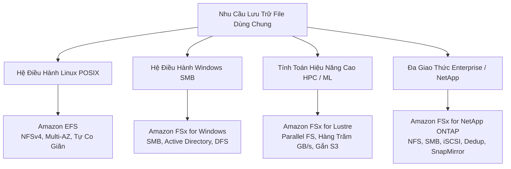

# 02 — STORAGE KEYWORDS: S3, EBS, EFS, FSx, Storage Gateway, AWS Backup

---

## 📖 ĐỊNH NGHĨA CỐT LÕI CÁC DỊCH VỤ STORAGE

| Dịch Vụ AWS | Bản Chất Kỹ Thuật (What is it?) | Sinh Ra Để Làm Gì (Core Job)? | 💡 Móc Nhớ Thần Chú |
|:---|:---|:---|:---|
| **Amazon S3** | Lưu trữ đối tượng (Object Storage) toàn cầu, dung lượng vô hạn, độ bền 11 số 9 (99.999999999%). | Kho chứa dữ liệu phi cấu trúc trung tâm (ảnh, video, file sao lưu, Data Lake), host web tĩnh. | *"Đại dương vô tận: Ném file vào kèm khóa (Key) là triệu năm không mất."* |
| **Amazon EBS** | Ổ đĩa lưu trữ dạng khối (Block Storage) kết nối mạng tốc độ cao, gắn vào 1 EC2 trong cùng 1 AZ. | Làm ổ cài hệ điều hành (Root Volume) và ổ dữ liệu cơ sở dữ liệu (MySQL, Oracle) cần độ trễ thấp. | *"Ổ cứng cắm cáp quang: Máy ở phòng nào (AZ nào) thì ổ đĩa phải ở đúng phòng đó."* |
| **EC2 Instance Store** | Ổ đĩa thể rắn (NVMe SSD) gắn trực tiếp vật lý trên bo mạch máy chủ EC2 host. | Cung cấp hàng triệu IOPS với độ trễ microsecond cho vùng nhớ đệm (Cache, Buffer, Temp) chấp nhận mất dữ liệu khi tắt máy. | *"Bảng viết bút dạ: Viết xóa cực nhanh, nhưng hết giờ lau bảng là sạch trơn dữ liệu."* |
| **Amazon EFS** | Hệ thống tệp tin mạng dùng chung chuẩn POSIX (NFS v4) serverless, tự động co giãn, Multi-AZ. | Cho hàng ngàn máy chủ Linux, container, Lambda cùng đọc/ghi vào một thư mục chung. | *"Thư mục dùng chung công ty cho máy Linux: Ai cũng vào xem và sửa file được."* |
| **Amazon FSx Family** | Dịch vụ hệ thống tệp tin chuyên biệt bên thứ 3 được AWS quản lý (Windows, Lustre, ONTAP, ZFS). | Đáp ứng các yêu cầu giao thức đặc thù: **FSx Windows (SMB/Active Directory)**, **FSx Lustre (HPC/ML song song)**. | *"Chuyên cơ riêng cho từng hệ điều hành: Windows có SMB, HPC có Lustre siêu tốc."* |
| **AWS Storage Gateway** | Cầu nối lưu trữ lai (Hybrid Storage) kết nối mạng On-Premises với Amazon S3/Glacier. | Cho ứng dụng tại chỗ dùng tiếp giao thức cũ (NFS, SMB, iSCSI) với đệm cục bộ (Local Cache) và sao lưu lên cloud. | *"Ống dẫn ngầm: Nối thẳng từ phòng máy On-Prem ra hồ chứa S3 trên mây."* |
| **AWS Backup** | Dịch vụ quản trị và tự động hóa chính sách sao lưu tập trung cấp doanh nghiệp đa dịch vụ. | Lập lịch backup tập trung cho EC2, EBS, RDS, Aurora, DynamoDB, EFS, FSx, S3; hỗ trợ khóa bất biến Vault Lock (WORM). | *"Tổng kho két sắt bảo mật: Quản lý chìa khóa và lịch cất giữ tài sản toàn bộ công ty."* |
| **AWS DataSync** | Công cụ truyền dữ liệu trực tuyến tốc độ cao (TLS, checksum) giữa On-Prem và AWS Storage. | Tự động hóa việc di chuyển và đồng bộ dữ liệu định kỳ qua mạng (nhanh gấp 10 lần rsync). | *"Đoàn xe chuyên dụng: Chở dữ liệu định kỳ qua mạng cực nhanh và an toàn."* |
| **AWS Transfer Family** | Cổng giao tiếp SFTP, FTPS, FTP, AS2 được quản lý hoàn toàn đổ thẳng vào S3 hoặc EFS. | Cho đối tác bên ngoài upload file an toàn qua SFTP quen thuộc mà không cần dựng FTP server. | *"Cửa khẩu SFTP: Đối tác nước ngoài giao hàng vào kho S3 bằng xe quen thuộc."* |
| **AWS Snow Family** | Thiết bị vận chuyển dữ liệu vật lý ngoại tuyến (Snowball Edge 80–210 TB, Snowcone, Snowmobile). | Di chuyển hàng chục TB đến hàng trăm PB khi đường truyền mạng quá chậm hoặc không có Internet. | *"Tàu chở container vật lý: Chở cả kho dữ liệu đi đường bộ khi mạng Internet nghẽn."* |

---

## 🪣 AMAZON S3 — CÁC NGUYÊN TẮC VÀ THÔNG SỐ CỐT LÕI

- **Định danh**: Tên Bucket là **duy nhất trên toàn cầu** (Globally unique), nhưng mỗi Bucket thuộc về **1 Region cụ thể**.
- **Kích thước Object**: Tối đa **5 TB**. Upload 1 lần qua `PUT` đơn lẻ tối đa **5 GB**.
- **Multipart Upload**: Khuyến nghị dùng cho file **> 100 MB**, **bắt buộc** dùng cho file **> 5 GB**. Giúp upload song song các phần và resume khi mất mạng.
- **Tính nhất quán**: Đạt chuẩn **Strong Read-After-Write Consistency** cho mọi lệnh PUT và DELETE.
- **Độ bền (Durability)**: Đạt chuẩn **11 số 9 (99.999999999%)** trên mọi Storage Class (kể cả One Zone-IA).
- **Static Website Hosting**: Chỉ cung cấp giao thức HTTP. Muốn có HTTPS $\rightarrow$ Bắt buộc kết hợp **Amazon CloudFront**.
- **VPC Gateway Endpoint**: Miễn phí $0, thêm route vào Route Table để EC2 trong private subnet gọi S3 không tốn tiền NAT Gateway.
- **Requester Pays**: Người tải dữ liệu (downloader) chịu chi phí truyền dữ liệu ra ngoài (Data Transfer Out), chủ bucket chỉ trả tiền lưu trữ.

---

## 📊 S3 STORAGE CLASSES — BẢNG PHÂN LOẠI & TÍNH PHÍ

| Storage Class | Availability | Min Days | Min Size | Retrieval Fee | 💡 Khi Nào Chọn Trong Đề Thi? |
|:---|:---:|:---:|:---:|:---:|:---|
| **S3 Standard** | 99.99% (≥3 AZ) | 0 ngày | 0 KB | $0 | Dữ liệu truy cập thường xuyên, website, analytics, **file có vòng đời ngắn < 30 ngày**. |
| **S3 Intelligent-Tiering** | 99.9% (≥3 AZ) | 0 ngày | 128 KB | **$0** (Không phí phạt) | **Mô hình truy cập không biết trước hoặc thay đổi**. Tự chuyển: Frequent $\rightarrow$ Infrequent (30 ngày) $\rightarrow$ Archive Instant (90 ngày). Tùy chọn: Archive Access (90+ ngày), Deep Archive Access (180+ ngày). File < 128 KB không tự chuyển. |
| **S3 Standard-IA** | 99.9% (≥3 AZ) | **30 ngày** | 128 KB | Có phí / GB | Dữ liệu ít truy cập (1–2 lần/tháng), cần lấy ra trong **vài mili-giây**, sao lưu DR đa vùng. |
| **S3 One Zone-IA** | **99.5% (1 AZ)** | **30 ngày** | 128 KB | Có phí / GB | **Rẻ hơn Standard-IA 20%**. Dùng cho dữ liệu có thể tái tạo được (thumbnails, secondary copies). Hỏng AZ = mất vĩnh viễn. Keyword: `re-creatable`, `non-critical`. |
| **S3 Glacier Instant Retrieval** | 99.9% (≥3 AZ) | **90 ngày** | 128 KB | Cao hơn IA | Dữ liệu lưu trữ lâu dài nhưng cần truy xuất trong **vài mili-giây** (hồ sơ y tế, ảnh báo chí cũ). Truy cập ~1 lần/quý. |
| **S3 Glacier Flexible Retrieval** | 99.99% (≥3 AZ) | **90 ngày** | 0 KB | Tùy chọn | Chờ lấy dữ liệu: **Expedited (1–5 phút)**, **Standard (3–5 giờ)**, **Bulk (5–12 giờ — MIỄN PHÍ retrieval fee)**. Sao lưu định kỳ hàng quý/năm. |
| **S3 Glacier Deep Archive** | 99.99% (≥3 AZ) | **180 ngày** | 0 KB | Rẻ nhất | **Rẻ nhất thế giới đám mây** (< $1/TB/tháng). Lấy dữ liệu: Standard (12 giờ), Bulk (48 giờ). Tuân thủ pháp lý 7–10 năm. Keyword: `retain 7-10 years`, `lowest cost`. |
| **S3 Express One Zone** | 99.95% (1 AZ) | 0 ngày | 0 KB | $0 | **Nhanh gấp 10 lần Standard** (độ trễ single-digit ms). Dạng Directory Bucket lưu trong 1 AZ. Cho ML Training, Apache Spark, AI workloads. |

> ⚠️ **BẪY THI KINH ĐIỂN VỀ VÒNG ĐỜI S3**:  
> Đề bài: *"Tập tin tạm thời được lưu trữ và tự động xóa sau 10 đến 15 ngày, phương án nào rẻ nhất?"*  
> 👉 **CHỌN**: **S3 Standard**.  
> ❌ **TRÁNH**: S3 Standard-IA (Vì IA có quy định **tính tiền tối thiểu 30 ngày** kèm phí truy xuất dữ liệu khi xóa sớm $\rightarrow$ đắt hơn Standard).

---

## 🔄 S3 LIFECYCLE RULES & PHÂN TÍCH LƯU TRỮ

- **Transition Actions**: Tự động chuyển Object sang tầng lưu trữ rẻ hơn theo thời gian (VD: Sau 30 ngày chuyển sang Standard-IA, sau 90 ngày chuyển sang Glacier Flexible). Lưu ý: Chuyển từ Standard sang Standard-IA phải sau ít nhất 30 ngày.
- **Expiration Actions**: Tự động xóa Object, xóa các phiên bản cũ (Noncurrent Versions), hoặc tự hủy các phần upload dở dang (`AbortIncompleteMultipartUpload`).
- **S3 Storage Class Analysis**: Công cụ phân tích pattern truy cập của bucket và gợi ý thời điểm thích hợp để chuyển từ Standard sang Standard-IA.
- **S3 Storage Lens**: Cung cấp bức tranh toàn cảnh về dung lượng, chi phí, mức độ bảo mật và tối ưu hóa của toàn bộ các bucket trong toàn công ty (Organization-wide visibility).

---

## 🔐 S3 VERSIONING, OBJECT LOCK & REPLICATION

### 1. S3 Versioning
- Khi bật Versioning trên bucket: **Không thể tắt hoàn toàn**, chỉ có thể tạm dừng (**Suspend**).
- Lệnh `DELETE` trên object: Tạo ra một **Delete Marker**. Muốn khôi phục $\rightarrow$ Chỉ cần xóa Delete Marker.
- **MFA Delete**: Bắt buộc xác thực đa yếu tố để xóa vĩnh viễn một version hoặc tạm dừng Versioning. **Chỉ tài khoản Root mới bật được MFA Delete**.

### 2. S3 Object Lock (Chuẩn WORM - Write Once, Read Many)
- Bắt buộc phải bật **S3 Versioning** trước khi kích hoạt Object Lock.
| Chế Độ | Đặc Điểm Phân Quyền | Ngữ Cảnh Sử Dụng |
|:---|:---|:---|
| **Compliance Mode** | **KHÔNG MỘT AI** (kể cả AWS Root, kể cả AWS Support) có thể xóa hoặc sửa object trong thời hạn khóa. | Chống mã độc tống tiền (Ransomware), tuân thủ luật tài chính khắt khe (SEC Rule 17a-4). |
| **Governance Mode** | Người dùng có quyền IAM đặc biệt (`s3:BypassGovernanceRetention`) có thể gỡ khóa hoặc xóa object. | Kiểm soát nội bộ linh hoạt, tránh nhân viên xóa nhầm nhưng admin vẫn can thiệp được. |
| **Legal Hold** | Khóa dữ liệu vô thời hạn (không có ngày hết hạn cố định), bật/tắt bằng cờ ON/OFF. | Giữ chứng cứ phục vụ điều tra pháp lý độc lập với thời hạn retention period. |

### 3. S3 Replication (CRR & SRR)
- **Điều kiện tiên quyết**: **Bắt buộc bật S3 Versioning ở CẢ 2 BUCKET (nguồn và đích)**.
- **Nguyên tắc nhân bản**: Mặc định **chỉ replicate các object MỚI** tạo sau khi bật rule. Đối với dữ liệu cũ có sẵn $\rightarrow$ Dùng **S3 Batch Replication**.
- **Không nhân bản theo chuỗi (No chained replication)**: Nếu A replicate sang B, và B replicate sang C $\rightarrow$ Dữ liệu từ A **không tự động sang C**.
- **Replication Time Control (RTC)**: Cam kết SLA nhân bản 99.99% số object trong vòng **15 phút**, có metric theo dõi trên CloudWatch.
- **Cross-Account Replication**: Cần cấp quyền IAM Role ở account nguồn và Bucket Policy ở account đích cho phép nhận dữ liệu.

---

## 🛡️ S3 SECURITY, ACCESS CONTROL & PERFORMANCE

### 1. Cơ Chế Mã Hóa (Encryption)
- **SSE-S3 (AES-256)**: Mã hóa mặc định cho mọi object mới tạo trên S3. AWS tự quản lý khóa. Miễn phí.
- **SSE-KMS**: Quản lý khóa qua AWS KMS, kiểm soát quyền truy cập chi tiết và audit qua CloudTrail.
  - *Lưu ý về KMS Quota*: Hàng triệu request S3 có thể làm cạn hạn ngạch KMS $\rightarrow$ Bật **S3 Bucket Key** để giảm số lần gọi KMS tới **99%** và tiết kiệm chi phí.
- **SSE-C**: Khách hàng tự giữ và quản lý khóa mã hóa, gửi khóa qua HTTPS header mỗi lần đọc/ghi. AWS không lưu khóa.
- **DSSE-KMS**: Mã hóa 2 lớp độc lập bằng KMS.
- **Ép Buộc Kết Nối HTTPS**: Tạo Bucket Policy từ chối (`Deny`) mọi request có `"aws:SecureTransport": "false"`.

### 2. Kiểm Soát Quyền Truy Cập
- **Block Public Access**: Bật mặc định ở cấp tài khoản và cấp bucket để chặn mọi nguy cơ lộ dữ liệu public.
- **Object Ownership**: Đặt chế độ **Bucket owner enforced** $\rightarrow$ **Vô hiệu hóa hoàn toàn Access Control Lists (ACLs)**, tập trung quản lý qua Bucket Policy.
- **Pre-signed URLs**: Cho phép người dùng tạm thời tải lên hoặc tải xuống 1 file cụ thể mà không cần tài khoản IAM. Thừa hưởng quyền của người tạo link và hết hạn sau thời gian định sẵn.
- **S3 Access Points**: Tạo các điểm truy cập riêng với chính sách (Policy) độc lập cho từng nhóm ứng dụng hoặc người dùng (VD: Access Point cho phòng Tài chính, Access Point cho phòng Marketing).

### 3. Tối Ưu Hiệu Năng (S3 Performance)
- **Hạn mức mặc định theo Prefix**: **3,500 PUT/POST/DELETE** và **5,500 GET/HEAD requests / giây trên mỗi Prefix**.
  - Muốn scale thông lượng $\rightarrow$ Chia dữ liệu ra nhiều prefix song song (VD: `/images/`, `/documents/`, `/logs/`).
- **Byte-Range Fetch**: Tải song song nhiều phần (ranges) của một file lớn để tăng tốc độ tải hoặc chỉ đọc phần header của file.
- **S3 Select**: Lọc và chỉ kéo đúng các cột/hàng cần thiết từ file CSV/JSON/Parquet trực tiếp tại tầng S3 trước khi trả về ứng dụng $\rightarrow$ Giảm 80% băng thông mạng và CPU.

---

## 💾 AMAZON EBS — CÁC LOẠI Ổ KHỐI & SNAPSHOTS

| Loại Ổ EBS | Công Nghệ | IOPS / Throughput Tối Đa | 💡 Khi Nào Chọn Trong Đề Thi? |
|:---|:---:|:---:|:---|
| **gp3** (General Purpose) | SSD | 16,000 IOPS / 1,000 MB/s | **Lựa chọn mặc định**, ổ boot OS, dev/test. Chỉnh IOPS và Throughput độc lập với dung lượng (rẻ hơn gp2 20%). Baseline 3,000 IOPS + 125 MB/s miễn phí. |
| **gp2** (General Purpose) | SSD | 16,000 IOPS | Công nghệ cũ, IOPS gắn liền với dung lượng (3 IOPS/GB) có cơ chế Burst credits. Nên nâng cấp lên gp3. |
| **io2 Block Express** | SSD | **256,000 IOPS** / 4,000 MB/s | Cơ sở dữ liệu quan trọng (SAP HANA, Oracle, SQL Server) cần độ trễ sub-millisecond và IOPS cực lớn. Hỗ trợ **EBS Multi-Attach**. |
| **io1** (Provisioned IOPS) | SSD | 64,000 IOPS / 1,000 MB/s | Thế hệ trước của io2. |
| **st1** (Throughput Optimized) | HDD | 500 IOPS / 500 MB/s | Dữ liệu đọc/ghi tuần tự lớn (Big data, Hadoop, Kafka, Log processing). **KHÔNG THỂ LÀM Ổ BOOT**. |
| **sc1** (Cold HDD) | HDD | 250 IOPS / 250 MB/s | Dữ liệu lạnh, ít truy cập, chi phí rẻ nhất họ EBS. **KHÔNG THỂ LÀM Ổ BOOT**. |

### 🛠️ Các Quy Tắc Vàng Của EBS Cần Nhớ
1. **Phạm vi AZ**: EBS Volume chỉ tồn tại trong **1 Availability Zone duy nhất**. Muốn chuyển sang AZ hoặc Region khác $\rightarrow$ Chụp **Snapshot** rồi restore tại AZ/Region mới.
2. **Delete on Termination**: Mặc định **BẬT** cho Root volume (tự xóa khi EC2 bị terminate) và mặc định **TẮT** cho các ổ đĩa dữ liệu phụ gắn thêm.
3. **Mã hóa (Encryption)**: Bật tính năng *"Always encrypt new EBS volumes"* cho toàn Region. Nếu ổ đĩa chưa mã hóa $\rightarrow$ Chụp Snapshot $\rightarrow$ Copy Snapshot kèm tùy chọn bật mã hóa KMS $\rightarrow$ Khởi tạo Volume mới từ snapshot mã hóa.
4. **Elastic Volumes**: Cho phép tăng dung lượng, đổi loại ổ (VD: gp2 $\rightarrow$ gp3) trực tiếp khi máy chủ đang chạy mà không cần unmount hay reboot.
5. **EBS Multi-Attach**: CHỈ hỗ trợ dòng `io1` và `io2`, gắn vào tối đa **16 EC2 instances trong CÙNG 1 AZ**. Đòi hỏi ứng dụng phải dùng Cluster-aware file system (như GFS2).

### 📸 EBS Snapshots & Quản Lý Vòng Đời
- **Bản chất**: Lưu ngầm trên Amazon S3, hoạt động theo cơ chế **Incremental (chỉ lưu các khối đĩa bị thay đổi)**.
- **Fast Snapshot Restore (FSR)**: Loại bỏ hoàn toàn độ trễ đọc lần đầu (Lazy loading) khi khởi tạo volume từ snapshot (tính thêm phí).
- **Snapshot Archive**: Lưu trữ snapshot dài hạn rẻ hơn 75% so với snapshot thông thường, thời gian phục hồi từ 24–72 giờ.
- **Recycle Bin**: Thiết lập thời gian giữ lại (Retention rules) để khôi phục các snapshot hoặc AMI bị xóa nhầm.
- **Amazon Data Lifecycle Manager (DLM)**: Tự động hóa lịch chụp, sao chép xuyên Region và xóa snapshot EBS theo chính sách.

---

## 📁 AMAZON EFS vs FSx FAMILY — CHỌN ĐÚNG FILE SYSTEM

| Dịch Vụ | Giao Thức | Hệ Điều Hành | 💡 Đặc Điểm Quyết Định Trong Đề Thi |
|:---|:---:|:---:|:---|
| **Amazon EFS** | NFSv4 | **Linux duy nhất** | Tự co giãn không cần khai báo trước dung lượng, Multi-AZ mặc định (có bản EFS One Zone rẻ hơn). Đắt hơn EBS ~3 lần. Cung cấp **EFS Access Points** để phân quyền thư mục cho container/Lambda. |
| **FSx for Windows File Server** | SMB | Windows (mount được Linux) | Tích hợp sâu Microsoft Active Directory, NTFS ACLs, DFS Namespaces (gộp nhiều file shares). Hỗ trợ Multi-AZ và Single-AZ, backup tự động hằng ngày sang S3. |
| **FSx for Lustre** | Lustre | Linux | Hệ thống tệp song song cho HPC, mô phỏng tài chính, training Machine Learning. Đọc/ghi trực tiếp từ S3 như một thư mục cục bộ. Bản **Scratch** (tạm thời, rẻ, không replicate) và **Persistent** (lâu dài, HA trong AZ). |
| **FSx for NetApp ONTAP** | NFS, SMB, iSCSI | Đa nền tảng (Linux, Windows, macOS, VMware) | Migrate hệ thống NetApp tại chỗ lên AWS không sửa ứng dụng. Hỗ trợ tính năng nén, chống trùng lặp (dedup), clone tức thì (point-in-time clone). |
| **FSx for OpenZFS** | NFS (v3, v4) | Linux, macOS | Di chuyển workload ZFS lên AWS. Thông lượng hàng triệu IOPS, độ trễ dưới 0.5 mili-giây, nén dữ liệu ZFS. |

---

## 🏗️ HYBRID STORAGE & DATA TRANSFER

### 1. AWS Storage Gateway (Cầu Nối Lưu Trữ Lai)
| Biến Thể Gateway | Giao Thức On-Prem | Lưu Trữ Phía Sau | 💡 Ngữ Cảnh Đề Thi Phản Xạ |
|:---|:---:|:---:|:---|
| **S3 File Gateway** | NFS / SMB | Amazon S3 | Ứng dụng tại chỗ cần ghi file qua NFS/SMB và lưu thành object S3 có cache cục bộ độ trễ thấp. |
| **FSx File Gateway** | SMB | FSx for Windows | Người dùng tại văn phòng chi nhánh truy cập thư mục FSx for Windows trên mây với tốc độ mạng LAN nhờ local cache. |
| **Volume Gateway — Cached** | iSCSI | Amazon S3 | Dữ liệu chính lưu trên S3, chỉ giữ dữ liệu nóng (hay dùng) tại ổ đĩa On-Premises. Tiết kiệm bộ nhớ tại chỗ. |
| **Volume Gateway — Stored** | iSCSI | On-Premises (S3 backup) | Toàn bộ dữ liệu nằm tại On-Premises để truy cập tức thì, sao lưu bất đồng bộ snapshot lên S3. |
| **Tape Gateway (VTL)** | iSCSI VTL | S3 Glacier / Deep Archive | **Thay thế thư viện băng từ vật lý**. Phần mềm sao lưu cũ (Veeam, Commvault) giữ nguyên, băng ảo cất trên Glacier. |

### 2. AWS Backup (Quản Trị Sao Lưu Tập Trung Doanh Nghiệp)
- Quản lý sao lưu tập trung theo chính sách cho: **EC2, EBS, RDS, Aurora, DynamoDB, EFS, FSx, S3, Storage Gateway**.
- **Backup Plan**: Định nghĩa tần suất sao lưu, thời gian lưu giữ (Retention), và tự động chuyển sang tầng lưu trữ lạnh (Cold Storage).
- **Cross-Region & Cross-Account Backup**: Tự động sao chép bản backup sang Region hoặc AWS Account khác để phòng chống thảm họa và ransomware.
- **AWS Backup Vault Lock**: Bật chế độ **Compliance Mode (WORM)** ngăn chặn mọi người dùng (kể cả root) xóa hoặc sửa bản sao lưu trước thời hạn.

### 3. Công Cụ Truyền Tải Dữ Liệu: DataSync vs Transfer Family vs Snow Family
- **AWS DataSync**: Đồng bộ dữ liệu định kỳ qua mạng (NFS/SMB/HDFS $\rightarrow$ S3/EFS/FSx), nhanh gấp 10 lần rsync, bảo toàn quyền POSIX/NTFS.
- **AWS Transfer Family**: Cung cấp cổng SFTP/FTPS/FTP/AS2 cho đối tác bên ngoài upload file trực tiếp vào S3 hoặc EFS mà không sửa script của họ.
- **AWS Snow Family**: Vận chuyển dữ liệu vật lý ngoại tuyến khi đường truyền internet quá chậm (mất > 1 tuần để truyền qua mạng).
  - *Quy tắc vàng*: Dữ liệu từ Snowball chỉ có thể import vào **Amazon S3 Standard**, sau đó mới dùng Lifecycle Rule chuyển sang S3 Glacier (không import trực tiếp vào Glacier).

---

## 🚀 BẢNG CHỌN NHANH STORAGE

| Tín Hiệu Đề Thi (Trigger Keywords) | ✅ Đáp Án Chuẩn |
|:---|:---|
| "unlimited capacity", "static content", "object storage", "data lake" | **Amazon S3** |
| "boot volume", "block storage for single EC2", "low latency database" | **Amazon EBS (gp3 / io2)** |
| "shared file system", "POSIX compliant", "NFS protocol", "Linux multi-AZ" | **Amazon EFS** |
| "Windows file share", "SMB protocol", "Active Directory integration", "NTFS ACLs" | **FSx for Windows File Server** |
| "HPC parallel file system", "ML training throughput", "read S3 directly as files" | **FSx for Lustre** |
| "multi-protocol", "NFS + SMB + iSCSI", "NetApp SnapMirror migration" | **FSx for NetApp ONTAP** |
| "on-premise apps need local cache for S3", "hybrid cloud storage" | **AWS Storage Gateway (File Gateway)** |
| "replace physical tape library without changing backup software", "VTL" | **Storage Gateway (Tape Gateway)** |
| "centralized backup policy across multiple services", "ransomware backup lock" | **AWS Backup + Vault Lock** |
| "accelerate large file upload globally to S3", "worldwide users" | **S3 Transfer Acceleration** |
| "file upload > 5 GB" | **S3 Multipart Upload** |
| "query specific rows/columns directly from S3 CSV/Parquet" | **S3 Select** |
| "single-digit ms latency for S3", "AI/ML training in 1 AZ" | **S3 Express One Zone** |
| "WORM compliance", "nobody can delete even root", "SEC 17a-4" | **S3 Object Lock (Compliance Mode)** |
| "temporary files deleted after 10 days, cost-effective" | **S3 Standard (Tránh bẫy Standard-IA)** |
| "unpredictable access pattern, zero retrieval fees" | **S3 Intelligent-Tiering** |
| "infrequent access, ms retrieval, lowest cost archive" | **S3 Glacier Instant Retrieval** |
| "retain 7-10 years, compliance, lowest storage cost" | **S3 Glacier Deep Archive** |
| "transfer TBs of files periodically over network", "10x faster than rsync" | **AWS DataSync** |
| "external partners upload via SFTP to S3" | **AWS Transfer Family** |
| "offline data transfer > 10 TB, slow internet" | **AWS Snowball Edge** |
