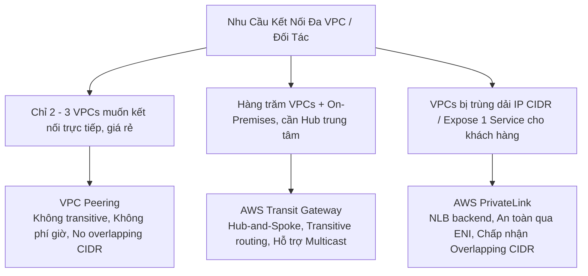

# 04 — NETWORK KEYWORDS: VPC, Subnets, Gateways, Endpoints, ELB, CloudFront, Route 53 & API Gateway

---

## 📖 ĐỊNH NGHĨA CỐT LÕI CÁC DỊCH VỤ NETWORKING & CONTENT DELIVERY

| Dịch Vụ AWS | Bản Chất Kỹ Thuật (What is it?) | Sinh Ra Để Làm Gì (Core Job)? | 💡 Móc Nhớ Thần Chú |
|:---|:---|:---|:---|
| **Amazon VPC** | Mạng riêng ảo biệt lập logic (Virtual Network) cấp độ Region cho tài khoản AWS của bạn. | Toàn quyền kiểm soát cấu trúc mạng: dải CIDR, chia Public/Private Subnets, Route Tables, Internet/NAT Gateways. | *"Mảnh đất có hàng rào kiên cố: Tự phân chia phòng khách (Public) và phòng ngủ (Private)."* |
| **AWS Transit Gateway (TGW)** | Thiết bị định tuyến đám mây trung tâm (Cloud Router) theo mô hình hình sao (Hub-and-Spoke). | Kết nối hàng ngàn VPC và mạng On-Premises về một điểm duy nhất, hỗ trợ Transitive Routing và IP Multicast. | *"Vòng xuyến giao thông trung tâm: Mọi ngả đường VPC đều đổ về một đầu mối điều phối."* |
| **AWS PrivateLink** | Công nghệ kết nối mạng riêng tư an toàn qua card mạng ảo ENI có IP riêng trong subnet. | Truy cập các dịch vụ AWS hoặc SaaS mà không đi ra Internet công cộng; **giải pháp duy nhất kết nối VPC trùng IP (Overlapping CIDR)**. | *"Đường hầm bí mật: Đi ngầm dưới lòng đất đến thẳng nhà đối tác, không cần biết số nhà."* |
| **Application Load Balancer (ALB)** | Bộ cân bằng tải Layer 7 (HTTP/HTTPS/gRPC/WebSocket). | Định tuyến thông minh theo URL path (`/api`), host header, query string, tích hợp WAF và xác thực người dùng Cognito/OIDC. | *"Lễ tân khách sạn: Đọc bảng tên và hướng dẫn khách lên đúng số phòng tương ứng."* |
| **Network Load Balancer (NLB)** | Bộ cân bằng tải Layer 4 (TCP/UDP/TLS) hiệu năng siêu cao, độ trễ microsecond. | Xử lý hàng triệu request/s, cung cấp **địa chỉ IP tĩnh (Elastic IP)** cố định cho firewall whitelist; làm backend cho PrivateLink. | *"Trạm thu phí tự động cao tốc: Xe phóng qua hàng triệu chiếc/giây không cần phanh."* |
| **Gateway Load Balancer (GWLB)** | Bộ cân bằng tải Layer 3 + Layer 4 tích hợp thiết bị an ninh mạng ảo của bên thứ ba. | Chèn các cụm tường lửa (Palo Alto, Fortinet) vào luồng mạng một cách trong suốt bằng giao thức GENEVE (port 6081). | *"Trạm kiểm soát an ninh sân bay: Soi chiếu toàn bộ hành lý rồi trả lại nguyên vẹn luồng đi."* |
| **AWS Global Accelerator** | Dịch vụ tăng tốc mạng Layer 4 bằng **2 địa chỉ Anycast IP tĩnh** trên mạng trục cáp quang riêng AWS. | Hỗ trợ TCP/UDP, bỏ qua bộ nhớ đệm DNS của client/ISP, chuyển hướng tức thì (< 1 phút) cho gaming, VoIP, IoT toàn cầu. | *"Đường sắt cao tốc chuyên dụng: Vào ga gần nhất là phóng thẳng tuyến riêng, bỏ qua kẹt xe DNS."* |
| **Amazon CloudFront** | Mạng phân phối nội dung toàn cầu (CDN) Layer 7 với hàng trăm điểm biên (Edge Locations). | Lưu cache nội dung tĩnh (ảnh, video) và tăng tốc nội dung động, hấp thụ 90% tải và phòng thủ DDoS tại biên với WAF. | *"Chuỗi cửa hàng tiện lợi ven đường: Mua hàng ngay đầu ngõ, không cần lặn lội về kho tổng S3."* |
| **Amazon Route 53** | Dịch vụ phân giải tên miền (DNS) độ sẵn sàng 100% SLA và quản lý định tuyến lưu lượng. | Dịch tên miền thành IP với các chính sách thông minh: Geolocation, Geoproximity, Latency, Failover, Weighted. | *"Tổng đài chuyển hướng cuộc gọi thông minh: Nhìn người gọi từ đâu để nối máy tới chi nhánh tốt nhất."* |
| **Route 53 Resolver** | Cầu nối phân giải DNS lai (Hybrid DNS) giữa On-Premises và AWS VPC. | Cho phép on-prem giải mã tên miền private trong VPC (Inbound) và VPC giải mã tên miền nội bộ công ty (Outbound). | *"Phiên dịch viên song ngữ: Chuyển ngữ tên miền giữa mạng công ty và đám mây AWS."* |
| **AWS Direct Connect (DX)** | Tuyến cáp vật lý chuyên dụng riêng biệt từ On-Premises đến AWS qua đối tác viễn thông. | Đường truyền mạng cực lớn (1G–100Gbps), độ trễ ổn định, bảo mật cao không đi qua mạng Internet công cộng. | *"Đường dây điện thoại nóng bảo mật: Cáp quang kéo thẳng từ phòng sếp sang cơ quan đối tác."* |
| **AWS Site-to-Site VPN** | Đường hầm mạng riêng ảo mã hóa IPsec qua Internet công cộng giữa On-Prem và AWS (2 tunnels HA). | Triển khai kết nối an toàn nhanh chóng trong vài phút, chi phí thấp hoặc làm kênh dự phòng (backup) cho Direct Connect. | *"Hầm chui an toàn qua phố đông: Xe bọc thép chạy qua đường phố công cộng có bảo vệ hộ tống."* |
| **AWS VPN CloudHub** | Kiến trúc kết nối nhiều chi nhánh văn phòng với nhau qua 1 Virtual Private Gateway (VGW). | Kết nối các văn phòng chi nhánh theo mô hình hub-and-spoke giá rẻ sử dụng giao thức BGP. | *"Tổng đài bưu điện liên tỉnh: Các chi nhánh gửi thư qua bưu điện trung tâm để giao cho nhau."* |
| **AWS Client VPN** | Dịch vụ OpenVPN được quản lý cho máy tính cá nhân của nhân viên làm việc từ xa. | Cho phép nhân viên kết nối an toàn vào tài nguyên private trong VPC từ laptop ở nhà (hỗ trợ Split-tunnel). | *"Thẻ bài vào cổng từ xa: Nhân viên ở nhà quẹt thẻ là vào thẳng mạng nội bộ công ty."* |
| **Amazon API Gateway** | Cửa ngõ API serverless tạo, xuất bản, bảo vệ và quản lý các API REST, HTTP và WebSocket. | Quản lý lưu lượng truy cập backend Lambda/EC2, hỗ trợ xác thực Cognito, điều tiết tải (Throttling) và Cache. | *"Cửa kiểm soát vé nhà hát: Soát vé, giới hạn người vào và giữ trật tự cho toàn bộ sân khấu."* |

---

## 🌐 QUY TẮC MẠNG VPC, TOÁN CIDR & KIẾN TRÚC 3 TẦNG

### 1. Quy Tắc Dải Mạng & Subnet Math
- **Phạm vi VPC**: Cấp độ Region, bao phủ toàn bộ các Availability Zones trong Region đó.
- **Kích thước CIDR block**: Từ `/16` (65,536 địa chỉ IP) đến `/28` (16 địa chỉ IP).
- **Dải IP nội bộ RFC 1918**: `10.0.0.0/8`, `172.16.0.0/12`, `192.168.0.0/16`.
- **Subnet là ZONAL**: 1 Subnet chỉ nằm trong duy nhất 1 Availability Zone.
- ⚠️ **AWS giữ lại 5 địa chỉ IP trong mỗi Subnet**:
  - `.0`: Network address (Địa chỉ mạng).
  - `.1`: VPC Router address.
  - `.2`: Amazon-provided DNS mapping address.
  - `.3`: Dành riêng cho AWS sử dụng trong tương lai.
  - `.255`: Network broadcast address (AWS không hỗ trợ broadcast, nhưng vẫn giữ).
- 🧮 **Bài Toán Thi Hay Gặp**:  
  Đề bài yêu cầu: *"Cần một subnet chứa tối thiểu **29 địa chỉ IP khả dụng** cho máy chủ"* $\rightarrow$ Dải `/27` có 32 IP, trừ 5 IP của AWS chỉ còn $32 - 5 = 27$ IP (**KHÔNG ĐỦ**) $\rightarrow$ **Bắt buộc phải chọn dải `/26`** ($64 - 5 = 59$ IP).
- **Elastic IP (EIP)**: Địa chỉ IPv4 tĩnh public. Mọi địa chỉ IPv4 public đều tính phí theo giờ; EIP tạo ra nhưng không gắn vào instance đang chạy sẽ bị tính phí phạt.
- **Cờ DNS VPC**: Bắt buộc bật cả `enableDnsSupport` và `enableDnsHostnames` khi dùng VPC Interface Endpoints hoặc Route 53 Private Hosted Zones.
- **VPC Sharing (AWS RAM)**: Cho phép chia sẻ Subnet giữa nhiều tài khoản AWS trong cùng Organization để dùng chung tài nguyên mạng mà không cần Peering.

### 2. Kiến Trúc Chuẩn 3 Tầng Sẵn Sàng Cao (3-Tier HA Architecture)
```
[Internet]
    │
    ▼
[Public Subnets (≥2 AZs)]   ──> ALB, NAT Gateway, Bastion Host (có Route 0.0.0.0/0 tới IGW)
    │
    ▼
[Private Subnets (≥2 AZs)]  ──> EC2 Application Fleet / ECS Tasks (Route 0.0.0.0/0 tới NAT GW)
    │
    ▼
[Database Subnets (≥2 AZs)] ──> RDS Multi-AZ / Aurora Cluster (Hoàn toàn không có Route ra Internet)
```

---

## 🚪 CỔNG KẾT NỐI: IGW vs EGRESS-ONLY IGW vs NAT GATEWAY

| Cổng Mạng (Gateway) | Giao Thức | Chiều Truy Cập | Vị Trí Triển Khai | 💡 Đặc Điểm Cốt Lõi |
|:---|:---:|:---:|:---|:---|
| **Internet Gateway (IGW)** | IPv4 & IPv6 | **2 chiều** (Inbound & Outbound) | Gắn vào VPC (1 VPC = 1 IGW) | Tự động co giãn, tính sẵn sàng cao, hoàn toàn **MIỄN PHÍ**. Thực hiện NAT 1-1 cho IP public. |
| **Egress-Only IGW** | **Chỉ IPv6** | **1 chiều ra ngoài** (Outbound only) | Gắn vào VPC | Cho phép instance IPv6 đi ra internet tải bản vá, chặn hoàn toàn internet khởi tạo kết nối vào. |
| **NAT Gateway** | **Chỉ IPv4** | **1 chiều ra ngoài** (Outbound only) | Đặt tại **Public Subnet** | Cho instance trong private subnet ra internet. Cần gắn **Elastic IP**. Scale tới 100 Gbps. **Không gắn Security Group**. Tính phí theo giờ + GB dữ liệu. |
| **Private NAT Gateway** | IPv4 | 1 chiều qua mạng riêng | Đặt tại Private Subnet | Không cần IGW/EIP, dùng để định tuyến giữa các dải mạng private chồng lấn hoặc ra on-prem qua TGW. |
| **NAT Instance** (Legacy) | IPv4 | 1 chiều ra ngoài | Đặt tại Public Subnet | Chạy trên máy ảo EC2. Bắt buộc tắt cờ `Source/Dest Check`. Tự quản lý cấu hình, Security Group và tính HA. |

> ⚠️ **Bẫy HA Của NAT Gateway**:  
> NAT Gateway chỉ có tính sẵn sàng cao **bên trong 1 AZ duy nhất**. Nếu AZ đó sập, các AZ khác dùng chung NAT GW sẽ mất mạng.  
> 👉 Để đạt **Multi-AZ High Availability**: Bắt buộc tạo **MỖI AZ MỘT NAT GATEWAY RIÊNG BIỆT** trong Public Subnet của AZ đó.

---

## 🛡️ TƯỜNG LỬA MẠNG: SECURITY GROUP vs NETWORK ACL (NACL)

| Tiêu Chí So Sánh | Security Group (SG) | Network Access Control List (NACL) |
|:---|:---|:---|
| **Cấp độ áp dụng** | **ENI / Máy ảo EC2 riêng lẻ** | **Toàn bộ Subnet** |
| **Trạng thái lưu trữ (State)** | **STATEFUL (Có nhớ trạng thái)** | **STATELESS (Không nhớ trạng thái)** |
| **Chiều phản hồi** | Inbound được duyệt $\rightarrow$ Tự động mở đường về Outbound | **Phải mở cả 2 chiều Inbound VÀ Outbound** |
| **Loại quy tắc hỗ trợ** | **CHỈ CÓ ALLOW RULES** (Mặc định chặn hết Inbound) | **HỖ TRỢ CẢ ALLOW VÀ DENY RULES** |
| **Thứ tự xét duyệt quy tắc** | Xét duyệt toàn bộ các rules đồng thời | **Xét duyệt theo số thứ tự (từ nhỏ đến lớn, khớp là dừng)** |
| **Chặn một IP cụ thể** | ❌ **KHÔNG THỂ CHẶN 1 IP CỤ THỂ** | ✅ **CHẶN ĐƯỢC 1 IP HOẶC DẢI IP BẰNG RULE DENY** |
| **Dải cổng chiều về (Return)**| Tự động mở | Bắt buộc phải mở **Ephemeral Ports (1024–65535)** ở chiều về |
| **Tham chiếu (Referencing)** | **Có thể tham chiếu SG khác làm Source** (cùng Region) | Chỉ cấu hình được dải CIDR IP |

> 💡 **Móc nhớ quy tắc**:  
> - Đề bài: *"Phát hiện 1 địa chỉ IP độc hại đang tấn công vào hệ thống, chặn ngay lập tức"* $\rightarrow$ Chọn **NACL (Rule Deny)** hoặc **AWS WAF**.  
> - Đề bài: *"Chỉ cho phép máy chủ Database nhận kết nối từ tầng Web App"* $\rightarrow$ Chọn **Security Group** (cấu hình SG của Database cho phép Inbound từ SG của Web App).

---

## 🔗 KẾT NỐI ĐA VPC: PEERING vs TRANSIT GATEWAY vs PRIVATELINK



| Tiêu Chí | VPC Peering | AWS Transit Gateway (TGW) | AWS PrivateLink |
|:---|:---|:---|:---|
| **Mô hình kiến trúc** | Điểm - Điểm (Point-to-Point 1-1) | Hình sao trung tâm (Hub-and-Spoke) | Cung cấp dịch vụ riêng lẻ (Service-based) |
| **Định tuyến bắc cầu (Transitive)** | ❌ **KHÔNG** (A nối B, B nối C thì A không qua được C) | ✅ **CÓ** (Định tuyến thông suốt qua TGW) | Không áp dụng (chỉ gọi 1 service) |
| **Trùng lặp dải IP (Overlapping CIDR)** | ❌ **BỊ LỖI (Không cho phép)** | ❌ **BỊ LỖI (Không cho phép)** | ✅ **HOẠT ĐỘNG HOÀN HẢO** |
| **Chi phí** | **Không tính phí giờ** (chỉ tính phí data transfer) | Tính phí theo attachment-giờ + phí GB | Tính phí theo endpoint-giờ + phí GB |
| **Khả năng mở rộng** | Kém khi quy mô lớn ($N(N-1)/2$ kết nối) | **Hàng ngàn VPC và mạng On-prem** | Hàng chục ngàn VPC khách hàng |
| **Hỗ trợ IP Multicast** | ❌ Không | ✅ **DUY NHẤT HỖ TRỢ TRÊN AWS** | ❌ Không |

---

## 🔌 VPC ENDPOINTS: GATEWAY vs INTERFACE (PRIVATELINK)

| Tiêu Chí So Sánh | Gateway VPC Endpoint | Interface VPC Endpoint (PrivateLink) |
|:---|:---|:---|
| **Dịch vụ hỗ trợ** | **CHỈ HỖ TRỢ 2 DỊCH VỤ: Amazon S3 & DynamoDB** | **Hỗ trợ 100+ dịch vụ AWS** (SQS, SNS, KMS, Secrets Manager, ECR...) |
| **Bản chất kỹ thuật** | Một bản ghi định tuyến trỏ trong **Route Table** | Một **card mạng ảo (ENI)** có Private IP nằm trong subnet |
| **Bảo mật** | Gắn **Endpoint Policy** giới hạn bucket/action | Gắn **Security Group** kiểm soát traffic như 1 máy chủ |
| **Chi phí** | **HOÀN TOÀN MIỄN PHÍ ($0)** | **Có tính phí theo giờ + phí GB dữ liệu xử lý** |
| **Truy cập từ On-Premises** | ❌ **KHÔNG THỂ TRUY CẬP** qua VPN hay Direct Connect | ✅ **TRUY CẬP ĐƯỢC TỪ ON-PREMISES** qua VPN / Direct Connect |
| **Truy cập từ Peered VPC** | ❌ Không thể đi qua VPC Peering | ✅ Truy cập được từ VPC Peering |

> 💡 **Thần Chú Tiết Kiệm Chi Phí**:  
> EC2 trong Private Subnet cần đọc/ghi S3 hoặc DynamoDB $\rightarrow$ **Luôn luôn chọn Gateway VPC Endpoint** để vừa bảo mật vừa miễn phí \$0 (tránh đi qua NAT Gateway tốn tiền).

---

## 🏢 HYBRID CONNECTIVITY: DIRECT CONNECT vs SITE-TO-SITE VPN

| Tiêu Chí | AWS Direct Connect (DX) | AWS Site-to-Site VPN |
|:---|:---|:---|
| **Bản chất đường truyền** | Cáp vật lý chuyên dụng riêng biệt qua đối tác | Đường hầm mã hóa IPsec qua Internet công cộng |
| **Độ trễ & Tính ổn định** | **Cực kỳ ổn định, độ trễ thấp và dự đoán được** | Độ trễ phụ thuộc vào tình trạng mạng Internet |
| **Băng thông** | Lớn (1 Gbps, 10 Gbps, 100 Gbps, 400 Gbps) | Tối đa **1.25 Gbps trên mỗi tunnel** |
| **Thời gian thiết lập** | Mất từ **vài tuần đến vài tháng** để kéo cáp | Thiết lập nhanh chóng chỉ trong **vài phút đến vài giờ** |
| **Mã hóa mặc định** | ❌ **KHÔNG MÃ HÓA MẶC ĐỊNH** (phải bật MACsec hoặc VPN over DX) | ✅ **MÃ HÓA IPsec MẶC ĐỊNH** |
| **Tính sẵn sàng cao (HA)** | • Max Resilience: 2 kết nối tại 2 locations khác nhau<br>• Cost-effective HA: **Dùng Direct Connect chính + Site-to-Site VPN làm backup** | Cung cấp sẵn **2 tunnels IPsec** trên mỗi kết nối VPN |

### 🛠️ Các Khái Niệm Quan Trọng Của Direct Connect
- **Virtual Interfaces (VIF)**:
  - `Private VIF`: Kết nối tới 1 VPC cụ thể.
  - `Public VIF`: Kết nối tới các dịch vụ public của AWS (Amazon S3, DynamoDB, Route 53) mà không qua internet.
  - `Transit VIF`: Kết nối tới AWS Transit Gateway để vươn tới hàng trăm VPC.
- **Direct Connect Gateway (DXGW)**: Cầu nối toàn cầu cho phép 1 đường cáp Direct Connect kết nối tới nhiều VPC ở **nhiều Region khác nhau**.
- **LAG (Link Aggregation Group)**: Gom tối đa 4 kết nối Direct Connect vật lý cùng tốc độ thành một đường truyền logic duy nhất để tăng băng thông và dự phòng failover.

---

## ⚖️ ELASTIC LOAD BALANCING (ELB): ALB vs NLB vs GWLB

| Tiêu Chí | Application Load Balancer (ALB) | Network Load Balancer (NLB) | Gateway Load Balancer (GWLB) |
|:---|:---|:---|:---|
| **Tầng mạng (OSI)** | **Layer 7 (Ứng dụng)** | **Layer 4 (Giao vận)** | **Layer 3 (Mạng) + Layer 4** |
| **Giao thức hỗ trợ** | HTTP, HTTPS, WebSocket, gRPC | TCP, UDP, TLS | IP Packets (Giao thức **GENEVE port 6081**) |
| **Hiệu năng & Độ trễ** | Vài mili-giây | **Siêu nhanh (độ trễ microsecond)**, hàng triệu req/s | Cực cao, truyền tải trong suốt |
| **Địa chỉ IP tĩnh** | ❌ **KHÔNG CÓ IP TĨNH** (Chỉ cung cấp DNS Name) | ✅ **CÓ IP TĨNH / ELASTIC IP TRÊN MỖI AZ** | IP riêng trong subnet |
| **Giữ nguyên Client IP** | Ghi vào header `X-Forwarded-For` | **Giữ nguyên IP gốc của Client trong TCP packet** | Giữ nguyên nguyên trạng packet |
| **Đối tượng Target** | EC2, ECS (dynamic port), IP, **Lambda** | EC2, IP, **ALB (ALB làm target của NLB)** | Cụm thiết bị tường lửa ảo của bên thứ 3 |
| **Định tuyến thông minh** | Theo URL Path (`/api`), Hostname, Query string, Cookie | Chỉ theo IP và Port | Phân phối luồng gói tin trong suốt |
| **Tích hợp bảo mật** | **Tích hợp trực tiếp AWS WAF**, xác thực OIDC/Cognito | Hỗ trợ Security Group | Chèn cụm IPS/IDS/Firewall (Palo Alto, Fortinet) |
| **Cross-Zone LB** | **Mặc định BẬT (Miễn phí)** | Mặc định TẮT (Bật có tính phí data transfer) | Mặc định TẮT |

> 💡 **Mẹo Kiến Trúc**:  
> Khách hàng yêu cầu: *"Cần một địa chỉ IP tĩnh cố định để cấu hình whitelist trên tường lửa đối tác, nhưng backend là ứng dụng web định tuyến theo URL Path"* $\rightarrow$ **Đặt NLB có gán Elastic IP ở phía trước $\rightarrow$ chuyển tiếp vào ALB ở phía sau**.

---

## ⚡ AMAZON CLOUDFRONT — MẠNG PHÂN PHỐI NỘI DUNG (CDN)

### 1. Kiến Trúc & Tính Năng Vận Hành
- **Origin**: Nguồn gốc dữ liệu: **Amazon S3, ALB, EC2, API Gateway, hoặc máy chủ HTTP On-Premises**.
- **Origin Group**: Thiết lập cơ chế Failover chính - phụ giữa 2 origins $\rightarrow$ Đạt tính sẵn sàng cao khi origin chính lỗi 5xx.
- **Cache Key**: Xác định nội dung cache dựa trên URL kết hợp chọn lọc: Headers, Cookies, hoặc Query Strings.
- **Invalidation**: Xóa dữ liệu cache sớm trước khi hết hạn TTL (VD: lệnh invalidation `/*` hoặc `/index.html`).
- **Chứng chỉ SSL/TLS (ACM)**: Muốn dùng HTTPS với domain riêng trên CloudFront $\rightarrow$ **Bắt buộc chứng chỉ ACM phải được tạo tại Region `us-east-1` (N. Virginia)**.
- **Price Classes**: Chọn khu vực Edge Locations để tiết kiệm chi phí (`Price Class 100` = Mỹ và Châu Âu, rẻ nhất; `Price Class All` = toàn cầu).

### 2. Cơ Chế Giới Hạn Truy Cập An Toàn (CloudFront Security)
- **Origin Access Control (OAC)**: Thay thế hoàn toàn OAI cũ. Đảm bảo người dùng **bắt buộc phải đi qua CloudFront**, chặn 100% việc truy cập trực tiếp vào S3 Bucket thông qua S3 Bucket Policy.
- **Bảo Vệ ALB Phía Sau CloudFront**: Cấu hình CloudFront gửi một **Custom Header bí mật** và cấu hình ALB chỉ chấp nhận request có Header này; kết hợp Security Group ALB chỉ cho phép dải IP Prefix List của CloudFront.
- **Signed URLs vs Signed Cookies**:
  - `Signed URL`: Dành cho việc cấp quyền tải **1 tệp tin cụ thể** (VD: 1 video khóa học đã mua).
  - `Signed Cookies`: Dành cho việc cấp quyền truy cập **nhiều tệp tin cùng lúc** (VD: toàn bộ khu vực dành cho thành viên VIP).
  - Khuyến nghị dùng **Trusted Key Groups** thay cho CloudFront Key Pairs cũ.
- **Geo Restriction**: Cho phép tạo Whitelist hoặc Blacklist để chặn truy cập theo quốc gia bản quyền.

---

## 🌍 AMAZON ROUTE 53 — QUẢN LÝ DNS & CÁC CHÍNH SÁCH ĐỊNH TUYẾN

### 1. Bản Ghi DNS & Phân Biệt Alias Record vs CNAME
- **Hosted Zones**: `Public Hosted Zone` (phân giải trên Internet) vs `Private Hosted Zone` (phân giải nội bộ trong VPC).
- **Record Types**: `A` (trỏ tên miền về IPv4), `AAAA` (trỏ về IPv6), `CNAME` (trỏ tên miền về tên miền khác).
- ⚖️ **Alias Record vs CNAME Record**:
  - **CNAME**: **KHÔNG THỂ DÙNG CHO NAKED DOMAIN / APEX DOMAIN** (`example.com`). Chỉ dùng cho subdomain (`app.example.com`). Truy vấn có tính phí DNS.
  - **Alias Record**: Tính năng độc quyền Route 53. **DÙNG ĐƯỢC CHO CẢ NAKED DOMAIN (`example.com`)**. Trỏ thẳng vào các tài nguyên AWS (ALB, CloudFront, S3 website, API Gateway). **HOÀN TOÀN MIỄN PHÍ TRUY VẤN DNS**. Tự động cập nhật khi IP của tài nguyên thay đổi.
  - ⚠️ **Lưu ý**: Alias Record **KHÔNG THỂ trỏ trực tiếp tới DNS name của máy chủ EC2**.

### 2. Bảng So Sánh Các Chính Sách Định Tuyến (Routing Policies)
| Chính Sách Định Tuyến | Cách Hoạt Động | 💡 Tín Hiệu Đề Thi Phản Xạ |
|:---|:---|:---|
| **Simple Routing** | Trả về 1 hoặc nhiều IP ngẫu nhiên. Không có health check. | "Single resource", "basic DNS query", không cần failover. |
| **Weighted Routing** | Chia tỷ lệ lưu lượng theo phần trăm (VD: 90% phiên bản v1, 10% phiên bản v2). | **A/B Testing, Canary deployment, di chuyển dần ứng dụng**. Trọng số 0 = ngừng gửi traffic. |
| **Latency-Based Routing** | Đưa người dùng tới AWS Region có **độ trễ mạng thấp nhất**. | "Lowest latency", "performance across multiple regions". *(Lưu ý: Đo theo độ trễ mạng, không phải khoảng cách địa lý)*. |
| **Failover Routing** | Định tuyến Chủ động - Bị động (Active-Passive). Health check máy chính lỗi $\rightarrow$ chuyển sang máy phụ. | **Disaster Recovery (DR)**, tự động chuyển hướng khi server chính down. Bắt buộc có Health Check. |
| **Geolocation Routing** | Định tuyến dựa trên **vị trí địa lý của người dùng** (theo Lục địa hoặc Quốc gia). | **Bản địa hóa nội dung, tuân thủ pháp lý/bản quyền** (VD: User ở Châu Âu bắt buộc vào server EU để tuân thủ GDPR). Bắt buộc có record Default. |
| **Geoproximity Routing** | Định tuyến dựa trên khoảng cách giữa user và tài nguyên, có thể dùng tham số **Bias (-99 đến +99)** để mở rộng/thu hẹp vùng. | **Dịch chuyển lưu lượng có chủ đích** giữa các Region bằng trực quan (Traffic Flow). |
| **Multi-Value Answer** | Trả về tối đa **8 địa chỉ IP khỏe mạnh (Healthy)** kèm health check cho từng IP. | Cân bằng tải phía client đơn giản, không thay thế cho ELB. |
| **IP-Based Routing** | Định tuyến dựa trên dải mạng CIDR của địa chỉ IP người dùng. | Tối ưu hóa lưu lượng theo từng nhà mạng viễn thông (ISP). |

### 3. Route 53 Resolver (Hybrid DNS)
- **Inbound Endpoint**: Cho phép hệ thống DNS On-Premises chuyển tiếp truy vấn vào VPC để phân giải các tên miền trong Private Hosted Zone.
- **Outbound Endpoint**: Cho phép các máy chủ trong VPC gửi truy vấn phân giải tên miền nội bộ của công ty (`*.corp.local`) về hệ thống DNS On-Premises thông qua Conditional Forwarding Rules.
- **Route 53 Resolver DNS Firewall**: Kiểm soát và chặn các truy vấn DNS gửi tới các tên miền độc hại đã biết.

---

## 🚪 AMAZON API GATEWAY — CỬA NGÕ API SERVERLESS

| Loại API | Đặc Tính Kỹ Thuật | 💡 Khi Nào Chọn Trong Đề Thi? |
|:---|:---|:---|
| **REST API** | Đầy đủ tính năng nhất: Quản lý API Key, Usage Plans, Request Validation, Caching (TTL 300s), tích hợp AWS WAF. | Ứng dụng doanh nghiệp cần kiểm soát hạn mức khách hàng, kiếm tiền từ API, bảo vệ WAF. |
| **HTTP API** | **Rẻ hơn tới 70%** và độ trễ thấp hơn so với REST API. Ít tính năng hơn (chỉ hỗ trợ auth OIDC/OAuth2). | Chỉ cần proxy HTTP đơn giản phía trước Lambda hoặc backend HTTP, tối ưu chi phí tối đa. |
| **WebSocket API** | Duy trì kết nối 2 chiều liên tục (Stateful duplex). Server chủ động push dữ liệu xuống client. | Ứng dụng chat thời gian thực, bảng điểm thể thao, giao dịch chứng khoán trực tiếp. |

- **Loại Endpoint**: `Edge-Optimized` (qua CloudFront), `Regional` (trong Region), `Private` (chỉ truy cập từ VPC qua Interface Endpoint).
- **Giới Hạn Tích Hợp**: Thời gian timeout tối đa của 1 request là **29 giây**.
- **Điều Tiết Lưu Lượng (Throttling)**: Mặc định **10,000 requests/giây trên mỗi Region** $\rightarrow$ Vượt quá sẽ trả về mã lỗi **`HTTP 429 Too Many Requests`**.
- **VPC Link**: Cho phép API Gateway kết nối an toàn vào các tài nguyên nội bộ trong VPC nằm sau NLB hoặc ALB private.

---

## 🚀 BẢNG CHỌN NHANH NETWORKING

| Tín Hiệu Đề Thi (Trigger Keywords) | ✅ Đáp Án Chuẩn |
|:---|:---|
| "private subnet instances need internet access for updates" | **NAT Gateway (trong Public Subnet)** |
| "IPv6 instances need outbound internet access only" | **Egress-Only Internet Gateway** |
| "access S3/DynamoDB from VPC privately, free of charge" | **Gateway VPC Endpoint** |
| "access AWS services privately via private IP in subnet, on-prem access" | **Interface VPC Endpoint (PrivateLink)** |
| "block specific malicious IP address at subnet level" | **Network ACL (NACL Rule Deny)** |
| "only allow database access from web servers security group" | **Security Group (SG referencing)** |
| "connect 2 VPCs directly, no transitive, low cost" | **VPC Peering** |
| "connect hundreds of VPCs and on-prem, transitive routing, multicast" | **AWS Transit Gateway (TGW)** |
| "expose service privately, overlapping CIDRs, SaaS provider" | **AWS PrivateLink (Endpoint Service)** |
| "dedicated physical connection, high bandwidth, predictable latency" | **AWS Direct Connect (DX)** |
| "quick secure encrypted tunnel over internet, backup for DX" | **AWS Site-to-Site VPN** |
| "static Anycast IPs, UDP/TCP, bypass client DNS cache, gaming" | **AWS Global Accelerator** |
| "global CDN edge caching, HTTP/HTTPS, WAF, S3 website HTTPS" | **Amazon CloudFront** |
| "secure S3 bucket so only CloudFront can read files" | **Origin Access Control (OAC)** |
| "restrict access to single video file / multiple files" | **Signed URL (1 file) / Signed Cookies (nhiều files)** |
| "edge compute < 1ms, rewrite URL, manipulate headers" | **CloudFront Functions** |
| "edge compute up to 30s, dynamic image resize, network calls" | **Lambda@Edge** |
| "zone apex (example.com) points to ALB/CloudFront for free" | **Route 53 Alias Record** |
| "route users based on country/continent for legal compliance" | **Route 53 Geolocation Routing** |
| "active-passive DR failover with health checks" | **Route 53 Failover Routing** |
| "on-premise resolves private VPC DNS names" | **Route 53 Resolver Inbound Endpoint** |
| "VPC resolves on-premise company domain names" | **Route 53 Resolver Outbound Endpoint** |
| "inspect raw packets payload, IDS/IPS appliance" | **VPC Traffic Mirroring** |
| "packet metadata only, source/destination IP, port, accept/reject" | **VPC Flow Logs** |
