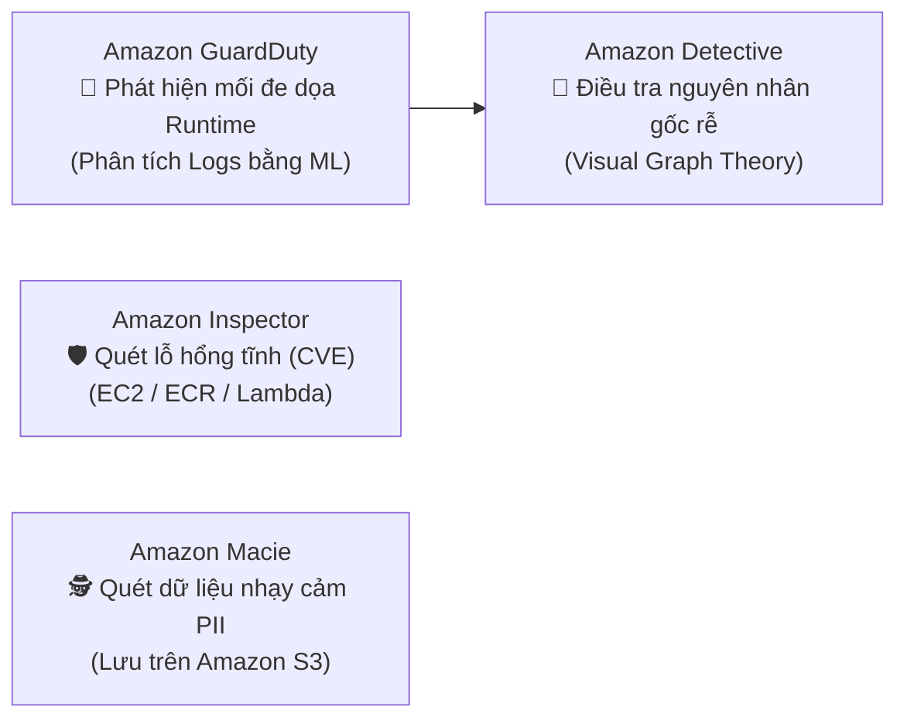

# 05 — SECURITY KEYWORDS: IAM, KMS, Threat Detection, Compliance

---

## 📖 ĐỊNH NGHĨA CỐT LÕI CÁC DỊCH VỤ AN NINH & BẢO MẬT

| Dịch Vụ AWS | Bản Chất Kỹ Thuật (What is it?) | Sinh Ra Để Làm Gì (Core Job)? | 💡 Móc Nhớ Thần Chú |
|:---|:---|:---|:---|
| **AWS IAM** | Dịch vụ quản trị danh tính và phân quyền truy cập miễn phí cấp độ tài nguyên AWS. | Tạo IAM Users, Roles, Policies để phân quyền hạt mịn theo nguyên tắc đặc quyền tối thiểu (Least Privilege). | *"Thẻ căn cước công ty: Quy định rõ ai là ai, được mở những phòng ban nào."* |
| **AWS Organizations & SCPs**| Dịch vụ quản trị tập trung đa tài khoản AWS; **SCPs (Service Control Policies)** là rào chắn quyền tối thượng. | Quản lý hóa đơn tập trung và đặt rào cản an ninh tối đa phủ quyết quyền của cả Admin/Root tài khoản thành viên. | *"Hiến pháp tập đoàn: Chi nhánh dù là Giám đốc cũng không được vi phạm luật cấm."* |
| **AWS KMS** | Dịch vụ quản lý và tạo khóa mã hóa dữ liệu đạt chuẩn bảo mật FIPS 140-2. | Mã hóa đĩa EBS, S3, RDS bằng kỹ thuật **Envelope Encryption**; kiểm soát Key Policies và nhật ký giải mã qua CloudTrail. | *"Két sắt giữ chìa khóa: Chỉ cấp khóa mã hóa dữ liệu cho người có thẩm quyền."* |
| **Amazon GuardDuty** | Dịch vụ phát hiện mối đe dọa an ninh tự động trong thời gian thực (**Runtime Threat Detection**) bằng ML. | Phân tích CloudTrail, VPC Flow Logs, DNS Logs để phát hiện mã độc đào coin, rò rỉ khóa API, tấn công brute-force. | *"Cảnh vệ gác cổng 24/7: Soi camera và nhật ký phát hiện kẻ đột nhập ngay lập tức."* |
| **Amazon Inspector** | Dịch vụ quét lỗ hổng bảo mật phần mềm tĩnh (**CVE**) và cấu hình mạng hở. | Quét định kỳ hệ điều hành EC2, mã nguồn Lambda và kho ảnh container Amazon ECR trước khi triển khai sản xuất. | *"Thanh tra an toàn: Kiểm tra giấy phép và trang thiết bị định kỳ xem có lỗi thời."* |
| **Amazon Macie** | Dịch vụ bảo mật dữ liệu sử dụng Machine Learning để tìm kiếm dữ liệu nhạy cảm (**PII**) trong **Amazon S3**. | Tự động quét số căn cước, thẻ tín dụng, hồ sơ y tế trong bucket S3 để tuân thủ HIPAA, GDPR, PCI-DSS. | *"Kính lúp soi thông tin mật: Tự động lùng sục dữ liệu cá nhân bị bỏ quên trong S3."* |
| **Amazon Detective** | Dịch vụ điều tra nguyên nhân gốc rễ (Root-Cause Investigation) sau sự cố an ninh bằng đồ thị (Visual Graph). | Nhận cảnh báo từ GuardDuty và dựng lại sơ đồ trực quan đường đi của hacker để phục vụ điều tra forensics. | *"Thám tử điều tra: Dựng lại hiện trường vụ án sau khi chuông báo trộm reo."* |
| **AWS Security Hub** | Trung tâm điều phối an ninh tập trung, chấm điểm tuân thủ **CIS Benchmark, PCI-DSS**. | Gom toàn bộ cảnh báo từ GuardDuty, Inspector, Macie, Config về một bảng điều khiển duy nhất (Single pane of glass). | *"Sở chỉ huy an ninh: Tập hợp báo cáo từ các đồn cảnh sát để chấm điểm toàn thành phố."* |
| **AWS Config** | Dịch vụ ghi lại lịch sử cấu hình tài nguyên và đánh giá tuân thủ liên tục theo Rules. | Phát hiện cấu hình vi phạm (ví dụ S3 public) và tự động kích hoạt **SSM Automation** để sửa lỗi tức thì. | *"Cảnh sát trật tự đô thị: Thấy hàng quán lấn chiếm vỉa hè là tự động dẹp ngay."* |
| **AWS Secrets Manager** | Dịch vụ lưu trữ và tự động xoay vòng (**Automatic Rotation**) mật khẩu cơ sở dữ liệu, API keys. | Xoay mật khẩu RDS tự động bằng Lambda không downtime với cơ chế 2-label (CURRENT/PENDING). | *"Người đổi ổ khóa tự động: Cứ 30 ngày đổi chìa mới mà chủ nhà không bị gián đoạn."* |
| **SSM Parameter Store** | Kho lưu trữ cấu hình tĩnh, biến môi trường, chuỗi license (Standard Tier miễn phí $0). | Quản lý tham số ứng dụng tập trung, hỗ trợ mã hóa KMS nhưng không có tính năng tự động xoay vòng. | *"Bảng ghi nhớ thông tin: Dán các thông số chung của dự án, miễn phí, dễ đọc."* |
| **AWS Artifact** | Cổng tự phục vụ chính thức của AWS cho phép tải về báo cáo kiểm toán tuân thủ (ISO, SOC, PCI) và ký **HIPAA BAA**. | Cung cấp chứng chỉ pháp lý của hạ tầng AWS cho kiểm toán viên bên thứ ba. | *"Văn phòng công chứng: Tải các chứng nhận kiểm toán quốc tế của AWS về trình thanh tra."* |
| **Amazon Cognito** | Dịch vụ xác thực và phân quyền người dùng ứng dụng web/mobile. | **User Pools** = Xác thực (đăng ký/đăng nhập cấp JWT); **Identity Pools** = Phân quyền (đổi vé lấy AWS credentials). | *"Phòng vé sự kiện: Cửa trước soát vé cấp vòng tay, cửa sau đổi vòng lấy thẻ ra vào."* |

---

## 🔐 IAM — IDENTITY & ACCESS MANAGEMENT

| Keyword Trong Đề Thi | ✅ Đáp Án | 💡 Vì Sao / Ngữ Cảnh Nhớ Nhanh | ❌ Bẫy Cần Tránh |
|:---|:---|:---|:---|
| **"EC2 call AWS APIs without hardcoded keys"** | **IAM Instance Profile** (Role attached) | Role cấp STS credentials tạm thời, tự rotate mỗi vài giờ qua IMDS. Tuyệt đối không hardcode Access Key/Secret Key trong code hay AMI. | ~~Hardcode keys~~ ~~IAM User credentials~~ |
| **"cross-account resource access"** | **IAM Role with Trust Policy** (`sts:AssumeRole`) | Tài khoản A tạo Role cấp quyền + Trust Policy cho Tài khoản B. User B gọi `sts:AssumeRole` để lấy token tạm thời. Không bao giờ chia sẻ IAM user credentials giữa 2 account. | ~~Chia sẻ Access Key~~ |
| **"org-wide max permission guardrail (block all accounts)"** | **SCP (Service Control Policies)** | SCP hoạt động như bộ lọc tối cao cấp OU/Account. Dù Admin tài khoản con có quyền `AdministratorAccess`, nếu SCP `Deny`, admin con vẫn bị chặn 100%. | ~~Permission Boundaries~~ (cấp User/Role) |
| **"limit max permissions of specific IAM user/role"** | **IAM Permission Boundaries** | Đặt "trần quyền" cho 1 User/Role. Quyền thực tế = giao thoa giữa Identity Policy VÀ Permission Boundary. Developer không thể tự cấp quyền vượt quá trần này. | ~~SCP~~ (SCP là cấp Account) |
| **"share resources across accounts without IAM role"** | **Resource-Based Policy** (S3 bucket policy, KMS key policy) | Resource policy cho phép principal ở account khác truy cập trực tiếp tài nguyên mà không cần switch role hay đổi credentials. | ~~VPC Peering~~ |

### ⚖️ SCP vs Permission Boundaries — Phân Biệt Sống Còn

| Tiêu Chí | Service Control Policy (SCP) | IAM Permission Boundary |
|:---|:---|:---|
| **Phạm vi áp dụng** | Organization Root / OU / AWS Account | Từng **IAM User hoặc IAM Role** riêng lẻ |
| **Áp dụng lên Root User?** | ✅ **CÓ** (Root user của Member Account bị chặn) | ❌ **KHÔNG** |
| **Có tự cấp quyền không?** | ❌ Chỉ đặt rào chắn chặn (Guardrail) | ❌ Chỉ đặt rào chắn chặn (Max permission) |
| **Ngoại lệ không bị ảnh hưởng** | **Service-Linked Roles** & **Management Account** | Không có |

> 💡 **Móc nhớ**:  
> _"**SCP** = **S**iêu **C**ấp **P**olicy: Áp dụng cả công ty, trùm lên cả Root con.  
> **Boundary** = Ranh giới cá nhân: Dành riêng cho từng Developer/Role để chống leo thang đặc quyền."_

---

## 🔑 KMS — KEY MANAGEMENT SERVICE

| Keyword Trong Đề Thi | ✅ Đáp Án | 💡 Vì Sao / Ngữ Cảnh Nhớ Nhanh |
|:---|:---|:---|
| **"who controls key policy, manual rotation, audit"** | **Customer Managed Key (CMK)** (\$1/tháng) | Toàn quyền kiểm soát: Tự viết Key Policy, bật/tắt key, tự xoay key theo yêu cầu hoặc tự động hàng năm, xem CloudTrail audit logs chi tiết. |
| **"auto-managed key, free, standard AWS services"** | **AWS Managed Key** (`aws/s3`, `aws/rds`) | Miễn phí hàng tháng. AWS tự động xoay key 1 năm/lần. Người dùng **không thể sửa Key Policy**, không xóa được key. |
| **"encrypt data > 4 KB with KMS"** | **Envelope Encryption** (`GenerateDataKey`) | KMS chỉ mã hóa trực tiếp dữ liệu ≤ 4 KB. Với file/đĩa lớn: KMS sinh ra **Data Key** (gồm Plaintext Key để máy chủ tự mã hóa cục bộ và Ciphertext Key lưu trữ đi kèm dữ liệu). |
| **"share encrypted resource / snapshot across regions"** | **KMS Multi-Region Keys** | Tạo primary key ở 1 region và replica key cùng Key ID sang region khác. Cho phép giải mã dữ liệu xuyên region mà không cần re-encrypt lại từ đầu. |
| **"audit all key usage (who decrypted what, when)"** | **CloudTrail + KMS logs** | Mọi lệnh gọi API `kms:Decrypt`, `kms:GenerateDataKey` đều được ghi log chi tiết vào CloudTrail (User, Time, IP, Key ARN). |

---

## 🔍 BỘ TỨ AN NINH: GuardDuty vs Inspector vs Macie vs Detective

| Dịch Vụ | Nguồn Dữ Liệu Đầu Vào | 💡 Ngữ Cảnh Sử Dụng & Móc Nhớ |
|:---|:---|:---|
| **Amazon GuardDuty** | CloudTrail Logs, VPC Flow Logs, DNS Logs, EKS Audit Logs | **Bảo vệ thời gian thực (Runtime)**: Phát hiện máy ảo bị cài mã đào coin (crypto mining), hacker brute-force SSH, API call từ IP lạ Tor/VPN. _Móc nhớ: "Guard = Cảnh vệ gác cổng 24/7 phát hiện kẻ đột nhập"._ |
| **Amazon Inspector** | Quét EC2 (SSM Agent), Container Images (ECR), Lambda code | **Quét lỗ hổng tĩnh (CVE)**: Tìm phần mềm hết hạn, package có lỗ hổng bảo mật chưa vá, cấu hình mạng mở port nguy hiểm. _Móc nhớ: "Inspector = Thanh tra kiểm tra giấy tờ/kho bãi định kỳ"._ |
| **Amazon Macie** | Đọc nội dung file trong Amazon S3 | **Tìm PII & dữ liệu mật**: Quét số thẻ tín dụng, hộ chiếu, căn cước công dân trong S3 để tuân thủ HIPAA, GDPR, PCI-DSS. _Móc nhớ: "Macie = Soi kính lúp tìm thông tin cá nhân trong thùng S3"._ |
| **Amazon Detective** | Findings từ GuardDuty, VPC Flow Logs, CloudTrail | **Điều tra sau sự cố (Post-incident Root Cause)**: Dựng đồ thị trực quan (Visual Graph) liên kết hacker IP $\rightarrow$ IAM Role bị lộ $\rightarrow$ EC2 bị chiếm $\rightarrow$ S3 bị tải dữ liệu. _Móc nhớ: "Detective = Thám tử Conan dựng lại hiện trường vụ án"._ |

---

## 🛡️ SECURITY POSTURE & COMPLIANCE

| Dịch Vụ | Chức Năng Cốt Lõi | 💡 Ngữ Cảnh Đề Thi Phản Xạ |
|:---|:---|:---|
| **AWS Security Hub** | Trung tâm điều phối an ninh tập trung, chấm điểm tuân thủ CIS AWS Foundations Benchmark, PCI-DSS. | Gặp từ khóa: **"CIS benchmark score"**, **"centralized security posture"**, **"single pane of glass for all security findings"**. |
| **AWS Config** | Ghi lại lịch sử cấu hình tài nguyên, đánh giá tuân thủ liên tục theo Rules, tự động kích hoạt **SSM Automation Remediation**. | Gặp từ khóa: **"continuous compliance"**, **"detect unapproved changes"**, **"auto-remediate non-compliant S3 buckets"**. |
| **AWS CloudTrail** | Nhật ký kiểm toán API (Ai đã làm gì, lúc nào, từ IP nào, qua console hay CLI). | Gặp từ khóa: **"who terminated EC2"**, **"API audit trail"**, **"track user actions"**. |
| **AWS Artifact** | Cổng tự phục vụ tải báo cáo kiểm toán bảo mật của AWS (ISO 27001, SOC 1/2/3, PCI) và ký thỏa thuận **HIPAA BAA**. | Gặp từ khóa: **"download compliance reports for external auditor"**, **"accept HIPAA BAA agreement"**. |

---

## 🔑 QUẢN LÝ MẬT KHẨU & THAM SỐ: Secrets Manager vs SSM Parameter Store

| Tiêu Chí | AWS Secrets Manager | AWS Systems Manager Parameter Store |
|:---|:---|:---|
| **Chi phí** | \$0.40 / secret / tháng | **Standard Tier: Miễn phí $0** |
| **Tự động xoay vòng (Rotation)** | ✅ **Có sẵn qua Lambda Rotation Template** | ❌ Không tự động (phải tự viết script ngoài) |
| **Tích hợp RDS/Aurora** | ✅ Tự động xoay mật khẩu không downtime | ❌ Không tích hợp sẵn |
| **Trường hợp sử dụng** | Mật khẩu database, API key bên thứ 3 cần đổi định kỳ 30-90 ngày. | Biến môi trường, chuỗi cấu hình (URL, License string, AMI ID), feature flags. |

> 💡 **Quy tắc vàng chọn nhanh**:  
> - Đề bài có **"Automatic rotation"** hoặc **"RDS password rotation"** $\rightarrow$ **AWS Secrets Manager**.  
> - Đề bài yêu cầu **"Cost-effective"** hoặc **"Store configuration string / non-secret"** $\rightarrow$ **SSM Parameter Store**.

---

## 👥 AMAZON COGNITO: User Pools vs Identity Pools

| Tiêu Chí | Cognito User Pools (CUP) | Cognito Identity Pools (Federated Identities) |
|:---|:---|:---|
| **Mục đích cốt lõi** | **Xác thực (Authentication)**: "Bạn là ai?" | **Phân quyền (Authorization)**: "Bạn được làm gì trên AWS?" |
| **Kết quả trả về** | **JWT Tokens** (ID Token, Access Token, Refresh Token) | **AWS Temporary Credentials** (Access Key, Secret Key, STS Token) |
| **Tính năng chính** | Đăng ký, Đăng nhập, Quên mật khẩu, Bật MFA, Hosted UI. | Đổi JWT/Social Login lấy quyền IAM Role để gọi S3, DynamoDB trực tiếp. |

> 💡 **Móc nhớ thần tốc**:  
> _"**User Pools** = Danh bạ người dùng (User Directory) cấp vé JWT.  
> **Identity Pools** = Cửa đổi vé lấy chìa khóa vào kho AWS (IAM Credentials)."_
