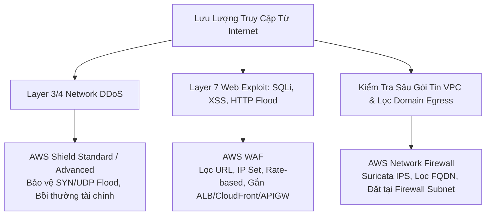

# 05 — SECURITY KEYWORDS: IAM, Organizations, KMS, CloudHSM, WAF, Shield, GuardDuty & Compliance

---

## 📖 ĐỊNH NGHĨA CỐT LÕI CÁC DỊCH VỤ AN NINH, BẢO MẬT & TUÂN THỦ

| Dịch Vụ AWS | Bản Chất Kỹ Thuật (What is it?) | Sinh Ra Để Làm Gì (Core Job)? | 💡 Móc Nhớ Thần Chú |
|:---|:---|:---|:---|
| **AWS IAM** | Dịch vụ quản trị danh tính và phân quyền truy cập miễn phí cấp độ tài nguyên AWS (Global service). | Tạo IAM Users, Groups, Roles, Policies để phân quyền hạt mịn theo nguyên tắc đặc quyền tối thiểu (Least Privilege). | *"Thẻ căn cước công ty: Quy định rõ ai là ai, được mở những phòng ban nào."* |
| **AWS Organizations & SCPs**| Dịch vụ quản trị tập trung đa tài khoản AWS; **SCPs (Service Control Policies)** là rào chắn quyền tối thượng. | Quản lý hóa đơn tập trung và đặt rào cản an ninh tối đa phủ quyết quyền của cả Admin/Root tài khoản thành viên. | *"Hiến pháp tập đoàn: Chi nhánh dù là Giám đốc cũng không được vi phạm luật cấm."* |
| **AWS IAM Identity Center** | Dịch vụ đăng nhập một lần (Single Sign-On - SSO) tập trung cho đa tài khoản AWS và ứng dụng SaaS. | Kết nối với Active Directory, Okta, Azure AD; cấp quyền qua **Permission Sets** thay thế việc tạo IAM User thủ công. | *"Cổng ra vào một cửa: Quẹt một thẻ duy nhất để vào tất cả các tòa nhà công ty."* |
| **AWS Directory Service** | Dịch vụ Microsoft Active Directory được quản lý trên AWS (Managed AD, AD Connector, Simple AD). | Kết nối hoặc mở rộng Active Directory của công ty lên đám mây phục vụ FSx Windows, RDS SQL Server, WorkSpaces. | *"Chi nhánh văn phòng công chứng: Xác thực nhân sự công ty trên nền tảng Microsoft."* |
| **AWS KMS** | Dịch vụ quản lý và tạo khóa mã hóa dữ liệu đạt chuẩn bảo mật FIPS 140-2. | Mã hóa đĩa EBS, S3, RDS bằng kỹ thuật **Envelope Encryption**; kiểm soát Key Policies và nhật ký giải mã qua CloudTrail. | *"Két sắt giữ chìa khóa: Chỉ cấp khóa mã hóa dữ liệu cho người có thẩm quyền."* |
| **AWS CloudHSM** | Thiết bị bảo mật phần cứng chuyên dụng độc quyền (Single-tenant Hardware Security Module - FIPS 140-2 Level 3). | Khách hàng toàn quyền nắm giữ và quản lý khóa mã hóa; AWS không có quyền can thiệp hay khôi phục khóa khi mất. | *"Két sắt nguyên khối của riêng bạn: Tự giữ chìa duy nhất, hãng sản xuất cũng chịu chết nếu mất chìa."* |
| **AWS WAF** | Tường lửa ứng dụng web Layer 7 lọc lưu lượng HTTP/HTTPS bảo vệ CloudFront, ALB, API Gateway. | Chặn tấn công SQL Injection (SQLi), Cross-site Scripting (XSS), giới hạn tần suất (Rate limiting chống DDoS layer 7). | *"Bảo vệ cổng gác nhà hát: Soát vé, kiểm tra túi xách không cho mang vũ khí vào khán phòng."* |
| **AWS Shield** | Dịch vụ chuyên dụng phòng chống tấn công từ chối dịch vụ phân tán (DDoS). | Bản **Standard** miễn phí bảo vệ Layer 3/4 tự động; bản **Advanced** có đội phản ứng nhanh 24/7 và bảo hiểm chi phí. | *"Áo giáp chống đạn: Chống đỡ mọi đợt xả súng DDoS tầng mạng từ bên ngoài."* |
| **AWS Network Firewall** | Tường lửa mạng Stateful L3–L7 có kiểm tra sâu gói tin và lọc tên miền FQDN cho toàn bộ VPC. | Bảo vệ toàn diện cấp độ mạng VPC, tích hợp bộ quy tắc phòng chống xâm nhập mã nguồn mở Suricata IPS. | *"Hệ thống kiểm dịch thành phố: Kiểm tra mọi xe ra vào thành phố theo luật kiểm dịch nghiêm ngặt."* |
| **Amazon GuardDuty** | Dịch vụ phát hiện mối đe dọa an ninh tự động trong thời gian thực (**Runtime Threat Detection**) bằng ML. | Phân tích CloudTrail, VPC Flow Logs, DNS Logs để phát hiện mã độc đào coin, rò rỉ khóa API, tấn công brute-force. | *"Cảnh vệ gác cổng 24/7: Soi camera và nhật ký phát hiện kẻ đột nhập ngay lập tức."* |
| **Amazon Inspector** | Dịch vụ quét lỗ hổng bảo mật phần mềm tĩnh (**CVE**) và cấu hình mạng hở. | Quét định kỳ hệ điều hành EC2 (qua SSM Agent), mã nguồn Lambda và kho ảnh container Amazon ECR. | *"Thanh tra an toàn: Kiểm tra giấy phép và trang thiết bị định kỳ xem có lỗi thời."* |
| **Amazon Macie** | Dịch vụ bảo mật dữ liệu sử dụng Machine Learning để tìm kiếm dữ liệu nhạy cảm (**PII**) trong **Amazon S3**. | Tự động quét số căn cước, thẻ tín dụng, hồ sơ y tế trong bucket S3 để tuân thủ HIPAA, GDPR, PCI-DSS. | *"Kính lúp soi thông tin mật: Tự động lùng sục dữ liệu cá nhân bị bỏ quên trong S3."* |
| **Amazon Detective** | Dịch vụ điều tra nguyên nhân gốc rễ (Root-Cause Investigation) sau sự cố an ninh bằng đồ thị (Visual Graph). | Nhận cảnh báo từ GuardDuty và dựng lại sơ đồ trực quan đường đi của hacker để phục vụ điều tra forensics. | *"Thám tử điều tra: Dựng lại hiện trường vụ án sau khi chuông báo trộm reo."* |
| **AWS Security Hub** | Trung tâm điều phối an ninh tập trung, chấm điểm tuân thủ **CIS Benchmark, PCI-DSS, AWS FSBP**. | Gom toàn bộ cảnh báo từ GuardDuty, Inspector, Macie, Config về một bảng điều khiển duy nhất chuẩn ASFF. | *"Sở chỉ huy an ninh: Tập hợp báo cáo từ các đồn cảnh sát để chấm điểm toàn thành phố."* |
| **AWS Secrets Manager** | Dịch vụ lưu trữ và tự động xoay vòng (**Automatic Rotation**) mật khẩu cơ sở dữ liệu, API keys. | Xoay mật khẩu RDS tự động bằng Lambda không downtime với cơ chế 2-label (AWSCURRENT/AWSPENDING). | *"Người đổi ổ khóa tự động: Cứ 30 ngày đổi chìa mới mà chủ nhà không bị gián đoạn."* |
| **SSM Parameter Store** | Kho lưu trữ cấu hình tĩnh, biến môi trường, chuỗi license (Standard Tier miễn phí $0). | Quản lý tham số ứng dụng tập trung, hỗ trợ mã hóa KMS nhưng không có tính năng tự động xoay vòng. | *"Bảng ghi nhớ thông tin: Dán các thông số chung của dự án, miễn phí, dễ đọc."* |
| **AWS RAM** | Dịch vụ chia sẻ tài nguyên AWS an toàn giữa các tài khoản trong Organization. | Chia sẻ VPC Subnet, Transit Gateway, Route 53 Resolver Rules mà không cần tạo trùng lặp tài nguyên. | *"Kho dùng chung gia đình: Các anh em trong nhà dùng chung xe máy mà không phải mua thêm xe."* |
| **AWS Artifact** | Cổng tự phục vụ chính thức của AWS cho phép tải về báo cáo kiểm toán tuân thủ (ISO, SOC, PCI) và ký **HIPAA BAA**. | Cung cấp chứng chỉ pháp lý của hạ tầng AWS cho kiểm toán viên bên thứ ba. | *"Văn phòng công chứng: Tải các chứng nhận kiểm toán quốc tế của AWS về trình thanh tra."* |
| **AWS Audit Manager** | Dịch vụ tự động thu thập bằng chứng liên tục để đánh giá mức độ tuân thủ của tài khoản với các khung pháp lý. | Tự động chuẩn bị báo cáo kiểm toán cho GDPR, HIPAA, PCI-DSS, SOC 2 mà không tốn công gom thủ công. | *"Trợ lý kiểm toán tự động: Hàng ngày tự chụp màn hình lưu chứng từ cho kiểm toán viên."* |
| **Amazon Cognito** | Dịch vụ xác thực và phân quyền người dùng ứng dụng web/mobile. | **User Pools** = Xác thực (đăng ký/đăng nhập cấp JWT); **Identity Pools** = Phân quyền (đổi vé lấy AWS credentials). | *"Phòng vé sự kiện: Cửa trước soát vé cấp vòng tay, cửa sau đổi vòng lấy thẻ ra vào."* |

---

## 🔐 AWS IAM — QUY TẮC PHÂN QUYỀN & ĐÁNH GIÁ CHÍNH SÁCH

### 1. Các Thực Thể Cốt Lõi Của IAM
- **Root User**: Tài khoản tối cao tạo khi mở account.
  - *Best Practice*: Bắt buộc bật **MFA**, **KHÔNG BAO GIỜ TẠO ACCESS KEY**, chỉ dùng cho các tác vụ bắt buộc (đổi gói support, đóng tài khoản, bật S3 MFA Delete).
- **IAM Groups**: Tập hợp nhiều User để gán quyền chung.
  - ⚠️ **2 Giới hạn cứng trong đề thi**: **Groups KHÔNG THỂ lồng nhau** (không có group trong group) và **Group KHÔNG THỂ là Principal** trong Resource-based policies.
- **IAM Roles & STS**: Cấp quyền tạm thời thông qua token AWS STS.
  - Gắn vào EC2: Dùng **Instance Profile**.
  - Gắn vào Lambda: Dùng **Execution Role**.
  - Gắn vào ECS: Dùng **Task Role**.
  - Truy cập chéo tài khoản (Cross-account): Account A tạo Role kèm **Trust Policy** cho Account B gọi `sts:AssumeRole`.
  - **External ID**: Bắt buộc cấu hình khi cho bên thứ 3 (SaaS vendor) assume role vào account mình để chống lỗi **Confused Deputy**.
- **Công Cụ Kiểm Toán Quyền Của IAM**:
  - `Credential Report`: Báo cáo cấp account liệt kê tất cả users, trạng thái mật khẩu, MFA, access keys.
  - `Access Advisor`: Hiển thị dịch vụ nào được cấp quyền nhưng không hề được truy cập trong N ngày qua $\rightarrow$ Thu hồi quyền thừa.
  - `IAM Access Analyzer`: Phát hiện tài nguyên đang bị chia sẻ ra ngoài internet/account khác; tự sinh IAM policy chuẩn từ lịch sử CloudTrail.

### 2. Phương Trình Đánh Giá Quyền Hiệu Lực (Policy Evaluation)
```
Quy tắc vàng: EXPLICIT DENY LUÔN CHIẾN THẮNG MỌI LỆNH ALLOW
Nếu không có Deny và không có Allow ──> Mặc định là IMPLICIT DENY

Quyền Hiệu Lực = (SCP ∩ Permission Boundary ∩ Identity Policy) + Resource-based Policy
```

### 3. Điều Kiện Chính Sách Thường Ra Đề (Condition Keys)
- `aws:PrincipalOrgID`: Cho phép toàn bộ các tài khoản nằm trong Organization truy cập vào bucket S3.
- `aws:SourceIp`: Giới hạn chỉ cho phép truy cập từ địa chỉ IP mạng văn phòng.
- `aws:RequestedRegion`: Chặn mọi thao tác tạo tài nguyên ngoài các Region được phê duyệt (VD: cấm ngoài `ap-southeast-1`).
- `aws:MultiFactorAuthPresent`: Ép buộc phải đăng nhập qua MFA mới được thực thi hành động nhạy cảm.
- `aws:SecureTransport`: Ép buộc kết nối qua HTTPS (TLS).

---

## 🏢 AWS ORGANIZATIONS & SERVICE CONTROL POLICIES (SCP)

| Đặc Tính | Service Control Policies (SCP) | IAM Permission Boundaries |
|:---|:---|:---|
| **Cấp độ áp dụng** | Organization Root, OU, hoặc Member Account | Từng **IAM User hoặc IAM Role** riêng lẻ |
| **Có áp dụng lên Root User?** | ✅ **CÓ (Áp dụng lên Root của Member Account)** | ❌ **KHÔNG** |
| **Áp dụng lên Management Account?** | ❌ **KHÔNG BAO GIỜ** | Không áp dụng |
| **Có tự cấp quyền không?** | ❌ **KHÔNG (Chỉ đặt trần quyền bảo vệ)** | ❌ **KHÔNG (Chỉ đặt trần quyền bảo vệ)** |
| **Mục đích sử dụng** | Guardrails toàn doanh nghiệp (VD: cấm tắt CloudTrail, cấm xóa GuardDuty, cấm mở Region lạ) | Phân quyền an toàn cho Developers tự tạo IAM Roles mà không sợ leo thang đặc quyền |

> 💡 **Di chuyển Account giữa các Organization**:  
> Rời khỏi Organization cũ (Leave Org) $\rightarrow$ Nhận lời mời từ Organization mới (Accept Invite).

---

## 🔑 AWS KMS (KEY MANAGEMENT SERVICE) vs CLOUDHSM

| Tiêu Chí So Sánh | AWS KMS | AWS CloudHSM |
|:---|:---|:---|
| **Mô hình thuê (Tenancy)** | Multi-tenant (dùng chung phần cứng HSM bảo mật) | **Single-tenant (Phần cứng phần cứng dành riêng 100%)** |
| **Tiêu chuẩn bảo mật** | FIPS 140-2 Level 2 (tổng thể) / Level 3 (phần cứng) | **FIPS 140-2 Level 3 toàn diện** |
| **Quyền quản lý khóa** | AWS quản lý hạ tầng, người dùng quản lý Key Policy | **Khách hàng nắm toàn quyền sinh và quản lý khóa** |
| **Khả năng khôi phục** | AWS hỗ trợ vận hành | **AWS KHÔNG THỂ KHÔI PHỤC nếu khách hàng mất credentials** |
| **Khả năng tích hợp** | Tích hợp native sẵn với 100+ dịch vụ AWS | Tích hợp qua PKCS#11, JCE, CNG APIs, Custom Key Store |
| **Use case cốt lõi** | Mã hóa đĩa EBS, S3, RDS, DynamoDB chuẩn mực | Yêu cầu pháp lý bắt buộc phần cứng riêng, SSL offloading, TDE |

### 🛠️ Các Quy Tắc KMS Cần Nhớ Trong Đề Thi
1. **Phạm vi Region**: Khóa KMS là **Regional** (không rời khỏi Region). Muốn mã hóa xuyên Region $\rightarrow$ Dùng **KMS Multi-Region Keys**.
2. **Key Policy**: BẮT BUỘC phải có. Nếu không có Key Policy cho phép, ngay cả Admin tài khoản cũng không thể dùng hay sửa khóa.
3. **Envelope Encryption**: Dùng cho dữ liệu **> 4 KB**. Lệnh `GenerateDataKey` trả về **Plaintext Data Key** (để máy chủ tự mã hóa file) và **Ciphertext Data Key** (lưu đính kèm với dữ liệu).
4. **Automatic Key Rotation**:
   - Khóa do AWS quản lý (`aws/s3`, `aws/rds`): Tự động xoay khóa mỗi 1 năm một lần.
   - Khóa Customer Managed (CMK): Người dùng có thể bật tự động xoay khóa mỗi năm (hoặc xoay thủ công).
   - Khóa do người dùng tự nhập (Imported Key Material - BYOK): **KHÔNG THỂ BẬT TỰ ĐỘNG XOAY KHÓA**.
5. **Thời gian xóa khóa**: Tối thiểu chờ từ **7 đến 30 ngày** (không thể xóa ngay lập tức để tránh thảm họa mất dữ liệu).
6. **S3 Bucket Key**: Bật tính năng này trên S3 để giảm tới **99% số lượng lệnh gọi API tới KMS**, tránh bị lỗi KMS Quota Throttling và tiết kiệm tiền.

---

## 🛡️ TƯỜNG LỬA ỨNG DỤNG & CHỐNG DDOS: WAF vs SHIELD vs NETWORK FIREWALL



| Dịch Vụ | Tầng Bảo Vệ | Vị Trí Gắn | 💡 Tín Hiệu Đề Thi Nhận Diện |
|:---|:---:|:---|:---|
| **AWS WAF** | Layer 7 | CloudFront, ALB, API Gateway, AppSync, Cognito | Chặn SQLi, XSS, quét bot độc hại, rate limiting (chặn IP gửi quá 100 req/5 phút). **KHÔNG GẮN ĐƯỢC VÀO NLB**. |
| **AWS Shield Standard** | Layer 3 & 4 | Tự động bật cho mọi tài khoản AWS | Miễn phí, phòng thủ các đòn tấn công SYN Flood, UDP Reflection phổ biến. |
| **AWS Shield Advanced** | Layer 3, 4 & 7 | Gắn trên EIP, ELB, CloudFront, Global Accelerator, Route 53 | Trả phí (~$3,000/tháng), hỗ trợ đội SRT 24/7, bảo vệ chống tăng vọt chi phí do tự động co giãn khi bị DDoS. |
| **AWS Network Firewall** | Layer 3 – 7 | Toàn bộ VPC (Firewall Subnet) | Tường lửa mạng stateful, kiểm tra sâu gói tin (DPI), bộ luật Suricata IPS, chặn tên miền ra ngoài (FQDN egress filter). |
| **AWS Firewall Manager** | Quản trị | Cấp độ Organization đa tài khoản | Tự động áp dụng cùng một bộ quy tắc WAF, Shield, Security Group, Network Firewall cho mọi tài khoản mới tạo. |

---

## 🔍 BỘ TỨ AN NINH THỰC CHIẾN: GuardDuty vs Inspector vs Macie vs Detective

| Dịch Vụ | Nguồn Dữ Liệu Phân Tích | Mục Tiêu & Cơ Chế Phát Hiện | 💡 Tín Hiệu Đề Thi Phản Xạ |
|:---|:---|:---|:---|
| **Amazon GuardDuty** | CloudTrail (mgmt + S3 data), VPC Flow Logs, DNS Logs, EKS Audit | **Phát hiện mối đe dọa thời gian thực (Runtime)** bằng ML: Máy ảo đào coin, credential bị lộ từ IP lạ, brute-force. | "detect crypto mining", "compromised credentials", "unusual API activity", "malicious IP". |
| **Amazon Inspector** | Quét EC2 (qua SSM Agent), Container Images (ECR), Lambda code | **Quét lỗ hổng tĩnh (CVE)** và đánh giá mức độ hở cổng mạng (Network reachability) chưa được vá. | "scan for CVE vulnerabilities", "unpatched packages", "ECR image vulnerability scanning". |
| **Amazon Macie** | Đọc nội dung tệp tin trong **Amazon S3 duy nhất** | **Tìm kiếm và phân loại dữ liệu nhạy cảm (PII)**: Số CMND/CCCD, thẻ tín dụng, bệnh án trong bucket S3. | "discover PII in S3", "credit card numbers in S3", "HIPAA/GDPR compliance for S3 data". |
| **Amazon Detective** | Findings từ GuardDuty, VPC Flow Logs, CloudTrail | **Điều tra nguyên nhân gốc rễ (Root-Cause Investigation)** bằng sơ đồ quan hệ đồ thị (Graph visual). | "investigate root cause of security incident", "interactive graph visualization of attack". |
| **AWS Security Hub** | Findings từ GuardDuty, Inspector, Macie, Config, Firewall Manager | **Bảng điều khiển an ninh tập trung** và chấm điểm tuân thủ CIS AWS Foundations Benchmark, PCI-DSS. | "centralized dashboard for all security findings", "CIS benchmark compliance score", "ASFF format". |

---

## 👥 AMAZON COGNITO: User Pools vs Identity Pools

| Tiêu Chí So Sánh | Cognito User Pools (CUP) | Cognito Identity Pools (Federated Identities) |
|:---|:---|:---|
| **Mục đích cốt lõi** | **Xác thực (Authentication)**: "Bạn là ai?" | **Phân quyền (Authorization)**: "Bạn được làm gì trên AWS?" |
| **Kết quả trả về** | **JWT Tokens** (ID Token, Access Token, Refresh Token) | **AWS Temporary Credentials** (Access Key, Secret Key, STS Token) |
| **Đối tượng người dùng** | Đăng ký, đăng nhập tài khoản người dùng cuối của app | Cấp quyền cho user (kể cả khách vãng lai - Guest) truy cập S3/DynamoDB |
| **Tích hợp xác thực** | Google, Facebook, Apple, SAML 2.0, OIDC, Hosted UI | Nhận JWT từ User Pool, Google, Facebook đổi lấy IAM Role tạm |
| **Tính năng S3 nâng cao** | Không trực tiếp | Dùng biến `${cognito-identity.amazonaws.com:sub}` cấp mỗi user 1 thư mục S3 riêng |

---

## 🚀 BẢNG CHỌN NHANH SECURITY

| Tín Hiệu Đề Thi (Trigger Keywords) | ✅ Đáp Án Chuẩn |
|:---|:---|
| "EC2 needs to access S3/DynamoDB without credentials" | **IAM Role (Instance Profile)** |
| "cross-account access using temporary credentials" | **IAM Role with Trust Policy (`sts:AssumeRole`)** |
| "prevent confused deputy attack when third-party assumes role" | **External ID** |
| "org-wide guardrail, deny action across all member accounts including root" | **Service Control Policies (SCP)** |
| "limit maximum permissions an IAM developer can grant themselves" | **IAM Permission Boundaries** |
| "centralized single sign-on for multiple accounts and SaaS" | **AWS IAM Identity Center (AWS SSO)** |
| "existing on-prem Active Directory, do not sync/replicate passwords to AWS" | **AD Connector** |
| "full-featured Active Directory on AWS, 2-way trust with on-prem" | **AWS Managed Microsoft AD** |
| "audit who decrypted what key, CloudTrail integration" | **AWS KMS (Customer Managed Key)** |
| "data > 4 KB encryption" | **Envelope Encryption (`GenerateDataKey`)** |
| "prevent KMS throttling on high-volume S3 requests" | **S3 Bucket Key** |
| "dedicated single-tenant hardware HSM, FIPS 140-2 Level 3, customer owns keys" | **AWS CloudHSM** |
| "auto-rotate database passwords without application downtime" | **AWS Secrets Manager** |
| "store configuration parameters, non-secret strings, free tier" | **SSM Parameter Store (Standard)** |
| "public SSL certificate auto-renew for free for ALB/CloudFront" | **AWS Certificate Manager (ACM)** |
| "CloudFront custom domain SSL certificate location" | **ACM in `us-east-1`** |
| "block SQL injection, XSS, rate-limit HTTP requests" | **AWS WAF** |
| "DDoS mitigation layer 3/4 with financial protection and 24/7 team" | **AWS Shield Advanced** |
| "centralize WAF and firewall rules across entire Organization" | **AWS Firewall Manager** |
| "VPC inspection, FQDN domain filtering for outbound traffic" | **AWS Network Firewall** |
| "runtime threat detection, cryptocurrency mining, compromised API keys" | **Amazon GuardDuty** |
| "scan EC2/ECR container images for software vulnerabilities (CVE)" | **Amazon Inspector** |
| "discover sensitive personal data (PII) stored in S3" | **Amazon Macie** |
| "root cause analysis and interactive graph visualization after security alert" | **Amazon Detective** |
| "central dashboard for security compliance score (CIS benchmark)" | **AWS Security Hub** |
| "share VPC subnets or Transit Gateway across accounts in Organization" | **AWS Resource Access Manager (RAM)** |
| "download official AWS compliance reports (SOC, PCI, ISO) and HIPAA BAA" | **AWS Artifact** |
| "continuous compliance auditing and evidence collection for auditors" | **AWS Audit Manager** |
| "web/mobile app user registration, social login, JWT token" | **Amazon Cognito User Pools** |
| "exchange mobile user token for temporary AWS credentials to access S3 directly" | **Amazon Cognito Identity Pools** |
