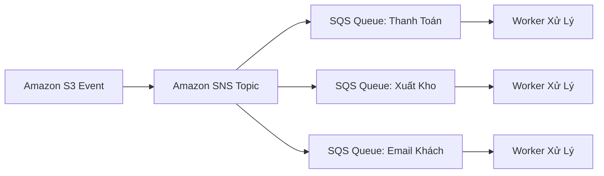

# 06 — MESSAGING & INTEGRATION KEYWORDS: SQS, SNS, EventBridge, Step Functions, Kinesis & Amazon MQ

---

## 📖 ĐỊNH NGHĨA CỐT LÕI CÁC DỊCH VỤ MESSAGING & DECOUPLING

| Dịch Vụ AWS | Bản Chất Kỹ Thuật (What is it?) | Sinh Ra Để Làm Gì (Core Job)? | 💡 Móc Nhớ Thần Chú |
|:---|:---|:---|:---|
| **Amazon SQS** | Hàng đợi tin nhắn phân tán serverless (Message Queue) hoạt động theo mô hình kéo (**Pull-based**). | Tách rời các tầng ứng dụng (Decouple), làm bộ đệm chống tràn tải (Buffer), bảo vệ database phía sau không bị sập. | *"Hàng chờ lấy số thứ tự ở ngân hàng: Khách đông mấy cũng đứng xếp hàng, giao dịch viên xử lý dần."* |
| **Amazon SNS** | Dịch vụ thông báo đẩy theo mô hình Nhà xuất bản - Người đăng ký (**Pub/Sub Push-based**). | Phát tán 1 tin nhắn đồng thời tới nhiều đích (**Fan-out** tới nhiều SQS, Lambda, HTTP, Email, SMS). | *"Loa phát thanh phường: Phát thanh 1 câu là cả ngõ ai cắm tai nghe (Subscriber) đều nghe thấy."* |
| **Amazon EventBridge** | Xe buýt sự kiện phi máy chủ (**Serverless Event Bus**) lọc và định tuyến sự kiện JSON thời gian thực. | Kết nối các dịch vụ AWS, ứng dụng SaaS (Salesforce, Shopify) và microservices nội bộ; có Scheduler thay thế cron jobs. | *"Bưu điện phân loại bưu phẩm tự động: Nhìn địa chỉ trên bưu kiện JSON rồi chuyển thẳng đến đúng nhà xe."* |
| **AWS Step Functions** | Dịch vụ điều phối luồng công việc serverless (Visual State Machine) kết hợp hơn 200 dịch vụ AWS. | Ghép nhiều bước xử lý (Lambda, ECS, SQS) thành quy trình nghiệp vụ có rẽ nhánh, thử lại, và chờ người duyệt. | *"Tổng đạo diễn sân khấu: Chỉ đạo diễn viên nào ra trước, diễn viên nào ra sau theo đúng kịch bản."* |
| **Amazon Kinesis Data Streams** | Nền tảng hấp thụ luồng dữ liệu lớn thời gian thực, lưu trữ và **cho phép phát lại (Replay)** từ 24h đến 365 ngày. | Hấp thụ hàng triệu sự kiện telemetry/clickstream mỗi giây từ IoT, web analytics; chia nhỏ công suất theo Shards. | *"Đập thủy điện trữ nước: Giữ nước lại trong hồ để tua-bin chạy qua chạy lại phát điện nhiều lần."* |
| **Amazon Data Firehose**| Dịch vụ trích xuất và nạp dữ liệu luồng tự động (Streaming ETL Delivery) dạng Serverless hoàn toàn. | Tự động buffer, chuyển định dạng (Parquet) và đổ thẳng luồng dữ liệu vào **S3, Redshift, OpenSearch, Splunk** không cần code. | *"Vòi rồng cứu hỏa: Cứ có nước là xịt thẳng vào bồn chứa (S3/Redshift), không giữ lại giọt nào."* |
| **Amazon MQ** | Dịch vụ Message Broker được quản lý hỗ trợ các giao thức chuẩn: **JMS, AMQP, MQTT, STOMP** (ActiveMQ/RabbitMQ). | Di chuyển ứng dụng cũ (Lift-and-Shift) từ On-Premises lên đám mây mà **nghiêm cấm sửa code ứng dụng**. | *"Người phiên dịch trung thành: Giữ nguyên tiếng mẹ đẻ (JMS/AMQP) cho các cụ ứng dụng cao tuổi."* |
| **Amazon AppFlow** | Dịch vụ truyền tải dữ liệu luồng lớn 2 chiều không cần viết code (**No-code**) giữa SaaS và AWS qua PrivateLink. | Kéo hàng triệu bản ghi từ Salesforce, ServiceNow, Zendesk đổ thẳng vào S3 hoặc Redshift an toàn. | *"Đoàn tàu chở quặng riêng: Vận chuyển cả mỏ dữ liệu Salesforce về kho S3 trên đường ray bí mật."* |
| **AWS AppSync** | Dịch vụ GraphQL API được quản lý toàn diện và Pub/Sub thời gian thực cho ứng dụng web/mobile. | Gộp dữ liệu từ nhiều nguồn (DynamoDB, Aurora, Lambda) trong 1 request, cập nhật real-time qua WebSocket và đồng bộ offline. | *"Người gom đơn thông minh: Đi một vòng gom đủ mọi món đồ khách đặt chỉ trong một chuyến đi duy nhất."* |

---

## 📬 AMAZON SQS — CÁC THÔNG SỐ VẬN HÀNH CỐT TỬ

### 1. Phân Biệt SQS Standard vs SQS FIFO
| Tiêu Chí So Sánh | SQS Standard | SQS FIFO |
|:---|:---|:---|
| **Thông lượng (Throughput)** | **Gần như vô hạn (Unlimited TPS)** | **300 msg/s** (Lên tới 3,000 msg/s với batching / High Throughput) |
| **Thứ tự tin nhắn (Ordering)** | Best-effort (Có thể không đúng thứ tự ban đầu) | **Strict First-In-First-Out (Đúng thứ tự 100%)** |
| **Độ tin cậy chuyển giao** | At-least-once (Có thể nhận trùng tin nhắn) | **Exactly-once (Tuyệt đối không bao giờ nhận trùng)** |
| **Tên hàng đợi** | Tự do | **BẮT BUỘC KẾT THÚC BẰNG `.fifo`** |
| **Nhóm xử lý song song** | Không có | Dùng **`MessageGroupId`** (Các message cùng Group ID xử lý tuần tự, khác Group ID xử lý song song) |
| **Cơ chế chống trùng** | Ứng dụng tự xử lý Idempotency | Dùng **`MessageDeduplicationId`** hoặc Content-Based Dedup trong cửa sổ **5 phút** |
| **Chuyển đổi loại hàng đợi** | ❌ Không thể đổi thành FIFO (phải tạo queue mới) | ❌ Không thể đổi thành Standard (phải tạo queue mới) |

### 2. Các Thuật Ngữ & Cấu Hình Sống Còn Của SQS
- **Kích thước Message tối đa**: **256 KB**.
  - Muốn gửi tin nhắn lớn hơn (tới 2 GB) $\rightarrow$ Sử dụng thư viện **Amazon SQS Extended Client Library for Java/Python** (lưu payload thực tế vào Amazon S3 và chỉ để đường dẫn pointer vào SQS).
- **Thời gian lưu giữ (Retention Period)**: Mặc định **4 ngày**, có thể điều chỉnh từ 1 phút đến tối đa **14 ngày**.
- **Visibility Timeout**: Mặc định **30 giây**, tối đa **12 giờ**.
  - Là khoảng thời gian message trở nên "vô hình" với các worker khác sau khi đã được 1 worker lấy ra xử lý.
  - Nếu worker cần thêm thời gian để hoàn thành $\rightarrow$ Phải gọi API **`ChangeMessageVisibility`** để gia hạn.
  - *Khuyến nghị khi kết hợp với AWS Lambda*: Cấu hình SQS Visibility Timeout $\ge$ **6 lần thời gian Lambda Timeout**.
- **Dead-Letter Queue (DLQ)**:
  - Tự động cách ly các tin nhắn lỗi liên tục ("Poison Pill") sau khi vượt quá số lần thử lại **`maxReceiveCount`** (thường đặt 3–5 lần).
  - DLQ của hàng đợi FIFO cũng bắt buộc phải là một hàng đợi FIFO.
  - **DLQ Redrive**: Tính năng bấm nút đẩy ngược các message từ DLQ về hàng đợi chính sau khi lập trình viên đã sửa xong lỗi code.
- **Long Polling (`WaitTimeSeconds` từ 1 đến 20 giây)**:
  - Worker giữ kết nối mở chờ tin nhắn mới tới hàng đợi $\rightarrow$ **Giảm tới 90% số lượng request rỗng**, tiết kiệm chi phí API tối đa so với Short Polling (0s).
- **Delay Queue**: Hoãn việc phát tin nhắn cho worker từ **0 đến 15 phút** sau khi được đẩy vào hàng đợi.
- **Metric Tính Toán Auto Scaling**: Để ASG scale số lượng EC2 worker chuẩn xác theo lượng công việc tồn đọng $\rightarrow$ Dùng metric **`ApproximateNumberOfMessagesVisible`** chia cho số instance đang chạy (Backlog Per Instance).

---

## 📢 AMAZON SNS — PUB/SUB & MÔ HÌNH FAN-OUT KINH ĐIỂN

### 1. Đặc Tính Kỹ Thuật Của SNS
- Hoạt động theo mô hình **Đẩy (Push-based)**. Publisher gửi 1 tin nhắn $\rightarrow$ SNS tự động đẩy tới tất cả các Subscribers.
- **Subscribers hỗ trợ**: Amazon SQS, AWS Lambda, HTTPS Webhooks, Email, SMS, Mobile Push, Kinesis Data Firehose.
- Hỗ trợ tối đa **12.5 triệu subscriptions** trên mỗi Topic.
- ⚠️ **Không lưu trữ tin nhắn**: Nếu Subscriber bị sập và không có DLQ/retry $\rightarrow$ Tin nhắn sẽ **bị mất vĩnh viễn** (khác với SQS lưu được tới 14 ngày).
- **Message Filtering**: Gắn bộ lọc JSON Filter Policy trên từng Subscription để worker chỉ nhận đúng loại tin nhắn quan tâm (VD: `{"tier": ["premium"]}`).
- **SNS FIFO**: Đảm bảo thứ tự và không trùng lặp; Subscriber bắt buộc phải là **Amazon SQS FIFO Queue**.

### 2. Mô Hình SNS + SQS Fan-Out
- **Bài toán**: 1 sự kiện (đơn hàng mới, tải file lên S3) cần được xử lý bởi nhiều hệ thống độc lập (Thanh toán, Kho vận, Phân tích, Gửi email) mà không hệ thống nào làm nghẽn hệ thống nào.
- **Giải pháp**: Gửi sự kiện vào **1 Topic SNS**, cho các hàng đợi **SQS đăng ký làm subscriber**. Mỗi dịch vụ kéo dữ liệu từ hàng đợi SQS riêng của mình $\rightarrow$ Tách rời hoàn toàn (Decoupled), lỗi 1 bên không ảnh hưởng bên khác.
- **S3 Event Fan-Out**: Do S3 Event Notifications chỉ cho phép cấu hình 1 đích đến cho 1 event prefix $\rightarrow$ Bắt buộc gửi sự kiện S3 vào **SNS Topic (hoặc EventBridge)** để Fan-Out ra nhiều đích.

---

## ⚡ AMAZON EVENTBRIDGE — KIẾN TRÚC HƯỚNG SỰ KIỆN HIỆN ĐẠI

| Thành Phần | Chức Năng Cốt Lõi |
|:---|:---|
| **Event Buses** | • `Default`: Nhận sự kiện từ toàn bộ các dịch vụ AWS. • `Custom`: Nhận sự kiện từ ứng dụng nội bộ qua API `PutEvents`. • `Partner`: Nhận sự kiện từ các đối tác SaaS (Salesforce, Datadog, Zendesk, Shopify). |
| **Rules & Filtering** | So khớp cấu trúc JSON của sự kiện (Event Pattern) và định tuyến tới tối đa **5 targets** trên mỗi rule (Lambda, SQS, SNS, Step Functions, Kinesis, ECS task). |
| **EventBridge Scheduler** | Bộ lập lịch tác vụ serverless thay thế hoàn toàn cron jobs truyền thống. Hỗ trợ lịch định kỳ, lịch 1 lần duy nhất, múi giờ quốc tế và cơ chế giãn cách thời gian (Flexible time windows) chống spike. |
| **Archive & Replay** | Lưu trữ toàn bộ các sự kiện đã xảy ra và cho phép phát lại (Replay) vào hệ thống để thử nghiệm tính năng mới hoặc debug. |
| **Schema Registry** | Tự động suy luận cấu trúc JSON của sự kiện và sinh mã nguồn code bindings (Java, Python, TypeScript) cho developer. |
| **EventBridge Pipes** | Kết nối trực tiếp Điểm - Điểm giữa nguồn phát (SQS, Kinesis, DynamoDB Streams) $\rightarrow$ Tầng lọc/biến đổi dữ liệu $\rightarrow$ Đích đến. |

---

## 🔄 AWS STEP FUNCTIONS: STANDARD vs EXPRESS WORKFLOWS

| Tiêu Chí So Sánh | Standard Workflows | Express Workflows |
|:---|:---|:---|
| **Thời gian chạy tối đa** | **Lên tới 1 năm** | **Tối đa 5 phút** |
| **Mô hình thực thi** | **Exactly-once (Chính xác 1 lần)** | **At-least-once (Có thể lặp lại)** |
| **Thông lượng xử lý** | Dưới 2,000 executions / giây | **Rất cao (Hơn 100,000 executions / giây)** |
| **Mô hình tính giá** | Tính theo số lần chuyển trạng thái (**State transitions**) | Tính theo thời gian và bộ nhớ thực thi (**GB-seconds**) |
| **Lưu trữ lịch sử chạy** | Giữ lại chi tiết 90 ngày trên console | Gửi nhật ký vào CloudWatch Logs |
| **Chờ người duyệt (Human Approval)** | ✅ **Hỗ trợ tạm dừng chờ Token (`.waitForTaskToken`)** | ❌ Không hỗ trợ |
| **Xử lý hàng loạt quy mô lớn** | ✅ Hỗ trợ **Distributed Map** (xử lý hàng triệu file S3 song song) | Hỗ trợ Map nội bộ |
| **Ngữ cảnh đề thi** | Quy trình thanh toán thương mại điện tử, đăng ký mở thẻ ngân hàng có bước người quản lý duyệt. | Xử lý sự kiện IoT tốc độ cao, chuyển đổi log streaming, microservice API ngắn hạn. |

---

## 🐰 AMAZON MQ vs SQS / SNS

| Tiêu Chí | Amazon MQ | Amazon SQS / SNS |
|:---|:---|:---|
| **Giao thức hỗ trợ** | Các chuẩn truyền thống: **JMS, AMQP, MQTT, OpenWire, STOMP**. | API độc quyền của AWS SDK (`sqs:SendMessage`, `sns:Publish`). |
| **Công nghệ engine** | **Apache ActiveMQ** hoặc **RabbitMQ**. | Hạ tầng phân tán độc quyền của AWS. |
| **Độ co giãn** | Cụm máy chủ chuyên dụng (Active/Standby với EFS storage). Không vô hạn. | Serverless hoàn toàn, tự động co giãn không giới hạn. |
| **Khi nào chọn trong đề thi?** | Di chuyển ứng dụng cũ (**Lift-and-Shift**) từ On-Premises đang dùng **ActiveMQ hoặc RabbitMQ** mà **nghiêm cấm sửa code ứng dụng**. | Xây dựng ứng dụng đám mây mới (**Cloud-native**), microservices serverless. |

---

## ⚖️ BẢNG SO SÁNH 4 TRỤ CỘT MESSAGING & STREAMING

| Tiêu Chí | Amazon SQS | Amazon SNS | Amazon EventBridge | Amazon Kinesis Data Streams |
|:---|:---|:---|:---|:---|
| **Mô hình** | **Kéo (Pull)** | **Đẩy (Push)** | **Đẩy (Push qua Bus)** | **Kéo (Pull qua Shards)** |
| **Số lượng Consumer** | 1 consumer / message | Nhiều subscriber nhận cùng lúc | Nhiều target nhận cùng lúc | Nhiều consumer đọc độc lập |
| **Xóa sau khi đọc?** | ✅ Xóa sau khi xử lý | Không lưu trữ | Không lưu trữ (trừ khi bật Archive) | ❌ Không xóa (Giữ 24h–365 ngày) |
| **Phát lại (Replay)?** | ❌ Không | ❌ Không | ✅ Replay sự kiện cũ | ✅ **Replay dữ liệu bất kỳ lúc nào** |
| **Định tuyến thông minh** | ❌ Không | Lọc qua Filter Policy | ✅ **Lọc sâu JSON Payload** | Phân vùng theo Partition Key |

---

## 🚀 BẢNG CHỌN NHANH MESSAGING & INTEGRATION

| Tín Hiệu Đề Thi (Trigger Keywords) | ✅ Đáp Án Chuẩn |
|:---|:---|
| "decouple application components", "buffer spikes", "worker pull" | **Amazon SQS** |
| "strict ordering", "first-in first-out", "no duplicates", "financial transactions" | **Amazon SQS FIFO** |
| "parallel processing within FIFO queue" | **MessageGroupId** |
| "prevent duplicate messages within 5 minutes" | **MessageDeduplicationId** |
| "reduce empty responses and API costs for SQS" | **Long Polling (`WaitTimeSeconds = 20`)** |
| "isolate failed messages for debugging", "poison pill" | **Dead-Letter Queue (DLQ)** |
| "SQS messages larger than 256 KB up to 2 GB" | **Amazon SQS Extended Client Library** |
| "metric to scale EC2 worker fleet based on queue backlog" | **`ApproximateNumberOfMessagesVisible` / Instances** |
| "fan-out 1 event to multiple independent queues/services" | **SNS $\rightarrow$ Multiple SQS Queues (Fan-out)** |
| "filter messages before hitting subscribers", "JSON policy" | **SNS Message Filtering** |
| "event-driven architecture from AWS services or SaaS", "cron schedule" | **Amazon EventBridge** |
| "managed cron scheduler with timezone support" | **EventBridge Scheduler** |
| "workflow orchestration up to 1 year, human approval" | **AWS Step Functions Standard** |
| "high-throughput workflow < 5 mins, IoT event processing" | **AWS Step Functions Express** |
| "migrate existing messaging app without rewriting code", "JMS/AMQP/MQTT" | **Amazon MQ (ActiveMQ / RabbitMQ)** |
| "no-code bulk data transfer between Salesforce and S3/Redshift" | **Amazon AppFlow** |
| "GraphQL API, real-time WebSocket subscriptions, offline sync" | **AWS AppSync** |
| "legacy workflow service, decider and worker code" | **Amazon SWF (Simple Workflow Service)** |
| "real-time streaming ingestion, replay data, retain up to 365 days" | **Amazon Kinesis Data Streams** |
| "serverless delivery of streaming data directly into S3/Redshift" | **Amazon Data Firehose** |
