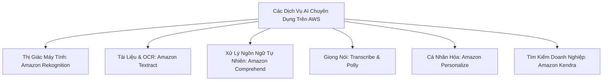

# 07 — ANALYTICS KEYWORDS: Athena, Glue, Redshift, EMR, Lake Formation, AI/ML

---

## 📖 ĐỊNH NGHĨA CỐT LÕI CÁC DỊCH VỤ ANALYTICS & AI/ML

| Dịch Vụ AWS | Bản Chất Kỹ Thuật (What is it?) | Sinh Ra Để Làm Gì (Core Job)? | 💡 Móc Nhớ Thần Chú |
|:---|:---|:---|:---|
| **Amazon Athena** | Công cụ truy vấn SQL Serverless tương thích chuẩn ANSI SQL, đọc trực tiếp file trên S3. | Chạy các câu truy vấn phân tích ad-hoc trên Data Lake không cần cluster, chỉ tính tiền \$5/TB data scanned. | *"Kính lúp đọc sách trong kho S3: Mở sách ra đọc thẳng, không cần khuân sách về nhà."* |
| **AWS Glue** | Dịch vụ tích hợp dữ liệu (ETL) serverless: Crawlers (phát hiện schema), Catalog (từ điển), Jobs (biến đổi), DataBrew (no-code). | Tự động hóa pipeline trích xuất, biến đổi và nạp dữ liệu từ nhiều nguồn về Data Lake/Data Warehouse. | *"Nhà máy chế biến quặng tự động: Đãi cát tìm vàng, đóng gói thành thỏi Parquet chuẩn."* |
| **Amazon EMR** | Nền tảng cụm Big Data được quản lý chạy các framework mã nguồn mở: **Hadoop, Spark, Presto, Flink**. | Xử lý dữ liệu lớn cấp độ Petabyte với quyền can thiệp sâu vào cấu hình phần cứng; dùng Spot cho Task nodes để tiết kiệm 80%. | *"Đoàn xe ben đại công trường: Xúc đất đá hàng triệu tấn phân tán khắp nơi."* |
| **Amazon Redshift** | Kho dữ liệu đám mây (Cloud Data Warehouse) lưu trữ theo cột (Columnar) và xử lý song song khối lượng lớn (MPP). | Chạy các báo cáo BI phức tạp, tổng hợp hàng tỷ bản ghi với tốc độ cực nhanh; hỗ trợ Spectrum query thẳng S3. | *"Thư viện trung tâm thành phố: Sắp xếp sách theo từng mục lục chi tiết, tra cứu thống kê cực nhanh."* |
| **AWS Lake Formation** | Dịch vụ quản trị tập trung Data Lake trên S3, phân quyền cấp độ hàng và cột (**Row/Column-level access control**). | Xây dựng Data Lake bảo mật trong vài ngày, chia sẻ dữ liệu an toàn cho Athena, Redshift mà không copy data. | *"Trưởng ban an ninh kho bạc: Kiểm soát từng người chỉ được nhìn đúng trang sổ được phép."* |
| **Amazon OpenSearch** | Dịch vụ tìm kiếm và phân tích nhật ký phân tán (Elasticsearch & OpenSearch Dashboards). | Tìm kiếm toàn văn (Full-text search) có gợi ý từ khóa, theo dõi log ứng dụng và vẽ biểu đồ trực quan. | *"Google tìm kiếm nội bộ: Gõ từ khóa tìm kiếm ra kết quả ngay trong vài mili-giây."* |
| **Amazon Textract** | Dịch vụ OCR thế hệ mới sử dụng học máy trích xuất **Bảng biểu (Tables)** và **Biểu mẫu (Forms / Key-Value)** từ scan/PDF. | Đọc hóa đơn, biểu mẫu thuế, bệnh án viết tay/in sẵn chuyển thành dữ liệu có cấu trúc. | *"Thư ký soi hóa đơn: Đọc bảng biểu trên giấy scan rồi gõ lại thành bảng Excel chuẩn."* |
| **Amazon Comprehend** | Dịch vụ xử lý ngôn ngữ tự nhiên (NLP) phân tích cảm xúc (Sentiment), thực thể (Entities), ngôn ngữ văn bản. | Phân tích hàng ngàn đánh giá của khách hàng xem hài lòng hay phàn nàn, che giấu dữ liệu nhạy cảm PII. | *"Chuyên gia tâm lý học: Đọc thư khách hàng và biết ngay họ đang vui hay giận dữ."* |
| **Amazon Rekognition**| Dịch vụ thị giác máy tính nhận diện khuôn mặt, vật thể, biển báo, kiểm duyệt nội dung phản cảm từ ảnh/video. | Xác thực khuôn mặt người dùng (eKYC), gắn nhãn ảnh tự động, lọc video bạo lực. | *"Camera giám sát thông minh: Nhìn mặt biết ai, nhìn đường biết xe gì, thấy hàng cấm báo ngay."* |
| **Amazon Transcribe** | Chuyển đổi giọng nói âm thanh (Audio) thành văn bản (Speech-to-Text). | Tự động tạo phụ đề video, ghi chép cuộc gọi tổng đài chăm sóc khách hàng. | *"Người tốc ký phòng họp: Nghe người ta nói gì là gõ máy tính thành văn bản tức thì."* |
| **Amazon Polly** | Chuyển đổi văn bản thành giọng đọc tự nhiên (Text-to-Speech) với hơn 60 giọng đọc. | Đọc báo tự động cho người khiếm thị, lồng tiếng nhân vật ảo, thông báo phát thanh tự động. | *"Phát thanh viên ảo: Đưa văn bản chữ là phát thanh giọng đọc truyền cảm ngay."* |
| **Amazon Personalize**| Động cơ gợi ý sản phẩm và cá nhân hóa trải nghiệm người dùng (Recommendation Engine) chuẩn Amazon.com. | Gợi ý bài hát, phim ảnh, món hàng "có thể bạn cũng thích" theo thời gian thực. | *"Người bán hàng có tâm: Nhìn giỏ hàng của bạn là biết ngay bạn sắp cần thêm món gì."* |
| **Amazon Kendra** | Công cụ tìm kiếm tài liệu thông minh cấp doanh nghiệp (Enterprise Search) trả lời câu hỏi tự nhiên. | Tìm kiếm chính xác câu trả lời trong hàng triệu tài liệu Word, PDF, SharePoint nội bộ. | *"Thủ thư uyên bác: Hỏi câu gì trong kho tài liệu nghìn cuốn cũng chỉ đúng trang trả lời."* |

---

## 🔎 BẢNG ĐIỀU HƯỚNG TỔNG QUAN PHÂN TÍCH DỮ LIỆU

```
Query SQL trực tiếp trên S3 không cần server     → Amazon Athena ($5/TB scanned)
Làm sạch dữ liệu trực quan no-code cho Analysts   → AWS Glue DataBrew
Pipeline ETL viết mã Python/PySpark              → AWS Glue ETL Jobs
Cụm Big Data mã nguồn mở (Hadoop, Spark, Presto) → Amazon EMR (Task Nodes = Spot)
Kho dữ liệu phân tích tập trung OLAP quy mô PB   → Amazon Redshift / Redshift Serverless
Truy vấn trực tiếp S3 Data Lake từ Redshift      → Redshift Spectrum
Tìm kiếm toàn văn (Full-text) & phân tích logs    → Amazon OpenSearch Service
Cơ sở dữ liệu chuỗi thời gian cho cảm biến IoT   → Amazon Timestream
Quản trị phân quyền chi tiết cấp dòng/cột Data Lake → AWS Lake Formation
```

---

## 📊 AMAZON ATHENA — TRUY VẤN SQL SERVERLESS TRÊN S3

| Kịch Bản Đề Thi | ✅ Giải Pháp | 💡 Vì Sao / Ngữ Cảnh Nhớ Nhanh | ❌ Bẫy Cần Tránh |
|:---|:---|:---|:---|
| **"Run ad-hoc SQL queries on S3 data lake with zero server management"** | **Amazon Athena** | Athena là serverless, chỉ tính phí **\$5 trên mỗi TB dữ liệu được quét (scanned)**. Không cần tạo hay duy trì database cluster. | ~~Amazon Redshift~~ (Redshift cần cụm máy chủ và phải load data). |
| **"Cost-optimize Athena queries by 70–90%"** | Chuyển đổi sang **Apache Parquet / ORC** kết hợp **Partitioning** | Parquet/ORC là định dạng lưu trữ theo cột (**Columnar Format**). Khi query `SELECT name`, Athena chỉ đọc đúng cột `name`, bỏ qua 90% dung lượng file CSV/JSON. | ~~Nén file CSV bằng GZIP~~ (GZIP nén dung lượng nhưng vẫn quét toàn bộ các cột). |
| **"Query RDS / DynamoDB from Athena console"** | **Athena Federated Query** | Sử dụng Data Source Connectors chạy trên AWS Lambda để query dữ liệu chéo giữa S3, RDS, DynamoDB, MongoDB mà không cần chuyển dữ liệu về 1 nơi. | ~~DMS~~ (DMS là copy dữ liệu). |
| **"Existing Redshift cluster needs to query raw files in S3"** | **Redshift Spectrum** | Redshift Spectrum cho phép cụm Redshift hiện có truy vấn thẳng files trên S3 thông qua Glue Data Catalog mà không cần lệnh `COPY` nạp dữ liệu vào cluster. | ~~Amazon Athena~~ (Nếu đã có cụm Redshift, Spectrum tận dụng sức mạnh tính toán sẵn có). |

---

## 🔧 AWS GLUE — TRÍCH XUẤT, BIẾN ĐỔI & NẠP DỮ LIỆU (ETL)

| Thành Phần Của Glue | Chức Năng Cốt Lõi | 💡 Ngữ Cảnh Đề Thi Phản Xạ |
|:---|:---|:---|
| **AWS Glue DataBrew** | Công cụ chuẩn bị dữ liệu trực quan (**Visual Data Preparation**) với hơn 250 phép biến đổi dựng sẵn, không cần viết code (**No-code**). | Dành cho **Business Analysts / Data Scientists** muốn làm sạch dữ liệu, xóa giá trị rỗng (null), chuẩn hóa định dạng ngày tháng mà không biết code PySpark. |
| **AWS Glue Crawlers** | Tự động quét các kho dữ liệu (S3, RDS, DynamoDB), suy luận cấu trúc bảng (schema) và tự động cập nhật vào **Glue Data Catalog**. | Tự động cập nhật bảng biểu khi có dữ liệu mới đổ về S3. |
| **AWS Glue Data Catalog** | Kho siêu dữ liệu tập trung (Central Metadata Repository) lưu định nghĩa schema của bảng, partition. | Đóng vai trò làm từ điển dữ liệu chung cho Athena, Redshift Spectrum, EMR. |
| **AWS Glue ETL Jobs** | Chạy các tiến trình xử lý hàng loạt phân tán bằng Python hoặc Apache Spark. Serverless hoàn toàn. | Xử lý dữ liệu lớn theo lịch, chuyển đổi hàng loạt CSV sang Parquet. |

---

## 🏭 AMAZON EMR — CỤM XỬ LÝ HADOOP & SPARK DOANH NGHIỆP

| Loại Node Trong Cụm | Trách Nhiệm | 💡 Có Nên Dùng Spot Instance? |
|:---|:---|:---|
| **Master Node** | Điều phối cụm, quản lý tài nguyên YARN, theo dõi trạng thái jobs. | ❌ **TUYỆT ĐỐI KHÔNG**. Master chết = toàn bộ cụm sập. Luôn dùng **On-Demand**. |
| **Core Nodes** | Chạy tác vụ tính toán VÀ lưu trữ dữ liệu phân tán **HDFS**. | ⚠️ **Hạn chế dùng Spot**. Mất Core Node có nguy cơ làm mất dữ liệu HDFS nếu replication factor thấp. |
| **Task Nodes** | **CHỈ chạy tác vụ tính toán**, KHÔNG lưu trữ dữ liệu HDFS. | ✅ **LUÔN DÙNG SPOT INSTANCES (Tiết kiệm tới 80%)**. Task Node bị thu hồi chỉ làm tác vụ chạy lại trên node khác, không bao giờ mất dữ liệu! |

---

## 🏢 AMAZON REDSHIFT — KHO DỮ LIỆU PHÂN TÍCH QUY MÔ PETABYTE

| Tính Năng / Khái Niệm | 💡 Vì Sao Chọn / Ngữ Cảnh Đề Thi |
|:---|:---|
| **Redshift Serverless** | Tự động cấp phát và co giãn dung lượng tính toán (RPUs). Dùng cho tải truy vấn ngắt quãng, không dự đoán trước được (intermittent / spiky workload), tự tắt khi nhàn rỗi. |
| **Concurrency Scaling** | Tự động thêm các cụm phụ tạm thời trong vài giây để xử lý tình trạng nghẽn cổ chai khi hàng ngàn người dùng cùng gửi truy vấn BI đầu giờ sáng. Mỗi 24h cụm chạy được tích lũy 1 giờ Concurrency Scaling miễn phí. |
| **Distribution Styles** | • **AUTO**: Redshift tự quyết định.<br>• **KEY**: Phân phối dựa trên giá trị của 1 cột, gom các dòng có cùng khóa vào cùng 1 node để tăng tốc độ phép `JOIN`.<br>• **ALL**: Sao chép toàn bộ bảng sang mọi node (dùng cho bảng danh mục/dimension nhỏ < 3 triệu dòng).<br>• **EVEN**: Phân phối đều vòng tròn (Round-Robin) cho bảng không tham gia JOIN. |

---

## 🏛️ AWS LAKE FORMATION — QUẢN TRỊ DATA LAKE TẬP TRUNG

| Kịch Bản Đề Thi | ✅ Giải Pháp | 💡 Vì Sao & Điểm Quyết Định |
|:---|:---|:---|
| **"Enforce column-level and row-level access control on S3 Data Lake"** | **AWS Lake Formation** | IAM Policy trên S3 chỉ phân quyền tới cấp độ Bucket hoặc Prefix (thư mục). Muốn cấp quyền: "Phòng Marketing chỉ được xem cột `email`, không được xem cột `salary`" $\rightarrow$ **Bắt buộc dùng Lake Formation**. |
| **"Share Data Lake tables across multiple AWS Accounts without copying data"** | **Lake Formation Cross-Account Sharing** | Chia sẻ bảng dữ liệu thông qua Glue Data Catalog và AWS RAM, người dùng tài khoản khác query bằng Athena/Redshift mà không cần nhân bản dữ liệu S3. |

---

## 🤖 BỘ DỊCH VỤ TRÍ TUỆ NHÂN TẠO & HỌC MÁY (AI / ML SERVICES)



| Dịch Vụ AWS | Đầu Vào (Input) $\rightarrow$ Đầu Ra (Output) | 💡 Ngữ Cảnh Đề Thi / Từ Khóa Nhận Diện |
|:---|:---|:---|
| **Amazon Textract** | Ảnh / File scan PDF $\rightarrow$ Chữ viết, **Bảng biểu (Tables)**, **Biểu mẫu (Forms / Key-Value)** | "extract tables from invoices/PDFs", "OCR document processing", "medical forms extraction". _(Không nhầm với Comprehend)_. |
| **Amazon Comprehend** | Văn bản thô (Text) $\rightarrow$ Cảm xúc (**Sentiment**), Thực thể (Entities), Ngôn ngữ, Tìm dữ liệu nhạy cảm PII trong văn bản | "analyze customer reviews sentiment", "detect language of support tickets", "redact PII from emails". |
| **Amazon Rekognition** | Hình ảnh / Video $\rightarrow$ Nhận diện khuôn mặt, vật thể, biển báo, kiểm duyệt nội dung phản cảm (**Content moderation**) | "face detection", "find inappropriate images", "celebrity recognition", "identify unsafe video content". |
| **Amazon Transcribe** | Âm thanh giọng nói (Audio) $\rightarrow$ Văn bản (Text) | "convert call center recordings to text", "generate video subtitles automatically". |
| **Amazon Polly** | Văn bản (Text) $\rightarrow$ Giọng đọc tự nhiên (Audio / MP3) | "text-to-speech", "read news articles aloud to users", "synthesize lifelike voices". |
| **Amazon Personalize** | Lịch sử click, mua hàng $\rightarrow$ Gợi ý sản phẩm thời gian thực (**Recommendations**) | "real-time personalized product recommendations", "Amazon.com recommendation engine". |
| **Amazon Translate** | Văn bản ngôn ngữ A $\rightarrow$ Văn bản ngôn ngữ B | "translate multilingual content", "real-time chat translation". |
| **Amazon Kendra** | Tài liệu nội bộ (SharePoint, S3, Salesforce) $\rightarrow$ Hộp tìm kiếm thông minh dạng câu hỏi tự nhiên | "intelligent enterprise search engine", "search intranet documents using natural questions". |
| **Amazon SageMaker** | Dữ liệu huấn luyện $\rightarrow$ Xây dựng, huấn luyện và triển khai mô hình ML tùy biến | "build custom machine learning models", "train neural networks from scratch", "deploy ML endpoints". |

> ⚠️ **Bẫy thi AI kinh điển nhất**:  
> - Đề bài: "Trích xuất thông tin bảng và các ô nhập liệu từ ảnh hóa đơn scan" $\rightarrow$ **Amazon Textract** (OCR hiểu cấu trúc).  
> - Đề bài: "Phân tích xem phản hồi của khách hàng là hài lòng hay thất vọng" $\rightarrow$ **Amazon Comprehend** (NLP phân tích cảm xúc).
