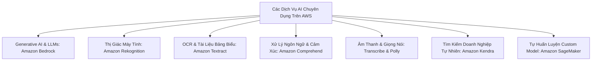

# 07 — ANALYTICS KEYWORDS: Athena, Glue, Redshift, EMR, Lake Formation & AI/ML Services

---

## 📖 ĐỊNH NGHĨA CỐT LÕI CÁC DỊCH VỤ ANALYTICS & AI/ML

| Dịch Vụ AWS | Bản Chất Kỹ Thuật (What is it?) | Sinh Ra Để Làm Gì (Core Job)? | 💡 Móc Nhớ Thần Chú |
|:---|:---|:---|:---|
| **Amazon Athena** | Công cụ truy vấn SQL Serverless tương thích chuẩn ANSI SQL, đọc trực tiếp file trên S3. | Chạy các câu truy vấn phân tích ad-hoc trên Data Lake không cần cluster, chỉ tính tiền \$5/TB data scanned. | *"Kính lúp đọc sách trong kho S3: Mở sách ra đọc thẳng, không cần khuân sách về nhà."* |
| **AWS Glue** | Dịch vụ tích hợp dữ liệu (ETL) serverless: Crawlers (phát hiện schema), Catalog (từ điển), Jobs (biến đổi), DataBrew (no-code). | Tự động hóa pipeline trích xuất, biến đổi và nạp dữ liệu từ nhiều nguồn về Data Lake/Data Warehouse. | *"Nhà máy chế biến quặng tự động: Đãi cát tìm vàng, đóng gói thành thỏi Parquet chuẩn."* |
| **Amazon EMR** | Nền tảng cụm Big Data được quản lý chạy các framework mã nguồn mở: **Hadoop, Spark, Presto, Flink**. | Xử lý dữ liệu lớn cấp độ Petabyte với quyền can thiệp sâu vào cấu hình phần cứng; dùng Spot cho Task nodes để tiết kiệm 80%. | *"Đoàn xe ben đại công trường: Xúc đất đá hàng triệu tấn phân tán khắp nơi."* |
| **Amazon Redshift** | Kho dữ liệu đám mây (Cloud Data Warehouse) lưu trữ theo cột (Columnar) và xử lý song song khối lượng lớn (MPP). | Chạy các báo cáo BI phức tạp, tổng hợp hàng tỷ bản ghi với tốc độ cực nhanh; hỗ trợ Spectrum query thẳng S3. | *"Thư viện trung tâm thành phố: Sắp xếp sách theo từng mục lục chi tiết, tra cứu thống kê cực nhanh."* |
| **AWS Lake Formation** | Dịch vụ quản trị tập trung Data Lake trên S3, phân quyền cấp độ hàng và cột (**Row/Column-level access control**). | Xây dựng Data Lake bảo mật trong vài ngày, chia sẻ dữ liệu an toàn cho Athena, Redshift mà không copy data. | *"Trưởng ban an ninh kho bạc: Kiểm soát từng người chỉ được nhìn đúng trang sổ được phép."* |
| **Amazon OpenSearch** | Dịch vụ tìm kiếm và phân tích nhật ký phân tán (Elasticsearch & OpenSearch Dashboards). | Tìm kiếm toàn văn (Full-text search) có gợi ý từ khóa, theo dõi log ứng dụng và vẽ biểu đồ trực quan; hỗ trợ vector search k-NN. | *"Google tìm kiếm nội bộ: Gõ từ khóa tìm kiếm ra kết quả ngay trong vài mili-giây."* |
| **Amazon QuickSight** | Dịch vụ Business Intelligence (BI) serverless tạo bảng điều khiển trực quan và báo cáo quản trị. | Vẽ dashboard báo cáo cho lãnh đạo, tích hợp động cơ tính toán siêu tốc in-memory **SPICE**, hỏi đáp ngôn ngữ tự nhiên Amazon Q. | *"Họa sĩ vẽ biểu đồ kinh doanh: Trực quan hóa mọi con số phức tạp thành biểu đồ trực quan."* |
| **Amazon MSK** | Dịch vụ Apache Kafka được quản lý toàn diện (Managed Streaming for Apache Kafka). | Chạy cụm Kafka phân tán cho các ứng dụng cần hệ sinh thái Kafka (Kafka Connect, Streams) với message size lên tới 10 MB. | *"Đường sắt vận tải hàng siêu trường: Chuyên chở các kiện hàng dữ liệu lớn vượt quá khổ của Kinesis."* |
| **Amazon Managed Flink**| Dịch vụ phân tích dữ liệu luồng thời gian thực bằng Apache Flink (Java, Python, SQL) serverless. | Thực hiện các phép tính toán phức tạp trên dòng dữ liệu đang chảy: tính trung bình trượt, phát hiện dị thường, session windows. | *"Máy đo nhịp tim thông minh: Theo dõi và phân tích tín hiệu liên tục từng giây không nghỉ."* |
| **AWS Data Exchange** | Sàn giao dịch dữ liệu thương mại đám mây của bên thứ 3. | Tìm kiếm, đăng ký và nạp trực tiếp các bộ dữ liệu kinh tế, thời tiết, y tế từ các nhà cung cấp bên ngoài vào S3/Redshift. | *"Chợ đầu mối thông tin: Đặt mua các bộ số liệu thống kê quốc tế về nạp thẳng vào kho dữ liệu."* |
| **Amazon Bedrock** | Dịch vụ serverless truy cập các mô hình nền tảng (Foundation Models) hàng đầu (Claude, Llama, Titan) qua API. | Xây dựng ứng dụng Generative AI, chatbot RAG trên dữ liệu doanh nghiệp mà không cần tự huấn luyện máy chủ GPU. | *"Showroom trí tuệ nhân tạo: Chọn mô hình AI xịn nhất về cắm vào ứng dụng của mình qua API."* |
| **Amazon SageMaker AI** | Nền tảng học máy (Machine Learning) toàn diện từ A-Z cho Data Scientists. | Tự chuẩn bị dữ liệu, huấn luyện mô hình tùy biến (Custom models) với GPU Spot, và triển khai endpoint suy luận. | *"Học viện đào tạo AI chuyên sâu: Tự nghiên cứu, huấn luyện và xuất xưởng các mô hình máy học riêng."* |

---

## 📊 AMAZON ATHENA — TRUY VẤN SQL SERVERLESS TRÊN S3

### 1. Bản Chất Kỹ Thuật & Tối Ưu Chi Phí
- Dựa trên công nghệ **Trino / Presto**, chạy trực tiếp trên file lưu trong Amazon S3.
- **Mô hình tính giá**: **$5 trên mỗi TB dữ liệu được quét (Data Scanned)**.
- 💡 **3 Biện Pháp Vàng Giảm 90% Chi Phí Athena**:
  1. **Định dạng cột (Columnar Formats)**: Chuyển đổi dữ liệu CSV/JSON sang **Apache Parquet hoặc ORC**. Khi query `SELECT name`, Athena chỉ quét đúng cột `name`, bỏ qua toàn bộ các cột khác.
  2. **Nén dữ liệu (Compression)**: Nén các file Parquet bằng thuật toán **Snappy hoặc GZIP**.
  3. **Phân vùng dữ liệu (Partitioning)**: Tổ chức dữ liệu S3 theo cấu trúc thư mục ngày tháng (VD: `s3://bucket/logs/year=2026/month=11/day=12/`). Câu query lọc theo ngày chỉ quét đúng thư mục đó.
- **Kích thước file tối ưu**: Nên gom các file nhỏ thành các file lớn có kích thước **từ 128 MB đến 512 MB** để tránh độ trễ overhead khi mở file.

### 2. Các Tính Năng Nâng Cao
- **AWS Glue Data Catalog**: Athena sử dụng Data Catalog làm từ điển siêu dữ liệu (Metadata Schema) để biết cấu trúc bảng, tên cột và kiểu dữ liệu của các file trên S3.
- **Athena Workgroups**: Cho phép phân nhóm người dùng/phòng ban, đặt hạn ngạch giới hạn dung lượng quét dữ liệu tối đa cho mỗi câu query để khống chế chi phí.
- **Athena Federated Query**: Cho phép chạy 1 câu lệnh SQL duy nhất để `JOIN` dữ liệu giữa Amazon S3 với cơ sở dữ liệu quan hệ RDS, DynamoDB, hoặc hệ thống On-Premises thông qua các đầu kết nối chạy trên AWS Lambda.

---

## 🌊 STREAMING ANALYTICS: KINESIS DATA STREAMS vs DATA FIREHOSE vs MSK

```mermaid
flowchart LR
    Producer[Nguồn Dữ Liệu: Logs, IoT, Clickstream]
    Producer --> KDS[Kinesis Data Streams\nĐộ trễ ~200ms\nLưu trữ & Replay 24h-365d\nCần viết Consumer]
    Producer --> Firehose[Amazon Data Firehose\nNear real-time (0-900s)\nServerless Auto-scale\nĐổ thẳng S3/Redshift/OpenSearch]
    Producer --> MSK[Amazon MSK (Apache Kafka)\nMessage size tới 10MB\nTương thích Kafka ecosystem]

    KDS --> Flink[Managed Service for Apache Flink\nTính toán real-time, Windowing]
    KDS --> Firehose
    Firehose --> S3[Amazon S3 Data Lake]
    Firehose --> Redshift[Amazon Redshift DW]
    Firehose --> OS[Amazon OpenSearch]
```

| Tiêu Chí So Sánh | Kinesis Data Streams (KDS) | Amazon Data Firehose | Amazon MSK (Apache Kafka) |
|:---|:---|:---|:---|
| **Độ trễ xử lý** | **Thời gian thực (~200 mili-giây)** | Gần thời gian thực (**Near real-time: 60–900s buffer**) | Thời gian thực (< 100 mili-giây) |
| **Khả năng lưu trữ & Replay**| ✅ **Lưu từ 24 giờ đến 365 ngày (Replay được)** | ❌ **KHÔNG lưu trữ, KHÔNG thể replay** | ✅ **Lưu trữ không giới hạn trên EBS** |
| **Kích thước bản ghi tối đa**| Tối đa **1 MB / record** | Tối đa 1 MB / record | **Cấu hình lên tới 10 MB** |
| **Quản lý Consumer** | Tự viết mã nguồn (KCL, Lambda, Flink) | **Hoàn toàn Serverless, tự đổ vào đích đến** | Viết consumer Kafka chuẩn (Java, Python) |
| **Biến đổi định dạng** | Không tích hợp sẵn | ✅ **Tự đổi JSON sang Parquet/ORC qua Glue** | Cần Kafka Streams / Flink |
| **Đích đến hỗ trợ** | Bất kỳ ứng dụng nào đọc từ Shard | **S3, Redshift (via COPY), OpenSearch, Splunk, Iceberg** | Bất kỳ Kafka Consumer nào |
| **Enhanced Fan-Out (EFO)** | ✅ Cấp 2 MB/s riêng cho mỗi consumer / shard | Không áp dụng | Consumer groups |

---

## 🏭 AMAZON EMR vs AWS GLUE — PHÂN BIỆT BIG DATA & ETL

| Tiêu Chí So Sánh | Amazon EMR | AWS Glue |
|:---|:---|:---|
| **Bản chất kiến trúc** | Cụm máy chủ Big Data chuyên dụng (EC2/EKS/Serverless) | **Serverless ETL Engine 100% (Không thấy máy chủ)** |
| **Hệ sinh thái hỗ trợ** | **Đầy đủ: Hadoop, Spark, Hive, HBase, Presto, Flink** | Apache Spark, Python Shell |
| **Mức độ kiểm soát** | Toàn quyền cấu hình OS, SSH vào node, tinh chỉnh JVM | AWS lo toàn bộ hạ tầng, chỉ nộp mã nguồn script |
| **Chiến lược chi phí** | **Tận dụng Spot Instances cho Task Nodes (Giảm 80%)** | Tính phí theo Data Processing Units (**DPUs**) theo giây |
| **Lưu trữ dữ liệu cụm** | HDFS trên ổ cứng EC2 nội bộ hoặc **EMRFS (S3)** | Đọc trực tiếp từ S3 / Database |
| **Trường hợp sử dụng** | Xử lý Big Data quy mô Petabyte, di chuyển cụm Hadoop cũ từ On-Premises lên AWS, tùy biến sâu thư viện. | Pipeline ETL làm sạch dữ liệu tự động, crawl schema vào Data Catalog, chuyển đổi CSV sang Parquet. |

### 🛠️ Các Thành Phần Của AWS Glue Cần Nhớ
- **Glue Crawlers**: Tự động quét dữ liệu S3/JDBC $\rightarrow$ Suy luận schema $\rightarrow$ Tạo/cập nhật bảng trong **Glue Data Catalog**.
- **Glue DataBrew**: Công cụ trực quan **No-code với 250+ phép biến đổi** dành cho Business Analysts làm sạch dữ liệu.
- **Glue Job Bookmarks**: Ghi nhớ trạng thái dữ liệu đã đọc $\rightarrow$ **Chỉ xử lý dữ liệu mới phát sinh**, chống chạy trùng lặp.
- **Glue Studio**: Giao diện kéo thả trực quan để thiết kế pipeline ETL phân tán.

---

## 🏢 AMAZON REDSHIFT — KHO DỮ LIỆU PHÂN TÍCH QUY MÔ PETABYTE

### 1. Kiến Trúc Cốt Lõi
- **Lưu trữ theo cột (Columnar Storage)**: Tối ưu cho các câu lệnh `SUM`, `AVG`, `COUNT` trên hàng triệu dòng.
- **Xử lý song song khối lượng lớn (MPP)**:
  - `Leader Node`: Nhận câu lệnh SQL từ client, lập kế hoạch thực thi và phân phối việc cho các Compute Nodes.
  - `Compute Nodes`: Chạy song song và lưu trữ dữ liệu trên ổ cứng NVMe.
- **Redshift Spectrum**: Cho phép cụm Redshift chạy câu truy vấn SQL trực tiếp trên hàng Petabyte dữ liệu thô lưu trong **Amazon S3 Data Lake** mà không cần nạp (`COPY`) dữ liệu vào cụm Redshift.
- **Concurrency Scaling**: Tự động bổ sung các cụm phụ tạm thời trong vài giây để giải phóng tình trạng ùn tắc truy vấn khi có hàng ngàn user cùng xem báo cáo đầu tuần.

### 2. Các Kiểu Phân Phối Dữ Liệu (Distribution Styles)
- **AUTO**: Redshift tự động chọn kiểu phù hợp nhất dựa trên kích thước bảng.
- **KEY**: Phân phối các dòng có cùng giá trị khóa (Matching Key) vào cùng một Compute Node $\rightarrow$ Tối ưu hóa cực đại tốc độ phép **`JOIN`**.
- **ALL**: Sao chép nguyên vẹn toàn bộ bảng sang tất cả các Compute Nodes $\rightarrow$ Dành cho các **bảng danh mục (Dimension Tables) nhỏ < 3 triệu dòng**.
- **EVEN**: Phân phối các dòng đều đặn theo vòng tròn (Round-Robin) $\rightarrow$ Dành cho bảng dữ liệu lớn không tham gia phép JOIN.

---

## 🏛️ AWS LAKE FORMATION — QUẢN TRỊ DATA LAKE TẬP TRUNG

- Xây dựng Data Lake chuẩn mực trên Amazon S3 chỉ trong vài ngày thay vì nhiều tháng.
- **Phân Quyền Hạt Mịn (Fine-Grained Access Control)**:
  - IAM Policy của S3 chỉ cho phép phân quyền tới cấp độ Bucket hoặc Prefix (thư mục).
  - Lake Formation cho phép phân quyền chi tiết tới: **Cấp độ Database, Table, Cột (Column-level), Dòng (Row-level) và Ô dữ liệu (Cell-level)**.
  - *Ví dụ đề thi*: "Phòng Chăm sóc khách hàng được xem bảng Orders nhưng bị ẩn cột `CreditCardNumber` và chỉ được xem các dòng có `Country = VN`" $\rightarrow$ **Bắt buộc dùng AWS Lake Formation**.
- **LF-Tags**: Phân quyền theo cơ chế Attribute-Based Access Control (ABAC) giúp quản lý quyền truy cập cho hàng ngàn nhân sự dễ dàng theo nhãn thẻ.
- **Cross-Account Sharing**: Chia sẻ bảng dữ liệu an toàn cho tài khoản AWS khác query qua Athena mà không cần copy dữ liệu S3.

---

## 🤖 BỘ DỊCH VỤ TRÍ TUỆ NHÂN TẠO & HỌC MÁY (AI / ML)



| Dịch Vụ AWS | Đầu Vào $\rightarrow$ Đầu Ra | 💡 Tín Hiệu Đề Thi Phản Xạ |
|:---|:---|:---|
| **Amazon Bedrock** | Prompts $\rightarrow$ Văn bản, Hình ảnh, Embeddings | "Generative AI", "Foundation Models (Claude, Llama, Titan)", "RAG Knowledge Bases", "AI Agents", "no server management". |
| **Amazon Textract** | Ảnh / File scan PDF $\rightarrow$ Chữ viết, **Bảng biểu (Tables)**, **Biểu mẫu (Forms / Key-Value)** | "extract tables and key-value forms from invoices/receipts", "medical forms OCR", "structured document extraction". |
| **Amazon Comprehend**| Văn bản thô (Text) $\rightarrow$ Cảm xúc (**Sentiment**), Thực thể (Entities), Ngôn ngữ, PII | "analyze customer reviews sentiment", "detect language of support tickets", "redact PII from emails", "NLP". |
| **Amazon Rekognition**| Hình ảnh / Video $\rightarrow$ Nhận diện khuôn mặt, vật thể, kiểm duyệt nội dung (**Moderation**) | "face detection and comparison", "find inappropriate images", "celebrity recognition", "identify unsafe video content". |
| **Amazon Transcribe**| Âm thanh giọng nói (Audio) $\rightarrow$ Văn bản (Text) | "convert call center recordings to text", "generate video subtitles automatically", "speech-to-text", "speaker diarization". |
| **Amazon Polly** | Văn bản (Text) $\rightarrow$ Giọng đọc tự nhiên (Audio / MP3) | "text-to-speech", "read news articles aloud to users", "synthesize lifelike voices", "SSML pronunciation". |
| **Amazon Translate** | Văn bản ngôn ngữ A $\rightarrow$ Văn bản ngôn ngữ B | "translate multilingual content", "real-time chat translation", "custom terminology". |
| **Amazon Lex** | Giọng nói / Văn bản $\rightarrow$ Chatbot đàm thoại tự nhiên | "conversational chatbot", "voicebot", "NLU intent and slot", "integrate with Amazon Connect". |
| **Amazon Kendra** | Tài liệu nội bộ (SharePoint, S3, Salesforce) $\rightarrow$ Hộp tìm kiếm trả lời câu hỏi tự nhiên | "intelligent enterprise search engine", "search intranet documents using natural language questions", "RAG retriever". |
| **Amazon Personalize**| Lịch sử click, mua hàng $\rightarrow$ Gợi ý cá nhân hóa thời gian thực | "real-time personalized product recommendations", "Amazon.com recommendation engine". |
| **Amazon Augmented AI (A2I)**| Dự đoán ML có confidence score thấp $\rightarrow$ Giao diện cho con người duyệt lại | "human-in-the-loop review", "low confidence ML predictions", "auditing sensitive AI decisions". |
| **Amazon SageMaker AI**| Dữ liệu thô $\rightarrow$ Huấn luyện, tối ưu và triển khai Custom ML Models | "build, train, and deploy custom machine learning models", "data scientists", "Managed Spot Training (giảm 90%)". |

---

## 🚀 BẢNG CHỌN NHANH ANALYTICS & AI/ML

| Tín Hiệu Đề Thi (Trigger Keywords) | ✅ Đáp Án Chuẩn |
|:---|:---|
| "serverless SQL query directly on S3 data lake", "ad-hoc analytics" | **Amazon Athena** |
| "query S3 data lake from existing Redshift cluster without loading" | **Redshift Spectrum** |
| "serverless ETL", "schema discovery", "convert CSV to Parquet" | **AWS Glue** |
| "visual no-code data preparation for business analysts" | **AWS Glue DataBrew** |
| "petabyte big data cluster", "managed Hadoop/Spark", "cheap Spot task nodes" | **Amazon EMR** |
| "data warehouse", "OLAP queries", "MPP columnar storage" | **Amazon Redshift** |
| "enforce column-level and row-level security on S3 data lake" | **AWS Lake Formation** |
| "full-text search", "log analytics dashboard", "Kibana", "vector k-NN" | **Amazon OpenSearch Service** |
| "serverless BI dashboards", "SPICE in-memory", "natural language Q&A" | **Amazon QuickSight** |
| "subscribe to third-party commercial datasets on cloud" | **AWS Data Exchange** |
| "real-time streaming analytics", "sliding windows", "Apache Flink" | **Amazon Managed Service for Apache Flink** |
| "managed Apache Kafka", "message size > 1 MB up to 10 MB" | **Amazon MSK** |
| "Foundation Models via serverless API", "GenAI chatbot RAG" | **Amazon Bedrock** |
| "extract tables and forms from scanned PDFs/invoices" | **Amazon Textract** |
| "analyze customer feedback sentiment", "detect PII in text" | **Amazon Comprehend** |
| "detect objects, faces, inappropriate content in images/video" | **Amazon Rekognition** |
| "speech-to-text", "call center transcription" | **Amazon Transcribe** |
| "text-to-speech", "read articles aloud" | **Amazon Polly** |
| "intelligent enterprise search answering natural questions from documents" | **Amazon Kendra** |
| "train custom machine learning models from scratch", "data scientists" | **Amazon SageMaker AI** |
| "human review for low confidence machine learning predictions" | **Amazon Augmented AI (A2I)** |
