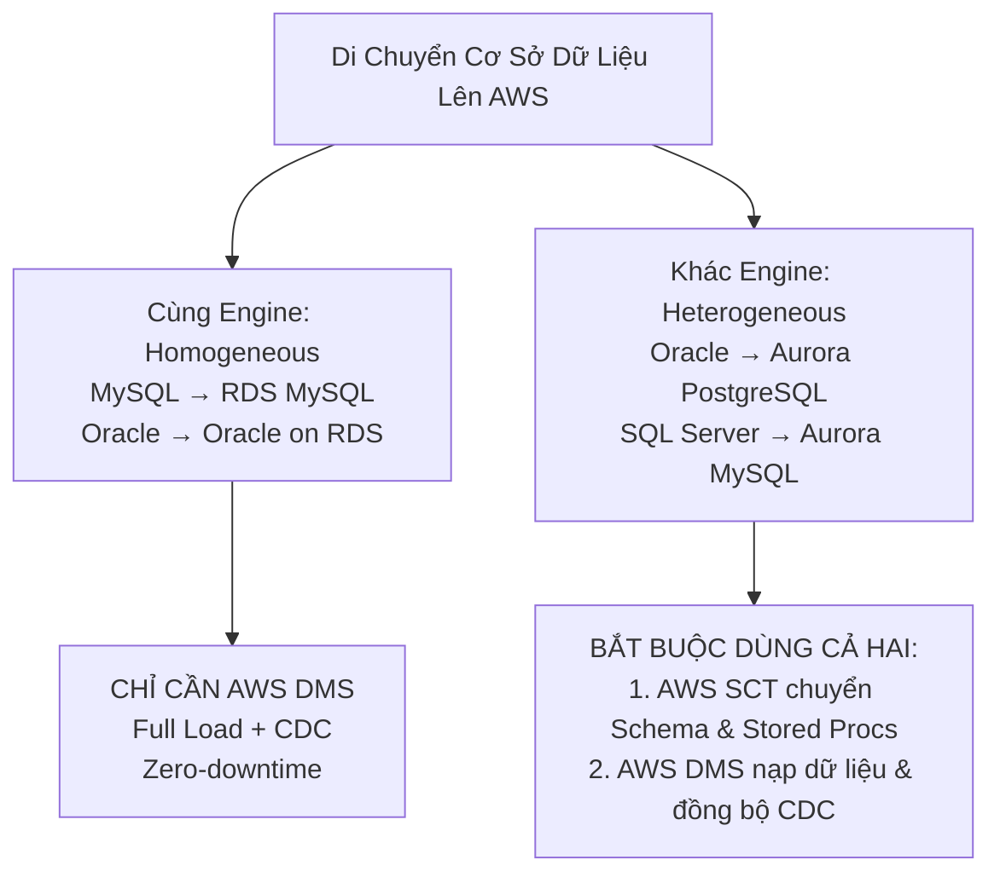
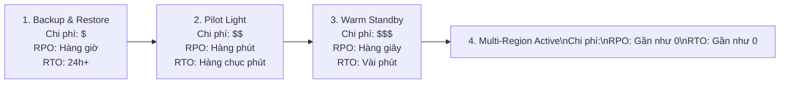

# 08 — MIGRATION & DISASTER RECOVERY (DR) KEYWORDS: 7Rs, MGN, DMS, SCT, DataSync, Snow Family & DRS

---

## 📖 ĐỊNH NGHĨA CỐT LÕI CÁC DỊCH VỤ MIGRATION & DISASTER RECOVERY

| Dịch Vụ AWS | Bản Chất Kỹ Thuật (What is it?) | Sinh Ra Để Làm Gì (Core Job)? | 💡 Móc Nhớ Thần Chú |
|:---|:---|:---|:---|
| **Chiến Lược 7Rs** | Khung phân loại 7 chiến lược di chuyển ứng dụng lên đám mây của AWS. | Giúp doanh nghiệp đánh giá từng ứng dụng: Retire, Retain, Rehost, Relocate, Replatform, Repurchase, Refactor. | *"La bàn định hướng di dân: Phân loại hành lý nào vứt bỏ, cái nào chở nguyên khối, cái nào đập đi xây lại."* |
| **AWS MGN** | Dịch vụ chuẩn mực của AWS cho chiến lược chuyển máy chủ nguyên trạng (**Lift-and-Shift / Rehost**). | Cài agent sao chép khối đĩa (Block-level TCP 1500) liên tục từ máy chủ vật lý, VMware, Hyper-V lên EC2; cho phép chạy test trước khi Cutover. | *"Xe cẩu chuyển nguyên căn nhà: Bốc nguyên cả máy chủ kèm hệ điều hành và phần mềm đặt lên mây."* |
| **AWS DMS** | Dịch vụ di chuyển dữ liệu cơ sở dữ liệu (Database Migration Service) thời gian gián đoạn tối thiểu. | Nạp dữ liệu ban đầu (Full Load) và sao chép liên tục các thay đổi mới qua cơ chế **Change Data Capture (CDC)** để chuyển đổi êm ái (Zero-downtime). | *"Người chuyển nhà chuyên nghiệp: Chuyển hết đồ sang nhà mới trong khi bạn vẫn đang sinh hoạt bình thường."* |
| **AWS SCT** | Công cụ chuyển đổi cấu trúc cơ sở dữ liệu (**Schema Conversion Tool**) cài đặt cục bộ hoặc trên web. | Tự động dịch cấu trúc bảng, kiểu dữ liệu, Stored Procedures từ Oracle/SQL Server sang PostgreSQL/MySQL cho **Heterogeneous Migration**. | *"Nhà biên dịch ngôn ngữ cơ sở dữ liệu: Dịch từ tiếng Anh (PL/SQL) sang tiếng Pháp (PL/pgSQL) chuẩn ngữ pháp."* |
| **AWS DRS** | Dịch vụ phục hồi thảm họa tự động (Elastic Disaster Recovery) bảo vệ máy chủ doanh nghiệp. | Sao chép mức khối đĩa liên tục vào **Staging Area** giá rẻ tại Region thứ hai; đảm bảo **RPO tính bằng giây và RTO tính bằng phút**. | *"Bản sao dự phòng vô hình: Luôn có một chiếc bóng song sinh sẵn sàng thức dậy gánh việc trong vài phút."* |
| **AWS Application Discovery**| Bộ công cụ khảo sát máy chủ On-Premises và vẽ bản đồ phụ thuộc mạng giữa các ứng dụng. | Gom nhóm các máy chủ phụ thuộc nhau trước khi lập kế hoạch di chuyển; bản **Agent-based** cung cấp network mapping chi tiết. | *"Đội trinh sát địa hình: Đi từng phòng máy vẽ bản đồ xem máy nào đang nói chuyện với máy nào."* |
| **AWS Migration Hub** | Bảng điều khiển quản trị tiến độ di chuyển tập trung duy nhất (Single pane of glass). | Theo dõi trạng thái của nhiều công cụ (MGN, DMS, DataSync) gom theo từng ứng dụng kinh doanh, đưa ra gợi ý chiến lược 7Rs. | *"Phòng điều hành bay: Theo dõi tất cả các chuyến bay di chuyển dữ liệu đang hạ cánh ở đâu."* |
| **AWS DataSync** | Công cụ truyền dữ liệu trực tuyến tốc độ cao (TLS, checksum) giữa On-Prem và AWS Storage. | Tự động hóa việc di chuyển và đồng bộ dữ liệu định kỳ qua mạng (nhanh gấp 10 lần rsync), bảo toàn quyền POSIX/NTFS. | *"Đoàn xe chuyên dụng: Chở dữ liệu định kỳ qua mạng cực nhanh và an toàn."* |
| **AWS Transfer Family** | Cổng giao tiếp SFTP, FTPS, FTP, AS2 được quản lý hoàn toàn đổ thẳng vào S3 hoặc EFS. | Cho đối tác bên ngoài upload file an toàn qua SFTP quen thuộc mà không cần duy trì bất kỳ máy chủ FTP nào. | *"Cửa khẩu SFTP: Đối tác nước ngoài giao hàng vào kho S3 bằng xe quen thuộc."* |
| **AWS Snow Family** | Thiết bị vận chuyển dữ liệu vật lý ngoại tuyến: **Snowball Edge (80–210 TB)**, Snowcone, Snowmobile. | Di chuyển hàng chục TB đến hàng trăm PB khi mạng Internet tại chỗ quá chậm (> 1 tuần) hoặc chi phí kéo cáp quá đắt. | *"Tàu chở container vật lý: Vận chuyển cả kho dữ liệu đi đường bộ khi mạng Internet nghẽn."* |
| **VM Import/Export** | Công cụ chuyển đổi file ảnh máy ảo (OVA, VMDK, VHD) thành AMI/EC2 và ngược lại. | Chuyển một vài máy ảo có sẵn thành AMI để lưu giữ bản cài đặt chuẩn của công ty; không có cơ chế replication liên tục. | *"Máy ép khuôn: Biến file máy ảo VMware thành máy ảo EC2 tiêu chuẩn."* |

---

## 🗺️ CHIẾN LƯỢC MIGRATION: KHUNG 7Rs CỐT LÕI

| Chiến Lược (7Rs) | Bản Chất Thực Thi | 💡 Tín Hiệu Đề Thi Nhận Diện |
|:---|:---|:---|
| **1. Retire** | Tắt bỏ hoàn toàn các ứng dụng và máy chủ cũ không còn giá trị kinh doanh. | "No longer needed", "decommission obsolete systems", "cost savings by shutting down". |
| **2. Retain** | Giữ nguyên tại On-Premises vì chưa sẵn sàng, phụ thuộc phần cứng đặc thù hoặc pháp lý. | "Compliance mandates keeping on-premises", "not ready to migrate", "legacy OS dependencies". |
| **3. Rehost** (Lift-and-Shift) | Chuyển nguyên trạng máy ảo lên **Amazon EC2** bằng **AWS MGN** mà **không sửa mã nguồn ứng dụng**. Nhanh nhất, ít rủi ro nhất. | "Without code changes", "quickly migrate hundreds of servers", "minimal downtime", "Lift-and-shift". |
| **4. Relocate** | Chuyển toàn bộ nền tảng ảo hóa (VMware) lên **VMware Cloud on AWS** mà không đổi cấu hình hay định dạng máy ảo. | "Keep VMware hypervisor", "migrate VMware to AWS without VM conversion", "same operational tools". |
| **5. Replatform** (Lift-tinker-and-shift) | Thực hiện một vài tối ưu hóa nhỏ để tận dụng dịch vụ quản lý (VD: chuyển database tự cài trên EC2 sang **Amazon RDS**). | "Reduce operational overhead without architectural rewrite", "move self-managed database to RDS". |
| **6. Repurchase** (Drop-and-shop) | Bỏ phần mềm tự host để chuyển sang mua dịch vụ **SaaS** của bên thứ 3 (VD: bỏ server CRM nội bộ chuyển sang dùng **Salesforce**). | "Switch to SaaS solution", "replace custom CRM with Salesforce", "drop in-house software". |
| **7. Refactor / Re-architect** | Đập đi viết lại ứng dụng theo kiến trúc đám mây hiện đại (**Cloud-native: Serverless, Microservices, Lambda, DynamoDB**). Chi phí đầu tư lớn nhất, lợi ích lâu dài cao nhất. | "Cloud-native modernization", "break monolithic into microservices", "serverless architecture", "maximize scalability". |

---

## 🚚 DATABASE MIGRATION — BỘ ĐÔI SCT & DMS

| Tình Huống Di Chuyển | Công Cụ Chuẩn | 💡 Vì Sao Chọn / Ngữ Cảnh |
|:---|:---|:---|
| **Homogeneous Migration** (Cùng loại Database Engine) | **AWS DMS duy nhất** | Cấu trúc dữ liệu và cú pháp SQL giống hệt nhau $\rightarrow$ Không cần chuyển đổi Schema, chỉ cần copy data qua DMS. |
| **Heterogeneous Migration** (Khác loại Database Engine) | **AWS SCT + AWS DMS** | Cú pháp SQL, Data Types và Stored Procedures hoàn toàn khác nhau. **AWS SCT** chuyển đổi Schema trước $\rightarrow$ **AWS DMS** nạp dữ liệu và đồng bộ CDC. |
| **Zero-downtime Cutover** | **DMS với tính năng Change Data Capture (CDC)** | DMS chạy Full Load nền trong khi hệ thống cũ vẫn phục vụ khách bình thường. CDC đọc transaction logs để đồng bộ các thay đổi mới liên tục $\rightarrow$ Khi sẵn sàng chỉ mất vài phút đổi connection string. |
| **Chuyển RDS MySQL sang Aurora MySQL** | **Tạo Aurora Read Replica $\rightarrow$ Promote** | Cách nhanh nhất, không cần cấu hình DMS. Tạo Aurora Read Replica trực tiếp từ RDS MySQL, đợi đồng bộ xong bấm nút Promote. |
| **Database quá lớn, mạng internet quá chậm** | **Snowball Edge + AWS DMS CDC** | Nạp bản Full Load ban đầu vào thiết bị **Snowball Edge** chở bằng đường bộ lên AWS. Trong lúc chở, bật **AWS DMS CDC** ghi lại các thay đổi mới qua mạng $\rightarrow$ Nạp xong Snowball thì CDC sync nốt phần trôi. |

---

## 🖥️ MÁY CHỦ & KHẢO SÁT HẠ TẦNG (SERVER MIGRATION & DISCOVERY)

| Kịch Bản / Dịch Vụ | ✅ Giải Pháp | 💡 Vì Sao & Ngữ Cảnh Đề Thi |
|:---|:---|:---|
| **"Lift-and-Shift on-prem VMs/physical servers to EC2 with minimal downtime"** | **AWS Application Migration Service (AWS MGN)** | Cài **AWS Replication Agent** sao chép từng khối đĩa (Block-level) liên tục qua cổng **TCP 1500** vào Staging Area (EC2 nhỏ + EBS rẻ). Cho phép khởi chạy máy ảo thử nghiệm không ảnh hưởng máy chủ gốc (Non-disruptive testing) trước khi Cutover. |
| **"Survey on-prem servers and map network dependencies between applications"** | **AWS Application Discovery Service (Agent-based)** | Cài **Application Discovery Agent** lên từng máy chủ để thu thập chi tiết: CPU/RAM thực tế, các tiến trình đang chạy và **bản đồ kết nối mạng giữa các server** để gom nhóm ứng dụng di chuyển. |
| **"Survey VMware infrastructure quickly without installing agents on VMs"** | **AWS Application Discovery Service (Agentless Collector)** | Import file OVA máy ảo vào vCenter để quét nhanh danh mục máy chủ. Nhược điểm: **Không nhìn thấy network dependencies chi tiết**. |
| **"Track migration progress of multiple tools in a single dashboard"** | **AWS Migration Hub** | "Single pane of glass" — Bảng điều khiển quản lý tiến độ tổng thể, gom nhóm các máy chủ theo từng ứng dụng kinh doanh; gợi ý chiến lược 7Rs. |
| **"Convert a few VM images (OVA, VMDK) to EC2 AMI"** | **VM Import/Export** | Phù hợp chuyển đổi một vài image chuẩn, không có cơ chế replication liên tục. |

---

## 💾 CHIẾN LƯỢC PHỤC HỒI THẢM HỌA (DISASTER RECOVERY - DR)

### 📊 Bảng So Sánh 4 Cấp Độ DR Quyết Định Điểm Thi
| Tiêu Chí So Sánh | 1. Backup & Restore | 2. Pilot Light | 3. Warm Standby | 4. Multi-Region Multi-Active |
|:---|:---|:---|:---|:---|
| **Trạng thái Database tại Region phụ** | **KHÔNG CÓ DB CHẠY** (Chỉ có snapshots/backups trên S3) | **DB LUÔN CHẠY VÀ ĐỒNG BỘ** (Read Replica / Global DB) | **DB LUÔN CHẠY VÀ ĐỒNG BỘ** | **TẤT CẢ DB ĐỀU NHẬN GHI VÀ ĐỌC** (DynamoDB Global Tables) |
| **Trạng thái Compute (EC2) tại Region phụ** | **HOÀN TOÀN KHÔNG CÓ** (0 instance) | **TẮT HOÀN TOÀN (0 instance)**, chỉ có sẵn AMI / CloudFormation | **CHẠY 24/7 VỚI QUY MÔ NHỎ** (Scaled-down fleet: ví dụ 2 máy thay vì 20) | **CHẠY 24/7 VỚI 100% CÔNG SUẤT** ở mọi Region |
| **RPO (Mất mát dữ liệu)** | Hàng giờ tới hàng ngày | Vài phút | Vài giây | Gần như bằng 0 |
| **RTO (Thời gian phục hồi dịch vụ)** | 24 giờ+ (lâu nhất) | Hàng chục phút (khởi động EC2 từ AMI) | Vài phút (ASG tăng số máy ảo lên) | Tức thì trong vài giây (Route 53 chuyển hướng) |
| **Chi phí vận hành** | **Rẻ nhất ($)** | **Thấp ($$)** | **Trung bình ($$$)** | **Đắt nhất ($$$$)** |

> ⚠️ **BẪY THI KINH ĐIỂN CẦN KHẮC CỐT GHI TÂM**:  
> - **Pilot Light** = Ngọn lửa mồi trong bếp gas: Chỉ có Database chạy, **máy chủ EC2 = 0 (tắt ngúm)**. Khi sự cố mới bật máy lên từ AMI.  
> - **Warm Standby** = Máy bay bay ở chế độ tiết kiệm xăng: Cả Database VÀ một dàn **EC2 thu nhỏ (scaled-down)** vẫn **ĐANG CHẠY 24/7**, sẵn sàng scale up ngay lập tức khi thảm họa xảy ra.

---

## ⏱️ CÔNG THỨC ƯỚC TÍNH THỜI GIAN TRUYỀN DỮ LIỆU (ONLINE vs OFFLINE)

- 🧮 **Quy tắc tính nhẩm tốc độ truyền dữ liệu qua mạng**:
  - **Đường truyền 100 Mbps**: Truyền được xấp xỉ **1 TB / ngày**.
  - **Đường truyền 1 Gbps**: Truyền được xấp xỉ **10 TB / ngày** (Lý thuyết: $\frac{10^9 \times 86400}{8 \times 10^{12}} \approx 10.8\text{ TB}$).
  - **Đường truyền 10 Gbps**: Truyền được xấp xỉ **100 TB / ngày**.
- 💡 **Quy tắc vàng chọn Snowball Edge (Rule of Thumb)**:  
  Nếu thời gian chuyển dữ liệu qua mạng mất **nhiều hơn 1 tuần (7 ngày)**, hoặc đường truyền mạng chập chờn, hoặc chi phí băng thông quá đắt $\rightarrow$ **Luôn luôn chọn giải pháp ngoại tuyến AWS Snowball Edge**.
  - *Ví dụ đề bài*: Cần di chuyển **100 TB dữ liệu** với đường truyền **1 Gbps** (mất $\approx 10$ ngày), nhưng công ty yêu cầu phải hoàn tất trong vòng **5 ngày** $\rightarrow$ **Bắt buộc chọn AWS Snowball Edge** (không thể dùng DataSync qua mạng).

---

## 🚀 BẢNG CHỌN NHANH MIGRATION & DISASTER RECOVERY

| Tín Hiệu Đề Thi (Trigger Keywords) | ✅ Đáp Án Chuẩn |
|:---|:---|
| "rehost physical servers, VMware, Hyper-V to EC2 with minimal downtime" | **AWS Application Migration Service (AWS MGN)** |
| "homogeneous database migration without code changes", "minimal downtime" | **AWS Database Migration Service (AWS DMS)** |
| "heterogeneous database migration", "Oracle to Aurora PostgreSQL", "convert stored procedures" | **AWS SCT + AWS DMS** |
| "survey on-prem servers and discover network dependency mapping" | **AWS Application Discovery Service (Agent-based)** |
| "single dashboard to track migration progress across multiple tools" | **AWS Migration Hub** |
| "synchronize large files periodically over network", "10x faster than rsync" | **AWS DataSync** |
| "external partners upload via SFTP directly to S3 without changing scripts" | **AWS Transfer Family** |
| "offline bulk data transfer > 10 TB, slow internet taking > 1 week" | **AWS Snowball Edge Storage Optimized** |
| "disaster recovery for on-prem/EC2 servers, RPO seconds, RTO minutes" | **AWS Elastic Disaster Recovery (AWS DRS)** |
| "convert OVA/VMDK VM images into EC2 AMIs" | **VM Import/Export** |
| "DR strategy: database running, compute fleet 0 instances until failover" | **Pilot Light** |
| "DR strategy: database running, scaled-down compute fleet running 24/7" | **Warm Standby** |
| "DR strategy: active-active multi-region, zero RPO and zero RTO" | **Multi-Region Multi-Active** |
| "RPO < 1s, RTO < 1m for relational database cross-region DR" | **Amazon Aurora Global Database** |
| "protect backups from ransomware deletion even by root" | **AWS Backup Vault Lock (Compliance Mode)** |
