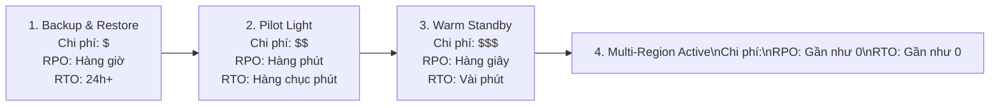

# 08 — MIGRATION & DISASTER RECOVERY (DR) KEYWORDS

---

## 📖 ĐỊNH NGHĨA CỐT LÕI CÁC DỊCH VỤ MIGRATION & DISASTER RECOVERY

| Dịch Vụ AWS | Bản Chất Kỹ Thuật (What is it?) | Sinh Ra Để Làm Gì (Core Job)? | 💡 Móc Nhớ Thần Chú |
|:---|:---|:---|:---|
| **AWS DMS** | Dịch vụ di chuyển dữ liệu cơ sở dữ liệu (Database Migration Service) thời gian gián đoạn tối thiểu. | Nạp dữ liệu ban đầu (Full Load) và sao chép liên tục các thay đổi mới qua cơ chế **Change Data Capture (CDC)** để chuyển đổi êm ái (Zero-downtime). | *"Người chuyển nhà chuyên nghiệp: Chuyển hết đồ sang nhà mới trong khi bạn vẫn đang sinh hoạt bình thường."* |
| **AWS SCT** | Công cụ chuyển đổi cấu trúc cơ sở dữ liệu (**Schema Conversion Tool**) cài đặt cục bộ. | Đọc và tự động dịch cấu trúc bảng, kiểu dữ liệu, Stored Procedures, Triggers từ Oracle/SQL Server sang Aurora PostgreSQL/MySQL. | *"Nhà biên dịch ngôn ngữ cơ sở dữ liệu: Dịch từ tiếng Anh (PL/SQL) sang tiếng Pháp (PL/pgSQL) chuẩn ngữ pháp."* |
| **AWS MGN** | Dịch vụ chuẩn mực của AWS cho chiến lược chuyển máy chủ nguyên trạng (**Lift-and-Shift / Rehost**). | Cài agent sao chép khối đĩa (Block-level TCP 1500) liên tục từ máy chủ vật lý, VMware, Hyper-V lên EC2; cho phép chạy test trước khi Cutover. | *"Xe cẩu chuyển nguyên căn nhà: Bốc nguyên cả máy chủ kèm hệ điều hành và phần mềm đặt lên mây."* |
| **AWS DRS** | Dịch vụ phục hồi thảm họa tự động (Elastic Disaster Recovery) bảo vệ máy chủ doanh nghiệp. | Sao chép mức khối đĩa liên tục vào **Staging Area** giá rẻ tại Region thứ hai; đảm bảo **RPO tính bằng giây và RTO tính bằng phút**. | *"Bản sao dự phòng vô hình: Luôn có một chiếc bóng song sinh sẵn sàng thức dậy gánh việc trong vài phút."* |
| **AWS Application Discovery**| Bộ công cụ khảo sát máy chủ On-Premises và vẽ bản đồ phụ thuộc mạng giữa các ứng dụng. | Gom nhóm các máy chủ phụ thuộc nhau trước khi lập kế hoạch di chuyển; bản **Agent-based** cung cấp network mapping chi tiết. | *"Đội trinh sát địa hình: Đi từng phòng máy vẽ bản đồ xem máy nào đang nói chuyện với máy nào."* |
| **AWS Migration Hub** | Bảng điều khiển quản trị tiến độ di chuyển tập trung duy nhất (Single pane of glass). | Theo dõi trạng thái của nhiều công cụ (MGN, DMS, DataSync) gom theo từng ứng dụng kinh doanh. | *"Phòng điều hành bay: Theo dõi tất cả các chuyến bay di chuyển dữ liệu đang hạ cánh ở đâu."* |
| **AWS Backup** | Dịch vụ quản lý và tự động hóa chính sách sao lưu tập trung cấp độ doanh nghiệp (EC2, RDS, EFS, S3). | Tạo lịch sao lưu định kỳ, sao chép xuyên vùng/tài khoản và bật khóa bất biến **Backup Vault Lock (Compliance WORM)** chống ransomware. | *"Két bảo hiểm bất biến: Khóa sao lưu lại ở chế độ Compliance thì hacker hay root cũng chịu chết."* |
| **AWS Snow Family** | Thiết bị vận chuyển dữ liệu vật lý ngoại tuyến: **Snowcone (8TB)**, **Snowball Edge (80TB)**, **Snowmobile (100PB)**. | Di chuyển hàng chục TB đến hàng trăm PB khi mạng Internet tại chỗ quá chậm hoặc chi phí kéo cáp quá đắt. | *"Tàu chở container vật lý: Vận chuyển cả kho dữ liệu đi đường bộ khi mạng Internet nghẽn."* |

---

## 🚚 DATABASE MIGRATION — BỘ ĐÔI SCT & DMS

| Kịch Bản Đề Thi | ✅ Giải Pháp Chuẩn | 💡 Vì Sao / Ngữ Cảnh Nhớ Nhanh | ❌ Bẫy Cần Tránh |
|:---|:---|:---|:---|
| **"Homogeneous database migration (e.g. On-prem MySQL → RDS MySQL)"** | **AWS DMS** (Database Migration Service) | Cùng loại engine $\rightarrow$ Cấu trúc bảng, kiểu dữ liệu, Stored Procedures giống nhau 100%. Không cần chuyển đổi mã nguồn, chỉ cần copy data qua DMS. | ~~AWS SCT~~ (Không cần SCT khi cùng engine). |
| **"Heterogeneous database migration (e.g. Oracle / SQL Server → Aurora PostgreSQL)"** | **AWS SCT** (Schema) + **AWS DMS** (Data) | Khác engine $\rightarrow$ Cú pháp SQL, kiểu dữ liệu và Stored Procedures khác nhau. **AWS SCT** chuyển đổi Schema & PL-SQL sang PL-pgSQL trước, sau đó **AWS DMS** nạp dữ liệu. | ~~Chỉ dùng AWS DMS~~ (DMS đơn thuần không chuyển đổi được stored procedures phức tạp). |
| **"Zero-downtime database cutover with continuous replication"** | **AWS DMS với chế độ Change Data Capture (CDC)** | DMS nạp dữ liệu nền (Full Load) mà hệ thống cũ vẫn chạy. Sau đó DMS liên tục đọc transaction logs đồng bộ các thay đổi mới (CDC). Khi sẵn sàng, chỉ mất vài giây đổi Connection String của ứng dụng. | ~~Backup & Restore qua file dump~~ (Mất hàng giờ downtime). |
| **"Migrate MongoDB to AWS document store"** | **Amazon DocumentDB** dùng **mongodump/mongorestore** hoặc **AWS DMS** | DocumentDB tương thích 100% MongoDB API. DMS hỗ trợ MongoDB làm nguồn dữ liệu. | ~~Amazon DynamoDB~~ (DynamoDB API khác hoàn toàn). |

---

## 🖥️ MÁY CHỦ & KHẢO SÁT HẠ TẦNG (SERVER MIGRATION & DISCOVERY)

| Kịch Bản / Dịch Vụ | ✅ Giải Pháp | 💡 Vì Sao & Ngữ Cảnh Đề Thi |
|:---|:---|:---|
| **"Lift-and-Shift on-prem VMs/physical servers to EC2 with minimal downtime"** | **AWS Application Migration Service (AWS MGN)** | MGN cài agent sao chép từng khối đĩa (Block-level) liên tục qua cổng **TCP 1500** vào Staging Area trên AWS. Cho phép khởi chạy máy ảo thử nghiệm không ảnh hưởng máy chủ gốc (Non-disruptive testing) trước khi Cutover. |
| **"Survey on-prem servers and map network dependencies between applications"** | **AWS Application Discovery Service (Agent-based)** | Cài **Application Discovery Agent** lên từng máy chủ để thu thập chi tiết: CPU/RAM thực tế, các tiến trình đang chạy và **bản đồ kết nối mạng giữa các server** để gom nhóm ứng dụng di chuyển. |
| **"Survey VMware infrastructure quickly without installing agents on VMs"** | **AWS Application Discovery Service (Agentless Collector)** | Import file OVA máy ảo vào vCenter để quét nhanh danh mục máy chủ. Nhược điểm: **Không nhìn thấy network dependencies chi tiết**. |
| **"Track migration progress of multiple tools (MGN, DMS, SMS) in a single dashboard"** | **AWS Migration Hub** | "Single pane of glass" — Bảng điều khiển quản lý tiến độ tổng thể, gom nhóm các máy chủ theo từng ứng dụng kinh doanh. |

---

## 💾 CHIẾN LƯỢC PHỤC HỒI THẢM HỌA (DISASTER RECOVERY - DR)

### 📊 Bảng So Sánh 4 Cấp Độ DR Quyết Định Điểm Thi

| Tiêu Chí So Sánh | 1. Backup & Restore | 2. Pilot Light | 3. Warm Standby | 4. Multi-Region Multi-Active |
|:---|:---|:---|:---|:---|
| **Trạng thái Database tại Region phụ** | **KHÔNG CÓ DB CHẠY** (Chỉ có snapshots/backups trên S3) | **DB LUÔN CHẠY VÀ ĐỒNG BỘ** (Read Replica / Global DB) | **DB LUÔN CHẠY VÀ ĐỒNG BỘ** | **TẤT CẢ DB ĐỀU NHẬN GHI VÀ ĐỌC** (DynamoDB Global Tables) |
| **Trạng thái Compute (EC2) tại Region phụ** | **HOÀN TOÀN KHÔNG CÓ** (0 instance) | **TẮT HOÀN TOÀN (0 instance)**, chỉ có sẵn AMI / CloudFormation | **CHẠY 24/7 VỚI QUY MÔ NHỎ** (Scaled-down fleet: ví dụ 2 máy thay vì 20) | **CHẠY 24/7 VỚI 100% CÔNG SUẤT** ở mọi Region |
| **RPO (Mất mát dữ liệu)** | Hàng giờ tới hàng ngày | Vài phút | Vài giây | Gần như bằng 0 |
| **RTO (Thời gian phục hồi dịch vụ)** | 24 giờ+ (lâu nhất) | Hàng chục phút (khởi động EC2 từ AMI) | Vài phút (ASG tăng số máy ảo lên) | Tức thì trong vài giây (Route 53 chuyển hướng) |
| **Chi phí vận hành** | **Rẻ nhất ($)** | **Thấp ($$)** | **Trung bình ($$$)** | **Đắt nhất ($$$$)** |

> ⚠️ **BẪY THI KINH ĐIỂN NHẤT CẦN KHẮC CỐT GHI TÂM**:  
> Sự khác biệt cốt tử giữa **Pilot Light** và **Warm Standby**:  
> - **Pilot Light** = Ngọn lửa mồi trong bếp gas: Chỉ có Database chạy, **máy chủ EC2 = 0 (tắt ngúm)**. Khi sự cố mới bật máy lên từ AMI.  
> - **Warm Standby** = Máy bay bay ở chế độ tiết kiệm xăng: Cả Database VÀ một dàn **EC2 thu nhỏ (scaled-down)** vẫn **ĐANG CHẠY 24/7**, sẵn sàng scale up ngay lập tức.

---

## 🔄 CÁC DỊCH VỤ AWS PHỤC VỤ DISASTER RECOVERY

| Dịch Vụ | Cơ Chế Phục Hồi | 💡 Ngữ Cảnh Đề Thi |
|:---|:---|:---|
| **AWS Elastic Disaster Recovery (AWS DRS)** | Sao chép mức khối đĩa (Block-level replication) liên tục từ On-Premises hoặc giữa các AWS Regions vào một **Staging Area** giá rẻ. Cho phép diễn tập thử nghiệm (Drills) không ảnh hưởng sản xuất. | "RPO seconds, RTO minutes for enterprise servers", "Automated DR failover and failback for EC2". |
| **Amazon Aurora Global Database** | Nhân bản dữ liệu đa vùng ở tầng lưu trữ chuyên dụng với độ trễ dưới 1 giây. Hỗ trợ thăng cấp (promote) secondary region thành Primary trong **dưới 1 phút**. | "Cross-region DR for relational database with RPO < 1s and RTO < 1 minute". |
| **DynamoDB Global Tables** | Nhân bản tự động Active-Active 2 chiều đa vùng. Mọi Region đều có thể nhận ghi và đọc trực tiếp. | "Globally distributed users write locally with microsecond latency and zero DR failover time". |
| **AWS Backup Vault Lock** | Khóa bất biến WORM (Write Once, Read Many). Ở chế độ **Compliance Mode** kèm cooling-off period (1–72h), không bất kỳ ai (kể cả AWS Root) xóa được bản sao lưu. | "Protect enterprise backups from ransomware infection and malicious root deletion". |

---

## 📦 VẬN CHUYỂN DỮ LIỆU NGOẠI TUYẾN: HỌ HÀNG AWS SNOW FAMILY

| Thiết Bị | Dung Lượng Khả Dụng | 💡 Khi Nào Chọn Trong Đề Thi? |
|:---|:---:|:---|
| **AWS Snowcone** | **8 TB** HDD (hoặc 14 TB SSD) | Rất nhẹ (2.1 kg), bỏ vừa ba lô, hoạt động ở môi trường khắc nghiệt không mạng (tàu thủy, trạm cứu hộ), hỗ trợ pin. |
| **AWS Snowball Edge Storage Optimized** | **80 TB** HDD | Di chuyển khối dữ liệu lớn từ **10 TB đến vài trăm TB** khi đường truyền Internet tại chỗ quá chậm (10–50 Mbps). Có tích hợp EC2 và Lambda để lọc dữ liệu tại chỗ. |
| **AWS Snowball Edge Compute Optimized** | **42 TB** HDD + 52 vCPUs | Chuyên dùng cho tính toán biên hiệu năng cao (Edge Computing), phân tích video, AI inference tại hiện trường trước khi gửi dữ liệu về AWS. |
| **AWS Snowmobile** | **100 PB** (Container xe tải 45 feet) | Di chuyển toàn bộ dữ liệu của cả Data Center quy mô **Petabyte / Exabyte**. Chỉ chọn khi dữ liệu **$\ge 10$ PB**. |
