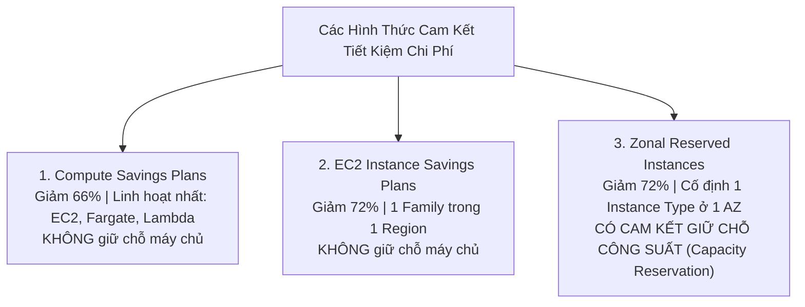

# 09 — COST OPTIMIZATION KEYWORDS

---

## 📖 ĐỊNH NGHĨA CỐT LÕI CÁC DỊCH VỤ QUẢN LÝ CHI PHÍ & TỐI ƯU HÓA

| Dịch Vụ AWS | Bản Chất Kỹ Thuật (What is it?) | Sinh Ra Để Làm Gì (Core Job)? | 💡 Móc Nhớ Thần Chú |
|:---|:---|:---|:---|
| **AWS Cost Explorer** | Bảng điều khiển phân tích chi phí lịch sử **12 tháng qua** và dự báo chi tiêu **12 tháng tới**. | Phân tích sâu theo Dịch vụ, Resource Tags, Member Accounts; đưa ra khuyến nghị mua Savings Plans / RIs. | *"Báo cáo tài chính doanh nghiệp: Nhìn lại chi tiêu năm ngoái và dự báo ngân sách năm tới."* |
| **AWS Budgets** | Công cụ thiết lập ngưỡng ngân sách tài chính tùy biến và kích hoạt hành động ngăn chặn. | Cảnh báo SNS/Email khi chi tiêu thực tế hoặc dự phóng vượt ngưỡng; tự động thực thi **Budget Actions** (tắt EC2/RDS). | *"Chuông báo động thủ quỹ: Tiêu gần hết tiền là hú còi, tiêu lố là tự động khóa két."* |
| **AWS Compute Optimizer** | Dịch vụ ứng dụng Machine Learning phân tích thông số CloudWatch trong **14 ngày gần nhất**. | Phát hiện tài nguyên thừa thãi (**Over-provisioned**) hoặc thiếu hụt; gợi ý chuyển sang size nhỏ hơn hoặc đổi sang chip **Graviton**. | *"Bác sĩ khám sức khỏe máy chủ: Kê đơn hạ size máy để đỡ tốn tiền thuốc men."* |
| **AWS Trusted Advisor** | Cố vấn tự động quét tài khoản và chấm điểm theo 5 trụ cột của **AWS Well-Architected Framework**. | Kiểm tra: **Cost Optimization, Performance, Security, Fault Tolerance, Service Limits** (bản đầy đủ cần gói Business/Enterprise Support). | *"Cố vấn tham mưu cấp cao: Chỉ ra 5 lĩnh vực cần chấn chỉnh để tiết kiệm tiền và bảo mật."* |
| **AWS Cost Anomaly Detection**| Dịch vụ Machine Learning tự động phát hiện các đợt tăng vọt chi phí bất thường ngoài dự kiến. | Phát hiện sớm sự cố rò rỉ mã nguồn bị tin tặc chiếm quyền tạo hàng loạt máy ảo đào coin, gửi cảnh báo nguyên nhân gốc. | *"Hệ thống radar chống trộm tiền: Có dòng tiền lạ tăng vọt là báo động đỏ ngay lập tức."* |
| **AWS Instance Scheduler** | Giải pháp tự động hóa bằng Lambda + EventBridge dựa trên Resource Tags (`Schedule=office-hours`). | Tự động tắt máy ảo EC2 và RDS ngoài giờ làm việc (đêm và cuối tuần), **cắt giảm ngay 70% hóa đơn** môi trường Dev/Test. | *"Bác bảo vệ tắt điện: Hết giờ làm 6h tối là tắt cầu dao máy tính, sáng thứ 2 bật lại."* |
| **AWS Pricing Calculator** | Công cụ web tính toán và ước tính chi phí hạ tầng AWS trước khi bắt tay triển khai thực tế. | Lập dự toán chi phí hàng tháng cho dự án mới để trình ban giám đốc phê duyệt ngân sách. | *"Bảng báo giá dự toán công trình: Tính trước chi phí gạch đá xi măng trước khi xây nhà."* |

---

## 💲 EC2 PRICING OPTIONS — BẢNG PHẢN XẠ 3 GIÂY

| Mô Hình Mua Sắm | Mức Giảm Giá | 💡 Vì Sao Chọn / Ngữ Cảnh Nhớ Nhanh | ❌ Bẫy Cần Tránh |
|:---|:---:|:---|:---|
| **On-Demand** | 0% (Giá chuẩn) | Workload ngắn hạn, ứng dụng mới đang thử nghiệm, lưu lượng tăng giảm hoàn toàn không thể đoán trước. | Không dùng cho hệ thống chạy ổn định 24/7 (gây lãng phí ngân sách lớn). |
| **Compute Savings Plans** | Lên tới **66%** | **Linh hoạt nhất trong kỳ thi**: Cam kết chi tiêu (\$ / giờ) trong 1 hoặc 3 năm. Tự động áp dụng cho bất kỳ instance family nào, bất kỳ OS, Region nào, và áp dụng cho cả **AWS Fargate** lẫn **AWS Lambda**. | Không đi kèm tính năng giữ chỗ năng lực tính toán (No capacity reservation). |
| **EC2 Instance Savings Plans** | Lên tới **72%** | Tiết kiệm nhiều hơn Compute SP, nhưng bắt buộc cam kết một dòng máy cụ thể tại 1 Region (ví dụ: cam kết dòng `c7g` tại `ap-southeast-1`). Cho phép đổi kích cỡ (size) tự do trong dòng đó. | Không áp dụng được cho Fargate hay Lambda. |
| **Spot Instances** | Lên tới **90%** | Tận dụng phần cứng máy chủ nhàn rỗi của AWS. Tiết kiệm tối đa cho các tác vụ xử lý hàng loạt (Batch), container vô trạng thái (Stateless), render đồ họa 3D, CI/CD runners có thể tự động chạy lại nếu bị thu hồi (với thông báo trước 2 phút). | Không bao giờ dùng cho cơ sở dữ liệu sản xuất hoặc ứng dụng quan trọng không thể gián đoạn. |
| **Dedicated Hosts** | Đắt nhất | Thuê trọn vẹn thùng máy chủ vật lý riêng biệt. Bắt buộc khi doanh nghiệp cần đáp ứng yêu cầu bản quyền phần mềm khắt khe theo Socket/Core vật lý (**BYOL - Microsoft Windows Server, SQL Server, Oracle**). | Không nhầm với Dedicated Instances (Dedicated Instances không kiểm soát được socket). |
| **Dedicated Instances** | Phí phụ thu / giờ | Chạy trên phần cứng cô lập ở cấp máy chủ, không chia sẻ với khách hàng AWS khác (Tenant Isolation). Không kiểm soát được socket placement. | Không hỗ trợ BYOL theo socket. |
| **On-Demand Capacity Reservations (ODCR)** | Giá On-Demand | **Đảm bảo 100% có sẵn máy chủ** tại một Availability Zone cụ thể trong các dịp cao điểm (Black Friday, Tết, thảm họa DR). Trả tiền tính theo giờ bất kể máy có bật hay tắt. | Không tự động giảm giá trừ khi kết hợp với Savings Plans. |

---

## 📊 SAVINGS PLANS vs RESERVED INSTANCES (RI)

| Tiêu Chí So Sánh | Compute Savings Plans | EC2 Instance Savings Plans | Zonal Reserved Instances (Zonal RI) |
|:---|:---:|:---:|:---:|
| **Phạm vi bảo vệ** | EC2 + Fargate + Lambda | EC2 (1 Family) | EC2 (1 loại máy cụ thể trong 1 AZ) |
| **Thay đổi Region được không?** | ✅ Đổi thoải mái | ❌ Cố định 1 Region | ❌ Cố định 1 AZ |
| **Có giữ chỗ máy chủ (Capacity Reservation)?** | ❌ **KHÔNG** | ❌ **KHÔNG** | ✅ **CÓ BẢO ĐẢM 100%** |
| **Thị trường mua bán lại (Marketplace)?** | ❌ Không | ❌ Không | ✅ **Có thể bán lại trên RI Marketplace** |

> ⚠️ **BẪY THI KINH ĐIỂN CỦA DOMAIN 4**:  
> Nếu đề bài yêu cầu: *"Vừa muốn tiết kiệm chi phí tối đa, vừa phải bảo đảm chắc chắn có sẵn máy chủ chạy trong sự kiện cao điểm tại AZ cụ thể"* $\rightarrow$ **Đáp án đúng bắt buộc là Zonal Reserved Instances** (hoặc On-Demand Capacity Reservations kết hợp Savings Plans). Compute Savings Plans không bao giờ đảm bảo giữ chỗ phần cứng!

---

## 💰 BỘ CÔNG CỤ QUẢN TRỊ CHI PHÍ & NGÂN SÁCH

| Công Cụ | 💡 Vì Sao Chọn / Ngữ Cảnh Đề Thi Nhận Diện |
|:---|:---|
| **AWS Cost Explorer** | • Xem lịch sử tiêu dùng **12 tháng qua** và dự báo chi phí **12 tháng tới** bằng Machine Learning. • Phân tích chi phí theo Dịch vụ, Tài khoản thành viên (Linked Account), hoặc Resource Tags. • Đưa ra khuyến nghị mua Savings Plans / RIs dựa trên dữ liệu thực tế. |
| **AWS Budgets** | • Đặt ngưỡng ngân sách (ví dụ: \$1,000/tháng). Gửi cảnh báo SNS/Email khi chi phí thực tế hoặc chi phí dự phóng (**Forecasted**) vượt 80%, 100%. • **Budget Actions**: Tự động thực thi hành động ngăn chặn (gắn IAM Deny Policy hoặc tự động tắt máy ảo EC2/RDS). |
| **AWS Compute Optimizer** | • Sử dụng ML phân tích dữ liệu hiệu năng CloudWatch trong 14 ngày. • Phát hiện máy chủ bị thừa thãi cấu hình (**Over-provisioned**) hoặc thiếu tài nguyên (**Under-provisioned**). • Gợi ý chuyển sang kiểu máy nhỏ hơn hoặc đổi sang chip **AWS Graviton** để tiết kiệm chi phí. |
| **AWS Cost Anomaly Detection** | • Sử dụng thuật toán Machine Learning phát hiện các đợt tăng vọt chi phí bất thường (ví dụ: bị hacker chiếm tài khoản tạo hàng trăm máy ảo đào coin). • Gửi thông báo nguyên nhân gốc rễ (Root-cause analysis) về tài khoản bị ảnh hưởng. |
| **AWS Trusted Advisor** | • Đánh giá tài khoản theo 5 trụ cột: **Cost Optimization, Performance, Security, Fault Tolerance, Service Limits**. • Bản miễn phí chỉ kiểm tra 7 mục cơ bản; gói hỗ trợ **Business hoặc Enterprise Support** mới mở khóa toàn bộ các khuyến nghị tiết kiệm chi phí chi tiết. |

---

## 🗄️ CHIẾN LƯỢC TỐI ƯU CHI PHÍ LƯU TRỮ S3

| Kịch Bản Lưu Trữ | ✅ Giải Pháp Tối Ưu Nhất | 💡 Lý Do & Bẫy Cần Tránh |
|:---|:---|:---|
| **Dữ liệu tạm thời bị xóa sau 10 đến 15 ngày** | **Giữ nguyên tại S3 Standard** | ❌ **BẪY LỚN**: Không chuyển sang S3 Standard-IA vì tầng này có **quy định tính phí tối thiểu 30 ngày lưu trữ**. Xóa ngày thứ 10 vẫn bị tính tiền đủ 30 ngày kèm phí truy xuất dữ liệu! |
| **Mô hình truy cập thay đổi, không đoán trước được** | **S3 Intelligent-Tiering** | Tự động luân chuyển giữa các tầng Frequent, Infrequent và Archive Instant mà **hoàn toàn không tính phí truy xuất dữ liệu phạt (Zero retrieval fee)**. |
| **Hồ sơ bệnh án / sao lưu cũ chỉ mở 1 lần mỗi quý** | **S3 Glacier Instant Retrieval** | Rẻ hơn S3 Standard-IA tới 68% nhưng vẫn đáp ứng yêu cầu tải về trong **mili-giây** khi bác sĩ cần tra cứu khẩn cấp. |
| **Dữ liệu tuân thủ pháp lý 7–10 năm, hiếm khi đọc lại** | **S3 Glacier Deep Archive** | Tầng lưu trữ rẻ nhất thế giới đám mây (dưới \$1 cho 1 TB mỗi tháng). Chấp nhận thời gian phục hồi từ 12 đến 48 giờ. |

---

## 💡 CÁC MẸO VÀNG CẮT GIẢM CHI PHÍ KHÁC TRONG ĐỀ THI

1. **Môi trường Dev / Test / QA**:
   - Sử dụng **AWS Instance Scheduler** tự động tắt máy ảo EC2 và RDS ngoài giờ hành chính $\rightarrow$ Cắt giảm ngay **70% chi phí**.
   - Dùng **Aurora Serverless v2** hoặc **Aurora Clone** (sao chép tức thì bằng cơ chế copy-on-write, không tốn thêm tiền đĩa).
2. **Vi xử lý ARM (AWS Graviton)**:
   - Các dòng instance có chữ `g` (như `c7g`, `m7g`, `r7g`) mang lại hiệu năng trên giá thành (**Price-Performance**) tốt hơn tới **20%** so với chip x86 tương đương.
3. **Mạng nội bộ và Endpoint**:
   - Truy cập S3 và DynamoDB từ trong VPC: Luôn dùng **Gateway VPC Endpoint** (miễn phí \$0) thay vì đi qua NAT Gateway (tốn phí \$0.045/giờ + phí dữ liệu).
