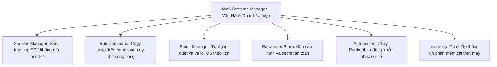

# 11 — MANAGEMENT & GOVERNANCE KEYWORDS: CloudWatch, CloudTrail, Config, Systems Manager (SSM), CloudFormation & Control Tower

---

## 📖 ĐỊNH NGHĨA CỐT LÕI CÁC DỊCH VỤ MANAGEMENT & GOVERNANCE

| Dịch Vụ AWS | Bản Chất Kỹ Thuật (What is it?) | Sinh Ra Để Làm Gì (Core Job)? | 💡 Móc Nhớ Thần Chú |
|:---|:---|:---|:---|
| **Amazon CloudWatch Metrics** | Dịch vụ thu thập, giám sát và phân tích thông số hiệu năng (Metrics) của tài nguyên AWS và ứng dụng. | Theo dõi CPU, mạng, đĩa, request count; làm nguồn kích hoạt Alarm và Auto Scaling Group co giãn. | *"Đồng hồ đo tốc độ trên xe hơi: Nhìn kim đồng hồ biết xe đang chạy nhanh hay chậm, nóng máy hay êm."* |
| **CloudWatch Alarms** | Hệ thống cảnh báo tự động khi các thông số metric vượt ngưỡng quy định. | Kích hoạt cảnh báo qua SNS, gọi Auto Scaling thêm máy ảo, tự động phục hồi (**EC2 Recover**) khi máy chủ bị lỗi phần cứng. | *"Còi báo động quá nhiệt: Nhiệt độ vượt 80 độ C là hú còi báo động và bật quạt làm mát."* |
| **CloudWatch Logs** | Dịch vụ tập trung, lưu trữ và tìm kiếm nhật ký hoạt động (Logs) từ EC2, Lambda, VPC Flow Logs, ứng dụng. | Phân tích log bằng **Logs Insights**, đếm lỗi bằng **Metric Filters**, truyền log thời gian thực qua **Subscription Filters**. | *"Hộp đen máy bay: Ghi lại từng giây từng phút mọi biến cố để sau này tra cứu."* |
| **CloudWatch Agent** | Gói phần mềm cài trực tiếp vào Hệ điều hành của EC2 hoặc máy chủ On-Premises. | Thu thập các thông số nội bộ OS mà AWS bên ngoài không thấy được: **RAM usage, đĩa EBS còn trống, swap, tiến trình (procstat)**. | *"Bác sĩ cắm máy đo nhịp tim vào người bệnh: Đo chính xác huyết áp và lượng máu bên trong cơ thể."* |
| **AWS CloudTrail** | Nhật ký kiểm toán toàn bộ các lệnh gọi API và hành động của User/Role/Service trong tài khoản (Ai, Làm gì, Khi nào, Từ đâu). | Phục vụ điều tra an ninh, pháp lý tuân thủ (Compliance), phát hiện ai đã xóa EC2 hoặc sửa Security Group trái phép. | *"Camera an ninh hành lang: Ghi lại khuôn mặt từng người ra vào mở cửa phòng nào."* |
| **AWS Config** | Dịch vụ ghi lại lịch sử thay đổi cấu hình tài nguyên và đánh giá mức độ tuân thủ liên tục theo Rules. | Kiểm tra S3 có bị mở public không, EBS có mã hóa không; tự động kích hoạt **SSM Automation Remediation** để tự sửa lỗi. | *"Thanh tra trật tự đô thị: Thấy hàng quán lấn chiếm vỉa hè là chụp ảnh lưu hồ sơ và dẹp ngay."* |
| **AWS CloudFormation** | Dịch vụ Hạ tầng dưới dạng mã (Infrastructure as Code - IaC) chuẩn hóa bằng template YAML/JSON. | Tự động hóa khởi tạo và quản lý toàn bộ vòng đời tài nguyên theo Stack; hỗ trợ **StackSets** triển khai đa vùng/đa tài khoản. | *"Bản vẽ thiết kế thi công công trình: Cứ đưa bản vẽ cho máy in là xây xong toàn bộ tòa nhà."* |
| **AWS Systems Manager (SSM)** | Bộ công cụ quản trị vận hành tập trung máy chủ EC2 và máy chủ On-Premises ở quy mô lớn. | Truy cập shell không cần mở port 22 (**Session Manager**), vá lỗi tự động (**Patch Manager**), chạy lệnh hàng loạt (**Run Command**). | *"Bộ điều khiển vạn năng từ xa: Ngồi một chỗ điều khiển hàng ngàn máy chủ mà không cần chìa khóa SSH."* |
| **AWS Control Tower** | Dịch vụ tự động thiết lập và quản trị môi trường đa tài khoản AWS an toàn chuẩn mực (**Landing Zone**). | Cung cấp sẵn các rào chắn bảo vệ (**Guardrails: Preventive, Detective, Proactive**), tự động cấp phát account mới qua **Account Factory**. | *"Ban quản lý khu đô thị mới: Xây sẵn hạ tầng đường xá, bảo vệ, cấp sổ đỏ cho từng căn hộ chuẩn mực."* |
| **AWS Service Catalog** | Danh mục sản phẩm hạ tầng đã được phê duyệt sẵn (dựa trên CloudFormation) cho nhân viên tự triển khai. | Cho phép Developers tự tạo môi trường làm việc nhưng chỉ trong khuôn khổ cấu hình cho phép, không cần cấp quyền IAM rộng. | *"Căn tin tự phục vụ nội bộ: Nhân viên chỉ được chọn các món ăn đã được duyệt trong thực đơn."* |
| **AWS Health Dashboard** | Bảng hiển thị trạng thái hoạt động của dịch vụ AWS và các sự kiện ảnh hưởng tới tài nguyên cá nhân. | Thông báo sự cố toàn cầu (**Service Health**) và sự kiện riêng của account (**Your Account Health: lịch bảo trì EC2, nghỉ hưu phần cứng**). | *"Bảng thông báo y tế bệnh viện: Thông báo tình hình dịch bệnh chung và lịch hẹn khám của từng bệnh nhân."* |
| **AWS License Manager** | Dịch vụ quản lý, theo dõi và ràng buộc hạn mức bản quyền phần mềm (Microsoft, Oracle, SAP) trên AWS và On-Prem. | Thiết lập **Hard Limit** chặn khởi tạo máy ảo khi vượt quá số lượng core/socket cho phép; kết hợp với **Dedicated Hosts cho BYOL**. | *"Quản lý bản quyền phần mềm: Đếm từng số core CPU đang chạy để không vi phạm hợp đồng."* |
| **Amazon Managed Prometheus & Grafana** | Bộ công cụ giám sát và hiển thị biểu đồ mã nguồn mở (Prometheus PromQL & Grafana) được AWS quản lý toàn diện. | Giám sát chuyên sâu cụm container **Amazon EKS / Kubernetes** mà không tốn công dựng và bảo trì cụm server giám sát riêng. | *"Bảng đồng hồ điều khiển tàu vũ trụ: Hiển thị hàng trăm thông số cảm biến container theo thời gian thực."* |

---

## ⏱️ AMAZON CLOUDWATCH: METRICS, ALARMS, LOGS & AGENT

```
TAM GIÁC QUẢN TRỊ VÀ GIÁM SÁT AWS:
  1. CloudWatch ──> "HIỆU NĂNG NHƯ THẾ NÀO?" (CPU, RAM, Đĩa, Logs, Alerts)
  2. CloudTrail ──> "AI ĐÃ LÀM GÌ, LÚC NÀO, TỪ ĐÂU?" (API Call Audit History)
  3. AWS Config ──> "CẤU HÌNH TÀI NGUYÊN ĐÃ THAY ĐỔI NHƯ THẾ NÀO?" (Compliance & State)
```

### 1. CloudWatch Metrics & Khoảng Thời Gian Thu Thập
- **Metric Mặc Định Của EC2**: CPU Utilization, Network In/Out, Disk I/O (chỉ của Instance Store), Status Checks.
  - ⚠️ **EC2 MẶC ĐỊNH KHÔNG CÓ THÔNG SỐ VỀ RAM VÀ DUNG LƯỢNG Ổ EBS** (Do AWS không can thiệp sâu vào bên trong Hệ điều hành của khách hàng).
- **Tần Suất Giám Sát**:
  - `Basic Monitoring`: Miễn phí, thu thập thông số mỗi **5 phút**.
  - `Detailed Monitoring`: Có tính phí, thu thập thông số mỗi **1 phút** (khuyến nghị cho hệ thống cần scale nhanh).
  - `High-Resolution Metrics`: Có thể ghi nhận thông số tới mức **1 giây** qua lệnh `PutMetricData`.
- **Thời Gian Lưu Trữ (Retention)**: Lưu tối đa **15 tháng** (độ phân giải giảm dần theo thời gian).
- **Metric Streams**: Truyền liên tục thông số metric thời gian thực ra bên ngoài (qua Kinesis Data Firehose) vào Amazon S3 hoặc đối tác (Datadog, Dynatrace).

### 2. CloudWatch Agent (Bắt Buộc Cài Vào OS)
- **Unified CloudWatch Agent**: Thu thập cả **Metrics** VÀ **Log Files** từ bên trong hệ điều hành máy chủ EC2 hoặc máy chủ On-Premises.
- **Các thông số thu thập được**: **RAM Usage (Memory), Disk Used / Free (EBS), Swap space, Netstat, Process metrics (procstat)**.
- **Cấu hình hàng loạt**: File cấu hình JSON của Agent có thể được lưu trữ tập trung trong **SSM Parameter Store** $\rightarrow$ Dùng SSM Run Command cài đặt cho hàng ngàn máy chủ cùng lúc.
- **IAM Role**: Máy ảo EC2 cần được gán Role có chứa managed policy `CloudWatchAgentServerPolicy`.

### 3. CloudWatch Alarms & Hành Động Tự Phục Hồi (EC2 Recover)
- **3 Trạng Thái Của Alarm**: `OK`, `ALARM`, `INSUFFICIENT_DATA`.
- **Các Hành Động (Actions) Được Kích Hoạt**:
  - Gửi thông báo tới **Amazon SNS Topic** (bắn email, SMS, Slack).
  - Điều khiển **Auto Scaling Group** tăng/giảm số lượng instance.
  - **EC2 Actions**: Stop, Terminate, Reboot, hoặc **Recover**.
- 🌟 **Tính Năng EC2 Recover (Thường Ra Đề)**:
  - Khi máy ảo bị lỗi kiểm tra phần cứng (`StatusCheckFailed_System`) $\rightarrow$ CloudWatch Alarm kích hoạt **EC2 Recover**.
  - Máy ảo sẽ được di chuyển sang một máy chủ vật lý mới hoàn toàn nhưng **GIỮ NGUYÊN TOÀN BỘ: Private IP, Elastic IP, Metadata, Instance ID và EBS Volume gắn kèm**!
- **Composite Alarms**: Cho phép gộp nhiều Alarm đơn lẻ lại bằng các biểu thức logic `AND`, `OR` để giảm thiểu các cảnh báo rác (Alarm Noise).

### 4. CloudWatch Logs: Insights & Subscription Filters
- **Cấu trúc**: `Log Event` $\rightarrow$ `Log Stream` $\rightarrow$ `Log Group`.
- **Logs Insights**: Công cụ truy vấn nhật ký mạnh mẽ bằng ngôn ngữ SQL-like (ví dụ: `fields @timestamp, @message | filter @message like /ERROR/ | sort @timestamp desc | limit 20`).
- **Metric Filters**: Quét pattern chuỗi trong log (VD: đếm số lần xuất hiện chữ `"404"` hoặc `"Exception"`) để biến thành một CloudWatch Metric $\rightarrow$ Gắn Alarm cảnh báo.
- **Subscription Filters**: Truyền luồng log thời gian thực (**Real-time**) sang **Amazon Kinesis Data Streams, Amazon Data Firehose, AWS Lambda, hoặc Amazon OpenSearch Service**.

---

## 📜 AWS CLOUDTRAIL — NHẬT KÝ KIỂM TOÁN LỆNH GỌI API

| Thành Phần Cốt Lõi | Đặc Tính Kỹ Thuật | 💡 Tín Hiệu Đề Thi Phản Xạ |
|:---|:---|:---|
| **Event History** | Bật mặc định sẵn cho mọi tài khoản, lưu trữ lịch sử các lệnh Management API trong **90 ngày gần nhất** (Miễn phí). | Kiểm tra nhanh ai vừa xóa máy ảo EC2 sáng nay. |
| **CloudTrail Trail** | Cấu hình lưu trữ lâu dài không giới hạn bằng cách xuất toàn bộ log API vào một **Amazon S3 Bucket** chuyên dụng. | Yêu cầu lưu trữ log kiểm toán 1–7 năm phục vụ pháp lý tuân thủ. |
| **Management Events** | Ghi lại các thao tác cấu hình tài nguyên (VD: `RunInstances`, `CreateBucket`, `AttachPolicy`). Mặc định được ghi lại. | Quản lý hạ tầng và thay đổi phân quyền IAM. |
| **Data Events** | Ghi lại các thao tác dữ liệu chi tiết trên tài nguyên (VD: `GetObject`, `PutObject` trên S3; `Invoke` trên Lambda). **Mặc định TẮT (phải bật riêng và có tính phí)**. | Audit xem ai đã tải file nhạy cảm trong bucket S3 xuống máy tính. |
| **CloudTrail Insights** | Sử dụng thuật toán Machine Learning tự động phát hiện các hành vi gọi API bất thường (ví dụ: số lần gọi API tăng vọt 500% so với ngày thường). | Phát hiện sớm tài khoản bị hack hoặc rò rỉ mã nguồn. |
| **Organization Trail** | Cấu hình từ tài khoản quản trị (Management Account) để tự động ghi log API của **TẤT CẢ các tài khoản thành viên trong Organization**. | Thu thập và tập trung toàn bộ nhật ký kiểm toán doanh nghiệp về một bucket S3 duy nhất. |
| **Log File Integrity Validation**| Bật tính năng chữ ký số kiểm tra tính toàn vẹn của file log $\rightarrow$ Phát hiện nếu file log bị kẻ xấu sửa đổi hoặc xóa bớt. | Đáp ứng yêu cầu kiểm toán an ninh nghiêm ngặt. |

> 🔒 **Bảo Vệ File Log CloudTrail An Toàn Tuyệt Đối**:  
> Đề bài yêu cầu: *"Bảo đảm file log CloudTrail không thể bị sửa, xóa hay ghi đè bởi bất kỳ ai kể cả Admin"* $\rightarrow$ Lưu vào **S3 Bucket riêng biệt** + Bật **S3 Versioning** + Bật **S3 Object Lock (Compliance Mode)** + Bật **MFA Delete** + Mã hóa bằng **SSE-KMS**.

---

## ⚙️ AWS CONFIG — THEO DÕI CẤU HÌNH & TỰ ĐỘNG KHẮC PHỤC (REMEDIATION)

- **Nguyên lý hoạt động**: Ghi lại mọi thay đổi cấu hình (Configuration Items) của tài nguyên theo thời gian và đánh giá so với các bộ quy tắc (**Config Rules**).
- **Các Bộ Quy Tắc (Rules)**:
  - *AWS Managed Rules* (Hơn 300+ rules có sẵn): VD: `s3-bucket-public-read-prohibited`, `encrypted-volumes`, `restricted-ssh` (kiểm tra port 22 có mở 0.0.0.0/0).
  - *Custom Rules*: Tự viết logic kiểm tra bằng **AWS Lambda** hoặc **Guard DSL**.
- ⚠️ **LƯU Ý CỐT TỬ ĐỀ THI**: **AWS Config KHÔNG CÓ TÍNH NĂNG NGĂN CHẶN HÀNH ĐỘNG XẢY RA** (Config là dịch vụ mang tính chất thám tử - Detective, nó chỉ phát hiện vi phạm SAU KHI tài nguyên đã bị tạo hoặc sửa).
  - 👉 Muốn **CHẶN TRƯỚC (Preventive)** không cho tạo $\rightarrow$ Dùng **Service Control Policies (SCP)** hoặc **IAM Policy**.
- **Tự Động Khắc Phục (Automatic Remediation)**:
  - Khi phát hiện một tài nguyên vi phạm quy tắc (Non-compliant) $\rightarrow$ Config có thể tự động kích hoạt một **AWS Systems Manager (SSM) Automation Document** để sửa lỗi tức thì (VD: Tự động tắt public read trên S3 bucket, tự động mã hóa lại ổ đĩa).
- **Conformance Packs**: Đóng gói hàng loạt các bộ quy tắc Config thành một gói tiêu chuẩn duy nhất (VD: Conformance Pack cho chuẩn bảo mật PCI-DSS, HIPAA).

---

## 🏗️ AWS CLOUDFORMATION — HẠ TẦNG DƯỚI DẠNG MÃ (IaC)

### 1. Cấu Trúc Template YAML/JSON
- `Resources` (**Bắt buộc duy nhất**): Khai báo các tài nguyên AWS cần tạo (EC2, S3, RDS...).
- `Parameters`: Nhận giá trị đầu vào từ người dùng khi triển khai stack (VD: chọn môi trường `dev` hay `prod`).
- `Mappings`: Bảng ánh xạ giá trị tĩnh (VD: ánh xạ AMI ID theo từng Region).
- `Outputs`: Xuất ra các giá trị quan trọng sau khi tạo xong (VD: DNS name của ALB, IP của server) để stack khác dùng.
- `Conditions`: Điều kiện tạo tài nguyên (VD: chỉ tạo máy chủ phụ nếu môi trường là `prod`).

### 2. Các Tính Năng Nâng Cao Thường Ra Đề
| Tính Năng | Cơ Chế Hoạt Động | 💡 Tín Hiệu Đề Thi Phản Xạ |
|:---|:---|:---|
| **Change Sets** | Tạo bản xem trước (Preview) chi tiết các tài nguyên sẽ bị thêm, sửa, hoặc xóa trước khi thực sự áp dụng update vào Stack. | "Preview changes before updating production infrastructure", "avoid unexpected replacement of database". |
| **CloudFormation StackSets** | Mở rộng triển khai 1 template CloudFormation duy nhất ra **nhiều AWS Accounts VÀ nhiều AWS Regions** đồng thời từ một tài khoản quản trị. | "Deploy standard baseline infrastructure across all accounts in AWS Organization and multiple regions". |
| **Drift Detection** | Quét và so sánh cấu hình thực tế của tài nguyên với cấu hình khai báo trong template $\rightarrow$ Phát hiện ai đã vào console sửa tay tài nguyên. | "Detect manual out-of-band changes to infrastructure". |
| **DeletionPolicy** | Quy định điều gì sẽ xảy ra với tài nguyên khi Stack bị xóa: `Delete` (mặc định xóa), **`Retain` (giữ lại tài nguyên)**, hoặc **`Snapshot` (chụp bản sao lưu EBS/RDS trước khi xóa)**. | "Prevent RDS database from being deleted when CloudFormation stack is deleted". |
| **Stack Policy** | Chính sách JSON ngăn chặn việc cập nhật hoặc vô tình ghi đè các tài nguyên trọng yếu trong quá trình update stack (VD: bảo vệ Database instance). | "Protect critical production database from being updated or replaced during stack update". |
| **Cross-Stack Reference** | Dùng từ khóa `Export` trong phần Outputs của Stack hạ tầng $\rightarrow$ Stack ứng dụng dùng hàm `Fn::ImportValue` để đọc lại giá trị. | "Share VPC ID and Subnets between network stack and application stack". |
| **cfn-init & cfn-signal** | `cfn-init` đọc cấu hình cài đặt phần mềm trên EC2; `cfn-signal` gửi tín hiệu về cho CloudFormation biết máy chủ đã boot xong để tiếp tục. | "Wait for EC2 application bootstrap to complete before marking stack creation successful". |

---

## 🛠️ AWS SYSTEMS MANAGER (SSM) — VẬN HÀNH DOANH NGHIỆP TẬP TRUNG



- **Điều kiện tiên quyết**: Máy chủ phải được cài đặt **SSM Agent**, được gán IAM Role có policy `AmazonSSMManagedInstanceCore`, và có đường kết nối mạng tới các SSM Endpoints (qua Internet, NAT GW, hoặc **VPC Interface Endpoints**).
- 🌟 **SSM Session Manager (Tính năng ra đề nhiều nhất)**:
  - Cho phép mở phiên làm việc dòng lệnh (Terminal/Shell) vào máy ảo EC2 hoặc On-prem trực tiếp từ trình duyệt web AWS Console hoặc AWS CLI.
  - **HOÀN TOÀN KHÔNG CẦN MỞ PORT INBOUND 22 TRÊN SECURITY GROUP**.
  - **HOÀN TOÀN KHÔNG CẦN DỰNG BASTION HOST / JUMP BOX**.
  - **HOÀN TOÀN KHÔNG CẦN QUẢN LÝ KHÓA SSH KEY PAIR**.
  - Toàn bộ các câu lệnh thực thi được ghi nhật ký đầy đủ và đẩy về **Amazon S3 hoặc CloudWatch Logs** phục vụ kiểm toán an ninh.
- **SSM Patch Manager**:
  - Tự động hóa quá trình quét và vá lỗi hệ điều hành (Windows/Linux) hàng loạt.
  - Sử dụng **Patch Baseline** để quy định các bản vá nào được phép cài đặt (VD: chỉ duyệt các bản vá có mức độ nghiêm trọng `Critical` sau 7 ngày phát hành).
  - Kết hợp với **Maintenance Windows** để chỉ chạy vá lỗi vào ban đêm hoặc cuối tuần.
- **SSM Run Command**: Thực thi script (Bash, PowerShell) đồng thời trên hàng trăm/hàng ngàn máy ảo mà không cần SSH vào từng máy.
- **SSM Automation**: Thực thi các quy trình vận hành phức tạp (Runbooks) như: tạo AMI định kỳ, tắt mở máy ảo, hoặc đóng vai trò khắc phục sự cố tự động cho **AWS Config**.

---

## 🏛️ QUẢN TRỊ ĐA TÀI KHOẢN: CONTROL TOWER vs SERVICE CATALOG

| Dịch Vụ | Bản Chất & Chức Năng | 💡 Tín Hiệu Đề Thi Phản Xạ |
|:---|:---|:---|
| **AWS Control Tower** | Dịch vụ cấp cao chạy trên nền AWS Organizations, IAM Identity Center, CloudTrail và AWS Config để tự động thiết lập một **Landing Zone đa tài khoản chuẩn mực**. Cung cấp sẵn các **Guardrails (Controls)**: Preventive (SCP), Detective (Config Rules), và Proactive (CloudFormation Hooks). Cấp phát tài khoản mới tự động qua **Account Factory**. | "Set up multi-account landing zone quickly according to AWS best practices", "automated account vending factory", "enforce guardrails across enterprise". |
| **AWS Service Catalog** | Cho phép quản trị viên đóng gói các template CloudFormation thành các **Products** và nhóm vào các **Portfolios**. Gán **Launch Constraints (IAM Role)** để cho phép nhân viên tự tay tạo tài nguyên mà không cần cấp quyền IAM trực tiếp. | "Allow developers to deploy approved infrastructure stacks self-service", "restrict infrastructure creation to approved configurations", "no direct IAM permissions". |
| **AWS Health Dashboard** | Hiển thị tình trạng sức khỏe dịch vụ: `Service Health` (toàn cầu) và `Your Account Health` (sự kiện ảnh hưởng tới tài nguyên của bạn như lịch bảo trì phần cứng EC2, thông báo retire). Có thể kích hoạt **EventBridge** để tự động xử lý khi có thông báo bảo trì. | "Proactive notification about AWS infrastructure events impacting resources", "scheduled maintenance event for EC2". |
| **AWS License Manager** | Quản lý hạn mức bản quyền phần mềm theo vCPU, Core, Socket hoặc Instance. Cung cấp tính năng **Hard Limit** chặn không cho bật máy mới nếu vượt quá hạn mức bản quyền; đi kèm **Dedicated Hosts cho BYOL**. | "Track and enforce software license limits", "prevent launching instances exceeding vCPU licenses", "BYOL compliance". |

---

## 🚀 BẢNG CHỌN NHANH MANAGEMENT & GOVERNANCE

| Tín Hiệu Đề Thi (Trigger Keywords) | ✅ Đáp Án Chuẩn |
|:---|:---|
| "monitor CPU, network, request metrics, trigger auto scaling" | **Amazon CloudWatch Metrics** |
| "monitor RAM usage, disk free space on EC2 OS" | **Unified CloudWatch Agent (Cài vào OS)** |
| "automatically move EC2 to new hardware while keeping same IP and EBS" | **CloudWatch Alarm + EC2 Recover Action** |
| "query log files using SQL-like syntax" | **CloudWatch Logs Insights** |
| "stream log events real-time to Kinesis/OpenSearch" | **CloudWatch Logs Subscription Filter** |
| "audit who made API calls, track user actions across accounts" | **AWS CloudTrail (Management Events)** |
| "audit S3 object access or Lambda invocations" | **CloudTrail Data Events** |
| "detect abnormal API calling patterns using machine learning" | **CloudTrail Insights** |
| "continuous compliance auditing of resource configuration changes" | **AWS Config** |
| "automatically fix non-compliant resources detected by Config" | **AWS Config + SSM Automation Remediation** |
| "Infrastructure as Code, deploy multi-account multi-region simultaneously" | **AWS CloudFormation StackSets** |
| "preview infrastructure changes before applying update" | **CloudFormation Change Sets** |
| "detect manual changes made to infrastructure outside CloudFormation" | **CloudFormation Drift Detection** |
| "prevent database deletion when CloudFormation stack is deleted" | **DeletionPolicy: Retain / Snapshot** |
| "secure shell access to EC2 without port 22, no bastion host, full audit log" | **AWS Systems Manager Session Manager** |
| "automate OS patching across large EC2 fleet with patch baseline" | **AWS Systems Manager Patch Manager** |
| "execute scripts on thousands of EC2 instances without SSH" | **AWS Systems Manager Run Command** |
| "quickly build secure multi-account landing zone with guardrails" | **AWS Control Tower** |
| "self-service portal for developers to launch pre-approved infrastructure" | **AWS Service Catalog** |
| "receive alert about scheduled EC2 hardware retirement/maintenance" | **AWS Health Dashboard (EventBridge trigger)** |
| "enforce software license compliance by core/socket with hard limits" | **AWS License Manager** |

