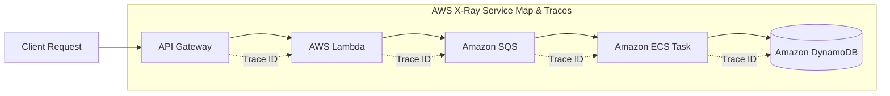

# 12 — DEVELOPER TOOLS KEYWORDS: CI/CD, X-Ray, CodePipeline, CodeBuild, CodeDeploy, CodeArtifact, CDK & SAM

---

## 📖 ĐỊNH NGHĨA CỐT LÕI CÁC DỊCH VỤ DEVELOPER TOOLS

| Dịch Vụ AWS | Bản Chất Kỹ Thuật (What is it?) | Sinh Ra Để Làm Gì (Core Job)? | 💡 Móc Nhớ Thần Chú |
|:---|:---|:---|:---|
| **AWS X-Ray** | Dịch vụ theo dõi phân tán (Distributed Tracing) và phân tích hiệu năng cuộc gọi request xuyên microservices. | Vẽ bản đồ tương tác dịch vụ (**Service Map**), đo độ trễ từng chặng, phát hiện nghẽn cổ chai và lỗi 4xx/5xx trong microservices và serverless. | *"Kính soi X-quang y tế: Soi xuyên thấu cơ thể để tìm đoạn xương nào đang bị rạn nứt."* |
| **AWS CodePipeline** | Dịch vụ điều phối quy trình phân phối phần mềm liên tục (CI/CD Orchestration) tự động hóa. | Ghép các giai đoạn **Source $\rightarrow$ Build $\rightarrow$ Test $\rightarrow$ Deploy** thành chuỗi tự động; hỗ trợ bước duyệt thủ công (**Manual Approval**). | *"Nhạc trưởng dàn nhạc CI/CD: Bắt nhịp cho từng nhạc công chơi đúng lúc, đúng bài bản."* |
| **AWS CodeBuild** | Dịch vụ biên dịch mã nguồn, chạy kiểm thử và đóng gói Docker image hoàn toàn serverless. | Thay thế máy chủ Jenkins tự dựng, tự động co giãn từ 0 máy lên hàng trăm máy build đồng thời, trả tiền theo số phút build. | *"Công xưởng gia công theo yêu cầu: Bấm nút là thuê thợ lắp ráp phần mềm, xong việc là giải tán."* |
| **AWS CodeDeploy** | Dịch vụ tự động hóa việc triển khai phiên bản phần mềm mới lên EC2, on-prem, ECS, và Lambda. | Triển khai không gián đoạn (Zero-downtime) với các chiến lược **In-Place, Blue/Green, Canary, Linear**; tự động Rollback khi có lỗi. | *"Đội ngũ kỹ thuật chuyển giao: Thay phiên bản mới nhẹ nhàng, thấy lỗi là bấm nút quay xe ngay."* |
| **AWS CodeArtifact** | Kho lưu trữ và quản lý các gói phần mềm (Artifact Package Repository) nội bộ doanh nghiệp. | Lưu và chia sẻ các gói thư viện (npm, PyPI, Maven, Gradle, NuGet); làm proxy đệm các thư viện public cho build trong VPC private. | *"Kho thuốc tây đạt chuẩn: Kiểm tra và lưu trữ thuốc nội bộ, cất giữ an toàn không sợ thiếu hàng."* |
| **AWS CloudShell** | Cửa sổ dòng lệnh Terminal chạy trực tiếp trên trình duyệt web tại AWS Management Console. | Thực thi nhanh các lệnh AWS CLI hoặc script mà không cần cài đặt công cụ hay cấu hình Access Key trên máy tính cá nhân (1 GB home). | *"Bàn phím phụ khẩn cấp: Ngồi máy tính lạ mở web là có sẵn terminal gõ lệnh ngay."* |
| **AWS CDK (Cloud Development Kit)** | Bộ khung phát triển hạ tầng đám mây bằng các ngôn ngữ lập trình phổ biến (TypeScript, Python, Java, C#, Go). | Viết mã nguồn IaC bằng cú pháp lập trình hướng đối tượng, tự động biên dịch (`cdk synth`) thành template CloudFormation. | *"Kiến trúc sư vẽ nhà bằng mã nguồn: Dùng vòng lặp for tạo 100 máy chủ chỉ bằng 3 dòng code."* |
| **AWS SAM (Serverless Application Model)** | Framework mã nguồn mở rút gọn chuyên dụng để định nghĩa và triển khai ứng dụng Serverless. | Viết template ngắn gọn cho Lambda, API Gateway, DynamoDB; hỗ trợ chạy thử nghiệm và debug Lambda cục bộ qua Docker. | *"Khuôn đúc bánh pizza serverless: Nhào nặn Lambda và API Gateway siêu nhanh trong 1 nốt nhạc."* |

---

## 🔍 AWS X-RAY — THEO DÕI VÀ PHÂN TÍCH HIỆU NĂNG PHÂN TÁN (TRACING)



- **Trace ID**: Mỗi request từ người dùng đi vào hệ thống được gán 1 mã Trace ID duy nhất và truyền qua HTTP Header (`X-Amzn-Trace-Id`) qua tất cả các microservices.
- **Thành Phần Của X-Ray**:
  - `Segment`: Đại diện cho công việc của một dịch vụ tính toán (VD: hàm Lambda, máy chủ EC2).
  - `Subsegment`: Chia nhỏ chi tiết bên trong Segment (VD: thời gian gọi câu lệnh SQL vào RDS, thời gian upload file lên S3).
  - `Annotations`: Các cặp key-value được **đánh chỉ mục (Indexed)** để người dùng tìm kiếm và lọc trace trên console (VD: `filter "game_id = 123"`).
  - `Metadata`: Các cặp key-value bổ sung nhưng **không được đánh chỉ mục** (không tìm kiếm được).
- **Service Map**: Biểu đồ trực quan hiển thị mối quan hệ phụ thuộc giữa các dịch vụ, đo độ trễ trung bình, và tô màu đỏ/vàng cho các service đang gặp lỗi (4xx Client Error, 5xx Server Error, Throttle).
- **Cài Đặt**:
  - AWS Lambda: Chỉ cần bấm nút bật **Active Tracing**.
  - Amazon EC2 / ECS: Bắt buộc phải chạy **X-Ray Daemon** (hoặc AWS Distro for OpenTelemetry - ADOT) và gắn IAM Role cấp quyền ghi log cho daemon.
- **Sampling Rules**: Cấu hình tỷ lệ lấy mẫu (VD: chỉ trace 5% tổng số request) để kiểm soát và tiết kiệm chi phí giám sát.

---

## 🚀 QUY TRÌNH CI/CD CHUẨN MỰC TRÊN AWS

```
[Mã nguồn] ───────────────> [Biên dịch & Test] ───────────────> [Triển khai]
AWS CodeCommit / GitHub      AWS CodeBuild                      AWS CodeDeploy
(Kích hoạt tự động)          (Dùng buildspec.yml)               (Dùng appspec.yml)
       │                             │                                 │
       └─────────────────────────────┴─────────────────────────────────┘
                                      │
                          [AWS CodePipeline Orchestration]
```

### 1. AWS CodeBuild — Serverless Build Engine
- Định nghĩa các bước biên dịch trong tệp tin **`buildspec.yml`** đặt tại **thư mục gốc (root)** của repository mã nguồn.
- **Các giai đoạn (Phases)**: `install` $\rightarrow$ `pre_build` $\rightarrow$ `build` $\rightarrow$ `post_build`.
- **Output Artifacts**: Xuất ra các file nhị phân nén zip lưu vào **Amazon S3**, hoặc build Docker image rồi đẩy (`docker push`) lên **Amazon ECR**.
- **Chạy Trong VPC**: Hỗ trợ gắn vào VPC Subnet để chạy unit test kết nối trực tiếp vào cơ sở dữ liệu RDS private hoặc cache ElastiCache nội bộ.

### 2. AWS CodeDeploy — Triển Khai Không Gián Đoạn (Zero-Downtime)
- Định nghĩa cấu hình triển khai trong tệp tin **`appspec.yml`** đặt tại thư mục gốc repository.
- **Triển Khai Lên EC2 / Máy Chủ On-Premises**:
  - Bắt buộc phải cài đặt **CodeDeploy Agent** trên từng máy chủ.
  - *In-Place Deployment*: Dừng ứng dụng trên từng máy $\rightarrow$ cài code mới $\rightarrow$ khởi động lại. (Tiết kiệm máy nhưng giảm năng lực phục vụ tạm thời).
  - *Blue/Green Deployment*: Tạo ra một nhóm máy chủ mới (Green fleet) với code mới $\rightarrow$ Kiểm tra OK $\rightarrow$ Chuyển hướng lưu lượng trên Load Balancer từ Blue sang Green $\rightarrow$ Xóa nhóm máy cũ.
  - Các cấu hình triển khai: `AllAtOnce` (nhanh nhất, downtime), `HalfAtATime`, `OneAtATime` (chậm nhưng an toàn).
- **Triển Khai Lên AWS Lambda & Amazon ECS**:
  - Tận dụng tính năng chuyển hướng lưu lượng thông minh (Traffic Shifting) thông qua **Lambda Alias**:
    - **Canary**: Chuyển trước một phần nhỏ traffic để thử nghiệm (VD: `Canary10Percent5Minutes` = chuyển 10% traffic trong 5 phút đầu, nếu không có lỗi mới chuyển nốt 90% còn lại).
    - **Linear**: Chuyển đều đặn lưu lượng theo từng bước tuyến tính (VD: `Linear10PercentEvery1Minute` = mỗi phút chuyển thêm 10% traffic cho đến khi đạt 100%).
    - **AllAtOnce**: Chuyển ngay 100% traffic sang phiên bản mới.
  - **Tự Động Rollback**: Cấu hình liên kết với **CloudWatch Alarms**. Nếu trong quá trình deploy mà tỷ lệ lỗi HTTP 5xx tăng vọt $\rightarrow$ CodeDeploy sẽ tự động hủy bỏ đợt triển khai và đảo ngược lưu lượng về phiên bản cũ ngay lập tức.

### 3. AWS CodePipeline — Nhạc Trưởng Tự Động Hóa
- Tự động hóa quy trình phát hành phần mềm mỗi khi có commit mới vào Git.
- **Cấu trúc Pipeline**: Bao gồm nhiều **Stages** (Source, Build, Test, Deploy), mỗi Stage chứa một hoặc nhiều **Actions** chạy tuần tự hoặc song song.
- **Manual Approval Action**: Tạm dừng pipeline tại một giai đoạn cụ thể (VD: trước khi deploy lên Production) và gửi thông báo qua **Amazon SNS** cho trưởng nhóm kiểm duyệt. Trưởng nhóm bấm nút Duyệt trên console thì pipeline mới chạy tiếp.
- **Cross-Account Deployment**: Cho phép CodePipeline ở tài khoản Shared Services triển khai ứng dụng an toàn sang tài khoản Production thông qua IAM Roles.

---

## 📦 KHO GÓI PHẦN MỀM: AWS CODEARTIFACT

- Giải quyết bài toán bảo mật và quản lý chuỗi cung ứng phần mềm (Software Supply Chain).
- Hỗ trợ các chuẩn quản lý package thông dụng: **npm (JavaScript), pip (Python), Maven / Gradle (Java), NuGet (.NET), Cargo (Rust)**.
- **Public Upstream Repositories**: CodeArtifact đóng vai trò làm Proxy và lưu cache cục bộ các thư viện tải từ các kho công cộng (như npmjs.org, PyPI).
  - *Lợi ích đề thi*: Giúp các máy chủ build nằm trong **Private Subnet không có Internet** vẫn có thể tải các thư viện mã nguồn mở một cách an toàn thông qua **VPC Interface Endpoint** nối vào CodeArtifact.

---

## 💻 HẠ TẦNG DƯỚI DẠNG MÃ BẰNG CODE: AWS CDK & AWS SAM

| Tiêu Chí So Sánh | AWS CDK (Cloud Development Kit) | AWS SAM (Serverless Application Model) |
|:---|:---|:---|
| **Mục đích chính** | Định nghĩa **toàn bộ mọi loại hạ tầng AWS** bằng ngôn ngữ lập trình hướng đối tượng. | Khung rút gọn chuyên biệt để định nghĩa và chạy thử nghiệm **Serverless Applications**. |
| **Ngôn ngữ sử dụng** | **TypeScript, Python, Java, C#, Go** | YAML hoặc JSON (Cú pháp mở rộng của CloudFormation) |
| **Bản chất bên dưới** | Lệnh `cdk synth` biên dịch mã nguồn thành **CloudFormation Template chuẩn** | Dùng chỉ thị `Transform: AWS::Serverless-2016-10-31` sinh ra CloudFormation |
| **Thành phần cốt lõi** | Các **Constructs**: L1 (tương ứng 1-1 CFN), L2 (có sẵn best practices), L3 (kiến trúc mẫu) | Định nghĩa gọn: `AWS::Serverless::Function`, `AWS::Serverless::Api`, `AWS::Serverless::SimpleTable` |
| **Chạy thử nghiệm local** | Hạn chế | Cung cấp **SAM CLI** mạnh mẽ: `sam local invoke`, `sam local start-api` giả lập Lambda qua Docker |

---

## 🚀 BẢNG CHỌN NHANH DEVELOPER TOOLS

| Tín Hiệu Đề Thi (Trigger Keywords) | ✅ Đáp Án Chuẩn |
|:---|:---|
| "trace requests across microservices", "find performance bottleneck", "service map" | **AWS X-Ray** |
| "orchestrate CI/CD pipeline", "automated release workflow", "manual approval step" | **AWS CodePipeline** |
| "serverless build service", "replace Jenkins", "build Docker image", "buildspec.yml" | **AWS CodeBuild** |
| "deploy applications to EC2/Lambda", "canary deployment with auto rollback", "appspec.yml" | **AWS CodeDeploy** |
| "manage internal software packages (npm, pip, maven) privately in VPC" | **AWS CodeArtifact** |
| "in-browser terminal with pre-installed AWS CLI, no local setup" | **AWS CloudShell** |
| "define infrastructure using programming languages (TypeScript/Python)" | **AWS CDK** |
| "simplified serverless framework, local testing of Lambda functions" | **AWS SAM** |
| "gradual traffic shifting for Lambda deployment (10% every minute)" | **CodeDeploy Linear / Canary Deployment** |
| "rollback deployment automatically when errors occur" | **CodeDeploy + CloudWatch Alarms Trigger** |

