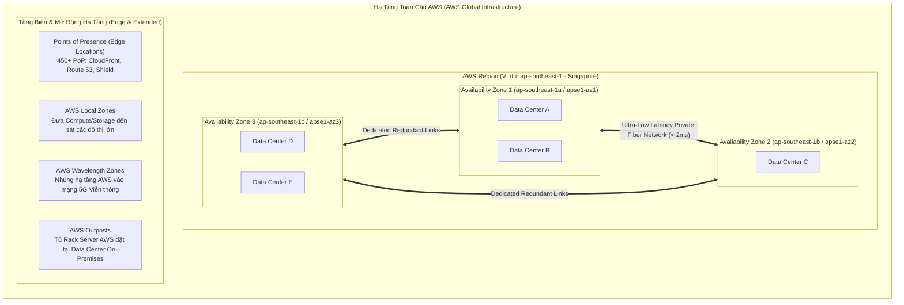
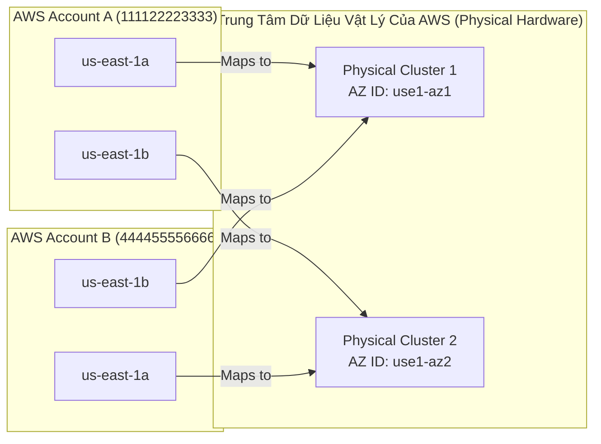
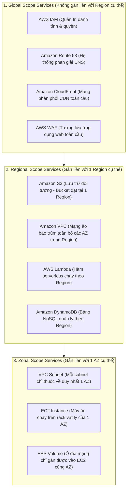

# Ghi Chú Bài Học: Chương 03 - Khởi Đầu Với Điện Toán Đám Mây AWS & Hạ Tầng Toàn Cầu (Getting Started with AWS)

> **Khóa học**: Ultimate AWS Certified Solutions Architect Associate  
> **Chương**: 03 - Getting started with AWS (Bài 08 đến Bài 10)  
> **Tài liệu tham chiếu liên quan**: [Bảng Thuật Ngữ Kỹ Thuật (GLOSSARY.md)](../GLOSSARY.md) | [AWS Well-Architected Framework](../AWS_Services/AWS_Well_Architected_Framework.md)

---

## 1. Tổng Quan Bài Học (Lesson Overview)

Chương mở đầu này cung cấp nền tảng vật lý và luận lý của điện toán đám mây Amazon Web Services (AWS): cách thức AWS xây dựng hạ tầng vật lý toàn cầu để cung cấp độ sẵn sàng cao (**High Availability**), khả năng chịu lỗi (**Fault Tolerance**), và độ trễ cực thấp cho người dùng cuối trên toàn cầu.

### Mục tiêu học tập cốt lõi
1. Nắm vững bản chất vật lý và luận lý của **AWS Regions**, **Availability Zones (AZs)**, và **Data Centers**.
2. Hiểu cơ chế phân bổ vật lý ẩn: **Logical AZ vs Physical AZ (AZ ID Mapping)** giữa các tài khoản AWS.
3. Phân biệt rõ các giải pháp mở rộng hạ tầng tại biên: **Points of Presence (Edge Locations)**, **AWS Local Zones**, **AWS Wavelength Zones**, và **AWS Outposts**.
4. Phân loại phạm vi hoạt động của dịch vụ AWS (**Global Scope**, **Region Scope**, **AZ Scope**).
5. Thành thạo các lệnh AWS CLI khám phá hạ tầng và cấu hình cảnh báo chi phí ban đầu (**Billing Alarms**).

---

## 2. Điểm Cốt Lõi Cần Nhớ (Key Takeaways)

1. **AWS Region**: Một vị trí địa lý độc lập trên thế giới (ví dụ: `ap-southeast-1` tại Singapore, `us-east-1` tại Bắc Virginia). Mỗi Region luôn có **tối thiểu 3 Availability Zones** biệt lập.
2. **Bốn yếu tố quyết định lựa chọn Region**:
   - **Tuân thủ pháp lý & Chủ quyền dữ liệu (Compliance & Data Residency)**: Dữ liệu khách hàng không được phép rời khỏi quốc gia sở tại theo luật (ví dụ: GDPR, HIPAA, Luật An ninh mạng).
   - **Độ trễ mạng (Latency)**: Vị trí đặt máy chủ càng gần tệp người dùng cuối thì thời gian phản hồi Round-Trip Time (RTT) càng thấp.
   - **Tính sẵn sàng của dịch vụ (Service Availability)**: Các dịch vụ hoặc tính năng mới nhất thường được ra mắt trước tại các Region trung tâm (`us-east-1`, `us-west-2`, `eu-west-1`).
   - **Chi phí vận hành (Pricing)**: Biểu phí giữa các Region chênh lệch đáng kể do thuế, chi phí điện năng và nhân công (ví dụ: São Paulo `sa-east-1` đắt hơn ~40-60% so với Bắc Virginia `us-east-1`).
3. **Availability Zone (AZ)**: Tập hợp từ một hoặc nhiều trung tâm dữ liệu vật lý (Data Centers) rời rạc, có nguồn điện (power grid), hệ thống làm mát và mạng viễn thông hoàn toàn tách biệt. Các AZ trong cùng một Region được kết nối với nhau qua đường truyền cáp quang riêng biệt băng thông cao với độ trễ một chiều cực thấp (< 1–2 ms).
4. **Cơ chế ẩn AZ ID Mapping**: Tên hiển thị AZ (ví dụ `us-east-1a`) chỉ mang tính luận lý (Logical AZ) theo từng tài khoản. Cùng ký hiệu `us-east-1a` nhưng tài khoản A và tài khoản B có thể đang trỏ vào hai trung tâm dữ liệu vật lý hoàn toàn khác nhau để AWS tránh dồn tải lệch. Để chỉ định đích xác trung tâm dữ liệu vật lý chung giữa nhiều tài khoản, bắt buộc phải dùng **AZ ID** (ví dụ: `use1-az1`).
5. **Điểm hiện diện tại biên (Points of Presence - PoP / Edge Locations)**: Hơn 450+ điểm hiện diện toàn cầu giúp phân phối nội dung tĩnh/động với độ trễ thấp thông qua **Amazon CloudFront**, tối ưu định tuyến qua **AWS Global Accelerator**, và lọc mã độc tại biên với **AWS WAF** & **AWS Shield**.

---

## 3. Kiến Trúc & Cơ Chế Hoạt Động Chuyên Sâu (Under-the-Hood Mechanisms & Deep Dive)

### 3.1. Sơ đồ phân tầng Hạ tầng Vật lý Toàn cầu của AWS



---

### 3.2. Cơ chế ánh xạ Logical AZ sang Physical AZ ID (AZ ID Mapping)

Khi tạo một tài nguyên (như Subnet) trong VPC, người dùng thấy các nhãn như `us-east-1a`, `us-east-1b`. Tuy nhiên, nhằm phân tán nguy cơ quá tải phần cứng nếu tất cả khách hàng cùng chọn `us-east-1a`, hệ thống quản phối phần cứng nội bộ của AWS thực hiện phép băm và ánh xạ độc lập cho từng AWS Account:



> **Hệ quả kiến trúc**: Khi bạn chia sẻ tài nguyên mạng (qua AWS RAM - Resource Access Manager hoặc VPC Peering) giữa nhiều AWS Account trong doanh nghiệp, bạn **phải dựa trên `AZ ID`** (như `use1-az1`) để đảm bảo các máy ảo thực sự nằm cùng một cụm vật lý nhằm tối ưu độ trễ và tránh phát sinh phí truyền dữ liệu liên AZ (Cross-AZ Data Transfer Fee).

---

### 3.3. So sánh các hình thức mở rộng hạ tầng AWS

| Giải pháp hạ tầng | Bản chất phần cứng | Độ trễ mục tiêu | Kịch bản kiến trúc tối ưu |
| :--- | :--- | :--- | :--- |
| **AWS Region & AZ** | Cụm Data Centers quy mô khổng lồ do AWS sở hữu và vận hành hoàn toàn | Chuẩn đám mây (< 10–50ms tới người dùng vùng) | Mọi workload sản xuất tiêu chuẩn, ứng dụng doanh nghiệp có tính chịu lỗi cao. |
| **Edge Locations (PoP)** | Các máy chủ biên đặt tại các điểm giao cắt Internet quốc tế (IXPs) | < 10ms tới người dùng toàn cầu | Caching nội dung tĩnh/động (CloudFront), phân giải DNS (Route 53), bảo vệ chống DDoS (Shield). |
| **AWS Local Zones** | Phần cứng compute/storage của AWS đặt tại các trung tâm dân cư/công nghiệp lớn không có Region | < 5–10ms tới người dùng cục bộ | Render đồ họa thời gian thực, truyền phát video trực tiếp, giao dịch tài chính tốc độ cao. |
| **AWS Wavelength** | Phần cứng máy chủ AWS được đặt trực tiếp bên trong trung tâm dữ liệu mạng 5G viễn thông (Verizon, Vodafone...) | < 5ms qua kết nối 5G | Ứng dụng điều khiển xe tự hành, thiết bị bay không người lái, phân tích video IoT biên, AR/VR di động. |
| **AWS Outposts** | Tủ rack máy chủ vật lý chứa phần cứng chuẩn AWS được lắp đặt ngay trong Data Center On-Premises của khách hàng | < 1ms cục bộ | Xử lý dữ liệu tại chỗ khắt khe, tuân thủ lưu trữ dữ liệu y tế/tài chính không được ra Internet. |

---

## 4. Lệnh, Cấu Hình & Mã Nguồn Thực Tế (Commands, Config & Code)

### 4.1. Lệnh AWS CLI khám phá Regions và AZ ID Mapping

```bash
# Liệt kê tất cả các Region đang khả dụng kèm trạng thái kích hoạt (Opt-in status)
aws ec2 describe-regions --all-regions --query "Regions[].{RegionName:RegionName, OptInStatus:OptInStatus}" --output table

# Khám phá mối quan hệ giữa Logical AZ (ZoneName) và Physical AZ ID (ZoneId) tại Region Singapore
aws ec2 describe-availability-zones \
    --region ap-southeast-1 \
    --query "AvailabilityZones[].{ZoneName:ZoneName, ZoneId:ZoneId, State:State}" \
    --output table

# Kiểm tra danh tính tài khoản hiện tại và quyền IAM đang dùng
aws sts get-caller-identity
```

---

### 4.2. Cấu hình CloudWatch Billing Alarm cảnh báo chi phí (AWS CloudFormation)

Khi mới làm quen với AWS, việc tạo cảnh báo chi phí vượt ngưỡng (Billing Metric Alarm) trên Region `us-east-1` (nơi lưu trữ duy nhất các chỉ số thanh toán toàn cầu) là bước bắt buộc:

```yaml
AWSTemplateFormatVersion: '2010-09-09'
Description: 'CloudWatch Billing Alarm khi chi phí vượt mức 10 USD'

Parameters:
  AlarmThresholdUSD:
    Type: Number
    Default: 10
    Description: 'Ngưỡng chi phí (USD) để kích hoạt cảnh báo'
  NotificationEmail:
    Type: String
    Description: 'Email nhận thông báo khi vượt ngưỡng'

Resources:
  BillingAlertTopic:
    Type: AWS::SNS::Topic
    Properties:
      TopicName: 'aws-billing-alarm-topic'
      Subscription:
        - Protocol: email
          Endpoint: !Ref NotificationEmail

  EstimatedChargesAlarm:
    Type: AWS::CloudWatch::Alarm
    Properties:
      AlarmName: 'Billing-Alarm-Exceeding-10-USD'
      AlarmDescription: 'Cảnh báo khi tổng chi phí ước tính tháng vượt ngưỡng'
      MetricName: EstimatedCharges
      Namespace: AWS/Billing
      Statistic: Maximum
      Period: 21600 # 6 giờ kiểm tra một lần
      EvaluationPeriods: 1
      Threshold: !Ref AlarmThresholdUSD
      ComparisonOperator: GreaterThanThreshold
      Dimensions:
        - Name: Currency
          Value: USD
      AlarmActions:
        - !Ref BillingAlertTopic
```

---

## 5. Tình Huống Thực Tiễn & Mẫu Kiến Trúc (Real-World Scenarios & Design Patterns)

### Tình huống 1: Ứng dụng Tài chính Yêu Cầu Độ Trễ Dưới 3ms & Không Được Rời Biên Giới
- **Bối cảnh**: Một sàn giao dịch chứng khoán tại Hà Nội yêu cầu các thuật toán máy tính đặt lệnh phải đạt độ trễ mạng dưới 3ms và toàn bộ dữ liệu giao dịch tài chính bắt buộc phải lưu trữ vật lý trên lãnh thổ Việt Nam.
- **Giải pháp**: Nếu AWS chưa có Region tại Việt Nam, doanh nghiệp triển khai **AWS Outposts** đặt tại Trung tâm dữ liệu của sàn giao dịch hoặc sử dụng **AWS Local Zones** (nếu có điểm tại địa phương). Các dịch vụ lưu trữ và tính toán chạy trực tiếp trên Outposts cục bộ, kết nối an toàn với mạng AWS qua AWS Direct Connect.

### Tình huống 2: Thiết Kế High Availability Cho Hệ Thống E-Commerce
- **Bối cảnh**: Doanh nghiệp bán lẻ trực tuyến cần đảm bảo trang web luôn hoạt động 99.99% ngay cả khi một trung tâm dữ liệu gặp sự cố cháy nổ hoặc mất điện diện rộng.
- **Giải pháp**: Triển khai kiến trúc **Multi-AZ**:
  - Tầng Web/App: Máy chủ EC2 chạy trong Auto Scaling Group trải đều trên **ít nhất 3 Availability Zones** phía sau một Application Load Balancer.
  - Tầng Dữ liệu: Sử dụng **Amazon RDS Multi-AZ** (đồng bộ dữ liệu liên tục sang Standby DB ở AZ khác) hoặc **Amazon Aurora** (tự động phân tán 6 bản sao dữ liệu trên 3 AZs).

---

## 6. Mối Quan Hệ Giữa Các Dịch Vụ (Service Relationships & Ecosystem)

Các dịch vụ AWS được chia thành 3 cấp độ phạm vi hoạt động (Scope):



---

## 7. Câu Hỏi Ôn Tập, Bẫy Thi & Tự Đánh Giá (Review, Exam Traps & Self-Assessment)

### Câu hỏi:

1. **Một công ty đa quốc gia thiết lập 2 tài khoản AWS (Account A và Account B) trong cùng một AWS Organization. Đội kỹ thuật triển khai máy chủ EC2 tại Subnet có gắn `us-east-1a` trên Account A và Subnet có gắn `us-east-1a` trên Account B. Tuy nhiên, họ nhận thấy độ trễ giao tiếp giữa 2 máy chủ này cao bất thường và phát sinh phí Cross-AZ Data Transfer. Nguyên nhân gốc rễ là gì?**
2. **Một ứng dụng streaming thể thao trực tiếp yêu cầu xử lý các frame video từ camera tại sân vận động với độ trễ phản hồi < 5ms trên các thiết bị di động kết nối mạng 5G. Giải pháp kiến trúc nào là tối ưu nhất?**
3. **Số lượng Availability Zones tối thiểu có trong mỗi AWS Region là bao nhiêu?**
4. **Bạn muốn tạo một CloudWatch Billing Alarm để theo dõi tổng chi phí tài khoản hàng ngày. Bạn bắt buộc phải cấu hình Alarm này tại AWS Region nào?**
5. **Dịch vụ nào sau đây có phạm vi hoạt động ở cấp độ toàn cầu (Global Scope) mà không phụ thuộc vào một Region cụ thể?**
   - A. Amazon EC2
   - B. Amazon Virtual Private Cloud (VPC)
   - C. AWS Identity and Access Management (IAM)
   - D. Amazon Elastic Block Store (EBS)

---

### Đáp án (Self-Assessment Answers):

<details>
<summary>👉 Nhấp vào đây để xem đáp án và giải thích chi tiết</summary>

1. **Giải thích**: Tên Zone Name (như `us-east-1a`) là **Logical AZ** được AWS gán ngẫu nhiên cho từng tài khoản để cân bằng tải vật lý. Để đảm bảo 2 instance ở 2 account thực sự nằm trong cùng một cụm Data Center vật lý, đội kỹ thuật phải đối chiếu và chọn cùng **AZ ID** (ví dụ `use1-az1`), không dựa vào Zone Name.
2. **Giải thích**: Sử dụng **AWS Wavelength Zones**. AWS Wavelength nhúng trực tiếp năng lực tính toán và lưu trữ của AWS vào trung tâm dữ liệu viễn thông của nhà mạng 5G, giúp luồng dữ liệu từ thiết bị di động không cần đi qua Internet công cộng ra ngoài Region mà được xử lý ngay tại chặng 5G đầu tiên.
3. **Giải thích**: **Tối thiểu 3 Availability Zones** (theo tiêu chuẩn thiết kế kiến trúc của AWS để đảm bảo tính sẵn sàng cao và khả năng bầu chọn Quorum trong các hệ thống phân tán).
4. **Giải thích**: Bắt buộc phải tạo tại **`us-east-1` (US East - N. Virginia)** vì toàn bộ dữ liệu và chỉ số thanh toán (Billing Metric: `AWS/Billing`) của tất cả tài khoản AWS trên thế giới đều được thu thập và tổng hợp độc quyền tại Region này.
5. **Giải thích**: **C. AWS IAM**. IAM là dịch vụ Global; người dùng, nhóm, vai trò và chính sách được khởi tạo một lần và tự động đồng bộ hóa trên toàn cầu. Trong khi đó VPC và S3 bucket có phạm vi Regional, còn EC2 Instance và EBS Volume có phạm vi Zonal.
</details>

---

## 8. Nguồn Trích Dẫn Bài Giảng & Tài Liệu Liên Quan (Source References)

- **Source Transcripts**:
  - [08 - AWS Cloud Overview - Regions & AZ.md](../AWS_Resources/03%20-%20Getting%20started%20with%20AWS/08%20-%20AWS%20Cloud%20Overview%20-%20Regions%20%26%20AZ.md)
  - [09 - [Important] AWS Console UI Update.md](../AWS_Resources/03%20-%20Getting%20started%20with%20AWS/09%20-%20%5BImportant%5D%20AWS%20Console%20UI%20Update.md)
  - [10 - Tour of the AWS Console & Services in AWS.md](../AWS_Resources/03%20-%20Getting%20started%20with%20AWS/10%20-%20Tour%20of%20the%20AWS%20Console%20%26%20Services%20in%20AWS.md)
- **Tài liệu tham chiếu nội bộ**:
  - [Bảng Thuật Ngữ Kỹ Thuật GLOSSARY.md](../GLOSSARY.md)
  - [AWS Well-Architected Framework](../AWS_Services/AWS_Well_Architected_Framework.md)
