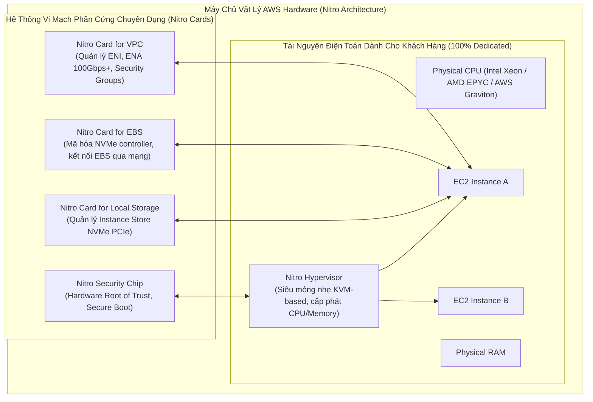
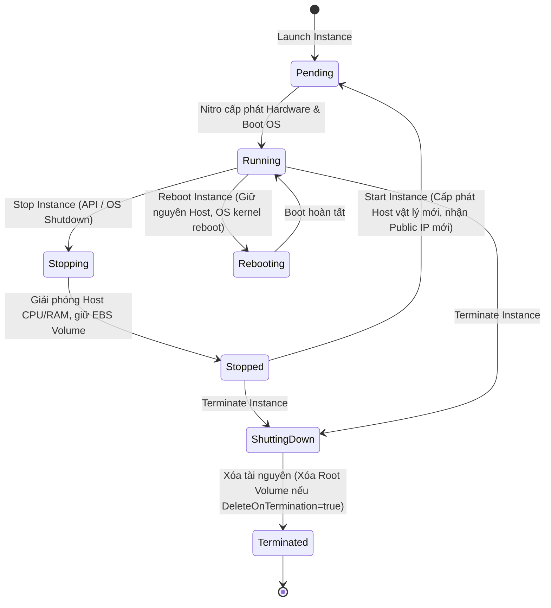
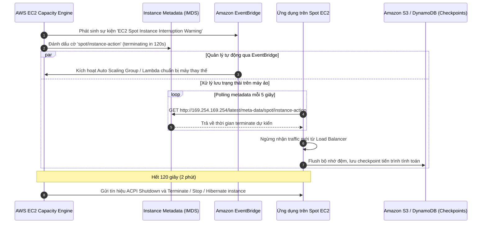
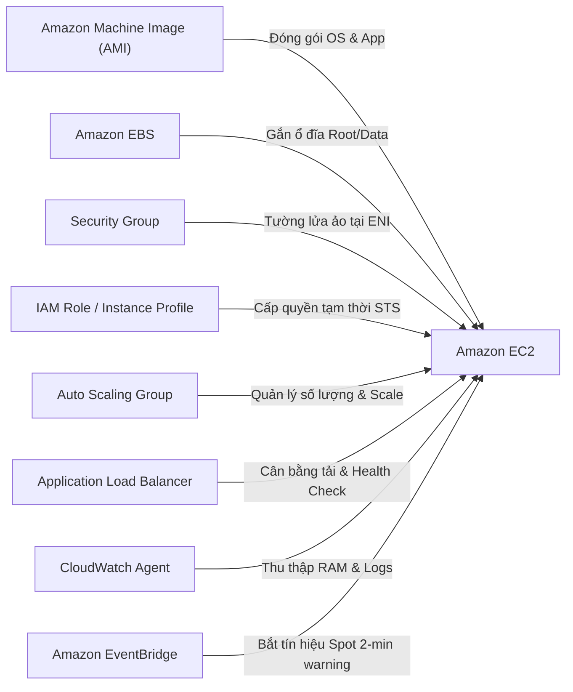

# Ghi Chú Bài Học: Chương 05 - Nền Tảng Máy Chủ Ảo Amazon EC2 (EC2 Fundamentals)

> **Khóa học**: Ultimate AWS Certified Solutions Architect Associate  
> **Chương**: 05 - EC2 Fundamentals (Bài 31 đến Bài 46)  
> **Tài liệu tham chiếu liên quan**: [AWS Service Document: Amazon EC2](../AWS_Services/EC2_Elastic_Compute_Cloud.md)

---

## 1. Tổng Quan Bài Học (Lesson Overview)

### Chủ đề chính
Chương này trang bị nền tảng chuyên sâu về dịch vụ điện toán đám mây cốt lõi **Amazon Elastic Compute Cloud (Amazon EC2)**:
- Cơ chế khởi tạo, quản lý vòng đời máy chủ ảo (**Lifecycle: Pending, Running, Stopping, Stopped, Terminated**).
- Tự động hóa cài đặt phần mềm khi khởi động máy ảo với **EC2 User Data**.
- Phân loại kiến trúc vi xử lý và dòng máy chủ (**Instance Families & Types: General, Compute, Memory, Storage, HPC**).
- Tường lửa ảo phân tán **Security Groups** và danh mục các cổng mạng kinh điển (**Classic Ports**).
- Các phương thức kết nối an toàn: **SSH**, **EC2 Instance Connect (EIC)**, và **EC2 Instance Connect Endpoint (EICE)**.
- Phân quyền nguyên tắc đặc quyền tối thiểu thông qua **IAM Roles for EC2** kết hợp **Instance Profile**.
- Ma trận các tùy chọn mua sắm tối ưu chi phí (**Purchasing Options**): On-Demand, Reserved Instances, Savings Plans, Dedicated Hosts/Instances, và **Spot Instances & Spot Fleet**.

### Mục tiêu học tập
1. Hiểu sâu kiến trúc phần cứng và ảo hóa nền tảng **AWS Nitro System** (Nitro Card, Nitro Hypervisor, Nitro Security Chip).
2. Phân tích chính xác cơ chế bảo mật của **Security Groups** (Stateful connection tracking) so với Subnet NACLs.
3. Thiết kế chiến lược kết hợp **Spot Instances** và **On-Demand** với cơ chế đón nhận cảnh báo thu hồi trước 2 phút (**2-Minute Interruption Notice**).
4. Phân biệt cơ chế bảo mật chống tấn công SSRF giữa **IMDSv1** và **IMDSv2**.
5. Làm chủ các lệnh **AWS CLI v2** để cấu hình và truy vấn máy chủ ảo.

---

## 2. Điểm Cốt Lõi Cần Nhớ (Key Takeaways)

1. **EC2 User Data**: Chạy tự động **1 lần duy nhất** trong lần khởi động đầu tiên (first boot cycle) với đặc quyền `root`. File log thực thi được lưu tại `/var/log/cloud-init-output.log`.
2. **Security Groups**:
   - Hoạt động ở cấp độ **Card mạng ảo (ENI)** của máy ảo, độc lập với hệ điều hành.
   - **Stateful (Có lưu trạng thái)**: Khi gói tin Inbound được phép đi vào, gói tin phản hồi (Outbound return traffic) được tự động cho phép đi ra bất kể luật Outbound.
   - **Chỉ có luật ALLOW**: Mặc định chặn toàn bộ Inbound và mở toàn bộ Outbound (`0.0.0.0/0`).
   - Có thể tham chiếu (reference) trực tiếp đến **Security Group ID** khác để thiết lập kiến trúc đa tầng (Multi-tier Security).
3. **Purchasing Options (Tối ưu FinOps)**:
   - *On-Demand*: Thanh toán theo giây/giờ, không cam kết, đắt nhất, phù hợp ứng dụng mới hoặc tải đột biến khó đoán.
   - *Reserved Instances (RI) / Savings Plans*: Cam kết 1 hoặc 3 năm, tiết kiệm tới 72%. Savings Plans linh hoạt hơn (cam kết $/giờ).
   - *Spot Instances*: Tiết kiệm tới 90% từ tài nguyên nhàn rỗi của AWS, có thể bị thu hồi bất kỳ lúc nào với cảnh báo trước 2 phút.
   - *Dedicated Hosts*: Cung cấp máy chủ vật lý riêng biệt, cho phép kiểm soát socket/core để tối ưu chi phí bản quyền phần mềm (BYOL - Microsoft, Oracle).
4. **IAM Instance Profile**: Tuyệt đối không bao giờ hardcode AWS Access Key / Secret Key vào User Data hoặc mã nguồn máy ảo; luôn gắn IAM Role qua Instance Profile để nhận temporary credentials tự động xoay vòng.
5. **IMDSv2**: Bắt buộc sử dụng token session thông qua HTTP `PUT` để ngăn chặn lỗ hổng SSRF (Server-Side Request Forgery).

---

## 3. Kiến Trúc & Cơ Chế Hoạt Động Chuyên Sâu (Under-the-Hood Mechanisms & Deep Dive)

### 3.1. Bản Chất Kiến Trúc Phần Cứng: AWS Nitro System

Trước khi có Nitro, các máy ảo EC2 sử dụng Xen Hypervisor truyền thống, trong đó phần mềm ảo hóa tiêu tốn tài nguyên CPU và RAM của máy chủ để quản lý I/O mạng, lưu trữ và bảo mật.  
**AWS Nitro System** đã tách toàn bộ các tác vụ quản lý này sang các vi mạch phần cứng chuyên dụng (**Nitro Cards**):



- **Lợi ích**: 100% năng lực CPU và bộ nhớ RAM của phần cứng được giải phóng cho các máy ảo của khách hàng, loại bỏ hiện tượng "ồn ào từ hàng xóm" (noisy neighbor) và giảm triệt để độ trễ I/O mạng/ổ đĩa.

---

### 3.2. Vòng Đời Máy Chủ Ảo (EC2 Instance Lifecycle)



- **Stop vs Terminate**:
  - Khi **Stop**: Máy chủ giải phóng CPU và RAM vật lý (ngừng tính tiền EC2 compute). Tuy nhiên, ổ cứng EBS vẫn tồn tại và tiếp tục tính phí lưu trữ EBS. Máy ảo khi **Start** lại sẽ được gán sang một máy chủ vật lý mới và nhận một Public IPv4 mới (trừ khi dùng Elastic IP).
  - Khi **Reboot**: Máy ảo không đổi máy chủ vật lý, giữ nguyên Public IP và Private IP.

---

### 3.3. Cơ Chế Thu Hồi Spot Instance & Quy Trình Xử Lý 2 Phút (Spot Interruption Workflow)

Khi nhu cầu On-Demand tăng vọt hoặc giá Spot vượt quá mức giá trần của bạn, AWS sẽ gửi thông báo thu hồi (**Spot Instance Interruption Notice**) trước **2 phút**:



---

### 3.4. So Sánh Bảo Mật IMDSv1 vs IMDSv2 (Under the Hood)

Instance Metadata Service (IMDS) cung cấp thông tin về IP, AMI, Instance Profile Credentials tại địa chỉ Link-local IP `169.254.169.254`:
- **IMDSv1 (Không khuyến nghị)**: Sử dụng phương thức HTTP `GET` đơn giản. Kẻ tấn công có thể lợi dụng lỗi **Server-Side Request Forgery (SSRF)** trong ứng dụng web (ví dụ ứng dụng tải file từ URL) để đọc trộm IAM Credentials tạm thời của máy chủ.
- **IMDSv2 (Bắt buộc theo chuẩn bảo mật)**: Sử dụng phiên làm việc hướng trạng thái (Session-oriented). Client bắt buộc phải gửi request `PUT` kèm header `X-aws-ec2-metadata-token-ttl-seconds` để lấy token, sau đó đính kèm token vào header `X-aws-ec2-metadata-token` trong các lệnh `GET`. Hơn nữa, mặc định gói tin IMDSv2 có **IP TTL = 1** (Hop Limit = 1), ngăn chặn các router hoặc reverse proxy / container chuyển tiếp gói tin metadata ra ngoài.

---

## 4. Lệnh, Cấu Hình & Mã Nguồn Thực Tế (Commands, Config & Code)

### 4.1. Script EC2 User Data Khởi Tạo Web Server Nginx Chuẩn Doanh Nghiệp

```bash
#!/bin/bash
# Thiết lập chế độ ghi log chi tiết cho script
exec > >(tee /var/log/user-data.log|logger -t user-data -s 2>/dev/console) 2>&1

echo "[INFO] Bat dau qua trinh bootstrap EC2 instance tai $(date)..."

# 1. Cap nhat he dieu hanh Amazon Linux 2023
dnf update -y

# 2. Cai dat Nginx web server
dnf install -y nginx

# 3. Lay thong tin Instance qua IMDSv2
TOKEN=$(curl -s -X PUT "http://169.254.169.254/latest/api/token" -H "X-aws-ec2-metadata-token-ttl-seconds: 21600")
INSTANCE_ID=$(curl -s -H "X-aws-ec2-metadata-token: $TOKEN" http://169.254.169.254/latest/meta-data/instance-id)
AZ=$(curl -s -H "X-aws-ec2-metadata-token: $TOKEN" http://169.254.169.254/latest/meta-data/placement/availability-zone)
LOCAL_IPV4=$(curl -s -H "X-aws-ec2-metadata-token: $TOKEN" http://169.254.169.254/latest/meta-data/local-ipv4)

# 4. Tao trang chu dong hien thi thong tin he thong
cat <<EOF > /usr/share/nginx/html/index.html
<!DOCTYPE html>
<html>
<head><title>AWS EC2 Production Node</title></head>
<body style="font-family: Arial; text-align: center; margin-top: 50px;">
  <h1 style="color: #FF9900;">Amazon EC2 Instance Health: OK</h1>
  <p><strong>Instance ID:</strong> $INSTANCE_ID</p>
  <p><strong>Availability Zone:</strong> $AZ</p>
  <p><strong>Private IP:</strong> $LOCAL_IPV4</p>
</body>
</html>
EOF

# 5. Khoi chay va kich hoat Nginx tu dong chay khi restart
systemctl enable nginx
systemctl start nginx

echo "[INFO] Bootstrap EC2 hoan tat thanh cong vao $(date)!"
```

---

### 4.2. Quản Trị EC2 Bằng AWS CLI v2

```bash
# 1. Khoi tao may ao EC2 bat buoc ap dung IMDSv2 (Chong SSRF)
aws ec2 run-instances \
    --image-id ami-0c55b159cbfafe1f0 \
    --instance-type t3.micro \
    --key-name ProductionKeyPair \
    --security-group-ids sg-0123456789abcdef0 \
    --subnet-id subnet-0a1b2c3d4e5f6g7h8 \
    --iam-instance-profile Name=EC2-CloudWatch-Role \
    --metadata-options "HttpTokens=required,HttpPutResponseHopLimit=1,HttpEndpoint=enabled" \
    --tag-specifications 'ResourceType=instance,Tags=[{Key=Environment,Value=Production}]'

# 2. Kiem tra canh bao Spot Interruption tu ben trong Instance (IMDSv2)
TOKEN=$(curl -s -X PUT "http://169.254.169.254/latest/api/token" -H "X-aws-ec2-metadata-token-ttl-seconds: 60")
curl -s -H "X-aws-ec2-metadata-token: $TOKEN" http://169.254.169.254/latest/meta-data/spot/instance-action

# 3. Tao Security Group Rule cho phep traffic tu 1 Security Group khac (Security Group Chaining)
aws ec2 authorize-security-group-ingress \
    --group-id sg-0backendAppGroup123 \
    --protocol tcp \
    --port 8080 \
    --source-group sg-0frontendAlbGroup456
```

---

## 5. Tình Huống Thực Tiễn & Mẫu Kiến Trúc (Real-World Scenarios & Design Patterns)

### Tình huống 1: Khắc phục sự cố kết nối SSH (Troubleshooting SSH)
- **Triệu chứng A**: `ssh: connect to host ... port 22: Connection timed out`.
  - *Nguyên nhân cốt lõi*: Gói tin bị chặn ở tầng mạng.
  - *Kiểm tra*: Security Group Inbound rule chưa mở port 22, Subnet Route Table chưa có đường dẫn ra Internet Gateway (`0.0.0.0/0 -> igw-xxx`), hoặc NACL bị chặn.
- **Triệu chứng B**: `Host key verification failed` hoặc `Permission denied (publickey)`.
  - *Nguyên nhân*: File khóa `.pem` có quyền quá mở (phải chạy `chmod 400 key.pem`), dùng sai username (Amazon Linux dùng `ec2-user`, Ubuntu dùng `ubuntu`, CentOS dùng `centos`), hoặc chọn sai Key Pair khi tạo máy.

### Tình huống 2: Mô Hình Kiến Trúc Phối Hợp Mua Sắm (Cost-Optimized Compute Fleet)
- Doanh nghiệp vận hành hệ thống thương mại điện tử với tải nền (baseline) ổn định 20 máy ảo, vào giờ cao điểm tăng lên 80 máy ảo, và chạy batch processing phân tích đơn hàng vào nửa đêm:
  - **Tải nền (Baseline 20 máy)**: Sử dụng **Compute Savings Plans (1 hoặc 3 năm)** để nhận mức chiết khấu cao nhất (tới 72%).
  - **Tải co giãn ban ngày (+60 máy)**: Sử dụng **On-Demand Instances** kết hợp Auto Scaling Group để đảm bảo tính sẵn sàng 100% không bị gián đoạn giao dịch của khách hàng.
  - **Tải phân tích Batch nửa đêm**: Sử dụng **Spot Fleet** với cấu hình đa dạng loại máy (diversified instance types) để tiết kiệm 80-90% chi phí.

---

## 6. Mối Quan Hệ Giữa Các Khái Niệm / Dịch Vụ (Service Relationships & Ecosystem)



---

## 7. Câu Hỏi Ôn Tập, Bẫy Thi & Tự Đánh Giá (Review, Exam Traps & Self-Assessment)

### Câu hỏi:
1. Bạn kết nối SSH vào một máy ảo EC2 mới tạo nhưng terminal đứng im và sau đó báo lỗi `ssh: connect to host ... port 22: Connection timed out`. Thành phần hạ tầng nào có khả năng cao nhất là nguyên nhân gây ra lỗi này?
2. Sự khác biệt cơ bản nhất về mặt an ninh giữa **IMDSv1** và **IMDSv2** là gì, và tại sao IMDSv2 lại ngăn chặn được tấn công SSRF?
3. Bạn cấu hình một Auto Scaling Group gồm các Spot Instances để chạy tác vụ xử lý video. Khi nhận được tín hiệu cảnh báo thu hồi trước 2 phút qua EventBridge, máy ảo cần thực hiện hành động gì để không làm mất tiến trình render?
4. Một ứng dụng cơ sở dữ liệu đòi hỏi license tính theo số lượng lõi vi xử lý vật lý (Physical CPU Cores) và nhà cung cấp phần mềm yêu cầu bạn phải chứng minh được ứng dụng đang chạy trên phần cứng vật lý chuyên biệt riêng biệt. Tùy chọn mua sắm EC2 nào là bắt buộc?
5. Nếu bạn Stop và sau đó Start một máy chủ EC2 (sử dụng EBS-backed volume), những thuộc tính nào sau đây sẽ **THAY ĐỔI**: Private IP, Public IP, Elastic IP, Volume ID?

---

### Đáp án & Giải thích chi tiết:

<details>
<summary>👉 Nhấp vào đây để xem đáp án và phân tích chi tiết</summary>

1. **Nguyên nhân**: Lỗi `Connection timed out` chứng tỏ gói tin SYN bị DROP hoàn toàn trước khi nhận được phản hồi. Cần kiểm tra:
   - **Security Group Inbound Rules**: Chưa mở port 22 từ IP công khai của bạn.
   - **VPC Route Table**: Subnet thiếu đường định tuyến `0.0.0.0/0` trỏ tới Internet Gateway (IGW).
   - *(Bẫy thi: Nếu báo `Connection Refused` thì SG đã thông nhưng dịch vụ SSH daemon trên OS chưa chạy; nếu báo `Permission Denied` thì SG và mạng đã thông nhưng sai Key Pair hoặc sai username).*
2. **IMDSv2** sử dụng phương thức hướng phiên (Session-oriented request). Nó yêu cầu thực hiện HTTP `PUT` với header `X-aws-ec2-metadata-token-ttl-seconds` để lấy token phiên trước khi có thể đọc dữ liệu bằng HTTP `GET`. Các cuộc tấn công SSRF thông thường chỉ kích hoạt được các lệnh `GET` đơn giản mà không thể tự ý chèn các custom header của request `PUT`, do đó không thể đánh cắp metadata. Hơn nữa, IMDSv2 quy định IP Hop Limit mặc định là 1, ngăn chặn việc chuyển tiếp gói tin ra ngoài container hoặc reverse proxy.
3. Ứng dụng trên máy ảo cần lắng nghe cảnh báo thu hồi từ Instance Metadata Service (`spot/instance-action`) hoặc Amazon EventBridge. Khi nhận cảnh báo, ứng dụng lập tức:
   - Ngừng nhận việc mới từ hàng đợi SQS.
   - Flush bộ nhớ đệm và ghi checkpoint trạng thái xử lý video hiện tại lên Amazon S3 hoặc DynamoDB.
   - Thông báo cho hệ thống để Spot Instance khác có thể tiếp tục xử lý từ checkpoint đó.
4. Bắt buộc chọn **Dedicated Hosts** (không phải Dedicated Instances). Dedicated Hosts cấp quyền kiểm soát vật lý đối với máy chủ socket/core, cho phép quản lý affinity và đáp ứng các yêu cầu tuân thủ bản quyền phần mềm phức tạp (Bring Your Own License - BYOL).
5. **Public IP** sẽ bị THAY ĐỔI (được thu hồi về pool công cộng của AWS và cấp một Public IP mới khi Start lại). Các thành phần **Private IP**, **Elastic IP** (nếu đã gán), và **Volume ID** của ổ đĩa EBS gắn kèm đều được **GIỮ NGUYÊN**.
</details>

---

## 8. Nguồn Trích Dẫn Bài Giảng & Tài Liệu Liên Quan (Source References)

- **Source Transcripts**:
  - [32 - EC2 Basics.md](../AWS_Resources/05%20-%20EC2%20Fundamentals/32%20-%20EC2%20Basics.md)
  - [33 - Create an EC2 Instance with EC2 User Data to hav.md](../AWS_Resources/05%20-%20EC2%20Fundamentals/33%20-%20Create%20an%20EC2%20Instance%20with%20EC2%20User%20Data%20to%20hav.md)
  - [34 - EC2 Instance Types Basics.md](../AWS_Resources/05%20-%20EC2%20Fundamentals/34%20-%20EC2%20Instance%20Types%20Basics.md)
  - [35 - Security Groups & Classic Ports Overview.md](../AWS_Resources/05%20-%20EC2%20Fundamentals/35%20-%20Security%20Groups%20%26%20Classic%20Ports%20Overview.md)
  - [41 - SSH Troubleshooting.md](../AWS_Resources/05%20-%20EC2%20Fundamentals/41%20-%20SSH%20Troubleshooting.md)
  - [44 - EC2 Instance Purchasing Options.md](../AWS_Resources/05%20-%20EC2%20Fundamentals/44%20-%20EC2%20Instance%20Purchasing%20Options.md)
  - [45 - Spot Instances & Spot Fleet.md](../AWS_Resources/05%20-%20EC2%20Fundamentals/45%20-%20Spot%20Instances%20%26%20Spot%20Fleet.md)
- **Tài liệu chuyên sâu liên quan**:
  - [Chuyên đề Master: Amazon Elastic Compute Cloud (EC2)](../AWS_Services/EC2_Elastic_Compute_Cloud.md)
