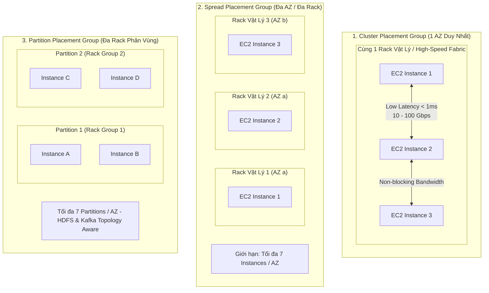
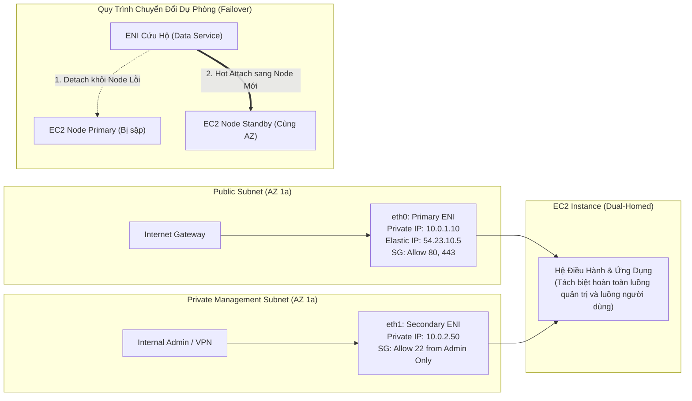
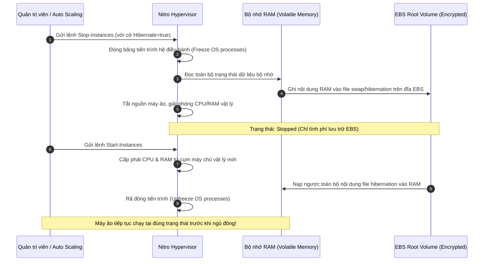
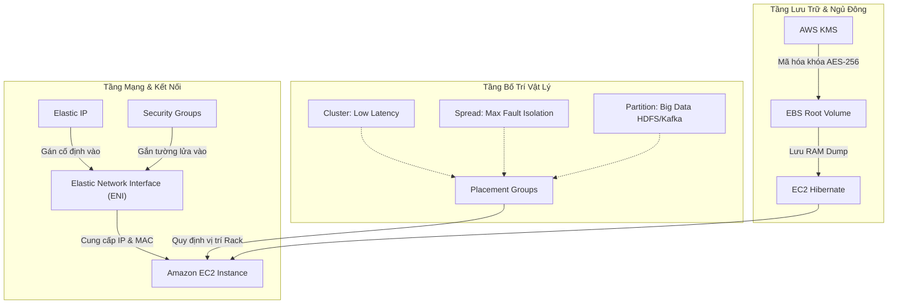

# Ghi Chú Bài Học: Chương 06 - Kỹ Thuật Máy Chủ EC2 Nâng Cao (EC2 Solutions Architect Associate)

> **Khóa học**: Ultimate AWS Certified Solutions Architect Associate  
> **Chương**: 06 - EC2 - Solutions Architect Associate (Bài 47 đến Bài 55)  
> **Tài liệu tham chiếu liên quan**: [AWS Service Document: Amazon EC2](../AWS_Services/EC2_Elastic_Compute_Cloud.md)

---

## 1. Tổng Quan Bài Học (Lesson Overview)

### Chủ đề chính
Chương này đi sâu vào các cấu trúc hạ tầng mạng và điện toán nâng cao của máy chủ ảo **Amazon EC2**, đóng vai trò trọng tâm trong các bài thi chứng chỉ AWS Solutions Architect và thiết kế hệ thống sản xuất cấp doanh nghiệp:
- Cơ chế phân định địa chỉ mạng: **Private IPv4**, **Public IPv4**, và **Elastic IP (EIP)**.
- Chiến lược bố trí vật lý máy chủ **EC2 Placement Groups**: **Cluster**, **Spread**, và **Partition**.
- Card mạng ảo **Elastic Network Interfaces (ENI)**: cấu tạo, cơ chế đa card mạng (Multi-homed) và giải pháp chuyển đổi dự phòng nhanh (**Network Failover**).
- Chế độ ngủ đông **EC2 Hibernate**: nguyên lý lưu trạng thái RAM vào ổ cứng EBS, điều kiện tiên quyết và trường hợp sử dụng.

### Mục tiêu học tập
1. Phân biệt chính xác cơ chế hoạt động, vòng đời và cách tính phí của Private IP, Public IP và Elastic IP.
2. Làm chủ kiến trúc và giới hạn kỹ thuật của 3 loại **Placement Group** để tối ưu hóa hiệu năng mạng hoặc độ chịu lỗi vật lý.
3. Cấu hình và vận hành **Elastic Network Interface (ENI)** cho các kịch bản mạng phân tầng và cứu hộ dịch vụ.
4. Hiểu bản chất quy trình **Hibernate** (ngủ đông) và cách thức bảo mật dữ liệu RAM khi lưu xuống đĩa EBS.
5. Thực thi các lệnh AWS CLI v2 để tự động hóa quản lý Placement Groups và ENI.

---

## 2. Điểm Cốt Lõi Cần Nhớ (Key Takeaways)

1. **Vòng đời Public IPv4**: Khi máy ảo EC2 bị **Stop** rồi **Start** lại, địa chỉ Public IPv4 cũ sẽ bị thu hồi về pool công cộng của AWS và máy ảo nhận một Public IPv4 mới. Để giữ nguyên địa chỉ IP công khai cố định, bắt buộc phải sử dụng **Elastic IP**.
2. **Elastic IP nhàn rỗi (Idle Cost)**: AWS tính phí đối với Elastic IP được cấp phát nhưng **không gắn vào máy ảo đang chạy**, nhằm ngăn chặn tình trạng găm giữ và lãng phí dải địa chỉ IPv4 toàn cầu.
3. **Placement Groups (Quy hoạch vị trí vật lý)**:
   - **Cluster**: Gộp các máy ảo vào **cùng 1 rack phần cứng trong duy nhất 1 AZ**; cung cấp băng thông mạng cực cao (lên tới 100 Gbps) và độ trễ dưới 1 mili-giây. Nhược điểm: rủi ro sập toàn bộ cụm nếu rack hỏng.
   - **Spread**: Phân tán các máy ảo sang các **rack phần cứng, nguồn điện và switch mạng hoàn toàn độc lập**; tối đa **7 máy ảo / AZ**; tối ưu hóa khả năng chịu lỗi (Fault Tolerance) cho cơ sở dữ liệu quan trọng.
   - **Partition**: Chia phân vùng rack vật lý; tối đa **7 partitions / AZ**; mỗi partition chứa nhiều máy ảo nhưng không dùng chung rack với partition khác. Phù hợp cho cụm phân tán dữ liệu lớn (Hadoop, Kafka, Cassandra).
4. **ENI (Elastic Network Interface)**:
   - Là card mạng ảo gắn với **1 Subnet (và do đó gắn với 1 AZ duy nhất)**.
   - Có thể tháo ra (detach) và gắn nóng (hot attach) sang một máy ảo khác trong **cùng Availability Zone**.
5. **EC2 Hibernate**:
   - Ghi toàn bộ nội dung của bộ nhớ RAM xuống **EBS Root Volume**.
   - Bắt buộc ổ đĩa Root phải **được mã hóa (Encrypted)** và dung lượng phải đủ lớn để chứa toàn bộ dung lượng RAM.
   - Khi khởi động lại, máy ảo khôi phục trạng thái hoạt động tức thì mà không mất thời gian boot lại hệ điều hành hay nạp lại cache bộ nhớ.

---

## 3. Kiến Trúc & Cơ Chế Hoạt Động Chuyên Sâu (Under-the-Hood Mechanisms & Deep Dive)

### 3.1. Bản Chất Vật Lý Của 3 Loại Placement Groups



- **Cơ chế hoạt động**:
  - Khi bạn khởi tạo máy ảo vào một **Cluster Placement Group**, AWS Nitro Fabric sẽ chọn các server blade nằm trong cùng một switch quang để đạt tốc độ bisectional bandwidth cao nhất. Nếu AWS hết dung lượng máy chủ trong rack đó, lệnh launch máy mới sẽ trả về lỗi `InsufficientCapacityError`.
  - Với **Spread Placement Group**, thuật toán cấp phát đảm bảo mỗi máy ảo nhận một giá đỡ phần cứng (hardware rack), nguồn điện (PDU) và switch riêng biệt, triệt tiêu hoàn toàn rủi ro Single Point of Failure (SPOF) ở tầng phần cứng.

---

### 3.2. Cấu Trúc Đa Card Mạng Ảo ENI & Mẫu Kiến Trúc Network Failover



- **Nguyên lý chuyển giao (Failover)**: Thay vì cấu hình lại DNS (phải chờ TTL lan tỏa), kỹ sư có thể lập trình tự động tháo ENI của máy chủ bị sự cố và gắn ngay vào máy chủ dự phòng trong cùng Availability Zone. Địa chỉ Private IP, Secondary IPs, Elastic IP và Security Groups đi theo ENI, giúp các ứng dụng khác kết nối không bị gián đoạn cấu hình.

---

### 3.3. Vòng Đời & Quy Trình Kỹ Thuật EC2 Hibernate



---

## 4. Lệnh, Cấu Hình & Mã Nguồn Thực Tế (Commands, Config & Code)

### 4.1. Tạo và Khởi Động Máy Ảo Vào Cluster Placement Group

```bash
# 1. Tao moi mot Cluster Placement Group
aws ec2 create-placement-group \
    --group-name "HPC-Financial-Cluster" \
    --strategy cluster

# 2. Khoi tao may ao Compute Optimized vao Placement Group vua tao
aws ec2 run-instances \
    --image-id ami-0c55b159cbfafe1f0 \
    --instance-type c6i.4xlarge \
    --placement GroupName="HPC-Financial-Cluster" \
    --key-name ProdKey \
    --subnet-id subnet-0123456789abcdef0 \
    --count 2
```

---

### 4.2. Tạo, Gán Nóng và Tháo Rời Card Mạng Ảo ENI

```bash
# 1. Tao mot ENI moi trong Private Subnet
ENI_ID=$(aws ec2 create-network-interface \
    --subnet-id subnet-0123456789abcdef0 \
    --description "Secondary-Admin-Interface" \
    --groups sg-0123456789abcdef0 \
    --query "NetworkInterface.NetworkInterfaceId" \
    --output text)
echo "Da tao ENI: $ENI_ID"

# 2. Gan nong (Hot Attach) ENI vao may ao EC2 o vi tri card mang thu 2 (DeviceIndex=1)
ATTACH_ID=$(aws ec2 attach-network-interface \
    --network-interface-id $ENI_ID \
    --instance-id i-0123456789abcdef0 \
    --device-index 1 \
    --query "AttachmentId" \
    --output text)
echo "Attachment ID: $ATTACH_ID"

# 3. Thao roi (Detach) ENI khi can chuyen sang may ao du phong
aws ec2 detach-network-interface \
    --attachment-id $ATTACH_ID \
    --force
```

---

### 4.3. Khởi Tạo Máy Ảo Có Hỗ Trợ Chế Độ Ngủ Đông (Hibernate)

```bash
# Luu y: Root Volume bat buoc phai Encrypted va HibernateOptions phai Configured=true
aws ec2 run-instances \
    --image-id ami-0c55b159cbfafe1f0 \
    --instance-type m5.large \
    --block-device-mappings '[{"DeviceName":"/dev/xvda","Ebs":{"VolumeSize":30,"Encrypted":true}}]' \
    --hibernation-options Configured=true \
    --key-name ProdKey \
    --subnet-id subnet-0123456789abcdef0
```

---

## 5. Tình Huống Thực Tiễn & Mẫu Kiến Trúc (Real-World Scenarios & Design Patterns)

### Tình huống 1: Hệ Thống Giao Dịch Tần Suất Cao (High-Frequency Trading)
- **Bài toán**: Ứng dụng phân tích sổ lệnh giao dịch chứng khoán cần truyền dữ liệu giữa các node tính toán với độ trễ dưới 1ms và băng thông mạng 100 Gbps.
- **Giải pháp**:
  - Triển khai toàn bộ cụm máy ảo dòng `c6in.metal` hoặc `c6i.32xlarge` vào một **Cluster Placement Group** trong cùng một Availability Zone.
  - Sử dụng card mạng nâng cao **Elastic Fabric Adapter (EFA)** để vượt qua kernel hệ điều hành (OS bypass), giảm thiểu biến thiên độ trễ (latency jitter).

### Tình huống 2: Ứng Dụng Xử Lý Dữ Liệu Khởi Động Chậm (Long Initialization Time)
- **Bài toán**: Ứng dụng Java enterprise mất tới 15 phút để khởi động hệ điều hành, load thư viện và nạp các bảng dữ liệu tĩnh 20 GB vào bộ nhớ đệm trước khi sẵn sàng nhận request. Khi cần bảo trì máy hoặc tiết kiệm chi phí ngoài giờ làm việc, việc tắt và bật lại máy gây downtime nghiêm trọng.
- **Giải pháp**:
  - Kích hoạt tính năng **EC2 Hibernate**.
  - Trước khi kết thúc ngày làm việc, gửi lệnh Hibernate. Toàn bộ 20 GB cache trong RAM được lưu xuống ổ đĩa EBS đã mã hóa.
  - Sáng hôm sau khi bật lại máy ảo, ứng dụng chỉ mất dưới 60 giây để khôi phục và phục vụ người dùng ngay lập tức với đầy đủ bộ nhớ đệm đã nạp sẵn.

---

## 6. Mối Quan Hệ Giữa Các Khái Niệm / Dịch Vụ (Service Relationships & Ecosystem)



---

## 7. Câu Hỏi Ôn Tập, Bẫy Thi & Tự Đánh Giá (Review, Exam Traps & Self-Assessment)

### Câu hỏi:
1. Bạn đang thiết kế một cụm máy chủ phân tích tài chính đòi hỏi độ trễ trao đổi dữ liệu giữa các máy tính phải dưới 1 millisecond. Bạn nên chọn loại Placement Group nào?
2. Giới hạn tối đa số lượng máy chủ ảo EC2 có thể đặt trong một Spread Placement Group trên một Availability Zone là bao nhiêu, và tại sao lại có giới hạn này?
3. Bạn có thể tháo một Elastic Network Interface (ENI) từ một máy ảo ở AZ `ap-southeast-1a` và gắn sang một máy ảo khác ở AZ `ap-southeast-1b` được không? Giải thích bản chất kỹ thuật bên dưới.
4. Tại sao khi cấu hình tính năng EC2 Hibernate, AWS lại bắt buộc ổ đĩa EBS Root Volume phải được mã hóa (Encrypted)?
5. Bạn có 3 Elastic IP đang được cấp phát trong tài khoản AWS. Cả 3 IP này đều được gán vào 3 máy ảo EC2 đang ở trạng thái `stopped`. Tài khoản của bạn có bị tính phí cho các Elastic IP này không?
6. Một cụm phân tán Apache Kafka gồm 15 brokers được triển khai trên AWS. Loại Placement Group nào phù hợp nhất để đảm bảo các brokers không bị ảnh hưởng đồng thời khi xảy ra lỗi phần cứng rack, đồng thời vẫn tương thích với mô hình phân vùng dữ liệu?

---

### Đáp án & Giải thích chi tiết:

<details>
<summary>👉 Nhấp vào đây để xem đáp án và phân tích chi tiết</summary>

1. **Cluster Placement Group**. Toàn bộ máy ảo nằm trong cùng một rack phần cứng vật lý tại một Availability Zone duy nhất, cung cấp băng thông non-blocking tối đa và độ trễ dưới 1 mili-giây.
2. Tối đa **7 máy ảo EC2 trên mỗi Availability Zone**. Giới hạn này xuất phát từ bản chất vật lý: AWS phân bổ mỗi máy ảo vào một tủ rack phần cứng độc lập có nguồn điện và switch mạng riêng biệt. Con số 7 tương ứng với số lượng rack vật lý tách biệt được đảm bảo an toàn tuyệt đối trong một cụm trung tâm dữ liệu.
3. **KHÔNG THỂ**. Một ENI được tạo ra bên trong một Subnet cụ thể, mà mỗi Subnet trong AWS VPC chỉ tồn tại trên **duy nhất một Availability Zone**. Do đó, ENI chỉ có thể di chuyển và gắn kết giữa các máy ảo nằm trong **cùng một Availability Zone**.
4. Vì khi Hibernate, toàn bộ nội dung của bộ nhớ RAM (bao gồm các dữ liệu kinh doanh nhạy cảm, mã token phiên làm việc, thậm chí cả khóa mã hóa đang lưu tạm trong bộ nhớ) được ghi trực tiếp ra ổ đĩa lưu trữ khối EBS. Việc bắt buộc mã hóa ổ đĩa (EBS Encryption) đảm bảo rằng dữ liệu nhạy cảm đó luôn được bảo vệ an toàn ở trạng thái nghỉ (At-Rest) bằng chuẩn mã hóa phần cứng AES-256.
5. **CÓ BỊ TÍNH PHÍ**. AWS chỉ miễn phí Elastic IP khi nó được gắn vào một máy ảo đang ở trạng thái **`running`**. Khi máy ảo ở trạng thái `stopped`, Elastic IP đó bị coi là nhàn rỗi (idle) và sẽ bị tính phí theo giờ để tránh việc chiếm dụng tài nguyên địa chỉ IPv4.
6. **Partition Placement Group**. Partition Placement Group cho phép chia cụm máy chủ thành tối đa 7 phân vùng (partitions) trên mỗi AZ. Mỗi partition đại diện cho một cụm rack riêng biệt. Bạn có thể ánh xạ các Kafka broker partition vào các partition của placement group để đảm bảo tính sẵn sàng cao, loại bỏ rủi ro sập toàn bộ bản sao partition khi một rack bị sự cố.
</details>

---

## 8. Nguồn Trích Dẫn Bài Giảng & Tài Liệu Liên Quan (Source References)

- **Source Transcripts**:
  - [47 - Private vs Public vs Elastic IP.md](../AWS_Resources/06%20-%20EC2%20-%20Solutions%20Architect%20Asso/47%20-%20Private%20vs%20Public%20vs%20Elastic%20IP.md)
  - [49 - EC2 Placement Groups.md](../AWS_Resources/06%20-%20EC2%20-%20Solutions%20Architect%20Asso/49%20-%20EC2%20Placement%20Groups.md)
  - [51 - Elastic Network Interfaces (ENI) - Overview.md](../AWS_Resources/06%20-%20EC2%20-%20Solutions%20Architect%20Asso/51%20-%20Elastic%20Network%20Interfaces%20%28ENI%29%20-%20Overview.md)
  - [54 - EC2 Hibernate.md](../AWS_Resources/06%20-%20EC2%20-%20Solutions%20Architect%20Asso/54%20-%20EC2%20Hibernate.md)
- **Tài liệu chuyên sâu liên quan**:
  - [Chuyên đề Master: Amazon Elastic Compute Cloud (EC2)](../AWS_Services/EC2_Elastic_Compute_Cloud.md)
  - [Chuyên đề Master: Amazon VPC & Mạng Phân Tán](../AWS_Services/VPC_Networking.md)
