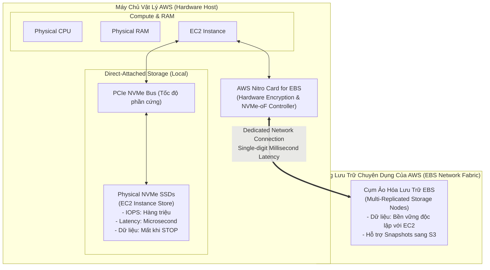
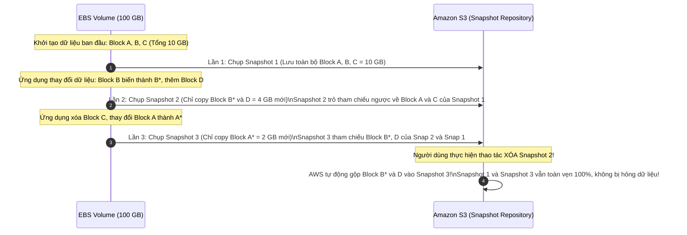
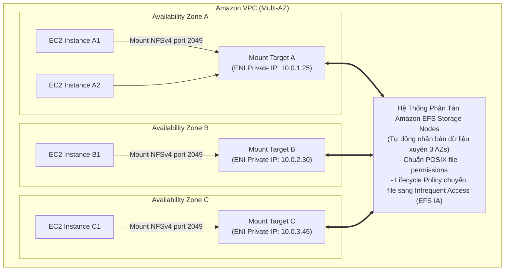
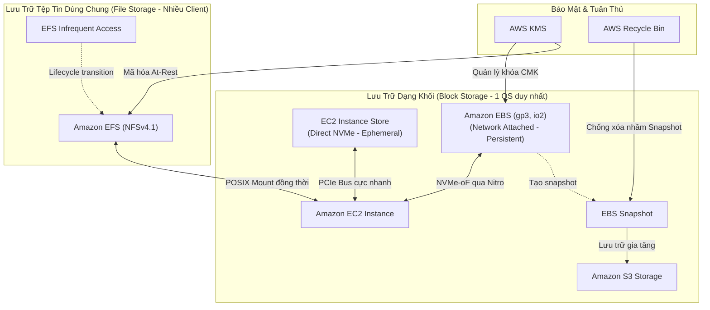

# Ghi Chú Bài Học: Chương 07 - Lưu Trữ Dữ Liệu Gắn Kèm Máy Chủ EC2 (EC2 Instance Storage)

> **Khóa học**: Ultimate AWS Certified Solutions Architect Associate  
> **Chương**: 07 - EC2 Instance Storage (Bài 56 đến Bài 69)  
> **Tài liệu tham chiếu liên quan**: [AWS Service Document: Amazon EBS, EFS & Instance Store](../AWS_Services/EBS_EFS_Storage.md)

---

## 1. Tổng Quan Bài Học (Lesson Overview)

### Chủ đề chính
Chương này phân tích toàn diện các giải pháp lưu trữ dữ liệu dành cho máy chủ ảo Amazon EC2:
- Ổ lưu trữ khối qua mạng **Amazon Elastic Block Store (EBS)**: bản chất phân vùng khối, ràng buộc theo Availability Zone, và các phân loại ổ đĩa (**gp2, gp3, io1, io2 Block Express, st1, sc1**).
- Bản chụp nhanh khối **EBS Snapshots**: cơ chế sao lưu gia tăng (**Incremental Backups**), tính năng khôi phục tức thì **Fast Snapshot Restore (FSR)**, lưu trữ giá rẻ **Snapshot Archive**, và thùng rác cứu hộ **Recycle Bin**.
- Ảnh máy mẫu **Amazon Machine Images (AMI)**: cấu trúc, quy trình tạo Golden Image từ EC2, và sao chép xuyên Region.
- Ổ cứng phần cứng tốc độ cao **EC2 Instance Store**: kiến trúc kết nối trực tiếp qua bus PCIe, tính chất tạm thời (**Ephemeral Storage**).
- Tính năng gắn đồng thời nhiều máy ảo **EBS Multi-Attach** và cơ chế mã hóa trong suốt **EBS Encryption**.
- Hệ thống tệp tin mạng dùng chung **Amazon Elastic File System (EFS)**: giao thức NFSv4, kiến trúc Multi-AZ, và các lớp lưu trữ tối ưu chi phí (Standard vs Infrequent Access).

### Mục tiêu học tập
1. Phân biệt được sự khác nhau căn bản về kiến trúc vật lý giữa **EBS** (Network-attached) và **Instance Store** (Direct-attached PCIe).
2. Nắm vững cơ chế sao lưu gia tăng của **EBS Snapshots** trên Amazon S3 và quy trình chuyển vùng dữ liệu xuyên AZ/Region.
3. So sánh chính xác hiệu năng (IOPS, Throughput) và chi phí của các dòng ổ đĩa EBS để ra quyết định thiết kế tối ưu.
4. Hiểu rõ trường hợp sử dụng và yêu cầu kỹ thuật của **EBS Multi-Attach** (Clustered File Systems).
5. Thiết kế giải pháp chia sẻ dữ liệu tệp tin cho hàng trăm máy ảo đồng thời bằng **Amazon EFS**.

---

## 2. Điểm Cốt Lõi Cần Nhớ (Key Takeaways)

1. **EBS gắn chặt với 1 AZ (AZ-locked)**: Một ổ đĩa EBS chỉ có thể gắn vào máy ảo EC2 nằm trong **cùng một Availability Zone**. Muốn chuyển sang AZ khác hoặc Region khác, bắt buộc phải theo chuỗi: `Tạo Snapshot` ➔ `Tạo Volume từ Snapshot tại AZ đích` (hoặc `Copy Snapshot sang Region khác`).
2. **`gp3` tối ưu hơn `gp2`**: Rẻ hơn 20%, có sẵn 3,000 IOPS và 125 MB/s throughput miễn phí; cho phép tăng dung lượng, IOPS và Throughput hoàn toàn độc lập mà không cần phải mở rộng kích thước ổ đĩa.
3. **Instance Store = Mất dữ liệu khi Stop (Ephemeral)**: Ổ cứng vật lý gắn trực tiếp vào máy chủ vật lý, cung cấp hàng triệu IOPS với độ trễ microsecond; tuy nhiên **mất sạch dữ liệu khi Stop hoặc Terminate** máy ảo (Reboot thì không mất). Chỉ dùng cho cache, buffer, temp tables, và scratchpad.
4. **Boot Volume chỉ dùng được SSD**: Các dòng ổ cứng HDD (`st1` - Throughput Optimized, `sc1` - Cold HDD) **không bao giờ** được phép dùng làm ổ đĩa khởi động (Boot volume).
5. **EBS Multi-Attach**: Chỉ hỗ trợ trên các dòng SSD cao cấp `io1` và `io2` trong cùng 1 AZ; cho phép tối đa 16 máy ảo gắn cùng lúc; ứng dụng bắt buộc phải dùng hệ thống tệp tin dạng cụm (Clustered File System như GFS2, OCFS2) để chống xung đột ghi dữ liệu.
6. **EFS = Multi-AZ NFSv4**: Hệ thống tệp tin mạng chuẩn POSIX, tự động co giãn dung lượng không giới hạn, hỗ trợ hàng ngàn kết nối đồng thời từ nhiều AZ, chỉ hỗ trợ máy ảo Linux (không hỗ trợ Windows native).

---

## 3. Kiến Trúc & Cơ Chế Hoạt Động Chuyên Sâu (Under-the-Hood Mechanisms & Deep Dive)

### 3.1. Bản Chất Vật Lý: Instance Store vs Amazon EBS



- **Cơ chế vật lý**:
  - **Instance Store** là các thanh ổ cứng NVMe cắm trực tiếp vào mainboard của máy chủ vật lý. Do đi qua bus PCIe cục bộ, nó đạt tốc độ truyền tải cực đại nhưng gắn liền với vòng đời của phần cứng đó. Khi bạn bấm "Stop", AWS giải phóng phần cứng nên dữ liệu trên Instance Store bị xóa trắng hoàn toàn.
  - **Amazon EBS** bản chất là một hệ thống mạng lưu trữ phân tán (Storage Area Network - SAN) kết nối với máy ảo thông qua giao thức mạng NVMe over Fabrics (NVMe-oF) được tăng tốc bởi Nitro Card chuyên dụng. Do đó, ổ đĩa EBS tồn tại độc lập với máy chủ.

---

### 3.2. Cơ Chế Sao Lưu Khối Gia Tăng Của EBS Snapshots Trên S3



---

### 3.3. Kiến Trúc Hệ Thống Tệp Tin Dùng Chung Amazon EFS (Multi-AZ)



---

## 4. Lệnh, Cấu Hình & Mã Nguồn Thực Tế (Commands, Config & Code)

### 4.1. Tạo Ổ Đĩa EBS gp3 Đã Mã Hóa và Gắn Vào EC2 Bằng AWS CLI

```bash
# 1. Tao o dia EBS gp3 dung luong 100GB, 4000 IOPS, 250 MB/s tai us-east-1a
VOLUME_ID=$(aws ec2 create-volume \
    --availability-zone us-east-1a \
    --volume-type gp3 \
    --size 100 \
    --iops 4000 \
    --throughput 250 \
    --encrypted \
    --kms-key-id alias/aws/ebs \
    --query "VolumeId" \
    --output text)
echo "Da tao EBS Volume: $VOLUME_ID"

# 2. Cho o dia chuyen sang trang thai 'available'
aws ec2 wait volume-available --volume-ids $VOLUME_ID

# 3. Gan nong (Attach) o dia vao may ao EC2 o thiet bi /dev/sdf
aws ec2 attach-volume \
    --volume-id $VOLUME_ID \
    --instance-id i-0123456789abcdef0 \
    --device /dev/sdf
```

---

### 4.2. Khởi Tạo Hệ Thống Tệp Tin và Mount Trên Linux

```bash
# Kiem tra danh sach block devices (tren Nitro se co ten /dev/nvme1n1)
lsblk

# Kiem tra xem o dia da co filesystem chua (neu chi tra ve 'data' tuc la chua co)
sudo file -s /dev/nvme1n1

# Dinh dang o dia voi filesystem XFS
sudo mkfs -t xfs /dev/nvme1n1

# Tao thu muc mount va tien hanh mount
sudo mkdir -p /mnt/data
sudo mount /dev/nvme1n1 /mnt/data

# Lay ma UUID cua o dia de cau hinh tu dong mount khi khoi dong lai OS (/etc/fstab)
UUID=$(sudo blkid -s UUID -o value /dev/nvme1n1)
echo "UUID=$UUID /mnt/data xfs defaults,nofail 0 2" | sudo tee -a /etc/fstab
```

---

### 4.3. Mount Hệ Thống Tệp Tin Amazon EFS Qua EFS Mount Helper

```bash
# Cai dat amazon-efs-utils
sudo dnf install -y amazon-efs-utils

# Tao thu muc mount
sudo mkdir -p /mnt/efs-shared

# Mount EFS voi giao thuc TLS ma hoa du lieu khi truyen dan
sudo mount -t efs -o tls fs-0123456789abcdef0:/ /mnt/efs-shared
```

---

## 5. Tình Huống Thực Tiễn & Mẫu Kiến Trúc (Real-World Scenarios & Design Patterns)

### Tình huống 1: Di Chuyển Dữ Liệu EBS Xuyên Availability Zone & Region
- **Bài toán**: Doanh nghiệp cần chuyển một cơ sở dữ liệu MySQL chạy trên EBS từ `us-east-1a` sang `us-east-1b` để dự phòng thảm họa, và sao lưu sang `eu-west-1` (Ireland) để tuân thủ pháp lý.
- **Quy trình giải quyết chuẩn**:
  1. Dừng dịch vụ MySQL để đảm bảo tính nhất quán của dữ liệu (Consistency).
  2. Tạo bản chụp **EBS Snapshot** từ ổ đĩa hiện tại.
  3. Để chuyển sang `us-east-1b`: Tạo một EBS Volume mới trực tiếp từ Snapshot đó với tham số `--availability-zone us-east-1b`.
  4. Để chuyển sang `eu-west-1`: Dùng lệnh `aws ec2 copy-snapshot` sang Region `eu-west-1` (có thể đổi KMS key để mã hóa lại bằng khóa của Region đích). Sau đó tạo Volume mới tại Region đích.

### Tình huống 2: Chia Sẻ Dữ Liệu Web WordPress / Drupal (Shared Media Assets)
- **Bài toán**: Website thương mại điện tử chạy trên cụm Auto Scaling Group gồm 10 máy ảo EC2 phân bổ trên 3 Availability Zones. Khách hàng tải ảnh sản phẩm lên máy nào thì tất cả các máy khác phải lập tức đọc được ảnh đó.
- **Giải pháp**:
  - Tạo một hệ thống **Amazon EFS** với Mount Target tại cả 3 Availability Zones.
  - Gắn thư mục `/wp-content/uploads` của mỗi máy ảo EC2 vào EFS qua giao thức NFSv4.
  - Bật chính sách **EFS Lifecycle Management** để tự động chuyển các hình ảnh không được truy cập sau 30 ngày sang lớp **EFS Infrequent Access (IA)**, giúp tiết kiệm tới 92% chi phí lưu trữ.

---

## 6. Mối Quan Hệ Giữa Các Khái Niệm / Dịch Vụ (Service Relationships & Ecosystem)



---

## 7. Câu Hỏi Ôn Tập, Bẫy Thi & Tự Đánh Giá (Review, Exam Traps & Self-Assessment)

### Câu hỏi:
1. Bạn có một website WordPress chạy trên cụm 5 máy ảo EC2 phân tán ở 2 Availability Zones. Tất cả các máy ảo cần phải đọc và ghi đồng thời vào một thư mục tải ảnh chung (`/wp-content/uploads`). Giải pháp lưu trữ nào là phù hợp nhất và tại sao không thể dùng EBS thông thường?
2. Sự khác biệt cốt lõi nhất về mặt kiến trúc và cách tính phí giữa ổ đĩa Amazon EBS `gp2` và `gp3` là gì?
3. Nếu bạn xóa (Terminate) một máy ảo EC2, chuyện gì sẽ xảy ra với ổ đĩa Root Volume và các ổ đĩa phụ (Attached Data Volumes) gắn kèm của nó?
4. Một ứng dụng xử lý đồ họa đòi hỏi ổ đĩa có tốc độ đọc ghi cực đại lên tới 2,000,000 IOPS với độ trễ microsecond. Dữ liệu này chỉ là các file render trung gian và có thể tạo lại từ file gốc nếu gặp sự cố phần cứng. Bạn nên chọn loại lưu trữ nào?
5. Bạn có thể sử dụng ổ đĩa `st1` (Throughput Optimized HDD) làm ổ đĩa khởi động (Boot volume) cho máy ảo Linux không? Tại sao?
6. Khi bạn xóa một bản snapshot trung gian (ví dụ Snapshot 2) trong chuỗi 3 snapshot gia tăng trên S3, điều gì sẽ xảy ra với các snapshot còn lại (Snapshot 1 và Snapshot 3)?

---

### Đáp án & Giải thích chi tiết:

<details>
<summary>👉 Nhấp vào đây để xem đáp án và phân tích chi tiết</summary>

1. **Amazon EFS (Elastic File System)**. Vì EFS là hệ thống lưu trữ tệp tin mạng (NFSv4) được thiết kế nguyên bản để hỗ trợ hàng ngàn máy ảo đọc ghi đồng thời xuyên qua nhiều Availability Zones. Ổ đĩa EBS thông thường bị khóa cứng vào duy nhất 1 AZ và theo mặc định chỉ có thể gắn vào 1 máy ảo duy nhất tại một thời điểm.
2. Với `gp2`, số lượng IOPS gắn chặt với kích thước ổ đĩa theo tỷ lệ 3 IOPS/GB (muốn có 3,000 IOPS bắt buộc phải mua ổ đĩa 1,000 GB). Với `gp3`, bạn được cấp sẵn **3,000 IOPS và 125 MB/s miễn phí**, đồng thời có thể trả tiền để nâng cấp IOPS và Throughput hoàn toàn độc lập mà **không cần phải tăng kích thước ổ đĩa**, với đơn giá rẻ hơn 20% so với `gp2`.
3. Mặc định: Ổ đĩa **Root Volume** sẽ bị xóa theo máy ảo (thuộc tính `DeleteOnTermination: true`). Các ổ đĩa phụ (**Attached Data Volumes**) mặc định sẽ được giữ lại nguyên vẹn (thuộc tính `DeleteOnTermination: false`), chuyển sang trạng thái `available` để bạn có thể gắn sang máy khác hoặc tạo snapshot sao lưu.
4. **EC2 Instance Store** (ổ cứng NVMe gắn trực tiếp vào máy chủ vật lý). Cung cấp hiệu năng I/O tối đa với chi phí tối ưu cho các dữ liệu tạm thời, chấp nhận rủi ro mất dữ liệu khi máy ảo bị stop.
5. **KHÔNG THỂ**. AWS quy định rõ: các dòng ổ đĩa HDD (`st1` và `sc1`) chỉ được dùng làm ổ đĩa dữ liệu bổ sung (Data Volume), không thể dùng làm ổ Boot Volume. Chỉ có các dòng SSD (`gp2`, `gp3`, `io1`, `io2`) mới được hỗ trợ làm ổ đĩa khởi động hệ điều hành.
6. **Snapshot 1 và Snapshot 3 vẫn hoạt động bình thường và không bị mất bất kỳ dữ liệu nào**. AWS S3 quản lý snapshot ở cấp độ khối phân tán (Block-level reference). Khi Snapshot 2 bị xóa, AWS tự động xác định các khối dữ liệu duy nhất chỉ có ở Snapshot 2 nhưng được Snapshot 3 tham chiếu tới, và chuyển quyền sở hữu các khối đó sang Snapshot 3 trước khi giải phóng không gian lưu trữ của Snapshot 2.
</details>

---

## 8. Nguồn Trích Dẫn Bài Giảng & Tài Liệu Liên Quan (Source References)

- **Source Transcripts**:
  - [56 - EBS Overview.md](../AWS_Resources/07%20-%20EC2%20Instance%20Storage/56%20-%20EBS%20Overview.md)
  - [58 - EBS Snapshots.md](../AWS_Resources/07%20-%20EC2%20Instance%20Storage/58%20-%20EBS%20Snapshots.md)
  - [60 - AMI Overview.md](../AWS_Resources/07%20-%20EC2%20Instance%20Storage/60%20-%20AMI%20Overview.md)
  - [62 - EC2 Instance Store.md](../AWS_Resources/07%20-%20EC2%20Instance%20Storage/62%20-%20EC2%20Instance%20Store.md)
  - [63 - EBS Volume Types.md](../AWS_Resources/07%20-%20EC2%20Instance%20Storage/63%20-%20EBS%20Volume%20Types.md)
  - [64 - EBS Multi-Attach.md](../AWS_Resources/07%20-%20EC2%20Instance%20Storage/64%20-%20EBS%20Multi-Attach.md)
  - [65 - EBS Encryption.md](../AWS_Resources/07%20-%20EC2%20Instance%20Storage/65%20-%20EBS%20Encryption.md)
  - [66 - Amazon EFS.md](../AWS_Resources/07%20-%20EC2%20Instance%20Storage/66%20-%20Amazon%20EFS.md)
  - [68 - EFS vs EBS.md](../AWS_Resources/07%20-%20EC2%20Instance%20Storage/68%20-%20EFS%20vs%20EBS.md)
- **Tài liệu chuyên sâu liên quan**:
  - [Chuyên đề Master: Amazon EBS, EFS & Instance Store](../AWS_Services/EBS_EFS_Storage.md)
  - [Chuyên đề Master: Amazon EC2](../AWS_Services/EC2_Elastic_Compute_Cloud.md)
