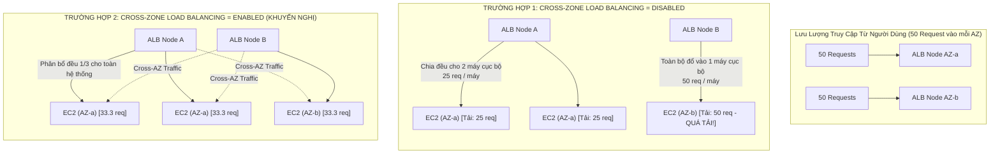
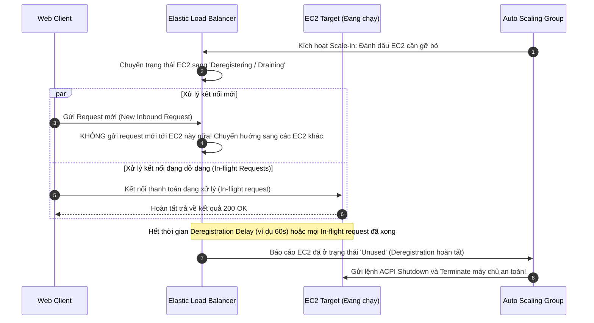
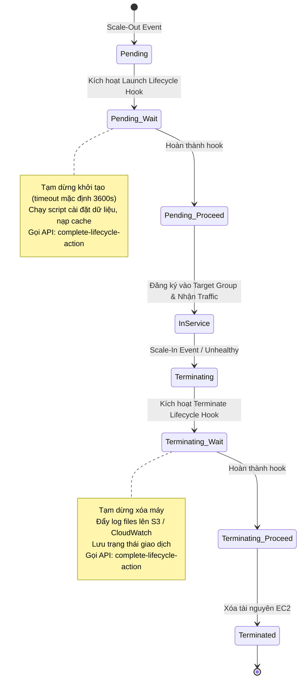
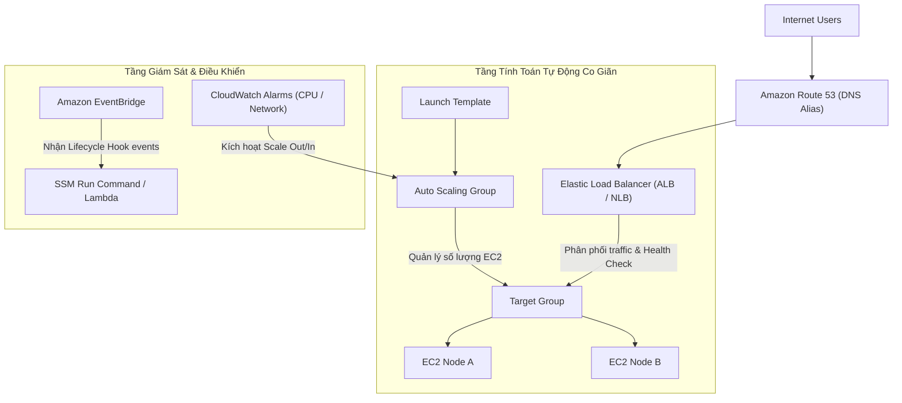

# Ghi Chú Bài Học: Chương 08 - Tính Khả Dụng Cao & Khả Năng Co Giãn Đàn Hồi (High Availability and Scalability)

> **Khóa học**: Ultimate AWS Certified Solutions Architect Associate  
> **Chương**: 08 - High Availability and Scalability (Bài 70 đến Bài 86)  
> **Tài liệu tham chiếu liên quan**: [AWS Service Document: ELB & Auto Scaling Groups](../AWS_Services/ELB_and_ASG_High_Availability.md)

---

## 1. Tổng Quan Bài Học (Lesson Overview)

### Chủ đề chính
Chương này trang bị các nguyên lý và kỹ thuật thiết kế kiến trúc phân tán chịu lỗi cao hàng đầu trên AWS:
- Khái niệm nền tảng: **High Availability (HA)**, **Scalability (Mở rộng quy mô)**, và **Elasticity (Co giãn đàn hồi)**.
- Bộ cân bằng tải **Elastic Load Balancing (ELB)**:
  - **Application Load Balancer (ALB)** (Layer 7 - HTTP/HTTPS/gRPC, Host/Path Routing, WebSocket).
  - **Network Load Balancer (NLB)** (Layer 4 - TCP/UDP/TLS, Static/Elastic IP per AZ, Ultra-low latency).
  - **Gateway Load Balancer (GWLB)** (Layer 3/4 - Kiểm tra an ninh mạng trong suốt qua giao thức GENEVE).
- Cơ chế duy trì phiên **Sticky Sessions (Session Affinity)** và bảo mật chứng chỉ số **SSL/TLS & SNI (Server Name Indication)**.
- Cơ chế cân bằng tải chéo vùng **Cross-Zone Load Balancing** và rút máy chủ an toàn **Connection Draining (Deregistration Delay)**.
- Nhóm máy chủ tự động co giãn **Auto Scaling Groups (ASG)**: **Launch Templates**, các chính sách co giãn (**Target Tracking, Step Scaling, Scheduled, Predictive**), **Cooldown Period**, và **Lifecycle Hooks**.

### Mục tiêu học tập
1. Phân biệt chính xác cơ chế hoạt động và trường hợp ứng dụng của 3 loại Load Balancer: ALB, NLB và GWLB.
2. Hiểu sâu luồng gói tin và chi phí dữ liệu trong **Cross-Zone Load Balancing**.
3. Nắm vững vòng đời rút máy chủ và xử lý yêu cầu đang dở dang với **Deregistration Delay**.
4. Cấu hình kiểm tra sức khỏe (**Health Checks**) chuẩn xác để kích hoạt cơ chế tự phục hồi (**Self-Healing**) của ASG.
5. Thiết kế quy trình can thiệp vòng đời máy ảo bằng **ASG Lifecycle Hooks** (cài đặt trước khi nhận traffic, thu thập log trước khi terminate).

---

## 2. Điểm Cốt Lõi Cần Nhớ (Key Takeaways)

1. **ALB = Layer 7 = Định tuyến linh hoạt**: Phân tích nội dung gói tin HTTP (URL Path, Hostname, Query String, HTTP Headers); hỗ trợ Dynamic Port Mapping cho ECS Docker; backend nhận IP người dùng qua header `X-Forwarded-For`.
2. **NLB = Layer 4 = Hiệu năng đỉnh cao & IP tĩnh**: Xử lý hàng triệu kết nối TCP/UDP mỗi giây với độ trễ microsecond; cung cấp **1 địa chỉ IP tĩnh cố định (hoặc Elastic IP) cho mỗi Availability Zone**; lý tưởng cho IoT, game server, và tài chính.
3. **GWLB = Bảo mật mạng trong suốt**: Đứng trước cụm Firewall / IDS / IPS của bên thứ ba; đóng gói gói tin mạng bằng giao thức **GENEVE (Cổng 6081)**; định tuyến lưu lượng vào/ra VPC qua **Gateway Load Balancer Endpoints (GWLBE)**.
4. **SNI (Server Name Indication)**: Cho phép một ALB hoặc NLB duy nhất tiếp nhận nhiều chứng chỉ số SSL/TLS khác nhau cho nhiều domain name khác nhau trên cùng một cổng lắng nghe.
5. **Cross-Zone Load Balancing**:
   - Khi **Bật (Enabled)**: Mỗi node của Load Balancer sẽ phân phối đều traffic tới **tất cả** các máy chủ backend ở tất cả các AZs.
   - Khi **Tắt (Disabled)**: Mỗi node của Load Balancer chỉ phân phối traffic cho các máy chủ backend trong **cùng Availability Zone** của nó. (Mặc định: ALB luôn bật miễn phí; NLB mặc định tắt và bị tính phí truyền dữ liệu liên vùng khi bật).
6. **Connection Draining (Deregistration Delay)**: Khoảng thời gian (mặc định 300 giây) ELB chờ các kết nối đang xử lý dở dang (in-flight requests) hoàn tất trước khi gỡ máy chủ ra khỏi Target Group và cho phép ASG tắt máy.

---

## 3. Kiến Trúc & Cơ Chế Hoạt Động Chuyên Sâu (Under-the-Hood Mechanisms & Deep Dive)

### 3.1. Phân Tích Cơ Chế Cross-Zone Load Balancing (Under the Hood)



- **Hệ quả kiến trúc**:
  - Khi tắt Cross-Zone, nếu số lượng máy chủ ở các AZ không đồng đều (ví dụ AZ-a có 2 máy, AZ-b có 1 máy), máy chủ ở AZ-b sẽ phải gánh chịu lượng tải gấp đôi so với các máy ở AZ-a, dẫn tới nguy cơ sập dây chuyền.
  - Bật Cross-Zone giải quyết triệt để vấn đề mất cân bằng tải, phân phối request đồng đều 100% trên toàn bộ các target.

---

### 3.2. Cơ Chế Rút Máy Chủ An Toàn (Deregistration Delay / Connection Draining)



---

### 3.3. Vòng Đời Co Giãn ASG & Lifecycle Hooks



---

## 4. Lệnh, Cấu Hình & Mã Nguồn Thực Tế (Commands, Config & Code)

### 4.1. Cấu Hình ALB Target Group & Deregistration Delay Bằng AWS CLI

```bash
# 1. Tao Target Group HTTP tren port 80 voi Health Check nang cao
TARGET_GROUP_ARN=$(aws elbv2 create-target-group \
    --name "Production-Web-TG" \
    --protocol HTTP \
    --port 80 \
    --vpc-id vpc-0123456789abcdef0 \
    --health-check-protocol HTTP \
    --health-check-path "/healthz" \
    --health-check-interval-seconds 15 \
    --healthy-threshold-count 2 \
    --unhealthy-threshold-count 3 \
    --query "TargetGroups[0].TargetGroupArn" \
    --output text)
echo "Target Group ARN: $TARGET_GROUP_ARN"

# 2. Cau hinh thoi gian Deregistration Delay xuong con 60 giay (mac dinh 300s)
aws elbv2 modify-target-group-attributes \
    --target-group-arn $TARGET_GROUP_ARN \
    --attributes Key=deregistration_delay.timeout_seconds,Value=60

# 3. Kiem tra trang thai suc khoe cua cac Target trong Group
aws elbv2 describe-target-health \
    --target-group-arn $TARGET_GROUP_ARN \
    --output table
```

---

### 4.2. Tạo Chính Sách Co Giãn Đàn Hồi ASG Target Tracking Scaling Policy

```bash
# Thiet lap chinh sach tu dong tang/giam may chu de duy tri CPU trung binh o muc 50%
aws autoscaling put-scaling-policy \
    --auto-scaling-group-name "Production-App-ASG" \
    --policy-name "Target-Tracking-CPU-50-Percent" \
    --policy-type TargetTrackingScaling \
    --target-tracking-configuration '{
        "PredefinedMetricSpecification": {
            "PredefinedMetricType": "ASGAverageCPUUtilization"
        },
        "TargetValue": 50.0,
        "DisableScaleIn": false
    }'
```

---

## 5. Tình Huống Thực Tiễn & Mẫu Kiến Trúc (Real-World Scenarios & Design Patterns)

### Tình huống 1: Ứng Dụng Đơn Hàng Thanh Toán Chậm Bị Ngắt Kết Nối
- **Vấn đề**: Khi lưu lượng mua hàng hạ nhiệt, Auto Scaling Group kích hoạt scale-in và terminate một số máy chủ. Nhiều người dùng bị lỗi kết nối HTTP 502/504 ngay khi đang nhấn nút "Thanh toán".
- **Phân tích nguyên nhân**: Thời gian xử lý đơn hàng qua cổng thanh toán ngân hàng mất trung bình 45 giây. Tuy nhiên, giá trị `deregistration_delay.timeout_seconds` trên Target Group đang bị cấu hình là 15 giây. ASG xóa máy ảo khi giao dịch thanh toán chưa kịp phản hồi xong.
- **Giải pháp**:
  - Tăng `deregistration_delay.timeout_seconds` lên mức 120 giây trên ALB Target Group.
  - Cấu hình thêm **ASG Terminating Lifecycle Hook** để ứng dụng gửi tín hiệu graceful shutdown cho web server, đợi đóng toàn bộ database connection pool trước khi máy bị tắt.

### Tình huống 2: Ứng Dụng Đa Tên Miền Với Một Cụm ALB Duy Nhất (Cost Reduction)
- **Bài toán**: Công ty có 3 dịch vụ web: `shop.mycompany.com`, `api.mycompany.com`, và `blog.mycompany.com`, mỗi dịch vụ có chứng chỉ SSL riêng và chạy trên các nhóm máy chủ EC2 khác nhau.
- **Giải pháp tối ưu**:
  - Sử dụng **duy nhất 1 Application Load Balancer**.
  - Tận dụng tính năng **SNI (Server Name Indication)** để gắn cả 3 chứng chỉ SSL từ AWS Certificate Manager (ACM) vào cùng HTTPS Listener cổng 443.
  - Sử dụng **Host-based Routing Rules** trên ALB:
    - Nếu Host là `shop.mycompany.com` ➔ Chuyển hướng tới Target Group Shop.
    - Nếu Host là `api.mycompany.com` ➔ Chuyển hướng tới Target Group API.
    - Nếu Host là `blog.mycompany.com` ➔ Chuyển hướng tới Target Group Blog.

---

## 6. Mối Quan Hệ Giữa Các Khái Niệm / Dịch Vụ (Service Relationships & Ecosystem)



---

## 7. Câu Hỏi Ôn Tập, Bẫy Thi & Tự Đánh Giá (Review, Exam Traps & Self-Assessment)

### Câu hỏi:
1. Bạn cần xây dựng một hệ thống nhận dữ liệu thời gian thực từ hàng triệu thiết bị IoT qua giao thức TCP thô và yêu cầu hệ thống phải cung cấp địa chỉ IP tĩnh cố định để cấu hình cứng trên firmware thiết bị. Bộ cân bằng tải nào đáp ứng được yêu cầu này?
2. Khi một máy chủ EC2 phía sau Application Load Balancer bị đánh dấu là `Unhealthy`, ALB sẽ xử lý các request tiếp theo của người dùng như thế nào?
3. Tính năng nào trên ELB cho phép đảm bảo rằng một người dùng cụ thể sẽ liên tục được gửi tới cùng một máy chủ backend trong suốt phiên giao dịch, và có những loại cookie nào hỗ trợ tính năng này?
4. Đâu là sự khác biệt cơ bản giữa Target Tracking Scaling Policy và Step Scaling Policy trong Auto Scaling Group?
5. Một kỹ sư thấy rằng khi ASG giảm số lượng máy chủ (Scale-in), các log files trên máy ảo bị xóa mất trước khi kịp tải lên S3. Cơ chế nào của ASG giải quyết triệt để vấn đề này?
6. Bật Cross-Zone Load Balancing trên Network Load Balancer (NLB) khác gì so với Application Load Balancer (ALB) về mặt chi phí và mặc định?

---

### Đáp án & Giải thích chi tiết:

<details>
<summary>👉 Nhấp vào đây để xem đáp án và phân tích chi tiết</summary>

1. **Network Load Balancer (NLB)**. NLB hoạt động ở Layer 4 (Transport Layer), hỗ trợ giao thức TCP/UDP thô và cung cấp địa chỉ IP tĩnh cố định (Elastic IP) cho mỗi Availability Zone, đáp ứng hoàn hảo cho các thiết bị IoT không hỗ trợ phân giải DNS động.
2. ALB sẽ **ngay lập tức ngừng gửi bất kỳ request mới nào** tới máy chủ bị Unhealthy đó, và chỉ phân phối traffic đến các máy chủ còn lại đang ở trạng thái Healthy trong Target Group cho đến khi máy chủ đó vượt qua đủ số lần kiểm tra sức khỏe liên tiếp để trở lại trạng thái Healthy.
3. Tính năng **Sticky Sessions (Session Affinity)**. Có 2 cơ chế hỗ trợ:
   - **Application-based Cookie**: Do chính ứng dụng tạo ra (tên cookie tùy biến theo ứng dụng) hoặc Application Cookie do Load Balancer phát sinh.
   - **Duration-based Cookie**: Do chính ALB tự động tạo ra và quản lý với tên cố định là `AWSALB`, có thời hạn hiệu lực (TTL) do quản trị viên thiết lập từ 1 giây đến 7 ngày.
4. **Target Tracking** cho phép người dùng chỉ định một chỉ số mục tiêu duy nhất (ví dụ: `ASGAverageCPUUtilization = 50%`) và AWS sẽ tự động tính toán số lượng máy cần tăng hoặc giảm theo thuật toán nội bộ. Trong khi đó, **Step Scaling** đòi hỏi bạn phải tự định nghĩa các ngưỡng cảnh báo của CloudWatch Alarm và số lượng máy cụ thể cần can thiệp theo từng bậc (ví dụ: nếu CPU 60-70% thêm 1 máy; nếu CPU 70-85% thêm 2 máy; nếu CPU > 85% thêm 4 máy).
5. Sử dụng **ASG Lifecycle Hooks** với trạng thái **`autoscaling:EC2_INSTANCE_TERMINATING`**. Khi sự kiện scale-in diễn ra, máy ảo sẽ được đưa vào trạng thái chờ `Terminating:Wait`. Tại đây, một script hoặc Lambda function sẽ được kích hoạt để upload toàn bộ log files lên S3, sau đó mới phát lệnh `CompleteLifecycleAction` để ASG chính thức xóa máy ảo.
6. Với **ALB**, Cross-Zone Load Balancing được **bật mặc định (Enabled)** và **hoàn toàn miễn phí** cước dữ liệu truyền tải giữa các AZs. Với **NLB**, Cross-Zone Load Balancing **mặc định bị tắt (Disabled)**; khi bạn kích hoạt tính năng này trên NLB, lưu lượng truyền tải xuyên qua các Availability Zones sẽ bị tính phí Data Transfer liên vùng của AWS.
</details>

---

## 8. Nguồn Trích Dẫn Bài Giảng & Tài Liệu Liên Quan (Source References)

- **Source Transcripts**:
  - [71 - Elastic Load Balancing (ELB) Overview.md](../AWS_Resources/08%20-%20High%20Availability%20and%20Scalabil/71%20-%20Elastic%20Load%20Balancing%20%28ELB%29%20Overview.md)
  - [72 - Application Load Balancer (ALB).md](../AWS_Resources/08%20-%20High%20Availability%20and%20Scalabil/72%20-%20Application%20Load%20Balancer%20%28ALB%29.md)
  - [75 - Network Load Balancer (NLB).md](../AWS_Resources/08%20-%20High%20Availability%20and%20Scalabil/75%20-%20Network%20Load%20Balancer%20%28NLB%29.md)
  - [77 - Gateway Load Balancer (GWLB).md](../AWS_Resources/08%20-%20High%20Availability%20and%20Scalabil/77%20-%20Gateway%20Load%20Balancer%20%28GWLB%29.md)
  - [78 - Elastic Load Balancer - Sticky Sessions.md](../AWS_Resources/08%20-%20High%20Availability%20and%20Scalabil/78%20-%20Elastic%20Load%20Balancer%20-%20Sticky%20Sessions.md)
  - [79 - Elastic Load Balancer - Cross Zone Load Balancin.md](../AWS_Resources/08%20-%20High%20Availability%20and%20Scalabil/79%20-%20Elastic%20Load%20Balancer%20-%20Cross%20Zone%20Load%20Balancin.md)
  - [80 - Elastic Load Balancer - SSL Certificates.md](../AWS_Resources/08%20-%20High%20Availability%20and%20Scalabil/80%20-%20Elastic%20Load%20Balancer%20-%20SSL%20Certificates.md)
  - [82 - Elastic Load Balancer - Connection Draining.md](../AWS_Resources/08%20-%20High%20Availability%20and%20Scalabil/82%20-%20Elastic%20Load%20Balancer%20-%20Connection%20Draining.md)
  - [83 - Auto Scaling Groups (ASG) Overview.md](../AWS_Resources/08%20-%20High%20Availability%20and%20Scalabil/83%20-%20Auto%20Scaling%20Groups%20%28ASG%29%20Overview.md)
  - [85 - Auto Scaling Groups - Scaling Policies.md](../AWS_Resources/08%20-%20High%20Availability%20and%20Scalabil/85%20-%20Auto%20Scaling%20Groups%20-%20Scaling%20Policies.md)
- **Tài liệu chuyên sâu liên quan**:
  - [Chuyên đề Master: Elastic Load Balancing (ELB) & Auto Scaling Groups (ASG)](../AWS_Services/ELB_and_ASG_High_Availability.md)
  - [Chuyên đề Master: Amazon EC2](../AWS_Services/EC2_Elastic_Compute_Cloud.md)
