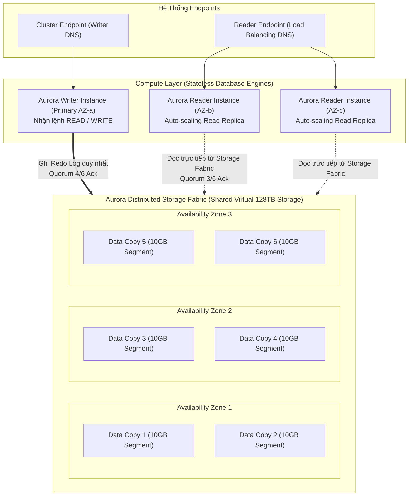
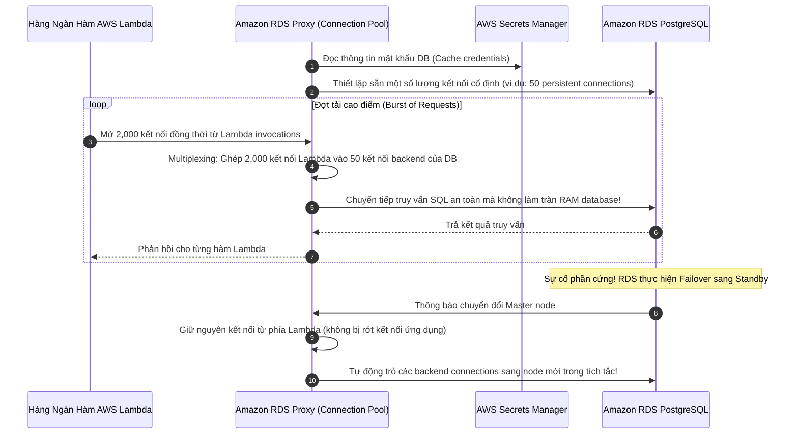
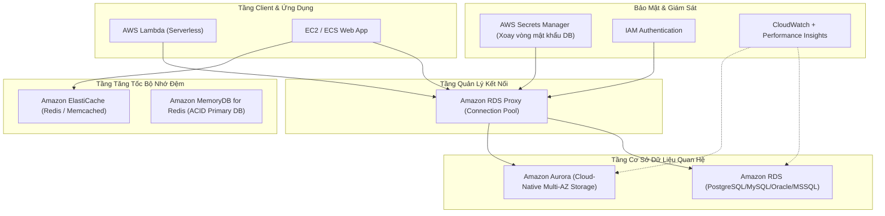

# Ghi Chú Bài Học: Chương 09 - Cơ Sở Dữ Liệu Quan Hệ RDS, Aurora & Bộ Nhớ Đệm ElastiCache

> **Khóa học**: Ultimate AWS Certified Solutions Architect Associate  
> **Chương**: 09 - AWS Fundamentals: RDS + Aurora (Bài 87 đến Bài 100)  
> **Tài liệu tham chiếu liên quan**: [AWS Service Document: Amazon RDS, Aurora & Databases](../AWS_Services/RDS_Aurora_Databases.md)

---

## 1. Tổng Quan Bài Học (Lesson Overview)

### Chủ đề chính
Chương này cung cấp kiến thức toàn diện và chuyên sâu về hệ sinh thái cơ sở dữ liệu quan hệ và bộ nhớ đệm hiệu năng cao trên AWS:
- Dịch vụ cơ sở dữ liệu quan hệ được quản lý **Amazon Relational Database Service (RDS)**: các engine hỗ trợ (PostgreSQL, MySQL, MariaDB, Oracle, SQL Server), cơ chế sao chép đọc **Read Replicas** và khả năng chịu lỗi đa vùng **Multi-AZ**.
- Cơ sở dữ liệu Cloud-Native cao cấp **Amazon Aurora**: kiến trúc phân tán tách rời Compute và Storage, cơ chế tự động nhân bản 6 bản sao trên 3 AZ, **Aurora Serverless v2**, **Aurora Global Database**, và các Endpoints (Writer vs Reader).
- Cơ chế sao lưu và phục hồi: **Automated Backups**, **Point-in-Time Recovery (PITR)**, và **Manual DB Snapshots**.
- Giám sát chuyên sâu: **CloudWatch Metrics**, **Enhanced Monitoring** (OS process level), và **Performance Insights** (Database Load & Top SQL).
- Tối ưu hóa kết nối Serverless bằng **Amazon RDS Proxy**.
- Bộ nhớ đệm trong bộ nhớ **Amazon ElastiCache** (Redis vs Memcached), **ElastiCache Serverless**, và cơ sở dữ liệu in-memory bền vững **Amazon MemoryDB for Redis**.
- Danh mục cổng mạng tiêu chuẩn của các hệ quản trị cơ sở dữ liệu.

### Mục tiêu học tập
1. Phân biệt được sự khác biệt cốt lõi về bản chất giữa **Read Replicas** (sao chép bất đồng bộ, mở rộng năng lực đọc) và **Multi-AZ** (sao chép đồng bộ, dự phòng thảm họa).
2. Hiểu sâu kiến trúc phân tán, cơ chế đồng thuận Quorum (4/6 ghi, 3/6 đọc) và tự phục hồi dữ liệu của **Amazon Aurora**.
3. Nắm vững vai trò và nguyên lý hoạt động của **RDS Proxy** trong việc giải quyết tình trạng cạn kiệt connection pool của Lambda.
4. Làm chủ 2 chiến lược lưu cache: **Lazy Loading (Cache-Aside)** và **Write-Through**.
5. Thuộc lòng danh sách các cổng mạng database để cấu hình Security Group chuẩn xác.

---

## 2. Điểm Cốt Lõi Cần Nhớ (Key Takeaways)

1. **Read Replicas vs Multi-AZ (Nguyên tắc sống còn)**:
   - **Multi-AZ**: 1 Standby instance duy nhất trong cùng Region khác AZ; **sao chép đồng bộ (Synchronous)**; tự động chuyển giao dự phòng (Automated Failover); **KHÔNG phục vụ đọc/ghi dữ liệu** trong điều kiện bình thường.
   - **Read Replicas**: Tối đa 15 bản sao; **sao chép bất đồng bộ (Asynchronous)**; hỗ trợ Cross-AZ và Cross-Region; **chuyên dùng mở rộng tải đọc (Read-heavy workload)**; có thể được thăng cấp (Promote) thành database độc lập.
2. **Amazon Aurora**:
   - Tương thích 100% với MySQL và PostgreSQL; hiệu năng nhanh gấp 5x (so với MySQL) và 3x (so với Postgres).
   - Tự động chia nhỏ dữ liệu thành các khối 10GB và nhân bản **6 bản sao xuyên qua 3 Availability Zones (2 bản sao/AZ)**.
   - Cơ chế đồng thuận Quorum: Cần **4/6 node đồng ý để Ghi (Write Quorum)** và **3/6 node để Đọc (Read Quorum)**; sống sót an toàn ngay cả khi mất toàn bộ 1 AZ và thêm 1 node hỏng ở AZ khác.
3. **Aurora Serverless v2**: Tự động scale tính toán tức thì tính bằng mili-giây theo đơn vị ACU (Aurora Capacity Units, 1 ACU = 2 GB RAM + CPU tương ứng); hỗ trợ đầy đủ Multi-AZ, Read Replicas và Global Database.
4. **RDS Proxy**:
   - Hồ chứa kết nối (Connection Pool) được quản lý hoàn toàn cho RDS và Aurora.
   - Giảm tới 66% thời gian failover của RDS nhờ cơ chế multiplexing kết nối.
   - Bắt buộc lưu trữ thông tin xác thực an toàn trong **AWS Secrets Manager** và tích hợp xác thực qua **IAM**.
5. **ElastiCache vs MemoryDB**:
   - **ElastiCache**: Bộ nhớ đệm tạm thời (Cache), có nguy cơ mất dữ liệu nhỏ nếu cụm hỏng trước khi kịp snapshot.
   - **MemoryDB for Redis**: Cơ sở dữ liệu chính (Primary Database) in-memory với **Multi-AZ Transactional Log**, đảm bảo tính toàn vẹn và bền vững dữ liệu (ACID compliant).
6. **Danh sách cổng kết nối Database kinh điển**:
   - **PostgreSQL**: `5432`
   - **MySQL / MariaDB / Aurora**: `3306`
   - **Oracle Database**: `1521`
   - **Microsoft SQL Server**: `1433`
   - **Redis**: `6379`
   - **Memcached**: `11211`

---

## 3. Kiến Trúc & Cơ Chế Hoạt Động Chuyên Sâu (Under-the-Hood Mechanisms & Deep Dive)

### 3.1. Bản Chất Kiến Trúc Phân Tán Của Amazon Aurora & Cơ Chế Quorum

Amazon Aurora tách rời hoàn toàn tầng tính toán (**Compute Layer**) và tầng lưu trữ phân tán (**Distributed Storage Layer**):



- **Cơ chế ghi Redo Log**: Khác với MySQL truyền thống phải ghi toàn bộ dữ liệu trang đĩa (dirty pages) xuống ổ cứng, Aurora chỉ gửi luồng **Redo Log** nhỏ gọn qua mạng tới 6 storage nodes. Các storage nodes tự phân tích redo log và tự động cập nhật trang đĩa ngầm. Nhờ đó, băng thông mạng giảm tới 90% và tốc độ ghi tăng vọt.
- **Tự phục hồi dữ liệu (Self-Healing)**: Storage layer liên tục quét các khối dữ liệu 10GB. Nếu phát hiện một khối bị lỗi checksum hoặc mất node, hệ thống tự động copy khối tương ứng từ các node khác trong tích tắc mà không làm ảnh hưởng đến Compute layer.

---

### 3.2. So Sánh Kiến Trúc RDS Multi-AZ vs RDS Read Replicas

```mermaid
flowchart LR
    subgraph MultiAZArch["1. RDS Multi-AZ (High Availability & Disaster Recovery)"]
        direction TB
        AppWrite["Ứng Dụng (App Server)"] -->|Kết nối qua CNAME Endpoint| PrimaryDB["Primary DB Instance (AZ-a)\nActive: Đọc & Ghi"]
        PrimaryDB ==="Sao chép đồng bộ mức khối ổ đĩa (Synchronous Physical Replication)"===> StandbyDB["Standby DB Instance (AZ-b)\nPassive: KHÔNG nhận kết nối"]
        noteMAZ["Failover tự động trong 60-120s bằng cách đổi DNS CNAME"]
    end

    subgraph ReadReplicaArch["2. RDS Read Replicas (Read Scalability & Analytics)"]
        direction TB
        MasterDB["Master DB Instance (AZ-a)\nActive: Ghi & Đọc"] -.->|"Sao chép bất đồng bộ (Asynchronous Binlog / WAL Replication)\nCó độ trễ (Replication Lag)"| RR1["Read Replica 1 (AZ-b)\nChỉ Đọc (Read-Only)"]
        MasterDB -.-> RR2["Read Replica 2 (Khác Region)\nChỉ Đọc & Phục hồi thảm họa"]
        ReportingApp["Hệ Thống Báo Cáo / BI"] --> RR1
    end
```

---

### 3.3. Giải Pháp Tối Ưu Kết Nối Với Amazon RDS Proxy



---

## 4. Lệnh, Cấu Hình & Mã Nguồn Thực Tế (Commands, Config & Code)

### 4.1. Khởi Tạo Cụm Cơ Sở Dữ Liệu Aurora Serverless v2 Bằng AWS CLI

```bash
# 1. Tao Aurora DB Cluster voi che do Postgres va khoi tao cau hinh Serverless v2
aws rds create-db-cluster \
    --db-cluster-identifier "production-aurora-cluster" \
    --engine "aurora-postgresql" \
    --engine-version "15.4" \
    --master-username "clusteradmin" \
    --master-user-password "MySecurePassword2026!" \
    --serverless-v2-scaling-configuration MinCapacity=0.5,MaxCapacity=16.0 \
    --backup-retention-period 7 \
    --storage-encrypted

# 2. Tao Primary Writer Instance gan voi cau hinh Serverless v2
aws rds create-db-instance \
    --db-instance-identifier "production-aurora-instance-1" \
    --db-cluster-identifier "production-aurora-cluster" \
    --db-instance-class "db.serverless" \
    --engine "aurora-postgresql"
```

---

### 4.2. Tạo Amazon RDS Proxy Cho PostgreSQL

```bash
# Tao RDS Proxy tich hop voi AWS Secrets Manager va IAM
aws rds create-db-proxy \
    --db-proxy-name "lambda-rds-postgres-proxy" \
    --engine-family "POSTGRESQL" \
    --auth '[{
        "AuthScheme": "SECRETS",
        "SecretArn": "arn:aws:secretsmanager:ap-southeast-1:123456789012:secret:db-credentials-xxxx",
        "IAMAuth": "REQUIRED"
    }]' \
    --role-arn "arn:aws:iam::123456789012:role/RDSProxyRole" \
    --vpc-subnet-ids "subnet-0123456789abcdef0" "subnet-0abcdef1234567890" \
    --require-tls
```

---

## 5. Tình Huống Thực Tiễn & Mẫu Kiến Trúc (Real-World Scenarios & Design Patterns)

### Tình huống 1: Tối Ưu Hóa Chi Phí Cho Ứng Dụng Đọc Ghi I/O Dày Đặc (FinOps)
- **Bài toán**: Một sàn giao dịch thương mại điện tử chạy trên Aurora PostgreSQL thực hiện hàng trăm triệu câu truy vấn I/O mỗi ngày. Chi phí I/O requests chiếm tới 45% tổng hóa đơn database hàng tháng.
- **Giải pháp**:
  - Chuyển đổi cấu hình lưu trữ cụm Aurora sang **Aurora I/O-Optimized**.
  - Ở chế độ này, AWS không tính bất kỳ chi phí nào cho các yêu cầu đọc/ghi I/O, chỉ tính phí dung lượng lưu trữ cố định.
  - Kết quả: Tiết kiệm ngay lập tức 35-40% tổng chi phí vận hành cơ sở dữ liệu.

### Tình huống 2: Giải Quyết Bài Toán Đọc Dữ Liệu Nóng Bằng Mô Hình Caching
- **Bài toán**: Hệ thống bảng xếp hạng người dùng trong ứng dụng game di động bị nghẽn cổ chai tại database MySQL do hàng triệu lượt đọc cùng 1 danh sách top 100 người chơi.
- **Giải pháp**:
  - Triển khai **Amazon ElastiCache for Redis** đứng trước RDS.
  - Áp dụng chiến lược **Lazy Loading (Cache-Aside) kết hợp TTL**:
    1. Khi có request đọc bảng xếp hạng, ứng dụng kiểm tra cache Redis trước.
    2. Nếu cache HIT: Trả về kết quả ngay lập tức trong vòng < 1 millisecond.
    3. Nếu cache MISS: Truy vấn vào RDS MySQL, ghi kết quả vào Redis với TTL là 60 giây, và trả về cho client.
  - Kết quả: Giảm 95% tải đọc lên cơ sở dữ liệu chính, chi phí hạ tầng giảm mạnh.

---

## 6. Mối Quan Hệ Giữa Các Khái Niệm / Dịch Vụ (Service Relationships & Ecosystem)



---

## 7. Câu Hỏi Ôn Tập, Bẫy Thi & Tự Đánh Giá (Review, Exam Traps & Self-Assessment)

### Câu hỏi:
1. Bạn có một hệ thống tài chính chạy trên Amazon RDS MySQL. Đội ngũ dữ liệu muốn chạy các báo cáo phân tích phức tạp tốn nhiều giờ và làm giảm hiệu năng phục vụ người dùng của website. Bạn sẽ thiết kế cấu hình gì trên RDS để giải quyết triệt để vấn đề này mà không làm gián đoạn người dùng?
2. Nếu máy chủ chính (Primary) của một cụm RDS Multi-AZ bị sự cố phần cứng đột ngột, quá trình chuyển đổi dự phòng (Failover) diễn ra như thế nào? Ứng dụng của bạn có cần phải cập nhật lại địa chỉ IP hay chuỗi kết nối (Connection String) không?
3. Tại sao một kiến trúc gồm hàng trăm hàm AWS Lambda khi truy vấn trực tiếp vào Amazon RDS PostgreSQL lại dễ dẫn đến lỗi `too many connections`, và giải pháp kiến trúc tối ưu nhất của AWS cho vấn đề này là gì?
4. Đâu là cổng mạng mặc định của cơ sở dữ liệu PostgreSQL, MySQL, và Oracle?
5. Sự khác biệt cốt lõi về độ bền vững dữ liệu và trường hợp sử dụng giữa **Amazon ElastiCache for Redis** và **Amazon MemoryDB for Redis** là gì?
6. Cơ chế đồng thuận Quorum của Amazon Aurora yêu cầu bao nhiêu bản sao xác nhận thành công để hoàn tất một tác vụ Ghi (Write) và tác vụ Đọc (Read)? Điều gì xảy ra nếu toàn bộ 1 Availability Zone bị mất điện hoàn toàn?

---

### Đáp án & Giải thích chi tiết:

<details>
<summary>👉 Nhấp vào đây để xem đáp án và phân tích chi tiết</summary>

1. Tạo một hoặc nhiều **RDS Read Replicas** và cấu hình ứng dụng phân tích dữ liệu kết nối trực tiếp vào DNS Endpoint của Read Replica đó. Mọi câu lệnh SELECT nặng sẽ chạy trên bản sao độc lập, giải phóng hoàn toàn tài nguyên CPU/RAM cho máy chủ Primary.
2. Quá trình Failover diễn ra **hoàn toàn tự động trong khoảng 60–120 giây**: AWS tự động cập nhật bản ghi DNS CNAME của Database Endpoint để trỏ sang địa chỉ IP của máy chủ Standby ở Availability Zone phụ. Do đó, ứng dụng của bạn **KHÔNG CẦN THAY ĐỔI** chuỗi kết nối hay cấu hình mã nguồn.
3. Vì Lambda là kiến trúc Serverless co giãn cực nhanh, mỗi instance của hàm mở một kết nối mạng riêng biệt đến cơ sở dữ liệu. Khi có hàng trăm hàm chạy đồng thời, số lượng kết nối vượt quá giới hạn `max_connections` của PostgreSQL, khiến máy chủ hết RAM. Giải pháp chuẩn là triển khai **Amazon RDS Proxy** đứng giữa để gom và tái sử dụng các kết nối (Connection Pooling), đồng thời giữ kết nối an toàn cho ứng dụng khi DB thực hiện failover.
4. Cổng mạng mặc định:
   - **PostgreSQL**: `5432`
   - **MySQL**: `3306`
   - **Oracle Database**: `1521`
5. **Amazon ElastiCache for Redis** đóng vai trò là một **bộ nhớ đệm tạm thời (Cache)**; dữ liệu chủ yếu lưu trên RAM và chụp snapshot bất đồng bộ, nếu node hỏng vẫn có nguy cơ mất mát dữ liệu nhỏ. Trong khi đó, **Amazon MemoryDB for Redis** được thiết kế làm **Cơ sở dữ liệu chính (Primary Database)**; nó bổ sung một cơ chế ghi nhật ký giao dịch phân tán đa vùng (**Multi-AZ Transactional Log**), đảm bảo tính toàn vẹn dữ liệu ACID 100% với tốc độ truy xuất microsecond.
6. Aurora yêu cầu:
   - **Ghi (Write Quorum)**: Cần **4 trên 6 bản sao** xác nhận.
   - **Đọc (Read Quorum)**: Cần **3 trên 6 bản sao** xác nhận.
   - Khi **toàn bộ 1 Availability Zone bị mất điện** (mất 2 bản sao), hệ thống vẫn còn 4 bản sao tại 2 AZ còn lại. Do đó, Aurora **vẫn duy trì khả năng GHI và ĐỌC bình thường 100%** mà không bị gián đoạn hoạt động.
</details>

---

## 8. Nguồn Trích Dẫn Bài Giảng & Tài Liệu Liên Quan (Source References)

- **Source Transcripts**:
  - [87 - Amazon RDS Overview.md](../AWS_Resources/09%20-%20AWS%20Fundamentals_%20RDS%20+%20Aurora/87%20-%20Amazon%20RDS%20Overview.md)
  - [88 - RDS Read Replicas vs Multi AZ.md](../AWS_Resources/09%20-%20AWS%20Fundamentals_%20RDS%20+%20Aurora/88%20-%20RDS%20Read%20Replicas%20vs%20Multi%20AZ.md)
  - [91 - Amazon Aurora.md](../AWS_Resources/09%20-%20AWS%20Fundamentals_%20RDS%20+%20Aurora/91%20-%20Amazon%20Aurora.md)
  - [94 - RDS & Aurora - Backup and Monitoring.md](../AWS_Resources/09%20-%20AWS%20Fundamentals_%20RDS%20+%20Aurora/94%20-%20RDS%20%26%20Aurora%20-%20Backup%20and%20Monitoring.md)
  - [96 - RDS Proxy.md](../AWS_Resources/09%20-%20AWS%20Fundamentals_%20RDS%20+%20Aurora/96%20-%20RDS%20Proxy.md)
  - [97 - ElastiCache Overview.md](../AWS_Resources/09%20-%20AWS%20Fundamentals_%20RDS%20+%20Aurora/97%20-%20ElastiCache%20Overview.md)
  - [100 - List of Ports to be familiar with.md](../AWS_Resources/09%20-%20AWS%20Fundamentals_%20RDS%20+%20Aurora/100%20-%20List%20of%20Ports%20to%20be%20familiar%20with.md)
- **Tài liệu chuyên sâu liên quan**:
  - [Chuyên đề Master: Amazon RDS, Aurora & Modern Databases](../AWS_Services/RDS_Aurora_Databases.md)
