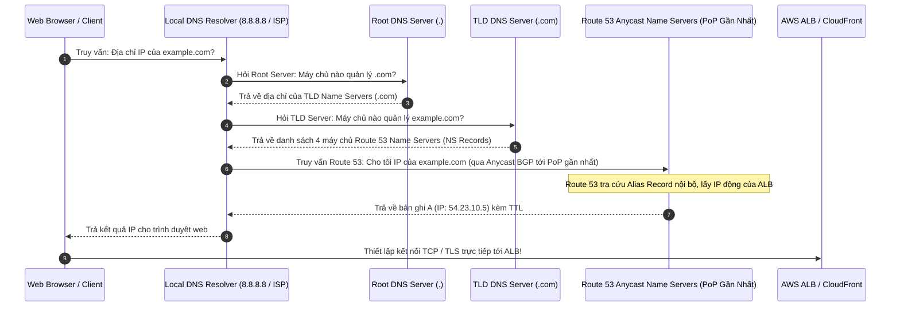
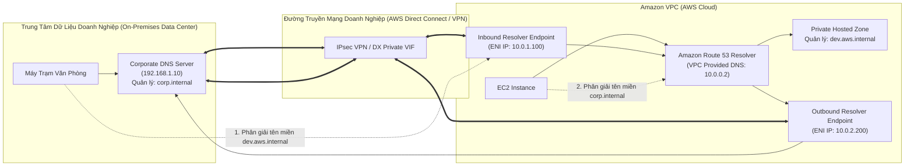
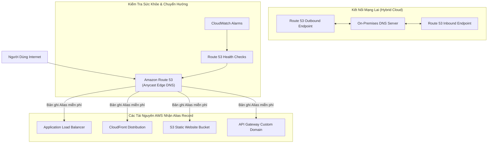

# Ghi Chú Bài Học: Chương 10 - Hệ Thống Phân Giải Tên Miền Đám Mây Amazon Route 53 (Route 53)

> **Khóa học**: Ultimate AWS Certified Solutions Architect Associate  
> **Chương**: 10 - Route 53 (Bài 101 đến Bài 120)  
> **Tài liệu tham chiếu liên quan**: [AWS Service Document: Amazon Route 53](../AWS_Services/Route53_DNS.md)

---

## 1. Tổng Quan Bài Học (Lesson Overview)

### Chủ đề chính
Chương này trang bị toàn bộ kiến thức chuyên sâu về giao thức phân giải tên miền (**DNS 101**) và dịch vụ DNS thẩm quyền toàn cầu được quản lý hoàn toàn của AWS: **Amazon Route 53**:
- Bản chất mạng lưới máy chủ tên miền phân tán: Root Servers, Top-Level Domain (TLD), Second-Level Domain (SLD), và Authoritative Name Servers sử dụng công nghệ mạng **Anycast BGP**.
- Phân biệt **Public Hosted Zones** (công khai trên Internet) và **Private Hosted Zones** (cô lập an toàn trong VPC).
- Các loại bản ghi DNS tiêu chuẩn: **A**, **AAAA**, **CNAME**, **NS**, **MX**, **TXT**, và **PTR**.
- So sánh bản chất kiến trúc giữa **CNAME** và **Route 53 Alias Record** (giải quyết bài toán Zone Apex theo chuẩn RFC 1034).
- Tám chính sách định tuyến lưu lượng (**Routing Policies**): Simple, Weighted, Latency-based, Failover, Geolocation, Geoproximity (Traffic Flow), Multi-Value Answer, và IP-based.
- Cơ chế kiểm tra sức khỏe hệ thống (**Route 53 Health Checks**) và kịch bản khắc phục sự cố tự động (**DNS Failover**).
- Giải pháp mạng lai phân giải DNS hai chiều giữa On-Premises và AWS VPC qua **Route 53 Resolver (Inbound/Outbound Endpoints)**.

### Mục tiêu học tập
1. Hiểu sâu luồng gói tin truy vấn DNS toàn cầu và cơ chế định tuyến Anycast BGP của Route 53.
2. Phân tích nguyên nhân kỹ thuật tại sao Zone Apex không thể dùng CNAME và cách Alias Record khắc phục hoàn hảo mà không mất phí truy vấn.
3. Làm chủ 8 chính sách định tuyến lưu lượng để thiết kế các hệ thống đa vùng (Multi-Region), cân bằng tải và chịu lỗi cao.
4. Cấu hình kiểm tra sức khỏe đa tầng (Endpoint Checks, Calculated Checks, CloudWatch Alarm Checks).
5. Thiết kế kiến trúc DNS lai (Hybrid DNS Architecture) kết nối giữa Data Center truyền thống và AWS Cloud.

---

## 2. Điểm Cốt Lõi Cần Nhớ (Key Takeaways)

1. **Route 53 Alias Record = Lựa chọn chuẩn mực trên AWS**:
   - Hoạt động như một bản ghi ảo nội bộ của AWS; cho phép trỏ tên miền gốc **Zone Apex (`example.com`)** về các tài nguyên AWS (ALB, CloudFront, S3 Bucket, API Gateway).
   - **Hoàn toàn miễn phí cước truy vấn DNS** đối với các tài nguyên AWS.
   - Tự động nhận biết sự thay đổi địa chỉ IP ngầm của tài nguyên AWS mà không phải phụ thuộc vào thời gian cache DNS của client.
2. **CNAME chỉ dùng cho Subdomain (`api.example.com`)**: Theo chuẩn RFC 1034, bản ghi CNAME không thể cùng tồn tại với các bản ghi khác như NS hay SOA; do đó tuyệt đối không thể tạo CNAME cho Zone Apex.
3. **TTL (Time to Live)**:
   - TTL cao (ví dụ: 86,400s - 24 giờ): Giảm thiểu số lượng truy vấn tới Route 53, tiết kiệm chi phí và tăng tốc độ tải trang cho client nhờ cache tại DNS Resolver trung gian.
   - TTL thấp (ví dụ: 60s): Cho phép thay đổi IP lan tỏa tức thì trên toàn cầu; bắt buộc phải hạ TTL trước khi tiến hành di chuyển hệ thống (migration).
4. **Phân biệt Latency vs Geolocation vs Geoproximity**:
   - *Latency-based*: Định tuyến người dùng tới AWS Region có **độ trễ mạng thấp nhất** (dựa trên các phép đo liên tục của AWS).
   - *Geolocation*: Định tuyến dựa trên **vị trí địa lý thực tế của người dùng** (quốc gia, châu lục hoặc bang tại Mỹ) để bản địa hóa ngôn ngữ hoặc tuân thủ luật bản quyền.
   - *Geoproximity*: Định tuyến dựa trên tọa độ địa lý kết hợp với hệ số lệch **Bias** (-99 đến +99) để điều tiết lưu lượng giữa các datacenter.
5. **Failover Routing Policy**: Thiết kế cho mô hình Active-Passive Disaster Recovery; bản ghi Primary bắt buộc phải gắn với một Route 53 Health Check.
6. **Route 53 Resolver**:
   - *Inbound Endpoint*: Cho phép máy chủ On-Premises phân giải các tên miền trong VPC Private Hosted Zone.
   - *Outbound Endpoint*: Cho phép máy ảo trong VPC chuyển tiếp truy vấn phân giải các tên miền nội bộ của doanh nghiệp On-Premises.

---

## 3. Kiến Trúc & Cơ Chế Hoạt Động Chuyên Sâu (Under-the-Hood Mechanisms & Deep Dive)

### 3.1. Luồng Phân Giải DNS Toàn Cầu & Công Nghệ Mạng Anycast



- **Mạng Anycast BGP**: Route 53 không chỉ chạy trên 4 máy chủ vật lý, mà 4 địa chỉ NS đó được phát sóng (broadcast) bằng giao thức định tuyến BGP Anycast tại hàng trăm Edge Locations (PoPs) trên toàn thế giới. Khi client truy vấn, gói tin DNS được router Internet chuyển tự động tới trạm PoP gần nhất về mặt địa lý, giảm độ trễ phân giải xuống còn < 5ms và phân tán triệt để các cuộc tấn công từ chối dịch vụ DNS DDoS.

---

### 3.2. Cơ Chế DNS Failover (Active - Passive Disaster Recovery)

```mermaid
flowchart TD
    Client["Người Dùng Toàn Cầu"] --> R53["Amazon Route 53 DNS\n(Failover Routing Policy)"]
    
    subgraph PrimaryRegion["Primary AWS Region (Singapore) - Active"]
        ALB_Pri["Application Load Balancer (Primary)"] --> Web_Pri["Cụm Máy Chủ Web Chính"]
    end

    subgraph SecondaryRegion["Secondary AWS Region (Tokyo) - Passive"]
        ALB_Sec["Application Load Balancer (Secondary)"] --> Web_Sec["Cụm Máy Chủ Dự Phòng (Hot Standby)"]
    end

    subgraph HealthCheckers["Hệ Thống Route 53 Health Checkers (Toàn cầu)"]
        HC["Route 53 Health Check Engine\n(Gửi HTTP GET mỗi 10s từ 15 vị trí trên thế giới)"]
    end

    HC -->|Kiểm tra cổng /healthz| ALB_Pri
    HC -.->|Báo cáo trạng thái| R53

    R53 ==>|Trạng thái HEALTHY: Trả về IP Primary (100% traffic)| ALB_Pri
    R53 -.->|Khi Primary UNHEALTHY: Tự động chuyển 100% traffic| ALB_Sec
```

- **Quy tắc chuyển giao**: Health Check Engine theo dõi endpoint chính từ nhiều trung tâm kiểm thử trên thế giới. Nếu hơn 18% các trạm báo cáo lỗi (ví dụ không nhận được mã HTTP 2xx/3xx trong 3 lần kiểm tra liên tiếp), Route 53 đánh dấu Primary record là `Unhealthy` và lập tức chuyển hướng mọi câu trả lời DNS sang bản ghi Secondary.

---

### 3.3. Kiến Trúc Mạng Lai: Route 53 Resolver (Hybrid Cloud DNS)



---

## 4. Lệnh, Cấu Hình & Mã Nguồn Thực Tế (Commands, Config & Code)

### 4.1. Tạo Public Hosted Zone & Bản Ghi Alias Record Bằng AWS CLI

```bash
# 1. Tao mot Public Hosted Zone cho ten mien
HOSTED_ZONE_ID=$(aws route53 create-hosted-zone \
    --name "mycompany.com" \
    --caller-reference "$(date +%s)" \
    --hosted-zone-config Comment="Production Public Zone",PrivateZone=false \
    --query "HostedZone.Id" \
    --output text | cut -d'/' -f3)
echo "Hosted Zone ID: $HOSTED_ZONE_ID"

# 2. Tao ban ghi Alias Record cho Zone Apex (mycompany.com) tro ve Application Load Balancer
cat <<EOF > create-alias-record.json
{
  "Comment": "Tro Zone Apex ve ALB",
  "Changes": [
    {
      "Action": "UPSERT",
      "ResourceRecordSet": {
        "Name": "mycompany.com",
        "Type": "A",
        "AliasTarget": {
          "HostedZoneId": "Z1LMS91P8CMLE5", 
          "DNSName": "my-load-balancer-1234567890.ap-southeast-1.elb.amazonaws.com.",
          "EvaluateTargetHealth": true
        }
      }
    }
  ]
}
EOF

aws route53 change-resource-record-sets \
    --hosted-zone-id $HOSTED_ZONE_ID \
    --change-batch file://create-alias-record.json
```

---

### 4.2. Kiểm Tra và Khắc Phục Sự Cố Phân Giải DNS (Troubleshooting Commands)

```bash
# 1. Truy van dia chi IP truc tiep tu Name Server mac dinh
nslookup mycompany.com

# 2. Xem toan bo chuoi tra loi DNS kem thoi gian TTL con lai bang dig
dig mycompany.com +nocmd +noall +answer

# 3. Truy van truc tiep vao mot Authoritative Name Server cua Route 53 (Kiem tra ngay lap tuc bo qua cache ISP)
dig @ns-123.awsdns-45.org mycompany.com A

# 4. Truy van ban ghi TXT xac thuc SPF hoac Google Domain Verification
dig mycompany.com TXT +short
```

---

## 5. Tình Huống Thực Tiễn & Mẫu Kiến Trúc (Real-World Scenarios & Design Patterns)

### Tình huống 1: Triển Khai Kiểm Thử Tính Năng Canary Release (Weighted Routing)
- **Bài toán**: Nhóm phát triển phần mềm chuẩn bị ra mắt phiên bản v2 cho ứng dụng web. Để giảm thiểu rủi ro, nhóm muốn thử nghiệm phiên bản mới với 10% lượng người dùng thực tế trước khi chuyển đổi toàn bộ 100%.
- **Giải pháp**:
  - Triển khai cụm phiên bản cũ (v1) và cụm phiên bản mới (v2) trên 2 Target Groups riêng biệt.
  - Sử dụng **Weighted Routing Policy** trên Route 53 với cùng tên miền `app.mycompany.com`:
    - Bản ghi 1 (Trỏ về v1 ALB): Trọng số (Weight) = `90`.
    - Bản ghi 2 (Trỏ về v2 ALB): Trọng số (Weight) = `10`.
  - Theo dõi tỷ lệ lỗi CloudWatch của v2. Nếu ổn định, tăng dần trọng số của v2 lên 50% rồi 100%.

### Tình huống 2: Phục Vụ Nội Dung Bản Địa Hóa Đa Quốc Gia (Geolocation Routing)
- **Bài toán**: Ứng dụng thương mại điện tử cần chuyển hướng người dùng tại Nhật Bản sang máy chủ đặt tại Tokyo (`ap-northeast-1`) hiển thị tiếng Nhật, người dùng tại Pháp sang máy chủ tại Paris (`eu-west-3`) hiển thị tiếng Pháp, và tất cả các quốc gia còn lại tới cụm máy chủ toàn cầu tại Singapore (`ap-southeast-1`).
- **Giải pháp**:
  - Sử dụng **Geolocation Routing Policy**.
  - Cấu hình 3 bản ghi cho cùng domain `shop.mycompany.com`:
    - Location: Country = `Japan` ➔ Trỏ về ALB Tokyo.
    - Location: Country = `France` ➔ Trỏ về ALB Paris.
    - Location: **Default** ➔ Trỏ về ALB Singapore (bắt buộc phải có Default Record để hứng toàn bộ các truy vấn không khớp với Nhật hay Pháp).

---

## 6. Mối Quan Hệ Giữa Các Khái Niệm / Dịch Vụ (Service Relationships & Ecosystem)



---

## 7. Câu Hỏi Ôn Tập, Bẫy Thi & Tự Đánh Giá (Review, Exam Traps & Self-Assessment)

### Câu hỏi:
1. Bạn vừa đăng ký một tên miền tại Namecheap và muốn sử dụng Amazon Route 53 để quản lý toàn bộ các bản ghi DNS cho tên miền đó. Bạn cần lấy thông tin gì từ Route 53 và cập nhật vào đâu trên trang quản trị Namecheap?
2. Khi bạn muốn người dùng tại thị trường châu Âu luôn được kết nối tới cụm máy chủ đặt tại Frankfurt và người dùng tại châu Á luôn kết nối tới Singapore nhằm tuân thủ quy định bảo mật dữ liệu GDPR, chính sách định tuyến nào là bắt buộc?
3. Tại sao bản ghi **Route 53 Alias Record** được coi là ưu việt hơn hẳn so với **CNAME Record** khi liên kết với một Application Load Balancer? Nêu 3 lý do kỹ thuật cốt lõi.
4. Đâu là 2 thuộc tính bắt buộc phải được kích hoạt (`true`) trên một Amazon VPC để các máy ảo EC2 bên trong có thể phân giải được tên miền từ một **Route 53 Private Hosted Zone**?
5. Sự khác biệt cốt lõi giữa **Simple Routing Policy** và **Multi-Value Answer Routing Policy** khi cấu hình trả về nhiều địa chỉ IP là gì?
6. Bạn cấu hình Geoproximity Routing Policy cho 2 trung tâm dữ liệu đặt tại Oregon và Ohio. Nếu bạn muốn mở rộng vùng phủ sóng địa lý phục vụ của cụm Oregon để nó tiếp nhận thêm nhiều lưu lượng hơn từ các bang miền Trung nước Mỹ, bạn cần điều chỉnh tham số nào?

---

### Đáp án & Giải thích chi tiết:

<details>
<summary>👉 Nhấp vào đây để xem đáp án và phân tích chi tiết</summary>

1. Bạn tạo một **Public Hosted Zone** trên Route 53, sao chép danh sách **4 máy chủ Authoritative Name Servers (NS Records)** do Route 53 tự động cấp phát (ví dụ: `ns-xxx.awsdns-xx.org`), sau đó đăng nhập vào bảng điều khiển của Namecheap và dán 4 máy chủ này vào mục **Custom DNS / Custom Name Servers** để ủy quyền quản lý DNS (Delegation) cho Route 53.
2. **Geolocation Routing Policy (Định tuyến theo vị trí địa lý)**. Chính sách này xác định nguồn gốc địa lý của client thông qua địa chỉ IP của họ và định tuyến chính xác tới datacenter được chỉ định cho khu vực đó, đáp ứng hoàn hảo các yêu cầu về tuân thủ pháp lý (GDPR) hoặc phân phối nội dung bản địa hóa.
3. Ba ưu điểm vượt trội của **Alias Record**:
   - **Hỗ trợ Zone Apex (`example.com`)**: Chuẩn DNS RFC 1034 không cho phép tạo CNAME tại tên miền gốc, nhưng Route 53 Alias Record giải quyết được việc này bằng cách tự động phân giải ngầm và trả về bản ghi A.
   - **Hoàn toàn miễn phí cước truy vấn**: AWS không tính tiền cho các truy vấn DNS gửi tới bản ghi Alias trỏ về các tài nguyên AWS (ALB, CloudFront, S3, API Gateway).
   - **Tự động thích ứng với IP động**: Khi ALB mở rộng quy mô hoặc thay đổi địa chỉ IP ngầm, Route 53 nhận biết ngay lập tức mà không phải chờ TTL DNS lan tỏa.
4. Hai thuộc tính bắt buộc của VPC là:
   - **`enableDnsHostnames = true`**
   - **`enableDnsSupport = true`**
5. **Simple Routing** trả về toàn bộ danh sách địa chỉ IP cho client theo thứ tự ngẫu nhiên mà **không hề kiểm tra sức khỏe** của các IP đó (nếu 1 IP bị sập, client vẫn có thể nhận phải IP hỏng). Trong khi đó, **Multi-Value Answer Routing** kết hợp với **Route 53 Health Checks** để **chỉ trả về tối đa 8 địa chỉ IP đang thực sự khỏe mạnh (Healthy)**, đóng vai trò như một cơ chế cân bằng tải DNS chịu lỗi cấp độ cơ bản.
6. Bạn cần điều chỉnh tham số **Bias** của cụm Oregon sang **giá trị dương (Positive Bias từ +1 đến +99)**. Giá trị Bias dương sẽ mở rộng phạm vi địa lý mà datacenter đó phục vụ, kéo thêm lưu lượng từ các vùng lân cận về phía nó. Ngược lại, Bias âm (-1 đến -99) sẽ thu hẹp phạm vi phục vụ.
</details>

---

## 8. Nguồn Trích Dẫn Bài Giảng & Tài Liệu Liên Quan (Source References)

- **Source Transcripts**:
  - [101 - What is a DNS _.md](../AWS_Resources/10%20-%20Route%2053/101%20-%20What%20is%20a%20DNS%20_.md)
  - [102 - Route 53 Overview.md](../AWS_Resources/10%20-%20Route%2053/102%20-%20Route%2053%20Overview.md)
  - [106 - Route 53 - TTL.md](../AWS_Resources/10%20-%20Route%2053/106%20-%20Route%2053%20-%20TTL.md)
  - [107 - Route 53 CNAME vs Alias.md](../AWS_Resources/10%20-%20Route%2053/107%20-%20Route%2053%20CNAME%20vs%20Alias.md)
  - [109 - Routing Policy - Weighted.md](../AWS_Resources/10%20-%20Route%2053/109%20-%20Routing%20Policy%20-%20Weighted.md)
  - [110 - Routing Policy - Latency.md](../AWS_Resources/10%20-%20Route%2053/110%20-%20Routing%20Policy%20-%20Latency.md)
  - [111 - Route 53 - Health Checks.md](../AWS_Resources/10%20-%20Route%2053/111%20-%20Route%2053%20-%20Health%20Checks.md)
  - [113 - Routing Policy - Failover.md](../AWS_Resources/10%20-%20Route%2053/113%20-%20Routing%20Policy%20-%20Failover.md)
  - [114 - Routing Policy - Geolocation.md](../AWS_Resources/10%20-%20Route%2053/114%20-%20Routing%20Policy%20-%20Geolocation.md)
  - [117 - Routing Policy - Multi Value.md](../AWS_Resources/10%20-%20Route%2053/117%20-%20Routing%20Policy%20-%20Multi%20Value.md)
  - [119 - Route 53 Resolvers & Hybrid DNS.md](../AWS_Resources/10%20-%20Route%2053/119%20-%20Route%2053%20Resolvers%20%26%20Hybrid%20DNS.md)
- **Tài liệu chuyên sâu liên quan**:
  - [Chuyên đề Master: Amazon Route 53](../AWS_Services/Route53_DNS.md)
  - [Chuyên đề Master: Amazon VPC & Mạng Phân Tán](../AWS_Services/VPC_Networking.md)
