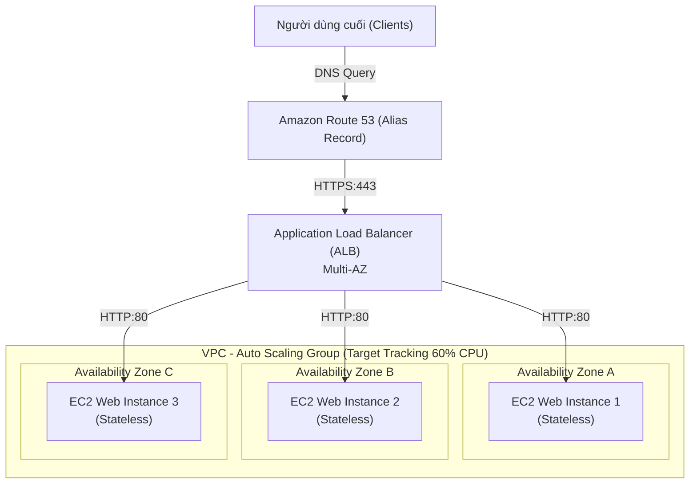
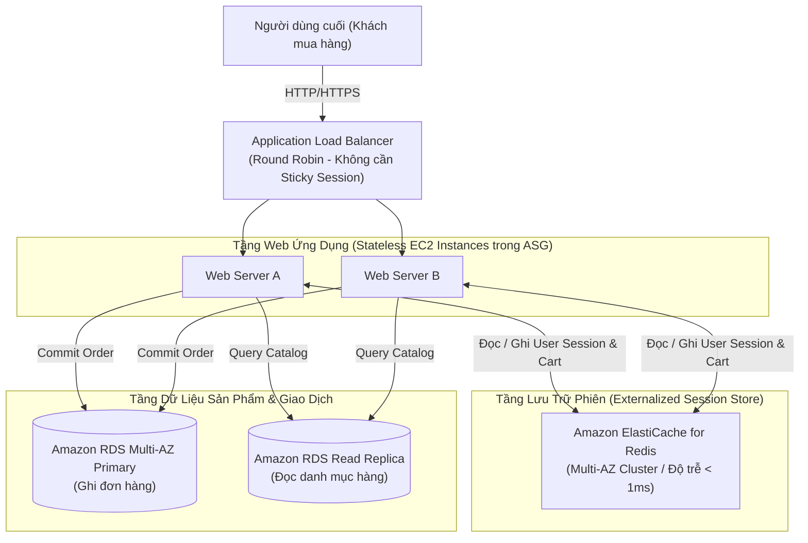
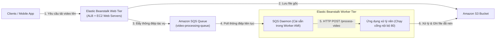
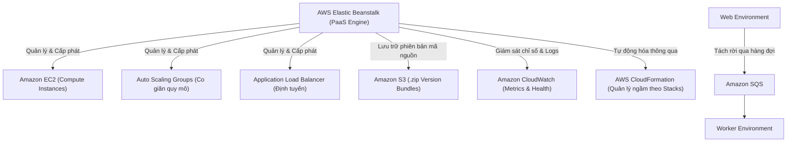

# Ghi Chú Bài Học: Chương 11 - Các Mẫu Thiết Kế Kiến Trúc Kinh Điển & AWS Elastic Beanstalk (Classic Solutions Architecture)

> **Khóa học**: Ultimate AWS Certified Solutions Architect Associate  
> **Chương**: 11 - Classic Solutions Architecture (Bài 121 đến Bài 127)  
> **Tài liệu tham chiếu liên quan**: [AWS Service Document: ELB & Auto Scaling Groups](../AWS_Services/ELB_and_ASG_High_Availability.md) | [AWS Service Document: EBS & EFS Storage](../AWS_Services/EBS_EFS_Storage.md) | [AWS Service Document: RDS & Aurora Databases](../AWS_Services/RDS_Aurora_Databases.md)

---

## 1. Tổng Quan Bài Học (Lesson Overview)

Chương học này tổng hợp và nâng tầm các khái niệm hạ tầng cốt lõi (EC2, ELB, ASG, EBS, EFS, RDS, ElastiCache, Route 53) thành các mẫu kiến trúc giải pháp kinh điển trong thực tế sản xuất (**Production Cloud Architectures**), đồng thời giới thiệu dịch vụ nền tảng tự động hóa triển khai ứng dụng đám mây **AWS Elastic Beanstalk** (Platform as a Service - PaaS).

### Mục tiêu học tập cốt lõi
1. Nắm vững tư duy chuyển đổi từ hệ thống nguyên khối có trạng thái (**Monolithic Stateful**) sang kiến trúc phi trạng thái phân tán (**Distributed Stateless**).
2. Phân tích 3 bài toán kiến trúc kinh điển: **WhatsTheTime.com**, **MyClothes.com**, và **MyWordPress.com**.
3. Hiểu cơ chế hoạt động của **AWS Elastic Beanstalk**: Phân biệt Web Environment và Worker Environment.
4. Nắm vững bản chất và sự đánh đổi của **5 chiến lược triển khai cập nhật phiên bản (Deployment Strategies)** trong môi trường doanh nghiệp.
5. Cấu hình tự động hóa ứng dụng qua `.ebextensions` và công cụ dòng lệnh **EB CLI**.

---

## 2. Điểm Cốt Lõi Cần Nhớ (Key Takeaways)

1. **WhatsTheTime.com (Stateless Web Tier)**:
   - Các máy chủ web chỉ thực hiện xử lý logic thuần túy, không lưu giữ bất kỳ trạng thái (State) hay phiên làm việc (Session) nào trong bộ nhớ RAM hoặc ổ đĩa cục bộ.
   - Nhờ đó, người dùng có thể gửi yêu cầu đến bất kỳ instance nào; máy ảo có thể bị Auto Scaling Group tắt hoặc bật bất kỳ lúc nào mà không làm gián đoạn trải nghiệm người dùng.
2. **MyClothes.com (Xử lý giỏ hàng & Quản lý phiên làm việc Stateful)**:
   - *Cách 1: Bật Sticky Sessions (Session Affinity) trên Load Balancer*: Yêu cầu từ cùng một người dùng luôn được gửi về một instance cụ thể. Rủi ro: Nếu instance đó chết, giỏ hàng bị mất; gây mất cân bằng tải giữa các server.
   - *Cách 2: Lưu Session Data trong Web Cookies*: Gửi trạng thái về trình duyệt của khách hàng. Rủi ro: Dung lượng cookie bị giới hạn (4KB), làm request HTTP phình to, và rủi ro bị sửa đổi/tấn công bảo mật.
   - *Cách 3 (Chuẩn kiến trúc Production)*: **Externalized Session State** - Đẩy toàn bộ session và giỏ hàng ra một cụm lưu trữ phân tán độc lập: **Amazon ElastiCache (Redis)** hoặc **Amazon DynamoDB**. Máy chủ web trở về dạng Stateless hoàn toàn.
3. **MyWordPress.com (Lưu trữ tệp tin chia sẻ phân tán)**:
   - Khi có nhiều máy chủ web WordPress cùng chạy song song, người dùng tải ảnh đại diện lên web server A thì web server B và C cũng phải nhìn thấy tệp tin đó.
   - Giải pháp: Gắn ổ đĩa mạng chia sẻ phân tán **Amazon EFS** (Elastic File System - giao thức NFSv4) vào thư mục `/wp-content/uploads` trên tất cả các instance trên nhiều AZs. Tầng cơ sở dữ liệu sử dụng **Amazon RDS Multi-AZ** (kết hợp Read Replicas).
4. **AWS Elastic Beanstalk**:
   - Dịch vụ PaaS: Lập trình viên chỉ cần tải mã nguồn lên (Java, .NET, Node.js, PHP, Python, Go, Docker), Beanstalk tự động xử lý toàn bộ việc cấu hình và gắn kết: VPC, EC2, Auto Scaling, Application Load Balancer, Route 53, và CloudWatch.
   - Giữ toàn quyền kiểm soát (Full Control): Người dùng vẫn có thể SSH vào máy ảo hoặc tùy biến hạ tầng thông qua thư mục cấu hình `.ebextensions/`.
5. **Beanstalk Worker Tier**:
   - Tách rời tác vụ tính toán nặng (như render video, sinh báo cáo PDF) khỏi luồng HTTP của người dùng. Worker Tier sử dụng một tiến trình daemon (SQS Daemon) đọc thông điệp từ hàng đợi **Amazon SQS** và gọi HTTP POST vào ứng dụng nội bộ trên cổng `localhost`.

---

## 3. Kiến Trúc & Cơ Chế Hoạt Động Chuyên Sâu (Under-the-Hood Mechanisms & Deep Dive)

### 3.1. Sơ đồ 3 Bài toán Kiến trúc Kinh điển

#### Kiến trúc 1: WhatsTheTime.com (Stateless Scalable Architecture)



---

#### Kiến trúc 2: MyClothes.com (Stateful Session Externalization)



---

#### Kiến trúc 3: MyWordPress.com (Đa tầng phân tán với Shared Storage)

```mermaid
flowchart TD
    User["Người dùng Web"] --> CF["Amazon CloudFront CDN (Cache hình ảnh/bài viết)"]
    CF --> ALB["Application Load Balancer"]

    subgraph AppTier["Tầng Web WordPress (Auto Scaling Group)"]
        WP1["WordPress Instance 1 (AZ-1)"]
        WP2["WordPress Instance 2 (AZ-2)"]
    end

    subgraph StorageTier["Tầng Lưu Trữ Tệp Dùng Chung (Shared Media Storage)"]
        EFS["Amazon EFS (Elastic File System)\nMount Target: /var/www/html/wp-content/uploads"]
    end

    subgraph DBTier["Tầng Cơ Sở Dữ Liệu"]
        RDS_Pri[("RDS MySQL Multi-AZ (Active)")]
        RDS_Stby[("RDS MySQL Standby (Passive)")]
    end

    ALB --> WP1
    ALB --> WP2
    WP1 <-->|NFSv4 Mount| EFS
    WP2 <-->|NFSv4 Mount| EFS
    WP1 -->|SQL Queries| RDS_Pri
    WP2 -->|SQL Queries| RDS_Pri
    RDS_Pri -.->|Đồng bộ dữ liệu ngầm (Synchronous)| RDS_Stby
```

---

### 3.2. Cơ chế phân tách Web Tier & Worker Tier trong AWS Elastic Beanstalk



---

### 3.3. So sánh 5 chiến lược triển khai (Deployment Strategies) của Elastic Beanstalk

| Chiến lược Deployment | Cơ chế hoạt động ngầm | Downtime | Thời gian triển khai | Sức chứa (Capacity) khi deploy | Chi phí phát sinh | Kịch bản sử dụng tối ưu |
| :--- | :--- | :--- | :--- | :--- | :--- | :--- |
| **All-at-once** | Dừng toàn bộ các instance cùng lúc, cài đặt code mới rồi bật lại. | **CÓ** (toàn bộ web ngừng hoạt động trong vài phút) | Cực nhanh | Bằng 0% trong lúc deploy | Không | Chỉ dùng cho môi trường Development / Testing nội bộ. |
| **Rolling** | Chia instance thành từng mẻ (batch). Cập nhật mẻ 1, xong mới chuyển sang mẻ 2. | Không | Trung bình | **Bị giảm** (ví dụ 4 máy cập nhật mẻ 2 máy thì chỉ còn 2 máy nhận tải) | Không | Hệ thống có dư thừa tài nguyên (oversized) có thể chịu tải khi giảm công suất. |
| **Rolling with additional batch** | Bật thêm một mẻ máy mới tương đương kích thước batch trước, deploy trên đó, rồi mới rolling các máy cũ. | **KHÔNG** | Chậm hơn Rolling | **Đảm bảo 100% dung lượng** phục vụ trong toàn bộ quá trình | Nhỏ (chỉ trả phí cho batch tạm thời) | **Khuyến nghị cho Production**: Vừa an toàn về tải vừa không phát sinh chi phí lớn. |
| **Immutable** | Tạo một Auto Scaling Group tạm thời hoàn toàn mới, khởi tạo các instance mới, kiểm tra sức khỏe thành công mới gộp vào ASG cũ và xóa máy cũ. | **KHÔNG** | Chậm | Đảm bảo 100% | Tạm thời tăng gấp đôi tài nguyên trong lúc deploy | **Cực kỳ an toàn**: Rollback tức thì nếu có lỗi (chỉ cần xóa ASG tạm); dùng cho các bản nâng cấp OS/patching lớn. |
| **Blue/Green** | Dựng một môi trường Elastic Beanstalk hoàn toàn mới (Green) song song với môi trường hiện tại (Blue). Dùng Route 53 hoặc tính năng **Swap Environment CNAME** để chuyển toàn bộ traffic ngay lập tức. | **KHÔNG** (chuyển DNS tức thì) | Phụ thuộc thời gian dựng môi trường mới | Đảm bảo 100% | Nhân đôi chi phí trong thời gian chạy song song | Triển khai phiên bản lớn (major release), thay đổi cấu hình cơ sở dữ liệu hoặc chuyển đổi kiến trúc sâu. |

---

## 4. Lệnh, Cấu Hình & Mã Nguồn Thực Tế (Commands, Config & Code)

### 4.1. Cấu hình tự động hóa Elastic Beanstalk qua `.ebextensions`

Thư mục `.ebextensions/` đặt tại thư mục gốc của mã nguồn chứa các tệp định dạng `.config` (YAML hoặc JSON) được Beanstalk thực thi theo thứ tự bảng chữ cái:

```yaml
# Đường dẫn: .ebextensions/01_app_environment.config
option_settings:
  aws:elasticbeanstalk:application:environment:
    NODE_ENV: production
    REDIS_HOST: 'my-clothes-redis.abcxyz.cache.amazonaws.com'
    REDIS_PORT: 6379
    DB_NAME: 'production_store'
  aws:elasticbeanstalk:environment:process:default:
    HealthCheckPath: /health
    DeregistrationDelay: '20'
  aws:autoscaling:asg:
    MinSize: '2'
    MaxSize: '10'
  aws:autoscaling:trigger:
    MeasureName: CPUUtilization
    Statistic: Average
    Unit: Percent
    UpperThreshold: '70'
    LowerThreshold: '20'
```

---

### 4.2. Thao tác điều khiển ứng dụng qua công cụ dòng lệnh EB CLI

```bash
# Khởi tạo dự án Elastic Beanstalk từ thư mục mã nguồn
eb init -p node.js-18 my-express-app --region ap-southeast-1

# Tạo môi trường Web Tier chạy Load Balancer và Auto Scaling
eb create my-express-prod --tier web --instance-types t3.medium --min-instances 2 --max-instances 6

# Triển khai phiên bản code mới lên môi trường
eb deploy my-express-prod

# Mở ứng dụng trên trình duyệt web
eb open

# Đổi URL CNAME giữa hai môi trường Blue và Green (Blue/Green Deployment)
eb swap my-express-blue -n my-express-green

# Kiểm tra log ứng dụng và trạng thái sức khỏe
eb health
eb logs
```

---

## 5. Tình Huống Thực Tiễn & Mẫu Kiến Trúc (Real-World Scenarios & Design Patterns)

### Tình huống 1: Người dùng mất giỏ hàng khi Flash Sale khiến Auto Scaling Group co giãn
- **Sự cố**: Trong đợt Flash Sale, ASG tự động tăng từ 2 lên 10 máy ảo. Tuy nhiên, nhiều khách hàng phàn nàn rằng khi đang duyệt hàng thì bỗng nhiên giỏ hàng bị trống trơn.
- **Phân tích nguyên nhân**: Ứng dụng bật Sticky Sessions trên ALB nhưng lưu giỏ hàng trong RAM cục bộ của máy chủ. Khi máy chủ cũ bị quá tải hoặc khi traffic phân bổ sang máy chủ mới, người dùng bị chuyển sang instance khác và mất dữ liệu RAM.
- **Giải pháp**:
  1. Tách toàn bộ việc lưu trữ Session ID và nội dung giỏ hàng ra cụm **Amazon ElastiCache for Redis Multi-AZ**.
  2. Tắt tính năng Sticky Sessions trên ALB để lưu lượng phân bổ đều qua thuật toán Round Robin.
  3. Bật tính năng **Connection Draining (Deregistration Delay)** trên ALB ở mức 300 giây để các request đang dở dang không bị ngắt đột ngột khi instance bị scale-in.

### Tình huống 2: Triển khai hệ thống nén video cho người dùng không bị nghẽn mạng
- **Yêu cầu**: Nền tảng chia sẻ video có hàng ngàn người dùng tải file MP4 lên mỗi giờ. Việc chuyển đổi định dạng (Transcoding) tốn từ 2 đến 10 phút CPU.
- **Kiến trúc giải pháp**:
  - Không cho máy chủ web trực tiếp xử lý chuyển mã video vì sẽ làm nghẽn toàn bộ kết nối HTTP của khách hàng.
  - Sử dụng **Elastic Beanstalk Worker Environment**: Tầng Web lưu video vào S3, tạo một tin nhắn vào **Amazon SQS** chứa S3 Key. Worker Environment tự động đọc SQS và xử lý chuyển mã chạy nền; khi hàng đợi SQS tăng cao, ASG của Worker Tier tự động scale thêm máy ảo để xử lý.

---

## 6. Mối Quan Hệ Giữa Các Dịch Vụ (Service Relationships & Ecosystem)



---

## 7. Câu Hỏi Ôn Tập, Bẫy Thi & Tự Đánh Giá (Review, Exam Traps & Self-Assessment)

### Câu hỏi:

1. **Một trang web thương mại điện tử chạy trên nhiều EC2 instance phía sau Application Load Balancer. Công ty phát hiện người dùng bị mất giỏ hàng mỗi khi Auto Scaling Group tắt bớt máy ảo trong giai đoạn scale-in. Giải pháp kiến trúc nào giải quyết triệt để vấn đề này mà vẫn đảm bảo tính co giãn cao nhất?**
2. **Bạn đang sử dụng AWS Elastic Beanstalk cho một ứng dụng quan trọng trong doanh nghiệp. Bạn chuẩn bị triển khai phiên bản phần mềm mới nhưng yêu cầu tuyệt đối KHÔNG ĐƯỢC CÓ DOWNTIME và hệ thống PHẢI DUY TRÌ 100% CÔNG SUẤT PHỤC VỤ (Full Capacity) trong suốt quá trình triển khai, đồng thời không muốn chi phí hạ tầng bị nhân đôi trong thời gian dài. Bạn nên chọn chiến lược triển khai nào?**
3. **Một ứng dụng WordPress nhiều tầng chạy trên nhiều máy chủ EC2 cần một giải pháp lưu trữ dùng chung cho thư mục tệp tin tải lên của người dùng (`wp-content/uploads`). Giải pháp lưu trữ nào có khả năng gắn kết đồng thời (Multi-Attach) trên nhiều máy chủ ở các Availability Zones khác nhau theo chuẩn hệ thống tệp tin POSIX?**
4. **Trong mô hình Elastic Beanstalk Worker Environment, làm thế nào ứng dụng mã nguồn của bạn (Node.js/Python) nhận được thông điệp từ Amazon SQS queue mà không cần phải tự viết code kết nối với AWS SDK?**
5. **Bạn muốn cập nhật phiên bản lớn (Major Release) cho ứng dụng trên Elastic Beanstalk kèm theo việc nâng cấp phiên bản cơ sở dữ liệu và chuyển đổi HTTPS certificate. Chiến lược triển khai nào cho phép bạn kiểm thử toàn diện trên môi trường mới và chuyển hướng traffic ngay lập tức với rủi ro rollback thấp nhất?**
6. **Khi sử dụng phương pháp lưu trữ phiên làm việc của người dùng bằng Client Cookies, nhược điểm bảo mật và hiệu năng lớn nhất là gì?**

---

### Đáp án (Self-Assessment Answers):

<details>
<summary>👉 Nhấp vào đây để xem đáp án và giải thích chi tiết</summary>

1. **Giải thích**: Chuyển trạng thái phiên và giỏ hàng ra một kho lưu trữ tập trung bên ngoài (**Amazon ElastiCache for Redis** hoặc **Amazon DynamoDB**). Việc này biến tầng máy chủ web thành phi trạng thái (Stateless), giúp việc bật/tắt máy ảo của ASG không gây bất kỳ ảnh hưởng nào tới giỏ hàng của người dùng.
2. **Giải thích**: Chọn **Rolling with additional batch**. Chiến lược này bật trước một mẻ máy ảo mới tương đương kích thước batch để đảm bảo tổng công suất luôn đạt 100% hoặc cao hơn, sau đó mới tiến hành cập nhật lần lượt từng mẻ cũ, đảm bảo không có downtime và chi phí chỉ phát sinh rất nhỏ trong thời gian ngắn của đợt cập nhật.
3. **Giải thích**: **Amazon EFS (Elastic File System)**. EFS là hệ thống lưu trữ tệp tin mạng (NFSv4) có khả năng chia sẻ đồng thời cho hàng trăm máy ảo EC2 trên nhiều AZs trong cùng một Region với chuẩn tương thích POSIX. (EBS Multi-Attach chỉ hỗ trợ trong 1 AZ duy nhất và yêu cầu clustered file system).
4. **Giải thích**: Thông qua tiến trình **SQS Daemon** được AWS tích hợp sẵn trong nền tảng Worker Tier. Tiến trình này liên tục poll thông điệp từ SQS và chuyển tiếp thông điệp đó thành một yêu cầu HTTP POST gửi vào endpoint nội bộ (thường là `http://localhost/` hoặc đường dẫn được chỉ định) của ứng dụng web.
5. **Giải thích**: **Blue/Green Deployment (thông qua Swap Environment CNAME)**. Bạn tạo một môi trường Green độc lập hoàn toàn, triển khai và kiểm thử kỹ lưỡng; sau đó chỉ cần một cú nhấp chuột hoán đổi CNAME DNS giữa Blue và Green để chuyển 100% lượng truy cập ngay lập tức; nếu có lỗi có thể swap ngược lại trong vòng vài giây.
6. **Giải thích**: Kích thước request HTTP bị phình to (vì mỗi request đều phải kèm theo toàn bộ cookie giỏ hàng), cookie bị giới hạn kích thước tối đa 4KB, và tiềm ẩn rủi ro bảo mật nếu kẻ tấn công giả mạo dữ liệu cookie trên trình duyệt khách hàng (Client-Side Tampering) trừ khi dữ liệu được mã hóa phức tạp.
</details>

---

## 8. Nguồn Trích Dẫn Bài Giảng & Tài Liệu Liên Quan (Source References)

- **Source Transcripts**:
  - [121 - Solutions Architecture Discussions Overview.md](../AWS_Resources/11%20-%20Classic%20Solutions%20Architecture/121%20-%20Solutions%20Architecture%20Discussions%20Overview.md)
  - [122 - WhatsTheTime.com.md](../AWS_Resources/11%20-%20Classic%20Solutions%20Architecture/122%20-%20WhatsTheTime.com.md)
  - [123 - MyClothes.com.md](../AWS_Resources/11%20-%20Classic%20Solutions%20Architecture/123%20-%20MyClothes.com.md)
  - [124 - MyWordPress.com.md](../AWS_Resources/11%20-%20Classic%20Solutions%20Architecture/124%20-%20MyWordPress.com.md)
  - [125 - Instantiating applications quickly.md](../AWS_Resources/11%20-%20Classic%20Solutions%20Architecture/125%20-%20Instantiating%20applications%20quickly.md)
  - [126 - Beanstalk Overview.md](../AWS_Resources/11%20-%20Classic%20Solutions%20Architecture/126%20-%20Beanstalk%20Overview.md)
- **Tài liệu tham chiếu nội bộ**:
  - [AWS Service Document: ELB & ASG High Availability](../AWS_Services/ELB_and_ASG_High_Availability.md)
  - [AWS Service Document: EBS & EFS Storage](../AWS_Services/EBS_EFS_Storage.md)
  - [AWS Service Document: RDS & Aurora Databases](../AWS_Services/RDS_Aurora_Databases.md)
