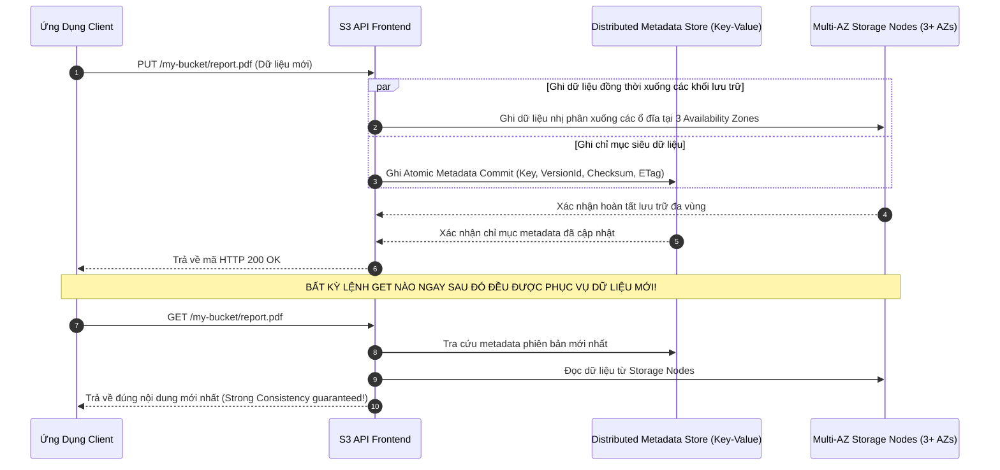
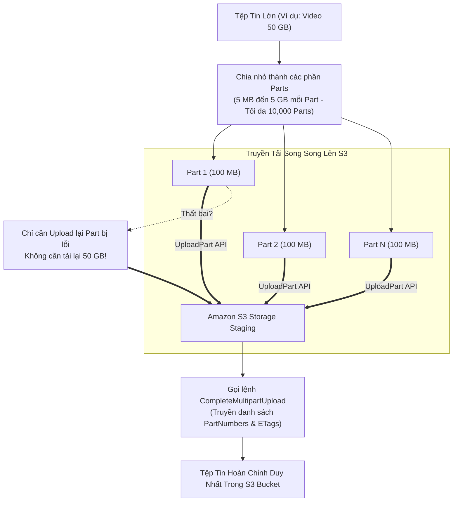
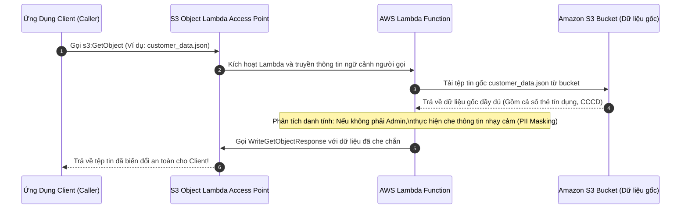
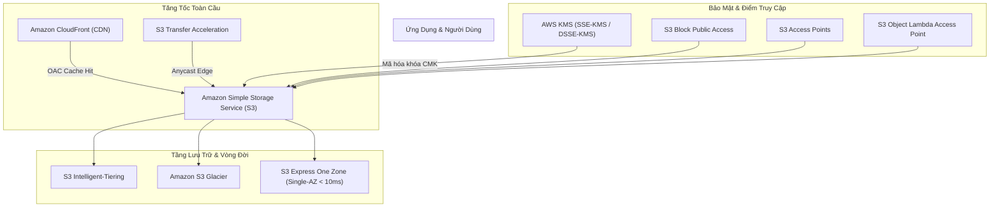

# Ghi Chú Bài Học: Chương 12, 13, 14 - Lưu Trữ Đối Tượng Amazon S3 Toàn Tập (Amazon S3 Comprehensive)

> **Khóa học**: Ultimate AWS Certified Solutions Architect Associate  
> **Chương**: 12, 13, 14 - Amazon S3 Introduction, Advanced S3 & S3 Security (Bài 128 đến Bài 164)  
> **Tài liệu tham chiếu liên quan**: [AWS Service Document: Amazon S3 & CloudFront](../AWS_Services/S3_and_CloudFront_Storage.md)

---

## 1. Tổng Quan Bài Học (Lesson Overview)

### Chủ đề chính
Cụm ba chương này bao quát toàn diện dịch vụ lưu trữ đối tượng cốt lõi **Amazon Simple Storage Service (Amazon S3)**:
- Cấu trúc cơ bản: **Buckets**, **Objects**, **Keys**, và tiền tố phân cấp ảo **Prefixes**.
- Quản lý phiên bản dữ liệu **S3 Versioning**, con dấu đánh dấu xóa **Delete Markers**, và cơ chế an toàn cấp cao **MFA Delete**.
- Sao chép dữ liệu tự động: **Cross-Region Replication (CRR)** và **Same-Region Replication (SRR)**.
- Phân loại các tầng lưu trữ (**Storage Classes**): Standard, Intelligent-Tiering, Standard-IA, One Zone-IA, Glacier Instant Retrieval, Glacier Flexible Retrieval, Glacier Deep Archive, và **S3 Express One Zone**.
- Tự động hóa tối ưu chi phí qua quy tắc vòng đời **S3 Lifecycle Rules**.
- Tối ưu hiệu năng truyền tải: Phân tán tiền tố (Prefix-based scaling), **Multipart Upload**, **S3 Transfer Acceleration**, và **Byte-Range Fetches**.
- Các cơ chế an ninh, bảo mật và phân quyền: **S3 Bucket Policy**, **Block Public Access (BPA)**, các chuẩn mã hóa dữ liệu (**SSE-S3, SSE-KMS, DSSE-KMS, SSE-C**), liên kết tên miền chéo **CORS**, đường dẫn tạm thời **Pre-signed URLs**, bảo vệ chống ghi đè **S3 Object Lock (WORM: Governance vs Compliance)**, điểm truy cập riêng biệt **S3 Access Points**, và biến đổi dữ liệu động **S3 Object Lambda**.

### Mục tiêu học tập
1. Hiểu sâu mô hình nhất quán dữ liệu mạnh mẽ (**Strong Read-After-Write Consistency**) trên Amazon S3.
2. Thiết kế chiến lược lưu trữ dữ liệu tối ưu chi phí kết hợp S3 Lifecycle Rules và Intelligent-Tiering.
3. Làm chủ kỹ thuật tăng tốc tải dữ liệu với **Multipart Upload** và phân chia Prefix.
4. Xây dựng rào chắn bảo mật cấp doanh nghiệp: Bucket Policy ép buộc HTTPS TLS 1.2+, ngăn ngừa rò rỉ dữ liệu qua Block Public Access và KMS CMK.
5. Triển khai cơ chế bất biến dữ liệu tuân thủ pháp lý tài chính với **S3 Object Lock Compliance Mode**.

---

## 2. Điểm Cốt Lõi Cần Nhớ (Key Takeaways)

1. **Nhất quán dữ liệu mạnh (Strong Read-After-Write Consistency)**: S3 hỗ trợ tính nhất quán mạnh mẽ ngay lập tức cho toàn bộ các thao tác `PUT` và `DELETE` trên mọi Region mà không phải trả thêm phí. Ngay sau khi ghi file thành công, lệnh `GET` tiếp theo được đảm bảo 100% đọc được dữ liệu mới nhất.
2. **S3 không có thư mục thật**: Các ký tự gạch chéo `/` trong đường dẫn chỉ là chuỗi tiền tố (**Prefix**). Mỗi Prefix riêng biệt có khả năng phục vụ độc lập **3,500 PUT/POST/DELETE** và **5,500 GET** requests/giây. Bạn có thể mở rộng thông lượng gần như vô hạn bằng cách phân bổ nhiều Prefix khác nhau.
3. **Multipart Upload**: Bắt buộc đối với các tệp tin có kích thước **> 5 GB** và khuyến nghị mạnh mẽ cho mọi tệp tin **> 100 MB** để tải song song các phần (parts) và tự động thử lại phần bị lỗi mà không phải tải lại toàn bộ file.
4. **S3 Express One Zone**: Tầng lưu trữ mới hiệu năng cực đại đặt trong **1 Availability Zone duy nhất**, mang lại độ trễ **single-digit millisecond** (nhanh gấp 10 lần S3 Standard). Lý tưởng cho training mô hình AI/ML và phân tích dữ liệu lớn thời gian thực.
5. **S3 Versioning**: Xóa tệp khi đã bật Versioning chỉ tạo ra một bản ghi **Delete Marker**. Muốn xóa vĩnh viễn tệp tin, bắt buộc phải truyền chính xác tham số `versionId`.
6. **MFA Delete**: Bắt buộc xác thực đa yếu tố bằng tài khoản Root để xóa vĩnh viễn một version hoặc thay đổi trạng thái Versioning của bucket; chỉ có thể kích hoạt thông qua **AWS CLI** (không hỗ trợ trên AWS Console).
7. **S3 Object Lock (Mô hình WORM - Write Once, Read Many)**:
   - *Governance Mode*: Người dùng có quyền IAM đặc biệt (`s3:BypassGovernanceRetention`) có thể chỉnh sửa hoặc xóa file trước hạn.
   - *Compliance Mode*: **TUYỆT ĐỐI BẤT BIẾN**, ngay cả tài khoản Root của AWS cũng không thể xóa hay rút ngắn thời hạn bảo vệ của file trước khi hết hạn lưu giữ.
8. **Mặc định an ninh hiện đại**: Mọi bucket mới tạo đều **mặc định bật mã hóa SSE-S3** và bật **Bucket Owner Enforced** (vô hiệu hóa hoàn toàn S3 ACLs cũ).

---

## 3. Kiến Trúc & Cơ Chế Hoạt Động Chuyên Sâu (Under-the-Hood Mechanisms & Deep Dive)

### 3.1. Mô Hình Nhất Quán Dữ Liệu Mạnh (Strong Read-After-Write Consistency)

Trước năm 2020, S3 sử dụng mô hình Eventual Consistency cho các thao tác ghi đè hoặc xóa. Hiện nay, kiến trúc phân tán của S3 áp dụng mô hình nhất quán tức thì (**Strong Consistency**):



---

### 3.2. Cơ Chế Tải Lên Song Song Đa Phần (Multipart Upload Architecture)



---

### 3.3. Cơ Chế Biến Đổi Dữ Liệu Trực Tiếp: S3 Object Lambda



---

## 4. Lệnh, Cấu Hình & Mã Nguồn Thực Tế (Commands, Config & Code)

### 4.1. S3 Bucket Policy Ép Buộc Kết Nối An Toàn Qua HTTPS (TLS 1.2+)

```json
{
  "Version": "2012-10-17",
  "Id": "EnforceTLSRequestsOnly",
  "Statement": [
    {
      "Sid": "DenyNonSecureTransport",
      "Effect": "Deny",
      "Principal": "*",
      "Action": "s3:*",
      "Resource": [
        "arn:aws:s3:::my-secure-enterprise-bucket",
        "arn:aws:s3:::my-secure-enterprise-bucket/*"
      ],
      "Condition": {
        "Bool": {
          "aws:SecureTransport": "false"
        }
      }
    }
  ]
}
```

---

### 4.2. Quản Trị S3 Bằng AWS CLI v2

```bash
# 1. Tao Bucket moi va bat tinh nang khoa toan bo truy cap cong khai (Block Public Access)
aws s3api create-bucket \
    --bucket my-secure-enterprise-bucket \
    --region ap-southeast-1 \
    --create-bucket-configuration LocationConstraint=ap-southeast-1

aws s3api put-public-access-block \
    --bucket my-secure-enterprise-bucket \
    --public-access-block-configuration "BlockPublicAcls=true,IgnorePublicAcls=true,BlockPublicPolicy=true,RestrictPublicBuckets=true"

# 2. Bat tinh nang Versioning cho Bucket
aws s3api put-bucket-versioning \
    --bucket my-secure-enterprise-bucket \
    --versioning-configuration Status=Enabled

# 3. Tao Pre-signed URL cho phep nguoi dung tai file xuong trong vong 15 phut (900 giay)
aws s3 presign s3://my-secure-enterprise-bucket/confidential-report.pdf --expires-in 900

# 4. Dong bo thu muc du lieu len S3 voi bang thong da luong
aws s3 sync ./local-data s3://my-secure-enterprise-bucket/datasets/ --storage-class INTELLIGENT_TIERING
```

---

## 5. Tình Huống Thực Tiễn & Mẫu Kiến Trúc (Real-World Scenarios & Design Patterns)

### Tình huống 1: Bảo Vệ Dữ Liệu Chống Lại Mã Độc Ransomware (WORM Storage)
- **Bài toán**: Doanh nghiệp tài chính cần lưu trữ hóa đơn điện tử trong 10 năm. Hệ thống phải đảm bảo dù tài khoản quản trị viên bị lộ thông tin đăng nhập hoặc bị mã độc tấn công mã hóa dữ liệu, các tệp tin hóa đơn không bao giờ có thể bị xóa hay sửa đổi.
- **Giải pháp**:
  - Khởi tạo S3 Bucket có bật **S3 Object Lock** ngay từ lúc tạo.
  - Thiết lập chế độ **Compliance Mode** với thời hạn lưu giữ mặc định là 10 năm (3,650 ngày).
  - Kết quả: Không một ai (kể cả tài khoản Root của công ty hay đội ngũ hỗ trợ kỹ thuật của AWS) có thể xóa hoặc ghi đè lên các hóa đơn này cho đến khi hết thời hạn 10 năm.

### Tình huống 2: Tối Ưu Hóa Chi Phí Tự Động Cho Dữ Liệu Truy Cập Không Dự Đoán Trước
- **Bài toán**: Doanh nghiệp truyền thông lưu trữ hàng triệu video do người dùng tải lên. Một số video bỗng nhiên trở nên cực kỳ phổ biến (viral) sau nhiều tháng ngủ yên, trong khi đa số các video khác không bao giờ được xem lại.
- **Giải pháp**:
  - Chuyển toàn bộ các tệp tin sang lớp lưu trữ **S3 Intelligent-Tiering**.
  - S3 Intelligent-Tiering tự động di chuyển tệp tin giữa 3 tầng truy cập (Frequent Access, Infrequent Access sau 30 ngày, Archive Instant Access sau 90 ngày) dựa trên thói quen truy cập thực tế mà **không tính bất kỳ chi phí khôi phục (retrieval fees)** hay chi phí di chuyển tầng nào.

---

## 6. Mối Quan Hệ Giữa Các Khái Niệm / Dịch Vụ (Service Relationships & Ecosystem)



---

## 7. Câu Hỏi Ôn Tập, Bẫy Thi & Tự Đánh Giá (Review, Exam Traps & Self-Assessment)

### Câu hỏi:
1. Bạn có một tệp tin hình ảnh vệ tinh dung lượng 12 GB cần tải lên Amazon S3. Phương thức tải lên nào là bắt buộc phải sử dụng và nếu tải bằng một lệnh `PUT` duy nhất thì chuyện gì sẽ xảy ra?
2. Trong một S3 Bucket đã bật tính năng Versioning, một kỹ sư chạy lệnh xóa một tệp tin mà không truyền Version ID. Tệp tin đó có bị xóa vĩnh viễn không? Làm thế nào để khôi phục lại tệp tin về trạng thái ban đầu?
3. Bạn muốn đảm bảo rằng các hồ sơ y tế bệnh án điện tử khi lưu vào S3 sẽ không thể bị sửa đổi hoặc xóa bỏ bởi bất kỳ ai (kể cả quản trị viên hệ thống hoặc tài khoản AWS Root) trong vòng 7 năm để tuân thủ luật y tế. Bạn nên cấu hình tính năng nào?
4. Đâu là 2 yêu cầu bắt buộc trên cả 2 S3 Buckets (Bucket nguồn và Bucket đích) để có thể thiết lập tính năng Cross-Region Replication (CRR)?
5. Làm thế nào để ứng dụng web chạy trên domain `www.myportal.com` có thể tải được các web fonts và icon lưu trữ tại một S3 bucket riêng biệt mà không bị trình duyệt chặn hiển thị?
6. S3 Express One Zone khác gì so với S3 Standard về mặt độ trễ (latency), phạm vi Availability Zone và trường hợp sử dụng tối ưu?

---

### Đáp án & Giải thích chi tiết:

<details>
<summary>👉 Nhấp vào đây để xem đáp án và phân tích chi tiết</summary>

1. Bắt buộc phải sử dụng **S3 Multipart Upload**. Vì Amazon S3 quy định giới hạn kích thước tối đa cho một thao tác tải lên đơn lẻ (`s3:PutObject` API) là **5 GB**. Nếu cố tình tải tệp tin 12 GB bằng một lệnh PUT duy nhất, API của S3 sẽ ngay lập tức từ chối và trả về mã lỗi HTTP 400 Bad Request.
2. Tệp tin **KHÔNG BỊ XÓA VĨNH VIỄN**. S3 chỉ ghi thêm một bản ghi phiên bản mới có tính chất là **Delete Marker** (đóng vai trò như một tấm biển che tệp tin gốc lại). Để khôi phục tệp, bạn chỉ cần hiển thị danh sách toàn bộ các phiên bản (Show Versions) và **thực hiện xóa chính bản ghi Delete Marker đó**.
3. Sử dụng tính năng **S3 Object Lock** ở chế độ **Compliance Mode** với thời hạn lưu giữ (Retention Period) là 7 năm. Ở chế độ này, tính bất biến WORM được đảm bảo tuyệt đối, không một tài khoản nào (kể cả AWS Root) có thể xóa file trước hạn.
4. Hai yêu cầu bắt buộc:
   - Cả hai S3 Buckets (Nguồn và Đích) bắt buộc phải **bật tính năng S3 Versioning**.
   - Phải cấu hình một **IAM Role** cấp quyền cho dịch vụ S3 đọc dữ liệu từ Bucket nguồn và sao chép ghi dữ liệu sang Bucket đích.
5. Cấu hình quy tắc **CORS (Cross-Origin Resource Sharing)** trên S3 bucket chứa fonts, khai báo Origin được phép là `https://www.myportal.com` với phương thức HTTP cho phép là `GET` và `HEAD`.
6. Sự khác biệt cốt lõi:
   - **Độ trễ**: S3 Express One Zone mang lại độ trễ chỉ **vài mili-giây (single-digit ms)**, nhanh hơn 10 lần so với S3 Standard.
   - **Phạm vi triển khai**: Đặt trong **duy nhất 1 Availability Zone**, trong khi S3 Standard phân tán trên tối thiểu 3 Availability Zones.
   - **Trường hợp sử dụng**: Dành cho các tác vụ tính toán chuyên sâu đòi hỏi tốc độ I/O cực đại như huấn luyện AI/ML, Apache Spark, tài chính thời gian thực.
</details>

---

## 8. Nguồn Trích Dẫn Bài Giảng & Tài Liệu Liên Quan (Source References)

- **Source Transcripts**:
  - [128 - S3 Overview.md](../AWS_Resources/12%20-%20Amazon%20S3%20Introduction/128%20-%20S3%20Overview.md)
  - [130 - S3 Security_ Bucket Policy.md](../AWS_Resources/12%20-%20Amazon%20S3%20Introduction/130%20-%20S3%20Security_%20Bucket%20Policy.md)
  - [134 - S3 Versioning.md](../AWS_Resources/12%20-%20Amazon%20S3%20Introduction/134%20-%20S3%20Versioning.md)
  - [136 - S3 Replication.md](../AWS_Resources/12%20-%20Amazon%20S3%20Introduction/136%20-%20S3%20Replication.md)
  - [139 - S3 Storage Classes Overview.md](../AWS_Resources/12%20-%20Amazon%20S3%20Introduction/139%20-%20S3%20Storage%20Classes%20Overview.md)
  - [142 - S3 Lifecycle Rules (with S3 Analytics).md](../AWS_Resources/13%20-%20Advanced%20Amazon%20S3/142%20-%20S3%20Lifecycle%20Rules%20%28with%20S3%20Analytics%29.md)
  - [147 - S3 Performance.md](../AWS_Resources/13%20-%20Advanced%20Amazon%20S3/147%20-%20S3%20Performance.md)
  - [150 - S3 Encryption.md](../AWS_Resources/14%20-%20Amazon%20S3%20Security/150%20-%20S3%20Encryption.md)
  - [156 - S3 MFA Delete.md](../AWS_Resources/14%20-%20Amazon%20S3%20Security/156%20-%20S3%20MFA%20Delete.md)
  - [160 - S3 Pre-signed URLs.md](../AWS_Resources/14%20-%20Amazon%20S3%20Security/160%20-%20S3%20Pre-signed%20URLs.md)
  - [162 - Glacier Vault Lock & S3 Object Lock.md](../AWS_Resources/14%20-%20Amazon%20S3%20Security/162%20-%20Glacier%20Vault%20Lock%20%26%20S3%20Object%20Lock.md)
  - [163 - S3 Access Points.md](../AWS_Resources/14%20-%20Amazon%20S3%20Security/163%20-%20S3%20Access%20Points.md)
- **Tài liệu chuyên sâu liên quan**:
  - [Chuyên đề Master: Amazon S3 & CloudFront](../AWS_Services/S3_and_CloudFront_Storage.md)
