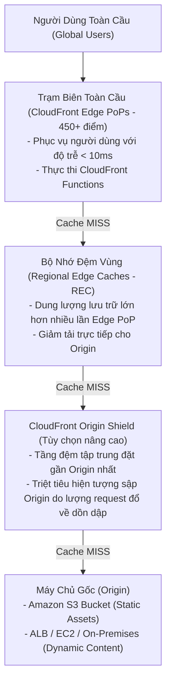
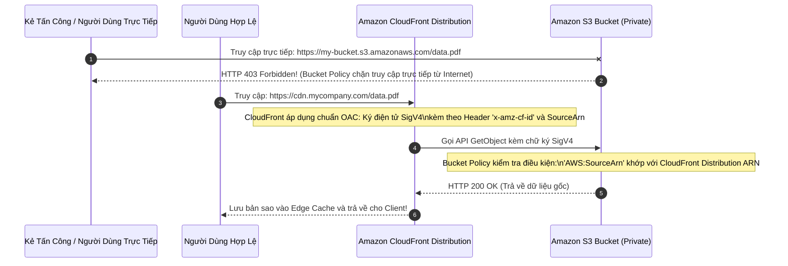
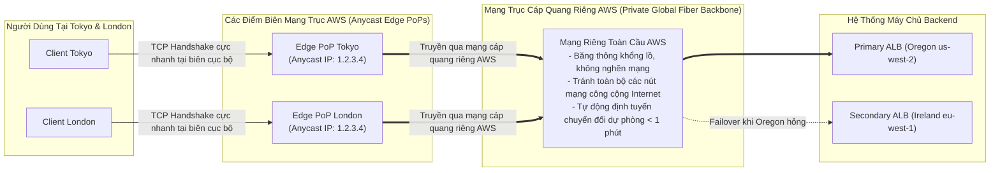
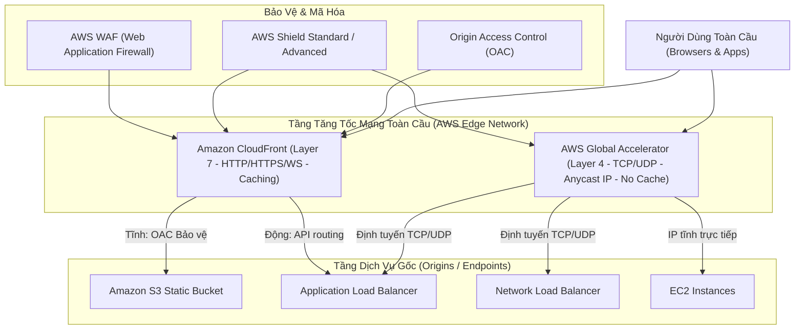

# Ghi Chú Bài Học: Chương 15 - Mạng Phân Phối Nội Dung CloudFront & Tăng Tốc Toàn Cầu (CloudFront & Global Accelerator)

> **Khóa học**: Ultimate AWS Certified Solutions Architect Associate  
> **Chương**: 15 - CloudFront & AWS Global Accelerator (Bài 165 đến Bài 171)  
> **Tài liệu tham chiếu liên quan**: [AWS Service Document: Amazon S3 & CloudFront](../AWS_Services/S3_and_CloudFront_Storage.md)

---

## 1. Tổng Quan Bài Học (Lesson Overview)

### Chủ đề chính
Chương này trang bị kiến thức toàn diện về hai công nghệ tăng tốc mạng và tối ưu hóa lưu lượng toàn cầu của AWS:
- Mạng phân phối nội dung **Amazon CloudFront (Content Delivery Network - CDN)**:
  - Cấu trúc mạng phân tán: **Edge Locations (PoPs)**, **Regional Edge Caches (REC)**, và **Origin Shield**.
  - Các loại Origin: S3 Bucket, Application Load Balancer, EC2 Instance, và máy chủ HTTP bên thứ ba.
  - Chuẩn bảo mật nguồn cấp hiện đại **Origin Access Control (OAC)** thay thế OAI cũ.
  - Tối ưu hóa bộ nhớ đệm: **Cache Policies**, **Origin Request Policies**, và xóa cache khẩn cấp **Cache Invalidation**.
  - Xử lý mã nguồn tại biên: so sánh **CloudFront Functions** và **Lambda@Edge**.
  - Giới hạn truy cập theo quốc gia **Geo Restriction (Allowlist / Blocklist)**.
- Dịch vụ tăng tốc mạng trục riêng **AWS Global Accelerator**:
  - Cơ chế mạng **Anycast Static IP** (2 địa chỉ IP tĩnh duy nhất).
  - Tăng tốc giao thức mạng không lưu bộ nhớ đệm (No Cache) cho cả **TCP** và **UDP**.
  - Cơ chế chấm dứt kết nối sớm tại biên (**TCP Termination at the Edge**).
  - Khắc phục sự cố chuyển giao tự động trong vòng chưa đầy 1 phút.

### Mục tiêu học tập
1. Phân biệt chính xác cơ chế hoạt động, tầng giao thức OSI và trường hợp sử dụng giữa **Amazon CloudFront** và **AWS Global Accelerator**.
2. Thiết lập rào chắn bảo mật cho S3 Origin sử dụng **Origin Access Control (OAC)** kết hợp mã hóa SSE-KMS.
3. Làm chủ kỹ thuật xóa bộ nhớ đệm (**Cache Invalidation**) và chiến lược tối ưu chi phí phân phối nội dung.
4. Lựa chọn đúng giải pháp điện toán tại biên giữa **CloudFront Functions** (siêu nhanh, chi phí thấp) và **Lambda@Edge** (mạnh mẽ, kết nối mạng ngoài).
5. Thiết kế kiến trúc chịu lỗi thảm họa đa vùng (Multi-Region Disaster Recovery) sử dụng Anycast IP của Global Accelerator.

---

## 2. Điểm Cốt Lõi Cần Nhớ (Key Takeaways)

1. **CloudFront = Caching Content (Layer 7)**: Lưu trữ bản sao dữ liệu tĩnh (HTML, CSS, JS, hình ảnh, video) tại hơn 450+ trạm Edge Locations toàn cầu; chuyên dùng cho giao thức HTTP/HTTPS/WebSocket; giảm tải trực tiếp cho Origin.
2. **AWS Global Accelerator = Network Routing (Layer 4 - No Caching)**: Cung cấp **2 địa chỉ IP Anycast tĩnh cố định**; đưa lưu lượng của người dùng vào mạng trục cáp quang riêng của AWS ngay tại điểm Edge gần nhất; hỗ trợ tối ưu cả **TCP và UDP**; không lưu bộ nhớ đệm.
3. **Origin Access Control (OAC)**: Chuẩn bảo mật hiện đại của AWS thay thế cho OAI cũ; sử dụng chữ ký điện tử AWS SigV4, hỗ trợ đầy đủ mã hóa **SSE-KMS**, tương thích với mọi AWS Region mới, và cho phép các tác vụ ghi dữ liệu động (`PUT`/`POST`) an toàn lên S3.
4. **Cache Invalidation**: Sử dụng khi cần cập nhật file trên các Edge Locations ngay lập tức mà không muốn chờ hết hạn TTL; cú pháp có thể áp dụng cho từng file cụ thể (`/images/logo.png`) hoặc dùng ký tự đại diện cho toàn bộ website (`/*`).
5. **So sánh Điện toán tại biên**:
   - *CloudFront Functions*: Viết bằng JavaScript nhẹ, chạy siêu tốc (độ trễ dưới 1 mili-giây), chỉ can thiệp vào `Viewer Request` và `Viewer Response`, không có quyền truy cập Internet hay đọc body; chi phí cực rẻ; dùng để chuyển hướng URL, sửa headers.
   - *Lambda@Edge*: Viết bằng Node.js hoặc Python, có thể gọi ra mạng ngoài (database, 3rd party API), hỗ trợ cả 4 trigger (Viewer Request/Response, Origin Request/Response), thời gian chạy tới 30 giây; dùng cho xác thực JWT phức tạp, tạo nội dung động (SSR).
6. **TCP Termination at the Edge**: Global Accelerator hoàn tất 3 bước bắt tay TCP (TCP 3-way handshake) ngay tại Edge Location gần người dùng nhất, sau đó truyền dữ liệu về backend qua kết nối mạng đường trục được tối ưu sẵn của AWS, giúp giảm triệt để độ trễ và hiện tượng mất gói tin.

---

## 3. Kiến Trúc & Cơ Chế Hoạt Động Chuyên Sâu (Under-the-Hood Mechanisms & Deep Dive)

### 3.1. Cấu Trúc Bộ Nhớ Đệm Đa Tầng Của Amazon CloudFront



- **Quy trình tối ưu**: Khi một file không có sẵn trong Edge PoP (Cache Miss), yêu cầu được chuyển tiếp lên Regional Edge Cache (REC). Nếu REC có sẵn bản sao từ người dùng khác trong cùng khu vực địa lý, nó sẽ phản hồi ngay lập tức mà không cần gọi về Origin. Origin Shield bổ sung thêm một tầng tập trung để bảo vệ Origin khỏi hiện tượng nghẽn mạng khi có hàng trăm nghìn Edge PoPs truy vấn đồng thời.

---

### 3.2. Cơ Chế Bảo Mật S3 Origin Bằng Origin Access Control (OAC)



---

### 3.3. Cơ Chế Anycast Routing & TCP Termination Của AWS Global Accelerator



---

## 4. Lệnh, Cấu Hình & Mã Nguồn Thực Tế (Commands, Config & Code)

### 4.1. S3 Bucket Policy Cho Phép Duy Nhất CloudFront OAC Truy Cập

```json
{
  "Version": "2012-10-17",
  "Statement": [
    {
      "Sid": "AllowCloudFrontServicePrincipalReadOnly",
      "Effect": "Allow",
      "Principal": {
        "Service": "cloudfront.amazonaws.com"
      },
      "Action": "s3:GetObject",
      "Resource": "arn:aws:s3:::my-static-website-bucket/*",
      "Condition": {
        "StringEquals": {
          "AWS:SourceArn": "arn:aws:cloudfront::123456789012:distribution/EDFDVBD632BHDS5"
        }
      }
    }
  ]
}
```

---

### 4.2. Xóa Bộ Nhớ Đệm (Cache Invalidation) Bằng AWS CLI v2

```bash
# 1. Xoa bo nho dem cho toan bo cac tep tin tren website (/*)
aws cloudfront create-invalidation \
    --distribution-id EDFDVBD632BHDS5 \
    --paths "/*"

# 2. Xoa bo nho dem cho mot so tep tin cu the sau khi deploy ban cap nhat
aws cloudfront create-invalidation \
    --distribution-id EDFDVBD632BHDS5 \
    --paths "/index.html" "/static/css/main.css" "/static/js/app.js"

# 3. Kiem tra tien trinh cua lenh Invalidation vua tao
aws cloudfront get-invalidation \
    --distribution-id EDFDVBD632BHDS5 \
    --id I1A2B3C4D5E6F7
```

---

### 4.3. Tạo Bộ Tăng Tốc Mạng AWS Global Accelerator

```bash
# Tao moi mot Global Accelerator cung cap 2 dia chi Anycast IP tinh
aws globalaccelerator create-accelerator \
    --name "Production-Gaming-Accelerator" \
    --ip-address-type IPV4 \
    --enabled \
    --query "Accelerator.{DnsName:DnsName,IpSets:IpSets}" \
    --output json
```

---

## 5. Tình Huống Thực Tiễn & Mẫu Kiến Trúc (Real-World Scenarios & Design Patterns)

### Tình huống 1: Trò Chơi Trực Tuyến Thời Gian Thực Độ Trễ Thấp (Real-Time Gaming)
- **Bài toán**: Một studio game phát hành trò chơi đối kháng trực tuyến (Multiplayer Action Game) sử dụng giao thức truyền nhận UDP thô. Người chơi phân tán trên toàn thế giới thường xuyên gặp hiện tượng giật lag (lag spikes) và mất gói tin (packet loss) khi lưu lượng đi qua các nhà mạng Internet công cộng.
- **Giải pháp**:
  - Triển khai **AWS Global Accelerator** đứng trước cụm Network Load Balancers ở các Region.
  - Cấu hình firmware của game trỏ kết nối UDP tới 2 địa chỉ **Anycast IP tĩnh** của Global Accelerator.
  - Gói tin của người chơi lập tức đi vào mạng cáp quang riêng của AWS tại PoP gần nhất, loại bỏ hoàn toàn các nút thắt cổ chai Internet công cộng, duy trì ping ổn định dưới 40ms.

### Tình huống 2: Cập Nhật Ứng Dụng Web SPA Khẩn Cấp (Cache Invalidation vs File Versioning)
- **Bài toán**: Ứng dụng Single Page Application (React/Vue) triển khai trên S3 + CloudFront. Sau khi đẩy bản sửa lỗi khẩn cấp, một số khách hàng vẫn tải file `bundle.js` cũ từ cache của trình duyệt và Edge PoP, gây lỗi ứng dụng.
- **Chiến lược chuẩn sản xuất (Best Practice)**:
  - Sử dụng cơ chế gắn mã hash phiên bản vào tên tệp (**File Fingerprinting / Versioning**): ví dụ `bundle.a1b2c3.js`. File HTML `index.html` sẽ tham chiếu tới mã hash mới này.
  - Mỗi lần deploy, chỉ cần thực hiện Cache Invalidation cho duy nhất file `/index.html` (rất nhanh và miễn phí trong hạn ngạch 1,000 requests/tháng). Trình duyệt sẽ đọc `index.html` mới và tự động tải file `bundle.a1b2c3.js` mới mà không lo bị kẹt cache.

---

## 6. Mối Quan Hệ Giữa Các Khái Niệm / Dịch Vụ (Service Relationships & Ecosystem)



---

## 7. Câu Hỏi Ôn Tập, Bẫy Thi & Tự Đánh Giá (Review, Exam Traps & Self-Assessment)

### Câu hỏi:
1. Bạn đang vận hành một ứng dụng truyền thanh giọng nói (VoIP) và trò chơi trực tuyến thời gian thực sử dụng giao thức UDP thô. Hệ thống yêu cầu độ trễ mạng thấp nhất và phải cung cấp địa chỉ IP tĩnh để cấu hình trên client. Dịch vụ nào giữa **Amazon CloudFront** và **AWS Global Accelerator** là lựa chọn phù hợp nhất?
2. Khi bạn vừa triển khai một bản vá lỗi cho file `index.html` trên S3 nhưng người dùng phản ánh họ vẫn thấy giao diện phiên bản cũ từ CloudFront, bạn cần thực hiện thao tác kỹ thuật gì trên CloudFront Distribution?
3. Tại sao cơ chế **Origin Access Control (OAC)** lại được xem là nâng cấp quan trọng và bắt buộc thay thế cho chuẩn **Origin Access Identity (OAI)** cũ trên CloudFront? Nêu 3 điểm khác biệt cốt lõi.
4. Một công ty truyền thông muốn chặn người dùng từ các quốc gia bị cấm vận không được truy cập vào dịch vụ video trực tuyến của mình. Tính năng nào trên CloudFront đáp ứng yêu cầu này mà không cần sửa đổi mã nguồn ứng dụng?
5. So sánh sự khác nhau về thời gian thực thi (execution time), ngôn ngữ hỗ trợ và khả năng truy cập mạng ngoài giữa **CloudFront Functions** và **Lambda@Edge**?
6. Cơ chế **TCP Termination at the Edge** của AWS Global Accelerator hoạt động như thế nào để cải thiện tốc độ truyền dữ liệu cho người dùng ở xa?

---

### Đáp án & Giải thích chi tiết:

<details>
<summary>👉 Nhấp vào đây để xem đáp án và phân tích chi tiết</summary>

1. **AWS Global Accelerator**. Vì CloudFront hoạt động ở Tầng 7 (Application Layer), chỉ hỗ trợ giao thức HTTP/HTTPS và WebSocket, đồng thời có cơ chế caching không phù hợp với các luồng truyền thông hai chiều UDP thời gian thực. Trong khi đó, Global Accelerator hoạt động ở Tầng 4 (Transport Layer), hỗ trợ tối ưu hóa giao thức UDP và cung cấp 2 địa chỉ Anycast IP tĩnh cố định để đưa lưu lượng trực tiếp vào mạng trục cáp quang riêng của AWS.
2. Bạn cần tạo một lệnh **Cache Invalidation** trên CloudFront Distribution cho đường dẫn `/index.html` (hoặc `/*`) để xóa bỏ bản sao cũ khỏi bộ nhớ đệm tại toàn bộ các trạm Edge Locations trên toàn thế giới, buộc các Edge trạm phải lấy dữ liệu mới từ S3 trong lần truy cập tiếp theo.
3. Ba ưu điểm vượt trội của **OAC** so với OAI cũ:
   - **Hỗ trợ mã hóa SSE-KMS**: OAC sử dụng chữ ký điện tử AWS SigV4, cho phép CloudFront giải mã và đọc các đối tượng S3 được mã hóa bằng khóa KMS CMK (điều mà OAI cũ hoàn toàn không thể làm được).
   - **Tương thích toàn cầu**: Hỗ trợ 100% tất cả các AWS Regions mới ra mắt (Opt-in regions).
   - **Hỗ trợ các phương thức ghi dữ liệu**: Cho phép thực thi các lệnh `PUT`, `POST`, `DELETE` an toàn từ client qua CloudFront lên S3.
4. Tính năng **CloudFront Geographic Restrictions (Geo Restriction)** ở chế độ **Blocklist (Restriction type = Blocklist)**, khai báo danh sách mã quốc gia cần chặn (dựa trên cơ sở dữ liệu định vị IP GeoIP của bên thứ ba được tích hợp sẵn).
5. So sánh:
   - **CloudFront Functions**: Viết bằng JavaScript nhẹ; thời gian thực thi < 1 mili-giây; chỉ gắn vào 2 sự kiện `Viewer Request` và `Viewer Response`; **KHÔNG có quyền truy cập Internet hay gọi database ngoài**; chi phí cực thấp; dùng để chuẩn hóa header, URL rewrite.
   - **Lambda@Edge**: Viết bằng Node.js hoặc Python; thời gian thực thi lên tới 5 giây (Viewer) hoặc 30 giây (Origin); gắn vào cả 4 sự kiện (Viewer Request/Response, Origin Request/Response); **CÓ quyền truy cập mạng ngoài, truy vấn database và hệ thống file**; chi phí cao hơn; dùng để xác thực JWT phức tạp, Server-Side Rendering (SSR).
6. **TCP Termination at the Edge**: Thay vì người dùng phải thực hiện quy trình bắt tay 3 bước TCP (3-way handshake) xuyên qua nửa vòng trái đất với máy chủ backend (tốn hàng trăm mili-giây), người dùng hoàn tất bắt tay TCP ngay tại Edge Location gần nhất của AWS chỉ trong vài mili-giây. Sau đó, dữ liệu được truyền tải về backend thông qua một kết nối TCP đường dài đã được thiết lập sẵn và tối ưu hóa liên tục trên mạng cáp quang riêng của AWS, giúp giảm tối đa độ trễ và hiện tượng nghẽn mạng.
</details>

---

## 8. Nguồn Trích Dẫn Bài Giảng & Tài Liệu Liên Quan (Source References)

- **Source Transcripts**:
  - [165 - CloudFront Overview.md](../AWS_Resources/15%20-%20CloudFront%20&%20AWS%20Global%20Accele/165%20-%20CloudFront%20Overview.md)
  - [167 - CloudFront - ALB_EC2 as an Origin.md](../AWS_Resources/15%20-%20CloudFront%20&%20AWS%20Global%20Accele/167%20-%20CloudFront%20-%20ALB_EC2%20as%20an%20Origin.md)
  - [168 - CloudFront - Geo Restriction.md](../AWS_Resources/15%20-%20CloudFront%20&%20AWS%20Global%20Accele/168%20-%20CloudFront%20-%20Geo%20Restriction.md)
  - [169 - CloudFront - Cache Invalidation.md](../AWS_Resources/15%20-%20CloudFront%20&%20AWS%20Global%20Accele/169%20-%20CloudFront%20-%20Cache%20Invalidation.md)
  - [170 - AWS Global Accelerator - Overview.md](../AWS_Resources/15%20-%20CloudFront%20&%20AWS%20Global%20Accele/170%20-%20AWS%20Global%20Accelerator%20-%20Overview.md)
- **Tài liệu chuyên sâu liên quan**:
  - [Chuyên đề Master: Amazon S3 & CloudFront](../AWS_Services/S3_and_CloudFront_Storage.md)
  - [Chuyên đề Master: Amazon Route 53 & Edge Networking](../AWS_Services/Route53_DNS.md)
