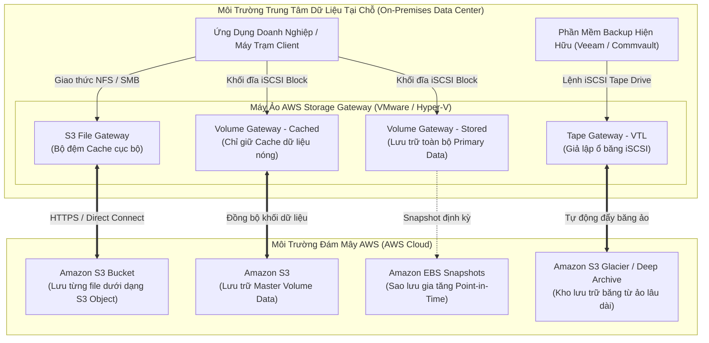
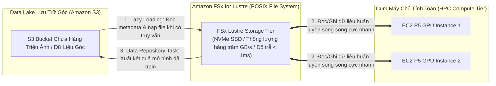
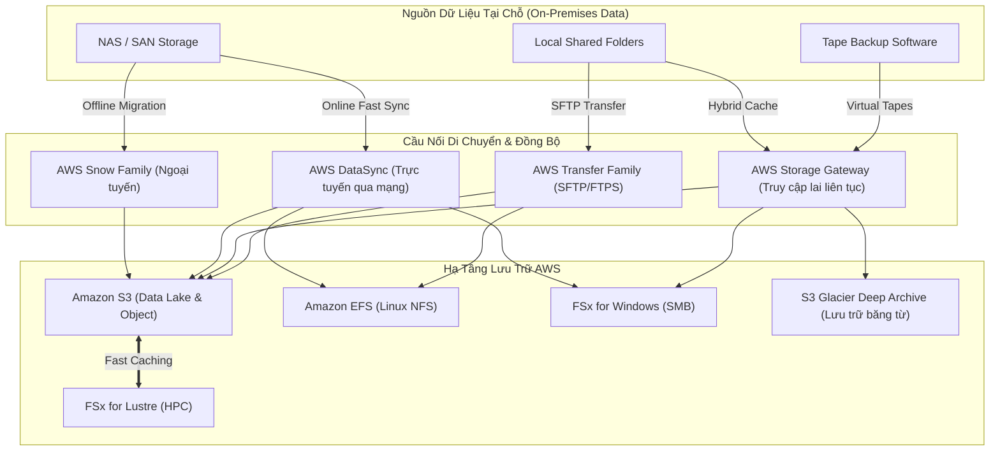

# Ghi Chú Bài Học: Chương 16 - Các Dịch Vụ Lưu Trữ Chuyên Sâu & Mạng Lai (AWS Storage Extras)

> **Khóa học**: Ultimate AWS Certified Solutions Architect Associate  
> **Chương**: 16 - AWS Storage Extras (Bài 172 đến Bài 181)  
> **Tài liệu tham chiếu liên quan**: [AWS Service Document: EBS & EFS Storage](../AWS_Services/EBS_EFS_Storage.md) | [AWS Service Document: S3 & CloudFront Storage](../AWS_Services/S3_and_CloudFront_Storage.md) | [AWS Service Document: Disaster Recovery & Migration](../AWS_Services/Disaster_Recovery_Migration.md)

---

## 1. Tổng Quan Bài Học (Lesson Overview)

Chương học này mở rộng hệ sinh thái lưu trữ đám mây của AWS với các giải pháp chuyên dụng phục vụ doanh nghiệp lớn, xử lý tính toán hiệu năng cao (**High Performance Computing - HPC**) và các mô hình kết nối đám mây lai (**Hybrid Cloud Storage**).

### Mục tiêu học tập cốt lõi
1. Nắm vững hệ sinh thái thiết bị di chuyển dữ liệu vật lý **AWS Snow Family** (Snowcone, Snowball Edge, Snowmobile) và tính năng điện toán tại biên (**Edge Computing**).
2. Phân tích chi tiết 4 biến thể của dòng hệ thống tệp tin hiệu năng cao **Amazon FSx** (FSx for Windows, FSx for Lustre, FSx for NetApp ONTAP, FSx for OpenZFS).
3. Hiểu rõ kiến trúc và cơ chế luồng dữ liệu của 3 dòng **AWS Storage Gateway** (S3 File Gateway, Volume Gateway, Tape Gateway).
4. Khai thác dịch vụ chuyển giao tệp qua giao thức truyền thống **AWS Transfer Family** (SFTP, FTPS, FTP, AS2).
5. Sử dụng **AWS DataSync** để đồng bộ hóa dữ liệu quy mô lớn tốc độ cao giữa On-Premises và AWS.

---

## 2. Điểm Cốt Lõi Cần Nhớ (Key Takeaways)

1. **AWS Snow Family (Di chuyển dữ liệu vật lý ngoại tuyến)**:
   - Dùng khi việc truyền tải dữ liệu qua mạng Internet/Direct Connect mất quá nhiều thời gian (vượt quá 1 tuần) hoặc băng thông bị hạn chế.
   - **AWS Snowcone**: Siêu nhỏ gọn (2.1 kg), pin rời, dung lượng 8TB HDD hoặc 14TB SSD, trang bị 2 vCPU chạy được tác vụ tính toán biên EC2.
   - **AWS Snowball Edge**:
     - *Storage Optimized*: 80TB dung lượng đĩa HDD hoặc 210TB NVMe SSD, chuyên cho di chuyển dữ liệu lớn.
     - *Compute Optimized*: 42TB dung lượng, 104 vCPU, GPU tùy chọn (NVIDIA V100), chuyên chạy phân tích video/ML tại biên.
   - **AWS Snowmobile**: Xe container chuyên dụng kéo rơ-moóc vận chuyển dung lượng cấp độ Exabyte (lên tới 100 PB trên mỗi xe), có bảo vệ vũ trang và kiểm soát nhiệt độ nghiêm ngặt.
   - Mọi thiết bị Snow Family đều tự động mã hóa dữ liệu phần cứng bằng **AWS KMS (256-bit)** và có màn hình E-Ink hiển thị địa chỉ vận chuyển tự động.
2. **AWS Storage Gateway (Cầu nối lưu trữ lai Hybrid Cloud)**:
   - Triển khai dưới dạng máy ảo (VMware ESXi, Hyper-V, KVM) hoặc phần cứng chuyên dụng đặt tại trung tâm dữ liệu On-Premises.
   - **S3 File Gateway**: Máy trạm mount qua giao thức **NFS** hoặc **SMB**, dữ liệu được chuyển đổi thành các **S3 Objects** thật (có đầy đủ versioning, lifecycle, KMS).
   - **FSx File Gateway**: Cung cấp bộ nhớ đệm (Cache) cục bộ cho hệ thống tệp tin **Amazon FSx for Windows File Server**.
   - **Volume Gateway (Giao thức iSCSI Block Storage)**:
     - *Cached Volumes*: Dữ liệu chính lưu trên **Amazon S3**, máy ảo On-Premises chỉ giữ các khối dữ liệu hay truy cập gần nhất trong Cache cục bộ (giải phóng dung lượng đĩa On-Prem).
     - *Stored Volumes*: Toàn bộ dữ liệu nằm tại ổ cứng On-Premises (độ trễ đọc/ghi cực thấp), hệ thống định kỳ chụp **EBS Snapshots** gia tăng đẩy ngầm lên S3 làm bản dự phòng.
   - **Tape Gateway**: Giả lập thư viện băng từ ảo (**Virtual Tape Library - VTL** qua iSCSI), tương thích hoàn toàn với các phần mềm sao lưu truyền thống (Veeam, Commvault, Veritas), lưu trữ các cuộn băng ảo vào **S3 Glacier Flexible Archive** hoặc **S3 Glacier Deep Archive**, loại bỏ chi phí quản lý băng từ vật lý.
3. **Amazon FSx Family (Hệ thống tệp tin chuyên dụng của bên thứ ba)**:
   - **FSx for Windows File Server**: Chạy trên nền tảng Windows Server bản quyền thật của Microsoft, hỗ trợ giao thức **SMB**, tích hợp hoàn hảo với **Microsoft Active Directory**, hỗ trợ quyền **NTFS ACLs** và tính năng **DFS (Distributed File System)**.
   - **FSx for Lustre**: Hệ thống tệp tin phân tán mã nguồn mở Lustre đạt thông lượng hàng trăm GB/s và độ trễ sub-millisecond, chuyên dùng cho **HPC, Machine Learning, render đồ họa 3D, mô phỏng tài chính**; có khả năng kết nối trực tiếp hai chiều với **Amazon S3** (đọc file từ S3 vào cache và ghi kết quả ngược lại S3).
   - **FSx for NetApp ONTAP**: Hệ thống tệp tin đa giao thức (NFS, SMB, iSCSI), hỗ trợ tính năng nén dữ liệu và chống trùng lặp (Deduplication) độc quyền của NetApp.
   - **FSx for OpenZFS**: Dành cho các khối lượng công việc chuyên dụng chạy trên hệ điều hành Linux/BSD sử dụng ZFS.
4. **AWS Transfer Family**: Cung cấp endpoint an toàn cho các giao thức truyền tệp truyền thống (**SFTP**, **FTPS**, **FTP**, và **AS2**) mà dữ liệu phía sau được lưu trữ trực tiếp vào **Amazon S3** hoặc **Amazon EFS** mà không cần thay đổi quy trình làm việc của đối tác bên ngoài.
5. **AWS DataSync**: Dịch vụ truyền dữ liệu mạng trực tuyến tốc độ cao (nhanh gấp 10 lần các công cụ rsync hoặc cp), cài đặt một DataSync Agent tại On-Premises, tự động nén, mã hóa TLS và xác minh tính toàn vẹn dữ liệu qua thuật toán băm SHA256.

---

## 3. Kiến Trúc & Cơ Chế Hoạt Động Chuyên Sâu (Under-the-Hood Mechanisms & Deep Dive)

### 3.1. Sơ đồ Luồng Hoạt Động của 3 Mô hình AWS Storage Gateway



---

### 3.2. Kiến trúc Tích hợp hai chiều giữa Amazon FSx for Lustre và Amazon S3 cho Cụm HPC / Machine Learning



---

### 3.3. Ma trận Quyết định Lựa chọn Giải pháp Lưu trữ Toàn diện trên AWS

| Dịch vụ lưu trữ | Loại dữ liệu | Giao thức truy cập | Khả năng chia sẻ đồng thời | Kịch bản sử dụng tối ưu |
| :--- | :--- | :--- | :--- | :--- |
| **Amazon EBS** | Block Storage | Giao thức khối NVMe | 1 EC2 (hoặc Multi-Attach trong 1 AZ với cluster FS) | Ổ đĩa hệ điều hành máy chủ (Root OS), cơ sở dữ liệu quan hệ (Postgres, MySQL). |
| **EC2 Instance Store** | Block Storage (Tạm thời) | Giao thức NVMe cục bộ | 1 EC2 Instance duy nhất | Bộ nhớ đệm tạm thời, buffer, swap space, dữ liệu có thể tái tạo. |
| **Amazon EFS** | File Storage | NFSv4 | Hàng trăm máy ảo Linux trên nhiều AZs | Web hosting (WordPress), CMS, chia sẻ tệp tin giữa các microservices Linux. |
| **Amazon S3** | Object Storage | HTTP / REST API | Truy cập toàn cầu không giới hạn | Tệp media, web tĩnh, backups, Data Lake lớn, phân tích dữ liệu lớn. |
| **FSx for Windows** | File Storage | SMB (Server Message Block) | Hàng ngàn máy chủ Windows/Linux | Chia sẻ tệp doanh nghiệp tích hợp Active Directory, SharePoint, SQL Server HA. |
| **FSx for Lustre** | File Storage | POSIX / Lustre client | Hàng ngàn compute nodes HPC | Huấn luyện Machine Learning / Deep Learning, mô phỏng tài chính, render 3D. |
| **Storage Gateway** | Hybrid (File, Block, Tape) | NFS, SMB, iSCSI | On-Premises tới AWS Cloud | Mở rộng lưu trữ On-Premises lên đám mây, sao lưu thảm họa, bỏ băng từ vật lý. |

---

## 4. Lệnh, Cấu Hình & Mã Nguồn Thực Tế (Commands, Config & Code)

### 4.1. Lệnh AWS CLI khởi tạo Job chuyển dữ liệu với AWS Snowball Edge

```bash
# Tạo một Import Job chuyển dữ liệu từ Snowball Edge vào một S3 Bucket
aws snowball create-job \
    --job-type IMPORT \
    --resources "{\"S3Resources\": [{\"BucketArn\": \"arn:aws:s3:::my-enterprise-data-lake\"}]}" \
    --description "Di chuyển 60TB dữ liệu máy chủ kế toán On-Premises" \
    --address-id "ADID12345678-abcd-1234-efgh-1234567890ab" \
    --kms-key-arn "arn:aws:kms:ap-southeast-1:111122223333:key/mrk-abc1234" \
    --snowball-type EDGE_STORAGE_OPTIMIZED \
    --shipping-option EXPRESS
```

---

### 4.2. Khởi tạo tác vụ đồng bộ hóa tốc độ cao với AWS DataSync

```bash
# 1. Khởi tạo vị trí nguồn (NFS Server tại On-Premises thông qua DataSync Agent)
aws datasync create-location-nfs \
    --server-hostname 192.168.10.50 \
    --subdirectory "/data/finance_records" \
    --on-prem-config "{\"AgentArns\": [\"arn:aws:datasync:ap-southeast-1:111122223333:agent/agent-0123456789abcdef0\"]}"

# 2. Khởi tạo vị trí đích (Amazon S3 Bucket)
aws datasync create-location-s3 \
    --s3-bucket-arn "arn:aws:s3:::corporate-finance-archive" \
    --s3-storage-class STANDARD \
    --s3-config "{\"BucketAccessRoleArn\": \"arn:aws:iam::111122223333:role/DataSyncS3AccessRole\"}"

# 3. Tạo Task đồng bộ hóa có kiểm tra toàn vẹn SHA256 và giữ nguyên quyền sở hữu POSIX
aws datasync create-task \
    --source-location-arn "arn:aws:datasync:ap-southeast-1:111122223333:location/loc-0123source" \
    --destination-location-arn "arn:aws:datasync:ap-southeast-1:111122223333:location/loc-0456dest" \
    --name "Sync-Finance-Data-Daily" \
    --options "{\"VerifyMode\": \"POINT_IN_TIME_CONSISTENT\", \"Atime\": \"BEST_EFFORT\", \"Mtime\": \"PRESERVE\"}"
```

---

## 5. Tình Huống Thực Tiễn & Mẫu Kiến Trúc (Real-World Scenarios & Design Patterns)

### Tình huống 1: Doanh nghiệp muốn loại bỏ hệ thống băng từ vật lý tốn kém
- **Bối cảnh**: Một tập đoàn bảo hiểm sử dụng phần mềm sao lưu Veeam để định kỳ ghi 20TB dữ liệu sao lưu hàng tuần lên các cuộn băng từ LTO vật lý. Chi phí mua băng, bảo quản trong kho lạnh và vận chuyển an ninh tốn hàng chục ngàn USD mỗi năm.
- **Giải pháp**: Triển khai **AWS Tape Gateway** dưới dạng máy ảo VMware tại On-Premises. Cấu hình phần mềm Veeam trỏ mục tiêu sao lưu tới cổng iSCSI của Tape Gateway (VTL). Khi dữ liệu backup được ghi vào băng ảo, Tape Gateway tự động nén, mã hóa AES-256 và đẩy các cuộn băng ảo lên **Amazon S3 Glacier Deep Archive** với chi phí lưu trữ chỉ ~1 USD / 1 TB / tháng, tiết kiệm hơn 85% chi phí mà không phải thay đổi một dòng quy trình vận hành nào của đội ngũ IT.

### Tình huống 2: Di chuyển 250 TB dữ liệu sang S3 với đường truyền mạng văn phòng chỉ 100 Mbps
- **Tính toán bài toán**: Truyền 250 TB (khoảng 2.000.000 Megabits) qua đường truyền 100 Mbps (thực tế chạy ~80 Mbps) sẽ mất:
  $$\text{Thời gian} \approx \frac{250 \times 10^{12} \times 8 \text{ bits}}{80 \times 10^6 \text{ bps}} \approx 25.000.000 \text{ giây} \approx 289 \text{ ngày} \text{ (gần 10 tháng!)}$$
- **Giải pháp**: Đặt hàng **3 thiết bị AWS Snowball Edge Storage Optimized (mỗi thiết bị 80TB)**. AWS chuyển thiết bị đến tận nơi trong 3 ngày, cắm cổng cáp quang 40Gbps nội bộ vào SAN để sao chép toàn bộ 250TB trong vòng 24–48 giờ, sau đó gửi trả lại AWS qua đường chuyển phát nhanh. Tổng thời gian hoàn tất chỉ trong 7–10 ngày, tiết kiệm 95% thời gian so với truyền qua Internet.

---

## 6. Mối Quan Hệ Giữa Các Dịch Vụ (Service Relationships & Ecosystem)



---

## 7. Câu Hỏi Ôn Tập, Bẫy Thi & Tự Đánh Giá (Review, Exam Traps & Self-Assessment)

### Câu hỏi:

1. **Một công ty có 150 TB dữ liệu video cần di chuyển lên Amazon S3 từ một trung tâm dữ liệu có đường truyền Internet 1 Gbps đang bị bão hòa bởi các hoạt động nghiệp vụ ban ngày. Họ muốn hoàn thành di chuyển trong vòng 1 tuần với chi phí tối ưu nhất. Giải pháp nào là tốt nhất?**
2. **Một ứng dụng phân tích tài chính chạy trên hàng chục máy chủ Windows Server EC2 yêu cầu một hệ thống tệp tin chia sẻ qua giao thức SMB, tích hợp với Microsoft Active Directory hiện có và hỗ trợ kiểm soát quyền truy cập chi tiết bằng NTFS ACLs. Dịch vụ nào đáp ứng hoàn hảo các yêu cầu này?**
3. **Một bệnh viện đang sử dụng phần mềm sao lưu truyền thống để ghi các bản chụp X-quang định kỳ lên băng từ vật lý. Họ muốn ngừng mua băng từ mới và chuyển sang lưu trữ trên đám mây với chi phí rẻ nhất nhưng KHÔNG MUỐN thay đổi phần mềm hay cấu hình sao lưu hiện hữu. Bạn nên đề xuất dịch vụ nào?**
4. **Một nhóm kỹ sư dữ liệu chạy mô hình Machine Learning phân tích hình ảnh vệ tinh. Dữ liệu gốc 80TB nằm trên Amazon S3. Họ cần một hệ thống tệp tin có thể nạp dữ liệu từ S3 với thông lượng hàng chục GB/s và độ trễ dưới 1 mili-giây để cụm máy chủ GPU xử lý song song, sau đó ghi kết quả ngược lại S3. Lựa chọn lưu trữ nào là tối ưu?**
5. **Điểm khác biệt căn bản giữa Volume Gateway (Cached Volumes) và Volume Gateway (Stored Volumes) là gì?**

---

### Đáp án (Self-Assessment Answers):

<details>
<summary>👉 Nhấp vào đây để xem đáp án và giải thích chi tiết</summary>

1. **Giải thích**: Sử dụng **AWS Snowball Edge Storage Optimized** (đặt 2 thiết bị 80TB). Mạng Internet của công ty đã bị bão hòa bởi hoạt động nghiệp vụ, việc đẩy 150TB qua mạng sẽ gây nghẽn băng thông của doanh nghiệp và tiềm ẩn nguy cơ gián đoạn. Thiết bị Snowball di chuyển ngoại tuyến trong vòng 1 tuần với chi phí cố định theo job.
2. **Giải thích**: **Amazon FSx for Windows File Server**. Đây là dịch vụ được thiết kế chuyên biệt cho hệ sinh thái Windows, hỗ trợ SMB, tích hợp trực tiếp với Microsoft Active Directory và tôn trọng các quyền NTFS ACLs. (EFS chỉ hỗ trợ giao thức NFS cho Linux và không tích hợp AD native).
3. **Giải thích**: **AWS Storage Gateway - Tape Gateway**. Tape Gateway cung cấp giao diện Virtual Tape Library (VTL) qua cổng iSCSI giả lập hoàn toàn ổ băng từ vật lý, cho phép phần mềm sao lưu hiện tại tiếp tục hoạt động mà không biết rằng dữ liệu đang được đẩy lên S3 Glacier Deep Archive với chi phí cực rẻ.
4. **Giải thích**: **Amazon FSx for Lustre**. Dịch vụ này hỗ trợ POSIX file system, thông lượng cực đại cho HPC/ML, và có tính năng liên kết liền mạch hai chiều trực tiếp với S3 bucket (tự động đọc dữ liệu từ S3 khi cần và đồng bộ kết quả ngược lại S3).
5. **Giải thích**:
   - **Cached Volumes**: Dữ liệu chính (Primary Data) được lưu trữ toàn bộ trên **Amazon S3**; máy ảo On-Premises chỉ giữ các khối dữ liệu được truy cập gần nhất trong Cache cục bộ để tiết kiệm ổ cứng On-Prem.
   - **Stored Volumes**: Toàn bộ dữ liệu chính được lưu trữ đầy đủ tại ổ cứng vật lý **On-Premises** để đảm bảo độ trễ truy cập nội bộ thấp nhất; hệ thống chỉ sao chép các bản Snapshot gia tăng định kỳ lên S3 để làm phương án phục hồi sau thảm họa (Disaster Recovery).
</details>

---

## 8. Nguồn Trích Dẫn Bài Giảng & Tài Liệu Liên Quan (Source References)

- **Source Transcripts**:
  - [172 - AWS Snow Family Overview.md](../AWS_Resources/16%20-%20AWS%20Storage%20Extras/172%20-%20AWS%20Snow%20Family%20Overview.md)
  - [173 - AWS Snow Family Hands On.md](../AWS_Resources/16%20-%20AWS%20Storage%20Extras/173%20-%20AWS%20Snow%20Family%20Hands%20On.md)
  - [174 - Architecture_ Snowball into Glacier.md](../AWS_Resources/16%20-%20AWS%20Storage%20Extras/174%20-%20Architecture_%20Snowball%20into%20Glacier.md)
  - [175 - Amazon FSx.md](../AWS_Resources/16%20-%20AWS%20Storage%20Extras/175%20-%20Amazon%20FSx.md)
  - [177 - Storage Gateway Overview.md](../AWS_Resources/16%20-%20AWS%20Storage%20Extras/177%20-%20Storage%20Gateway%20Overview.md)
  - [179 - AWS Transfer Family.md](../AWS_Resources/16%20-%20AWS%20Storage%20Extras/179%20-%20AWS%20Transfer%20Family.md)
  - [180 - DataSync - Overview.md](../AWS_Resources/16%20-%20AWS%20Storage%20Extras/180%20-%20DataSync%20-%20Overview.md)
  - [181 - All AWS Storage Options Compared.md](../AWS_Resources/16%20-%20AWS%20Storage%20Extras/181%20-%20All%20AWS%20Storage%20Options%20Compared.md)
- **Tài liệu tham chiếu nội bộ**:
  - [AWS Service Document: EBS & EFS Storage](../AWS_Services/EBS_EFS_Storage.md)
  - [AWS Service Document: S3 & CloudFront Storage](../AWS_Services/S3_and_CloudFront_Storage.md)
  - [AWS Service Document: Disaster Recovery & Migration](../AWS_Services/Disaster_Recovery_Migration.md)
