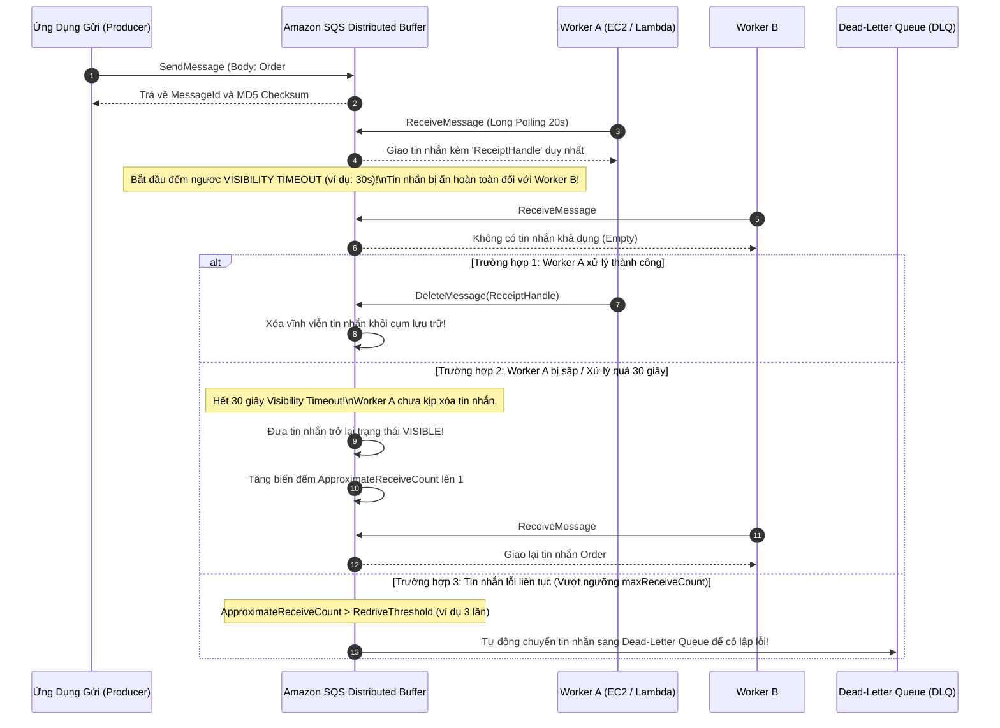
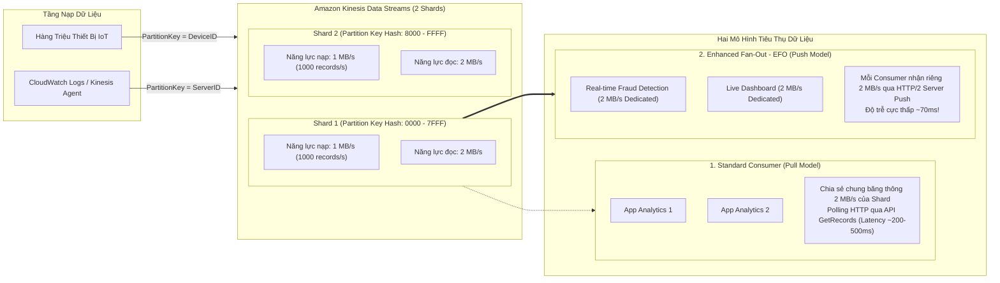
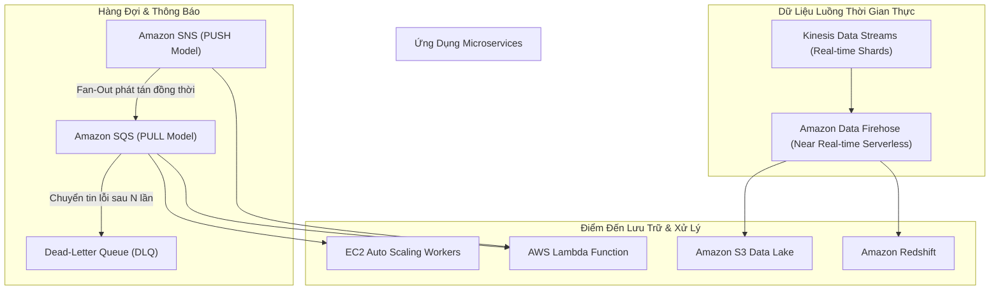

# Ghi Chú Bài Học: Chương 17 - Tách Rời Ứng Dụng Với SQS, SNS, Kinesis & Amazon MQ (Decoupling Applications)

> **Khóa học**: Ultimate AWS Certified Solutions Architect Associate  
> **Chương**: 17 - Decoupling applications: SQS, SNS, Kinesis, ActiveMQ (Bài 182 đến Bài 197)  
> **Tài liệu tham chiếu liên quan**: [AWS Service Document: Amazon SQS, SNS & Decoupling](../AWS_Services/SQS_SNS_EventBridge_Decoupling.md)

---

## 1. Tổng Quan Bài Học (Lesson Overview)

### Chủ đề chính
Chương này đi sâu vào các mẫu thiết kế hướng thông điệp (**Messaging Patterns**) và kiến trúc hướng sự kiện (**Event-Driven Architecture**) trên AWS nhằm giải quyết bài toán phụ thuộc chặt chẽ (tight coupling) giữa các thành phần hệ thống:
- Hàng đợi thông điệp phân tán **Amazon Simple Queue Service (Amazon SQS)**:
  - Phân loại **Standard Queues** (thông lượng vô hạn, at-least-once, out-of-order) vs **FIFO Queues** (thứ tự nghiêm ngặt, exactly-once, giới hạn throughput).
  - Vòng đời thông điệp: **Visibility Timeout**, **Long Polling** vs **Short Polling**, **Delay Queues**, và hàng đợi thư chết **Dead-Letter Queue (DLQ)** kèm cơ chế nạp lại (**DLQ Redrive**).
- Dịch vụ xuất bản/đăng ký thông báo **Amazon Simple Notification Service (Amazon SNS)**:
  - Mô hình **Fan-Out Pattern** (1 SNS Topic phát tán tới hàng loạt hàng đợi SQS, Lambda, Email, SMS).
  - Lọc thông điệp tại nguồn (**Message Filtering Policy**) và bảo mật hàng đợi.
- Nền tảng xử lý luồng dữ liệu thời gian thực **Amazon Kinesis**:
  - **Kinesis Data Streams (KDS)**: Cấu trúc Shards, cơ chế băm Partition Key, Standard Consumer vs **Enhanced Fan-Out (EFO)**.
  - **Amazon Data Firehose**: Dịch vụ Serverless chuyển tải dữ liệu luồng (Near real-time) nạp trực tiếp vào S3, Redshift, OpenSearch, Splunk.
- Dịch vụ môi giới thông điệp chuẩn công nghiệp **Amazon MQ** (Managed Apache ActiveMQ & RabbitMQ).

### Mục tiêu học tập
1. Nắm vững bản chất nguyên lý tách rời (Decoupling) để xây dựng hệ thống chịu tải đột biến mà không bị sập dây chuyền.
2. Hiểu sâu vòng đời thông điệp SQS, cơ chế hoạt động của `ReceiptHandle` và tính toán chuẩn xác `Visibility Timeout`.
3. Phân biệt chính xác cơ chế chống trùng lặp (**Deduplication**) và gom nhóm tuần tự (**MessageGroupId**) trong SQS FIFO.
4. Thiết kế mô hình **Fan-Out** kết hợp **Message Filtering** để tối ưu hóa chi phí và băng thông vi dịch vụ.
5. So sánh chi tiết giữa **Amazon SQS** (Queue, 1 consumer/message, xóa sau khi đọc) và **Amazon Kinesis** (Stream, replayable, lưu giữ 1-365 ngày).

---

## 2. Điểm Cốt Lõi Cần Nhớ (Key Takeaways)

1. **SQS là mô hình PULL (Consumer chủ động kéo tin)**: Dữ liệu được lưu trong hàng đợi tối đa **14 ngày** (mặc định 4 ngày); sau khi consumer xử lý xong bắt buộc phải gọi API `DeleteMessage` kèm `ReceiptHandle`.
2. **SNS là mô hình PUSH (Chủ động đẩy tin tới subscribers)**: Tin nhắn không được lưu giữ; nếu không có subscriber nào lắng nghe tại thời điểm phát, tin nhắn sẽ bị hủy ngay lập tức.
3. **Visibility Timeout (Mặc định 30 giây, tối đa 12 giờ)**: Khi một worker nhận tin nhắn, tin nhắn đó bị ẩn tạm thời khỏi các worker khác. Nếu worker không kịp xóa tin trước khi hết thời gian này, tin nhắn sẽ hiện lại trong hàng đợi để worker khác nhận. Worker có thể gọi API `ChangeMessageVisibility` để xin thêm thời gian xử lý.
4. **Long Polling (Thời gian chờ 1 đến 20 giây)**: Luôn cấu hình `ReceiveMessageWaitTimeSeconds = 20` để giảm triệt để số lượng request rỗng (empty responses), giúp tiết kiệm tới 80% chi phí gọi API SQS và giảm độ trễ nhận tin.
5. **SQS FIFO (First-In, First-Out)**:
   - Tên hàng đợi bắt buộc phải có đuôi `.fifo`.
   - Giới hạn thông lượng: 300 messages/giây (hoặc 3,000 messages/giây nếu bật Batching / High Throughput Mode).
   - **`MessageGroupId`**: Đảm bảo thứ tự nghiêm ngặt cho các tin nhắn trong cùng 1 nhóm, cho phép xử lý song song giữa các nhóm khác nhau.
   - **`MessageDeduplicationId`**: Ngăn chặn trùng lặp tin nhắn trong cửa sổ trượt **5 phút**.
6. **Fan-Out Pattern**: 1 publisher gửi tin tới 1 SNS Topic ➔ Topic tự động nhân bản và đẩy tin nhắn vào nhiều hàng đợi SQS độc lập của các team khác nhau (Thanh toán, Kho hàng, Giao vận) kèm bộ lọc **Message Filtering**.
7. **Kinesis Data Streams (KDS)**: Dữ liệu được tổ chức theo các **Shards**. Mỗi Shard cung cấp tốc độ nạp **1 MB/s hoặc 1,000 records/s** và tốc độ đọc **2 MB/s**. Hỗ trợ nhiều ứng dụng đọc lại dữ liệu độc lập (Replay data).

---

## 3. Kiến Trúc & Cơ Chế Hoạt Động Chuyên Sâu (Under-the-Hood Mechanisms & Deep Dive)

### 3.1. Vòng Đời Thông Điệp SQS & Cơ Chế Visibility Timeout (Under the Hood)



---

### 3.2. Mô Hình SNS Fan-Out Kèm Message Attribute Filtering

```mermaid
flowchart TD
    CheckoutService["Dịch Vụ Thanh Toán (Checkout Service)"] -->|Publish Event: OrderPlaced\nAttributes: {status: confirmed, tier: vip}| SNSTopic["Amazon SNS Topic: OrdersTopic"]
    
    subgraph FanOutLayer["Mô Hình Phân Nhánh Phát Tán (Fan-Out Architecture)"]
        SNSTopic ==>|Filter: status = confirmed| SQS_Ship["SQS Queue: Logistics Service\n(Chỉ xử lý đơn đã thanh toán)"]
        SNSTopic ==>|Filter: tier = vip| SQS_Fraud["SQS Queue: VIP Analytics Service\n(Chăm sóc khách hàng VIP)"]
        SNSTopic ==>|No Filter: Nhận toàn bộ events| SQS_Audit["SQS Queue: Compliance & Audit\n(Lưu vết toàn bộ đơn hàng)"]
        SNSTopic -.->|Lỗi phân phối 3 lần| SNS_DLQ["SQS: SNS Dead-Letter Queue"]
    end
    
    SQS_Ship --> WorkerShip["Logistics Workers"]
    SQS_Fraud --> WorkerFraud["VIP Service Workers"]
    SQS_Audit --> WorkerAudit["Audit S3 Archiver"]
```

- **Lợi ích kiến trúc**:
  - **Decoupling hoàn toàn**: Dịch vụ Checkout không cần biết có bao nhiêu hệ thống phía sau đang quan tâm tới sự kiện `OrderPlaced`. Khi cần thêm hệ thống mới, chỉ cần tạo SQS queue mới và subscribe vào topic mà không cần sửa 1 dòng code của Checkout Service.
  - **Lọc thông điệp tại biên (Server-side Filtering)**: Nhờ có SNS Subscription Filter Policy, tin nhắn không liên quan sẽ bị loại bỏ ngay tại tầng SNS, giúp các worker của hàng đợi không bị đánh thức vô ích, tiết kiệm chi phí compute và I/O.

---

### 3.3. Cấu Trúc Shard & Cơ Chế Enhanced Fan-Out Trong Kinesis Data Streams



---

## 4. Lệnh, Cấu Hình & Mã Nguồn Thực Tế (Commands, Config & Code)

### 4.1. Tạo SQS FIFO Queue Kèm Dead-Letter Queue (DLQ) Bằng AWS CLI

```bash
# 1. Tao Dead-Letter Queue FIFO truoc de lam noi chua thu loi
aws sqs create-queue \
    --queue-name "Orders-DeadLetter-Queue.fifo" \
    --attributes '{"FifoQueue":"true","ContentBasedDeduplication":"true"}'

DLQ_ARN=$(aws sqs get-queue-attributes \
    --queue-url "https://sqs.ap-southeast-1.amazonaws.com/123456789012/Orders-DeadLetter-Queue.fifo" \
    --attribute-names QueueArn \
    --query "Attributes.QueueArn" \
    --output text)

# 2. Tao Primary FIFO Queue voi RedrivePolicy (chuyen tin sang DLQ sau 3 lan loi)
cat <<EOF > redrive-policy.json
{
  "FifoQueue": "true",
  "ContentBasedDeduplication": "true",
  "ReceiveMessageWaitTimeSeconds": "20",
  "VisibilityTimeout": "60",
  "RedrivePolicy": "{\"deadLetterTargetArn\":\"$DLQ_ARN\",\"maxReceiveCount\":\"3\"}"
}
EOF

aws sqs create-queue \
    --queue-name "Production-Orders.fifo" \
    --attributes file://redrive-policy.json
```

---

### 4.2. Gửi và Nhận Tin Nhắn SQS Bằng AWS CLI

```bash
# 1. Producer gui tin nhan vao FIFO Queue voi MessageGroupId
aws sqs send-message \
    --queue-url "https://sqs.ap-southeast-1.amazonaws.com/123456789012/Production-Orders.fifo" \
    --message-body '{"order_id": 98765, "customer": "Nguyen Van A", "amount": 250.00}' \
    --message-group-id "Customer-Group-101" \
    --message-deduplication-id "TXN-98765-UNIQUE"

# 2. Worker nhan tin nhan (Long Polling 20s)
RECEIPT=$(aws sqs receive-message \
    --queue-url "https://sqs.ap-southeast-1.amazonaws.com/123456789012/Production-Orders.fifo" \
    --max-number-of-messages 1 \
    --wait-time-seconds 20 \
    --query "Messages[0].ReceiptHandle" \
    --output text)

# 3. Sau khi xu ly xong, Worker xoa tin nhan bang ReceiptHandle
aws sqs delete-message \
    --queue-url "https://sqs.ap-southeast-1.amazonaws.com/123456789012/Production-Orders.fifo" \
    --receipt-handle "$RECEIPT"
```

---

### 4.3. Phát Tin Nhắn Lên SNS Topic Kèm Thuộc Tính Lọc (Message Attributes)

```bash
aws sns publish \
    --topic-arn "arn:aws:sns:ap-southeast-1:123456789012:OrdersTopic" \
    --message '{"event": "ORDER_CREATED", "id": 12345}' \
    --message-attributes '{
        "status": {"DataType": "String", "StringValue": "confirmed"},
        "tier": {"DataType": "String", "StringValue": "vip"}
    }'
```

---

## 5. Tình Huống Thực Tiễn & Mẫu Kiến Trúc (Real-World Scenarios & Design Patterns)

### Tình huống 1: Mẫu Đệm Chống Nghẽn Cơ Sở Dữ Liệu (Buffer-and-Worker Pattern)
- **Bài toán**: Vào ngày lễ hội mua sắm Flash Sale, hàng triệu khách hàng bấm nút đặt hàng cùng một lúc. Nếu ứng dụng web ghi trực tiếp vào cơ sở dữ liệu quan hệ RDS MySQL, số lượng kết nối và IOPS sẽ tăng vọt làm sập hoàn toàn database.
- **Giải pháp**:
  - Đặt một hàng đợi **Amazon SQS** đứng giữa Web tier và Database.
  - Khi người dùng đặt hàng, Web Server chỉ cần đẩy một thông điệp nhỏ vào SQS (mất < 10ms) và trả về thông báo "Đơn hàng đang xử lý" cho người dùng.
  - Một nhóm máy chủ worker phía sau (nằm trong Auto Scaling Group) sẽ kéo tin nhắn từ SQS với tốc độ ổn định, kiểm soát chặt chẽ số lượng transaction ghi vào RDS để không bao giờ làm quá tải cơ sở dữ liệu.
  - Nếu số lượng tin nhắn trong hàng đợi tăng cao, ASG tự động scale thêm worker; nếu database tạm thời bảo trì, tin nhắn vẫn nằm an toàn trên SQS tới 14 ngày mà không bị mất đơn hàng của khách.

### Tình huống 2: Xử Lý Lỗi Tin Nhắn Độc Hại Bằng DLQ (Poison Pill Message Handling)
- **Bài toán**: Một khách hàng gửi lên dữ liệu đơn hàng bị lỗi cú pháp JSON nghiêm trọng khiến ứng dụng worker đọc vào là bị crash (lỗi bộ nhớ). Worker bị crash không thể xóa tin nhắn, tin nhắn lại hết Visibility Timeout và hiện lại, tiếp tục làm crash worker tiếp theo (lỗi dây chuyền toàn hệ thống).
- **Giải pháp**:
  - Thiết lập **Dead-Letter Queue (DLQ)** cho hàng đợi SQS với `maxReceiveCount = 3`.
  - Khi tin nhắn lỗi này làm crash worker 3 lần liên tiếp, SQS tự động ngắt tin nhắn đó ra khỏi hàng đợi chính và chuyển sang DLQ.
  - Hệ thống chính hoạt động trở lại bình thường. Kỹ sư nhận cảnh báo từ CloudWatch Alarm trên DLQ, kiểm tra nội dung tin nhắn độc hại, sửa lỗi code ứng dụng, và sau đó sử dụng tính năng **SQS DLQ Redrive** để đẩy tin nhắn trở lại hàng đợi chính xử lý lại an toàn.

---

## 6. Mối Quan Hệ Giữa Các Khái Niệm / Dịch Vụ (Service Relationships & Ecosystem)



---

## 7. Câu Hỏi Ôn Tập, Bẫy Thi & Tự Đánh Giá (Review, Exam Traps & Self-Assessment)

### Câu hỏi:
1. Một ứng dụng xử lý chuyển đổi video nhận tệp tin từ người dùng và mất trung bình 75 giây để xử lý xong một video. Tuy nhiên, kỹ sư nhận thấy một video thường xuyên bị xử lý lặp lại 2-3 lần bởi các máy chủ khác nhau, gây lãng phí tài nguyên tính toán. Bạn nên điều chỉnh thông số cấu hình nào của hàng đợi SQS?
2. Bạn cần thiết kế hệ thống trong đó khi người dùng hoàn tất thanh toán giỏ hàng, thông tin đơn hàng phải được gửi đồng thời tới 3 dịch vụ vi mô độc lập: Xuất hóa đơn, Quản lý kho, và Gửi email. Nếu dịch vụ Email bị sập, hai dịch vụ còn lại vẫn phải nhận được tin nhắn bình thường. Mẫu kiến trúc nào giải quyết bài toán này?
3. Sự khác nhau cốt lõi về cơ chế tiêu thụ dữ liệu và tính bền vững giữa **Amazon SQS** và **Amazon Kinesis Data Streams** là gì?
4. Doanh nghiệp của bạn đang chuyển dịch một ứng dụng monolithic viết bằng Java chạy tại On-Premises đang sử dụng giao thức JMS (Java Message Service) với Apache ActiveMQ. Họ muốn di chuyển lên AWS nhanh nhất với sự thay đổi mã nguồn tối thiểu. Dịch vụ nào là lựa chọn số 1?
5. Trong SQS FIFO Queue, thuộc tính `MessageGroupId` có vai trò kỹ thuật gì và làm thế nào để nó cho phép xử lý song song các nhóm thông điệp?
6. Phân biệt sự khác nhau giữa **Standard Consumer** và **Enhanced Fan-Out (EFO) Consumer** trong Amazon Kinesis Data Streams về mặt độ trễ và băng thông đọc của Shard?

---

### Đáp án & Giải thích chi tiết:

<details>
<summary>👉 Nhấp vào đây để xem đáp án và phân tích chi tiết</summary>

1. Bạn cần điều chỉnh tăng giá trị **Message Visibility Timeout** của hàng đợi SQS từ giá trị mặc định (30 giây) lên mức tối thiểu **90 hoặc 120 giây** (lớn hơn thời gian xử lý thực tế 75 giây của ứng dụng). Điều này đảm bảo rằng trong suốt quá trình máy chủ đầu tiên đang render video, tin nhắn vẫn được ẩn an toàn khỏi các máy chủ worker khác.
2. Áp dụng mô hình **Fan-Out Pattern**: Dịch vụ thanh toán gửi sự kiện vào một **Amazon SNS Topic**. Tạo 3 hàng đợi **Amazon SQS** riêng biệt cho 3 microservices (Hóa đơn, Kho hàng, Email) và đăng ký cả 3 hàng đợi này làm Subscriber của SNS Topic đó. Do mỗi hàng đợi lưu giữ tin nhắn độc lập, nếu dịch vụ Email bị sập thì tin nhắn của nó chỉ tích lũy trong hàng đợi Email SQS mà hoàn toàn không ảnh hưởng đến Hóa đơn hay Kho hàng.
3. So sánh:
   - **Amazon SQS**: Hoạt động theo mô hình **PULL**. Mỗi tin nhắn chỉ được tiêu thụ bởi duy nhất 1 worker tại một thời điểm; sau khi xử lý xong tin nhắn sẽ bị xóa vĩnh viễn khỏi hàng đợi; không thể đọc lại tin nhắn đã xóa.
   - **Amazon Kinesis Data Streams**: Hoạt động theo mô hình **STREAM**. Dữ liệu được lưu trữ liên tục theo thứ tự trong Shards từ 1 đến 365 ngày; nhiều ứng dụng consumer khác nhau có thể đọc đồng thời cùng một luồng dữ liệu một cách độc lập và có thể **đọc lại (replay)** dữ liệu lịch sử bất kỳ lúc nào.
4. **Amazon MQ**. Amazon MQ cung cấp dịch vụ Apache ActiveMQ và RabbitMQ được quản lý hoàn toàn trên đám mây AWS, hỗ trợ nguyên bản các giao thức nhắn tin chuẩn doanh nghiệp như JMS, AMQP 0-9-1, STOMP, MQTT, và OpenWire mà không yêu cầu viết lại logic giao tiếp sang API độc quyền của SQS/SNS.
5. `MessageGroupId` đóng vai trò là khóa phân vùng logic trong SQS FIFO:
   - Tất cả các tin nhắn có **cùng `MessageGroupId`** được đảm bảo xử lý theo đúng thứ tự nghiêm ngặt (FIFO) tuần tự bởi duy nhất một worker tại một thời điểm.
   - Các tin nhắn có **`MessageGroupId` khác nhau** có thể được phân phối và xử lý **song song đồng thời** bởi nhiều worker khác nhau mà vẫn duy trì tính toàn vẹn thứ tự riêng của từng nhóm (ví dụ: mỗi khách hàng là một Group ID).
6. So sánh:
   - **Standard Consumer**: Tất cả các ứng dụng đọc phải chia sẻ chung băng thông đọc **2 MB/s trên mỗi Shard**; sử dụng cơ chế kéo dữ liệu (Pull model) qua HTTP `GetRecords` với độ trễ từ 200–500 mili-giây.
   - **Enhanced Fan-Out (EFO)**: Mỗi consumer đăng ký EFO được cấp phát riêng một băng thông đọc **2 MB/s chuyên dụng trên mỗi Shard** (không bị tranh chấp với các consumer khác); sử dụng cơ chế đẩy dữ liệu (Push model) qua kết nối HTTP/2 hai chiều liên tục với độ trễ cực thấp **~70 mili-giây**.
</details>

---

## 8. Nguồn Trích Dẫn Bài Giảng & Tài Liệu Liên Quan (Source References)

- **Source Transcripts**:
  - [183 - Amazon SQS - Standard Queues Overview.md](../AWS_Resources/17%20-%20Decoupling%20applications_%20SQS,/183%20-%20Amazon%20SQS%20-%20Standard%20Queues%20Overview.md)
  - [185 - SQS - Message Visibility Timeout.md](../AWS_Resources/17%20-%20Decoupling%20applications_%20SQS,/185%20-%20SQS%20-%20Message%20Visibility%20Timeout.md)
  - [186 - SQS - Long Polling.md](../AWS_Resources/17%20-%20Decoupling%20applications_%20SQS,/186%20-%20SQS%20-%20Long%20Polling.md)
  - [187 - SQS - FIFO Queues.md](../AWS_Resources/17%20-%20Decoupling%20applications_%20SQS,/187%20-%20SQS%20-%20FIFO%20Queues.md)
  - [189 - Amazon Simple Notification Service (AWS SNS).md](../AWS_Resources/17%20-%20Decoupling%20applications_%20SQS,/189%20-%20Amazon%20Simple%20Notification%20Service%20%28AWS%20SNS%29.md)
  - [190 - SNS and SQS - Fan Out Pattern.md](../AWS_Resources/17%20-%20Decoupling%20applications_%20SQS,/190%20-%20SNS%20and%20SQS%20-%20Fan%20Out%20Pattern.md)
  - [192 - Amazon Kinesis Data Streams.md](../AWS_Resources/17%20-%20Decoupling%20applications_%20SQS,/192%20-%20Amazon%20Kinesis%20Data%20Streams.md)
  - [194 - Amazon Data Firehose.md](../AWS_Resources/17%20-%20Decoupling%20applications_%20SQS,/194%20-%20Amazon%20Data%20Firehose.md)
  - [197 - Amazon MQ.md](../AWS_Resources/17%20-%20Decoupling%20applications_%20SQS,/197%20-%20Amazon%20MQ.md)
- **Tài liệu chuyên sâu liên quan**:
  - [Chuyên đề Master: Amazon SQS, SNS, EventBridge & Kiến Trúc Tách Rời](../AWS_Services/SQS_SNS_EventBridge_Decoupling.md)
  - [Chuyên đề Master: Amazon Analytics & Big Data](../AWS_Services/Analytics_Big_Data_Services.md)
