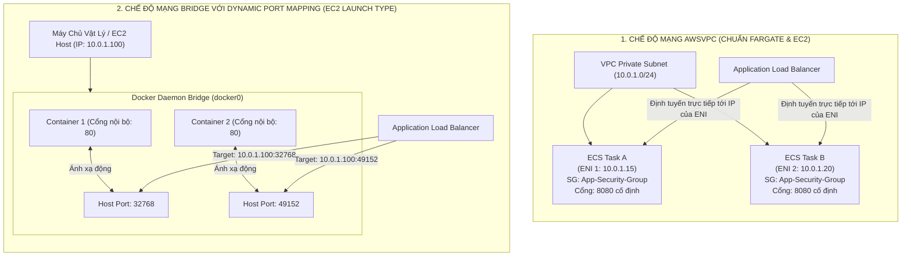
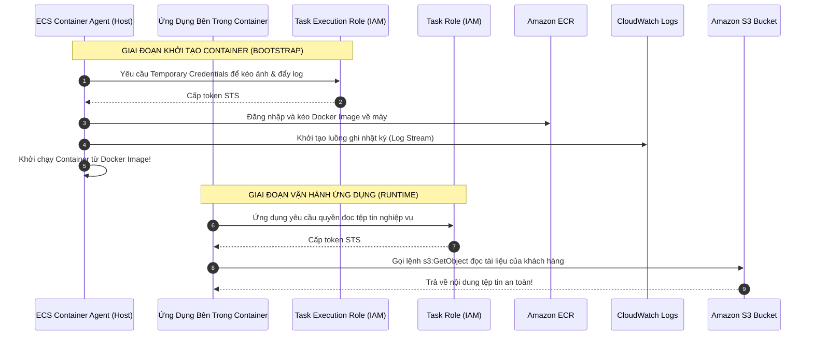
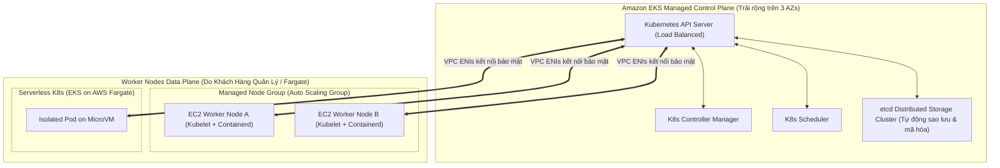
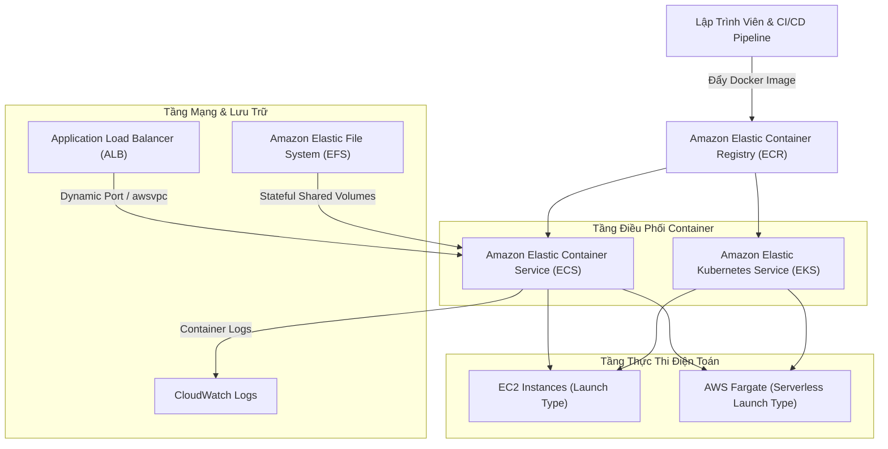

# Ghi Chú Bài Học: Chương 18 - Công Nghệ Đóng Gói Container Với Amazon ECS, Fargate & EKS (Containers on AWS)

> **Khóa học**: Ultimate AWS Certified Solutions Architect Associate  
> **Chương**: 18 - Containers on AWS: ECS, Fargate, ECR, EKS (Bài 198 đến Bài 207)  
> **Tài liệu tham chiếu liên quan**: [AWS Service Document: Amazon ECS, Fargate & Containers](../AWS_Services/ECS_Fargate_Containers.md)

---

## 1. Tổng Quan Bài Học (Lesson Overview)

### Chủ đề chính
Chương này trang bị kiến thức toàn diện và chuyên sâu về công nghệ đóng gói ứng dụng bằng **Docker Container** và các nền tảng điều phối container hàng đầu của AWS:
- Khái niệm nền tảng về **Docker Container**: tính cô lập tài nguyên, khả năng đóng gói đồng nhất từ môi trường phát triển cục bộ lên đám mây.
- Dịch vụ điều phối container nguyên bản của AWS **Amazon Elastic Container Service (Amazon ECS)**:
  - Cấu trúc phân tầng: **ECS Cluster**, **Task Definition**, **Task**, và **ECS Service**.
  - So sánh mô hình triển khai: **EC2 Launch Type** (tự quản lý máy chủ cụm) vs **AWS Fargate** (Serverless Container Platform).
  - Bốn chế độ mạng container (**Network Modes: none, bridge, host, awsvpc**).
  - Cơ chế ánh xạ cổng động (**Dynamic Port Mapping**) kết hợp với **Application Load Balancer (ALB)**.
- Phân định ranh giới bảo mật IAM: **Task Execution Role** vs **Task Role**.
- Kho lưu trữ ảnh container bảo mật **Amazon Elastic Container Registry (Amazon ECR)**: Private/Public Registries, Image Scanning (CVEs), và Lifecycle Policies.
- Nền tảng điều phối Kubernetes được quản lý **Amazon Elastic Kubernetes Service (Amazon EKS)**: Control Plane 3-AZ, Worker Node Groups, Pod Networking (AWS VPC CNI), và Fargate Profiles.

### Mục tiêu học tập
1. Phân biệt được sự khác biệt cốt lõi giữa ảo hóa máy ảo (Virtual Machines) và ảo hóa hệ điều hành (Containers).
2. Hiểu sâu kiến trúc vi máy ảo (**Firecracker microVM**) của **AWS Fargate** và cách tối ưu chi phí vCPU/RAM.
3. Làm chủ 4 chế độ mạng của ECS và hiểu tại sao `awsvpc` là chuẩn mực vàng cho kiến trúc bảo mật container.
4. Cấu hình chính xác **Task Execution Role** và **Task Role** tuân thủ nguyên tắc đặc quyền tối thiểu.
5. Thiết lập giải pháp co giãn tự động (**ECS Service Auto Scaling**) kết hợp lưu trữ tệp tin bền vững đa vùng với **Amazon EFS**.

---

## 2. Điểm Cốt Lõi Cần Nhớ (Key Takeaways)

1. **AWS Fargate = Serverless Containers**: Loại bỏ hoàn toàn gánh nặng quản lý máy chủ EC2, không cần vá lỗi OS hay cấu hình cụm; mỗi Task chạy trong một môi trường microVM độc lập hoàn toàn; chỉ thanh toán cho số vCPU và RAM mà Task sử dụng tính theo giây.
2. **Task Execution Role vs Task Role (Bẫy thi kinh điển)**:
   - **Task Execution Role**: Cấp quyền cho **ECS Container Agent** chạy ở tầng nền (kéo ảnh từ ECR, ghi log sự kiện vào CloudWatch Logs, giải mã secrets từ Secrets Manager / SSM Parameter Store).
   - **Task Role**: Cấp quyền cho **Mã nguồn ứng dụng bên trong Container** (ví dụ: ứng dụng Python/Node.js gọi API đọc ghi S3, DynamoDB, hoặc gửi tin nhắn SQS).
3. **Chế độ mạng `awsvpc` (Chuẩn mực AWS)**: Mỗi Task nhận một card mạng ảo **ENI riêng** và một địa chỉ **Private IP riêng trong Subnet** của VPC. Cho phép áp dụng Security Group độc lập cho từng Task; là chế độ mạng **bắt buộc** đối với AWS Fargate.
4. **Dynamic Port Mapping (Với chế độ mạng `bridge` trên EC2)**: Khai báo `hostPort = 0` trong Task Definition. Docker daemon sẽ tự động cấp một cổng ngẫu nhiên trong dải Ephemeral Ports (32768–60999) trên host EC2; ECS tự động đăng ký cổng này vào Target Group của ALB, cho phép chạy nhiều bản sao Task trên cùng một máy chủ mà không bị trùng cổng.
5. **Amazon EFS cho Stateful Containers**: Khi các ECS Tasks hoặc Fargate Tasks cần lưu trữ dữ liệu bền vững (như CMS WordPress, database nhẹ, hoặc chia sẻ tệp tin đa vùng), gắn kết trực tiếp với **Amazon EFS** thông qua EFS Mount Targets.
6. **Amazon EKS**: Nền tảng Kubernetes mã nguồn mở chuẩn mực; AWS quản lý tính sẵn sàng cao của K8s Control Plane (API server, etcd) trải rộng trên 3 AZs; phù hợp cho doanh nghiệp có sẵn hệ sinh thái công cụ Kubernetes (Helm, Istio, Prometheus) hoặc muốn tránh phụ thuộc nhà cung cấp (Multi-Cloud portability).

---

## 3. Kiến Trúc & Cơ Chế Hoạt Động Chuyên Sâu (Under-the-Hood Mechanisms & Deep Dive)

### 3.1. Phân Tích Chế Độ Mạng `awsvpc` vs Dynamic Port Mapping `bridge`



- **Sự khác biệt kỹ thuật**: Chế độ mạng `bridge` truyền thống sử dụng iptables và mạng ảo của Docker để NAT các gói tin, gây suy giảm hiệu năng mạng và khó cấu hình tường lửa. Trong khi đó, `awsvpc` gắn trực tiếp card mạng ảo ENI vào Task (nhờ công nghệ Nitro enclaves / Firecracker), mang lại hiệu năng mạng tương đương máy ảo EC2 native và tích hợp hoàn hảo với hệ thống giám sát VPC Flow Logs.

---

### 3.2. Ranh Giới Phân Quyền Bảo Mật: Task Execution Role vs Task Role



---

### 3.3. Kiến Trúc Cốt Lõi Của Amazon Elastic Kubernetes Service (Amazon EKS)



---

## 4. Lệnh, Cấu Hình & Mã Nguồn Thực Tế (Commands, Config & Code)

### 4.1. Cấu Hình ECS Task Definition JSON (Chế độ `awsvpc` & Tách Biệt 2 Roles)

```json
{
  "family": "production-api-task",
  "networkMode": "awsvpc",
  "requiresCompatibilities": ["FARGATE"],
  "cpu": "512",
  "memory": "1024",
  "executionRoleArn": "arn:aws:iam::123456789012:role/ecsTaskExecutionRole",
  "taskRoleArn": "arn:aws:iam::123456789012:role/ProductionAppS3AccessRole",
  "containerDefinitions": [
    {
      "name": "api-service",
      "image": "123456789012.dkr.ecr.ap-southeast-1.amazonaws.com/my-api:v2.1",
      "essential": true,
      "portMappings": [
        {
          "containerPort": 8080,
          "hostPort": 8080,
          "protocol": "tcp"
        }
      ],
      "logConfiguration": {
        "logDriver": "awslogs",
        "options": {
          "awslogs-group": "/ecs/production-api",
          "awslogs-region": "ap-southeast-1",
          "awslogs-stream-prefix": "api"
        }
      }
    }
  ]
}
```

---

### 4.2. Quy Trình Đẩy Ảnh Lên Amazon ECR Bằng AWS CLI

```bash
# 1. Dang nhap Docker client vao Amazon ECR Registry
aws ecr get-login-password --region ap-southeast-1 | docker login --username AWS --password-stdin 123456789012.dkr.ecr.ap-southeast-1.amazonaws.com

# 2. Xay dung Docker image tai may local
docker build -t my-api:v2.1 .

# 3. Gan tag cho Docker image theo dinh dang ECR
docker tag my-api:v2.1 123456789012.dkr.ecr.ap-southeast-1.amazonaws.com/my-api:v2.1

# 4. Day anh len ECR Private Repository
docker push 123456789012.dkr.ecr.ap-southeast-1.amazonaws.com/my-api:v2.1
```

---

### 4.3. Chạy Tác Vụ Đơn Lẻ Trên AWS Fargate (One-off Task Execution)

```bash
aws ecs run-task \
    --cluster "Production-Cluster" \
    --task-definition "production-api-task" \
    --launch-type FARGATE \
    --network-configuration '{
        "awsvpcConfiguration": {
            "subnets": ["subnet-0123456789abcdef0", "subnet-0abcdef1234567890"],
            "securityGroups": ["sg-0123456789abcdef0"],
            "assignPublicIp": "DISABLED"
        }
    }'
```

---

## 5. Tình Huống Thực Tiễn & Mẫu Kiến Trúc (Real-World Scenarios & Design Patterns)

### Tình huống 1: Triển Khai Cập Nhật Không Downtime (Rolling Update với ECS Service)
- **Bài toán**: Một ứng dụng thương mại điện tử chạy 4 tasks ECS Fargate. Khi deploy phiên bản mới, hệ thống không được phép làm rớt bất kỳ kết nối nào của khách hàng và không được vượt quá ngân sách chi phí tài nguyên.
- **Giải pháp**:
  - Cấu hình thuộc tính triển khai của ECS Service:
    - `minimumHealthyPercent = 100%`: Trong suốt quá trình deploy, luôn duy trì tối thiểu 4 tasks khỏe mạnh phục vụ khách hàng.
    - `maximumPercent = 200%`: ECS được phép khởi chạy thêm tối đa 4 tasks phiên bản mới song song (tổng 8 tasks).
  - Khi deploy, ECS bật 4 tasks mới, chờ Application Load Balancer kiểm tra Health Check thành công, sau đó mới rút dần và tắt 4 tasks phiên bản cũ.

### Tình huống 2: Chia Sẻ Tệp Tin Cấu Hình Giữa Các Microservices (Stateful Container với EFS)
- **Bài toán**: Một hệ thống xử lý nội dung số gồm nhiều container chạy trên các Availability Zones khác nhau cần đọc và ghi đồng thời vào một thư mục tài sản dùng chung dung lượng hàng trăm GB.
- **Giải pháp**:
  - Khởi tạo một cụm **Amazon EFS** với Mount Target tại các AZs chứa ECS Tasks.
  - Cấu hình **EFS Volume Configuration** ngay trong ECS Task Definition với thuộc tính `transitEncryption = ENABLED` và tích hợp IAM Authorization qua EFS Access Points.
  - Các container Fargate mount trực tiếp thư mục EFS vào `/var/data` với đầy đủ quyền đọc/ghi đồng thời mà không cần lo lắng về việc đồng bộ tệp tin.

---

## 6. Mối Quan Hệ Giữa Các Khái Niệm / Dịch Vụ (Service Relationships & Ecosystem)



---

## 7. Câu Hỏi Ôn Tập, Bẫy Thi & Tự Đánh Giá (Review, Exam Traps & Self-Assessment)

### Câu hỏi:
1. Bạn đang thiết kế một kiến trúc microservices gồm hàng trăm container Docker trên AWS. Đội ngũ kỹ sư mong muốn tập trung 100% vào việc phát triển tính năng ứng dụng, không muốn mất thời gian quản lý cụm máy chủ, vá lỗi hệ điều hành hay cấu hình kích thước máy chủ EC2. Bạn nên chọn kiến trúc nào?
2. Trong Amazon ECS, sự khác biệt căn bản về mặt bảo mật và trách nhiệm giữa **ECS Task Execution Role** và **ECS Task Role** là gì?
3. Khi bạn triển khai nhiều bản sao của cùng một container web trên một máy ảo EC2 duy nhất nằm phía sau một Application Load Balancer, kỹ thuật nào cho phép tất cả các container này hoạt động mà không bị xung đột cùng chiếm giữ cổng 80 trên máy chủ?
4. Đâu là giải pháp lưu trữ tệp tin bền vững đa vùng (Multi-AZ Persistent Storage) được khuyến nghị sử dụng khi các container chạy trên **AWS Fargate** cần chia sẻ chung dữ liệu?
5. Khi nào bạn nên chọn **Amazon EKS** thay vì **Amazon ECS** cho một dự án container doanh nghiệp mới?
6. Chế độ mạng `awsvpc` mang lại lợi ích gì vượt trội so với chế độ mạng `bridge` khi áp dụng các chính sách an ninh mạng (Security Groups)?

---

### Đáp án & Giải thích chi tiết:

<details>
<summary>👉 Nhấp vào đây để xem đáp án và phân tích chi tiết</summary>

1. Sử dụng **Amazon ECS (hoặc Amazon EKS) kết hợp với AWS Fargate Launch Type**. AWS Fargate là nền tảng điện toán phi máy chủ (Serverless), tự động cấp phát tài nguyên tính toán cho từng container mà không yêu cầu khách hàng phải khởi tạo, cấu hình hay quản lý bất kỳ cụm máy chủ EC2 nào.
2. Phân biệt:
   - **Task Execution Role**: Do **ECS Agent** sử dụng để thực hiện các hành động chuẩn bị ở tầng hạ tầng AWS: kéo ảnh container từ Amazon ECR, gửi nhật ký ứng dụng vào CloudWatch Logs, và lấy các thông tin bí mật từ AWS Secrets Manager hoặc SSM Parameter Store.
   - **Task Role**: Do **chính mã nguồn ứng dụng chạy bên trong container** sử dụng để thực thi các tác vụ nghiệp vụ: gọi AWS SDK để đọc/ghi tệp tin trên Amazon S3, truy vấn bảng Amazon DynamoDB, hoặc gửi thông điệp vào hàng đợi Amazon SQS.
3. Kỹ thuật **Dynamic Port Mapping (Ánh xạ cổng động)** với chế độ mạng `bridge`: Trong ECS Task Definition, bạn để giá trị `hostPort = 0` (hoặc để trống) trong khi `containerPort = 80`. Khi khởi chạy container, Docker daemon sẽ tự động cấp một cổng ngẫu nhiên trong dải Ephemeral Ports (32768–60999) trên máy chủ EC2, và ECS Service sẽ tự động đăng ký địa chỉ IP máy chủ kèm cổng ngẫu nhiên này vào Target Group của Application Load Balancer.
4. **Amazon Elastic File System (Amazon EFS)**. EFS là hệ thống lưu trữ tệp tin mạng chuẩn POSIX, tự động nhân bản dữ liệu xuyên qua nhiều Availability Zones và được tích hợp nguyên bản vào AWS Fargate, cho phép hàng trăm container gắn kết và đọc/ghi đồng thời an toàn.
5. Bạn nên chọn **Amazon EKS** khi:
   - Doanh nghiệp đã có sẵn chuyên môn sâu và quy trình vận hành chuẩn trên hệ sinh thái Kubernetes (Helm charts, Kustomize, Operators).
   - Yêu cầu kiến trúc có khả năng chuyển đổi linh hoạt giữa nhiều nhà cung cấp đám mây (Multi-cloud portability) hoặc đồng bộ giữa Data Center On-Premises và AWS.
   - Ứng dụng tận dụng các công cụ mã nguồn mở Kubernetes chuyên sâu như Istio Service Mesh, Prometheus, ArgoCD.  
   *(Nếu chỉ cần chạy container đơn giản, dễ vận hành và không mất phí quản lý Control Plane thì Amazon ECS là lựa chọn tối ưu hơn).*
6. Với chế độ mạng `bridge`, toàn bộ các container trên một máy chủ EC2 phải dùng chung card mạng và Security Group của máy chủ đó, không thể phân quyền an ninh riêng biệt cho từng container. Trong khi đó, với **`awsvpc`**, mỗi Task nhận một card mạng ảo **ENI riêng** và một địa chỉ **Private IP riêng trong VPC**, cho phép bạn gắn các **Security Groups độc lập cho từng Task**, cô lập hoàn toàn lưu lượng mạng giữa các microservices chạy trên cùng một hạ tầng.
</details>

---

## 8. Nguồn Trích Dẫn Bài Giảng & Tài Liệu Liên Quan (Source References)

- **Source Transcripts**:
  - [198 - Docker Introduction.md](../AWS_Resources/18%20-%20Containers%20on%20AWS_%20ECS,%20Fargat/198%20-%20Docker%20Introduction.md)
  - [199 - Amazon ECS.md](../AWS_Resources/18%20-%20Containers%20on%20AWS_%20ECS,%20Fargat/199%20-%20Amazon%20ECS.md)
  - [202 - Amazon ECS - Auto Scaling.md](../AWS_Resources/18%20-%20Containers%20on%20AWS_%20ECS,%20Fargat/202%20-%20Amazon%20ECS%20-%20Auto%20Scaling.md)
  - [203 - Amazon ECS - Solutions Architectures.md](../AWS_Resources/18%20-%20Containers%20on%20AWS_%20ECS,%20Fargat/203%20-%20Amazon%20ECS%20-%20Solutions%20Architectures.md)
  - [205 - Amazon ECR.md](../AWS_Resources/18%20-%20Containers%20on%20AWS_%20ECS,%20Fargat/205%20-%20Amazon%20ECR.md)
  - [206 - Amazon EKS - Overview.md](../AWS_Resources/18%20-%20Containers%20on%20AWS_%20ECS,%20Fargat/206%20-%20Amazon%20EKS%20-%20Overview.md)
- **Tài liệu chuyên sâu liên quan**:
  - [Chuyên đề Master: Amazon ECS, Fargate & Containers](../AWS_Services/ECS_Fargate_Containers.md)
  - [Chuyên đề Master: Amazon VPC & Mạng Phân Tán](../AWS_Services/VPC_Networking.md)
