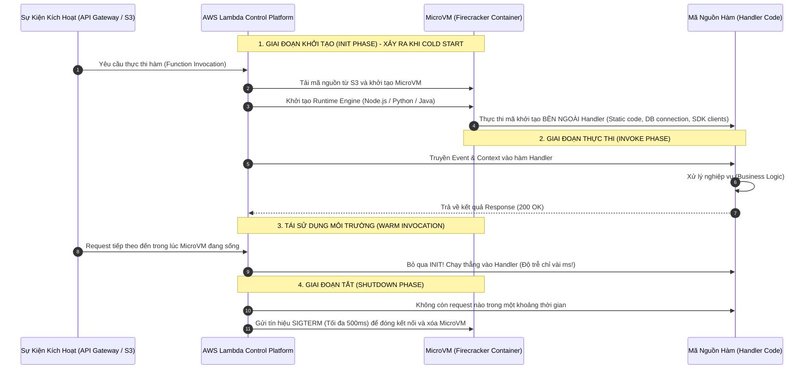
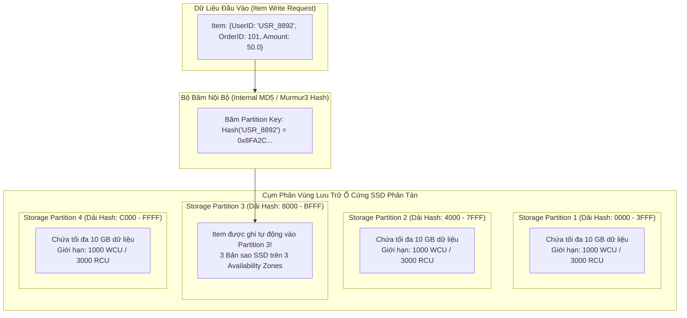
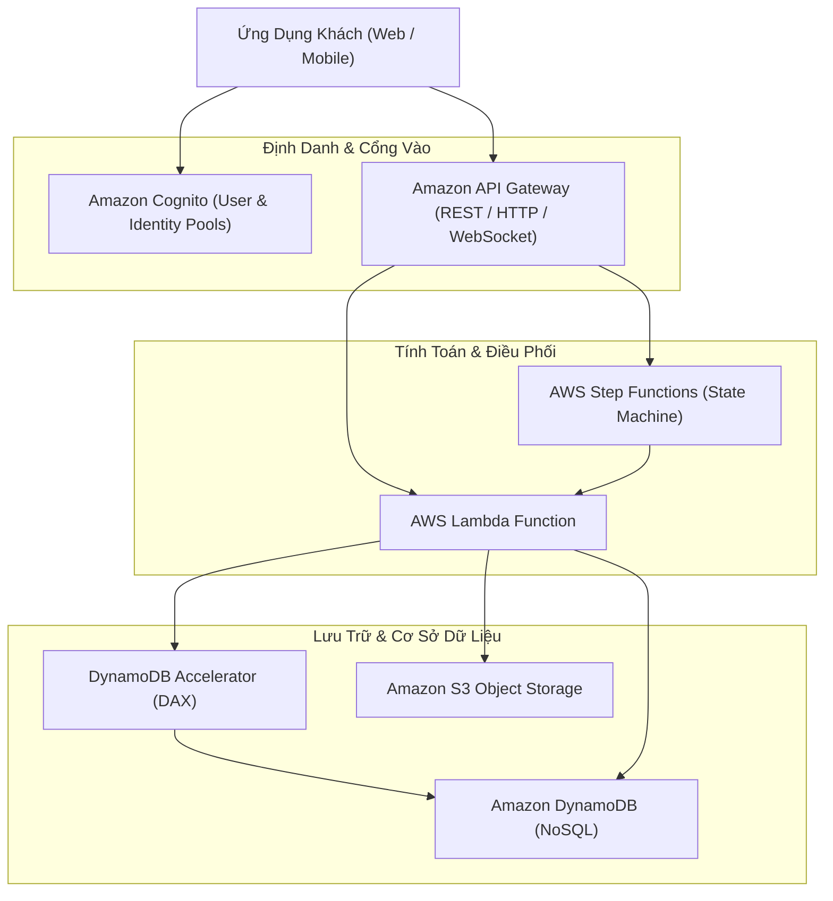

# Ghi Chú Bài Học: Chương 19 & 20 - Điện Toán Phi Máy Chủ & Kiến Trúc Giải Pháp Serverless (Serverless Solutions)

> **Khóa học**: Ultimate AWS Certified Solutions Architect Associate  
> **Chương**: 19 & 20 - Serverless Overviews & Solution Architectures (Bài 208 đến Bài 229)  
> **Tài liệu tham chiếu liên quan**: [AWS Service Document: AWS Lambda, API Gateway & DynamoDB](../AWS_Services/Lambda_Serverless_Architecture.md)

---

## 1. Tổng Quan Bài Học (Lesson Overview)

### Chủ đề chính
Cụm chương này trình bày bức tranh toàn cảnh và chuyên sâu về mô hình kiến trúc phi máy chủ (**Serverless Architecture**) trên AWS:
- Dịch vụ tính toán hướng sự kiện **AWS Lambda**:
  - Vòng đời môi trường thực thi (**Execution Environment Lifecycle: Init, Invoke, Shutdown**).
  - Tối ưu hóa hiện tượng khởi động lạnh (**Cold Start**): **Provisioned Concurrency**, kỹ thuật tái sử dụng kết nối ngoài handler, và **Lambda SnapStart**.
  - Kết nối mạng nội bộ **Lambda in VPC** thông qua hạ tầng mạng ảo hóa **AWS Hyperplane**.
  - Các giới hạn cốt lõi: thời gian chạy tối đa 15 phút, bộ nhớ RAM 128 MB đến 10 GB, dung lượng ổ đĩa tạm `/tmp` lên tới 10 GB.
- Cơ sở dữ liệu NoSQL hiệu năng cao **Amazon DynamoDB**:
  - Mô hình dữ liệu khóa-giá trị và tài liệu, cấu trúc khóa chính (**Partition Key & Sort Key**).
  - Cơ chế băm phân vùng và thuật toán tính toán năng lực đọc/ghi (**RCU & WCU**).
  - Tăng tốc truy xuất với **DynamoDB Accelerator (DAX)** (độ trễ microsecond), phát hiện thay đổi qua **DynamoDB Streams**, và đồng bộ đa vùng **Global Tables (Active-Active)**.
- Cổng quản lý giao diện lập trình **Amazon API Gateway**:
  - So sánh chuyên sâu giữa **HTTP APIs** (nhẹ, rẻ, độ trễ thấp) và **REST APIs** (đầy đủ tính năng: Caching, WAF, Usage Plans).
  - Cơ chế kiểm soát lưu lượng (**Throttling: Token Bucket Algorithm**).
- Dịch vụ điều phối luồng trạng thái **AWS Step Functions** (Standard vs Express Workflows).
- Quản lý định danh người dùng **Amazon Cognito**: Phân định **Cognito User Pools (Authentication)** và **Cognito Identity Pools (Authorization)**.
- Các mẫu thiết kế kiến trúc chuẩn mực: Ứng dụng di động Serverless (MyTodoList), Trang web Serverless (MyBlog), và Microservices hướng sự kiện.

### Mục tiêu học tập
1. Hiểu sâu bản chất vòng đời thực thi của AWS Lambda và loại bỏ hiện tượng Cold Start trong môi trường sản xuất.
2. Nắm vững công thức tính toán đơn vị dung lượng **RCU** và **WCU** của Amazon DynamoDB.
3. Thiết kế bảng DynamoDB chống hiện tượng phân vùng nóng (**Hot Partition**) bằng kỹ thuật Write Sharding.
4. Phân biệt được sự khác nhau giữa Cognito User Pools (cấp JWT) và Cognito Identity Pools (cấp AWS STS temporary credentials).
5. Kết hợp API Gateway, Lambda, DynamoDB, Cognito và S3 thành một hệ thống Serverless hoàn chỉnh có khả năng phục vụ hàng triệu người dùng.

---

## 2. Điểm Cốt Lõi Cần Nhớ (Key Takeaways)

1. **Giới Hạn Cứng Của AWS Lambda (Hard Limits)**:
   - Thời gian thực thi tối đa (Timeout): **15 phút (900 giây)**.
   - Dung lượng bộ nhớ RAM: Từ **128 MB đến 10,240 MB (10 GB)**. CPU được cấp phát tỷ lệ thuận theo dung lượng RAM (ở mức 1,769 MB RAM, Lambda nhận đủ 1 full vCPU).
   - Kích thước payload: **6 MB** đối với lời gọi đồng bộ (Synchronous) và **256 KB** đối với bất đồng bộ (Asynchronous).
2. **Cold Start & Tối Ưu Hóa**:
   - Khởi tạo kết nối Database, AWS SDK Clients, và nạp thư viện **ở bên ngoài khối hàm xử lý (outside the handler)** để tái sử dụng giữa các lần gọi (Warm Invocations).
   - Sử dụng **Provisioned Concurrency** để tạo sẵn các execution environments ấm (warm environments), triệt tiêu hoàn toàn Cold Start cho các hệ thống thanh toán khắt khe về SLA.
   - Sử dụng **Lambda SnapStart** (dành cho Java) để chụp bản sao bộ nhớ microVM và khôi phục trong vòng vài chục mili-giây.
3. **Lambda Trong VPC (Under the Hood)**: Sử dụng card mạng ảo chia sẻ được quản lý bởi **AWS Hyperplane**. Để Lambda trong VPC vừa gọi được database nội bộ vừa gọi được các dịch vụ Internet công cộng, bắt buộc phải đặt Lambda vào **Private Subnet có bảng định tuyến trỏ ra NAT Gateway** ở Public Subnet.
4. **DynamoDB RCU & WCU (Công Thức Sống Còn)**:
   - **1 WCU (Write Capacity Unit)**: Cho phép ghi 1 item có kích thước tối đa **1 KB** mỗi giây.
   - **1 RCU (Read Capacity Unit)**: Cho phép thực hiện **1 phép đọc Nhất Quán Mạnh (Strongly Consistent Read)** hoặc **2 phép đọc Nhất Quán Cuối Cùng (Eventually Consistent Reads)** cho 1 item có kích thước tối đa **4 KB** mỗi giây.
5. **DynamoDB DAX (DynamoDB Accelerator)**: Cụm bộ nhớ đệm in-memory chuyên dụng cho DynamoDB, giúp giảm độ trễ đọc từ mili-giây xuống **microsecond**; không yêu cầu viết lại logic mã nguồn ứng dụng (tương thích API DynamoDB).
6. **Cognito User Pools vs Identity Pools**:
   - *User Pools*: Cơ sở dữ liệu người dùng (Đăng ký, Đăng nhập, Quên mật khẩu, MFA, Social Login); trả về **mã thông báo định danh JWT (ID, Access, Refresh Tokens)**.
   - *Identity Pools*: Đổi mã xác thực của bên thứ ba hoặc Cognito User Pool lấy **Temporary AWS Credentials (IAM Role qua STS)**, cho phép client truy cập trực tiếp các tài nguyên AWS (như upload ảnh thẳng lên S3).

---

## 3. Kiến Trúc & Cơ Chế Hoạt Động Chuyên Sâu (Under-the-Hood Mechanisms & Deep Dive)

### 3.1. Vòng Đời Môi Trường Thực Thi AWS Lambda (Execution Lifecycle & Cold Start)



---

### 3.2. Cơ Chế Băm Phân Vùng Của Amazon DynamoDB (Partition Hash Ring)



- **Quy tắc phân vùng**: DynamoDB tự động cấp thêm một phân vùng mới khi: (1) Tổng dung lượng dữ liệu của bảng tăng thêm 10 GB; hoặc (2) Tổng thông lượng yêu cầu của bảng vượt quá 1,000 WCU hoặc 3,000 RCU.  
- **Hiện tượng Hot Partition**: Nếu tất cả các truy vấn đều dồn vào cùng một giá trị Partition Key (ví dụ: người nổi tiếng có hàng triệu lượt đọc), phân vùng chứa khóa đó sẽ bị quá tải vượt quá 3,000 RCU, gây ra lỗi `ProvisionedThroughputExceededException` ngay cả khi tổng RCU của toàn bảng vẫn còn dư.

---

### 3.3. Kiến Trúc Ứng Dụng Serverless End-to-End Chuẩn Mực

```mermaid
flowchart LR
    ClientApp["Người Dùng Di Động / Web SPA"]

    subgraph AuthLayer["Tầng Xác Thực & Phân Quyền"]
        CognitoUP["Cognito User Pool\n(Đăng nhập / Cấp JWT)"]
        CognitoIP["Cognito Identity Pool\n(Đổi JWT lấy STS Credentials)"]
    end

    subgraph APILayer["Tầng Giao Diện Lập Trình"]
        APIGW["Amazon API Gateway\n- Cognito Authorizer\n- Throttling (Rate/Burst)"]
    end

    subgraph ComputeLayer["Tầng Tính Toán Hướng Sự Kiện"]
        Lambda["AWS Lambda\n(Khởi tạo DB Pool ngoài handler)"]
    end

    subgraph DataStorage["Tầng Lưu Trữ & Bộ Nhớ Đệm"]
        DAX["Amazon DynamoDB DAX"]
        DDB["Amazon DynamoDB (Multi-AZ)"]
        S3["Amazon S3 Bucket (Media Uploads)"]
    end

    ClientApp -->|1. Đăng nhập| CognitoUP
    CognitoUP -->>|2. Trả JWT ID Token| ClientApp
    
    ClientApp -->|3. Đổi JWT lấy STS| CognitoIP
    CognitoIP -->>|4. Trả Temporary IAM Creds| ClientApp
    ClientApp ==>|5. Upload ảnh trực tiếp bằng STS| S3

    ClientApp -->|6. Gọi REST API kèm JWT Token| APIGW
    APIGW -->|7. Kích hoạt| Lambda
    Lambda -->|8. Đọc cache microsecond| DAX
    DAX -.->|Cache Miss| DDB
    Lambda -->|9. Ghi đơn hàng| DDB
```

---

## 4. Lệnh, Cấu Hình & Mã Nguồn Thực Tế (Commands, Config & Code)

### 4.1. Mã Nguồn Hàm AWS Lambda Chuẩn Mực (Tối Ưu Warm Start)

```python
import json
import os
import boto3

# 1. KHOI TAO CLIENT BEN NGOAI HANDLER (CHAY 1 LAN TRONG GIAI DOAN INIT)
# Giup tai su dung TCP connection va SSL session tren nhieu lan goi ham
dynamodb = boto3.resource('dynamodb')
TABLE_NAME = os.environ.get('TABLE_NAME', 'ProductionOrders')
table = dynamodb.Table(TABLE_NAME)

def lambda_handler(event, context):
    """
    Giai doan Invoke: Ham nay se duoc goi moi khi co request den
    """
    try:
        # Trich xuat thong tin nguoi dung tu Cognito Authorizer Context
        claims = event.get('requestContext', {}).get('authorizer', {}).get('claims', {})
        user_id = claims.get('sub', 'anonymous')
        
        body = json.loads(event.get('body', '{}'))
        order_id = body.get('order_id')
        amount = body.get('amount')
        
        # Ghi du lieu vao DynamoDB
        table.put_item(
            Item={
                'user_id': user_id,
                'order_id': order_id,
                'amount': amount,
                'status': 'PENDING'
            }
        )
        
        return {
            'statusCode': 201,
            'headers': {
                'Content-Type': 'application/json',
                'Access-Control-Allow-Origin': '*'
            },
            'body': json.dumps({'message': 'Don hang da duoc tiep nhan thanh cong!', 'order_id': order_id})
        }
    except Exception as e:
        print(f"[ERROR] Xu ly don hang that bai: {str(e)}")
        return {
            'statusCode': 500,
            'body': json.dumps({'error': 'Loi he thong noi bo'})
        }
```

---

### 4.2. Khởi Tạo Bảng DynamoDB Bằng AWS CLI v2

```bash
# Tao bang Orders voi Partition Key la user_id va Sort Key la order_id
aws dynamodb create-table \
    --table-name ProductionOrders \
    --attribute-definitions \
        AttributeName=user_id,AttributeType=S \
        AttributeName=order_id,AttributeType=S \
        AttributeName=status,AttributeType=S \
    --key-schema \
        AttributeName=user_id,KeyType=HASH \
        AttributeName=order_id,KeyType=RANGE \
    --billing-mode PROVISIONED \
    --provisioned-throughput ReadCapacityUnits=5,WriteCapacityUnits=5 \
    --global-secondary-indexes '[{
        "IndexName": "StatusIndex",
        "KeySchema": [
            {"AttributeName": "status", "KeyType": "HASH"},
            {"AttributeName": "order_id", "KeyType": "RANGE"}
        ],
        "Projection": {"ProjectionType": "ALL"},
        "ProvisionedThroughput": {"ReadCapacityUnits": 5, "WriteCapacityUnits": 5}
    }]' \
    --region ap-southeast-1
```

---

## 5. Tình Huống Thực Tiễn & Mẫu Kiến Trúc (Real-World Scenarios & Design Patterns)

### Tình huống 1: Giải Quyết Hiện Tượng Bị Nghẽn Bảng DynamoDB (Hot Partition Mitigation)
- **Bài toán**: Ứng dụng bình chọn trực tiếp trên truyền hình nhận 50,000 lượt bình chọn/giây. Tất cả các bản ghi đều ghi vào Partition Key là `CandidateID = 01`. Phân vùng chứa ứng viên số 01 bị nghẽn nghiêm trọng, liên tục trả về lỗi `ProvisionedThroughputExceededException`.
- **Giải pháp kỹ thuật (Write Sharding)**:
  - Thêm một hậu tố ngẫu nhiên (hoặc có tính toán) vào Partition Key khi ghi:
    `PartitionKey = CandidateID + "_" + random(1, 10)` (tạo thành 10 khóa logic: `01_1`, `01_2`, ..., `01_10`).
  - Dữ liệu ghi được phân tán đều sang 10 phân vùng vật lý khác nhau của DynamoDB, nhân gấp 10 lần khả năng ghi đồng thời.
  - Khi cần tính tổng số phiếu, ứng dụng chỉ cần thực hiện 10 phép đọc song song cho 10 sharded keys và cộng dồn lại.

### Tình huống 2: Tải Tệp Tin Khối Lượng Lớn Trực Tiếp Lên S3 Không Nghẽn API Gateway
- **Bài toán**: Người dùng ứng dụng di động tải lên các video dài 2 GB. Nếu truyền qua API Gateway và Lambda, ứng dụng sẽ bị lỗi ngay lập tức vì API Gateway giới hạn kích thước payload tối đa là 10 MB và Lambda có giới hạn 6 MB.
- **Giải pháp**:
  - Ứng dụng gửi một request siêu nhẹ (chỉ chứa tên file và metadata) tới API Gateway / Lambda để xin cấp **S3 Pre-signed URL**.
  - Hàm Lambda tạo một Pre-signed URL có thời hạn 15 phút và trả về cho ứng dụng di động.
  - Ứng dụng di động sử dụng URL đó để tải trực tiếp video 2 GB lên Amazon S3 qua giao thức HTTP `PUT` bằng **S3 Multipart Upload**, hoàn toàn bỏ qua API Gateway và Lambda, tiết kiệm chi phí và triệt tiêu giới hạn payload.

---

## 6. Mối Quan Hệ Giữa Các Khái Niệm / Dịch Vụ (Service Relationships & Ecosystem)



---

## 7. Câu Hỏi Ôn Tập, Bẫy Thi & Tự Đánh Giá (Review, Exam Traps & Self-Assessment)

### Câu hỏi:
1. Bạn đang xây dựng một ứng dụng xử lý tài liệu bảng lương phức tạp. Một số tài liệu cần tới 22 phút để phân tích hoàn tất. Bạn có thể sử dụng một hàm AWS Lambda đơn lẻ để thực hiện tác vụ này không? Vì sao, và đâu là giải pháp kiến trúc thay thế phù hợp nhất?
2. Bạn cấu hình một hàm AWS Lambda gắn vào một Private Subnet của VPC để kết nối an toàn với cơ sở dữ liệu Amazon RDS nội bộ. Tuy nhiên, hàm Lambda này cũng cần gọi một API thanh toán của bên thứ ba trên Internet công cộng nhưng liên tục bị lỗi `Task timed out`. Nguyên nhân sâu xa là gì và giải pháp khắc phục chuẩn xác?
3. Tính toán số lượng RCU cần thiết: Ứng dụng cần đọc 10 items mỗi giây từ bảng DynamoDB. Mỗi item có kích thước là 6 KB và ứng dụng yêu cầu chế độ **Đọc Nhất Quán Mạnh (Strongly Consistent Read)**. Bạn cần cấp phát bao nhiêu RCU?
4. Đâu là sự khác biệt cơ bản về tính năng và chi phí giữa **Amazon API Gateway HTTP APIs** và **REST APIs**?
5. Sự khác biệt cốt lõi về bản chất giữa **Amazon Cognito User Pools** và **Amazon Cognito Identity Pools** là gì?
6. Cơ chế hoạt động của **Lambda SnapStart** là gì và nó giúp giải quyết triệt để vấn đề gì đối với các ứng dụng viết bằng Java?

---

### Đáp án & Giải thích chi tiết:

<details>
<summary>👉 Nhấp vào đây để xem đáp án và phân tích chi tiết</summary>

1. **KHÔNG THỂ**. Vì giới hạn thời gian thực thi tối đa (Execution Timeout) cứng của AWS Lambda là **15 phút (900 giây)** và không thể tăng thêm. Các giải pháp thay thế chuẩn mực:
   - Chia nhỏ quy trình phân tích thành nhiều bước ngắn hơn và sử dụng **AWS Step Functions** để điều phối chuỗi các hàm Lambda.
   - Chuyển tác vụ tính toán nặng sang chạy dưới dạng container trên **AWS Fargate** hoặc tác vụ xử lý theo lô với **AWS Batch**.
2. **Nguyên nhân**: Khi Lambda được gắn vào VPC, AWS vô hiệu hóa quyền truy cập Internet công cộng trực tiếp của hàm; máy ảo Lambda lúc này phụ thuộc hoàn toàn vào cấu trúc mạng của Subnet nó trực thuộc. Vì hàm nằm trong Private Subnet không có Internet Gateway trực tiếp, các gói tin gửi ra ngoài Internet bị rơi vào khoảng không (Blackhole) dẫn tới timeout.  
   **Cách khắc phục**: Cấu hình bảng định tuyến (Route Table) của Private Subnet chứa Lambda có một tuyến đường định tuyến mặc định: `0.0.0.0/0` trỏ tới một **NAT Gateway** đặt tại một Public Subnet (Public Subnet này có định tuyến trỏ ra Internet Gateway).
3. **Công thức tính RCU**:
   - Bước 1: Làm tròn kích thước item lên bội số của 4 KB: 6 KB được làm tròn lên **8 KB**.
   - Bước 2: Tính RCU cho 1 item với Strongly Consistent Read: $8 \text{ KB} / 4 \text{ KB} = 2 \text{ RCU/item}$.
   - Bước 3: Tính cho 10 items/giây: $10 \times 2 = \mathbf{20 \text{ RCU}}$.  
   *(Lưu ý: Nếu đề bài hỏi Eventually Consistent Reads, số RCU sẽ được chia đôi: $20 / 2 = 10 \text{ RCU}$)*.
4. So sánh:
   - **HTTP APIs**: Được thiết kế tối ưu thế hệ mới; chi phí rẻ hơn tới 71% so với REST APIs; độ trễ thấp hơn; nhưng chỉ hỗ trợ các tính năng cơ bản (CORS, OIDC, JWT Authorizers).
   - **REST APIs**: Đầy đủ tính năng doanh nghiệp phức tạp: API Caching, Request/Response Payload Transformation (VTL), Request Validation, Quản lý gói cước (Usage Plans & API Keys), Tích hợp AWS WAF, và hỗ trợ triển khai Private Endpoints trong VPC.
5. So sánh:
   - **Cognito User Pools (Authentication)**: Đóng vai trò là Identity Provider (IdP) quản lý danh bạ tài khoản người dùng; xử lý đăng ký, đăng nhập, cấp lại mật khẩu, MFA; trả về **JWT Tokens (ID Token, Access Token)** để xác thực với API Gateway hoặc Backend.
   - **Cognito Identity Pools (Authorization)**: Cung cấp danh tính liên kết (Federated Identities); tiếp nhận JWT token từ User Pools (hoặc Google, Facebook, Apple) và đổi lấy **Thông tin xác thực AWS tạm thời (Temporary AWS Credentials qua AWS STS)**, gán trực tiếp một IAM Role cho client để truy cập các dịch vụ AWS như S3, DynamoDB.
6. **Lambda SnapStart**: Thay vì khởi động lại toàn bộ Java Virtual Machine (JVM), nạp hàng trăm file class và framework Spring/Micronaut từ đầu trong giai đoạn Init mỗi khi xảy ra Cold Start (mất tới 5-10 giây), Lambda SnapStart khởi tạo môi trường một lần duy nhất lúc bạn publish phiên bản hàm, chụp lại **bản sao bộ nhớ (Snapshot)** của microVM đã được nạp sẵn và lưu vào bộ nhớ cache phân tán. Khi có lời gọi hàm mới, AWS chỉ cần khôi phục lại bản sao snapshot đó trong vòng **chưa đầy 200 mili-giây**, giúp triệt tiêu hoàn toàn nỗi lo Cold Start đối với các ứng dụng Java.
</details>

---

## 8. Nguồn Trích Dẫn Bài Giảng & Tài Liệu Liên Quan (Source References)

- **Source Transcripts**:
  - [209 - Serverless Introduction.md](../AWS_Resources/19%20-%20Serverless%20Overviews%20from%20a%20So/209%20-%20Serverless%20Introduction.md)
  - [210 - Lambda Overview.md](../AWS_Resources/19%20-%20Serverless%20Overviews%20from%20a%20So/210%20-%20Lambda%20Overview.md)
  - [212 - Lambda Limits.md](../AWS_Resources/19%20-%20Serverless%20Overviews%20from%20a%20So/212%20-%20Lambda%20Limits.md)
  - [213 - Lambda Concurrency.md](../AWS_Resources/19%20-%20Serverless%20Overviews%20from%20a%20So/213%20-%20Lambda%20Concurrency.md)
  - [215 - Lambda SnapStart.md](../AWS_Resources/19%20-%20Serverless%20Overviews%20from%20a%20So/215%20-%20Lambda%20SnapStart.md)
  - [217 - Lambda in VPC.md](../AWS_Resources/19%20-%20Serverless%20Overviews%20from%20a%20So/217%20-%20Lambda%20in%20VPC.md)
  - [219 - Amazon DynamoDB.md](../AWS_Resources/19%20-%20Serverless%20Overviews%20from%20a%20So/219%20-%20Amazon%20DynamoDB.md)
  - [221 - Amazon DynamoDB - Advanced Features.md](../AWS_Resources/19%20-%20Serverless%20Overviews%20from%20a%20So/221%20-%20Amazon%20DynamoDB%20-%20Advanced%20Features.md)
  - [222 - API Gateway Overview.md](../AWS_Resources/19%20-%20Serverless%20Overviews%20from%20a%20So/222%20-%20API%20Gateway%20Overview.md)
  - [224 - Step Functions.md](../AWS_Resources/19%20-%20Serverless%20Overviews%20from%20a%20So/224%20-%20Step%20Functions.md)
  - [225 - Amazon Cognito Overview.md](../AWS_Resources/19%20-%20Serverless%20Overviews%20from%20a%20So/225%20-%20Amazon%20Cognito%20Overview.md)
  - [226 - Mobile Application_ MyTodoList.md](../AWS_Resources/20%20-%20Serverless%20Solution%20Architectu/226%20-%20Mobile%20Application_%20MyTodoList.md)
  - [227 - Serverless Website_ MyBlog.com.md](../AWS_Resources/20%20-%20Serverless%20Solution%20Architectu/227%20-%20Serverless%20Website_%20MyBlog.com.md)
- **Tài liệu chuyên sâu liên quan**:
  - [Chuyên đề Master: AWS Lambda & Kiến Trúc Serverless](../AWS_Services/Lambda_Serverless_Architecture.md)
  - [Chuyên đề Master: Amazon DynamoDB & Cơ Sở Dữ Liệu NoSQL](../AWS_Services/DynamoDB_NoSQL_Databases.md)
  - [Chuyên đề Master: API Gateway, Cognito & Step Functions](../AWS_Services/APIGateway_Cognito_StepFunctions.md)
